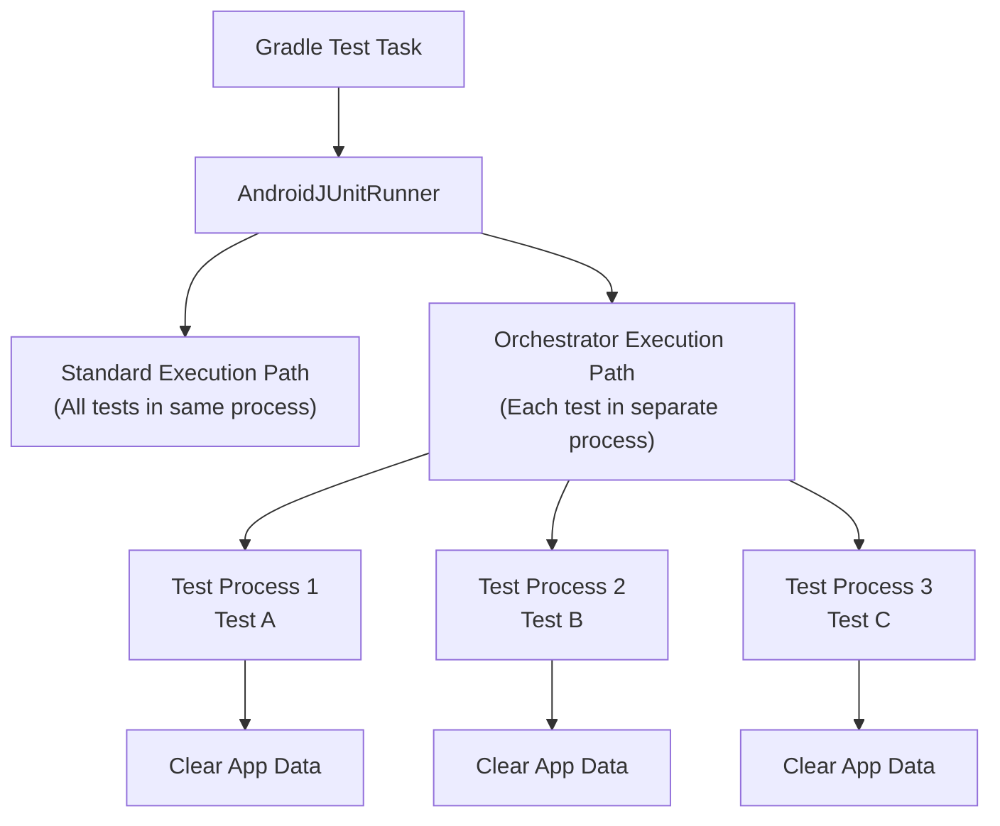
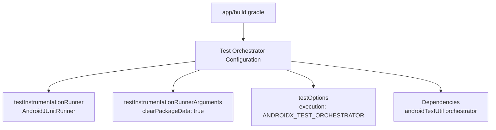
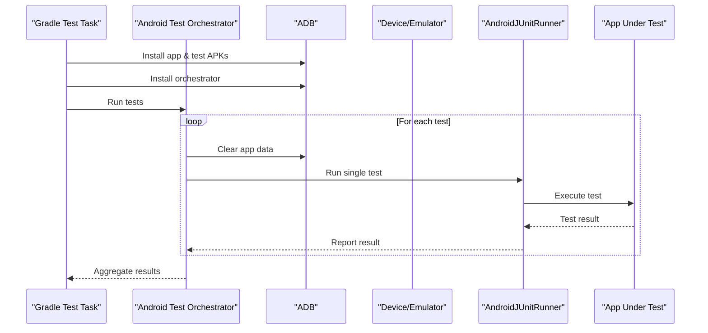
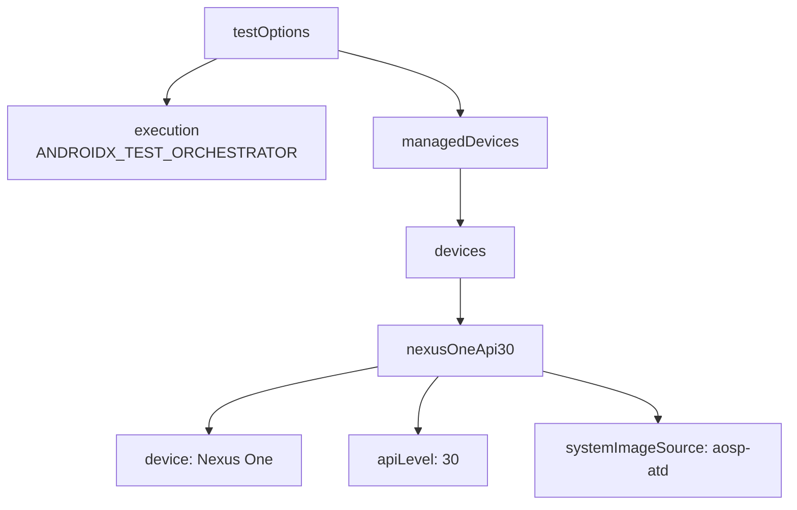
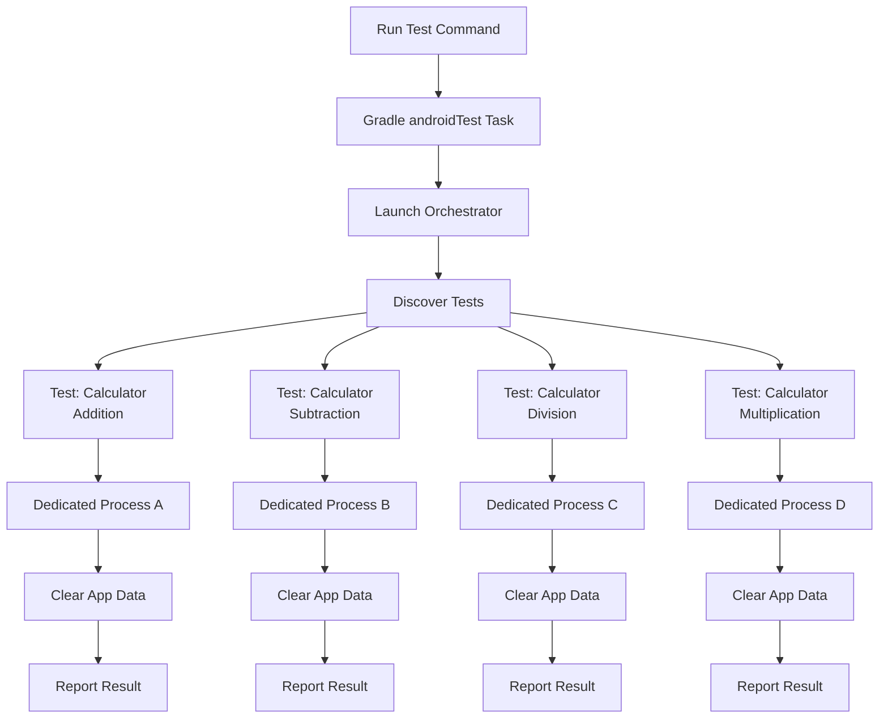
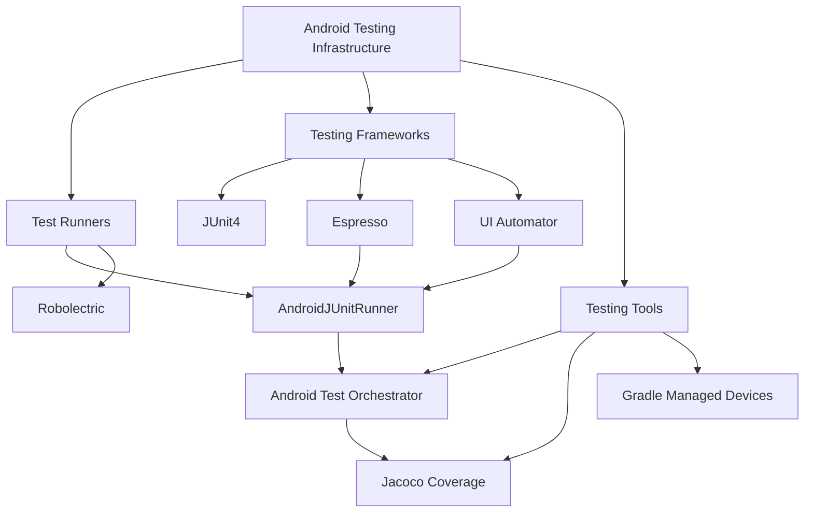

<!-- source: DeepWiki mcp.deepwiki.com · repo android/testing-samples · page 5.2 Android Test Orchestrator · fetched 2026-10-23 -->

# Android Test Orchestrator

<details>
<summary>Relevant source files</summary>

The following files were used as context for generating this wiki page:

- [runner/AndroidTestOrchestratorSample/.gitignore](runner/AndroidTestOrchestratorSample/.gitignore)
- [runner/AndroidTestOrchestratorSample/README.md](runner/AndroidTestOrchestratorSample/README.md)
- [runner/AndroidTestOrchestratorSample/app/build.gradle](runner/AndroidTestOrchestratorSample/app/build.gradle)
- [runner/AndroidTestOrchestratorSample/app/src/androidTest/java/com/example/android/testing/androidtestorchestratorsample/CalculatorAddParameterizedTest.java](runner/AndroidTestOrchestratorSample/app/src/androidTest/java/com/example/android/testing/androidtestorchestratorsample/CalculatorAddParameterizedTest.java)
- [runner/AndroidTestOrchestratorSample/app/src/androidTest/java/com/example/android/testing/androidtestorchestratorsample/CalculatorInstrumentationTest.java](runner/AndroidTestOrchestratorSample/app/src/androidTest/java/com/example/android/testing/androidtestorchestratorsample/CalculatorInstrumentationTest.java)
- [runner/AndroidTestOrchestratorSample/app/src/main/java/com/example/android/testing/androidtestorchestratorsample/Calculator.java](runner/AndroidTestOrchestratorSample/app/src/main/java/com/example/android/testing/androidtestorchestratorsample/Calculator.java)
- [runner/AndroidTestOrchestratorSample/app/src/main/java/com/example/android/testing/androidtestorchestratorsample/CalculatorActivity.java](runner/AndroidTestOrchestratorSample/app/src/main/java/com/example/android/testing/androidtestorchestratorsample/CalculatorActivity.java)
- [runner/AndroidTestOrchestratorSample/app/src/main/res/layout/activity_calculator.xml](runner/AndroidTestOrchestratorSample/app/src/main/res/layout/activity_calculator.xml)
- [runner/AndroidTestOrchestratorSample/app/src/main/res/values-v14/styles.xml](runner/AndroidTestOrchestratorSample/app/src/main/res/values-v14/styles.xml)
- [runner/AndroidTestOrchestratorSample/app/src/main/res/values-v21/styles.xml](runner/AndroidTestOrchestratorSample/app/src/main/res/values-v21/styles.xml)
- [runner/AndroidTestOrchestratorSample/app/src/main/res/values-w820dp/dimens.xml](runner/AndroidTestOrchestratorSample/app/src/main/res/values-w820dp/dimens.xml)
- [runner/AndroidTestOrchestratorSample/app/src/main/res/values/dimens.xml](runner/AndroidTestOrchestratorSample/app/src/main/res/values/dimens.xml)
- [runner/AndroidTestOrchestratorSample/app/src/main/res/values/strings.xml](runner/AndroidTestOrchestratorSample/app/src/main/res/values/strings.xml)
- [runner/AndroidTestOrchestratorSample/app/src/main/res/values/styles.xml](runner/AndroidTestOrchestratorSample/app/src/main/res/values/styles.xml)
- [runner/AndroidTestOrchestratorWithTestCoverageSample/app/build.gradle](runner/AndroidTestOrchestratorWithTestCoverageSample/app/build.gradle)
- [runner/AndroidTestOrchestratorWithTestCoverageSample/build.gradle](runner/AndroidTestOrchestratorWithTestCoverageSample/build.gradle)
- [ui/espresso/FragmentScenarioSample/app/build.gradle](ui/espresso/FragmentScenarioSample/app/build.gradle)

</details>


## Purpose and Scope

This document provides a technical overview of the Android Test Orchestrator system, explaining its purpose, configuration, and implementation within the Android Testing Samples repository. The Android Test Orchestrator enables running instrumentation tests in isolation, providing better test reliability and predictability. For information about general test runner usage, see [AndroidJUnitRunner](#5.1), and for test coverage configuration with the orchestrator, see [Test Coverage](#5.3).

## What is Android Test Orchestrator?

Android Test Orchestrator is a testing component that isolates each test by running it in a separate process. This isolation prevents state leakage between tests, reducing flaky tests and making test failures more deterministic.

### Key Benefits

- Runs each test in a separate process
- Clears app state between tests
- Provides more reliable test execution
- Prevents shared state contamination across tests
- Enables graceful handling of test crashes



Sources: [runner/AndroidTestOrchestratorSample/README.md](), [runner/AndroidTestOrchestratorSample/app/build.gradle:11-14]()

## Configuring Android Test Orchestrator

Enabling the Android Test Orchestrator requires specific configuration in your project's Gradle build files.

### Basic Configuration

The primary configuration is done in the app module's `build.gradle` file:



Sources: [runner/AndroidTestOrchestratorSample/app/build.gradle:12-25](), [runner/AndroidTestOrchestratorSample/app/build.gradle:54]()

### Required Configuration Elements

The following table details the necessary configuration elements to enable Android Test Orchestrator:

| Configuration Element | Value | Purpose |
|------------------------|--------|---------|
| `testInstrumentationRunner` | `androidx.test.runner.AndroidJUnitRunner` | Specifies the test runner to use |
| `testInstrumentationRunnerArguments` | `clearPackageData: "true"` | Instructs the orchestrator to clear app data between tests |
| `testOptions.execution` | `ANDROIDX_TEST_ORCHESTRATOR` | Configures Gradle to use the orchestrator for test execution |
| Dependency | `androidTestUtil "androidx.test:orchestrator:$version"` | Adds the orchestrator as a test utility dependency |

Sources: [runner/AndroidTestOrchestratorSample/app/build.gradle:12-14](), [runner/AndroidTestOrchestratorSample/app/build.gradle:24-25](), [runner/AndroidTestOrchestratorSample/app/build.gradle:54]()

### Example Configuration

Here's how the orchestrator is configured in the sample project:

```
defaultConfig {
    testInstrumentationRunner "androidx.test.runner.AndroidJUnitRunner"
    testInstrumentationRunnerArguments clearPackageData: "true"
}

testOptions {
    execution "ANDROIDX_TEST_ORCHESTRATOR"
}

dependencies {
    androidTestUtil "androidx.test:orchestrator:$orchestratorVersion"
}
```

Sources: [runner/AndroidTestOrchestratorSample/app/build.gradle:12-25](), [runner/AndroidTestOrchestratorSample/app/build.gradle:54]()

## Test Execution Flow

The Android Test Orchestrator changes the way instrumentation tests are executed on a device or emulator. This diagram illustrates the execution flow:



Sources: [runner/AndroidTestOrchestratorSample/app/build.gradle:12-14](), [runner/AndroidTestOrchestratorSample/app/build.gradle:24-25]()

## Integration with Managed Devices

Android Test Orchestrator can be used with the Gradle Managed Devices feature for automated testing on virtual devices:



Sources: [runner/AndroidTestOrchestratorSample/app/build.gradle:24-38]()

## Sample Tests and Orchestrator Usage

The Android Testing Samples repository includes example tests that demonstrate the use of the orchestrator.

### Test Types in the Sample

| Test Type | Example Class | Description |
|-----------|---------------|-------------|
| Parameterized Unit Tests | `CalculatorAddParameterizedTest` | Demonstrates parameterized testing for calculator functionality |
| UI Instrumentation Tests | `CalculatorInstrumentationTest` | Shows UI testing with Espresso, running in isolation via the orchestrator |

Sources: [runner/AndroidTestOrchestratorSample/app/src/androidTest/java/com/example/android/testing/androidtestorchestratorsample/CalculatorAddParameterizedTest.java](), [runner/AndroidTestOrchestratorSample/app/src/androidTest/java/com/example/android/testing/androidtestorchestratorsample/CalculatorInstrumentationTest.java]()

### Test Execution with Orchestrator

When a test is executed through the orchestrator, the process looks like this:



Sources: [runner/AndroidTestOrchestratorSample/app/src/androidTest/java/com/example/android/testing/androidtestorchestratorsample/CalculatorInstrumentationTest.java:64-94]()

## Orchestrator vs. Standard Test Runner

Understanding the differences between standard test execution and orchestrator-based execution helps explain the benefits:

| Feature | Standard AndroidJUnitRunner | With Android Test Orchestrator |
|---------|----------------------------|--------------------------------|
| Process isolation | All tests run in same process | Each test runs in separate process |
| State between tests | Shared application state | Fresh application state for each test |
| Test crashes | May terminate all subsequent tests | Only affects the current test |
| Performance | Faster (single process) | Slower (process per test) |
| Memory leaks | Can accumulate across tests | Cleared between tests |
| Reliability | May have interdependencies | More reliable, truly isolated tests |

Sources: [runner/AndroidTestOrchestratorSample/README.md]()

## Relationship with Other Testing Components

Android Test Orchestrator works in conjunction with other testing components in the Android ecosystem:



Sources: [runner/AndroidTestOrchestratorSample/app/build.gradle:48-54](), [runner/AndroidTestOrchestratorWithTestCoverageSample/app/build.gradle:33-39]()

## Advanced Usage: Test Coverage with Orchestrator

For information about configuring code coverage with Android Test Orchestrator, see the [Test Coverage](#5.3) page.

Sources: [runner/AndroidTestOrchestratorWithTestCoverageSample/app/build.gradle:14-18]()

## Conclusion

Android Test Orchestrator is a powerful tool for improving the reliability and predictability of Android instrumentation tests. By running each test in isolation and clearing application state between tests, it eliminates many common causes of flaky tests. While there is a performance cost to starting a new process for each test, the benefits in terms of test reliability typically outweigh this drawback for most testing scenarios.

---

