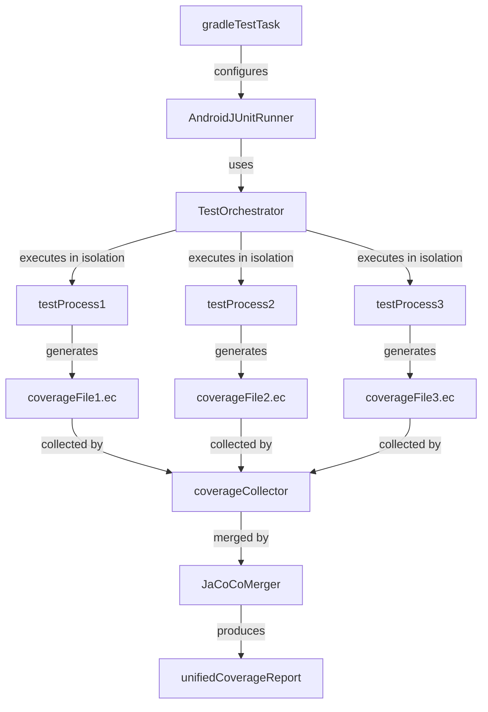
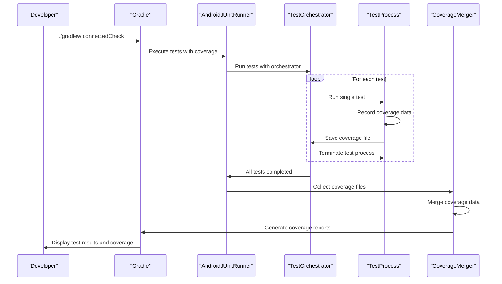
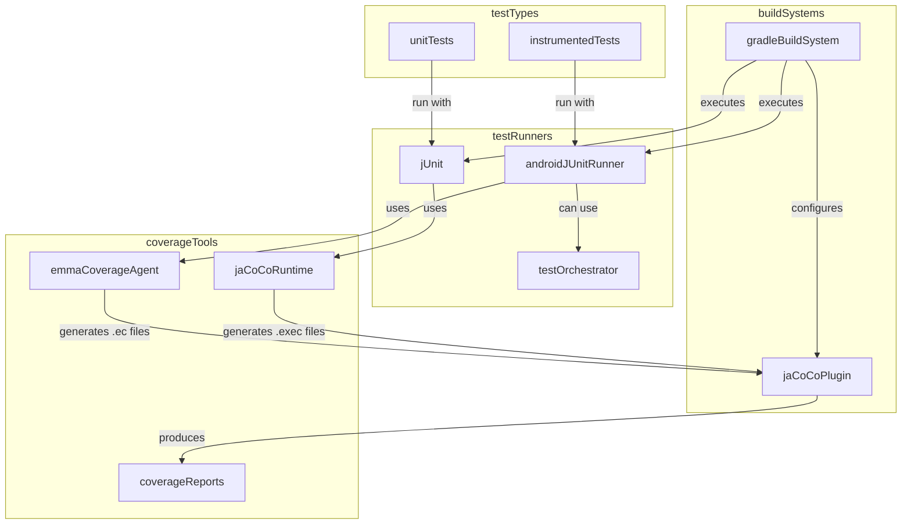

<!-- source: DeepWiki mcp.deepwiki.com · repo android/testing-samples · page 5.3 Test Coverage · fetched 2026-10-23 -->

# Test Coverage

<details>
<summary>Relevant source files</summary>

The following files were used as context for generating this wiki page:

- [runner/AndroidTestOrchestratorWithTestCoverageSample/gradle/wrapper/gradle-wrapper.jar](runner/AndroidTestOrchestratorWithTestCoverageSample/gradle/wrapper/gradle-wrapper.jar)
- [runner/AndroidTestOrchestratorWithTestCoverageSample/gradle/wrapper/gradle-wrapper.properties](runner/AndroidTestOrchestratorWithTestCoverageSample/gradle/wrapper/gradle-wrapper.properties)
- [runner/AndroidTestOrchestratorWithTestCoverageSample/gradlew](runner/AndroidTestOrchestratorWithTestCoverageSample/gradlew)
- [runner/AndroidTestOrchestratorWithTestCoverageSample/gradlew.bat](runner/AndroidTestOrchestratorWithTestCoverageSample/gradlew.bat)

</details>


This document explains how to configure and analyze code coverage for Android instrumentation tests when using Android Test Orchestrator. It focuses on the implementation shown in the AndroidTestOrchestratorWithTestCoverageSample project.

For information about Android Test Orchestrator without coverage analysis, see [Android Test Orchestrator](#5.2).

## What is Test Coverage?

Test coverage is a metric that measures what percentage of your application code is executed during tests. It helps:

- Identify untested or under-tested code paths
- Verify the effectiveness of your test suite
- Guide test development efforts
- Serve as a quality metric for code review and CI/CD pipelines

## The Challenge with Android Test Orchestrator

Android Test Orchestrator runs each test in a separate process for improved isolation and reliability. However, this creates challenges for collecting code coverage:

1. Traditional code coverage tools assume all tests run in a single process
2. Each isolated test process generates a separate coverage file
3. Coverage files must be preserved and merged to get a complete picture

## Test Coverage Collection Architecture

The following diagram illustrates how test coverage is collected when using Android Test Orchestrator:



Sources: None (general architecture diagram)

## Configuring Test Coverage with Orchestrator

To enable test coverage with Android Test Orchestrator, you need to configure your build.gradle file with specific settings for both coverage collection and orchestration.

### Gradle Configuration

Key elements in your app's build.gradle file include:

```
android {
    defaultConfig {
        testInstrumentationRunner "androidx.test.runner.AndroidJUnitRunner"
        testInstrumentationRunnerArguments clearPackageData: 'true'
    }
    
    testOptions {
        execution 'ANDROIDX_TEST_ORCHESTRATOR'
        
        // Enable coverage collection
        animationsDisabled true
        
        // Configure coverage settings
        coverageOptions {
            jacocoVersion = '0.8.7'
            enabled true
            includeNoLocationClasses true
            excludes = ['**/view/**', '**/R.class', '**/R$*.class', '**/BuildConfig.*']
        }
    }
}

dependencies {
    androidTestUtil 'androidx.test:orchestrator:x.y.z'
    androidTestImplementation 'androidx.test:runner:x.y.z'
    androidTestImplementation 'androidx.test:rules:x.y.z'
    // Other dependencies...
}
```

Sources: None (general configuration example)

## Coverage Collection Workflow

This sequence diagram shows the process of collecting coverage with Test Orchestrator:



Sources: None (workflow illustration)

## Running Tests with Coverage

To execute tests with coverage enabled:

1. Use the Gradle wrapper included in the sample:

```
cd AndroidTestOrchestratorWithTestCoverageSample
./gradlew connectedDebugAndroidTest
```

2. Or use the specific task for coverage:

```
./gradlew createDebugCoverageReport
```

Sources: `runner/AndroidTestOrchestratorWithTestCoverageSample/gradlew`

## Coverage Reports Analysis

After running tests with coverage enabled, reports are generated in the following locations:

```
app/build/reports/coverage/androidTest/debug/       # For HTML reports
app/build/outputs/code_coverage/                    # For raw coverage data
```

### Understanding Coverage Reports

The HTML report provides:
- Overall percentage of code coverage
- Package-level breakdown
- Class and method coverage metrics
- Line-by-line highlighting showing which code was executed

### Coverage Report Structure

| Report Element | Description |
|----------------|-------------|
| Package summary | Coverage by package |
| Class breakdown | Coverage by class |
| Method details | Coverage by method |
| Line coverage | Executed vs. non-executed lines |
| Branch coverage | Coverage of conditional branches |

## Test Coverage in the Android Testing Framework

Coverage analysis integrates with the broader Android testing architecture:



Sources: None (architecture integration diagram)

## Best Practices for Test Coverage

When implementing test coverage with Android Test Orchestrator:

1. **Focus on quality over quantity**: High coverage doesn't guarantee good tests
2. **Configure include/exclude patterns**: Measure coverage on your code, not external libraries
3. **Set reasonable thresholds**: Consider establishing minimum coverage requirements
4. **Integrate with CI**: Add coverage checks to your continuous integration pipeline

## Common Issues and Solutions

| Issue | Solution |
|-------|----------|
| Missing coverage data | Ensure coverage is enabled in both build configuration and test runner arguments |
| Empty coverage reports | Check that the correct source directories are configured |
| Incomplete coverage data | Verify the orchestrator is preserving coverage files between test runs |
| JaCoCo version conflicts | Specify the JaCoCo version explicitly in your build.gradle file |
| Out of memory errors | Increase Gradle memory: `org.gradle.jvmargs=-Xmx2048m` in gradle.properties |

## Conclusion

Test coverage with Android Test Orchestrator requires specific configuration to handle the process isolation model. The AndroidTestOrchestratorWithTestCoverageSample project demonstrates how to collect comprehensive coverage data while maintaining the benefits of test isolation.

For more information about other test runner features, see [AndroidJUnitRunner](#5.1).

---

