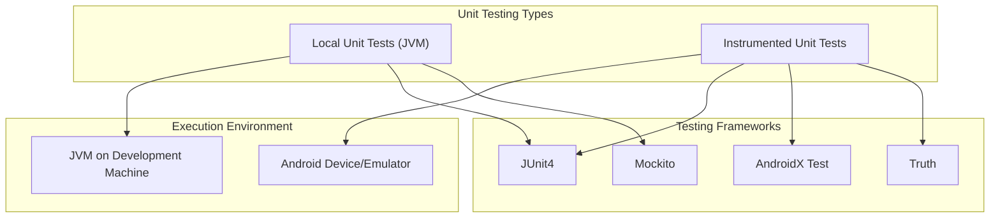
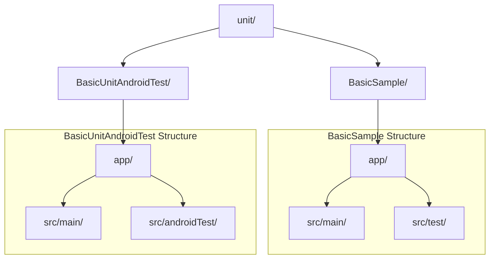
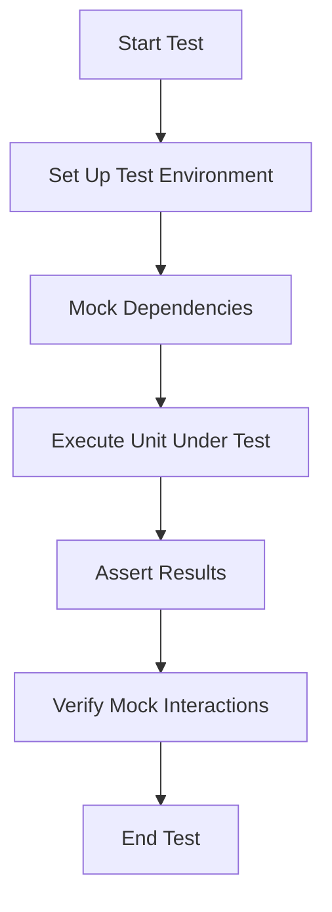
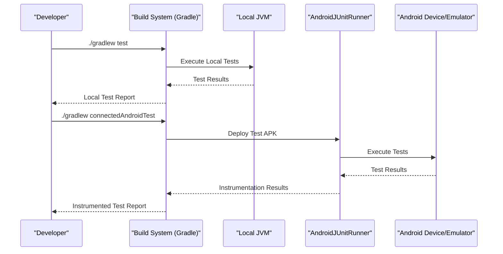

<!-- source: DeepWiki mcp.deepwiki.com · repo android/testing-samples · page 6 Unit Testing · fetched 2026-10-23 -->

# Unit Testing

<details>
<summary>Relevant source files</summary>

The following files were used as context for generating this wiki page:

- [README.md](README.md)
- [ui/espresso/MultiProcessSample/README.md](ui/espresso/MultiProcessSample/README.md)
- [unit/BasicSample/app/build.gradle](unit/BasicSample/app/build.gradle)
- [unit/BasicUnitAndroidTest/app/build.gradle](unit/BasicUnitAndroidTest/app/build.gradle)

</details>


## Purpose and Scope

This document provides an overview of unit testing approaches found in the Android Testing Samples repository. It covers local JVM-based unit tests and Android instrumented unit tests demonstrated in the sample projects. For integration testing approaches, see [Integration Testing](#7).

## Unit Testing in Android

Unit testing is a fundamental level of testing that focuses on verifying the functionality of individual code components in isolation. In Android development, unit tests can be categorized into two main types:

1. **Local Unit Tests** - Tests that run on the JVM without Android framework dependencies
2. **Instrumented Unit Tests** - Tests that run on Android devices or emulators



Sources: [README.md:61-63](), [unit/BasicSample/app/build.gradle:34-36](), [unit/BasicUnitAndroidTest/app/build.gradle:19-23]()

## Project Structure

The unit testing samples in the repository are organized in the `unit` directory, which contains examples for both local and instrumented unit tests:



Sources: [README.md:62-63]()

## Local Unit Tests

Local unit tests are Java/Kotlin tests that run on the local JVM, not on an Android device or emulator. They are faster than instrumented tests because they don't require device startup or app installation.

### Key Characteristics

- Reside in the `src/test/java` directory
- Execute on the local development machine's JVM
- Cannot access Android framework classes directly (require mocking)
- Fast execution, suitable for rapid feedback during development

### Sample Project: BasicSample

The BasicSample project demonstrates how to write local unit tests for Android applications. It uses JUnit 4 for test assertions and Mockito for mocking dependencies.

### Dependencies

The sample project includes the following testing dependencies:

```
dependencies {
    // Unit testing dependencies.
    testImplementation "junit:junit:" + rootProject.junitVersion;
    testImplementation "org.mockito:mockito-core:" + rootProject.mockitoVersion;
}
```

Sources: [unit/BasicSample/app/build.gradle:34-36]()

### Testing Flow



Sources: [unit/BasicSample/app/build.gradle:34-36]()

### Running Local Unit Tests

Local unit tests can be executed in several ways:

1. Via Android Studio:
   - Right-click on a test class or method and select "Run"
   - Right-click on the test directory and select "Run Tests"

2. Via Gradle command line:
   ```
   ./gradlew test
   ```

Sources: [README.md:62-63]()

## Instrumented Unit Tests

Instrumented unit tests are tests that run on Android devices or emulators. They're useful when you need to test code that interacts with the Android framework or when you need the real implementation of Android components.

### Key Characteristics

- Reside in the `src/androidTest/java` directory
- Execute on an Android device or emulator
- Can access Android framework classes directly
- Slower execution compared to local tests
- Requires the AndroidJUnitRunner test runner

### Sample Project: BasicUnitAndroidTest

The BasicUnitAndroidTest project demonstrates how to write instrumented unit tests for Android applications. It uses AndroidX Test libraries and Truth for assertions.

### Dependencies

The sample project includes the following testing dependencies:

```
dependencies {
    // Testing-only dependencies
    androidTestImplementation "androidx.test:core:" + rootProject.coreVersion;
    androidTestImplementation "androidx.test.ext:junit:" + rootProject.extJUnitVersion;
    androidTestImplementation "androidx.test:runner:" + rootProject.runnerVersion;
    androidTestImplementation "com.google.truth:truth:" + rootProject.truthVersion
}
```

Sources: [unit/BasicUnitAndroidTest/app/build.gradle:19-23]()

### Test Configuration

The sample project configures the AndroidJUnitRunner as the test instrumentation runner:

```
defaultConfig {
    ...
    testInstrumentationRunner "androidx.test.runner.AndroidJUnitRunner"
}
```

Sources: [unit/BasicUnitAndroidTest/app/build.gradle:13-14]()

### Running Instrumented Unit Tests

Instrumented unit tests can be executed in several ways:

1. Via Android Studio:
   - Right-click on a test class or method and select "Run"
   - Right-click on the test directory and select "Run Tests"

2. Via Gradle command line:
   ```
   ./gradlew connectedAndroidTest
   ```

Sources: [README.md:62-63]()

## Unit Test Types and Use Cases

This table outlines when to use each type of unit test:

| Test Type | Use When | Advantages | Limitations |
|-----------|----------|------------|-------------|
| Local Unit Tests | • Testing business logic<br>• Testing algorithms<br>• Testing utility classes<br>• When dependencies can be mocked | • Fast execution<br>• No device needed<br>• Quick development feedback | • Cannot test Android framework interactions directly<br>• Requires mocking Android dependencies |
| Instrumented Unit Tests | • Testing code with Android dependencies<br>• When real Android framework behavior is needed<br>• Testing database or content provider interactions | • Real Android framework behavior<br>• Access to device resources<br>• No need to mock system components | • Slower execution<br>• Requires connected device/emulator<br>• More complex setup |

Sources: [unit/BasicSample/app/build.gradle:34-36](), [unit/BasicUnitAndroidTest/app/build.gradle:19-23]()

## Unit Testing Execution Model



Sources: [README.md:62-63](), [unit/BasicUnitAndroidTest/app/build.gradle:13-14]()

## Best Practices for Android Unit Testing

1. **Write tests for core business logic** - Focus unit tests on your app's core business logic, algorithms, and data transformations
2. **Prefer local tests when possible** - Local tests run faster and provide quicker feedback during development
3. **Use dependency injection** - Make your code more testable by using dependency injection to provide mock implementations
4. **Isolate units of code** - Ensure each unit test verifies a single "unit" of functionality
5. **Test edge cases** - Include tests for edge cases, error conditions, and boundary values
6. **Keep tests independent** - Each test should be independent and not rely on the state from other tests
7. **Use test fixtures** - Create reusable test fixtures to avoid duplicating setup code
8. **Follow the AAA pattern** - Structure tests using Arrange, Act, Assert pattern for clarity
9. **Mock external dependencies** - Use Mockito to mock external dependencies that aren't the focus of your test
10. **Use Truth for readable assertions** - Consider using Google's Truth library for more readable assertions

Sources: [unit/BasicSample/app/build.gradle:34-36](), [unit/BasicUnitAndroidTest/app/build.gradle:19-23]()

## Related Resources

- For more information about test runners, see [Test Runners](#5)
- For integration testing approaches, see [Integration Testing](#7)
- For UI testing with Espresso, see [UI Testing with Espresso](#3)

---

