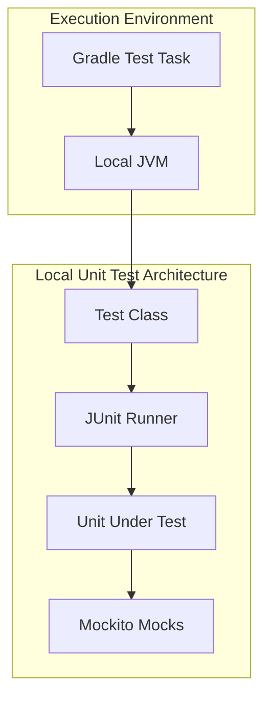
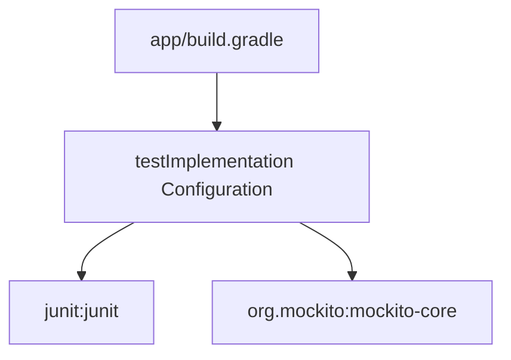
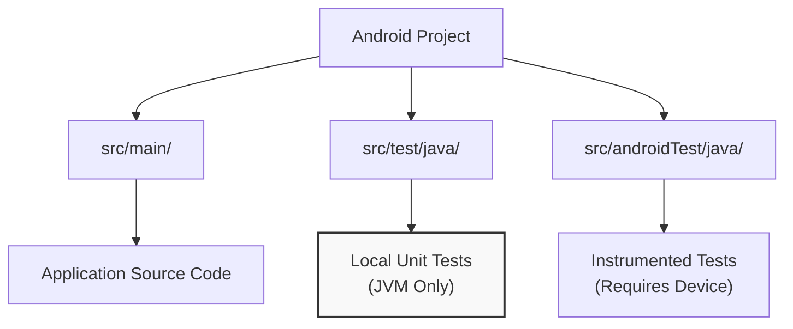
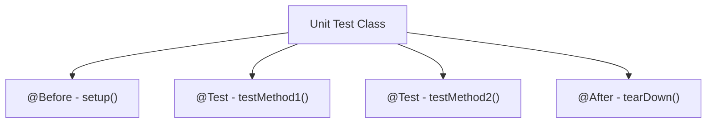
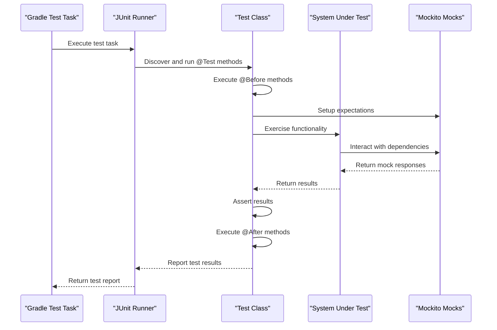
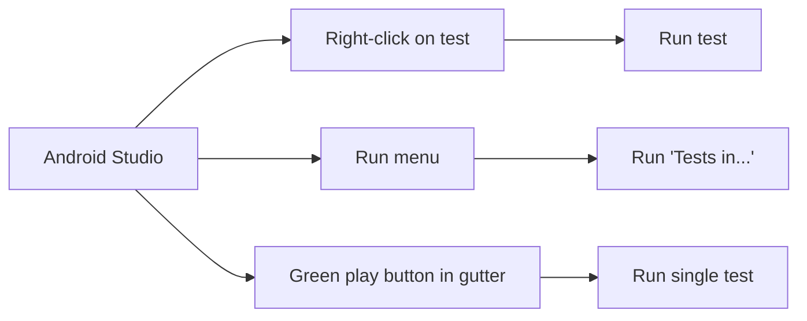
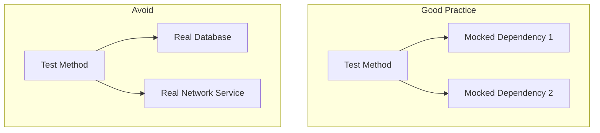
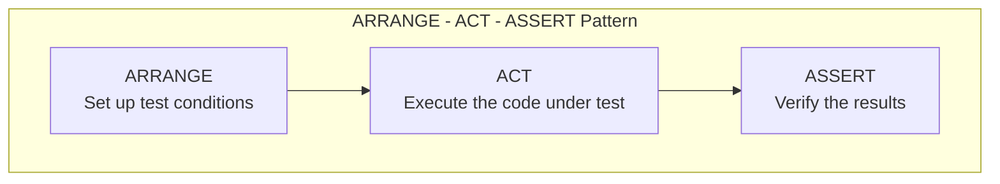

<!-- source: DeepWiki mcp.deepwiki.com · repo android/testing-samples · page 6.1 Local Unit Tests · fetched 2026-10-23 -->

# Local Unit Tests

<details>
<summary>Relevant source files</summary>

The following files were used as context for generating this wiki page:

- [unit/BasicSample/app/build.gradle](unit/BasicSample/app/build.gradle)
- [unit/BasicUnitAndroidTest/app/build.gradle](unit/BasicUnitAndroidTest/app/build.gradle)

</details>


## Purpose and Scope

This document covers local unit tests in Android applications, which are tests that run on the local Java Virtual Machine (JVM) rather than on an Android device or emulator. Local unit tests are designed to test code that doesn't have Android dependencies or where such dependencies can be effectively mocked. For information about unit tests that require Android framework components, see [Unit Testing](#6) and for device-based testing, see [UI Testing with Espresso](#3).

## Overview of Local Unit Tests

Local unit tests provide a fast and efficient way to verify individual components of your application logic. They execute directly on your development machine, making them significantly faster than tests that require device installation or emulation.



Sources: [unit/BasicSample/app/build.gradle:33-36]()

## Configuration

Local unit tests in Android projects are configured in the module's build.gradle file. The essential configuration includes defining test dependencies using the `testImplementation` configuration.

### Gradle Configuration



The sample project's build.gradle demonstrates how to set up the necessary dependencies:

```
dependencies {
    // Unit testing dependencies.
    testImplementation "junit:junit:" + rootProject.junitVersion;
    testImplementation "org.mockito:mockito-core:" + rootProject.mockitoVersion;
}
```

Sources: [unit/BasicSample/app/build.gradle:33-36]()

## Test Structure and Location

Local unit tests are organized in a specific directory structure within the Android project.



Sources: [unit/BasicSample/app/build.gradle]()

## Writing Local Unit Tests

Local unit tests use JUnit as the primary testing framework, often supplemented with Mockito for mocking dependencies.

### Basic Test Structure



### Test Execution Flow



Sources: [unit/BasicSample/app/build.gradle:33-36]()

## Key Components

### JUnit

JUnit provides the core testing framework with annotations that control test execution:

| Annotation | Purpose |
|------------|---------|
| `@Test` | Marks a method as a test method |
| `@Before` | Runs before each test method |
| `@After` | Runs after each test method |
| `@BeforeClass` | Runs once before all test methods in the class |
| `@AfterClass` | Runs once after all test methods in the class |
| `@Ignore` | Temporarily disables a test method |

### Mockito

Mockito enables the creation of test doubles that simulate the behavior of real dependencies:

| Method | Purpose |
|--------|---------|
| `mock()` | Creates a mock object |
| `when().thenReturn()` | Configures a mock to return specific values |
| `verify()` | Verifies that methods were called with specific arguments |
| `any()`, `eq()` | Matchers for method arguments |

Sources: [unit/BasicSample/app/build.gradle:33-36]()

## Running Local Unit Tests

Local unit tests can be executed through various methods:

### From Android Studio



### From Command Line


Sources: [unit/BasicSample/app/build.gradle]()

## Comparison with Instrumented Tests

Understanding the difference between local unit tests and instrumented tests helps in selecting the appropriate testing approach.

| Feature | Local Unit Tests | Instrumented Tests |
|---------|------------------|-------------------|
| **Execution Environment** | JVM | Android device or emulator |
| **Configuration** | `testImplementation` | `androidTestImplementation` |
| **Test Location** | `src/test/java/` | `src/androidTest/java/` |
| **Test Runner** | JUnit runner | AndroidJUnitRunner |
| **Speed** | Fast (milliseconds) | Slower (seconds) |
| **Access to Android Framework** | Limited (requires mocking) | Full access |
| **Best For** | Logic without Android dependencies | UI and integration testing |

Sources: [unit/BasicSample/app/build.gradle:33-36](), [unit/BasicUnitAndroidTest/app/build.gradle:18-24]()

## Best Practices

### What to Test with Local Unit Tests

- Business logic
- Data transformations
- View models
- Repository implementations (with mocked data sources)
- Utility functions

### Test Isolation



### Concise and Focused Tests



Sources: [unit/BasicSample/app/build.gradle:33-36]()

## Limitations

Local unit tests have certain limitations when testing Android-specific functionality:

1. No direct access to Android framework classes
2. Cannot test UI interactions directly
3. May require extensive mocking for Android dependencies
4. Does not verify device-specific behavior

For testing that requires Android framework components, consider using instrumented tests as covered in [UI Testing with Espresso](#3) and [Test Runners](#5).

Sources: [unit/BasicSample/app/build.gradle](), [unit/BasicUnitAndroidTest/app/build.gradle]()

---

