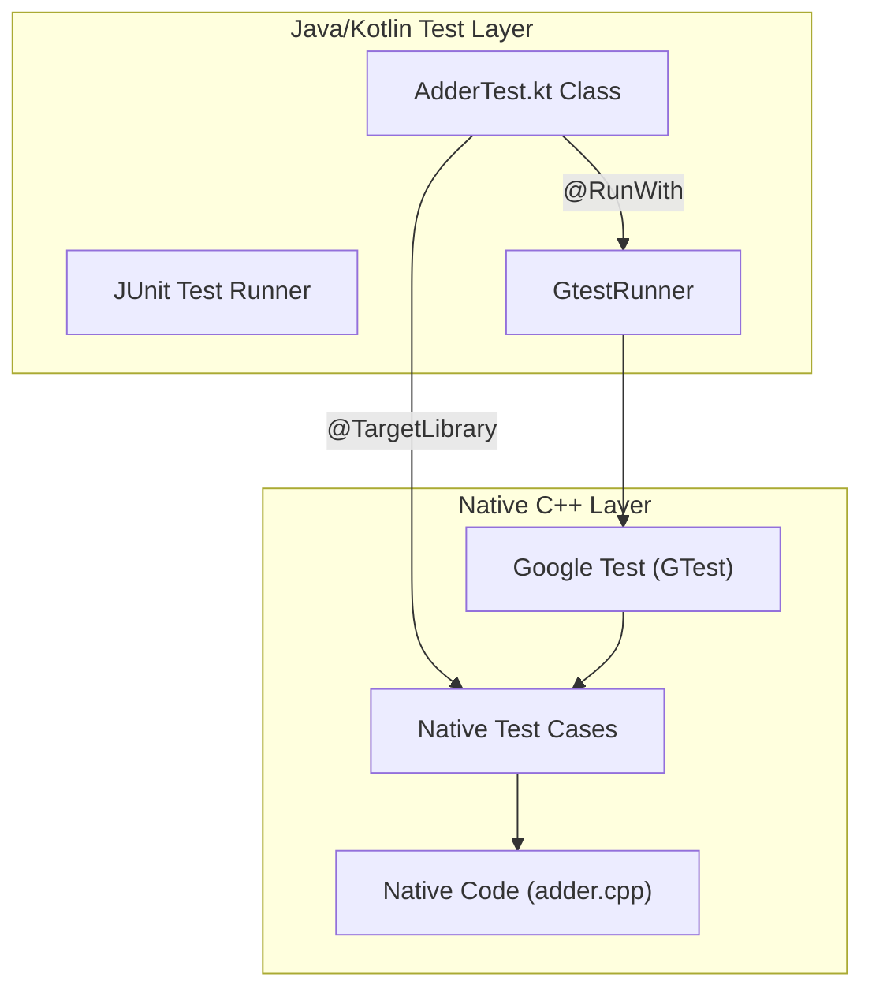
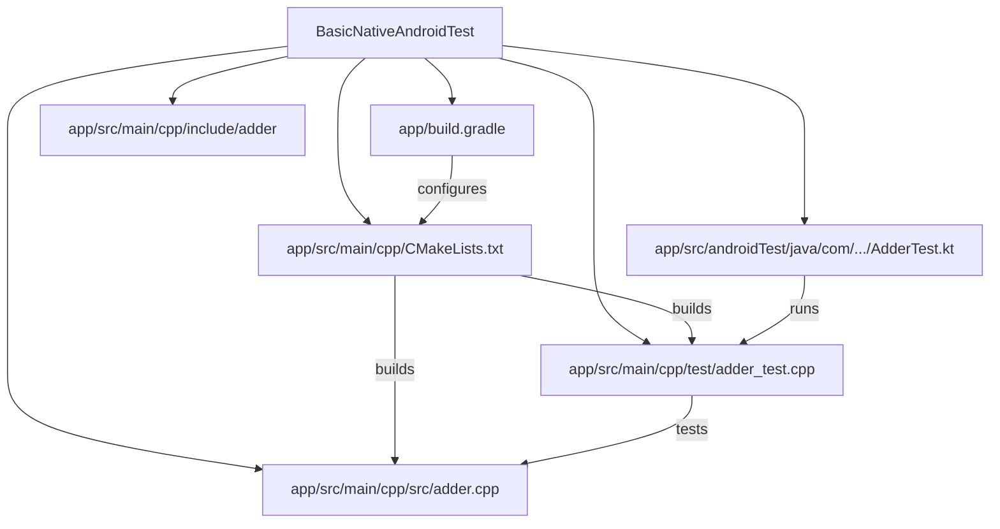
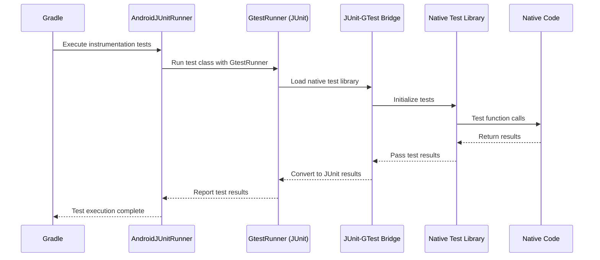

<!-- source: DeepWiki mcp.deepwiki.com · repo android/testing-samples · page 6.2 Native Unit Tests · fetched 2026-10-23 -->

# Native Unit Tests

<details>
<summary>Relevant source files</summary>

The following files were used as context for generating this wiki page:

- [projects.conf](projects.conf)
- [unit/BasicNativeAndroidTest/.gitignore](unit/BasicNativeAndroidTest/.gitignore)
- [unit/BasicNativeAndroidTest/app/.gitignore](unit/BasicNativeAndroidTest/app/.gitignore)
- [unit/BasicNativeAndroidTest/app/build.gradle](unit/BasicNativeAndroidTest/app/build.gradle)
- [unit/BasicNativeAndroidTest/app/proguard-rules.pro](unit/BasicNativeAndroidTest/app/proguard-rules.pro)
- [unit/BasicNativeAndroidTest/app/src/androidTest/java/com/example/android/testing/nativesample/AdderTest.kt](unit/BasicNativeAndroidTest/app/src/androidTest/java/com/example/android/testing/nativesample/AdderTest.kt)
- [unit/BasicNativeAndroidTest/app/src/main/AndroidManifest.xml](unit/BasicNativeAndroidTest/app/src/main/AndroidManifest.xml)
- [unit/BasicNativeAndroidTest/app/src/main/cpp/CMakeLists.txt](unit/BasicNativeAndroidTest/app/src/main/cpp/CMakeLists.txt)
- [unit/BasicNativeAndroidTest/app/src/main/cpp/include/adder](unit/BasicNativeAndroidTest/app/src/main/cpp/include/adder)
- [unit/BasicNativeAndroidTest/app/src/main/cpp/src/adder.cpp](unit/BasicNativeAndroidTest/app/src/main/cpp/src/adder.cpp)

</details>


## Purpose and Overview

This document provides information about native unit testing in Android applications, focusing on testing C/C++ code using Google Test (GTest). For information about Java/Kotlin-based unit tests, see [Local Unit Tests](#6.1).

Native unit tests allow you to test C/C++ code components in your Android application using familiar testing patterns. The BasicNativeAndroidTest sample demonstrates how to set up and run native unit tests for C++ code in an Android project.

## Native Unit Testing Architecture

The native unit testing system combines Android's standard testing infrastructure with Google Test (GTest), creating a bridge between JUnit on the Java/Kotlin side and GTest on the native C++ side.



Sources: [unit/BasicNativeAndroidTest/app/src/androidTest/java/com/example/android/testing/nativesample/AdderTest.kt:1-12](), [unit/BasicNativeAndroidTest/app/src/main/cpp/test/adder_test.cpp](), [unit/BasicNativeAndroidTest/app/src/main/cpp/src/adder.cpp:1-3]()

## Native Test Project Structure

The BasicNativeAndroidTest sample demonstrates how to set up native unit tests in an Android project:



Sources: [unit/BasicNativeAndroidTest/app/build.gradle:1-71](), [unit/BasicNativeAndroidTest/app/src/main/cpp/CMakeLists.txt:1-19](), [unit/BasicNativeAndroidTest/app/src/androidTest/java/com/example/android/testing/nativesample/AdderTest.kt:1-12]()

## Setup and Configuration

Setting up native unit tests requires configuration at both the Gradle and CMake levels.

### Gradle Configuration

The app-level build.gradle file needs specific configuration to support native tests:

| Configuration | Purpose |
|---------------|---------|
| `externalNativeBuild` | Points to the CMake build script |
| `prefab: true` | Enables Prefab for package dependencies |
| `testInstrumentationRunner` | Uses the standard AndroidJUnitRunner |
| Native dependencies | GoogleTest and JUnit-GTest bridge |

Key dependencies:

- `androidx.test.ext:junit-gtest` - The bridge between JUnit and GTest
- `com.android.ndk.thirdparty:googletest` - The Google Test framework

Sources: [unit/BasicNativeAndroidTest/app/build.gradle:16-70]()

### CMake Configuration

CMake is used to build both the native library and its tests:

```
cmake_minimum_required(VERSION 3.10.2)

project(junit-gtest-example LANGUAGES CXX)

find_package(googletest REQUIRED CONFIG)
find_package(junit-gtest REQUIRED CONFIG)

include_directories(include)

add_library(adder SHARED src/adder.cpp)

add_library(adder-test SHARED test/adder_test.cpp)

target_link_libraries(adder-test
        PRIVATE
        adder
        googletest::gtest
        junit-gtest::junit-gtest
)
```

This setup:
1. Creates a shared library (`adder`) with the production code
2. Creates a separate test library (`adder-test`) with the test code
3. Links the test library against the production code, GoogleTest, and the JUnit-GTest bridge

Sources: [unit/BasicNativeAndroidTest/app/src/main/cpp/CMakeLists.txt:1-19]()

## Writing Native Tests

Native tests are written using the GoogleTest framework in C++. The tests are placed in files inside the `test` directory and typically mirror the structure of the source code they're testing.

### Example Test Structure

```cpp
// Include the GoogleTest header
#include <gtest/gtest.h>

// Include the header for the code being tested
#include "adder"

// Define a test suite
TEST(AdderTest, PositiveNumbers) {
    // Set up test conditions
    int a = 2;
    int b = 3;
    
    // Call the function being tested
    int result = add(a, b);
    
    // Assert the expected result
    EXPECT_EQ(5, result);
}

// More test cases...
TEST(AdderTest, NegativeNumbers) {
    EXPECT_EQ(-5, add(-2, -3));
}
```

Sources: Inferred from [unit/BasicNativeAndroidTest/app/src/main/cpp/CMakeLists.txt:12]() and typical GTest usage

## Running Native Tests

To run the native tests, you need a bridge between JUnit and GTest.

### Test Runner Configuration

```kotlin
package com.example.android.testing.nativesample

import androidx.test.ext.junitgtest.GtestRunner
import androidx.test.ext.junitgtest.TargetLibrary
import org.junit.runner.RunWith

// Run our tests with the `GtestRunner`, which knows how to load and run GTest suites.
@RunWith(GtestRunner::class)
// Specify the name of the artifact which contains our tests, as configured in CMakeLists.txt
@TargetLibrary(libraryName = "adder-test")
class AdderTest
```

This configuration:

1. Uses `GtestRunner` as the test runner
2. Specifies `adder-test` as the target library containing the native tests
3. Creates an empty class as a container for the test configuration

Sources: [unit/BasicNativeAndroidTest/app/src/androidTest/java/com/example/android/testing/nativesample/AdderTest.kt:1-12]()

### Running Tests

Native tests can be run using the standard Android test commands:

```
./gradlew connectedAndroidTest
```

Or with a managed device:

```
./gradlew nexusOneApi30DebugAndroidTest
```

The tests will execute on the device or emulator, with results reported back through the standard Android test reporting mechanism.

Sources: [unit/BasicNativeAndroidTest/app/build.gradle:48-59]()

## Test Execution Flow

The execution of native tests follows this sequence:



Sources: [unit/BasicNativeAndroidTest/app/src/androidTest/java/com/example/android/testing/nativesample/AdderTest.kt:1-12](), [unit/BasicNativeAndroidTest/app/build.gradle:16-71]()

## Best Practices

1. **Separate Test and Production Code**: Keep test code in separate directories (e.g., `src` and `test`).

2. **Mirror Source Structure**: Organize test files to mirror the structure of the source code they test.

3. **Descriptive Test Names**: Use clear test case and suite names that describe the functionality being tested.

4. **Test Only Public Interfaces**: Focus testing on the public interfaces of your native code.

5. **Use Test Fixtures**: Create reusable test fixtures for complex setup requirements.

6. **Include in CI**: Configure your CI system to run native tests alongside Java/Kotlin tests.

7. **Test Coverage**: Monitor native code test coverage using appropriate tools.

## Limitations and Considerations

- Native tests run as instrumented tests on a device or emulator, not on the local JVM
- Shared libraries must be properly loaded and initialized
- Native test results must be bridged back to the JUnit system
- Debugging native test failures requires C++ debugging tools

## Summary

Native unit testing allows you to test C/C++ code in Android applications using the industry-standard GoogleTest framework. The integration between JUnit and GTest enables you to run native tests as part of your regular Android test suite, with results reported in a consistent way.

---

