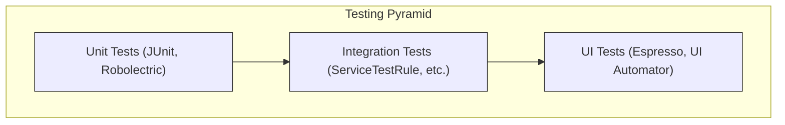
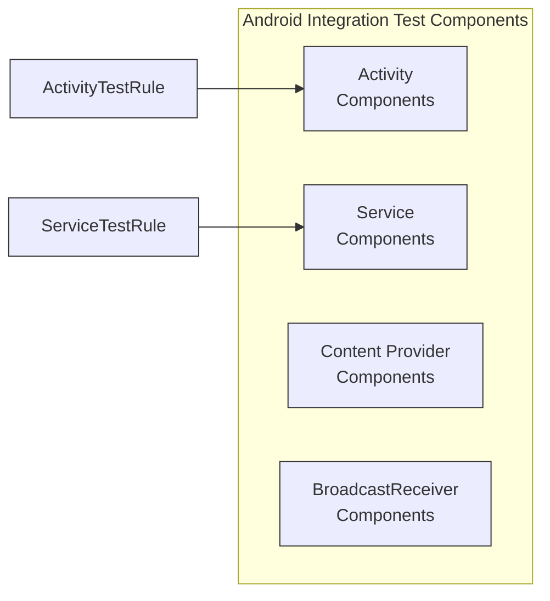
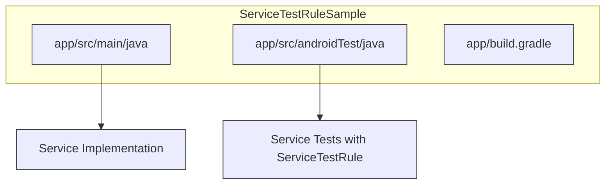
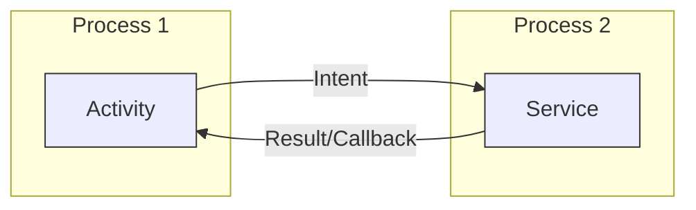

<!-- source: DeepWiki mcp.deepwiki.com · repo android/testing-samples · page 7 Integration Testing · fetched 2026-10-23 -->

# Integration Testing

<details>
<summary>Relevant source files</summary>

The following files were used as context for generating this wiki page:

- [README.md](README.md)
- [integration/ServiceTestRuleSample/gradle/wrapper/gradle-wrapper.properties](integration/ServiceTestRuleSample/gradle/wrapper/gradle-wrapper.properties)
- [ui/espresso/CustomMatcherSample/gradle/wrapper/gradle-wrapper.properties](ui/espresso/CustomMatcherSample/gradle/wrapper/gradle-wrapper.properties)
- [ui/espresso/DataAdapterSample/gradle/wrapper/gradle-wrapper.properties](ui/espresso/DataAdapterSample/gradle/wrapper/gradle-wrapper.properties)
- [ui/espresso/IntentsBasicSample/gradle/wrapper/gradle-wrapper.properties](ui/espresso/IntentsBasicSample/gradle/wrapper/gradle-wrapper.properties)
- [ui/espresso/MultiProcessSample/README.md](ui/espresso/MultiProcessSample/README.md)
- [ui/espresso/RecyclerViewSample/gradle/wrapper/gradle-wrapper.properties](ui/espresso/RecyclerViewSample/gradle/wrapper/gradle-wrapper.properties)

</details>


## Purpose and Scope

This document provides an overview of integration testing approaches in the Android Testing Samples repository. Integration testing focuses on verifying that different components of your Android application work correctly together. This differs from unit testing ([Unit Testing](#6)), which tests individual components in isolation, and UI testing ([UI Testing with Espresso](#3)), which tests the user interface as a whole.

## Introduction to Integration Testing

Integration testing in Android validates that components interact correctly when combined into functional subsystems. This testing level bridges the gap between isolated unit tests and comprehensive UI tests.



Sources: [README.md:4-4](), [README.md:43-49]()

### Key Characteristics of Integration Tests

- Test interactions between multiple components
- Verify behavior across component boundaries
- Validate proper data flow between components
- Often require test synchronization for asynchronous operations
- More complex setup than unit tests but less complex than UI tests

## Integration Testing Components in Android

The Android Testing Samples repository demonstrates integration testing primarily through the ServiceTestRule example, which focuses on testing Android Services.



Sources: [README.md:43-49]()

### ServiceTestRule

The `ServiceTestRule` provides a convenient way to test Android Service components. It handles the service lifecycle (starting and stopping) and provides mechanisms to bind to services when needed.

```mermaid
sequenceDiagram
    participant "Test" as T
    participant "ServiceTestRule" as STR
    participant "Android Service" as S
    
    T->>STR: "startService(Intent)"
    STR->>S: "start service"
    S-->>STR: "service started"
    STR-->>T: "ComponentName"
    
    T->>STR: "bindService(Intent)"
    STR->>S: "bind to service"
    S-->>STR: "binding established"
    STR-->>T: "IBinder"
    
    T->>STR: "unbindService()"
    STR->>S: "unbind service"
    
    T->>STR: "test completion"
    STR->>S: "stop service"
    
    classDef default stroke:#333,stroke-width:1px;
```

Sources: [README.md:49-49]()

## ServiceTestRuleSample Example

The repository includes a sample project demonstrating how to use `ServiceTestRule`. This example shows how to:

1. Start a service for testing
2. Bind to a service when needed
3. Test service functionality
4. Properly clean up service resources after testing

### Project Structure



Sources: [README.md:49-49](), [integration/ServiceTestRuleSample/gradle/wrapper/gradle-wrapper.properties:1-6]()

## Integration Testing Best Practices

When implementing integration tests for Android components:

### 1. Manage Component Lifecycle

- Use appropriate test rules to manage component lifecycles
- Ensure proper setup and teardown of test resources
- Handle asynchronous operations with synchronization mechanisms

### 2. Test Across Process Boundaries

When testing components that operate across process boundaries:



Sources: [ui/espresso/MultiProcessSample/README.md:1-22]()

For testing components across process boundaries, special considerations are needed:

- Ensure proper synchronization between processes
- Use appropriate testing tools like Multiprocess Espresso (API 26+)
- Test IPC mechanism integrity

### 3. Isolate Integration Points

- Mock external dependencies not being tested
- Use test doubles for network services, databases, etc.
- Focus tests on the integration points rather than all functionality

### 4. Orchestrate Test Execution

- Consider using Android Test Orchestrator for test isolation
- Plan test execution order to avoid state contamination
- Clean up resources between tests

## Integration Testing vs. Other Testing Types

| Aspect | Unit Testing | Integration Testing | UI Testing |
|--------|-------------|-------------------|-----------|
| **Focus** | Individual components | Component interactions | User flows |
| **Scope** | Narrow (class/method) | Moderate (subsystem) | Broad (application) |
| **Speed** | Fast | Medium | Slow |
| **Dependencies** | Mocked | Partial real/mocked | Mostly real |
| **Examples** | JUnit tests | ServiceTestRule tests | Espresso/UI Automator tests |
| **Repository Location** | `/unit` | `/integration` | `/ui` |

Sources: [README.md:36-49]()

## Gradle Configuration for Integration Tests

Integration tests in Android typically require instrumentation tests that run on a device or emulator:

```
// Run instrumentation tests
./gradlew connectedAndroidTest
```

Sources: [README.md:60-63](), [integration/ServiceTestRuleSample/gradle/wrapper/gradle-wrapper.properties:1-6]()

## Related Testing Approaches

For other testing approaches in the repository, see:

- [Unit Testing](#6) - For testing individual components in isolation
- [UI Testing with Espresso](#3) - For testing the user interface
- [Test Runners](#5) - For information about test execution frameworks
- [Service Testing](#7.1) - For detailed information about testing Android services

## Summary

Integration testing plays a crucial role in validating that Android application components work together correctly. The Android Testing Samples repository demonstrates this primarily through the ServiceTestRule example, showing how to test Service components effectively. By incorporating integration tests into your testing strategy, you can identify issues that might not be caught by unit or UI tests alone.

---

