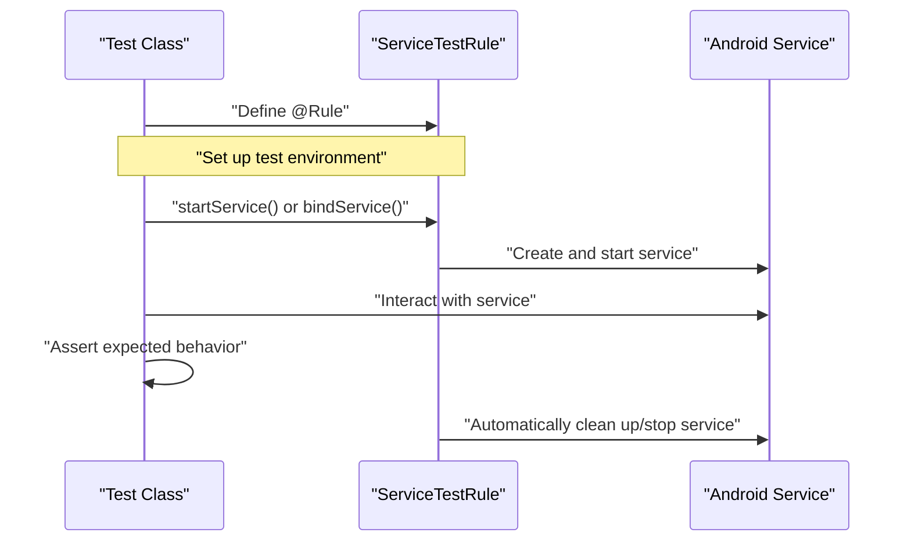
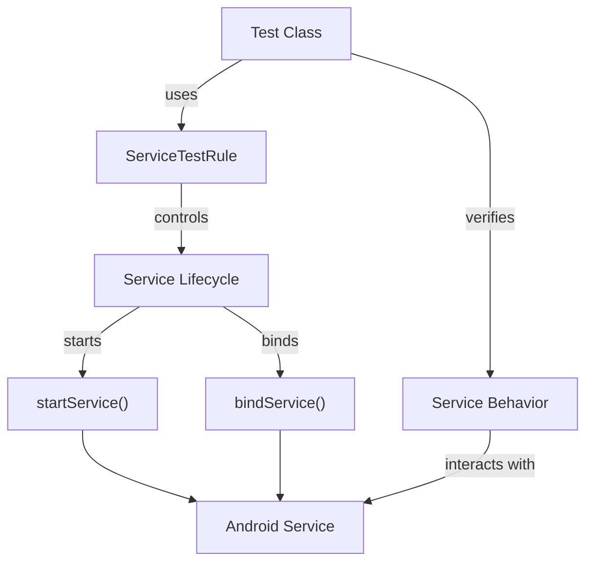
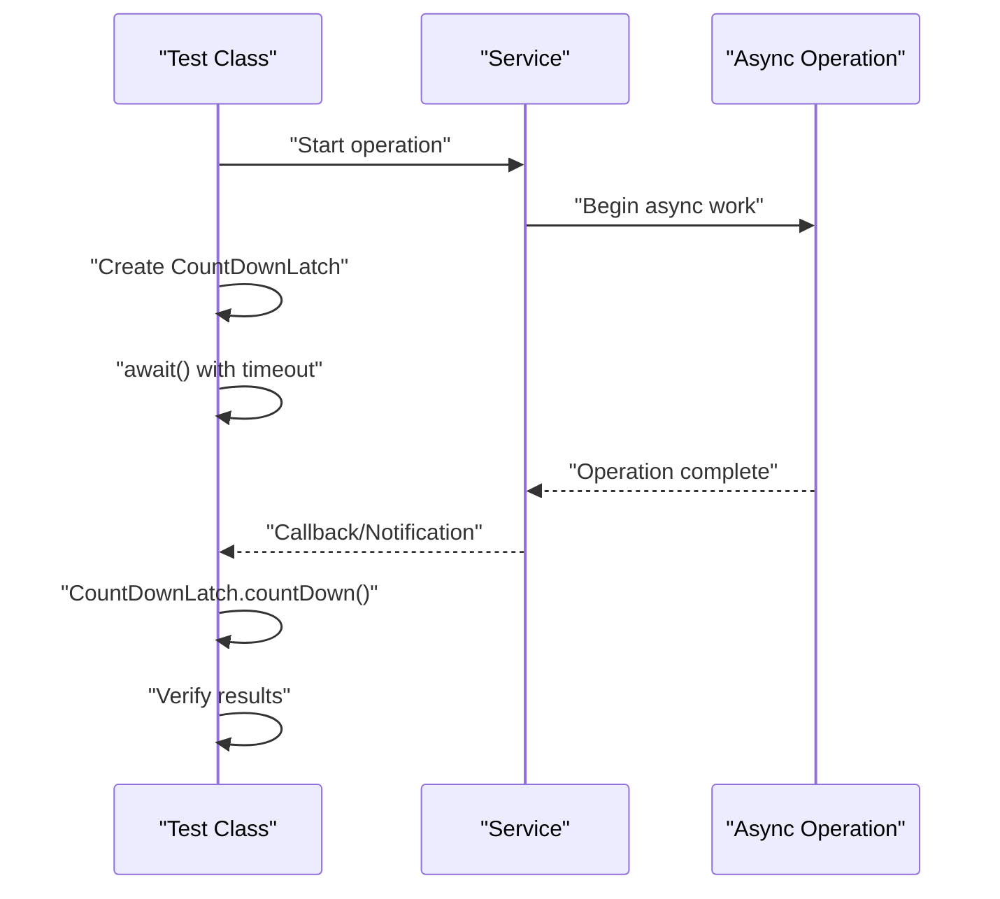

<!-- source: DeepWiki mcp.deepwiki.com · repo android/testing-samples · page 7.1 Service Testing · fetched 2026-10-23 -->

# Service Testing

<details>
<summary>Relevant source files</summary>

The following files were used as context for generating this wiki page:

- [integration/ServiceTestRuleSample/build.gradle](integration/ServiceTestRuleSample/build.gradle)
- [integration/ServiceTestRuleSample/gradle/wrapper/gradle-wrapper.properties](integration/ServiceTestRuleSample/gradle/wrapper/gradle-wrapper.properties)
- [runner/AndroidJunitRunnerSample/build.gradle](runner/AndroidJunitRunnerSample/build.gradle)
- [ui/espresso/BasicSample/build.gradle](ui/espresso/BasicSample/build.gradle)
- [ui/espresso/CustomMatcherSample/build.gradle](ui/espresso/CustomMatcherSample/build.gradle)
- [ui/espresso/CustomMatcherSample/gradle/wrapper/gradle-wrapper.properties](ui/espresso/CustomMatcherSample/gradle/wrapper/gradle-wrapper.properties)
- [ui/espresso/DataAdapterSample/build.gradle](ui/espresso/DataAdapterSample/build.gradle)
- [ui/espresso/DataAdapterSample/gradle/wrapper/gradle-wrapper.properties](ui/espresso/DataAdapterSample/gradle/wrapper/gradle-wrapper.properties)
- [ui/espresso/IdlingResourceSample/build.gradle](ui/espresso/IdlingResourceSample/build.gradle)
- [ui/espresso/IntentsAdvancedSample/build.gradle](ui/espresso/IntentsAdvancedSample/build.gradle)
- [ui/espresso/IntentsBasicSample/build.gradle](ui/espresso/IntentsBasicSample/build.gradle)
- [ui/espresso/IntentsBasicSample/gradle/wrapper/gradle-wrapper.properties](ui/espresso/IntentsBasicSample/gradle/wrapper/gradle-wrapper.properties)
- [ui/espresso/MultiWindowSample/build.gradle](ui/espresso/MultiWindowSample/build.gradle)
- [ui/espresso/RecyclerViewSample/build.gradle](ui/espresso/RecyclerViewSample/build.gradle)
- [ui/espresso/RecyclerViewSample/gradle/wrapper/gradle-wrapper.properties](ui/espresso/RecyclerViewSample/gradle/wrapper/gradle-wrapper.properties)
- [ui/espresso/WebBasicSample/build.gradle](ui/espresso/WebBasicSample/build.gradle)
- [ui/uiautomator/BasicSample/build.gradle](ui/uiautomator/BasicSample/build.gradle)

</details>


## Purpose and Scope

This document explains how to test Android Services using the ServiceTestRule class as demonstrated in the ServiceTestRuleSample of the Android Testing Samples repository. Android Services are components that run in the background without a user interface, making them challenging to test through traditional UI testing frameworks. This page covers the integration testing approach for services.

For general integration testing concepts, see [Integration Testing](#7). For information about other test rules, see [AndroidJUnitRunner](#5.1).

## Overview of Service Testing

Android Services operate independently of user interface components and often perform background operations, making them difficult to test through standard UI test frameworks like Espresso. The `ServiceTestRule` provides a structured approach to test Android Services by controlling their lifecycle during tests, enabling reliable verification of service behavior.

### Service Testing Lifecycle



Sources: [integration/ServiceTestRuleSample/build.gradle:26-31]()

## ServiceTestRule Functionality

The `ServiceTestRule` is a JUnit rule that facilitates the testing of Android Services by:

1. Starting and stopping services safely during test execution
2. Managing service lifecycle throughout the test
3. Supporting both started services and bound services
4. Providing proper cleanup after tests complete

### Service Testing Architecture



Sources: [integration/ServiceTestRuleSample/build.gradle:26-31]()

## Configuration for Service Testing

To use the `ServiceTestRule` in your project, you need to include the necessary dependencies in your build.gradle file:

```
dependencies {
    androidTestImplementation "androidx.test:core:$coreVersion"
    androidTestImplementation "androidx.test.ext:junit:$extJUnitVersion"
    androidTestImplementation "androidx.test:runner:$runnerVersion"
    androidTestImplementation "androidx.test:rules:$rulesVersion"
}
```

As seen in the ServiceTestRuleSample, the following versions are used:

| Library | Version |
|---------|---------|
| Core    | 1.6.1   |
| ExtJUnit| 1.2.1   |
| Runner  | 1.6.1   |
| Rules   | 1.6.1   |

Sources: [integration/ServiceTestRuleSample/build.gradle:26-31]()

## Implementing Service Tests

Here's a typical structure for implementing service tests using the `ServiceTestRule`:

### 1. Define the ServiceTestRule

First, declare the `ServiceTestRule` in your test class using the JUnit `@Rule` annotation:

```java
@Rule
public final ServiceTestRule mServiceRule = new ServiceTestRule();
```

### 2. Testing a Started Service

For services started with `startService()`:

```java
@Test
public void testStartedService() {
    // Create an intent for the service
    Intent serviceIntent = new Intent(getContext(), YourService.class);
    
    // Start the service
    mServiceRule.startService(serviceIntent);
    
    // Verify the service behavior
    // ...
}
```

### 3. Testing a Bound Service

For services that support binding:

```java
@Test
public void testBoundService() {
    // Create an intent for the service
    Intent serviceIntent = new Intent(getContext(), YourService.class);
    
    // Bind to the service
    IBinder binder = mServiceRule.bindService(serviceIntent);
    
    // Get service instance via the binder
    YourService service = ((YourService.LocalBinder) binder).getService();
    
    // Interact with the service and verify behavior
    // ...
}
```

Sources: [integration/ServiceTestRuleSample/build.gradle:26-31]()

## Testing Asynchronous Service Operations

Services often perform asynchronous operations. To test these effectively:

### Using CountDownLatch for Synchronization



In practice, you'll need to implement a callback mechanism or listener in your service that the test can use to know when asynchronous operations are complete.

Sources: [integration/ServiceTestRuleSample/build.gradle:26-31]()

## Best Practices for Service Testing

1. **Isolate Dependencies**: Mock or stub external systems that your service interacts with to ensure true unit testing
2. **Test Service Lifecycle**: Verify service behavior during different lifecycle events (`onCreate()`, `onStartCommand()`, `onBind()`, etc.)
3. **Timeout Management**: Always set reasonable timeouts when waiting for asynchronous operations
4. **Clean Test Environment**: Ensure each test starts with a clean state
5. **Test Edge Cases**: Include tests for error conditions and recovery mechanisms

## Limitations and Considerations

1. **Environment Differences**: Services may behave differently in test environments compared to production
2. **System Interactions**: Interactions with system services might need additional mocking
3. **Process Boundaries**: The `ServiceTestRule` works best for testing services in the same process as the test
4. **Resource Constraints**: Be aware of resource limitations in the test environment
5. **Timing Sensitivity**: Service operations that depend on precise timing may be difficult to test reliably

Sources: [integration/ServiceTestRuleSample/build.gradle:26-31]()

## Related Testing Approaches

If your services involve complex UI interactions or cross-application functionality, you might need to combine multiple testing approaches:

| Testing Need | Recommended Approach |
|--------------|---------------------|
| Service internal logic | ServiceTestRule |
| UI interactions triggered by service | Espresso with ServiceTestRule |
| System-level service interactions | UI Automator |
| Background task synchronization | IdlingResource |

For more information on these approaches, see [UI Testing with Espresso](#3) and [UI Testing with UI Automator](#4).

Sources: [integration/ServiceTestRuleSample/build.gradle:26-31]()

---

