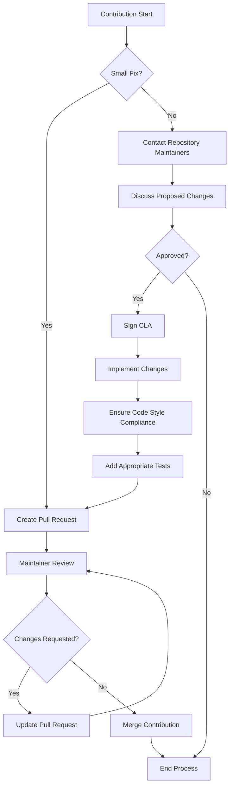
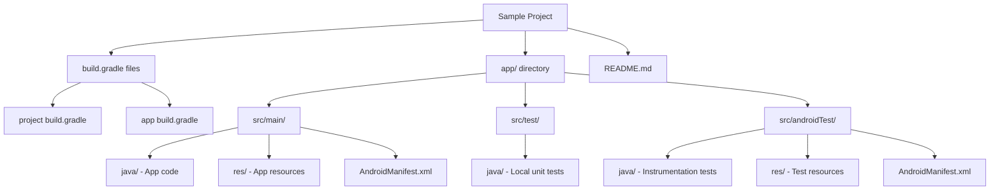

<!-- source: DeepWiki mcp.deepwiki.com · repo android/testing-samples · page 8 Contributing · fetched 2026-10-23 -->

# Contributing

Relevant source files

The following files were used as context for generating this wiki page:

- [CONTRIBUTING.md](CONTRIBUTING.md)
- [LICENSE](LICENSE)

## Purpose and Scope

This document outlines the guidelines and processes for contributing to the Android Testing Samples repository. It covers how to submit code changes, propose new samples, adhere to code style requirements, and fulfill legal prerequisites. This guide is intended for developers who want to improve existing samples or add new testing examples to the repository.

## Contribution Process Overview

The Android Testing Samples repository welcomes contributions ranging from small fixes to complete new testing samples. The contribution process differs slightly depending on the scope of your proposed changes.

Sources: [CONTRIBUTING.md:1-4](), [CONTRIBUTING.md:41-53]()

### Initial Contact

For small fixes or improvements to existing samples, you can directly create a pull request. For larger changes or new samples, contact the maintainers first through the [Android Testing Support Library forum](https://groups.google.com/forum/#!forum/android-testing-support-library).

Sources: [CONTRIBUTING.md:3]()

### Legal Requirements: Contributor License Agreements

Before your contribution can be accepted, you must sign the appropriate Contributor License Agreements (CLAs):

1. **Individual CLA**: If you're contributing as an individual and own the intellectual property
2. **Corporate CLA**: If you're contributing work done for a company
3. **Important**: You must sign both Android and Google CLAs

Google cannot accept your contribution until these legal requirements are satisfied.

Sources: [CONTRIBUTING.md:22-38]()

### Pull Request Process

The standard contribution workflow follows these steps:

1. Open an issue describing your proposed change
2. Wait for repository owner's response
3. Sign the required CLAs (if not already done)
4. Fork the repository and implement your changes
5. Ensure code adheres to project style guidelines
6. Include appropriate tests for your changes
7. Submit a pull request

Sources: [CONTRIBUTING.md:41-53]()

## Contributing New Samples

The repository welcomes new sample contributions that demonstrate Android testing best practices or showcase specific testing techniques.

### Sample Opportunities

If you're looking for ideas, these are some examples that the maintainers have identified as needed:

* Advanced Idling Resource examples
* RecyclerView actions
* Test sharding implementations
* RunListener demonstrations
* Testing rule examples

You can also contribute to this list with additional sample requests.

Sources: [CONTRIBUTING.md:5-15]()

### Sample Project Structure

When contributing a new sample, follow the existing structure of the repository to maintain consistency:

Your sample should be self-contained, well-documented, and demonstrate a specific testing concept or technique.

Sources: [CONTRIBUTING.md:17-19]()

## Code Style and Standards

Maintaining a consistent code style across all samples is important for readability and maintainability.

### Style Guidelines

All contributions must adhere to the [Android Code Style for Contributors](https://source.android.com/source/code-style.html). Review the existing samples to understand the code organization and formatting conventions used throughout the repository.

Key aspects to follow:

* Consistent indentation and formatting
* Proper commenting and documentation
* Meaningful variable and method names
* Logical organization of code

### Testing Requirements

All contributions should include appropriate tests:

* Unit tests for testable components
* Instrumentation tests for UI components
* Tests that demonstrate the specific testing technique being showcased

Your code must pass all existing tests, and any new functionality should be properly tested.

Sources: [CONTRIBUTING.md:17-19](), [CONTRIBUTING.md:47-52]()

## Licensing

The Android Testing Samples repository is licensed under the Apache License, Version 2.0. By contributing to this project, you agree that your contributions will be licensed under the same license.

The full text of the Apache License 2.0 can be found in the [LICENSE]() file in the repository.

Sources: [LICENSE:1-201]()

## Contribution Review Process

When you submit a contribution, here's what happens:

1. Automated checks verify that your code compiles and passes tests
2. Repository maintainers review your code for:
   * Code quality and style
   * Test coverage
   * Documentation completeness
   * Adherence to the sample's purpose
3. You may receive feedback requesting changes
4. Once approved, your contribution will be merged

The review process helps ensure that all samples in the repository maintain high quality and serve as good examples for the Android developer community.

Sources: [CONTRIBUTING.md:41-53]()

## Communication Channels

For questions or discussions about contributions:

* Open an issue on the GitHub repository
* Join the [Android Testing Support Library forum](https://groups.google.com/forum/#!forum/android-testing-support-library)
* Comment on existing issues or pull requests

Constructive communication helps ensure that your contribution aligns with the repository's goals and can be successfully integrated.

Sources: [CONTRIBUTING.md:3]()