# Page: Overview

# Overview

<details>
<summary>Relevant source files</summary>

The following files were used as context for generating this wiki page:

- [CONTRIBUTING.md](CONTRIBUTING.md)
- [LICENSE](LICENSE)
- [README.md](README.md)
- [ui/espresso/MultiProcessSample/README.md](ui/espresso/MultiProcessSample/README.md)

</details>


The Android Testing Samples repository provides a comprehensive collection of code examples demonstrating various testing frameworks and techniques for Android applications. This document introduces the repository organization, available samples, and supported testing approaches.

## Purpose and Scope

This repository serves as a practical reference for Android developers implementing automated testing in their applications. It contains working sample projects that demonstrate different testing strategies, including:

- UI testing with Espresso and UI Automator
- Unit testing with JUnit4
- Integration testing with Android Test Rules
- Test runners configuration and usage
- Specialized testing scenarios (asynchronous operations, multi-process, WebViews)

For detailed information about specific build systems configurations used in these samples, see [Build Systems](#2).

## Repository Structure

The repository is organized hierarchically by testing category and framework:

```mermaid
graph TD
    root["android-testing-samples/"] --> ui["ui/"]
    root --> runner["runner/"]
    root --> integration["integration/"]
    root --> unit["unit/"]
    
    ui --> espresso["espresso/"]
    ui --> uiautomator["uiautomator/"]
    
    espresso --> BasicSample["BasicSample/"]
    espresso --> CustomMatcherSample["CustomMatcherSample/"]
    espresso --> DataAdapterSample["DataAdapterSample/"]
    espresso --> FragmentScenarioSample["FragmentScenarioSample/"]
    espresso --> IdlingResourceSample["IdlingResourceSample/"]
    espresso --> IntentsBasicSample["IntentsBasicSample/"]
    espresso --> IntentsAdvancedSample["IntentsAdvancedSample/"]
    espresso --> MultiWindowSample["MultiWindowSample/"]
    espresso --> RecyclerViewSample["RecyclerViewSample/"]
    espresso --> ScreenshotSample["ScreenshotSample/"]
    espresso --> WebBasicSample["WebBasicSample/"]
    espresso --> MultiProcessSample["MultiProcessSample/"]
    
    uiautomator --> UiaBasicSample["BasicSample/"]
    
    runner --> AndroidJUnitRunnerSample["AndroidJunitRunnerSample/"]
    runner --> OrchestratorSample["AndroidTestOrchestratorSample/"]
    runner --> OrchestratorCoverageSample["AndroidTestOrchestratorWithTestCoverageSample/"]
    
    integration --> ServiceTestRuleSample["ServiceTestRuleSample/"]
    
    unit --> UnitBasicSample["BasicSample/"]
```

Sources: [README.md:1-43]()

## Testing Framework Architecture

The repository demonstrates various AndroidX Test components and their relationships:

```mermaid
graph TD
    androidx["androidx.test.*"] --> runner["androidx.test.runner"]
    androidx --> rules["androidx.test.rules"]
    androidx --> espresso["androidx.test.espresso"]
    androidx --> uiautomator["androidx.test.uiautomator"]
    androidx --> core["androidx.test.core"]
    
    runner --> AndroidJUnitRunner["AndroidJUnitRunner"]
    runner --> TestOrchestrator["AndroidTestOrchestrator"]
    
    rules --> ActivityTestRule["ActivityTestRule"]
    rules --> ServiceTestRule["ServiceTestRule"]
    rules --> GrantPermissionRule["GrantPermissionRule"]
    
    espresso --> espresso_core["espresso-core"]
    espresso --> espresso_intents["espresso-intents"]
    espresso --> espresso_web["espresso-web"]
    espresso --> espresso_idling["espresso-idling-resource"]
    espresso --> espresso_contrib["espresso-contrib"]
    
    espresso_core --> Espresso["Espresso class"]
    espresso_core --> ViewMatchers["ViewMatchers class"]
    espresso_core --> ViewActions["ViewActions class"]
    espresso_core --> ViewAssertions["ViewAssertions class"]
    
    espresso_intents --> Intents["Intents class"]
    espresso_intents --> IntentMatchers["IntentMatchers class"]
    
    uiautomator --> UiDevice["UiDevice class"]
    uiautomator --> UiObject["UiObject class"]
    uiautomator --> UiObject2["UiObject2 class"]
    uiautomator --> UiSelector["UiSelector class"]
    
    core --> FragmentScenario["FragmentScenario class"]
    core --> ActivityScenario["ActivityScenario class"]
    core --> ScreenCapture["ScreenCapture class"]
```

Sources: [README.md:6-43]()

## Sample Categories

The repository includes samples for the following testing categories:

| Category | Directory | Key Classes/Frameworks |
|----------|-----------|------------------------|
| UI Testing | `ui/espresso/` | `Espresso`, `ViewMatchers`, `ViewActions`, `ViewAssertions` |
| UI Automation | `ui/uiautomator/` | `UiDevice`, `UiObject`, `UiSelector` |
| Test Runners | `runner/` | `AndroidJUnitRunner`, `AndroidTestOrchestrator` |
| Integration Testing | `integration/` | `ServiceTestRule` |
| Unit Testing | `unit/` | JUnit4 (`@Test`, `@Before`, `@After`) |

Sources: [README.md:4-49]()

## UI Testing Samples

### Espresso Framework Usage

Espresso provides a fluent API for UI testing as demonstrated in this interaction flow:

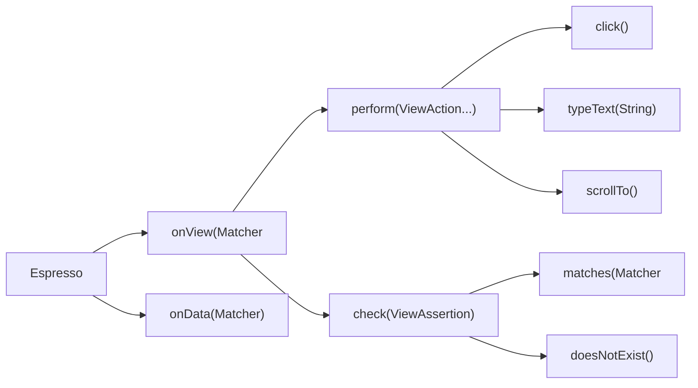

Sources: [README.md:6-32]()

### Espresso Sample Modules

| Sample | Path | Key Features |
|--------|------|-------------|
| Basic Sample | `ui/espresso/BasicSample` | Simple view interactions with `onView()`, `perform()`, and `check()` |
| CustomMatcher Sample | `ui/espresso/CustomMatcherSample` | Extending Espresso with custom view matchers |
| DataAdapter Sample | `ui/espresso/DataAdapterSample` | AdapterView testing using `onData()` |
| IdlingResource Sample | `ui/espresso/IdlingResourceSample` | Handling asynchronous operations with `IdlingResource` interface |
| Intents Samples | `ui/espresso/IntentsBasicSample` | Intent verification with `intended()` and stubbing with `intending()` |
| RecyclerView Sample | `ui/espresso/RecyclerViewSample` | RecyclerView testing with `RecyclerViewActions` |
| WebView Sample | `ui/espresso/WebBasicSample` | WebView testing using `WebView` matchers and actions |
| MultiProcess Sample | `ui/espresso/MultiProcessSample` | Testing components across app processes |

Sources: [README.md:6-32](), [ui/espresso/MultiProcessSample/README.md:1-22]()

### UI Automator

UI Automator enables system-wide UI testing across multiple apps:

| Sample | Path | Key Features |
|--------|------|-------------|
| Basic Sample | `ui/uiautomator/BasicSample` | Cross-application UI testing with `UiDevice` and `UiSelector` |

Sources: [README.md:33-35]()

## Test Runner Samples

The repository provides examples for configuring and using test runners:

| Sample | Path | Key Features |
|--------|------|-------------|
| AndroidJUnitRunner Sample | `runner/AndroidJunitRunnerSample` | Test annotations, parameterized tests, test suite creation |
| Test Orchestrator Sample | `runner/AndroidTestOrchestratorSample` | Test isolation with Android Test Orchestrator |
| Test Coverage Sample | `runner/AndroidTestOrchestratorWithTestCoverageSample` | Code coverage with Test Orchestrator |

Sources: [README.md:37-39]()

## Integration and Unit Testing

The repository includes samples for service testing and basic unit testing:

| Sample | Path | Key Features |
|--------|------|-------------|
| ServiceTestRule Sample | `integration/ServiceTestRuleSample` | Testing Android services with `ServiceTestRule` |
| Basic Unit Sample | `unit/BasicSample` | Local unit tests with JUnit4 |

Sources: [README.md:43-49]()

## Build Systems Support

The repository supports two build systems:

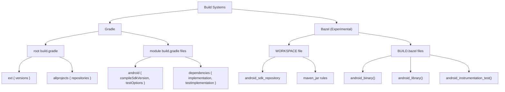

Sources: [README.md:51-129]()

## Getting Started

### Prerequisites

- Android SDK v28+
- Android Build Tools v28.03+
- For Bazel: Bazel 0.12.0+

### Running Tests

Execute tests using:

- **Gradle**: 
  - `./gradlew connectedAndroidTest` for instrumentation tests
  - `./gradlew test` for unit tests

- **Bazel (Experimental)**:
  - `bazel test //... --config=headless` for headless testing
  - `bazel test //... --config=gui` for GUI testing
  - `bazel test //... --config=local_device` for testing on a connected device

Sources: [README.md:51-117]()

---

# Page: Build Systems

# Build Systems

<details>
<summary>Relevant source files</summary>

The following files were used as context for generating this wiki page:

- [.bazelrc](.bazelrc)
- [WORKSPACE](WORKSPACE)
- [bazelci/buildkite-pipeline.yml](bazelci/buildkite-pipeline.yml)
- [common_defs.bzl](common_defs.bzl)
- [integration/ServiceTestRuleSample/build.gradle](integration/ServiceTestRuleSample/build.gradle)
- [runner/AndroidJunitRunnerSample/build.gradle](runner/AndroidJunitRunnerSample/build.gradle)
- [runner/AndroidTestOrchestratorSample/build.gradle](runner/AndroidTestOrchestratorSample/build.gradle)
- [ui/espresso/BasicSample/build.gradle](ui/espresso/BasicSample/build.gradle)
- [ui/espresso/CustomMatcherSample/build.gradle](ui/espresso/CustomMatcherSample/build.gradle)
- [ui/espresso/DataAdapterSample/build.gradle](ui/espresso/DataAdapterSample/build.gradle)
- [ui/espresso/IdlingResourceSample/build.gradle](ui/espresso/IdlingResourceSample/build.gradle)
- [ui/espresso/IntentsAdvancedSample/build.gradle](ui/espresso/IntentsAdvancedSample/build.gradle)
- [ui/espresso/IntentsBasicSample/build.gradle](ui/espresso/IntentsBasicSample/build.gradle)
- [ui/espresso/MultiWindowSample/build.gradle](ui/espresso/MultiWindowSample/build.gradle)
- [ui/espresso/RecyclerViewSample/build.gradle](ui/espresso/RecyclerViewSample/build.gradle)
- [ui/espresso/WebBasicSample/build.gradle](ui/espresso/WebBasicSample/build.gradle)
- [ui/uiautomator/BasicSample/build.gradle](ui/uiautomator/BasicSample/build.gradle)
- [update_versions.sh](update_versions.sh)

</details>


This document outlines the build systems used in the Android Testing Samples repository, explaining how they're configured for Android testing. It covers both Gradle and Bazel build systems, their configuration files, dependency management, and test setups. For detailed information about specific build configuration components, see [Gradle Configuration](#2.1) and [Bazel Configuration](#2.2).

## Overview of Build Systems

The Android Testing Samples repository supports two build systems:

1. **Gradle** - The primary build system used by default in Android development
2. **Bazel** - An alternative build system that provides hermetic builds and supports remote execution

Both build systems are configured to support Android instrumentation testing and unit testing across the sample projects.

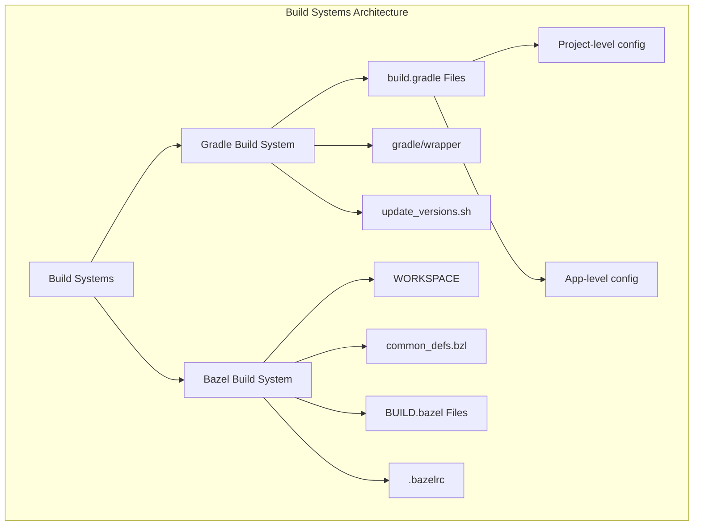

Sources: [ui/espresso/BasicSample/build.gradle](), [WORKSPACE](), [common_defs.bzl](), [.bazelrc]()

## Gradle Build System

Gradle is the primary build system used across all sample projects. Each sample has its own build configuration that defines dependencies, SDK versions, and test setups.

### Project Structure

Each sample project follows a similar Gradle structure:
- Root `build.gradle` - Contains common configurations and version definitions
- Module-level `build.gradle` - Contains app-specific configurations
- `gradle/wrapper` - Contains the Gradle wrapper to ensure consistent builds

### Version Management

Library versions are managed through the `ext` block in the root `build.gradle` file. Common testing library versions are defined here to ensure consistency across modules.

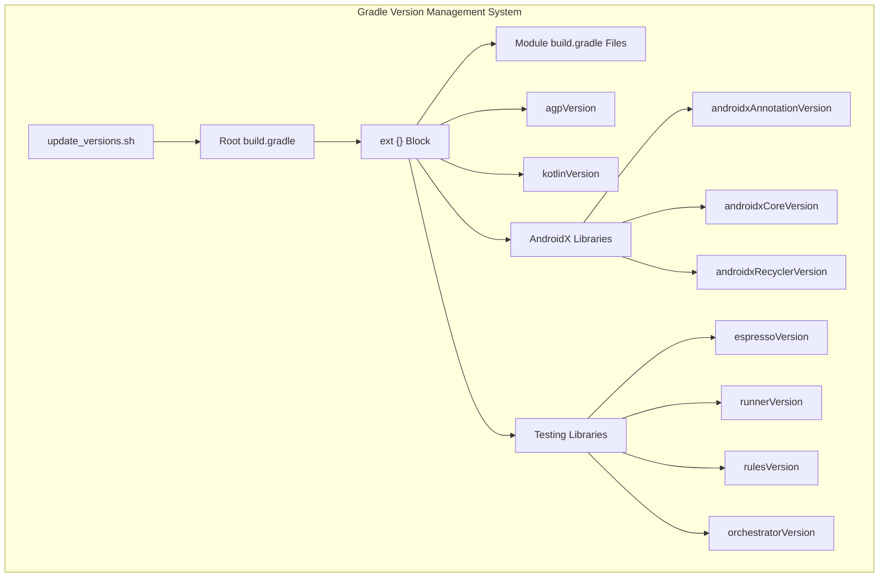

Sources: [ui/espresso/BasicSample/build.gradle:28-37](), [update_versions.sh:11-35]()

### Common Version Definitions

The repository maintains consistent library versions across all samples. A typical version definition block looks like:

```
ext {
    androidxAnnotationVersion = "1.5.0"
    robolectricVersion = "4.13"
    guavaVersion = "31.1-android"
    extTruthVersion = "1.6.0"
    coreVersion = "1.6.1"
    extJUnitVersion = "1.2.1"
    runnerVersion = "1.6.1"
    espressoVersion = "3.6.1"
}
```

Sources: [ui/espresso/BasicSample/build.gradle:28-37]()

### Version Update Script

The repository includes a script (`update_versions.sh`) that automates updating library versions across all sample projects. This script ensures that all samples use consistent library versions.

The script:
1. Defines the current versions of all dependencies
2. Iterates through each project defined in `projects.conf`
3. Updates version numbers in each project's build.gradle file

Sources: [update_versions.sh:1-78]()

## Bazel Build System

The repository also supports building and testing with Bazel, which provides hermetic builds and remote execution capabilities.

### Workspace Configuration

The `WORKSPACE` file defines the Bazel workspace and external dependencies:

- Android SDK and NDK repositories
- Android Test Support tools
- Maven artifacts for testing libraries
- Remote Build Execution (RBE) configuration

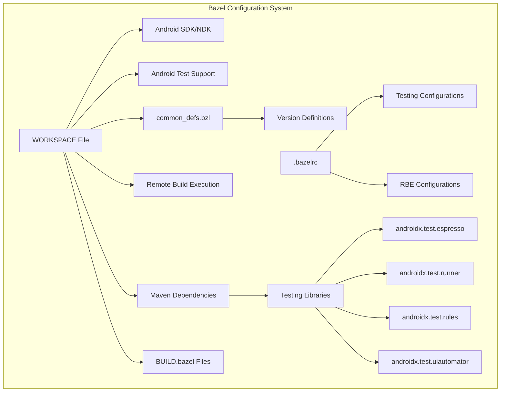

Sources: [WORKSPACE:1-116](), [common_defs.bzl:1-16](), [.bazelrc:1-75]()

### Common Definitions

The `common_defs.bzl` file contains shared constants for Bazel builds, similar to the ext block in Gradle:

```
androidxLibVersion = "1.0.0"
coreVersion = "1.2.0-beta01"
extJUnitVersion = "1.1.1-beta01"
extTruthVersion = "1.2.0-beta01"
runnerVersion = "1.2.0-beta01"
rulesVersion = "1.2.0-beta01"
espressoVersion = "3.2.0-beta01"
uiAutomatorVersion = "2.2.0"
```

Sources: [common_defs.bzl:6-15]()

### Testing Configuration

Bazel testing is configured through the `.bazelrc` file, which provides several testing configurations:

- Headless instrumentation tests
- Graphical instrumentation tests
- Testing with local emulators or devices
- Remote Build Execution (RBE) configuration

Sources: [.bazelrc:4-74]()

### Remote Build Execution

The repository supports remote execution of builds and tests through Bazel's Remote Build Execution (RBE) feature. This is configured in both the `WORKSPACE` file and `.bazelrc`.

The RBE configuration:
- Sets up the remote instance
- Configures authentication
- Defines execution strategies
- Sets up platform configurations for Android

Sources: [WORKSPACE:102-115](), [.bazelrc:25-74]()

## Comparison of Gradle vs Bazel

| Feature | Gradle | Bazel |
|---------|--------|-------|
| **Primary Use** | Default Android build system | Alternative build system |
| **Build Speed** | Fast for incremental builds | Fast for clean builds, hermetic builds |
| **Configuration** | build.gradle files | WORKSPACE, BUILD.bazel files |
| **Dependency Management** | Managed in ext block | Managed in WORKSPACE and common_defs.bzl |
| **Version Updates** | Via update_versions.sh | Manual updates in common_defs.bzl |
| **Remote Execution** | Limited support | Native support through RBE |
| **CI Integration** | Various CI systems | BazelCI configured |

Sources: [ui/espresso/BasicSample/build.gradle](), [WORKSPACE](), [bazelci/buildkite-pipeline.yml]()

## Dependency Management

The repository employs a consistent strategy for managing dependencies across both build systems. For more details on dependency management, see [Dependency Management](#2.3).

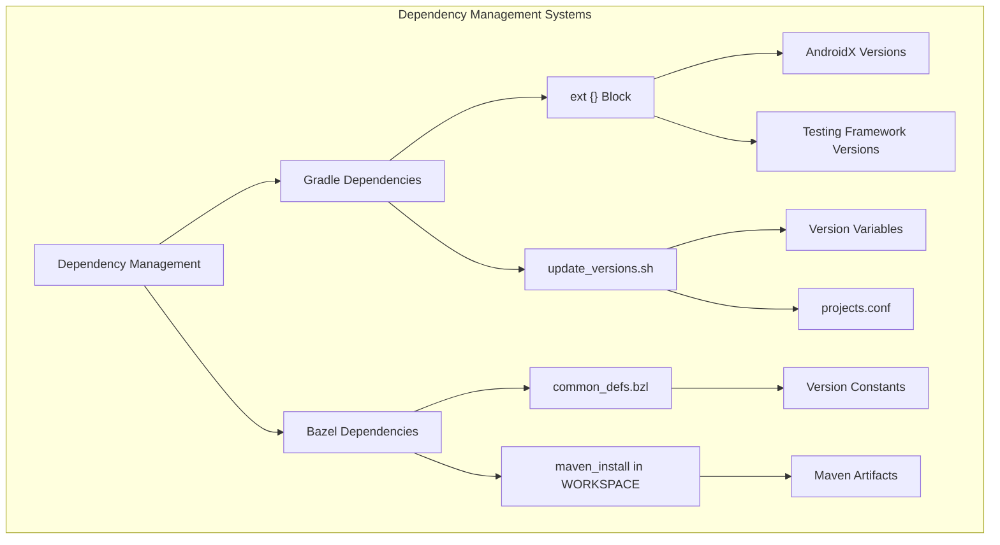

Sources: [ui/espresso/BasicSample/build.gradle:28-37](), [update_versions.sh:11-35](), [WORKSPACE:56-101](), [common_defs.bzl:6-15]()

## Gradle Wrapper

The Gradle Wrapper ensures consistent builds across different development environments. For detailed information about the Gradle Wrapper configuration, see [Gradle Wrapper](#2.4).

Sources: [ui/espresso/BasicSample/build.gradle:3-18]()

---

# Page: Gradle Configuration

# Gradle Configuration

<details>
<summary>Relevant source files</summary>

The following files were used as context for generating this wiki page:

- [integration/ServiceTestRuleSample/app/build.gradle](integration/ServiceTestRuleSample/app/build.gradle)
- [integration/ServiceTestRuleSample/build.gradle](integration/ServiceTestRuleSample/build.gradle)
- [runner/AndroidJunitRunnerSample/app/build.gradle](runner/AndroidJunitRunnerSample/app/build.gradle)
- [runner/AndroidJunitRunnerSample/build.gradle](runner/AndroidJunitRunnerSample/build.gradle)
- [runner/AndroidTestOrchestratorSample/app/build.gradle](runner/AndroidTestOrchestratorSample/app/build.gradle)
- [runner/AndroidTestOrchestratorWithTestCoverageSample/app/build.gradle](runner/AndroidTestOrchestratorWithTestCoverageSample/app/build.gradle)
- [runner/AndroidTestOrchestratorWithTestCoverageSample/build.gradle](runner/AndroidTestOrchestratorWithTestCoverageSample/build.gradle)
- [ui/espresso/BasicSample/app/build.gradle](ui/espresso/BasicSample/app/build.gradle)
- [ui/espresso/BasicSample/build.gradle](ui/espresso/BasicSample/build.gradle)
- [ui/espresso/CustomMatcherSample/app/build.gradle](ui/espresso/CustomMatcherSample/app/build.gradle)
- [ui/espresso/CustomMatcherSample/build.gradle](ui/espresso/CustomMatcherSample/build.gradle)
- [ui/espresso/DataAdapterSample/app/build.gradle](ui/espresso/DataAdapterSample/app/build.gradle)
- [ui/espresso/DataAdapterSample/build.gradle](ui/espresso/DataAdapterSample/build.gradle)
- [ui/espresso/EspressoDeviceSample/app/build.gradle](ui/espresso/EspressoDeviceSample/app/build.gradle)
- [ui/espresso/EspressoDeviceSample/build.gradle](ui/espresso/EspressoDeviceSample/build.gradle)
- [ui/espresso/EspressoDeviceSample/gradle/wrapper/gradle-wrapper.properties](ui/espresso/EspressoDeviceSample/gradle/wrapper/gradle-wrapper.properties)
- [ui/espresso/FragmentScenarioSample/app/build.gradle](ui/espresso/FragmentScenarioSample/app/build.gradle)
- [ui/espresso/IdlingResourceSample/app/build.gradle](ui/espresso/IdlingResourceSample/app/build.gradle)
- [ui/espresso/IdlingResourceSample/build.gradle](ui/espresso/IdlingResourceSample/build.gradle)
- [ui/espresso/IntentsAdvancedSample/app/build.gradle](ui/espresso/IntentsAdvancedSample/app/build.gradle)
- [ui/espresso/IntentsAdvancedSample/build.gradle](ui/espresso/IntentsAdvancedSample/build.gradle)
- [ui/espresso/IntentsBasicSample/app/build.gradle](ui/espresso/IntentsBasicSample/app/build.gradle)
- [ui/espresso/IntentsBasicSample/build.gradle](ui/espresso/IntentsBasicSample/build.gradle)
- [ui/espresso/MultiProcessSample/app/build.gradle](ui/espresso/MultiProcessSample/app/build.gradle)
- [ui/espresso/MultiWindowSample/app/build.gradle](ui/espresso/MultiWindowSample/app/build.gradle)
- [ui/espresso/MultiWindowSample/build.gradle](ui/espresso/MultiWindowSample/build.gradle)
- [ui/espresso/RecyclerViewSample/app/build.gradle](ui/espresso/RecyclerViewSample/app/build.gradle)
- [ui/espresso/RecyclerViewSample/build.gradle](ui/espresso/RecyclerViewSample/build.gradle)
- [ui/espresso/ScreenshotSample/gradle/wrapper/gradle-wrapper.properties](ui/espresso/ScreenshotSample/gradle/wrapper/gradle-wrapper.properties)
- [ui/espresso/WebBasicSample/app/build.gradle](ui/espresso/WebBasicSample/app/build.gradle)
- [ui/espresso/WebBasicSample/build.gradle](ui/espresso/WebBasicSample/build.gradle)
- [ui/uiautomator/BasicSample/app/build.gradle](ui/uiautomator/BasicSample/app/build.gradle)
- [ui/uiautomator/BasicSample/build.gradle](ui/uiautomator/BasicSample/build.gradle)
- [unit/BasicSample/app/build.gradle](unit/BasicSample/app/build.gradle)
- [unit/BasicUnitAndroidTest/app/build.gradle](unit/BasicUnitAndroidTest/app/build.gradle)

</details>


## Purpose and Scope

This document describes the Gradle build configuration used across the Android Testing Samples repository. It explains how the build system is structured, how dependencies are managed, and how tests are configured for execution. For information about Bazel configuration, see [Bazel Configuration](#2.2). For information about dependency management across build systems, see [Dependency Management](#2.3).

## Gradle Configuration Structure

The Android Testing Samples repository follows a standard Android multi-module project structure with a consistent Gradle configuration pattern across sample projects. Each sample contains both project-level and module-level Gradle configuration files.

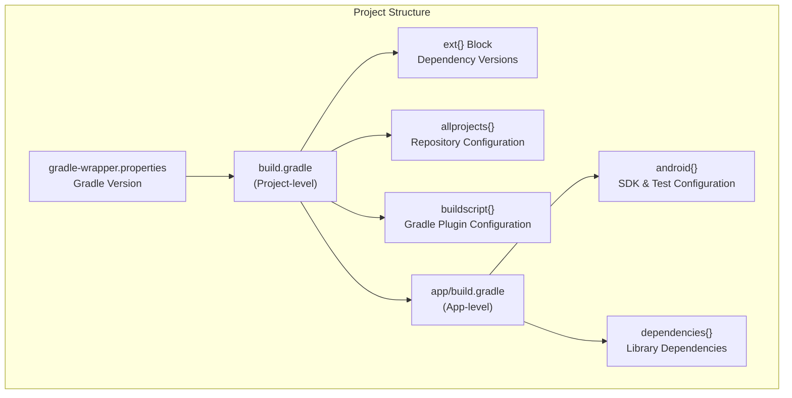

Sources: [ui/espresso/BasicSample/build.gradle:1-38](), [ui/espresso/BasicSample/app/build.gradle:1-71](), [ui/espresso/ScreenshotSample/gradle/wrapper/gradle-wrapper.properties:1-7]()

## Project-Level Gradle Configuration 

The top-level `build.gradle` file defines common configurations applied to all modules in a sample. This includes:

1. Plugin versions
2. Repository configurations
3. Common dependency versions

### Common Project-Level Structure

The project-level `build.gradle` follows a consistent structure across samples:

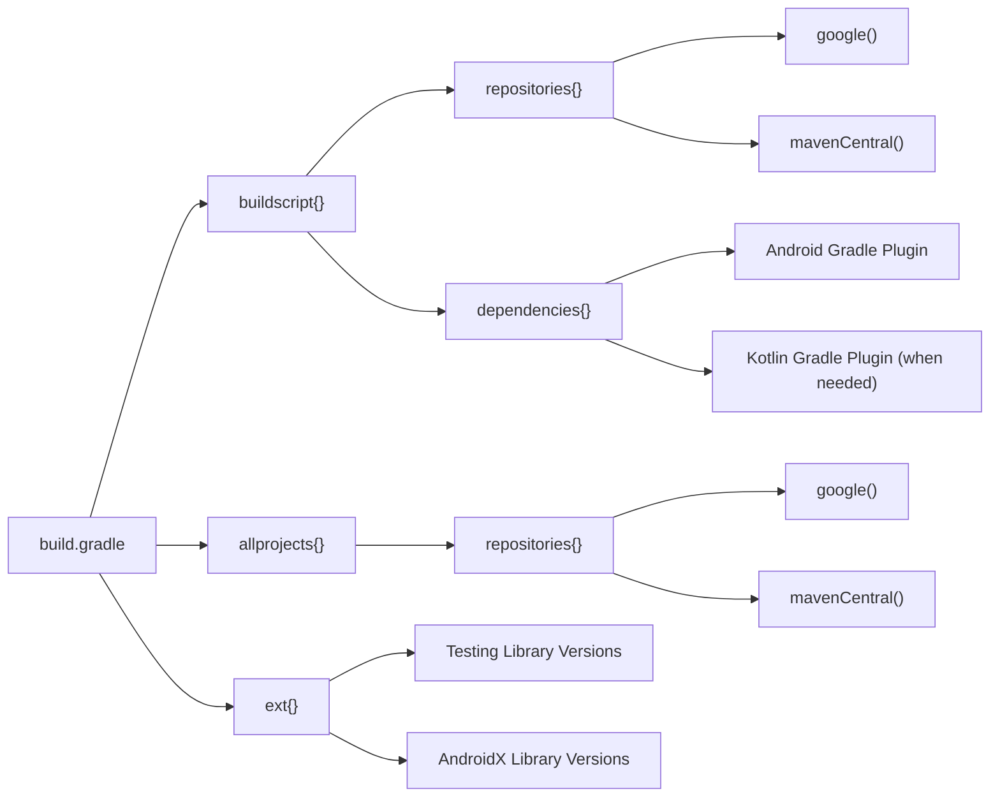

Sources: [ui/espresso/BasicSample/build.gradle:3-26](), [ui/espresso/DataAdapterSample/build.gradle:3-25]()

### Key Project-Level Configurations

#### Android Gradle Plugin Configuration

The Android Gradle Plugin (AGP) version is defined as an extension property and used in the buildscript dependencies:

```
buildscript {
    ext.agpVersion = "8.5.0"
    ...
    dependencies {
        classpath "com.android.tools.build:gradle:$agpVersion"
        ...
    }
}
```

Sources: [ui/espresso/BasicSample/build.gradle:3-17](), [ui/espresso/DataAdapterSample/build.gradle:3-16]()

#### Repository Configuration

Repositories are defined in both the `buildscript` and `allprojects` blocks:

```
buildscript {
    repositories {
        // Insert local test repo here
        google()
        mavenCentral()
    }
}

allprojects {
    repositories {
        // Insert local test repo here
        google()
        mavenCentral()
    }
}
```

Sources: [ui/espresso/BasicSample/build.gradle:6-25](), [ui/espresso/DataAdapterSample/build.gradle:5-24]()

#### Dependency Version Declaration

Testing dependencies are defined in the `ext` block, making them accessible to all modules:

```
ext {
    androidxAnnotationVersion = "1.5.0"
    robolectricVersion = "4.13"
    guavaVersion = "31.1-android"
    extTruthVersion = "1.6.0"
    coreVersion = "1.6.1"
    extJUnitVersion = "1.2.1"
    runnerVersion = "1.6.1"
    espressoVersion = "3.6.1"
}
```

Sources: [ui/espresso/BasicSample/build.gradle:28-37](), [ui/espresso/DataAdapterSample/build.gradle:26-34]()

## App-Level Gradle Configuration

The app-level `build.gradle` file contains module-specific configurations including:

1. SDK configurations
2. Application properties
3. Test instrumentation configuration
4. Dependency declarations

### Common App-Level Structure

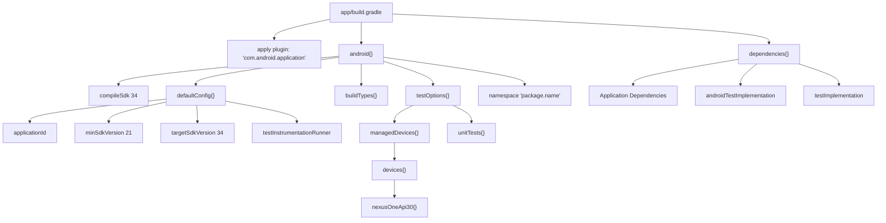

Sources: [ui/espresso/BasicSample/app/build.gradle:1-41](), [runner/AndroidJunitRunnerSample/app/build.gradle:1-42]()

### Key App-Level Configurations

#### Android SDK Configuration

SDK versions are defined in the Android block:

```
android {
    compileSdk 34
    defaultConfig {
        minSdkVersion 21
        targetSdkVersion 34
        ...
    }
}
```

Sources: [ui/espresso/BasicSample/app/build.gradle:5-9](), [runner/AndroidJunitRunnerSample/app/build.gradle:4-9]()

#### Test Instrumentation Configuration

The test instrumentation runner is specified in the defaultConfig block:

```
defaultConfig {
    ...
    testInstrumentationRunner "androidx.test.runner.AndroidJUnitRunner"
}
```

Some samples include additional test instrumentation arguments:

```
defaultConfig {
    ...
    testInstrumentationRunner "androidx.test.runner.AndroidJUnitRunner"
    testInstrumentationRunnerArguments clearPackageData: "true"
}
```

Sources: [ui/espresso/BasicSample/app/build.gradle:14-15](), [runner/AndroidTestOrchestratorSample/app/build.gradle:12-13]()

#### Managed Devices Configuration

Virtual devices for testing are configured in the testOptions block:

```
testOptions {
    managedDevices {
        devices {
            nexusOneApi30(com.android.build.api.dsl.ManagedVirtualDevice) {
                device = "Nexus One"
                apiLevel = 30
                systemImageSource = "aosp-atd"
            }
        }
    }
}
```

Sources: [ui/espresso/BasicSample/app/build.gradle:24-33](), [runner/AndroidJunitRunnerSample/app/build.gradle:23-35]()

#### Test Orchestrator Configuration

For samples using the Android Test Orchestrator, additional configuration is required:

```
testOptions {
    execution "ANDROIDX_TEST_ORCHESTRATOR"
}
```

And additional dependencies:

```
androidTestUtil "androidx.test:orchestrator:" + rootProject.orchestratorVersion
```

Sources: [runner/AndroidTestOrchestratorSample/app/build.gradle:24-25](), [runner/AndroidTestOrchestratorSample/app/build.gradle:54]()

## Dependency Management

Dependencies in the Android Testing Samples are managed using version variables defined in the top-level `build.gradle` file. This approach ensures consistent dependency versions across all modules.

### Dependency Declaration Flow

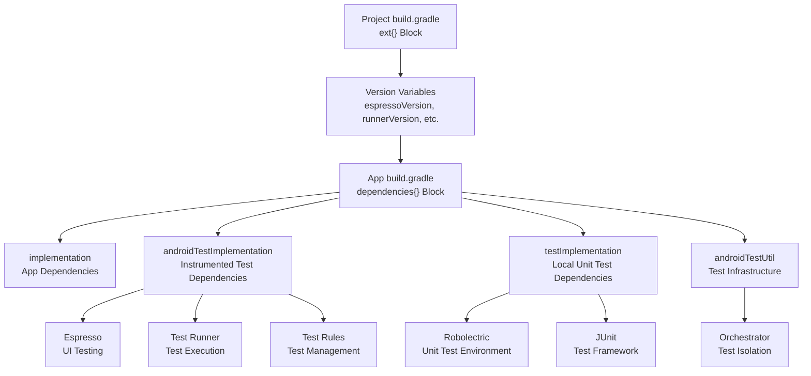

Sources: [ui/espresso/BasicSample/build.gradle:28-37](), [ui/espresso/BasicSample/app/build.gradle:50-70]()

### Common Testing Dependencies

The samples include several common testing dependencies:

| Dependency Type | Purpose | Example Declaration |
|-----------------|---------|---------------------|
| Unit Testing | Local tests running on JVM | `testImplementation "androidx.test:core:" + rootProject.coreVersion` |
| Instrumented Testing | Android device tests | `androidTestImplementation "androidx.test.espresso:espresso-core:" + rootProject.espressoVersion` |
| Test Infrastructure | Test setup | `androidTestUtil "androidx.test:orchestrator:" + rootProject.orchestratorVersion` |

Sources: [ui/espresso/BasicSample/app/build.gradle:56-69](), [runner/AndroidTestOrchestratorSample/app/build.gradle:48-54]()

### Version Management

Dependency versions are centrally defined in the top-level build.gradle file and referenced in module-level build.gradle files:

```
// In project-level build.gradle
ext {
    espressoVersion = "3.6.1"
    runnerVersion = "1.6.1"
}

// In app-level build.gradle
dependencies {
    androidTestImplementation "androidx.test.espresso:espresso-core:" + rootProject.espressoVersion
    androidTestImplementation "androidx.test:runner:" + rootProject.runnerVersion
}
```

Sources: [ui/espresso/BasicSample/build.gradle:28-37](), [ui/espresso/BasicSample/app/build.gradle:61]()

## Test Configuration

The Android Testing Samples repository includes various test configurations for different testing scenarios.

### Instrumented Test Configuration Flow

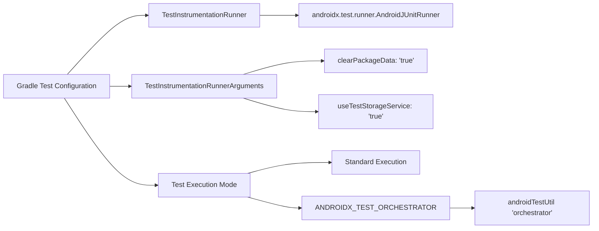

Sources: [runner/AndroidJunitRunnerSample/app/build.gradle:13-14](), [runner/AndroidTestOrchestratorSample/app/build.gradle:12-14](), [runner/AndroidTestOrchestratorSample/app/build.gradle:24-25]()

### Local Unit Test Configuration

Local unit tests are configured in the testOptions block:

```
testOptions {
    unitTests {
        includeAndroidResources = true
    }
}
```

This enables access to Android resources in local unit tests, particularly useful with Robolectric.

Sources: [ui/espresso/BasicSample/app/build.gradle:19-21](), [ui/espresso/DataAdapterSample/app/build.gradle:17-19]()

### Test Coverage Configuration

For projects that require test coverage reporting, additional configuration is needed:

```
buildTypes {
    debug {
        testCoverageEnabled true
    }
}
```

Sources: [runner/AndroidTestOrchestratorWithTestCoverageSample/app/build.gradle:17-19]()

### Source Set Configuration

Some samples share test code between instrumented and local unit tests:

```
sourceSets {
    test {
        java.srcDir "src/sharedTest/java"
    }
    androidTest {
        java.srcDir "src/sharedTest/java"
    }
}
```

Sources: [ui/espresso/IntentsBasicSample/app/build.gradle:34-41](), [ui/espresso/DataAdapterSample/app/build.gradle:34-41]()

## Gradle Tasks for Testing

The Android Testing Samples include several Gradle tasks for executing tests.

### Common Test Tasks

| Task | Description | Example Usage |
|------|-------------|--------------|
| `testDebugUnitTest` | Runs local unit tests on the debug variant | `./gradlew testDebugUnitTest` |
| `connectedDebugAndroidTest` | Runs instrumented tests on a connected device | `./gradlew connectedDebugAndroidTest` |
| `nexusOneApi30DebugAndroidTest` | Runs instrumented tests on a managed device | `./gradlew nexusOneApi30DebugAndroidTest` |

Sources: [ui/espresso/BasicSample/app/build.gradle:26](), [runner/AndroidJunitRunnerSample/app/build.gradle:27]()

## Gradle Wrapper Configuration

The Gradle Wrapper ensures consistent builds across different environments by specifying a fixed Gradle version. The configuration is stored in `gradle-wrapper.properties`:

```
distributionBase=GRADLE_USER_HOME
distributionPath=wrapper/dists
distributionUrl=https\://services.gradle.org/distributions/gradle-8.7-bin.zip
zipStoreBase=GRADLE_USER_HOME
zipStorePath=wrapper/dists
```

Sources: [ui/espresso/ScreenshotSample/gradle/wrapper/gradle-wrapper.properties:1-7](), [ui/espresso/EspressoDeviceSample/gradle/wrapper/gradle-wrapper.properties:1-6]()

---

# Page: Bazel Configuration

# Bazel Configuration

<details>
<summary>Relevant source files</summary>

The following files were used as context for generating this wiki page:

- [.bazelrc](.bazelrc)
- [BUILD.bazel](BUILD.bazel)
- [WORKSPACE](WORKSPACE)
- [bazelci/buildkite-pipeline.yml](bazelci/buildkite-pipeline.yml)
- [common_defs.bzl](common_defs.bzl)
- [ui/espresso/BasicSample/BUILD.bazel](ui/espresso/BasicSample/BUILD.bazel)
- [ui/espresso/CustomMatcherSample/BUILD.bazel](ui/espresso/CustomMatcherSample/BUILD.bazel)
- [ui/espresso/DataAdapterSample/BUILD.bazel](ui/espresso/DataAdapterSample/BUILD.bazel)
- [ui/espresso/IdlingResourceSample/BUILD.bazel](ui/espresso/IdlingResourceSample/BUILD.bazel)
- [ui/espresso/IntentsAdvancedSample/BUILD.bazel](ui/espresso/IntentsAdvancedSample/BUILD.bazel)
- [ui/espresso/IntentsBasicSample/BUILD.bazel](ui/espresso/IntentsBasicSample/BUILD.bazel)
- [ui/espresso/MultiWindowSample/BUILD.bazel](ui/espresso/MultiWindowSample/BUILD.bazel)
- [ui/espresso/RecyclerViewSample/BUILD.bazel](ui/espresso/RecyclerViewSample/BUILD.bazel)
- [ui/uiautomator/BasicSample/BUILD.bazel](ui/uiautomator/BasicSample/BUILD.bazel)

</details>


This page explains how the Android Testing Samples repository is configured to use Bazel as a build system for compiling and testing Android applications. It covers the workspace setup, dependency management, build definitions, and test configurations. For information about Gradle configuration, see [Gradle Configuration](#2.1).

## 1. Overview of Bazel in Android Testing Samples

Bazel is a build system developed by Google that focuses on fast, reproducible builds with explicit dependencies. In the Android Testing Samples repository, Bazel provides an alternative build system to Gradle, offering:

- Consistent builds across different environments
- Efficient parallel execution and caching
- Precise control over test execution
- Remote Build Execution (RBE) capabilities

The repository uses Bazel to demonstrate how to configure and run Android instrumentation tests across different API levels and test environments.

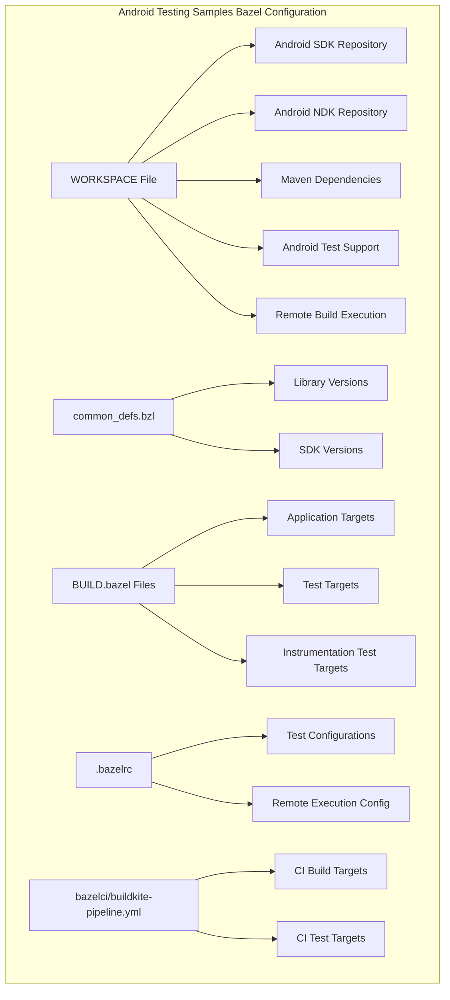

Sources: [WORKSPACE](), [common_defs.bzl](), [BUILD.bazel](), [.bazelrc](), [bazelci/buildkite-pipeline.yml]()

## 2. Workspace Configuration

The `WORKSPACE` file serves as the primary configuration file for Bazel, defining external dependencies and tools needed for building and testing Android applications.

### 2.1. Android SDK and NDK Setup

Bazel needs access to the Android SDK and NDK to build Android applications. These are configured with repository rules at the top of the `WORKSPACE` file:

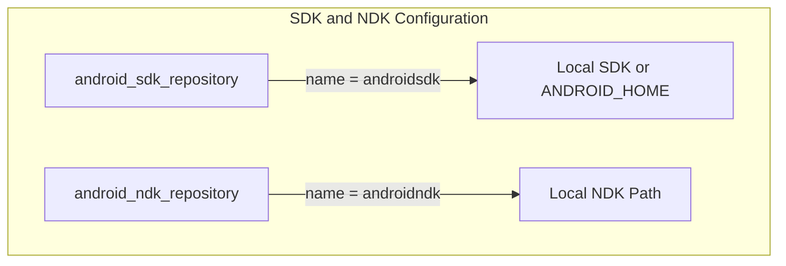

Sources: [WORKSPACE:4-8]()

### 2.2. Android Test Support

Android Test Support provides tools for running Android instrumentation tests, including emulator definitions and test runners:

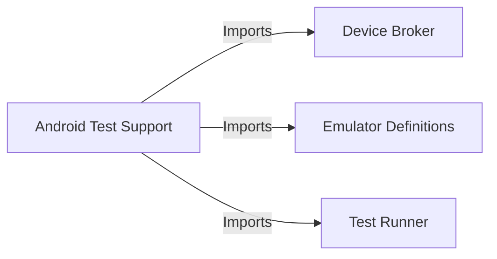

Sources: [WORKSPACE:10-27]()

### 2.3. Maven Dependencies

The repository uses `rules_jvm_external` to manage Maven dependencies, providing a familiar Maven-like dependency system within Bazel:

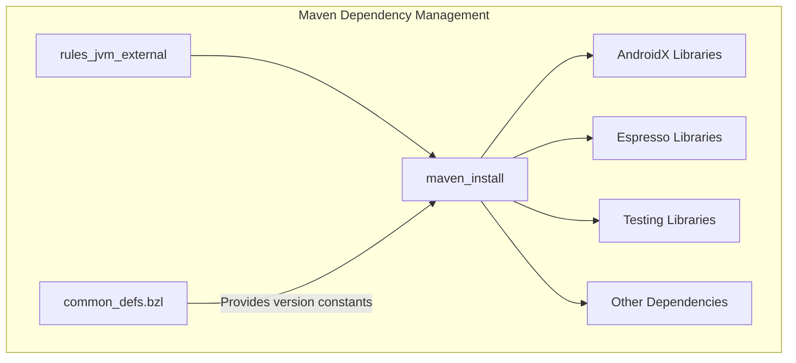

Sources: [WORKSPACE:29-101](), [common_defs.bzl:1-15]()

The key dependencies loaded include:
- AndroidX libraries (Annotation, Core, RecyclerView)
- Espresso testing framework components
- JUnit and related extensions
- Support libraries for testing

Each dependency is specified with a version that is defined in the `common_defs.bzl` file, allowing for centralized version management.

### 2.4. Remote Build Execution

The `WORKSPACE` file also configures Remote Build Execution (RBE), which enables tests to run on remote instances:

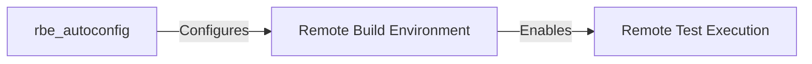

Sources: [WORKSPACE:102-115](), [.bazelrc:25-74]()

## 3. Common Definitions and Constants

The `common_defs.bzl` file defines constants used throughout the Bazel configuration, ensuring consistency across the repository.

| Constant | Purpose | Example Value |
|----------|---------|---------------|
| androidxLibVersion | Version for AndroidX libraries | 1.0.0 |
| coreVersion | Version for AndroidX test core | 1.2.0-beta01 |
| espressoVersion | Version for Espresso libraries | 3.2.0-beta01 |
| runnerVersion | Version for test runner | 1.2.0-beta01 |
| minSdkVersion | Minimum supported Android SDK | 14 |
| targetSdkVersion | Target Android SDK version | 28 |

Sources: [common_defs.bzl:1-15]()

## 4. Project Structure and Build Files

Each sample project in the repository contains a `BUILD.bazel` file that defines how the application and its tests are built.

### 4.1. Basic Build Target Structure

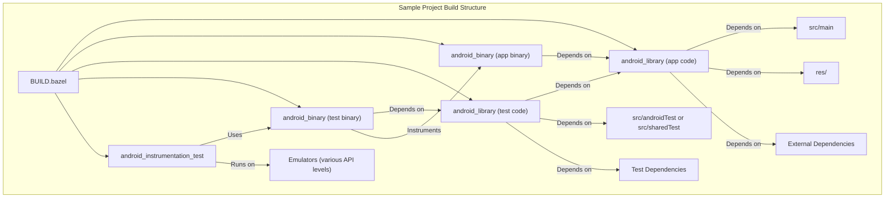

Sources: [ui/espresso/BasicSample/BUILD.bazel:1-61](), [ui/uiautomator/BasicSample/BUILD.bazel:1-52]()

### 4.2. Application Build Configuration

The application code is defined as an `android_library` target, which includes the source code, resources, and manifest:

```
android_library(
    name = "SampleLib",
    srcs = glob(["app/src/main/**/*.java"]),
    custom_package = "com.example.android.testing...",
    manifest = "app/src/main/AndroidManifest.xml",
    resource_files = glob(["app/src/main/res/**/*"]),
    deps = [
        # Dependencies
    ],
)
```

This library is then used to create an `android_binary` target, which is the actual application:

```
android_binary(
    name = "Sample",
    custom_package = "com.example.android.testing...",
    manifest = "app/src/main/AppManifest.xml",
    manifest_values = {
        "minSdkVersion": minSdkVersion,
        "targetSdkVersion": targetSdkVersion,
    },
    deps = [":SampleLib"],
)
```

Sources: [ui/espresso/BasicSample/BUILD.bazel:6-26](), [ui/espresso/IdlingResourceSample/BUILD.bazel:6-28]()

### 4.3. Test Build Configuration

Tests are also defined as an `android_library` and `android_binary`, but with additional configuration:

```
android_library(
    name = "SampleTestLib",
    srcs = glob(["app/src/androidTest/**/*.java"]),
    custom_package = "com.example.android.testing...test",
    deps = [
        ":SampleLib",
        "//:test_deps",
        # Other test-specific dependencies
    ],
)

android_binary(
    name = "SampleTest",
    custom_package = "com.example.android.testing...test",
    instruments = ":Sample",
    manifest = "app/src/androidTest/AndroidManifest.xml",
    manifest_values = {
        "minSdkVersion": minSdkVersion,
        "targetSdkVersion": targetSdkVersion,
    },
    deps = [":SampleTestLib"],
)
```

Sources: [ui/espresso/BasicSample/BUILD.bazel:28-48](), [ui/espresso/IntentsBasicSample/BUILD.bazel:30-56]()

### 4.4. Instrumentation Test Configuration

Instrumentation tests are defined for multiple API levels using a list comprehension:

```
API_LEVELS = [
    "19_x86",
    "21_x86",
    "22_x86",
    "23_x86",
]

[android_instrumentation_test(
    name = "SampleInstrumentationTest_%s" % API_LEVEL,
    target_device = "@android_test_support//tools/android/emulated_devices/generic_phone:android_%s_qemu2" % API_LEVEL,
    test_app = ":SampleTest",
) for API_LEVEL in API_LEVELS]
```

This creates separate test targets for each API level, allowing tests to be run on different Android versions.

Sources: [ui/espresso/BasicSample/BUILD.bazel:50-61](), [ui/uiautomator/BasicSample/BUILD.bazel:41-52]()

## 5. Common Test Dependencies

The root `BUILD.bazel` file defines a common set of test dependencies used across all samples:

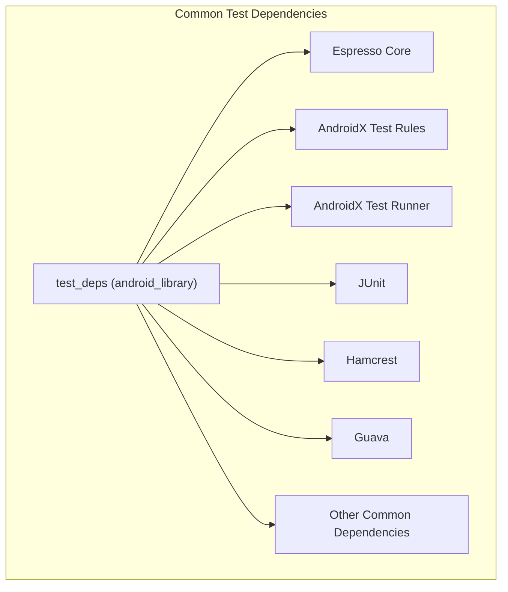

Sources: [BUILD.bazel:6-23]()

## 6. Runtime Configuration

The `.bazelrc` file provides runtime configuration options for Bazel, defining how tests are executed in different environments.

### 6.1. Test Execution Modes

```mermaid
graph TD
    subgraph "Bazel Test Configurations"
        bazelrc[".bazelrc"]
        
        bazelrc --> headless["Headless Mode"]
        bazelrc --> gui["GUI Mode"]
        bazelrc --> localDevice["Local Device Mode"]
        bazelrc --> remote["Remote Execution Mode"]
        
        headless -->|"--test_arg=--enable_display=false"| NoDisplay["No Display Needed"]
        gui -->|"--test_env=DISPLAY"| DisplayEnv["Requires $DISPLAY"]
        gui -->|"--test_arg=--enable_display=true"| EnableDisplay["Enable Display"]
        
        localDevice -->|"--test_strategy=exclusive"| SerialTests["Run Tests Serially"]
        localDevice -->|"--device_broker_type=LOCAL_ADB_SERVER"| AdbServer["Use Local ADB Server"]
        
        remote -->|"Using RBE configuration"| RemoteExec["Execute on Remote Instances"]
    end
```

Sources: [.bazelrc:1-74]()

### 6.2. Remote Build Execution Configuration

The `.bazelrc` file includes detailed configuration for Remote Build Execution (RBE), which allows tests to be run on remote machines:

```
# Remote instance setup
build:remote --remote_instance_name=projects/bazel-untrusted/instances/default_instance
build:remote --project_id=bazel-untrusted

# Set various strategies for remote execution
build:remote --spawn_strategy=remote
build:remote --define=EXECUTOR=remote

# Enable the remote cache and execution
build:remote --remote_cache=remotebuildexecution.googleapis.com
build:remote --remote_executor=remotebuildexecution.googleapis.com
```

Additionally, there is specialized configuration for Android remote execution:

```
build:remote_android --config=remote  # Reuse general configuration
build:remote_android --extra_execution_platforms=:android_platform
build:remote_android --host_platform=:android_platform
build:remote_android --platforms=:android_platform
```

Sources: [.bazelrc:25-74](), [BUILD.bazel:26-54]()

## 7. Continuous Integration Support

The repository includes configuration for Bazel Continuous Integration (CI) in the `bazelci/buildkite-pipeline.yml` file.

### 7.1. CI Build and Test Targets

The CI configuration specifies:
- Build targets (what to build)
- Test targets (what to test)
- Test flags (how to run tests)
- Platform-specific configurations (Ubuntu, macOS, Windows)

For example, on Ubuntu:

```
platforms:
  ubuntu1804:
    build_targets:
    - "//..."
    - "-//ui/uiautomator/BasicSample:BasicSampleInstrumentationTest_23_x86" # Excluded
    test_flags:
    - "--config=remote_android"
    - "--flaky_test_attempts=3"
    test_targets:
    - "//..."
    - "-//ui/espresso/AccessibilitySample/..." # Excluded
```

Note that certain tests are excluded from CI as they require an Android emulator that is not available in the CI environment.

Sources: [bazelci/buildkite-pipeline.yml:1-137]()

## 8. Summary

Bazel provides a robust build system for the Android Testing Samples repository, with precise control over dependencies, build configurations, and test execution. The key components of the Bazel configuration are:

1. The `WORKSPACE` file for external dependencies and tools
2. `common_defs.bzl` for shared constants and versions
3. Project-specific `BUILD.bazel` files for application and test targets
4. The `.bazelrc` file for runtime configuration
5. CI configuration for automated testing

This structure enables consistent, reliable builds and tests across different environments, from local development to continuous integration.

---

# Page: Dependency Management

# Dependency Management

<details>
<summary>Relevant source files</summary>

The following files were used as context for generating this wiki page:

- [integration/ServiceTestRuleSample/build.gradle](integration/ServiceTestRuleSample/build.gradle)
- [runner/AndroidJunitRunnerSample/build.gradle](runner/AndroidJunitRunnerSample/build.gradle)
- [runner/AndroidTestOrchestratorSample/build.gradle](runner/AndroidTestOrchestratorSample/build.gradle)
- [ui/espresso/BasicSample/build.gradle](ui/espresso/BasicSample/build.gradle)
- [ui/espresso/CustomMatcherSample/build.gradle](ui/espresso/CustomMatcherSample/build.gradle)
- [ui/espresso/DataAdapterSample/build.gradle](ui/espresso/DataAdapterSample/build.gradle)
- [ui/espresso/IdlingResourceSample/build.gradle](ui/espresso/IdlingResourceSample/build.gradle)
- [ui/espresso/IntentsAdvancedSample/build.gradle](ui/espresso/IntentsAdvancedSample/build.gradle)
- [ui/espresso/IntentsBasicSample/build.gradle](ui/espresso/IntentsBasicSample/build.gradle)
- [ui/espresso/MultiWindowSample/build.gradle](ui/espresso/MultiWindowSample/build.gradle)
- [ui/espresso/RecyclerViewSample/build.gradle](ui/espresso/RecyclerViewSample/build.gradle)
- [ui/espresso/WebBasicSample/build.gradle](ui/espresso/WebBasicSample/build.gradle)
- [ui/uiautomator/BasicSample/build.gradle](ui/uiautomator/BasicSample/build.gradle)
- [update_versions.sh](update_versions.sh)

</details>


## Purpose and Scope

This document describes the dependency management system used across the Android Testing Samples repository. It explains how library versions are defined, managed, and updated consistently across the various sample projects. This includes how version numbers are stored, how they are referenced in build files, and the mechanisms for updating them.

For information about specific Gradle configuration details, see [Gradle Configuration](#2.1). For Bazel-specific dependency management, see [Bazel Configuration](#2.2).

## Overview

The Android Testing Samples repository contains numerous example projects demonstrating different testing techniques, each requiring consistent dependency versions to ensure compatibility. To facilitate this, the repository implements a centralized dependency management system.

```mermaid
graph TD
    A["Dependency Management System"] --> B["Central Version Definitions"]
    A --> C["Version Update Mechanism"]
    A --> D["Project-level Implementation"]
    
    B --> B1["Version Variables in update_versions.sh"]
    
    C --> C1["update_versions.sh Script"]
    C --> C2["projects.conf List"]
    
    D --> D1["Project build.gradle Files"]
    D --> D2["ext Block with Version Constants"]
    
    C1 -->|"Updates"| D1
    B1 -->|"Defines"| C1
    C2 -->|"Specifies Target Projects"| C1
```

Sources: [update_versions.sh](), [ui/espresso/BasicSample/build.gradle]()

## Version Definition Structure

Dependency versions are primarily defined in two places: the `update_versions.sh` script (the source of truth) and project-level `build.gradle` files (which are updated by the script).

### Central Version Definitions

The `update_versions.sh` script contains the master definitions of all dependency versions used across the samples:

```mermaid
graph TD
    subgraph "update_versions.sh"
        A["Android Build Tools"] --> A1["agpVersion = 8.5.0"]
        A --> A2["kotlinVersion = 1.9.22"]
        A --> A3["compileSdk = 34"]
        A --> A4["minSdkVersion = 21"]
        A --> A5["targetSdkVersion = 34"]
        
        B["AndroidX Libraries"] --> B1["androidxAnnotationVersion = 1.5.0"]
        B --> B2["androidxCompatVersion = 1.5.1"]
        B --> B3["androidxCoreVersion = 1.9.0"]
        B --> B4["androidxFragmentVersion = 1.5.3"]
        B --> B5["androidxRecyclerVersion = 1.2.1"]
        
        C["Testing Frameworks"] --> C1["runnerVersion = 1.6.1"]
        C --> C2["monitorVersion = 1.7.1"]
        C --> C3["rulesVersion = 1.6.1"]
        C --> C4["servicesVersion = 1.5.0"]
        C --> C5["orchestratorVersion = 1.5.0"]
        C --> C6["coreVersion = 1.6.1"]
        C --> C7["extJUnitVersion = 1.2.1"]
        C --> C8["extTruthVersion = 1.6.0"]
        C --> C9["espressoVersion = 3.6.1"]
        C --> C10["uiAutomatorVersion = 2.3.0"]
        
        D["Utility Libraries"] --> D1["guavaVersion = 31.1-android"]
        D --> D2["truthVersion = 1.1.3"]
        D --> D3["robolectricVersion = 4.13"]
    end
```

Sources: [update_versions.sh:11-35]()

### Project-level Implementation

Each project defines its required dependency versions in the `ext` block of its root `build.gradle` file. While projects may use different subsets of dependencies based on their requirements, the version numbers are kept consistent across all projects.

```mermaid
graph TD
    subgraph "Project build.gradle"
        A["ext Block"] --> B["Testing Framework Versions"]
        A --> C["AndroidX Library Versions"]
        A --> D["Utility Library Versions"]
        
        B --> B1["coreVersion = 1.6.1"]
        B --> B2["extJUnitVersion = 1.2.1"]
        B --> B3["runnerVersion = 1.6.1"]
        B --> B4["espressoVersion = 3.6.1"]
        B --> B5["rulesVersion = 1.6.1"]
        
        C --> C1["androidxAnnotationVersion = 1.5.0"]
        C --> C2["androidxCoreVersion = 1.9.0"]
        C --> C3["androidxRecyclerVersion = 1.2.1"]
        
        D --> D1["guavaVersion = 31.1-android"]
        D --> D2["robolectricVersion = 4.13"]
    end
```

Sources: [ui/espresso/BasicSample/build.gradle:28-37](), [ui/espresso/RecyclerViewSample/build.gradle:42-51]()

## Version Update Mechanism

The repository includes a shell script (`update_versions.sh`) that automates the process of updating dependency versions across all projects.

### Update Script Workflow

```mermaid
flowchart TD
    A["update_versions.sh"] -->|"1. Read"| B["projects.conf"]
    A -->|"2. Define"| C["Version Variables"]
    A -->|"3. For each project"| D["Update build.gradle Files"]
    
    B -->|"Lists all projects to update"| D
    C -->|"Provides version values"| D
    
    D -->|"Using sed commands"| E["Replace Version Strings"]
    E -->|"Updates"| F["Project build.gradle"]
    
    G["Example: espressoVersion = 3.5.0"]
    -->|"Updated to"| 
    H["espressoVersion = 3.6.1"]
```

Sources: [update_versions.sh:37-75]()

### Sed Commands for Version Updates

The script uses a series of `sed` commands to update version variables in each project's build.gradle files. Each command targets a specific dependency version pattern:

```bash
sed -i "s/espressoVersion = \([\"']\).*\1/espressoVersion = \"$espressoVersion\"/" build.gradle
```

This pattern ensures that only the version number is updated while maintaining the variable name and syntax.

Sources: [update_versions.sh:45-67]()

## Common Dependencies

The following table lists the most common dependencies managed across the sample projects:

| Category | Dependency | Variable Name | Typical Version |
|----------|------------|---------------|----------------|
| Testing Frameworks | Espresso | espressoVersion | 3.6.1 |
| | AndroidX Test Runner | runnerVersion | 1.6.1 |
| | AndroidX Test Rules | rulesVersion | 1.6.1 |
| | AndroidX JUnit | extJUnitVersion | 1.2.1 |
| | AndroidX Test Core | coreVersion | 1.6.1 |
| | UI Automator | uiAutomatorVersion | 2.3.0 |
| | Test Orchestrator | orchestratorVersion | 1.5.0 |
| AndroidX Libraries | Annotation | androidxAnnotationVersion | 1.5.0 |
| | Core | androidxCoreVersion | 1.9.0 |
| | RecyclerView | androidxRecyclerVersion | 1.2.1 |
| | Fragment | androidxFragmentVersion | 1.5.3 |
| Utility Libraries | Guava | guavaVersion | 31.1-android |
| | Truth | truthVersion | 1.1.3 |
| | Robolectric | robolectricVersion | 4.13 |
| Build Tools | Android Gradle Plugin | agpVersion | 8.5.0 |
| | Kotlin | kotlinVersion | 1.9.22 |

Sources: [update_versions.sh:11-35](), [ui/espresso/BasicSample/build.gradle:28-37]()

## Dependency Definition in Build Files

### Root build.gradle Structure

Each project's root build.gradle file follows a consistent structure:

1. Buildscript block with repositories and dependencies
2. Allprojects block with repository definitions
3. Ext block with version constants

Example structure from BasicSample:

```
buildscript {
    ext.kotlinVersion = "1.9.22"
    ext.agpVersion = "8.5.0"
    repositories { ... }
    dependencies { ... }
}

allprojects {
    repositories { ... }
}

ext {
    androidxAnnotationVersion = "1.5.0"
    robolectricVersion = "4.13"
    guavaVersion = "31.1-android"
    extTruthVersion = "1.6.0"
    coreVersion = "1.6.1"
    extJUnitVersion = "1.2.1"
    runnerVersion = "1.6.1"
    espressoVersion = "3.6.1"
}
```

Sources: [ui/espresso/BasicSample/build.gradle:3-37]()

### Project-specific Dependencies

While the version numbers are kept consistent, each project includes only the dependencies it requires. For example:

- Basic UI testing samples typically include core Espresso dependencies
- RecyclerView samples add the RecyclerView-specific Espresso dependencies
- UI Automator samples include the UI Automator dependency
- Projects with orchestrated tests include the orchestrator dependency

```mermaid
graph TD
    A["Project Types"] --> B["Basic UI Testing"]
    A --> C["RecyclerView Testing"]
    A --> D["UI Automator Testing"]
    A --> E["Orchestrated Testing"]
    
    B --> B1["espressoVersion"]
    B --> B2["runnerVersion"]
    B --> B3["coreVersion"]
    
    C --> C1["espressoVersion"]
    C --> C2["androidxRecyclerVersion"]
    
    D --> D1["uiAutomatorVersion"]
    
    E --> E1["orchestratorVersion"]
```

Sources: [ui/espresso/RecyclerViewSample/build.gradle:42-51](), [ui/uiautomator/BasicSample/build.gradle:23-33](), [runner/AndroidTestOrchestratorSample/build.gradle:26-37]()

## Dependency Update Workflow

When updating dependencies across the repository, the typical workflow is:

1. Modify version variables in the `update_versions.sh` script
2. Run the script to update all project build.gradle files
3. Verify that all projects build successfully with the new versions

```mermaid
sequenceDiagram
    participant D as "Developer"
    participant S as "update_versions.sh"
    participant P as "projects.conf"
    participant G as "build.gradle Files"
    
    D->>S: Update version variables
    D->>S: Execute script
    S->>P: Read list of projects
    loop For each project
        S->>G: Update version strings
    end
    D->>G: Verify changes
    D->>D: Build & test projects
```

Sources: [update_versions.sh]()

## Integration with Other Build Systems

While Gradle is the primary build system for the Android Testing Samples repository, the consistent version management strategy also facilitates integration with other build systems like Bazel. For details on Bazel-specific dependency management, see [Bazel Configuration](#2.2).

## Conclusion

The dependency management system in the Android Testing Samples repository ensures consistent dependency versions across all sample projects while allowing each project to specify only the dependencies it needs. The central update mechanism via the `update_versions.sh` script makes it easy to maintain and update dependencies as new versions become available.

---

# Page: Gradle Wrapper

# Gradle Wrapper

<details>
<summary>Relevant source files</summary>

The following files were used as context for generating this wiki page:

- [integration/ServiceTestRuleSample/gradle/wrapper/gradle-wrapper.properties](integration/ServiceTestRuleSample/gradle/wrapper/gradle-wrapper.properties)
- [runner/AndroidTestOrchestratorSample/gradle/wrapper/gradle-wrapper.jar](runner/AndroidTestOrchestratorSample/gradle/wrapper/gradle-wrapper.jar)
- [runner/AndroidTestOrchestratorSample/gradle/wrapper/gradle-wrapper.properties](runner/AndroidTestOrchestratorSample/gradle/wrapper/gradle-wrapper.properties)
- [runner/AndroidTestOrchestratorSample/gradlew](runner/AndroidTestOrchestratorSample/gradlew)
- [runner/AndroidTestOrchestratorSample/gradlew.bat](runner/AndroidTestOrchestratorSample/gradlew.bat)
- [ui/espresso/BasicSample/gradle/wrapper/gradle-wrapper.properties](ui/espresso/BasicSample/gradle/wrapper/gradle-wrapper.properties)
- [ui/espresso/CustomMatcherSample/gradle/wrapper/gradle-wrapper.properties](ui/espresso/CustomMatcherSample/gradle/wrapper/gradle-wrapper.properties)
- [ui/espresso/DataAdapterSample/gradle/wrapper/gradle-wrapper.properties](ui/espresso/DataAdapterSample/gradle/wrapper/gradle-wrapper.properties)
- [ui/espresso/IdlingResourceSample/gradle/wrapper/gradle-wrapper.properties](ui/espresso/IdlingResourceSample/gradle/wrapper/gradle-wrapper.properties)
- [ui/espresso/IntentsAdvancedSample/gradle/wrapper/gradle-wrapper.properties](ui/espresso/IntentsAdvancedSample/gradle/wrapper/gradle-wrapper.properties)
- [ui/espresso/IntentsBasicSample/gradle/wrapper/gradle-wrapper.properties](ui/espresso/IntentsBasicSample/gradle/wrapper/gradle-wrapper.properties)
- [ui/espresso/MultiWindowSample/gradle/wrapper/gradle-wrapper.properties](ui/espresso/MultiWindowSample/gradle/wrapper/gradle-wrapper.properties)
- [ui/espresso/RecyclerViewSample/gradle/wrapper/gradle-wrapper.properties](ui/espresso/RecyclerViewSample/gradle/wrapper/gradle-wrapper.properties)
- [ui/espresso/WebBasicSample/gradle/wrapper/gradle-wrapper.properties](ui/espresso/WebBasicSample/gradle/wrapper/gradle-wrapper.properties)
- [ui/uiautomator/BasicSample/gradle/wrapper/gradle-wrapper.properties](ui/uiautomator/BasicSample/gradle/wrapper/gradle-wrapper.properties)
- [unit/BasicSample-kotlinApp/gradle/wrapper/gradle-wrapper.jar](unit/BasicSample-kotlinApp/gradle/wrapper/gradle-wrapper.jar)
- [unit/BasicSample-kotlinApp/gradle/wrapper/gradle-wrapper.properties](unit/BasicSample-kotlinApp/gradle/wrapper/gradle-wrapper.properties)
- [unit/BasicSample-kotlinApp/gradlew](unit/BasicSample-kotlinApp/gradlew)
- [unit/BasicSample-kotlinApp/gradlew.bat](unit/BasicSample-kotlinApp/gradlew.bat)
- [unit/BasicSample/gradle/wrapper/gradle-wrapper.jar](unit/BasicSample/gradle/wrapper/gradle-wrapper.jar)
- [unit/BasicSample/gradle/wrapper/gradle-wrapper.properties](unit/BasicSample/gradle/wrapper/gradle-wrapper.properties)
- [unit/BasicSample/gradlew](unit/BasicSample/gradlew)
- [unit/BasicSample/gradlew.bat](unit/BasicSample/gradlew.bat)
- [unit/BasicUnitAndroidTest/gradle/wrapper/gradle-wrapper.jar](unit/BasicUnitAndroidTest/gradle/wrapper/gradle-wrapper.jar)
- [unit/BasicUnitAndroidTest/gradlew](unit/BasicUnitAndroidTest/gradlew)

</details>


The Gradle Wrapper is a critical component of the Android Testing Samples build system that ensures consistent and reliable builds across different environments. It enables execution of Gradle tasks without requiring a locally installed Gradle distribution, ensuring that all developers and CI systems use the exact same Gradle version when building a project.

For information about general Gradle configuration in the Android Testing Samples, see [Gradle Configuration](#2.1). For details about dependency management, see [Dependency Management](#2.3).

## Overview

The Gradle Wrapper consists of several key files that work together to download and use a specific Gradle version. These files are checked into version control, allowing anyone who clones the repository to build the project with the exact same Gradle version.

### Gradle Wrapper Components

```mermaid
graph TD
    A["GradleWrapper"] --> B["gradle-wrapper.properties"]
    A --> C["gradle-wrapper.jar"]
    A --> D["gradlew Script"]
    A --> E["gradlew.bat Script"]
    
    B --> F["distributionUrl"]
    B --> G["zipStorePath"]
    B --> H["zipStoreBase"]
    B --> I["distributionPath"]
    B --> J["distributionBase"]
    
    D --> K["Unix/Linux/macOS\nExecution"]
    E --> L["Windows\nExecution"]
    
    C --> M["GradleWrapperMain"]
    M --> N["Download"]
    M --> O["Install"]
    
    N --> P["Fetches specified\nGradle version"]
    O --> Q["Installs Gradle\nto local cache"]
```

Sources:
- [integration/ServiceTestRuleSample/gradle/wrapper/gradle-wrapper.properties:1-6]()
- [runner/AndroidTestOrchestratorSample/gradle/wrapper/gradle-wrapper.properties:1-6]()
- [runner/AndroidTestOrchestratorSample/gradlew:1-234]()
- [runner/AndroidTestOrchestratorSample/gradlew.bat:1-89]()
- [runner/AndroidTestOrchestratorSample/gradle/wrapper/gradle-wrapper.jar]()

## Wrapper Components in Detail

### Properties File

The `gradle-wrapper.properties` file is the cornerstone of the Gradle Wrapper configuration. It defines which Gradle version to use and where to store the downloaded distribution.

Key properties:

| Property | Purpose | Example Value |
|----------|---------|---------------|
| distributionUrl | URL to download the specific Gradle version | https://services.gradle.org/distributions/gradle-8.7-bin.zip |
| distributionBase | Base directory for the Gradle distribution | GRADLE_USER_HOME |
| distributionPath | Path where the distribution is unpacked | wrapper/dists |
| zipStoreBase | Base directory for the downloaded ZIP file | GRADLE_USER_HOME |
| zipStorePath | Path where the ZIP file is stored | wrapper/dists |

Most sample projects in the repository consistently use Gradle 8.7-bin.zip, ensuring uniformity across the samples.

Sources:
- [integration/ServiceTestRuleSample/gradle/wrapper/gradle-wrapper.properties:1-6]()
- [ui/espresso/BasicSample/gradle/wrapper/gradle-wrapper.properties:1-6]()
- [unit/BasicSample/gradle/wrapper/gradle-wrapper.properties:1-6]()

### Wrapper Scripts

The Gradle Wrapper provides platform-specific scripts for executing Gradle commands:

1. **gradlew (Shell Script)**: For Unix-based systems (Linux, macOS)
2. **gradlew.bat (Batch Script)**: For Windows systems

These scripts handle:
- Locating Java on the system
- Setting up appropriate environment variables
- Downloading the specified Gradle distribution (if not already present)
- Invoking Gradle with the provided arguments

```mermaid
sequenceDiagram
    participant User as "User"
    participant Script as "gradlew/gradlew.bat"
    participant Wrapper as "GradleWrapperMain"
    participant Cache as "Local Cache"
    participant Remote as "Gradle Distribution Server"
    
    User->>Script: Executes ./gradlew [task]
    Script->>Script: Verifies Java installation
    Script->>Wrapper: Initializes GradleWrapperMain
    Wrapper->>Cache: Checks for Gradle distribution
    
    alt Distribution not found
        Wrapper->>Remote: Downloads specified version
        Remote->>Wrapper: Returns distribution ZIP
        Wrapper->>Cache: Extracts and stores distribution
    end
    
    Wrapper->>Cache: Loads Gradle distribution
    Cache->>Wrapper: Returns Gradle instance
    Wrapper->>User: Executes requested task
```

Sources:
- [runner/AndroidTestOrchestratorSample/gradlew:1-234]()
- [runner/AndroidTestOrchestratorSample/gradlew.bat:1-89]()
- [runner/AndroidTestOrchestratorSample/gradle/wrapper/gradle-wrapper.jar]()

### Wrapper JAR File

The `gradle-wrapper.jar` file contains the Java classes necessary for the wrapper's operation. Key classes include:

- `GradleWrapperMain`: Entry point for the wrapper
- `Download`: Handles downloading the Gradle distribution
- `Install`: Manages installing the distribution locally
- `PathAssembler`: Determines paths for storing distributions
- `WrapperConfiguration`: Holds wrapper configuration from properties file

These classes work together to manage Gradle versions and execute builds consistently.

Sources:
- [runner/AndroidTestOrchestratorSample/gradle/wrapper/gradle-wrapper.jar]()

## Version Consistency

The Android Testing Samples repository maintains consistent Gradle versions across most projects. Most samples use Gradle 8.7, while a few older samples use Gradle 7.4.

```mermaid
graph TD
    subgraph "Version Distribution in Repository"
        A["Gradle Wrapper\nVersions"] --> B["Gradle 8.7-bin.zip\n(Most samples)"]
        A --> C["Gradle 7.4-all.zip\n(Some unit test samples)"]
    end
    
    subgraph "Version Components"
        D["Version String\n(e.g., 8.7-bin)"] --> E["Major Version\n(e.g., 8)"]
        D --> F["Minor Version\n(e.g., 7)"]
        D --> G["Distribution Type\n(bin or all)"]
    end
    
    B -.-> H["Benefits: Latest features,\nperformance improvements"]
    C -.-> I["Used in: BasicSample-kotlinApp,\nBasicSample"]
    
    G --> J["bin: Basic distribution\n(smaller download)"]
    G --> K["all: Full distribution\nwith sources and docs"]
```

Different distribution types:
- **bin**: Contains only what's needed to run Gradle (smaller download)
- **all**: Includes sources and documentation (larger download)

Sources:
- [integration/ServiceTestRuleSample/gradle/wrapper/gradle-wrapper.properties:3]()
- [ui/espresso/BasicSample/gradle/wrapper/gradle-wrapper.properties:3]()
- [unit/BasicSample/gradle/wrapper/gradle-wrapper.properties:3]()
- [unit/BasicSample-kotlinApp/gradle/wrapper/gradle-wrapper.properties:3]()

## Wrapper Execution Flow

When a Gradle task is executed through the wrapper, the following sequence occurs:

1. User invokes `./gradlew` (Unix) or `gradlew.bat` (Windows) with task arguments
2. The script locates Java on the system
3. The script executes the Java application in `gradle-wrapper.jar`
4. `GradleWrapperMain` reads settings from `gradle-wrapper.properties` 
5. If the specified Gradle version isn't cached locally, it's downloaded
6. The cached or downloaded Gradle distribution is used to execute the requested task

```mermaid
flowchart TD
    A["User executes\n./gradlew build"] --> B["Wrapper script runs"]
    B --> C["Locates and validates\nJava installation"]
    C --> D["Executes GradleWrapperMain\nfrom wrapper JAR"]
    D --> E["Reads wrapper.properties"]
    E --> F["Checks for Gradle\nversion in local cache"]
    
    F --> G{"Is specified version\ncached locally?"}
    G -- Yes --> I["Use cached version"]
    G -- No --> H["Download specified\nGradle version"]
    H --> I
    
    I --> J["Initialize Gradle\nfor the project"]
    J --> K["Execute requested\nGradle tasks"]
    K --> L["Return result to user"]
```

Sources:
- [runner/AndroidTestOrchestratorSample/gradlew:117-206]()
- [runner/AndroidTestOrchestratorSample/gradlew.bat:67-74]()

## Integration with Android Testing Samples

In the Android Testing Samples repository, the Gradle Wrapper is used consistently across all sample projects to ensure build reliability and to demonstrate best practices for Android project setup.

### Key Features in Android Testing Samples

1. **Consistent Versioning**: Almost all sample projects use the same Gradle version (8.7), ensuring compatibility across samples.

2. **Identical Configuration**: The wrapper configuration across projects is standardized, with all projects following the same wrapper structure.

3. **Parallel Development**: The consistent wrapper enables seamless switching between samples without Gradle version conflicts.

### Location in Project Structure

Each sample project in the repository has its own Gradle Wrapper, located at:
- `[sample-project]/gradle/wrapper/gradle-wrapper.properties`
- `[sample-project]/gradle/wrapper/gradle-wrapper.jar`
- `[sample-project]/gradlew`
- `[sample-project]/gradlew.bat`

## Using the Gradle Wrapper

### Basic Usage

Instead of using a globally installed Gradle, you would use the wrapper scripts to execute Gradle tasks:

- On Unix-based systems (Linux, macOS):
  ```
  ./gradlew [task]
  ```

- On Windows:
  ```
  gradlew.bat [task]
  ```

### Common Commands

Some common commands when working with Android Testing Samples:

- Build the project: `./gradlew build`
- Run tests: `./gradlew test`
- Clean build directory: `./gradlew clean`
- Install debug APK: `./gradlew installDebug`
- Run Android tests: `./gradlew connectedAndroidTest`

### Benefits of Using the Wrapper

1. **Build Consistency**: Ensures all developers and CI systems use the exact same Gradle version
2. **No Manual Installation**: No need to install Gradle manually
3. **Version Control**: The Gradle version is tracked in version control
4. **Automatic Updates**: Easy to update Gradle by changing the wrapper properties file

## Relationship to Other Build System Components

The Gradle Wrapper works in conjunction with other components of the build system:

1. **Gradle Configuration** ([#2.1](#2.1)): The wrapper ensures that the defined configurations in build.gradle files are interpreted consistently.

2. **Dependency Management** ([#2.3](#2.3)): The wrapper executes the dependency resolution process using a consistent Gradle version, ensuring dependencies are handled identically across environments.

3. **Test Execution**: Provides a reliable foundation for running tests across different sample projects.

This reliability is particularly important in a repository like Android Testing Samples, which demonstrates various testing approaches that must work consistently for educational purposes.

---

# Page: UI Testing with Espresso

# UI Testing with Espresso

<details>
<summary>Relevant source files</summary>

The following files were used as context for generating this wiki page:

- [README.md](README.md)
- [integration/ServiceTestRuleSample/build.gradle](integration/ServiceTestRuleSample/build.gradle)
- [runner/AndroidJunitRunnerSample/README.md](runner/AndroidJunitRunnerSample/README.md)
- [runner/AndroidJunitRunnerSample/build.gradle](runner/AndroidJunitRunnerSample/build.gradle)
- [ui/espresso/BasicSample/README.md](ui/espresso/BasicSample/README.md)
- [ui/espresso/BasicSample/build.gradle](ui/espresso/BasicSample/build.gradle)
- [ui/espresso/CustomMatcherSample/README.md](ui/espresso/CustomMatcherSample/README.md)
- [ui/espresso/CustomMatcherSample/build.gradle](ui/espresso/CustomMatcherSample/build.gradle)
- [ui/espresso/DataAdapterSample/README.md](ui/espresso/DataAdapterSample/README.md)
- [ui/espresso/DataAdapterSample/build.gradle](ui/espresso/DataAdapterSample/build.gradle)
- [ui/espresso/IdlingResourceSample/build.gradle](ui/espresso/IdlingResourceSample/build.gradle)
- [ui/espresso/IntentsAdvancedSample/README.md](ui/espresso/IntentsAdvancedSample/README.md)
- [ui/espresso/IntentsAdvancedSample/build.gradle](ui/espresso/IntentsAdvancedSample/build.gradle)
- [ui/espresso/IntentsBasicSample/README.md](ui/espresso/IntentsBasicSample/README.md)
- [ui/espresso/IntentsBasicSample/app/src/main/AndroidManifest.xml](ui/espresso/IntentsBasicSample/app/src/main/AndroidManifest.xml)
- [ui/espresso/IntentsBasicSample/app/src/main/res/layout/activity_dialer.xml](ui/espresso/IntentsBasicSample/app/src/main/res/layout/activity_dialer.xml)
- [ui/espresso/IntentsBasicSample/build.gradle](ui/espresso/IntentsBasicSample/build.gradle)
- [ui/espresso/IntentsBasicSample/gradle.properties](ui/espresso/IntentsBasicSample/gradle.properties)
- [ui/espresso/MultiProcessSample/README.md](ui/espresso/MultiProcessSample/README.md)
- [ui/espresso/MultiWindowSample/README.md](ui/espresso/MultiWindowSample/README.md)
- [ui/espresso/MultiWindowSample/build.gradle](ui/espresso/MultiWindowSample/build.gradle)
- [ui/espresso/RecyclerViewSample/app/src/androidTest/java/com/example/android/testing/espresso/RecyclerViewSample/RecyclerViewSampleTest.java](ui/espresso/RecyclerViewSample/app/src/androidTest/java/com/example/android/testing/espresso/RecyclerViewSample/RecyclerViewSampleTest.java)
- [ui/espresso/RecyclerViewSample/build.gradle](ui/espresso/RecyclerViewSample/build.gradle)
- [ui/espresso/WebBasicSample/README.md](ui/espresso/WebBasicSample/README.md)
- [ui/espresso/WebBasicSample/build.gradle](ui/espresso/WebBasicSample/build.gradle)
- [ui/uiautomator/BasicSample/build.gradle](ui/uiautomator/BasicSample/build.gradle)

</details>


## Purpose and Scope

This document provides an overview of the Espresso testing framework as implemented in the Android Testing Samples repository. It covers the fundamental components of Espresso, key features for UI testing, and how these are demonstrated across different sample projects. For information about cross-app UI testing, see [UI Testing with UI Automator](#4).

## Introduction to Espresso

Espresso is a UI testing framework for Android that enables developers to write concise, reliable automated tests for their Android applications. It provides a simple API to interact with UI elements, verify states, and automate user interactions.

Espresso's key advantages include:

- Automatic synchronization with the application under test
- Fluent API for locating and interacting with UI elements
- Built-in thread synchronization to minimize flakiness
- AndroidX Test library integration

Sources: [README.md:7-31]()

## Espresso Architecture

```mermaid
graph TD
    subgraph "Espresso Framework"
        EspressoCore["Espresso Core"]
        ViewMatchers["ViewMatchers"]
        ViewActions["ViewActions"]
        ViewAssertions["ViewAssertions"]
        DataInteractions["onData()"]
        ViewInteractions["onView()"]
        IdlingResources["IdlingResource API"]
    end
    
    subgraph "Espresso Extensions"
        EspressoIntent["Espresso Intents"]
        EspressoWeb["Espresso Web"]
        EspressoContrib["Espresso Contrib (RecyclerView, etc.)"]
        EspressoDevice["Espresso Device"]
        EspressoAccess["Espresso Accessibility"]
    end
    
    AndroidJUnitRunner --> EspressoCore
    
    EspressoCore --> ViewInteractions
    EspressoCore --> DataInteractions
    
    ViewInteractions --> ViewMatchers
    ViewInteractions --> ViewActions
    ViewInteractions --> ViewAssertions
    
    EspressoCore --> IdlingResources
```

Sources: [ui/espresso/BasicSample/build.gradle:29-36](), [ui/espresso/IntentsBasicSample/build.gradle:27-36](), [README.md:7-31]()

## Espresso Test Flow

```mermaid
sequenceDiagram
    participant Dev as Developer
    participant Test as Test Class
    participant Runner as AndroidJUnitRunner
    participant Espresso as Espresso API
    participant App as Application Under Test
    
    Dev->>Test: Write test using @Test annotation
    Test->>Runner: Execute test with ActivityScenarioRule
    Runner->>App: Launch activity
    Test->>Espresso: onView(viewMatcher)
    Espresso->>App: Find view in hierarchy
    Espresso->>Test: Return ViewInteraction
    Test->>Espresso: perform(viewAction)
    Espresso->>App: Perform action on UI
    Espresso->>Espresso: Wait for idle
    Test->>Espresso: check(viewAssertion)
    Espresso->>App: Verify UI state
    Espresso->>Test: Pass/fail result
    Test->>Runner: Report test result
    Runner->>Dev: Display test outcome
```

Sources: [ui/espresso/RecyclerViewSample/app/src/androidTest/java/com/example/android/testing/espresso/RecyclerViewSample/RecyclerViewSampleTest.java:47-111]()

## Key Components

### 1. Espresso Core

The foundation of the Espresso framework includes:

- **ViewMatchers**: Used to find view(s) in the view hierarchy (e.g., `withId()`, `withText()`)
- **ViewActions**: Represent user interactions (e.g., `click()`, `typeText()`, `swipeLeft()`)
- **ViewAssertions**: Verify the state of views (e.g., `matches()`, `doesNotExist()`)
- **Espresso**: The main entry point with methods like `onView()` and coordination functions

### 2. Espresso Extensions

| Extension Module | Purpose | Build Dependency | Sample Project |
|------------------|---------|------------------|----------------|
| Espresso-Intents | Test app interactions via Intents | androidx.test.espresso:espresso-intents | IntentsBasicSample |
| Espresso-Web | Test WebViews | androidx.test.espresso:espresso-web | WebBasicSample |
| Espresso-Contrib | Test complex views (RecyclerView, etc.) | androidx.test.espresso:espresso-contrib | RecyclerViewSample |
| Espresso-IdlingResource | Synchronize with background operations | androidx.test.espresso:espresso-idling-resource | IdlingResourceSample |

Sources: [ui/espresso/BasicSample/build.gradle:29-36](), [ui/espresso/IntentsBasicSample/build.gradle:27-36]()

## Sample Projects Overview

```mermaid
graph LR
    Espresso["Espresso Test Framework"]
    
    Espresso --> Basic["BasicSample
    (Simple UI Interactions)"]
    Espresso --> Data["DataAdapterSample
    (AdapterView Testing)"]
    Espresso --> Custom["CustomMatcherSample
    (Extended Matchers)"]
    Espresso --> Recycler["RecyclerViewSample
    (RecyclerView Testing)"]
    Espresso --> Idling["IdlingResourceSample
    (Async Testing)"]
    Espresso --> IntentsBasic["IntentsBasicSample
    (Intent Verification)"]
    Espresso --> IntentsAdv["IntentsAdvancedSample
    (Intent Stubbing)"]
    Espresso --> MultiWindow["MultiWindowSample
    (Multiple Windows)"]
    Espresso --> Web["WebBasicSample
    (WebView Testing)"]
    Espresso --> MultiProcess["MultiProcessSample
    (Multi-process Testing)"]
```

Sources: [README.md:7-31]()

### Basic Sample

The BasicSample demonstrates fundamental Espresso capabilities:
- Finding views with `onView()`
- Performing actions with `perform()`
- Verifying state with `check()`

This sample serves as the entry point for developers new to Espresso testing.

Sources: [ui/espresso/BasicSample/README.md:1-30]()

### RecyclerView Sample

The RecyclerViewSample demonstrates how to test RecyclerView components using the Espresso-Contrib module:
- Scrolling to specific positions with `RecyclerViewActions.scrollToPosition()`
- Performing actions on specific items with `RecyclerViewActions.actionOnItemAtPosition()`
- Finding items by custom matchers with `RecyclerViewActions.scrollTo()`

Sources: [ui/espresso/RecyclerViewSample/app/src/androidTest/java/com/example/android/testing/espresso/RecyclerViewSample/RecyclerViewSampleTest.java:47-111](), [ui/espresso/RecyclerViewSample/build.gradle:42-51]()

### Intents Testing

Espresso Intents extends Espresso to verify and stub intents for hermetic testing:

#### IntentsBasicSample
- Basic usage of `intended()` to verify intents were sent
- Using `intending()` to stub responses from other activities
- Testing dialer app interactions

#### IntentsAdvancedSample
- Simulating camera interactions
- Stubbing complex intent results

Sources: [ui/espresso/IntentsBasicSample/README.md:1-32](), [ui/espresso/IntentsBasicSample/app/src/main/AndroidManifest.xml:1-42](), [ui/espresso/IntentsAdvancedSample/README.md:1-28]()

### Asynchronous Testing with IdlingResource

The IdlingResourceSample demonstrates how to synchronize tests with asynchronous operations:
- Implementation of custom IdlingResource
- Registration with Espresso to wait for background operations
- Preventing test flakiness in operations like network calls or database operations

Sources: [ui/espresso/IdlingResourceSample/build.gradle:42-49]()

### Multi-Window Testing

The MultiWindowSample shows how to test applications with multiple windows:
- Customizing the window selection heuristic
- Testing UI elements in popup windows or dialogs
- Handling auto-complete suggestions and dropdown menus

Sources: [ui/espresso/MultiWindowSample/README.md:1-40]()

### WebView Testing

The WebBasicSample demonstrates testing WebViews using Espresso-Web:
- Using WebView-specific matchers and actions
- Interacting with HTML elements inside WebViews
- Performing JavaScript evaluation

Sources: [ui/espresso/WebBasicSample/README.md:1-30](), [ui/espresso/WebBasicSample/build.gradle:27-34]()

## Writing Espresso Tests

### Basic Test Structure

A typical Espresso test follows this pattern:

1. Find a view using `onView()` with a ViewMatcher
2. Perform an action using `perform()` with one or more ViewActions
3. Verify the result using `check()` with a ViewAssertion

Example:
```java
@Test
public void buttonClickChangesText() {
    // Find a view
    onView(withId(R.id.button))
        // Perform an action
        .perform(click())
        // Verify the result
        .check(matches(isDisplayed()));
        
    // Verify resulting text change
    onView(withId(R.id.result_text))
        .check(matches(withText("Button clicked!")));
}
```

### Test Rule Setup

Espresso tests typically use ActivityScenarioRule to launch the activity under test:

```java
@Rule
public ActivityScenarioRule<MainActivity> activityScenarioRule =
    new ActivityScenarioRule<>(MainActivity.class);
```

Sources: [ui/espresso/RecyclerViewSample/app/src/androidTest/java/com/example/android/testing/espresso/RecyclerViewSample/RecyclerViewSampleTest.java:47-111]()

## Configuration

### Gradle Dependencies

To use Espresso in your project, add the appropriate dependencies:

```gradle
dependencies {
    // Core Espresso dependencies
    androidTestImplementation "androidx.test.espresso:espresso-core:$espressoVersion"
    
    // Optional modules based on testing needs
    androidTestImplementation "androidx.test.espresso:espresso-contrib:$espressoVersion"  // For RecyclerView, etc.
    androidTestImplementation "androidx.test.espresso:espresso-intents:$espressoVersion" // For Intent testing
    androidTestImplementation "androidx.test.espresso:espresso-web:$espressoVersion"     // For WebView testing
    
    // JUnit and AndroidX Test dependencies
    androidTestImplementation "androidx.test.ext:junit:$extJUnitVersion"
    androidTestImplementation "androidx.test:runner:$runnerVersion"
    androidTestImplementation "androidx.test:rules:$rulesVersion"
}
```

Sources: [ui/espresso/BasicSample/build.gradle:29-36](), [ui/espresso/RecyclerViewSample/build.gradle:42-51]()

### Running Tests

Tests can be run using:
- Android Studio: Right-click on test class and select "Run"
- Command line: `./gradlew connectedAndroidTest`

For best results:
- Turn off animations on the test device (under Developer Options)
- Clear app data between test runs if necessary
- Use test orchestration for test isolation

Sources: [README.md:52-66]()

## Best Practices

1. **Use ViewMatchers properly**: Choose the most specific matcher to find your view
2. **Handle asynchronous operations**: Use IdlingResource to wait for background operations
3. **Keep tests independent**: Each test should be self-contained and not depend on other tests
4. **Disable animations**: Animations can cause flaky tests
5. **Test on multiple device sizes**: UI behavior may vary on different screen sizes
6. **Use test orchestration**: Isolate tests with Android Test Orchestrator for reliability

Sources: [ui/espresso/BasicSample/README.md:1-30](), [ui/espresso/IdlingResourceSample/build.gradle:42-49](), [README.md:52-66]()

---

# Page: Basic Espresso Testing

# Basic Espresso Testing

<details>
<summary>Relevant source files</summary>

The following files were used as context for generating this wiki page:

- [runner/AndroidJunitRunnerSample/README.md](runner/AndroidJunitRunnerSample/README.md)
- [runner/AndroidJunitRunnerSample/app/src/androidTest/java/com/example/android/testing/androidjunitrunnersample/CalculatorInstrumentationTest.java](runner/AndroidJunitRunnerSample/app/src/androidTest/java/com/example/android/testing/androidjunitrunnersample/CalculatorInstrumentationTest.java)
- [ui/espresso/BasicSample/README.md](ui/espresso/BasicSample/README.md)
- [ui/espresso/CustomMatcherSample/README.md](ui/espresso/CustomMatcherSample/README.md)
- [ui/espresso/DataAdapterSample/README.md](ui/espresso/DataAdapterSample/README.md)
- [ui/espresso/IdlingResourceSample/app/src/androidTest/java/com/example/android/testing/espresso/IdlingResourceSample/ChangeTextBehaviorTest.java](ui/espresso/IdlingResourceSample/app/src/androidTest/java/com/example/android/testing/espresso/IdlingResourceSample/ChangeTextBehaviorTest.java)
- [ui/espresso/IntentsAdvancedSample/README.md](ui/espresso/IntentsAdvancedSample/README.md)
- [ui/espresso/IntentsAdvancedSample/app/src/androidTest/java/com/example/android/testing/espresso/intents/AdvancedSample/ImageViewHasDrawableMatcher.java](ui/espresso/IntentsAdvancedSample/app/src/androidTest/java/com/example/android/testing/espresso/intents/AdvancedSample/ImageViewHasDrawableMatcher.java)
- [ui/espresso/IntentsAdvancedSample/app/src/androidTest/java/com/example/android/testing/espresso/intents/AdvancedSample/ImageViewerActivityTest.java](ui/espresso/IntentsAdvancedSample/app/src/androidTest/java/com/example/android/testing/espresso/intents/AdvancedSample/ImageViewerActivityTest.java)
- [ui/espresso/IntentsBasicSample/README.md](ui/espresso/IntentsBasicSample/README.md)
- [ui/espresso/MultiWindowSample/README.md](ui/espresso/MultiWindowSample/README.md)
- [ui/espresso/MultiWindowSample/app/src/androidTest/java/com/example/android/testing/espresso/MultiWindowSample/MultiWindowTest.java](ui/espresso/MultiWindowSample/app/src/androidTest/java/com/example/android/testing/espresso/MultiWindowSample/MultiWindowTest.java)
- [ui/espresso/WebBasicSample/README.md](ui/espresso/WebBasicSample/README.md)
- [ui/espresso/WebBasicSample/app/src/androidTest/java/com/example/android/testing/espresso/web/BasicSample/WebViewActivityTest.java](ui/espresso/WebBasicSample/app/src/androidTest/java/com/example/android/testing/espresso/web/BasicSample/WebViewActivityTest.java)
- [unit/BasicUnitAndroidTest/app/src/androidTest/java/com/example/android/testing/unittesting/basicunitandroidtest/LogHistoryAndroidUnitTest.java](unit/BasicUnitAndroidTest/app/src/androidTest/java/com/example/android/testing/unittesting/basicunitandroidtest/LogHistoryAndroidUnitTest.java)

</details>


This document provides an introduction to UI testing with Espresso, focusing on simple interactions and assertions. It covers the fundamentals of writing Espresso tests for Android applications, including how to find views, perform actions, and verify results. For more advanced topics like testing RecyclerViews or handling asynchronous operations, see [RecyclerView Testing](#3.2) and [IdlingResource for Asynchronous Testing](#3.4).

## What is Espresso?

Espresso is a testing framework for Android that makes it easy to write reliable UI tests. It provides a simple and flexible API for simulating user interactions and verifying UI elements.

Key advantages of Espresso:
- Automatic synchronization with the UI thread
- Highly deterministic tests
- Natural Android testing syntax
- Integrated with AndroidX Test library

### Espresso Architecture

```mermaid
graph TD
    A["Espresso API"] --> B["ViewMatchers"]
    A --> C["ViewActions"]
    A --> D["ViewAssertions"]
    
    B --> E["Find View\n(withId, withText, etc.)"]
    C --> F["Interact with View\n(click, typeText, etc.)"]
    D --> G["Verify View State\n(matches, doesNotExist, etc.)"]
    
    H["onView(matcher)"] --> I["perform(action)"] --> J["check(assertion)"]
    
    style A stroke-width:2px
    style H stroke-width:2px
    style I stroke-width:2px
    style J stroke-width:2px
```

Sources: 
- [runner/AndroidJunitRunnerSample/app/src/androidTest/java/com/example/android/testing/androidjunitrunnersample/CalculatorInstrumentationTest.java:32-38]()
- [ui/espresso/IdlingResourceSample/app/src/androidTest/java/com/example/android/testing/espresso/IdlingResourceSample/ChangeTextBehaviorTest.java:19-25]()

## Setting Up Espresso Tests

### Required Dependencies

To use Espresso in your Android project, you need to add the following dependencies to your `build.gradle` file:

```
dependencies {
    // Core Espresso library
    androidTestImplementation 'androidx.test.espresso:espresso-core:x.x.x'
    
    // AndroidJUnitRunner
    androidTestImplementation 'androidx.test:runner:x.x.x'
    androidTestImplementation 'androidx.test:rules:x.x.x'
    androidTestImplementation 'androidx.test.ext:junit:x.x.x'
}
```

### Test Configuration

You must configure your test runner in the module-level `build.gradle`:

```
android {
    defaultConfig {
        testInstrumentationRunner "androidx.test.runner.AndroidJUnitRunner"
    }
}
```

### Test Setup Process

```mermaid
flowchart TD
    A["Create Test Class"] -->|"@RunWith(AndroidJUnit4.class)"| B["Configure Test Runner"]
    B --> C["Setup Activity\nvia ActivityScenario or ActivityTestRule"]
    C --> D["Write Test Methods\n(@Test)"]
    D --> E["Find Views\n(onView)"]
    E --> F["Perform Actions\n(perform)"]
    F --> G["Verify Results\n(check)"]
    
    style A stroke-width:2px
    style D stroke-width:2px
```

Sources:
- [ui/espresso/BasicSample/README.md:1-31]()
- [runner/AndroidJunitRunnerSample/app/src/androidTest/java/com/example/android/testing/androidjunitrunnersample/CalculatorInstrumentationTest.java:49-51]()
- [runner/AndroidJunitRunnerSample/app/src/androidTest/java/com/example/android/testing/androidjunitrunnersample/CalculatorInstrumentationTest.java:56-59]()

## Core Espresso Components

### ViewMatchers

ViewMatchers are used to find views in the view hierarchy.

| ViewMatcher | Description |
|-------------|-------------|
| `withId(R.id.view_id)` | Matches a view with the specified ID |
| `withText("text")` | Matches a view with the specified text |
| `isDisplayed()` | Matches views that are currently displayed on screen |
| `withContentDescription("desc")` | Matches views with the specified content description |
| `withClassName(is("className"))` | Matches views with the specified class name |

### ViewActions

ViewActions specify the actions to perform on views.

| ViewAction | Description |
|------------|-------------|
| `click()` | Clicks on a view |
| `typeText("text")` | Types text into an EditText |
| `closeSoftKeyboard()` | Closes the soft keyboard |
| `scrollTo()` | Scrolls to a view if it's inside a ScrollView |
| `clearText()` | Clears text from an EditText |

### ViewAssertions

ViewAssertions verify the state of the views.

| ViewAssertion | Description |
|---------------|-------------|
| `matches(Matcher)` | Asserts that the view matches the specified matcher |
| `doesNotExist()` | Asserts that the view does not exist |
| `selectedDescendantsMatch(...)` | Asserts that selected descendants match the specified matcher |

Sources:
- [runner/AndroidJunitRunnerSample/app/src/androidTest/java/com/example/android/testing/androidjunitrunnersample/CalculatorInstrumentationTest.java:32-38]()
- [ui/espresso/IdlingResourceSample/app/src/androidTest/java/com/example/android/testing/espresso/IdlingResourceSample/ChangeTextBehaviorTest.java:19-25]()

## The Espresso Test Pattern

The typical structure of an Espresso test follows this pattern:

```mermaid
sequenceDiagram
    participant T as "Test"
    participant V as "View Under Test"
    participant A as "Android System"
    
    T->>V: "onView(withId(R.id.view_id))"
    Note right of V: Find the view
    
    T->>V: "perform(action)"
    Note right of V: Execute action
    V->>A: "Process action"
    A->>V: "Update UI"
    
    T->>V: "check(matches(state))"
    Note right of V: Verify state
    V-->>T: "Result: Pass/Fail"
```

Sources:
- [runner/AndroidJunitRunnerSample/app/src/androidTest/java/com/example/android/testing/androidjunitrunnersample/CalculatorInstrumentationTest.java:62-66]()
- [runner/AndroidJunitRunnerSample/app/src/androidTest/java/com/example/android/testing/androidjunitrunnersample/CalculatorInstrumentationTest.java:94-107]()

## Example: Basic Espresso Test

The following example demonstrates a basic Espresso test that:
1. Types text into an input field
2. Clicks a button
3. Verifies that the output text matches the expected result

```java
@Test
public void typeTextInInput_clickButton_checkOutputText() {
    // Type text into the input field
    onView(withId(R.id.editTextUserInput))
            .perform(typeText("Espresso"), closeSoftKeyboard());
            
    // Click a button
    onView(withId(R.id.changeTextBt)).perform(click());
    
    // Verify that the output text matches expected value
    onView(withId(R.id.textToBeChanged)).check(matches(withText("Espresso")));
}
```

Sources:
- [ui/espresso/IdlingResourceSample/app/src/androidTest/java/com/example/android/testing/espresso/IdlingResourceSample/ChangeTextBehaviorTest.java:69-78]()

## Example: Calculator Test

Here's a more complex example testing a calculator application:

```java
@Test
public void typeOperandsAndPerformAddOperation() {
    // Type the two operands in the EditText fields
    onView(withId(R.id.operand_one_edit_text))
            .perform(typeText("16.0"), closeSoftKeyboard());
    onView(withId(R.id.operand_two_edit_text))
            .perform(typeText("16.0"), closeSoftKeyboard());
    
    // Click on the operation button
    onView(withId(R.id.operation_add_btn)).perform(click());
    
    // Check the expected result is displayed
    onView(withId(R.id.operation_result_text_view))
            .check(matches(withText("32.0")));
}
```

Sources:
- [runner/AndroidJunitRunnerSample/app/src/androidTest/java/com/example/android/testing/androidjunitrunnersample/CalculatorInstrumentationTest.java:68-71]()
- [runner/AndroidJunitRunnerSample/app/src/androidTest/java/com/example/android/testing/androidjunitrunnersample/CalculatorInstrumentationTest.java:94-107]()

## Activity Setup in Espresso Tests

Espresso tests need to launch the activity under test. There are two main approaches:

### Using ActivityScenario (Recommended)

```java
@Before
public void launchActivity() {
    ActivityScenario.launch(MyActivity.class);
}
```

This is the modern approach that gives you more control over the activity lifecycle.

### Using ActivityTestRule (Legacy)

```java
@Rule
public ActivityTestRule<MyActivity> mActivityRule = 
    new ActivityTestRule<>(MyActivity.class);
```

This was the traditional way to launch activities in tests.

Sources:
- [runner/AndroidJunitRunnerSample/app/src/androidTest/java/com/example/android/testing/androidjunitrunnersample/CalculatorInstrumentationTest.java:56-59]()
- [ui/espresso/MultiWindowSample/app/src/androidTest/java/com/example/android/testing/espresso/MultiWindowSample/MultiWindowTest.java:82-84]()
- [ui/espresso/IntentsAdvancedSample/app/src/androidTest/java/com/example/android/testing/espresso/intents/AdvancedSample/ImageViewerActivityTest.java:58-60]()

## Best Practices for Espresso Testing

### 1. Disable Animations

Animations can cause flaky tests. Always disable animations on your test device:
- Window animation scale
- Transition animation scale
- Animator duration scale

### 2. Handle the Keyboard

Always close the soft keyboard after typing text to avoid UI interference:

```java
onView(withId(R.id.editText))
    .perform(typeText("Hello"), closeSoftKeyboard());
```

### 3. Follow the Arrange-Act-Assert Pattern

Structure your tests using the Arrange-Act-Assert pattern:
- **Arrange**: Set up test conditions
- **Act**: Perform the action being tested
- **Assert**: Verify the expected outcome

### 4. Keep Tests Independent

Each test should be independent and should not rely on the state from other tests.

Sources:
- [ui/espresso/BasicSample/README.md:18-20]()
- [ui/espresso/MultiWindowSample/README.md:33-35]()
- [ui/espresso/IntentsAdvancedSample/README.md:21-22]()
- [ui/espresso/IntentsBasicSample/README.md:19-20]()

## Espresso Synchronization

Espresso automatically waits for the UI thread to be idle before performing actions or assertions. This automatic synchronization handles most cases, but for complex scenarios involving background work, you may need to use IdlingResource (see [IdlingResource for Asynchronous Testing](#3.4)).

```mermaid
flowchart TD
    A["Test Command\n(e.g., onView(...).perform(...))"] --> B["Espresso"]
    B --> C{"Is UI Thread\nIdle?"}
    C -->|"No"| D["Wait"]
    D --> C
    C -->|"Yes"| E["Execute Command"]
    E --> F["Verify Results"]
    
    style A stroke-width:2px
    style B stroke-width:2px
    style C stroke-width:2px
```

Sources:
- [ui/espresso/IdlingResourceSample/app/src/androidTest/java/com/example/android/testing/espresso/IdlingResourceSample/ChangeTextBehaviorTest.java:40-44]()

## Common Issues and Troubleshooting

### View Not Found

If Espresso throws a "NoMatchingViewException", it means the view specified by your matcher wasn't found. Check that:
- The view ID is correct
- The view is visible on screen
- You're not trying to interact with a view in a different window (see [Multi-Window Testing](#3.5))

### Test Timing Issues

If your test is flaky and sometimes passes, sometimes fails:
- Ensure animations are disabled
- Consider using IdlingResource for background operations
- Verify that your UI operations are properly synchronized

Sources:
- [ui/espresso/MultiWindowSample/README.md:8-11]()
- [ui/espresso/MultiWindowSample/app/src/androidTest/java/com/example/android/testing/espresso/MultiWindowSample/MultiWindowTest.java:53-58]()

## Conclusion

Espresso provides a powerful framework for writing UI tests for Android applications. By following the patterns and best practices outlined in this document, you can create reliable, maintainable tests that verify your app's UI behavior.

For more advanced testing scenarios, refer to:
- [RecyclerView Testing](#3.2) for testing lists and grids
- [Intents Testing](#3.3) for testing app interactions
- [IdlingResource for Asynchronous Testing](#3.4) for handling background operations
- [Multi-Window Testing](#3.5) for testing apps with multiple windows

---

# Page: RecyclerView Testing

# RecyclerView Testing

<details>
<summary>Relevant source files</summary>

The following files were used as context for generating this wiki page:

- [integration/ServiceTestRuleSample/app/build.gradle](integration/ServiceTestRuleSample/app/build.gradle)
- [runner/AndroidJunitRunnerSample/app/build.gradle](runner/AndroidJunitRunnerSample/app/build.gradle)
- [ui/espresso/BasicSample/app/build.gradle](ui/espresso/BasicSample/app/build.gradle)
- [ui/espresso/CustomMatcherSample/app/build.gradle](ui/espresso/CustomMatcherSample/app/build.gradle)
- [ui/espresso/DataAdapterSample/app/build.gradle](ui/espresso/DataAdapterSample/app/build.gradle)
- [ui/espresso/IdlingResourceSample/app/build.gradle](ui/espresso/IdlingResourceSample/app/build.gradle)
- [ui/espresso/IntentsAdvancedSample/app/build.gradle](ui/espresso/IntentsAdvancedSample/app/build.gradle)
- [ui/espresso/IntentsBasicSample/app/build.gradle](ui/espresso/IntentsBasicSample/app/build.gradle)
- [ui/espresso/IntentsBasicSample/app/src/main/AndroidManifest.xml](ui/espresso/IntentsBasicSample/app/src/main/AndroidManifest.xml)
- [ui/espresso/IntentsBasicSample/app/src/main/res/layout/activity_dialer.xml](ui/espresso/IntentsBasicSample/app/src/main/res/layout/activity_dialer.xml)
- [ui/espresso/IntentsBasicSample/gradle.properties](ui/espresso/IntentsBasicSample/gradle.properties)
- [ui/espresso/MultiProcessSample/app/build.gradle](ui/espresso/MultiProcessSample/app/build.gradle)
- [ui/espresso/MultiWindowSample/app/build.gradle](ui/espresso/MultiWindowSample/app/build.gradle)
- [ui/espresso/RecyclerViewSample/app/build.gradle](ui/espresso/RecyclerViewSample/app/build.gradle)
- [ui/espresso/RecyclerViewSample/app/src/androidTest/java/com/example/android/testing/espresso/RecyclerViewSample/RecyclerViewSampleTest.java](ui/espresso/RecyclerViewSample/app/src/androidTest/java/com/example/android/testing/espresso/RecyclerViewSample/RecyclerViewSampleTest.java)
- [ui/espresso/WebBasicSample/app/build.gradle](ui/espresso/WebBasicSample/app/build.gradle)
- [ui/uiautomator/BasicSample/app/build.gradle](ui/uiautomator/BasicSample/app/build.gradle)

</details>


## Purpose and Scope

This document explains how to test Android applications that use RecyclerView components using Espresso and the Espresso Contrib library. It covers setting up the test environment, common testing patterns, and best practices for RecyclerView testing in Android applications. For general Espresso UI testing basics, see [Basic Espresso Testing](#3.1).

## Overview

Testing RecyclerView components presents unique challenges due to their dynamic nature and the fact that not all items are visible on screen at once. The Espresso Contrib library provides specialized tools for interacting with RecyclerViews in tests.

```mermaid
graph TD
    A["Test Class"] --> B["Espresso Test Framework"]
    B --> C["Espresso Contrib Library"]
    C --> D["RecyclerViewActions"]
    D --> E["actionOnItem"]
    D --> F["actionOnItemAtPosition"]
    D --> G["scrollTo"]
    D --> H["scrollToHolder"]
    D --> I["scrollToPosition"]
    B --> J["RecyclerView Component"]
    J --> K["ViewHolders"]
    J --> L["Adapter"]
```

Sources: 
- [ui/espresso/RecyclerViewSample/app/src/androidTest/java/com/example/android/testing/espresso/RecyclerViewSample/RecyclerViewSampleTest.java:19-111]()
- [ui/espresso/RecyclerViewSample/app/build.gradle:62-73]()

## Setup for RecyclerView Testing

### Required Dependencies

To test RecyclerViews with Espresso, you need to include the Espresso Contrib library, which contains specialized actions for RecyclerView:

```
dependencies {
    // Core testing dependencies
    androidTestImplementation "androidx.test:core:" + rootProject.coreVersion;
    androidTestImplementation "androidx.test.ext:junit:" + rootProject.extJUnitVersion;
    androidTestImplementation "androidx.test:runner:" + rootProject.runnerVersion;
    androidTestImplementation "androidx.test.espresso:espresso-core:" + rootProject.espressoVersion;
    
    // Specialized RecyclerView testing support
    androidTestImplementation "androidx.test.espresso:espresso-contrib:" + rootProject.espressoVersion;
}
```

Sources:
- [ui/espresso/RecyclerViewSample/app/build.gradle:61-73]()

### Test Configuration

Configure the test runner in your application's `build.gradle` file:

```
android {
    defaultConfig {
        testInstrumentationRunner "androidx.test.runner.AndroidJUnitRunner"
    }
}
```

Sources:
- [ui/espresso/RecyclerViewSample/app/build.gradle:20-31]()

## RecyclerView Testing Architecture

The following diagram illustrates how RecyclerView testing fits into the Espresso testing architecture:

```mermaid
graph TD
    subgraph "Test Code"
        A["@RunWith(AndroidJUnit4.class)"]
        B["@Rule ActivityScenarioRule"]
        C["@Test Methods"]
    end
    
    subgraph "Espresso Framework"
        D["onView()"]
        E["ViewMatchers.withId()"]
        F["ViewActions"]
        G["ViewAssertions"]
    end
    
    subgraph "Espresso-Contrib"
        H["RecyclerViewActions"]
        I1["scrollTo()"]
        I2["scrollToPosition()"]
        I3["scrollToHolder()"]
        I4["actionOnItem()"]
        I5["actionOnItemAtPosition()"]
    end
    
    subgraph "RecyclerView Component"
        J["RecyclerView"]
        K["LayoutManager"]
        L["Adapter"]
        M["ViewHolder"]
    end
    
    A --> C
    B --> C
    C --> D
    D --> E
    E --> J
    D --> H
    H --> I1
    H --> I2
    H --> I3
    H --> I4
    H --> I5
    I1 --> J
    I2 --> J
    I3 --> J
    I4 --> J
    I5 --> J
    I3 --> M
    I4 --> M
    J --> K
    J --> L
    L --> M
```

Sources:
- [ui/espresso/RecyclerViewSample/app/src/androidTest/java/com/example/android/testing/espresso/RecyclerViewSample/RecyclerViewSampleTest.java:19-111]()
- [ui/espresso/RecyclerViewSample/app/build.gradle:72]()

## Key Testing Operations

### 1. Scrolling to Items

RecyclerViewActions provides several methods to scroll to items in a RecyclerView:

| Method | Description | Example Use Case |
|--------|-------------|-----------------|
| `scrollTo(Matcher<View>)` | Scrolls to item matching a view condition | Find item with specific text |
| `scrollToPosition(int)` | Scrolls to item at specified position | Access a known position item |
| `scrollToHolder(Matcher<VH>)` | Scrolls to ViewHolder matching condition | Find items matching custom criteria |

Example of scrolling to an item that contains specific text:

```java
onView(withId(R.id.recyclerView))
    .perform(RecyclerViewActions.scrollTo(
        hasDescendant(withText("specific text"))
    ));
```

Sources:
- [ui/espresso/RecyclerViewSample/app/src/androidTest/java/com/example/android/testing/espresso/RecyclerViewSample/RecyclerViewSampleTest.java:61-69]()
- [ui/espresso/RecyclerViewSample/app/src/androidTest/java/com/example/android/testing/espresso/RecyclerViewSample/RecyclerViewSampleTest.java:83-93]()

### 2. Acting on Items

To perform actions on specific items in a RecyclerView:

| Method | Description | Example Use Case |
|--------|-------------|------------------|
| `actionOnItemAtPosition(int, ViewAction)` | Performs action on item at position | Click item at position 5 |
| `actionOnItem(Matcher<View>, ViewAction)` | Performs action on matching item | Click item with specific text |
| `actionOnHolderItem(Matcher<VH>, ViewAction)` | Performs action on matching ViewHolder | Click item with custom ViewHolder state |

Example of clicking an item at a specific position:

```java
onView(withId(R.id.recyclerView))
    .perform(RecyclerViewActions.actionOnItemAtPosition(ITEM_POSITION, click()));
```

Sources:
- [ui/espresso/RecyclerViewSample/app/src/androidTest/java/com/example/android/testing/espresso/RecyclerViewSample/RecyclerViewSampleTest.java:72-81]()

### 3. Creating Custom ViewHolder Matchers

For complex RecyclerView testing scenarios, you can create custom matchers that match based on ViewHolder properties:

```java
private static Matcher<CustomAdapter.ViewHolder> isInTheMiddle() {
    return new TypeSafeMatcher<CustomAdapter.ViewHolder>() {
        @Override
        protected boolean matchesSafely(CustomAdapter.ViewHolder customHolder) {
            return customHolder.getIsInTheMiddle();
        }

        @Override
        public void describeTo(Description description) {
            description.appendText("item in the middle");
        }
    };
}
```

Then use this custom matcher with `scrollToHolder()`:

```java
onView(withId(R.id.recyclerView))
    .perform(RecyclerViewActions.scrollToHolder(isInTheMiddle()));
```

Sources:
- [ui/espresso/RecyclerViewSample/app/src/androidTest/java/com/example/android/testing/espresso/RecyclerViewSample/RecyclerViewSampleTest.java:98-110]()
- [ui/espresso/RecyclerViewSample/app/src/androidTest/java/com/example/android/testing/espresso/RecyclerViewSample/RecyclerViewSampleTest.java:83-93]()

## Common Testing Patterns

### Testing for Item Existence

To test that an item does not exist in a RecyclerView:

```java
@Test(expected = PerformException.class)
public void itemWithText_doesNotExist() {
    // This will fail with PerformException if item doesn't exist
    onView(withId(R.id.recyclerView))
            .perform(RecyclerViewActions.scrollTo(
                    hasDescendant(withText("not in the list"))
            ));
}
```

Sources:
- [ui/espresso/RecyclerViewSample/app/src/androidTest/java/com/example/android/testing/espresso/RecyclerViewSample/RecyclerViewSampleTest.java:61-69]()

### Testing Items Below the Fold

To test items that aren't initially visible:

```java
@Test
public void scrollToItemBelowFold_checkItsText() {
    // First scroll to position and click
    onView(withId(R.id.recyclerView))
            .perform(RecyclerViewActions.actionOnItemAtPosition(ITEM_BELOW_THE_FOLD, click()));

    // Verify the text is displayed
    onView(withText(expectedText)).check(matches(isDisplayed()));
}
```

Sources:
- [ui/espresso/RecyclerViewSample/app/src/androidTest/java/com/example/android/testing/espresso/RecyclerViewSample/RecyclerViewSampleTest.java:71-81]()

## RecyclerView Test Execution Flow

The following diagram illustrates the test execution flow when testing RecyclerViews:

```mermaid
sequenceDiagram
    participant Test as "Test Class"
    participant Espresso as "Espresso"
    participant RecyclerViewActions as "RecyclerViewActions"
    participant RecyclerView as "RecyclerView Component"
    participant Adapter as "Adapter"
    participant ViewHolder as "ViewHolder"
    
    Test->>Espresso: onView(withId(R.id.recyclerView))
    Espresso->>RecyclerView: Find View
    RecyclerView-->>Espresso: View Reference
    Test->>RecyclerViewActions: perform(scrollToPosition(5))
    RecyclerViewActions->>RecyclerView: smoothScrollToPosition(5)
    RecyclerView->>Adapter: onBindViewHolder()
    Adapter->>ViewHolder: Bind Data
    RecyclerView-->>RecyclerViewActions: Scrolling Complete
    RecyclerViewActions-->>Test: Action Complete
    Test->>Espresso: perform(click())
    Espresso->>RecyclerView: Click on Target View
    RecyclerView-->>Espresso: Action Complete
    Test->>Espresso: check(matches())
    Espresso->>RecyclerView: Check Assertion
    RecyclerView-->>Espresso: Assertion Result
    Espresso-->>Test: Test Result
```

Sources:
- [ui/espresso/RecyclerViewSample/app/src/androidTest/java/com/example/android/testing/espresso/RecyclerViewSample/RecyclerViewSampleTest.java:19-111]()

## Best Practices

### Performance Considerations

1. **Minimize scrolling**: Excessive scrolling operations in tests can slow down test execution
2. **Use position-based operations** when possible as they're more efficient than matcher-based operations
3. **Avoid unnecessary assertions** on items that are not relevant to the test

### Stability Considerations

1. **Handle empty lists**: Your tests should properly handle cases when RecyclerView might be empty
2. **Consider animations**: Set `setHasStableIds(true)` on your adapter to improve test stability
3. **Provide descriptive error messages** in custom matchers to simplify troubleshooting

## Common Pitfalls

1. **RecyclerView item animations**: Can cause flaky tests; consider disabling them during testing
2. **ViewHolder recycling**: Be aware that ViewHolders are reused, which can affect tests
3. **Visibility issues**: Items must be fully visible for some actions; use `scrollTo` before interaction
4. **Custom RecyclerViews**: May require custom test logic if they override standard behavior

## Summary

Testing RecyclerViews with Espresso requires the Espresso Contrib library and special actions designed for dynamic list content. Key operations include scrolling to items (by position or condition), performing actions on specific items, and creating custom matchers for complex scenarios. Following the best practices outlined in this document will help create reliable and maintainable RecyclerView tests.

---

# Page: Intents Testing

# Intents Testing

<details>
<summary>Relevant source files</summary>

The following files were used as context for generating this wiki page:

- [runner/AndroidJunitRunnerSample/README.md](runner/AndroidJunitRunnerSample/README.md)
- [runner/AndroidJunitRunnerSample/app/src/androidTest/java/com/example/android/testing/androidjunitrunnersample/CalculatorInstrumentationTest.java](runner/AndroidJunitRunnerSample/app/src/androidTest/java/com/example/android/testing/androidjunitrunnersample/CalculatorInstrumentationTest.java)
- [ui/espresso/BasicSample/README.md](ui/espresso/BasicSample/README.md)
- [ui/espresso/CustomMatcherSample/README.md](ui/espresso/CustomMatcherSample/README.md)
- [ui/espresso/DataAdapterSample/README.md](ui/espresso/DataAdapterSample/README.md)
- [ui/espresso/IdlingResourceSample/app/src/androidTest/java/com/example/android/testing/espresso/IdlingResourceSample/ChangeTextBehaviorTest.java](ui/espresso/IdlingResourceSample/app/src/androidTest/java/com/example/android/testing/espresso/IdlingResourceSample/ChangeTextBehaviorTest.java)
- [ui/espresso/IntentsAdvancedSample/README.md](ui/espresso/IntentsAdvancedSample/README.md)
- [ui/espresso/IntentsAdvancedSample/app/src/androidTest/java/com/example/android/testing/espresso/intents/AdvancedSample/ImageViewHasDrawableMatcher.java](ui/espresso/IntentsAdvancedSample/app/src/androidTest/java/com/example/android/testing/espresso/intents/AdvancedSample/ImageViewHasDrawableMatcher.java)
- [ui/espresso/IntentsAdvancedSample/app/src/androidTest/java/com/example/android/testing/espresso/intents/AdvancedSample/ImageViewerActivityTest.java](ui/espresso/IntentsAdvancedSample/app/src/androidTest/java/com/example/android/testing/espresso/intents/AdvancedSample/ImageViewerActivityTest.java)
- [ui/espresso/IntentsBasicSample/README.md](ui/espresso/IntentsBasicSample/README.md)
- [ui/espresso/MultiWindowSample/README.md](ui/espresso/MultiWindowSample/README.md)
- [ui/espresso/MultiWindowSample/app/src/androidTest/java/com/example/android/testing/espresso/MultiWindowSample/MultiWindowTest.java](ui/espresso/MultiWindowSample/app/src/androidTest/java/com/example/android/testing/espresso/MultiWindowSample/MultiWindowTest.java)
- [ui/espresso/WebBasicSample/README.md](ui/espresso/WebBasicSample/README.md)
- [ui/espresso/WebBasicSample/app/src/androidTest/java/com/example/android/testing/espresso/web/BasicSample/WebViewActivityTest.java](ui/espresso/WebBasicSample/app/src/androidTest/java/com/example/android/testing/espresso/web/BasicSample/WebViewActivityTest.java)
- [unit/BasicUnitAndroidTest/app/src/androidTest/java/com/example/android/testing/unittesting/basicunitandroidtest/LogHistoryAndroidUnitTest.java](unit/BasicUnitAndroidTest/app/src/androidTest/java/com/example/android/testing/unittesting/basicunitandroidtest/LogHistoryAndroidUnitTest.java)

</details>


## Purpose and Scope

This document covers how to test Android applications that interact with other components through Intents using Espresso Intents. It explains Intent verification and stubbing for hermetic inter-app testing without requiring actual component launches. For information about basic UI testing with Espresso, see [Basic Espresso Testing](#3.1).

## Introduction to Intents Testing

Android applications frequently communicate with other components (Activities, Services, BroadcastReceivers) through Intents. Testing these interactions traditionally required launching actual components, which can be unreliable and slow. Espresso Intents solves this problem by providing a Mockito-like API for:

1. **Intent Verification** - Confirming that your app sends the correct Intents
2. **Intent Stubbing** - Providing mock responses for Intents without launching actual components

Sources: 
- [ui/espresso/IntentsAdvancedSample/README.md]()
- [ui/espresso/IntentsBasicSample/README.md]()

## Espresso Intents Architecture

### Intents Testing Flow Diagram

```mermaid
flowchart TD
    subgraph "App Under Test"
        A["Activity"] --> |"Sends Intent"| B["Intent"]
        F["Activity"] --> |"Processes result"| G["UI Update"]
    end
    
    subgraph "Espresso Intents Framework"
        B --> C["Intent Matcher"]
        C --> |"Matched"| D["Intent Interceptor"]
        D --> |"Verification"| E["intended()"]
        D --> |"Stubbing"| H["intending()"]
        H --> |"Returns mock result"| F
    end
    
    classDef default stroke-width:1px;
```

Sources:
- [ui/espresso/IntentsAdvancedSample/app/src/androidTest/java/com/example/android/testing/espresso/intents/AdvancedSample/ImageViewerActivityTest.java]()

## Setup and Initialization

### Initialize and Release

All Intents tests require proper initialization and cleanup:

```mermaid
sequenceDiagram
    participant T as "Test"
    participant I as "Intents"
    participant A as "App Under Test"
    
    Note over T: "@Before method"
    T->>I: "Intents.init()"
    Note over I: "Begins recording intents"
    
    Note over T: "Test execution"
    T->>A: "Perform actions"
    A->>I: "Intent intercepted"
    I-->>A: "Stubbed response (if configured)"
    
    Note over T: "@After method"
    T->>I: "Intents.release()"
    Note over I: "Stops recording and cleans up"
```

In your test class, you must initialize Intents before the test and release resources afterward:

```java
@Before
public void setUp() {
    // Initialize Intents
    Intents.init();
}

@After
public void tearDown() {
    // Clean up resources
    Intents.release();
}
```

Sources:
- [ui/espresso/IntentsAdvancedSample/app/src/androidTest/java/com/example/android/testing/espresso/intents/AdvancedSample/ImageViewerActivityTest.java:62-76]()

## Intent Verification

Intent verification confirms that your app sends the expected Intents with correct data. It uses `intended()` to verify an intent was sent that matches specific criteria.

### Verification Example

```java
// Perform action that should trigger an intent
onView(withId(R.id.button_send_email)).perform(click());

// Verify that an intent with the email action was sent
intended(hasAction(Intent.ACTION_SENDTO));

// You can verify multiple properties
intended(allOf(
    hasAction(Intent.ACTION_SENDTO),
    hasExtra(Intent.EXTRA_SUBJECT, "Test Subject"),
    hasData(Uri.parse("mailto:test@example.com"))
));
```

Common intent matchers include:
- `hasAction()` - Matches the intent's action
- `hasData()` - Matches the intent's data URI
- `hasExtra()` - Matches an extra in the intent
- `hasComponent()` - Matches the component name

Sources:
- [ui/espresso/IntentsBasicSample/README.md]()

## Intent Stubbing

Intent stubbing intercepts outgoing intents and provides mock responses, avoiding the need to launch actual components.

### Stubbing Workflow Diagram

```mermaid
graph TD
    A["Test Setup"] --> B["Define Intent Matcher"]
    B --> C["Create Mock Result"]
    C --> D["Call intending() with matcher and result"]
    D --> E["Perform UI action that triggers intent"]
    E --> F["App receives stubbed result"]
    F --> G["Verify app behaves correctly with result"]
    
    classDef default stroke-width:1px;
```

### Stubbing Example

The following shows how to stub a camera intent:

```java
// Create a result to return when the camera intent is sent
ActivityResult result = createImageCaptureActivityResultStub();

// Register the response for the camera intent
intending(hasAction(MediaStore.ACTION_IMAGE_CAPTURE)).respondWith(result);

// Perform action that triggers camera intent
onView(withId(R.id.button_take_photo)).perform(click());

// Verify the app processed the result correctly
onView(withId(R.id.imageView)).check(matches(hasDrawable()));
```

The `createImageCaptureActivityResultStub()` method creates a mock result with image data:

```java
private ActivityResult createImageCaptureActivityResultStub() {
    // Create a bundle with the image data
    Bundle bundle = new Bundle();
    bundle.putParcelable(KEY_IMAGE_DATA, BitmapFactory.decodeResource(
            getInstrumentation().getTargetContext().getResources(),
            R.drawable.ic_launcher));

    // Create an intent with the bundle
    Intent resultData = new Intent();
    resultData.putExtras(bundle);

    // Return an ActivityResult with RESULT_OK and the intent
    return new ActivityResult(Activity.RESULT_OK, resultData);
}
```

Sources:
- [ui/espresso/IntentsAdvancedSample/app/src/androidTest/java/com/example/android/testing/espresso/intents/AdvancedSample/ImageViewerActivityTest.java:67-70]()
- [ui/espresso/IntentsAdvancedSample/app/src/androidTest/java/com/example/android/testing/espresso/intents/AdvancedSample/ImageViewerActivityTest.java:91-104]()

## Advanced Example: Camera Intent Stubbing

The `ImageViewerActivityTest` demonstrates testing a photo capture scenario without launching an actual camera app:

### Camera Test Implementation

1. **Setup**: Initialize Intents and stub the camera intent in `@Before`
2. **Test**: Click a button that triggers the camera intent
3. **Verify**: Check that the returned image is displayed correctly

### Implementation Components Diagram

```mermaid
classDiagram
    class ImageViewerActivity {
        +takePhoto()
        +processResult()
    }
    
    class ImageViewerActivityTest {
        +stubCameraIntent()
        +tearDown()
        +takePhoto_drawableIsApplied()
        -createImageCaptureActivityResultStub()
    }
    
    class ImageViewHasDrawableMatcher {
        +hasDrawable()
    }
    
    class EspressoIntents {
        +init()
        +release()
        +intending()
        +intended()
    }
    
    ImageViewerActivityTest --> EspressoIntents: uses
    ImageViewerActivityTest --> ImageViewHasDrawableMatcher: uses for verification
    ImageViewerActivityTest --> ImageViewerActivity: tests
```

### Custom Matcher for Verification

The sample uses a custom matcher to verify that an `ImageView` has a drawable set after processing the camera result:

```java
public static Matcher<View> hasDrawable() {
    return new BoundedDiagnosingMatcher<View, ImageView>(ImageView.class) {
        @Override
        protected void describeMoreTo(Description description) {
            description.appendText("has drawable");
        }

        @Override
        protected boolean matchesSafely(ImageView imageView, Description mismatchDescription) {
            return imageView.getDrawable() != null;
        }
    };
}
```

This matcher greatly simplifies checking if the camera result was properly processed and displayed.

Sources:
- [ui/espresso/IntentsAdvancedSample/app/src/androidTest/java/com/example/android/testing/espresso/intents/AdvancedSample/ImageViewHasDrawableMatcher.java:31-43]()
- [ui/espresso/IntentsAdvancedSample/app/src/androidTest/java/com/example/android/testing/espresso/intents/AdvancedSample/ImageViewerActivityTest.java:79-89]()

## Best Practices for Intents Testing

| Practice | Description |
|----------|-------------|
| Always initialize and release | Call `Intents.init()` before and `Intents.release()` after each test |
| Use precise intent matchers | Be specific about which intents to match to avoid intercepting unintended intents |
| Test failure scenarios | Stub intents with error results (e.g., `RESULT_CANCELED`) to test error handling |
| Keep stub responses realistic | Ensure mock data resembles what would be returned by the real component |
| Combine with UI verification | Verify that UI updates correctly after receiving stubbed intent results |
| Create custom matchers | Use custom matchers for specific verification needs |

Sources:
- [ui/espresso/IntentsAdvancedSample/app/src/androidTest/java/com/example/android/testing/espresso/intents/AdvancedSample/ImageViewerActivityTest.java]()
- [ui/espresso/IntentsAdvancedSample/README.md]()

## Integration with Other Espresso Features

Intents testing can be combined with other Espresso features for more comprehensive testing:

| Feature | Integration with Intents Testing |
|---------|----------------------------------|
| ViewMatchers | Verify UI state before sending intents and after processing results |
| ViewActions | Trigger actions that will send intents |
| ViewAssertions | Verify UI correctly reflects the processed intent results |
| IdlingResources | Synchronize tests with background processing of intent results |

For example, you might use IdlingResource to wait for image processing after a camera intent result, as shown in [IdlingResource for Asynchronous Testing](#3.4).

Sources:
- [ui/espresso/IdlingResourceSample/app/src/androidTest/java/com/example/android/testing/espresso/IdlingResourceSample/ChangeTextBehaviorTest.java]()
- [runner/AndroidJunitRunnerSample/app/src/androidTest/java/com/example/android/testing/androidjunitrunnersample/CalculatorInstrumentationTest.java]()

## Conclusion

Espresso Intents provides a powerful way to test inter-component communications without depending on external components. By using intent verification and stubbing, you can create hermetic tests that are faster and more reliable than tests that launch actual components.

For testing other aspects of your app, consider exploring:
- [RecyclerView Testing](#3.2) for list interactions
- [IdlingResource for Asynchronous Testing](#3.4) for tests involving asynchronous operations
- [Multi-Window Testing](#3.5) for apps with multiple windows

---

# Page: IdlingResource for Asynchronous Testing

# IdlingResource for Asynchronous Testing

<details>
<summary>Relevant source files</summary>

The following files were used as context for generating this wiki page:

- [integration/ServiceTestRuleSample/app/build.gradle](integration/ServiceTestRuleSample/app/build.gradle)
- [runner/AndroidJunitRunnerSample/app/build.gradle](runner/AndroidJunitRunnerSample/app/build.gradle)
- [runner/AndroidJunitRunnerSample/app/src/androidTest/java/com/example/android/testing/androidjunitrunnersample/CalculatorInstrumentationTest.java](runner/AndroidJunitRunnerSample/app/src/androidTest/java/com/example/android/testing/androidjunitrunnersample/CalculatorInstrumentationTest.java)
- [ui/espresso/BasicSample/app/build.gradle](ui/espresso/BasicSample/app/build.gradle)
- [ui/espresso/CustomMatcherSample/app/build.gradle](ui/espresso/CustomMatcherSample/app/build.gradle)
- [ui/espresso/DataAdapterSample/app/build.gradle](ui/espresso/DataAdapterSample/app/build.gradle)
- [ui/espresso/IdlingResourceSample/app/build.gradle](ui/espresso/IdlingResourceSample/app/build.gradle)
- [ui/espresso/IdlingResourceSample/app/src/androidTest/java/com/example/android/testing/espresso/IdlingResourceSample/ChangeTextBehaviorTest.java](ui/espresso/IdlingResourceSample/app/src/androidTest/java/com/example/android/testing/espresso/IdlingResourceSample/ChangeTextBehaviorTest.java)
- [ui/espresso/IntentsAdvancedSample/app/build.gradle](ui/espresso/IntentsAdvancedSample/app/build.gradle)
- [ui/espresso/IntentsAdvancedSample/app/src/androidTest/java/com/example/android/testing/espresso/intents/AdvancedSample/ImageViewHasDrawableMatcher.java](ui/espresso/IntentsAdvancedSample/app/src/androidTest/java/com/example/android/testing/espresso/intents/AdvancedSample/ImageViewHasDrawableMatcher.java)
- [ui/espresso/IntentsAdvancedSample/app/src/androidTest/java/com/example/android/testing/espresso/intents/AdvancedSample/ImageViewerActivityTest.java](ui/espresso/IntentsAdvancedSample/app/src/androidTest/java/com/example/android/testing/espresso/intents/AdvancedSample/ImageViewerActivityTest.java)
- [ui/espresso/IntentsBasicSample/app/build.gradle](ui/espresso/IntentsBasicSample/app/build.gradle)
- [ui/espresso/MultiProcessSample/app/build.gradle](ui/espresso/MultiProcessSample/app/build.gradle)
- [ui/espresso/MultiWindowSample/app/build.gradle](ui/espresso/MultiWindowSample/app/build.gradle)
- [ui/espresso/MultiWindowSample/app/src/androidTest/java/com/example/android/testing/espresso/MultiWindowSample/MultiWindowTest.java](ui/espresso/MultiWindowSample/app/src/androidTest/java/com/example/android/testing/espresso/MultiWindowSample/MultiWindowTest.java)
- [ui/espresso/RecyclerViewSample/app/build.gradle](ui/espresso/RecyclerViewSample/app/build.gradle)
- [ui/espresso/WebBasicSample/app/build.gradle](ui/espresso/WebBasicSample/app/build.gradle)
- [ui/espresso/WebBasicSample/app/src/androidTest/java/com/example/android/testing/espresso/web/BasicSample/WebViewActivityTest.java](ui/espresso/WebBasicSample/app/src/androidTest/java/com/example/android/testing/espresso/web/BasicSample/WebViewActivityTest.java)
- [ui/uiautomator/BasicSample/app/build.gradle](ui/uiautomator/BasicSample/app/build.gradle)
- [unit/BasicUnitAndroidTest/app/src/androidTest/java/com/example/android/testing/unittesting/basicunitandroidtest/LogHistoryAndroidUnitTest.java](unit/BasicUnitAndroidTest/app/src/androidTest/java/com/example/android/testing/unittesting/basicunitandroidtest/LogHistoryAndroidUnitTest.java)

</details>


## Purpose and Scope

This document explains how to use Espresso's IdlingResource mechanism to handle asynchronous operations in Android UI tests. When your app performs background work like network calls, database operations, or any lengthy computations, IdlingResource helps synchronize your tests with these operations, preventing flaky test results. 

For information about other Espresso testing approaches, see [Basic Espresso Testing](#3.1) or [Intents Testing](#3.3).

## Problem: The Asynchronous Testing Challenge

Without proper synchronization, tests that interact with asynchronous operations often fail unpredictably:

- Tests might attempt to interact with UI elements before they're populated with data
- Assertions might run before operations complete
- Tests may pass or fail based on timing rather than actual functionality

Traditional solutions like Thread.sleep() are unreliable and inefficient.

Sources:
- `ui/espresso/IdlingResourceSample/app/build.gradle`

## Solution: IdlingResource

IdlingResource is an interface provided by Espresso that creates a communication channel between your application code and test code. It informs Espresso when your application is "busy" with background work and when it's "idle" and ready for the next test action.

```mermaid
flowchart TD
    A["Test initiates UI action"] --> B["Action triggers async operation"]
    B --> C["IdlingResource reports 'busy'"]
    C --> D["Espresso pauses test execution"]
    D --> E["Async operation completes"]
    E --> F["IdlingResource reports 'idle'"]
    F --> G["Espresso resumes test execution"]
```

Sources:
- `ui/espresso/IdlingResourceSample/app/src/androidTest/java/com/example/android/testing/espresso/IdlingResourceSample/ChangeTextBehaviorTest.java`

## Understanding the IdlingResource Interface

The IdlingResource interface requires implementing three methods:

```mermaid
classDiagram
    class IdlingResource {
        <<interface>>
        +getName() String
        +isIdleNow() boolean
        +registerIdleTransitionCallback(ResourceCallback) void
    }
    
    class ResourceCallback {
        <<interface>>
        +onTransitionToIdle() void
    }
    
    IdlingResource --> ResourceCallback: uses
```

- `getName()`: Returns a name for debugging purposes
- `isIdleNow()`: Returns the current idle state
- `registerIdleTransitionCallback()`: Registers a callback that will be invoked when the resource transitions to idle

Sources:
- `ui/espresso/IdlingResourceSample/app/build.gradle:66`

## Implementation in the Sample App

In the IdlingResourceSample app, IdlingResource is used to handle a delayed text change operation. The implementation consists of the following components:

```mermaid
classDiagram
    class MainActivity {
        -IdlingResource mIdlingResource
        +getIdlingResource() IdlingResource
        +processText(String) void
    }
    
    class SimpleIdlingResource {
        -AtomicBoolean mIsIdleNow
        -ResourceCallback mResourceCallback
        +SimpleIdlingResource()
        +getName() String
        +isIdleNow() boolean
        +registerIdleTransitionCallback(ResourceCallback) void
        +setIdleState(boolean) void
    }
    
    class ChangeTextBehaviorTest {
        -IdlingResource mIdlingResource
        +registerIdlingResource() void
        +unregisterIdlingResource() void
        +changeText_sameActivity() void
    }
    
    MainActivity --> SimpleIdlingResource: creates and manages
    ChangeTextBehaviorTest --> MainActivity: gets IdlingResource from
    ChangeTextBehaviorTest --> SimpleIdlingResource: registers with IdlingRegistry
    
    class IdlingRegistry {
        <<singleton>>
        +getInstance() IdlingRegistry
        +register(IdlingResource) void
        +unregister(IdlingResource) void
    }
    
    ChangeTextBehaviorTest --> IdlingRegistry: uses to register/unregister
```

Sources:
- `ui/espresso/IdlingResourceSample/app/src/androidTest/java/com/example/android/testing/espresso/IdlingResourceSample/ChangeTextBehaviorTest.java`
- `ui/espresso/IdlingResourceSample/app/build.gradle:66`

## Usage in the Test

The test class demonstrates the proper pattern for using IdlingResource:

1. **Get the IdlingResource from the activity being tested:**

```java
ActivityScenario activityScenario = ActivityScenario.launch(MainActivity.class);
activityScenario.onActivity(activity -> {
    mIdlingResource = activity.getIdlingResource();
    IdlingRegistry.getInstance().register(mIdlingResource);
});
```

2. **Perform the test actions that trigger async operations:**

```java
onView(withId(R.id.editTextUserInput))
        .perform(typeText(STRING_TO_BE_TYPED), closeSoftKeyboard());
onView(withId(R.id.changeTextBt)).perform(click());
```

3. **Assert the expected results (Espresso automatically waits for the IdlingResource to be idle):**

```java
onView(withId(R.id.textToBeChanged)).check(matches(withText(STRING_TO_BE_TYPED)));
```

4. **Clean up by unregistering the IdlingResource:**

```java
if (mIdlingResource != null) {
    IdlingRegistry.getInstance().unregister(mIdlingResource);
}
```

Sources:
- `ui/espresso/IdlingResourceSample/app/src/androidTest/java/com/example/android/testing/espresso/IdlingResourceSample/ChangeTextBehaviorTest.java:57-84`

## IdlingResource Lifecycle

This sequence diagram shows how IdlingResource coordinates between the test and application:

```mermaid
sequenceDiagram
    participant Test as "Espresso Test"
    participant Registry as "IdlingRegistry"
    participant Resource as "SimpleIdlingResource"
    participant App as "MainActivity"
    
    Test->>App: launch Activity
    Test->>App: getIdlingResource()
    App-->>Test: return idlingResource
    Test->>Registry: register(idlingResource)
    
    Test->>App: perform action (typeText, click)
    App->>App: start async operation
    App->>Resource: setIdleState(false)
    
    Test->>App: attempt next assertion
    Registry->>Resource: isIdleNow()?
    Resource-->>Registry: false
    Note over Test: Test execution pauses
    
    App->>App: complete async operation
    App->>Resource: setIdleState(true)
    Resource->>Registry: callback.onTransitionToIdle()
    Registry-->>Test: resume test execution
    
    Test->>App: complete assertion
    Test->>Registry: unregister(idlingResource)
```

Sources:
- `ui/espresso/IdlingResourceSample/app/src/androidTest/java/com/example/android/testing/espresso/IdlingResourceSample/ChangeTextBehaviorTest.java`

## Implementation Patterns

### Simple Counter Pattern

For operations that have definite start and end points:

```mermaid
classDiagram
    class CountingIdlingResource {
        -AtomicInteger counter
        -ResourceCallback resourceCallback
        +increment() void
        +decrement() void
        +isIdleNow() boolean
    }
    
    class AsyncOperation {
        +execute() void
    }
    
    AsyncOperation --> CountingIdlingResource: calls increment() before operation
    AsyncOperation --> CountingIdlingResource: calls decrement() after operation
```

### Dependency Structure

```mermaid
flowchart TD
    A["espresso-core"] --> B["espresso-idling-resource"]
    C["Test Code"] --> A
    D["App Code"] --> B
    C -.-> D["App Code"]
    
    subgraph "androidTest"
        C
    end
    
    subgraph "main"
        D
    end
```

Sources:
- `ui/espresso/IdlingResourceSample/app/build.gradle:64-66`

## Best Practices

1. **Keep IdlingResource in production code minimal**:
   - Only include what's needed for test synchronization
   - Consider using product flavors or build types to include IdlingResource only in test builds

2. **Balance resource counting**:
   - For every `increment()` call, ensure there's a matching `decrement()`
   - Use try-finally blocks to ensure operations are decremented even if exceptions occur

3. **Use CountingIdlingResource for complex scenarios**:
   - When multiple async operations might be running concurrently
   - When operations might be nested

4. **Avoid test-only code in production**:
   - Use dependency injection to provide IdlingResource implementations
   - Consider conditional compilation to remove IdlingResource from release builds

5. **Always unregister IdlingResources**:
   - Use @After to ensure cleanup even if tests fail

Sources:
- `ui/espresso/IdlingResourceSample/app/src/androidTest/java/com/example/android/testing/espresso/IdlingResourceSample/ChangeTextBehaviorTest.java:80-84`

## Related Testing Approaches

For other testing approaches that complement IdlingResource:

- For testing RecyclerView components, see [RecyclerView Testing](#3.2)
- For testing WebViews, see [WebView Testing](#3.6)
- For understanding test orchestration, see [Android Test Orchestrator](#5.2)

## Common Implementations

### CountingIdlingResource

The most commonly used implementation that maintains a counter of ongoing operations:

```mermaid
classDiagram
    class IdlingResource {
        <<interface>>
        +getName() String
        +isIdleNow() boolean
        +registerIdleTransitionCallback(ResourceCallback) void
    }
    
    class CountingIdlingResource {
        -AtomicInteger counter
        -String name
        -ResourceCallback callback
        +CountingIdlingResource(String)
        +increment() void
        +decrement() void
        +getName() String
        +isIdleNow() boolean
        +registerIdleTransitionCallback(ResourceCallback) void
    }
    
    IdlingResource <|-- CountingIdlingResource
```

### Common Asynchronous Operations That Need IdlingResource

| Operation Type | Implementation Approach |
|----------------|-------------------------|
| Network calls | Wrap OkHttp or Retrofit client with IdlingResource |
| Database operations | Wrap Room DAO methods or add callback hooks |
| Image loading | Custom Glide or Picasso listeners |
| Animations | Register animation listeners |
| Service operations | Use CountingIdlingResource around service calls |
| Custom background tasks | Instrument Handler, Thread, AsyncTask with IdlingResource |

Sources:
- `ui/espresso/IdlingResourceSample/app/build.gradle:60-66`

## Conclusion

IdlingResource provides a robust solution for the asynchronous testing problem in Android UI tests. By properly implementing and registering IdlingResources, your tests can reliably wait for background operations to complete, resulting in more stable and reliable test suites.

By integrating IdlingResource into your app's architecture, you maintain a clear separation between production and test code while still enabling effective testing of asynchronous operations.

---

# Page: Multi-Window Testing

# Multi-Window Testing

<details>
<summary>Relevant source files</summary>

The following files were used as context for generating this wiki page:

- [runner/AndroidJunitRunnerSample/README.md](runner/AndroidJunitRunnerSample/README.md)
- [runner/AndroidJunitRunnerSample/app/src/androidTest/java/com/example/android/testing/androidjunitrunnersample/CalculatorInstrumentationTest.java](runner/AndroidJunitRunnerSample/app/src/androidTest/java/com/example/android/testing/androidjunitrunnersample/CalculatorInstrumentationTest.java)
- [ui/espresso/BasicSample/README.md](ui/espresso/BasicSample/README.md)
- [ui/espresso/CustomMatcherSample/README.md](ui/espresso/CustomMatcherSample/README.md)
- [ui/espresso/DataAdapterSample/README.md](ui/espresso/DataAdapterSample/README.md)
- [ui/espresso/IdlingResourceSample/app/src/androidTest/java/com/example/android/testing/espresso/IdlingResourceSample/ChangeTextBehaviorTest.java](ui/espresso/IdlingResourceSample/app/src/androidTest/java/com/example/android/testing/espresso/IdlingResourceSample/ChangeTextBehaviorTest.java)
- [ui/espresso/IntentsAdvancedSample/README.md](ui/espresso/IntentsAdvancedSample/README.md)
- [ui/espresso/IntentsAdvancedSample/app/src/androidTest/java/com/example/android/testing/espresso/intents/AdvancedSample/ImageViewHasDrawableMatcher.java](ui/espresso/IntentsAdvancedSample/app/src/androidTest/java/com/example/android/testing/espresso/intents/AdvancedSample/ImageViewHasDrawableMatcher.java)
- [ui/espresso/IntentsAdvancedSample/app/src/androidTest/java/com/example/android/testing/espresso/intents/AdvancedSample/ImageViewerActivityTest.java](ui/espresso/IntentsAdvancedSample/app/src/androidTest/java/com/example/android/testing/espresso/intents/AdvancedSample/ImageViewerActivityTest.java)
- [ui/espresso/IntentsBasicSample/README.md](ui/espresso/IntentsBasicSample/README.md)
- [ui/espresso/MultiWindowSample/README.md](ui/espresso/MultiWindowSample/README.md)
- [ui/espresso/MultiWindowSample/app/src/androidTest/java/com/example/android/testing/espresso/MultiWindowSample/MultiWindowTest.java](ui/espresso/MultiWindowSample/app/src/androidTest/java/com/example/android/testing/espresso/MultiWindowSample/MultiWindowTest.java)
- [ui/espresso/WebBasicSample/README.md](ui/espresso/WebBasicSample/README.md)
- [ui/espresso/WebBasicSample/app/src/androidTest/java/com/example/android/testing/espresso/web/BasicSample/WebViewActivityTest.java](ui/espresso/WebBasicSample/app/src/androidTest/java/com/example/android/testing/espresso/web/BasicSample/WebViewActivityTest.java)
- [unit/BasicUnitAndroidTest/app/src/androidTest/java/com/example/android/testing/unittesting/basicunitandroidtest/LogHistoryAndroidUnitTest.java](unit/BasicUnitAndroidTest/app/src/androidTest/java/com/example/android/testing/unittesting/basicunitandroidtest/LogHistoryAndroidUnitTest.java)

</details>


## Purpose and Scope

This document explains how to test Android applications that utilize multiple windows using Espresso. It covers the Android window system, how Espresso selects windows during testing, and techniques for properly targeting and testing UI elements that exist in different window layers. For related UI testing approaches, see [UI Testing with Espresso](#3) and [WebView Testing](#3.6).

## Android Window System Overview

Android's window system allows multiple view hierarchies to layer on top of each other, similar to overhead projector transparencies stacked together. Each window is a transparency, and what is drawn on that transparency is a view hierarchy. Common examples of multiple windows include:

- Auto-complete suggestion lists
- Drop-down menus
- Dialogs and popups
- Floating keyboards

```mermaid
flowchart TD
    subgraph "Android Window Layering"
        MainWindow["Main Activity Window"] -->|"Below"| DialogWindow["Dialog Window"]
        DialogWindow -->|"Below"| PopupWindow["Popup Window"]
        PopupWindow -->|"Below"| KeyboardWindow["Keyboard Window"]
    end
    
    subgraph "Window Components"
        Window["Window"] -->|"Contains"| DecorView["DecorView"]
        DecorView -->|"Contains"| ViewHierarchy["View Hierarchy"]
    end
```

Sources: [ui/espresso/MultiWindowSample/README.md:3-7]()

## Espresso's Default Window Selection

By default, Espresso uses a heuristic to guess which window you intend to interact with. This heuristic is usually adequate for standard UI interactions, but has limitations:

1. It typically targets the window with current input focus
2. It may ignore certain types of windows (like auto-complete dropdowns) 
3. It doesn't handle all layered UI scenarios correctly

When Espresso cannot correctly identify the target window, your tests may fail with errors like:
- "No views in hierarchy found matching..."
- "Animations or transitions are enabled on the target device..."
- "Multiple views match..."

Sources: [ui/espresso/MultiWindowSample/README.md:9-14]()

## Custom Window Selection

Espresso provides the ability to customize window selection for both `onView()` and `onData()` interactions. This is done using the `.inRoot()` method with appropriate matchers.

```mermaid
flowchart LR
    subgraph "Window Targeting in Test Code"
        Start["Espresso Test"] --> OnView["onView(viewMatcher)"]
        OnView --> InRoot["inRoot(rootMatcher)"]
        InRoot --> Action["perform(actions)"]
        
        Start --> OnData["onData(dataMatcher)"]
        OnData --> InRoot
    end

    subgraph "Root Matchers"
        RootMatchers["Root Matchers"] --> WindowDecor["withDecorView()"]
        RootMatchers --> IsDialog["isDialog()"]
        RootMatchers --> IsPlatformPopup["isPlatformPopup()"]
        RootMatchers --> HasWindowFocus["hasWindowFocus()"]
    end
```

Sources: [ui/espresso/MultiWindowSample/app/src/androidTest/java/com/example/android/testing/espresso/MultiWindowSample/MultiWindowTest.java:44-66]()

## Common Multi-Window Test Patterns

### Testing Auto-Complete Suggestions

Auto-complete dropdown suggestions appear in a separate window overlay. To test them:

1. Use `withDecorView(not(is(activity.getWindow().getDecorView())))` to target the suggestion window
2. Combine with view matchers to find elements within the suggestion window

```java
// Example test pattern for auto-complete suggestions
onView(withText("Suggestion Text"))
    .inRoot(withDecorView(not(is(activity.getWindow().getDecorView()))))
    .check(matches(isDisplayed()));
```

Table: Approach Comparison for Auto-Complete Testing

| Method | Advantages | Limitations |
|--------|------------|-------------|
| `onView()` with `inRoot()` | Direct view targeting, simpler for basic cases | May not see all items in large lists |
| `onData()` with `inRoot()` | Can access all adapter items, even if not visible | Requires adapter items to be accessible |

Sources: [ui/espresso/MultiWindowSample/app/src/androidTest/java/com/example/android/testing/espresso/MultiWindowSample/MultiWindowTest.java:93-105](), [ui/espresso/MultiWindowSample/app/src/androidTest/java/com/example/android/testing/espresso/MultiWindowSample/MultiWindowTest.java:141-157]()

### Checking Existence and Non-Existence

When testing multi-window scenarios, verifying that elements are present or not present in specific windows is a common requirement:

```java
// Check that element exists
onView(withText("Expected Text"))
    .inRoot(withDecorView(not(is(activity.getWindow().getDecorView()))))
    .check(matches(isDisplayed()));

// Check that element does not exist
onView(withText("Should Not Be Present"))
    .inRoot(withDecorView(not(is(activity.getWindow().getDecorView()))))
    .check(doesNotExist());
```

Sources: [ui/espresso/MultiWindowSample/app/src/androidTest/java/com/example/android/testing/espresso/MultiWindowSample/MultiWindowTest.java:114-122]()

## Example: Testing Auto-Complete Text View

The following sequence diagram illustrates a typical flow for testing an auto-complete text view:

```mermaid
sequenceDiagram
    participant Test as "Test Code"
    participant MainWin as "Main Window"
    participant Dropdown as "Auto-Complete Dropdown Window"
    
    Test->>MainWin: onView(withId(R.id.auto_complete_text_view))
    Test->>MainWin: perform(typeText("So"))
    Test->>MainWin: perform(closeSoftKeyboard())
    
    Note over MainWin,Dropdown: Typing triggers dropdown to appear
    
    Test->>Dropdown: onView(withText("South China Sea"))
    Test->>Dropdown: inRoot(withDecorView(not(is(activity.getWindow().getDecorView()))))
    Test->>Dropdown: check(matches(isDisplayed()))
    
    Test->>Dropdown: onView(withText("South China Sea"))
    Test->>Dropdown: inRoot(withDecorView(not(is(activity.getWindow().getDecorView()))))
    Test->>Dropdown: perform(click())
    
    Note over MainWin,Dropdown: Clicking completes the selection
    
    Test->>MainWin: onView(withId(R.id.auto_complete_text_view))
    Test->>MainWin: check(matches(withText("South China Sea")))
```

Sources: [ui/espresso/MultiWindowSample/app/src/androidTest/java/com/example/android/testing/espresso/MultiWindowSample/MultiWindowTest.java:126-139]()

## Using onData() with Multiple Windows

For more complex scenarios, particularly with large lists of suggestions, `onData()` provides a more robust approach:

1. `onData()` can access items not currently visible in the view hierarchy
2. Uses adapters to access the underlying data
3. Must be combined with `.inRoot()` for multi-window targeting

```java
onData(allOf(instanceOf(String.class), is("Desired Text")))
    .inRoot(withDecorView(not(is(activity.getWindow().getDecorView()))))
    .perform(click());
```

Sources: [ui/espresso/MultiWindowSample/app/src/androidTest/java/com/example/android/testing/espresso/MultiWindowSample/MultiWindowTest.java:141-157]()

## Implementation Structure

The following diagram shows how the different components of multi-window testing work together in the MultiWindowSample project:

```mermaid
classDiagram
    class SuggestActivity {
        +getWindow() Window
        +onCreate() void
        +autocompleteSetup() void
    }
    
    class MultiWindowTest {
        -SuggestActivity mActivity
        +autoCompleteTextView_twoSuggestions() void
        +autoCompleteTextView_oneSuggestion() void
        +autoCompleteTextView_clickAndCheck() void
        +autoCompleteTextView_onDataClickAndCheck() void
    }
    
    class RootMatchers {
        +withDecorView() Matcher
        +isDialog() Matcher
        +isPlatformPopup() Matcher
    }
    
    class Espresso {
        +onView() ViewInteraction
        +onData() DataInteraction
    }
    
    MultiWindowTest --> SuggestActivity: references
    MultiWindowTest --> Espresso: uses
    Espresso --> RootMatchers: uses
    
    note for SuggestActivity "Main activity with auto-complete implementation"
    note for MultiWindowTest "Test class containing multi-window tests"
    note for RootMatchers "Provides matchers to select specific windows"
    note for Espresso "Main entry point for test interactions"
```

Sources: [ui/espresso/MultiWindowSample/app/src/androidTest/java/com/example/android/testing/espresso/MultiWindowSample/MultiWindowTest.java:69-89]()

## Best Practices

1. **Get the correct window reference**: Always ensure you have the correct reference to the target window's DecorView.

2. **Combine with appropriate view matchers**: Window matching is just the first step; you still need precise view matchers.

3. **Handle timing issues**: Multi-window interactions may involve animations or delayed rendering. Use `IdlingResources` when necessary (see [IdlingResource for Asynchronous Testing](#3.4)).

4. **Verify window state before and after**: Check that windows appear and disappear as expected during test flows.

5. **Use `onData()` for complex lists**: For long adapter-backed lists where not all items may be rendered, use `onData()` instead of `onView()`.

6. **Test both selection and cancellation flows**: Ensure your tests cover both selecting from multi-window UI elements and dismissing them.

Sources: [ui/espresso/MultiWindowSample/app/src/androidTest/java/com/example/android/testing/espresso/MultiWindowSample/MultiWindowTest.java:93-157]()

## Common Pitfalls and Solutions

| Issue | Cause | Solution |
|-------|-------|----------|
| Test can't find elements in popup | Wrong window targeted | Use `.inRoot()` with appropriate matcher |
| "Multiple matches" errors | Multiple similar elements in different windows | Add more specific view matchers or window constraints |
| Element found but interaction fails | Window may not have focus | Ensure correct window has focus or use direct targeting |
| Tests work intermittently | Race conditions with window animations | Disable animations on test device or add IdlingResources |
| Can't access all list items | Not all adapter items are rendered | Use `onData()` instead of `onView()` |

Sources: [ui/espresso/MultiWindowSample/README.md:32-34]()

## Related Resources

For deeper understanding of Espresso testing patterns, consider exploring:
- [Basic Espresso Testing](#3.1) for fundamental Espresso concepts
- [RecyclerView Testing](#3.2) for complex list interactions
- [IdlingResource for Asynchronous Testing](#3.4) for handling asynchronous operations

---

# Page: WebView Testing

# WebView Testing

<details>
<summary>Relevant source files</summary>

The following files were used as context for generating this wiki page:

- [runner/AndroidJunitRunnerSample/README.md](runner/AndroidJunitRunnerSample/README.md)
- [runner/AndroidJunitRunnerSample/app/src/androidTest/java/com/example/android/testing/androidjunitrunnersample/CalculatorInstrumentationTest.java](runner/AndroidJunitRunnerSample/app/src/androidTest/java/com/example/android/testing/androidjunitrunnersample/CalculatorInstrumentationTest.java)
- [ui/espresso/BasicSample/README.md](ui/espresso/BasicSample/README.md)
- [ui/espresso/CustomMatcherSample/README.md](ui/espresso/CustomMatcherSample/README.md)
- [ui/espresso/DataAdapterSample/README.md](ui/espresso/DataAdapterSample/README.md)
- [ui/espresso/IdlingResourceSample/app/src/androidTest/java/com/example/android/testing/espresso/IdlingResourceSample/ChangeTextBehaviorTest.java](ui/espresso/IdlingResourceSample/app/src/androidTest/java/com/example/android/testing/espresso/IdlingResourceSample/ChangeTextBehaviorTest.java)
- [ui/espresso/IntentsAdvancedSample/README.md](ui/espresso/IntentsAdvancedSample/README.md)
- [ui/espresso/IntentsAdvancedSample/app/src/androidTest/java/com/example/android/testing/espresso/intents/AdvancedSample/ImageViewHasDrawableMatcher.java](ui/espresso/IntentsAdvancedSample/app/src/androidTest/java/com/example/android/testing/espresso/intents/AdvancedSample/ImageViewHasDrawableMatcher.java)
- [ui/espresso/IntentsAdvancedSample/app/src/androidTest/java/com/example/android/testing/espresso/intents/AdvancedSample/ImageViewerActivityTest.java](ui/espresso/IntentsAdvancedSample/app/src/androidTest/java/com/example/android/testing/espresso/intents/AdvancedSample/ImageViewerActivityTest.java)
- [ui/espresso/IntentsBasicSample/README.md](ui/espresso/IntentsBasicSample/README.md)
- [ui/espresso/MultiWindowSample/README.md](ui/espresso/MultiWindowSample/README.md)
- [ui/espresso/MultiWindowSample/app/src/androidTest/java/com/example/android/testing/espresso/MultiWindowSample/MultiWindowTest.java](ui/espresso/MultiWindowSample/app/src/androidTest/java/com/example/android/testing/espresso/MultiWindowSample/MultiWindowTest.java)
- [ui/espresso/WebBasicSample/README.md](ui/espresso/WebBasicSample/README.md)
- [ui/espresso/WebBasicSample/app/src/androidTest/java/com/example/android/testing/espresso/web/BasicSample/WebViewActivityTest.java](ui/espresso/WebBasicSample/app/src/androidTest/java/com/example/android/testing/espresso/web/BasicSample/WebViewActivityTest.java)
- [unit/BasicUnitAndroidTest/app/src/androidTest/java/com/example/android/testing/unittesting/basicunitandroidtest/LogHistoryAndroidUnitTest.java](unit/BasicUnitAndroidTest/app/src/androidTest/java/com/example/android/testing/unittesting/basicunitandroidtest/LogHistoryAndroidUnitTest.java)

</details>


This document describes how to test Android applications that contain WebView components using Espresso Web. Espresso Web is an API specifically designed for testing hybrid applications that combine native Android components with web content in WebViews.

For testing standard Android UI components, see [Basic Espresso Testing](#3.1). For testing across applications, see [UI Testing with UI Automator](#4).

## Introduction to Espresso Web

Espresso Web extends the standard Espresso framework to enable interaction with WebView content. It bridges the gap between Android UI testing and web testing by using WebDriver atoms (small JavaScript functions) to interact with web elements inside WebViews.

```mermaid
graph TD
    subgraph "Espresso Web Architecture"
        A["Espresso"] --> B["Espresso Web"]
        B --> C["WebView Interaction"]
        B --> D["WebDriver Atoms"]
        D --> E["JavaScript Execution"]
        E --> F["DOM Manipulation"]
    end
```

Sources: [ui/espresso/WebBasicSample/README.md:1-9]()

## Key Components of WebView Testing

The WebView testing architecture consists of several layers that work together to enable testing of web content within Android applications:

```mermaid
graph TD
    subgraph "WebView Testing Components"
        Test["Test Class"] --> EspressoWeb["Espresso Web API"]
        EspressoWeb --> WebInteraction["Web.WebInteraction"]
        WebInteraction --> DriverAtoms["DriverAtoms"]
        DriverAtoms --> JavaScript["JavaScript Bridge"]
        JavaScript --> WebView["WebView DOM"]
    end
```

Sources: [ui/espresso/WebBasicSample/app/src/androidTest/java/com/example/android/testing/espresso/web/BasicSample/WebViewActivityTest.java:27-41]()

### Core Components

| Component | Description |
|-----------|-------------|
| `Web.onWebView()` | Entry point for WebView interactions |
| `DriverAtoms` | JavaScript functions that interact with web elements |
| `WebViewMatcher` | Used to select specific WebView instances |
| `WebAssertion` | Used to verify conditions on web elements |

Sources: [ui/espresso/WebBasicSample/app/src/androidTest/java/com/example/android/testing/espresso/web/BasicSample/WebViewActivityTest.java:35-41]()

## Setting Up WebView Testing

Before you can test WebViews, you need to ensure JavaScript is enabled in the WebView. Espresso Web requires JavaScript to interact with the DOM elements inside the WebView.

```mermaid
flowchart TD
    A["Create Test Class"] --> B["Enable JavaScript"]
    B --> C["Use onWebView() API"]
    C --> D["Find Elements"]
    D --> E["Perform Actions"]
    E --> F["Make Assertions"]
```

Sources: [ui/espresso/WebBasicSample/app/src/androidTest/java/com/example/android/testing/espresso/web/BasicSample/WebViewActivityTest.java:67-77]()

### JavaScript Enabling

In the sample, JavaScript is enabled in the test setup by calling `onWebView().forceJavascriptEnabled()`. This is critical because all WebView interactions in Espresso are performed through JavaScript execution.

```java
@Rule
public ActivityTestRule<WebViewActivity> mActivityRule = new ActivityTestRule<WebViewActivity>(
        WebViewActivity.class, false, false) {
    @Override
    protected void afterActivityLaunched() {
        onWebView().forceJavascriptEnabled();
    }
};
```

Sources: [ui/espresso/WebBasicSample/app/src/androidTest/java/com/example/android/testing/espresso/web/BasicSample/WebViewActivityTest.java:67-77]()

## Basic WebView Testing Operations

### Selecting a WebView

If your layout contains multiple WebViews, you can use a matcher to select a specific one:

```java
onWebView(withId(R.id.web_view))
```

If there's only one WebView in your layout, you can simply use:

```java
onWebView()
```

Sources: [ui/espresso/WebBasicSample/app/src/androidTest/java/com/example/android/testing/espresso/web/BasicSample/WebViewActivityTest.java:84-86](), [ui/espresso/WebBasicSample/app/src/androidTest/java/com/example/android/testing/espresso/web/BasicSample/WebViewActivityTest.java:108-110]()

### Finding Web Elements

Espresso Web uses WebDriver's locator strategy to find elements within a WebView. Common locators include:

| Locator Type | Description | Example |
|--------------|-------------|---------|
| ID | Finds elements by their ID attribute | `findElement(Locator.ID, "submit_button")` |
| CLASS_NAME | Finds elements by their CSS class | `findElement(Locator.CLASS_NAME, "input-field")` |
| CSS_SELECTOR | Finds elements using CSS selectors | `findElement(Locator.CSS_SELECTOR, "#form .submit")` |
| XPATH | Finds elements using XPath expressions | `findElement(Locator.XPATH, "//input[@type='text']")` |

Sources: [ui/espresso/WebBasicSample/app/src/androidTest/java/com/example/android/testing/espresso/web/BasicSample/WebViewActivityTest.java:87-88](), [ui/espresso/WebBasicSample/app/src/androidTest/java/com/example/android/testing/espresso/web/BasicSample/WebViewActivityTest.java:97-98]()

### Performing Actions

Espresso Web provides various actions to interact with web elements:

```mermaid
graph TD
    subgraph "Common WebView Actions"
        A["Web.WebInteraction"] --> B["clearElement()"]
        A --> C["webClick()"]
        A --> D["webKeys(text)"]
        A --> E["webScrollIntoView()"]
    end
```

Sources: [ui/espresso/WebBasicSample/app/src/androidTest/java/com/example/android/testing/espresso/web/BasicSample/WebViewActivityTest.java:89-96]()

#### Example: Typing Text and Clicking

```java
onWebView()
        .withElement(findElement(Locator.ID, "text_input"))
        .perform(clearElement())
        .perform(DriverAtoms.webKeys("Macchiato"))
        .withElement(findElement(Locator.ID, "submitBtn"))
        .perform(webClick());
```

Sources: [ui/espresso/WebBasicSample/app/src/androidTest/java/com/example/android/testing/espresso/web/BasicSample/WebViewActivityTest.java:86-96]()

### Making Assertions

After performing actions, you can verify the results using WebView assertions:

```java
onWebView()
        .withElement(findElement(Locator.ID, "response"))
        .check(webMatches(getText(), containsString("Macchiato")));
```

This checks if the element with ID "response" contains the text "Macchiato".

Sources: [ui/espresso/WebBasicSample/app/src/androidTest/java/com/example/android/testing/espresso/web/BasicSample/WebViewActivityTest.java:97-100]()

## Complete WebView Test Example

Let's examine a complete test that:
1. Types text into an input field
2. Clicks a button to submit a form
3. Verifies the response contains the expected text

```mermaid
sequenceDiagram
    participant Test as "Test Class"
    participant EspWeb as "Espresso Web"
    participant WV as "WebView"
    participant DOM as "DOM Elements"
    
    Test->>EspWeb: onWebView()
    EspWeb->>WV: Find input element
    WV->>DOM: findElement(ID, "text_input")
    Test->>EspWeb: perform(clearElement())
    EspWeb->>DOM: Clear text
    Test->>EspWeb: perform(webKeys(text))
    EspWeb->>DOM: Enter text
    Test->>EspWeb: withElement(findElement(ID, "submitBtn"))
    EspWeb->>DOM: Find submit button
    Test->>EspWeb: perform(webClick())
    EspWeb->>DOM: Click button
    Test->>EspWeb: withElement(findElement(ID, "response"))
    EspWeb->>DOM: Find response element
    Test->>EspWeb: check(webMatches(getText(), containsString(text)))
    EspWeb->>DOM: Get text
    DOM->>EspWeb: Return text
    EspWeb->>Test: Assert text matches
```

Sources: [ui/espresso/WebBasicSample/app/src/androidTest/java/com/example/android/testing/espresso/web/BasicSample/WebViewActivityTest.java:79-101]()

Here's the complete test method from the sample:

```java
@Test
public void typeTextInInput_clickButton_SubmitsForm() {
    // Lazily launch the Activity with a custom start Intent per test
    mActivityRule.launchActivity(withWebFormIntent());

    // Selects the WebView in your layout
    onWebView()
            // Find the input element by ID
            .withElement(findElement(Locator.ID, "text_input"))
            // Clear previous input
            .perform(clearElement())
            // Enter text into the input element
            .perform(DriverAtoms.webKeys(MACCHIATO))
            // Find the submit button
            .withElement(findElement(Locator.ID, "submitBtn"))
            // Simulate a click via javascript
            .perform(webClick())
            // Find the response element by ID
            .withElement(findElement(Locator.ID, "response"))
            // Verify that the response page contains the entered text
            .check(webMatches(getText(), containsString(MACCHIATO)));
}
```

Sources: [ui/espresso/WebBasicSample/app/src/androidTest/java/com/example/android/testing/espresso/web/BasicSample/WebViewActivityTest.java:79-101]()

## WebView Testing Workflow

The typical workflow for WebView testing follows these steps:

```mermaid
flowchart LR
    A["Setup Test Environment"] --> B["Select WebView"]
    B --> C["Find Web Element"]
    C --> D["Perform Action"]
    D --> E["Check Result"]
    E --> |"Test another interaction"| C
```

Sources: [ui/espresso/WebBasicSample/app/src/androidTest/java/com/example/android/testing/espresso/web/BasicSample/WebViewActivityTest.java:79-101](), [ui/espresso/WebBasicSample/app/src/androidTest/java/com/example/android/testing/espresso/web/BasicSample/WebViewActivityTest.java:103-125]()

## Best Practices

1. **Always Enable JavaScript**: Ensure JavaScript is enabled for your WebView during testing using `forceJavascriptEnabled()`.

2. **Use Appropriate Locators**: Choose the most specific and stable locators (preferably IDs) to find elements.

3. **Chain Operations**: Espresso Web supports method chaining, which makes tests more readable and concise.

4. **Separate Test Intent Creation**: Create helper methods to generate test-specific intents, as shown in the sample with `withWebFormIntent()`.

5. **Test Different Interactions**: Test various user interactions, such as form submission, text changes, and navigation.

Sources: [ui/espresso/WebBasicSample/app/src/androidTest/java/com/example/android/testing/espresso/web/BasicSample/WebViewActivityTest.java:67-77](), [ui/espresso/WebBasicSample/app/src/androidTest/java/com/example/android/testing/espresso/web/BasicSample/WebViewActivityTest.java:127-134]()

## Common Challenges and Solutions

| Challenge | Solution |
|-----------|----------|
| JavaScript Disabled | Use `forceJavascriptEnabled()` in your test setup |
| Element Not Found | Check if the element is in an iframe or if you need to wait for dynamic content to load |
| Synchronization Issues | Espresso Web handles most synchronization automatically, but you may need custom IdlingResources for complex AJAX operations |
| Multiple WebViews | Use `onWebView(withId(...))` to target a specific WebView |

Sources: [ui/espresso/WebBasicSample/README.md:3-7](), [ui/espresso/WebBasicSample/app/src/androidTest/java/com/example/android/testing/espresso/web/BasicSample/WebViewActivityTest.java:67-77]()

## Conclusion

Espresso Web provides a powerful way to test WebView content in Android applications. By leveraging WebDriver atoms, it enables testers to interact with and verify web elements without leaving the Espresso testing framework.

For testing other UI components, refer to the appropriate sections in this wiki:
- For testing complex UI interactions, see [IdlingResource for Asynchronous Testing](#3.4)
- For testing across multiple windows, see [Multi-Window Testing](#3.5)

---

# Page: Accessibility Testing

# Accessibility Testing

<details>
<summary>Relevant source files</summary>

The following files were used as context for generating this wiki page:

- [ui/espresso/AccessibilitySample/app/build.gradle](ui/espresso/AccessibilitySample/app/build.gradle)
- [ui/espresso/AccessibilitySample/gradle/wrapper/gradle-wrapper.properties](ui/espresso/AccessibilitySample/gradle/wrapper/gradle-wrapper.properties)

</details>


## Purpose and Scope

This document covers the accessibility testing capabilities available in the Android Testing Samples repository, focusing on how to use Espresso Accessibility for automated accessibility validation. It explains how to implement and execute accessibility tests to verify that Android applications meet accessibility standards, ensuring they're usable by people with disabilities.

For information about testing WebViews, see [WebView Testing](#3.6). For information about UI testing fundamentals, see [Basic Espresso Testing](#3.1).

## Introduction to Accessibility Testing

Accessibility testing ensures that applications are usable by people with disabilities, including those with visual, auditory, motor, or cognitive impairments. In Android development, automated accessibility testing helps identify common accessibility issues early in the development cycle.

The AccessibilitySample demonstrates how to use the Espresso Accessibility testing framework to validate accessibility properties of UI elements, ensuring compliance with accessibility guidelines.

```mermaid
graph TD
    A["Android Application"] --> B["UI Components"]
    B --> C["Accessibility Properties"]
    C --> D["Content Descriptions"]
    C --> E["Touch Target Size"]
    C --> F["Color Contrast"]
    C --> G["Text Scaling"]
    C --> H["Focus Navigation"]
    
    I["Espresso Accessibility Testing"] --> J["AccessibilityChecks"]
    J --> K["Automated Validation"]
    K --> L["Validates Against"]
    L --> C
```

Sources: [ui/espresso/AccessibilitySample/app/build.gradle:65-68]()

## Espresso Accessibility Framework

The Espresso Accessibility framework provides automated checks for common accessibility issues. It extends the standard Espresso testing framework with specialized accessibility validation capabilities.

### Key Components

```mermaid
graph TD
    A["Espresso Accessibility"] --> B["AccessibilityChecks"]
    B --> C["enable()"]
    B --> D["setRunChecksFromRootView()"]
    B --> E["setThrowExceptionForErrors()"]
    
    F["Check Categories"] --> G["TouchTargetSizeCheck"]
    F --> H["ContentDescriptionCheck"]
    F --> I["SpeakableTextPresentCheck"]
    F --> J["TraversalOrderCheck"]
    F --> K["DuplicateSpeakableTextCheck"]
    
    B --> F
```

Sources: [ui/espresso/AccessibilitySample/app/build.gradle:65-68]()

### Integration in Test Setup

The AccessibilitySample demonstrates how to integrate accessibility checks into Espresso tests. The framework is configured in the test setup and then automatically evaluates accessibility criteria during test execution.

## Setup and Configuration

To implement accessibility testing in an Android project, the following setup is required:

1. Add the Espresso Accessibility dependency to your project:

```gradle
androidTestImplementation("androidx.test.espresso:espresso-accessibility:" + rootProject.espressoVersion) {
    // workaround for https://github.com/android/android-test/issues/861
    exclude group: "org.checkerframework", module: "checker"
}
```

2. Enable accessibility checks in your test classes.

Sources: [ui/espresso/AccessibilitySample/app/build.gradle:65-68]()

## Running Accessibility Tests

The AccessibilitySample is configured to use AndroidJUnitRunner as the test instrumentation runner. Tests can be executed on physical devices, emulators, or using managed devices configured in the build.gradle file.

```mermaid
sequenceDiagram
    participant D as "Developer"
    participant G as "Gradle"
    participant R as "AndroidJUnitRunner"
    participant A as "AccessibilityChecks"
    participant UI as "App UI Components"
    
    D->>G: Run androidTest task
    G->>R: Execute instrumentation tests
    R->>A: Initialize AccessibilityChecks
    A->>A: enable()
    
    loop For each test
        R->>UI: Perform UI interaction
        A->>UI: Check accessibility properties
        alt Accessibility issue found
            A->>R: Report failure
            R->>G: Test failure
            G->>D: Display accessibility issues
        else No issues
            A->>R: Continue
            R->>G: Test passes
            G->>D: Test success
        end
    end
```

Sources: [ui/espresso/AccessibilitySample/app/build.gradle:12-14](), [ui/espresso/AccessibilitySample/app/build.gradle:22-33]()

## Common Accessibility Checks

The Espresso Accessibility framework automatically validates the following aspects of accessibility:

| Accessibility Check | Description | Impact |
|---------------------|-------------|--------|
| Touch Target Size | Ensures interactive elements are sufficiently large (48dp × 48dp minimum) | Motor impairments |
| Content Description | Verifies that images and controls have proper descriptions | Screen readers, visual impairments |
| Speakable Text | Checks that text elements can be properly voiced by screen readers | Screen readers, visual impairments |
| Traversal Order | Validates that the focus traversal order is logical | Screen readers, motor impairments |
| Duplicate Speakable Text | Identifies duplicate content descriptions that may confuse users | Screen readers, visual impairments |
| Text Contrast | Ensures sufficient contrast between text and background | Visual impairments, color blindness |

Sources: [ui/espresso/AccessibilitySample/app/build.gradle:65-68]()

## Test Configuration Options

Espresso Accessibility provides several configuration options to customize how accessibility checks are performed and reported:

```mermaid
graph TD
    A["AccessibilityChecks"] --> B["Configuration Options"]
    
    B --> C["setRunChecksFromRootView(true/false)"]
    B --> D["setThrowExceptionForErrors(true/false)"]
    B --> E["setSuppressingResultMatcher(...)"]
    B --> F["setChecksEnabled(...)"]
    
    G["Error Handling Options"] --> H["Log Only"]
    G --> I["Throw Exception"]
    G --> J["Custom Handler"]
    
    A --> G
```

Sources: [ui/espresso/AccessibilitySample/app/build.gradle:65-68]()

## Integration with Continuous Integration

Accessibility tests can be integrated into continuous integration workflows to catch accessibility regressions early. The AccessibilitySample is configured to work with managed devices, making it suitable for automated CI environments.

```mermaid
flowchart TD
    A["Developer Commits Code"] --> B["CI System"]
    B --> C["Build Process"]
    C --> D["Run Unit Tests"]
    C --> E["Run Instrumentation Tests"]
    E --> F["Run Accessibility Tests"]
    F --> G["Generate Accessibility Report"]
    
    G --> H{"Accessibility\nIssues Found?"}
    H -->|Yes| I["Fail Build"]
    I --> J["Developer Fixes Issues"]
    J --> A
    H -->|No| K["Pass Build"]
    K --> L["Deploy"]
```

Sources: [ui/espresso/AccessibilitySample/app/build.gradle:22-33]()

## Best Practices for Accessibility Testing

1. **Early Integration**: Incorporate accessibility testing early in the development process
2. **Complete Coverage**: Test all UI components that users interact with
3. **Real Device Testing**: Verify with actual accessibility services like TalkBack
4. **Combine with Manual Testing**: Automated tests cannot catch all accessibility issues
5. **Consider Context**: Some UI components may require custom accessibility solutions

## Example Implementation Patterns

When implementing accessibility tests in your application, consider the following patterns demonstrated in the AccessibilitySample:

1. **Global Enabling**: Enable accessibility checks once for all tests
2. **Selective Testing**: Enable checks only for specific test suites or test cases
3. **Exception Suppression**: Suppress known issues using matchers
4. **Custom Checks**: Implement application-specific accessibility validations

## Related Resources

For further information on related testing topics:

- For UI testing fundamentals: [Basic Espresso Testing](#3.1)
- For testing RecyclerViews: [RecyclerView Testing](#3.2)
- For testing WebViews: [WebView Testing](#3.6)
- For screenshot testing: [Screenshot Testing](#3.8)

Sources: [ui/espresso/AccessibilitySample/app/build.gradle:1-70](), [ui/espresso/AccessibilitySample/gradle/wrapper/gradle-wrapper.properties:1-6]()

---

# Page: Screenshot Testing

# Screenshot Testing

<details>
<summary>Relevant source files</summary>

The following files were used as context for generating this wiki page:

- [ui/espresso/ScreenshotSample/.gitignore](ui/espresso/ScreenshotSample/.gitignore)
- [ui/espresso/ScreenshotSample/app/.gitignore](ui/espresso/ScreenshotSample/app/.gitignore)
- [ui/espresso/ScreenshotSample/app/proguard-rules.pro](ui/espresso/ScreenshotSample/app/proguard-rules.pro)
- [ui/espresso/ScreenshotSample/app/src/androidTest/java/com/example/android/testing/espresso/screenshotsample/ScreenshotJavaTest.java](ui/espresso/ScreenshotSample/app/src/androidTest/java/com/example/android/testing/espresso/screenshotsample/ScreenshotJavaTest.java)
- [ui/espresso/ScreenshotSample/app/src/androidTest/java/com/example/android/testing/espresso/screenshotsample/ScreenshotTest.kt](ui/espresso/ScreenshotSample/app/src/androidTest/java/com/example/android/testing/espresso/screenshotsample/ScreenshotTest.kt)
- [ui/espresso/ScreenshotSample/app/src/main/AndroidManifest.xml](ui/espresso/ScreenshotSample/app/src/main/AndroidManifest.xml)
- [ui/espresso/ScreenshotSample/app/src/main/java/com/example/android/testing/espresso/screenshotsample/MainActivity.kt](ui/espresso/ScreenshotSample/app/src/main/java/com/example/android/testing/espresso/screenshotsample/MainActivity.kt)
- [ui/espresso/ScreenshotSample/app/src/main/res/drawable-v24/ic_launcher_foreground.xml](ui/espresso/ScreenshotSample/app/src/main/res/drawable-v24/ic_launcher_foreground.xml)
- [ui/espresso/ScreenshotSample/app/src/main/res/drawable/ic_launcher_background.xml](ui/espresso/ScreenshotSample/app/src/main/res/drawable/ic_launcher_background.xml)

</details>


## Purpose and Scope

This document describes the screenshot testing capabilities provided in the Android Testing Samples repository. Screenshot testing allows developers to capture and save images of UI components during test execution, which can be used for visual verification and regression testing. This document covers the available screenshot APIs, capture methods, storage mechanisms, and integration with test frameworks.

For information about general Espresso UI testing, see [Basic Espresso Testing](#3.1). For accessibility testing, see [Accessibility Testing](#3.7).

## Overview of Screenshot Testing

Screenshot testing enables visual verification of UI components by capturing images during test execution. The Android Testing Samples repository demonstrates three primary screenshot capture methods:

1. Capturing an entire Activity
2. Capturing a specific View
3. Capturing the entire device screen

These capabilities are demonstrated in both Kotlin and Java implementations.

Sources: [ui/espresso/ScreenshotSample/app/src/androidTest/java/com/example/android/testing/espresso/screenshotsample/ScreenshotTest.kt:20-25](), [ui/espresso/ScreenshotSample/app/src/androidTest/java/com/example/android/testing/espresso/screenshotsample/ScreenshotJavaTest.java:23-25]()

## Screenshot Testing Architecture

The following diagram illustrates the architecture of the screenshot testing framework:

```mermaid
flowchart TB
    subgraph "Test Execution"
        TestRunner["AndroidJUnitRunner"]
        TestClass["Screenshot Test Class"]
    end
    
    subgraph "Screenshot APIs"
        ViewAction["captureToBitmap()"]
        DeviceCapture["takeScreenshot()"]
        BitmapStorage["writeToTestStorage()"]
    end
    
    subgraph "Storage"
        TestStorage["Test Storage"]
    end
    
    TestRunner --> TestClass
    TestClass --> ViewAction
    TestClass --> DeviceCapture
    ViewAction --> BitmapStorage
    DeviceCapture --> BitmapStorage
    BitmapStorage --> TestStorage
```

Sources: [ui/espresso/ScreenshotSample/app/src/androidTest/java/com/example/android/testing/espresso/screenshotsample/ScreenshotTest.kt:3-8](), [ui/espresso/ScreenshotSample/app/src/androidTest/java/com/example/android/testing/espresso/screenshotsample/ScreenshotJavaTest.java:3-8]()

## Screenshot Testing APIs

The screenshot testing sample demonstrates the use of several key APIs:

| API | Package | Purpose |
|-----|---------|---------|
| `takeScreenshot()` | `androidx.test.core.app` | Captures the entire device screen |
| `writeToTestStorage()` | `androidx.test.core.graphics` | Saves a bitmap to test storage |
| `captureToBitmap()` | `androidx.test.espresso.action.ViewActions` | Captures a specific view as a bitmap |

These APIs work together to provide a complete screenshot testing solution that integrates with the Espresso testing framework.

Sources: [ui/espresso/ScreenshotSample/app/src/androidTest/java/com/example/android/testing/espresso/screenshotsample/ScreenshotTest.kt:3-8](), [ui/espresso/ScreenshotSample/app/src/androidTest/java/com/example/android/testing/espresso/screenshotsample/ScreenshotJavaTest.java:3-8]()

## Screenshot Capture Methods

### Activity Screenshot Capture

The sample demonstrates how to capture screenshots of an entire Activity:

```mermaid
sequenceDiagram
    participant Test as "Test Class"
    participant Espresso as "Espresso"
    participant View as "Root View"
    participant Storage as "Test Storage"
    
    Test->>Espresso: onView(isRoot())
    Espresso->>View: perform(captureToBitmap())
    View-->>Espresso: bitmap
    Espresso-->>Test: bitmap callback
    Test->>Storage: bitmap.writeToTestStorage(filename)
```

In the Kotlin implementation, this is achieved through:

```
onView(isRoot())
    .perform(captureToBitmap({ bitmap: Bitmap -> 
        bitmap.writeToTestStorage("${javaClass.simpleName}_${nameRule.methodName}") 
    }))
```

Sources: [ui/espresso/ScreenshotSample/app/src/androidTest/java/com/example/android/testing/espresso/screenshotsample/ScreenshotTest.kt:40-45](), [ui/espresso/ScreenshotSample/app/src/androidTest/java/com/example/android/testing/espresso/screenshotsample/ScreenshotJavaTest.java:39-51]()

### View Screenshot Capture

For capturing a specific view, the sample shows:

```mermaid
sequenceDiagram
    participant Test as "Test Class"
    participant Espresso as "Espresso"
    participant View as "Specific View"
    participant Storage as "Test Storage"
    
    Test->>Espresso: onView(withText("Hello World!"))
    Espresso->>View: perform(captureToBitmap())
    View-->>Espresso: bitmap
    Espresso-->>Test: bitmap callback
    Test->>Storage: bitmap.writeToTestStorage(filename)
```

This is implemented in Kotlin as:

```
onView(withText("Hello World!"))
    .perform(captureToBitmap({ bitmap: Bitmap -> 
        bitmap.writeToTestStorage("${javaClass.simpleName}_${nameRule.methodName}") 
    }))
```

Sources: [ui/espresso/ScreenshotSample/app/src/androidTest/java/com/example/android/testing/espresso/screenshotsample/ScreenshotTest.kt:50-55](), [ui/espresso/ScreenshotSample/app/src/androidTest/java/com/example/android/testing/espresso/screenshotsample/ScreenshotJavaTest.java:56-70]()

### Device Screen Capture

For capturing the entire device screen:

```mermaid
sequenceDiagram
    participant Test as "Test Class"
    participant DeviceCapture as "DeviceCapture API"
    participant Storage as "Test Storage"
    
    Test->>DeviceCapture: takeScreenshot()
    DeviceCapture-->>Test: bitmap
    Test->>Storage: bitmap.writeToTestStorage(filename)
```

Implemented in Kotlin as:

```
takeScreenshot()
    .writeToTestStorage("${javaClass.simpleName}_${nameRule.methodName}")
```

Sources: [ui/espresso/ScreenshotSample/app/src/androidTest/java/com/example/android/testing/espresso/screenshotsample/ScreenshotTest.kt:60-65](), [ui/espresso/ScreenshotSample/app/src/androidTest/java/com/example/android/testing/espresso/screenshotsample/ScreenshotJavaTest.java:75-78]()

## Storage and File Management

Screenshots are saved to test storage, which varies based on how tests are executed. When using Gradle managed devices, screenshots are stored at:

```
build/outputs/managed_device_android_test_additional_output/debugAndroidTest/managedDevice/nexusOneApi30/
```

The samples demonstrate a best practice of using unique filenames for each test case by combining:
- The test class name: `javaClass.simpleName`
- The test method name: `nameRule.methodName`

This naming convention ensures that screenshots from different test methods don't overwrite each other.

Sources: [ui/espresso/ScreenshotSample/app/src/androidTest/java/com/example/android/testing/espresso/screenshotsample/ScreenshotTest.kt:20-25](), [ui/espresso/ScreenshotSample/app/src/androidTest/java/com/example/android/testing/espresso/screenshotsample/ScreenshotTest.kt:30-32]()

## Integration with JUnit Test Framework

The screenshot tests integrate with JUnit through several key mechanisms:

```mermaid
flowchart TB
    subgraph "JUnit Test Framework"
        Runner["@RunWith(AndroidJUnit4.class)"]
        TestNameRule["TestName Rule"]
        ActivityRule["ActivityScenarioRule"]
        TestMethods["@Test Methods"]
    end
    
    subgraph "Screenshot Functionality"
        CaptureActivity["saveActivityBitmap()"]
        CaptureView["saveViewBitmap()"]
        CaptureScreen["saveDeviceScreenBitmap()"]
    end
    
    Runner --> TestMethods
    TestNameRule --> TestMethods
    ActivityRule --> TestMethods
    TestMethods --> CaptureActivity
    TestMethods --> CaptureView
    TestMethods --> CaptureScreen
```

The test class uses:
- `@RunWith(AndroidJUnit4.class)` to specify the test runner
- `TestName` rule to access the current test method name for filename generation
- `ActivityScenarioRule` to launch the activity being tested

Sources: [ui/espresso/ScreenshotSample/app/src/androidTest/java/com/example/android/testing/espresso/screenshotsample/ScreenshotTest.kt:26-35](), [ui/espresso/ScreenshotSample/app/src/androidTest/java/com/example/android/testing/espresso/screenshotsample/ScreenshotJavaTest.java:26-34]()

## Sample Test Class Structure

Both Kotlin and Java implementations demonstrate the same screenshot testing capabilities, following this structure:

| Component | Purpose |
|-----------|---------|
| Test class annotation | `@RunWith(AndroidJUnit4.class)` specifies the test runner |
| TestName rule | Provides access to the current test method name |
| ActivityScenarioRule | Launches the activity being tested |
| saveActivityBitmap() | Captures and saves the entire activity |
| saveViewBitmap() | Captures and saves a specific view |
| saveDeviceScreenBitmap() | Captures and saves the entire device screen |

Sources: [ui/espresso/ScreenshotSample/app/src/androidTest/java/com/example/android/testing/espresso/screenshotsample/ScreenshotTest.kt:26-65](), [ui/espresso/ScreenshotSample/app/src/androidTest/java/com/example/android/testing/espresso/screenshotsample/ScreenshotJavaTest.java:26-78]()

## Implementation Differences: Kotlin vs Java

While both Kotlin and Java implementations provide the same functionality, there are syntax differences worth noting:

### Kotlin Implementation

- Uses extension functions: `bitmap.writeToTestStorage()`
- Uses lambda expressions for bitmap handling
- Applies concise Kotlin syntax for writing to test storage

Sources: [ui/espresso/ScreenshotSample/app/src/androidTest/java/com/example/android/testing/espresso/screenshotsample/ScreenshotTest.kt:40-65]()

### Java Implementation

- Uses static method imports for API calls
- Implements `BitmapReceiver` interface using anonymous classes
- Requires additional exception handling in the bitmap receiver

Sources: [ui/espresso/ScreenshotSample/app/src/androidTest/java/com/example/android/testing/espresso/screenshotsample/ScreenshotJavaTest.java:39-78]()

## Best Practices for Screenshot Testing

Based on the samples, several best practices emerge for screenshot testing:

1. **Unique filenames**: Use test class and method names to create unique filenames
2. **Targeted captures**: Capture specific views for more focused testing
3. **Multiple capture methods**: Use the appropriate capture method based on testing needs
4. **Exception handling**: Handle potential IOExceptions that may occur during bitmap storage
5. **Integration with JUnit**: Use JUnit rules to manage test state and activity lifecycle

Sources: [ui/espresso/ScreenshotSample/app/src/androidTest/java/com/example/android/testing/espresso/screenshotsample/ScreenshotTest.kt:26-65](), [ui/espresso/ScreenshotSample/app/src/androidTest/java/com/example/android/testing/espresso/screenshotsample/ScreenshotJavaTest.java:26-78]()

## Conclusion

The Screenshot Testing sample demonstrates how to capture and save screenshots during UI tests using Espresso and Android's testing framework. By providing examples in both Kotlin and Java, it shows how to implement screenshot testing for entire activities, specific views, and the device screen, with appropriate file naming and storage practices.

---

# Page: Device Control Testing

# Device Control Testing

<details>
<summary>Relevant source files</summary>

The following files were used as context for generating this wiki page:

- [ui/espresso/EspressoDeviceSample/.gitignore](ui/espresso/EspressoDeviceSample/.gitignore)
- [ui/espresso/EspressoDeviceSample/BUILD.bazel](ui/espresso/EspressoDeviceSample/BUILD.bazel)
- [ui/espresso/EspressoDeviceSample/README.md](ui/espresso/EspressoDeviceSample/README.md)
- [ui/espresso/EspressoDeviceSample/app/build.gradle](ui/espresso/EspressoDeviceSample/app/build.gradle)
- [ui/espresso/EspressoDeviceSample/app/src/androidTest/AndroidManifest.xml](ui/espresso/EspressoDeviceSample/app/src/androidTest/AndroidManifest.xml)
- [ui/espresso/EspressoDeviceSample/app/src/androidTest/java/com/example/android/testing/espresso/EspressoDeviceSample/RequiresDisplayTest.kt](ui/espresso/EspressoDeviceSample/app/src/androidTest/java/com/example/android/testing/espresso/EspressoDeviceSample/RequiresDisplayTest.kt)
- [ui/espresso/EspressoDeviceSample/app/src/androidTest/java/com/example/android/testing/espresso/EspressoDeviceSample/ResizeDisplayTest.kt](ui/espresso/EspressoDeviceSample/app/src/androidTest/java/com/example/android/testing/espresso/EspressoDeviceSample/ResizeDisplayTest.kt)
- [ui/espresso/EspressoDeviceSample/app/src/main/AndroidManifest.xml](ui/espresso/EspressoDeviceSample/app/src/main/AndroidManifest.xml)
- [ui/espresso/EspressoDeviceSample/app/src/main/AppManifest.xml](ui/espresso/EspressoDeviceSample/app/src/main/AppManifest.xml)
- [ui/espresso/EspressoDeviceSample/app/src/main/java/com/example/android/testing/espresso/EspressoDeviceSample/MainActivity.java](ui/espresso/EspressoDeviceSample/app/src/main/java/com/example/android/testing/espresso/EspressoDeviceSample/MainActivity.java)
- [ui/espresso/EspressoDeviceSample/app/src/main/res/drawable-hdpi/ic_launcher.png](ui/espresso/EspressoDeviceSample/app/src/main/res/drawable-hdpi/ic_launcher.png)
- [ui/espresso/EspressoDeviceSample/app/src/main/res/drawable-mdpi/ic_launcher.png](ui/espresso/EspressoDeviceSample/app/src/main/res/drawable-mdpi/ic_launcher.png)
- [ui/espresso/EspressoDeviceSample/app/src/main/res/drawable-xhdpi/ic_launcher.png](ui/espresso/EspressoDeviceSample/app/src/main/res/drawable-xhdpi/ic_launcher.png)
- [ui/espresso/EspressoDeviceSample/build.gradle](ui/espresso/EspressoDeviceSample/build.gradle)
- [ui/espresso/EspressoDeviceSample/gradle.properties](ui/espresso/EspressoDeviceSample/gradle.properties)
- [ui/espresso/EspressoDeviceSample/gradle/wrapper/gradle-wrapper.properties](ui/espresso/EspressoDeviceSample/gradle/wrapper/gradle-wrapper.properties)
- [ui/espresso/ScreenshotSample/gradle/wrapper/gradle-wrapper.properties](ui/espresso/ScreenshotSample/gradle/wrapper/gradle-wrapper.properties)

</details>


## Purpose and Scope

This page documents the Espresso Device API, which enables synchronized interactions with test devices during UI testing. The API allows controlling device properties like display size and filtering tests based on device characteristics. Note that this functionality differs from Screenshot Testing covered in [Screenshot Testing](#3.8), which focuses on capturing and verifying visual output.

The Espresso Device API is experimental and currently supported only on instrumentation tests run on emulators.

Sources: [ui/espresso/EspressoDeviceSample/README.md:1-7]()

## Overview of Espresso Device

Espresso Device extends the Espresso testing framework by providing APIs to control device-level characteristics during test execution. This allows tests to verify application behavior across different device configurations without requiring multiple physical devices.

### Component Architecture

```mermaid
graph TB
    subgraph "Espresso Device API Components"
        onDevice["onDevice() API"]
        deviceInteraction["DeviceInteraction"]
        displaySizeRule["DisplaySizeRule"]
        requiresDisplay["@RequiresDisplay"]
    end
    
    subgraph "Test Configuration"
        gradleConfig["Gradle Configuration"]
        emulatorControl["emulatorControl"]
    end
    
    subgraph "Size Classes"
        widthSizeClass["WidthSizeClass"]
        heightSizeClass["HeightSizeClass"]
        sizeEnums["SizeClassEnums"]
    end
    
    onDevice --> deviceInteraction
    deviceInteraction --> setDisplaySize["setDisplaySize()"]
    requiresDisplay --> sizeEnums
    widthSizeClass --> sizeEnums
    heightSizeClass --> sizeEnums
    displaySizeRule --> deviceInteraction
    gradleConfig --> emulatorControl
```

Sources: [ui/espresso/EspressoDeviceSample/app/src/androidTest/java/com/example/android/testing/espresso/EspressoDeviceSample/ResizeDisplayTest.kt:17-43]()
[ui/espresso/EspressoDeviceSample/app/src/androidTest/java/com/example/android/testing/espresso/EspressoDeviceSample/RequiresDisplayTest.kt:16-29]()

## Setup and Configuration

### Gradle Configuration

To use Espresso Device, you need to include the dependency and enable emulator control in your project.

#### Dependencies

Add the Espresso Device dependency to your app-level `build.gradle` file:

```
androidTestImplementation "androidx.test.espresso:espresso-device:<version>"
```

The current version used in the sample is defined in the root `build.gradle` file:

Sources: [ui/espresso/EspressoDeviceSample/build.gradle:28-33]()
[ui/espresso/EspressoDeviceSample/app/build.gradle:54-58]()

#### Enable Emulator Control

Enable emulator control in your app-level `build.gradle` file:

```
android {
    testOptions {
        emulatorControl {
            enable = true
        }
    }
}
```

Sources: [ui/espresso/EspressoDeviceSample/app/build.gradle:18-22]()

You also need to add the following property to your `gradle.properties` file:

```
android.experimental.androidTest.enableEmulatorControl=true
```

Sources: [ui/espresso/EspressoDeviceSample/gradle.properties:19-23]()

### Test Execution Flow

```mermaid
sequenceDiagram
    participant Test as "Test Class"
    participant Rule as "DisplaySizeRule"
    participant Device as "onDevice()"
    participant Emulator as "Emulator"
    
    Test->>Rule: Apply rule
    Note over Rule: Captures initial device state
    Test->>Device: onDevice().setDisplaySize()
    Device->>Emulator: Change display configuration
    Note over Emulator: Display size changes
    Test->>Test: Execute test assertions
    Rule->>Emulator: Restore original display state
    Note over Rule: Cleanup after test
```

Sources: [ui/espresso/EspressoDeviceSample/app/src/androidTest/java/com/example/android/testing/espresso/EspressoDeviceSample/ResizeDisplayTest.kt:40-43]()

## Display Size Control

The Espresso Device API allows changing the device's display size during test execution through the `onDevice()` API and `setDisplaySize()` method. 

### Size Classes

The API uses size classes to represent different display dimensions:

| Size Class | Description |
|------------|-------------|
| COMPACT    | Represents smaller display dimensions |
| MEDIUM     | Represents medium display dimensions |
| EXPANDED   | Represents larger display dimensions |

Both width and height dimensions can be classified into these size classes.

Sources: [ui/espresso/EspressoDeviceSample/app/src/androidTest/java/com/example/android/testing/espresso/EspressoDeviceSample/ResizeDisplayTest.kt:19-26]()

### Changing Display Size

To resize the display during a test, use the `onDevice()` API with `setDisplaySize()`:

```kotlin
onDevice().setDisplaySize(
    widthSizeClass = WidthSizeClass.COMPACT,
    heightSizeClass = HeightSizeClass.COMPACT
)
```

After changing the display size, you can perform assertions to verify your app's behavior in the new configuration.

Sources: [ui/espresso/EspressoDeviceSample/app/src/androidTest/java/com/example/android/testing/espresso/EspressoDeviceSample/ResizeDisplayTest.kt:46-51]()

### Display Size Rule

To ensure that the device returns to its original display size after the test, use the `DisplaySizeRule`:

```kotlin
@get:Rule(order = 2) var displaySizeRule: DisplaySizeRule = DisplaySizeRule()
```

The rule should have a higher order value than your activity rule to ensure proper cleanup.

Sources: [ui/espresso/EspressoDeviceSample/app/src/androidTest/java/com/example/android/testing/espresso/EspressoDeviceSample/ResizeDisplayTest.kt:42-43]()

## Test Filtering with @RequiresDisplay

The `@RequiresDisplay` annotation allows you to filter tests based on the device's display characteristics. Tests annotated with this will only run on devices that match the specified requirements.

### Using @RequiresDisplay

```mermaid
graph LR
    subgraph "Test Filtering Process"
        testMethod["Test Method/Class"]
        annotation["@RequiresDisplay"]
        requirements["Size Requirements"]
        deviceCheck["Device Check"]
        execution["Test Execution"]
        skipped["Test Skipped"]
    end
    
    testMethod --> annotation
    annotation --> requirements
    requirements --> deviceCheck
    deviceCheck -- "Requirements Met" --> execution
    deviceCheck -- "Requirements Not Met" --> skipped
```

Sources: [ui/espresso/EspressoDeviceSample/app/src/androidTest/java/com/example/android/testing/espresso/EspressoDeviceSample/RequiresDisplayTest.kt:16-92]()

### Annotation Examples

The `@RequiresDisplay` annotation can be applied to both test methods and test classes:

```kotlin
@RequiresDisplay(
    widthSizeClass = WidthSizeClass.Companion.WidthSizeClassEnum.EXPANDED,
    heightSizeClass = HeightSizeClass.Companion.HeightSizeClassEnum.EXPANDED
)
@Test
fun testOnDevicesWithExpandedWidthAndHeight() {}
```

This test will only run on devices with both expanded width and height.

You can specify different combinations of width and height size classes:

| Width Size Class | Height Size Class | Use Case |
|------------------|-------------------|----------|
| COMPACT          | COMPACT           | Phone in portrait |
| MEDIUM           | COMPACT           | Small tablet in landscape |
| EXPANDED         | MEDIUM            | Large tablet in landscape |
| COMPACT          | EXPANDED          | Phone in landscape |

Sources: [ui/espresso/EspressoDeviceSample/app/src/androidTest/java/com/example/android/testing/espresso/EspressoDeviceSample/RequiresDisplayTest.kt:30-92]()
[ui/espresso/EspressoDeviceSample/app/src/androidTest/java/com/example/android/testing/espresso/EspressoDeviceSample/ResizeDisplayTest.kt:58-61]()

## Managed Device Integration

Espresso Device works well with the Gradle Managed Devices feature, which allows testing on predefined emulator configurations.

### Configuring Managed Devices

```kotlin
testOptions {
    managedDevices {
        devices {
            nexusOneApi30(com.android.build.api.dsl.ManagedVirtualDevice) {
                device = "Nexus One"
                apiLevel = 30
                systemImageSource = "aosp-atd"
            }
        }
    }
}
```

This configuration can be used to run tests with specific emulator configurations.

Sources: [ui/espresso/EspressoDeviceSample/app/build.gradle:26-39]()

## Complete API Reference

| API Component | Function | Description |
|---------------|----------|-------------|
| `onDevice()` | Entry point | Main entry point for Espresso Device APIs |
| `DeviceInteraction` | Interaction | Object returned by `onDevice()` that provides device operations |
| `setDisplaySize()` | Operation | Changes the device's display size based on width and height size classes |
| `@RequiresDisplay` | Annotation | Filters tests based on device display characteristics |
| `DisplaySizeRule` | Test rule | Ensures display is restored after test execution |
| `WidthSizeClass` | Constants | Defines width size classifications (COMPACT, MEDIUM, EXPANDED) |
| `HeightSizeClass` | Constants | Defines height size classifications (COMPACT, MEDIUM, EXPANDED) |

Sources: [ui/espresso/EspressoDeviceSample/app/src/androidTest/java/com/example/android/testing/espresso/EspressoDeviceSample/ResizeDisplayTest.kt:17-26]()
[ui/espresso/EspressoDeviceSample/app/src/androidTest/java/com/example/android/testing/espresso/EspressoDeviceSample/RequiresDisplayTest.kt:18-20]()

## Limitations and Requirements

- Currently, Espresso Device API is experimental and subject to change
- Only supported on instrumentation tests run on emulators
- Requires API level 21 or higher
- For display size testing, API level 30 or higher is recommended
- The emulator's hardware GPU mode may affect display size changes

Sources: [ui/espresso/EspressoDeviceSample/README.md:1-7]()
[ui/espresso/EspressoDeviceSample/app/build.gradle:5-15]()

---

# Page: UI Testing with UI Automator

# UI Testing with UI Automator

<details>
<summary>Relevant source files</summary>

The following files were used as context for generating this wiki page:

- [README.md](README.md)
- [integration/ServiceTestRuleSample/app/build.gradle](integration/ServiceTestRuleSample/app/build.gradle)
- [integration/ServiceTestRuleSample/build.gradle](integration/ServiceTestRuleSample/build.gradle)
- [runner/AndroidJunitRunnerSample/app/build.gradle](runner/AndroidJunitRunnerSample/app/build.gradle)
- [runner/AndroidJunitRunnerSample/build.gradle](runner/AndroidJunitRunnerSample/build.gradle)
- [ui/espresso/BasicSample/app/build.gradle](ui/espresso/BasicSample/app/build.gradle)
- [ui/espresso/BasicSample/build.gradle](ui/espresso/BasicSample/build.gradle)
- [ui/espresso/CustomMatcherSample/app/build.gradle](ui/espresso/CustomMatcherSample/app/build.gradle)
- [ui/espresso/CustomMatcherSample/build.gradle](ui/espresso/CustomMatcherSample/build.gradle)
- [ui/espresso/DataAdapterSample/app/build.gradle](ui/espresso/DataAdapterSample/app/build.gradle)
- [ui/espresso/DataAdapterSample/build.gradle](ui/espresso/DataAdapterSample/build.gradle)
- [ui/espresso/IdlingResourceSample/app/build.gradle](ui/espresso/IdlingResourceSample/app/build.gradle)
- [ui/espresso/IdlingResourceSample/build.gradle](ui/espresso/IdlingResourceSample/build.gradle)
- [ui/espresso/IntentsAdvancedSample/app/build.gradle](ui/espresso/IntentsAdvancedSample/app/build.gradle)
- [ui/espresso/IntentsAdvancedSample/build.gradle](ui/espresso/IntentsAdvancedSample/build.gradle)
- [ui/espresso/IntentsBasicSample/app/build.gradle](ui/espresso/IntentsBasicSample/app/build.gradle)
- [ui/espresso/IntentsBasicSample/build.gradle](ui/espresso/IntentsBasicSample/build.gradle)
- [ui/espresso/MultiProcessSample/README.md](ui/espresso/MultiProcessSample/README.md)
- [ui/espresso/MultiProcessSample/app/build.gradle](ui/espresso/MultiProcessSample/app/build.gradle)
- [ui/espresso/MultiWindowSample/app/build.gradle](ui/espresso/MultiWindowSample/app/build.gradle)
- [ui/espresso/MultiWindowSample/build.gradle](ui/espresso/MultiWindowSample/build.gradle)
- [ui/espresso/RecyclerViewSample/app/build.gradle](ui/espresso/RecyclerViewSample/app/build.gradle)
- [ui/espresso/RecyclerViewSample/build.gradle](ui/espresso/RecyclerViewSample/build.gradle)
- [ui/espresso/WebBasicSample/app/build.gradle](ui/espresso/WebBasicSample/app/build.gradle)
- [ui/espresso/WebBasicSample/build.gradle](ui/espresso/WebBasicSample/build.gradle)
- [ui/uiautomator/BasicSample/app/build.gradle](ui/uiautomator/BasicSample/app/build.gradle)
- [ui/uiautomator/BasicSample/build.gradle](ui/uiautomator/BasicSample/build.gradle)

</details>


## Purpose and Scope

This document provides a technical overview of UI Automator, a testing framework designed for cross-app UI testing on Android. UI Automator allows you to write tests that interact with system and third-party apps, providing capabilities beyond the scope of app-specific testing frameworks such as Espresso (for Espresso testing information, see [UI Testing with Espresso](#3)).

UI Automator enables you to:
- Simulate user interactions on system UI elements
- Perform operations across multiple apps
- Control device-level functions (such as home button, back button)
- Test app interactions with system settings and notifications

Sources: [README.md:33-35](), [ui/uiautomator/BasicSample/app/build.gradle:49-50]()

## UI Automator Architecture

The diagram below shows the key components of the UI Automator framework and how they interact with the Android system.

```mermaid
graph TD
    subgraph "Test Code"
        Test["Test Class"] --> UiDevice["UiDevice"]
        Test --> UiSelector["UiSelector"]
        Test --> UiObject["UiObject"]
        Test --> UiObject2["UiObject2"]
        Test --> By["By"]
        UiSelector --> UiObject
        By --> UiObject2
    end
    
    subgraph "Android System"
        AccessibilityService["AccessibilityService"]
        Hierarchy["Accessibility Hierarchy"]
        Apps["Application UI"]
        SystemUI["System UI"]
    end
    
    UiDevice --> AccessibilityService
    AccessibilityService --> Hierarchy
    Hierarchy --> Apps
    Hierarchy --> SystemUI
    UiObject --> Hierarchy
    UiObject2 --> Hierarchy
```

Sources: [ui/uiautomator/BasicSample/app/build.gradle:49-50]()

## Setting Up UI Automator in Your Project

### Dependencies

To use UI Automator, you need to add the following dependency to your app's build.gradle file:

```
androidTestImplementation "androidx.test.uiautomator:uiautomator:2.3.0"
```

The UI Automator version is defined in the root build.gradle file:

Sources: [ui/uiautomator/BasicSample/build.gradle:32](), [ui/uiautomator/BasicSample/app/build.gradle:49-50]()

### Test Configuration

Configure your test instrumentation runner in the app's build.gradle file:

```
defaultConfig {
    testInstrumentationRunner "androidx.test.runner.AndroidJUnitRunner"
}
```

UI Automator requires a minimum API level of 18, though the sample in this repository targets API level 21 and above.

Sources: [ui/uiautomator/BasicSample/app/build.gradle:7-13]()

## UI Automator Testing Flow

The following diagram illustrates the typical flow of a UI Automator test:

```mermaid
sequenceDiagram
    participant TestClass as "UIAutomator Test Class"
    participant UiDevice as "UiDevice"
    participant Selector as "UiSelector/By"
    participant UiObject as "UiObject/UiObject2"
    participant System as "Android System"
    participant App as "Application Under Test"
    participant OtherApps as "Other Applications"

    TestClass->>UiDevice: getInstrumentation()
    TestClass->>UiDevice: getInstance(instrumentation)
    TestClass->>UiDevice: pressHome()
    UiDevice->>System: Send Home Intent
    System->>App: Exit App (if running)
    TestClass->>UiDevice: launchApp(packageName)
    UiDevice->>System: Launch App Intent
    System->>App: Start Application
    TestClass->>Selector: Create Selector
    TestClass->>UiDevice: findObject(selector)
    UiDevice->>System: Query Accessibility Hierarchy
    System->>UiDevice: Return Matching Node
    UiDevice->>UiObject: Create UiObject/UiObject2
    TestClass->>UiObject: perform action (click, text, etc.)
    UiObject->>App: Perform UI Interaction
    App->>System: Process Interaction
    TestClass->>UiDevice: pressBack()
    UiDevice->>System: Send Back Button Event
    TestClass->>UiDevice: openNotification()
    UiDevice->>System: Open Notification Shade
    TestClass->>UiObject: Assert conditions
    UiObject->>TestClass: Verification Result
```

Sources: [ui/uiautomator/BasicSample/app/build.gradle:49-50]()

## Key Components

### UiDevice

The `UiDevice` class represents the device on which the test is running. It provides methods to:
- Access device properties
- Perform device-level operations (press hardware buttons, rotate screen)
- Launch applications
- Search for UI elements

#### Initialization

```java
UiDevice device = UiDevice.getInstance(InstrumentationRegistry.getInstrumentation());
```

### UI Element Selection and Interaction

UI Automator provides two approaches for finding and interacting with UI elements:

#### 1. UiObject with UiSelector

The older API that uses `UiSelector` to build queries and returns `UiObject` instances.

```java
UiObject settingsApp = device.findObject(new UiSelector()
    .resourceId("com.android.launcher3:id/app_icon")
    .text("Settings"));
settingsApp.click();
```

#### 2. UiObject2 with By

The newer, more flexible API that uses `By` to find elements and returns `UiObject2` instances.

```java
UiObject2 settingsApp = device.findObject(By.res("com.android.launcher3:id/app_icon")
    .text("Settings"));
settingsApp.click();
```

### Comparison Table: UiObject vs UiObject2

| Feature | UiObject | UiObject2 |
|---------|----------|-----------|
| Selection method | UiSelector | By |
| Caching | State is not cached | State is cached |
| Refresh | Manual refresh required | Auto-refreshes |
| Chaining | Limited | More flexible |
| Performance | Slower | Faster |
| API Style | Older | Modern |

Sources: [ui/uiautomator/BasicSample/app/build.gradle:49-50]()

## Testing Across Applications

UI Automator's primary advantage is its ability to test interactions that span multiple applications. The diagram below illustrates this capability:

```mermaid
graph LR
    subgraph "UIAutomator Test"
        Test["Test Class"]
        UiDevice["UiDevice"]
    end
    
    subgraph "Device"
        AppUnderTest["App Under Test"]
        SystemUI["System UI"]
        OtherApp1["Other App 1"]
        OtherApp2["Other App 2"]
        Settings["Settings App"]
    end
    
    Test --> UiDevice
    UiDevice --> AppUnderTest
    UiDevice --> SystemUI
    UiDevice --> OtherApp1
    UiDevice --> OtherApp2
    UiDevice --> Settings
```

Sources: [README.md:33-35]()

## Common UI Automator Operations

### Device Operations

| Operation | Method | Description |
|-----------|--------|-------------|
| Press Home | `device.pressHome()` | Simulates pressing the home button |
| Press Back | `device.pressBack()` | Simulates pressing the back button |
| Open Notifications | `device.openNotification()` | Opens the notification shade |
| Take Screenshot | `device.takeScreenshot(file)` | Captures the screen |
| Device Rotation | `device.setOrientationLeft()` | Rotates the device |
| Screen Size | `device.getDisplayWidth()` | Gets screen dimensions |

### Application Operations

| Operation | Method | Description |
|-----------|--------|-------------|
| Launch App | `device.launchApp(packageName)` | Launches an application |
| Check if App is Running | `device.hasObject(By.pkg(packageName))` | Checks if an app is visible |
| Wait for App | `device.wait(Until.hasObject(By.pkg(packageName)), timeout)` | Waits for an app to appear |

### UI Element Operations

| Operation | Method (UiObject2) | Description |
|-----------|------------------|-------------|
| Click | `object.click()` | Clicks on an element |
| Long Click | `object.longClick()` | Long presses an element |
| Text Input | `object.setText(text)` | Enters text into a field |
| Clear Text | `object.clear()` | Clears text from a field |
| Scroll | `object.scroll(direction, percent)` | Scrolls in a container |
| Get Text | `object.getText()` | Gets the text of an element |
| Check if Element Exists | `device.hasObject(By.text("text"))` | Checks if an element exists |

Sources: [ui/uiautomator/BasicSample/app/build.gradle:49-50]()

## Synchronization in UI Automator

UI Automator provides several methods for synchronizing test execution with the UI:

### Wait Methods

| Method | Description |
|--------|-------------|
| `device.wait(Until.hasObject(selector), timeout)` | Waits for an object to appear |
| `device.wait(Until.gone(selector), timeout)` | Waits for an object to disappear |
| `device.waitForWindowUpdate(packageName, timeout)` | Waits for a window update |

### Wait Until Example

```java
// Wait for the settings app to appear
device.wait(Until.hasObject(By.pkg("com.android.settings").depth(0)), 5000);
```

Sources: [ui/uiautomator/BasicSample/app/build.gradle:49-50]()

## UI Automator vs. Espresso

The following diagram illustrates when to use UI Automator versus Espresso:

```mermaid
graph TD
    Start["Choose Testing Framework"] --> Question["Do you need to test across<br>multiple applications?"]
    Question -->|"Yes"| UIAutomator["Use UI Automator"]
    Question -->|"No"| Question2["Is testing confined to<br>a single application?"]
    Question2 -->|"Yes"| Espresso["Use Espresso"]
    Question2 -->|"No"| UIAutomator

    subgraph "UI Automator Use Cases"
        UC1["System UI Interactions"]
        UC2["Cross-App Testing"]
        UC3["Device Hardware Buttons"]
        UC4["Notifications & System Dialogs"]
    end

    subgraph "Espresso Use Cases"
        EC1["Single App UI Testing"]
        EC2["View Assertions"]
        EC3["Complex View Matching"]
        EC4["IdlingResource Support"]
    end
```

### When to Use UI Automator

- Testing interactions that span multiple apps
- Testing system UI elements (notifications, settings)
- Operations that require hardware buttons (home, back)
- Testing app interactions with system services

### When to Use Espresso

For single-app focused testing, see [UI Testing with Espresso](#3)

Sources: [README.md:33-35](), [ui/uiautomator/BasicSample/app/build.gradle:49-50]()

## Basic UI Automator Test Structure

A typical UI Automator test follows this structure:

```java
@RunWith(AndroidJUnit4.class)
public class SampleTest {

    private UiDevice mDevice;
    
    @Before
    public void setUp() {
        // Initialize UiDevice instance
        mDevice = UiDevice.getInstance(InstrumentationRegistry.getInstrumentation());
        
        // Start from the home screen
        mDevice.pressHome();
        
        // Wait for launcher
        final String launcherPackage = mDevice.getLauncherPackageName();
        mDevice.wait(Until.hasObject(By.pkg(launcherPackage).depth(0)), 5000);
    }
    
    @Test
    public void testOpenApp() {
        // Launch the app
        Context context = InstrumentationRegistry.getInstrumentation().getContext();
        final Intent intent = context.getPackageManager()
                .getLaunchIntentForPackage(APP_PACKAGE);
        intent.addFlags(Intent.FLAG_ACTIVITY_CLEAR_TASK);
        context.startActivity(intent);
        
        // Wait for the app to appear
        mDevice.wait(Until.hasObject(By.pkg(APP_PACKAGE).depth(0)), 5000);
        
        // Perform test actions
        UiObject2 button = mDevice.findObject(By.text("OK"));
        button.click();
        
        // Verify results
        UiObject2 result = mDevice.findObject(By.res(APP_PACKAGE, "result_text"));
        assertEquals("Success", result.getText());
    }
}
```

Sources: [ui/uiautomator/BasicSample/app/build.gradle:49-50]()

## Best Practices for UI Automator Testing

1. **Stable Element Identification**
   - Prefer resource IDs over text or content descriptions
   - Use multiple attributes when identifying elements to increase reliability

2. **Proper Synchronization**
   - Always use wait methods before interactions
   - Use appropriate timeouts based on operation complexity

3. **Device State Management**
   - Always reset to a known state (usually home screen) at test start
   - Clean up after tests to avoid influencing subsequent tests

4. **App Launching**
   - Use consistent methods to launch apps (Intent vs. UI interaction)
   - Verify app launch before proceeding with interactions

5. **Error Handling**
   - Catch UiObjectNotFoundException and provide meaningful test failures
   - Add screenshots on test failures for debugging

6. **Performance Considerations**
   - Use UiObject2 over UiObject when possible
   - Minimize the number of findObject calls

Sources: [ui/uiautomator/BasicSample/app/build.gradle:49-50]()

## Limitations of UI Automator

- Requires API level 18 or higher
- Tests run slower than Espresso tests (due to accessibility layer queries)
- Limited access to application internals compared to Espresso
- May be affected by changes in system UI across different Android versions

Sources: [ui/uiautomator/BasicSample/app/build.gradle:7-8]()

## Conclusion

UI Automator provides powerful capabilities for testing across application boundaries and interacting with system UI components. While Espresso is generally the better choice for app-specific UI testing due to its speed and integration with application internals, UI Automator excels at testing scenarios that involve multiple applications or system interactions.

For more information on other testing approaches available in this repository, see:
- [UI Testing with Espresso](#3) for single-app UI testing
- [Test Runners](#5) for information about test execution

Sources: [README.md:33-35](), [ui/uiautomator/BasicSample/app/build.gradle:49-50]()

---

# Page: Test Runners

# Test Runners

<details>
<summary>Relevant source files</summary>

The following files were used as context for generating this wiki page:

- [README.md](README.md)
- [integration/ServiceTestRuleSample/app/build.gradle](integration/ServiceTestRuleSample/app/build.gradle)
- [runner/AndroidJunitRunnerSample/app/build.gradle](runner/AndroidJunitRunnerSample/app/build.gradle)
- [ui/espresso/BasicSample/app/build.gradle](ui/espresso/BasicSample/app/build.gradle)
- [ui/espresso/CustomMatcherSample/app/build.gradle](ui/espresso/CustomMatcherSample/app/build.gradle)
- [ui/espresso/DataAdapterSample/app/build.gradle](ui/espresso/DataAdapterSample/app/build.gradle)
- [ui/espresso/IdlingResourceSample/app/build.gradle](ui/espresso/IdlingResourceSample/app/build.gradle)
- [ui/espresso/IntentsAdvancedSample/app/build.gradle](ui/espresso/IntentsAdvancedSample/app/build.gradle)
- [ui/espresso/IntentsBasicSample/app/build.gradle](ui/espresso/IntentsBasicSample/app/build.gradle)
- [ui/espresso/MultiProcessSample/README.md](ui/espresso/MultiProcessSample/README.md)
- [ui/espresso/MultiProcessSample/app/build.gradle](ui/espresso/MultiProcessSample/app/build.gradle)
- [ui/espresso/MultiWindowSample/app/build.gradle](ui/espresso/MultiWindowSample/app/build.gradle)
- [ui/espresso/RecyclerViewSample/app/build.gradle](ui/espresso/RecyclerViewSample/app/build.gradle)
- [ui/espresso/WebBasicSample/app/build.gradle](ui/espresso/WebBasicSample/app/build.gradle)
- [ui/uiautomator/BasicSample/app/build.gradle](ui/uiautomator/BasicSample/app/build.gradle)

</details>


This document provides a comprehensive overview of test runners in the Android Testing Samples repository. It covers the different types of test runners available, their configuration, and their use cases within the Android testing ecosystem. For information about specific UI testing frameworks like Espresso or UI Automator, see [UI Testing with Espresso](#3) or [UI Testing with UI Automator](#4).

## Introduction to Test Runners

Test runners are components that execute tests and report their results. In Android testing, they serve as the bridge between your test code and the Android runtime environment. The Android Testing Samples repository demonstrates the use of several test runners, with the primary focus on AndroidJUnitRunner and Android Test Orchestrator.

```mermaid
graph TD
    GradleTask["Gradle Test Task"]
    --> TestRunner["AndroidJUnitRunner"]
    
    TestRunner --> StandardExec["Standard Execution"]
    TestRunner --> OrchestExec["Orchestrator Execution"]
    
    StandardExec --> SingleProc["Tests Run in Same Process"]
    OrchestExec --> IsolatedProc["Tests Run in Isolated Processes"]
    
    TestRunner --> TestTypes["Test Types"]
    TestTypes --> InstrumentedTests["Instrumentation Tests"]
    TestTypes --> UnitTests["Local Unit Tests"]
    
    InstrumentedTests --> UITests["UI Tests"]
    InstrumentedTests --> IntegrationTests["Integration Tests"]
    
    UITests --> EspressoTests["Espresso Tests"]
    UITests --> UIAutomatorTests["UI Automator Tests"]
```

Sources: [README.md:38-39](), [ui/espresso/BasicSample/app/build.gradle:14-15]()

## AndroidJUnitRunner

AndroidJUnitRunner is the default test runner for Android instrumentation tests. It's an extension of JUnit that allows running JUnit tests on Android devices. The runner handles loading your test package and test app onto a device, running the tests, and reporting results.

### Configuration

To use AndroidJUnitRunner, it needs to be specified in the `build.gradle` file of your app module:

```mermaid
graph TD
    BuildGradle["build.gradle File"] --> DefaultConfig["defaultConfig Block"]
    DefaultConfig --> TestRunner["testInstrumentationRunner Config"]
    TestRunner --> AndroidJUnitRunner["androidx.test.runner.AndroidJUnitRunner"]
    
    AndroidJUnitRunner --> TestExecution["Test Execution"]
    TestExecution --> LoadsTests["Loads Test Package"]
    TestExecution --> RunsTests["Runs Tests"]
    TestExecution --> ReportsResults["Reports Results"]
```

Sources: [runner/AndroidJunitRunnerSample/app/build.gradle:13-14](), [ui/espresso/BasicSample/app/build.gradle:14-15](), [ui/uiautomator/BasicSample/app/build.gradle:12-13]()

AndroidJUnitRunner supports both JUnit3 and JUnit4 tests and includes features like:
- Running tests annotated with `@LargeTest`, `@MediumTest`, and `@SmallTest`
- Parameterized tests
- Test suite creation

### Running Tests with AndroidJUnitRunner

Tests can be executed through:
1. Android Studio's test configuration
2. Command line using Gradle:
   ```
   ./gradlew connectedAndroidTest
   ```

This executes all instrumentation tests, with results typically displayed in the console and as HTML reports.

## Android Test Orchestrator

Android Test Orchestrator runs each test in its own instrumentation process, providing better test isolation. This isolation prevents test pollution where state from one test might affect subsequent tests.

### Key Benefits

| Feature | Standard Runner | Test Orchestrator |
|---------|----------------|-------------------|
| Process Isolation | Tests share process | Each test in separate process |
| State Cleanup | Manual cleanup needed | Automatic app state cleanup |
| Test Pollution | Possible | Prevented |
| Test Flakiness | Higher potential | Reduced |
| Crash Impact | All subsequent tests fail | Only the crashed test fails |

### Test Orchestrator Execution Flow

```mermaid
sequenceDiagram
    participant GradleTask as "Gradle Test Task"
    participant Orchestrator as "Android Test Orchestrator"
    participant Runner as "AndroidJUnitRunner"
    participant App as "App Under Test"
    
    GradleTask->>Orchestrator: Start orchestration
    
    loop For each test
        Orchestrator->>Runner: Create new process
        Runner->>App: Install and start app
        Runner->>App: Run single test
        App->>Runner: Test results
        Runner->>Orchestrator: Report test results
        Orchestrator->>App: Terminate app process
    end
    
    Orchestrator->>GradleTask: Aggregate test results
```

Sources: [README.md:38-39]()

### Configuring Test Orchestrator

To use Android Test Orchestrator, additional dependencies and configurations are needed in the app module's `build.gradle` file:

1. Add the orchestrator dependency
2. Configure the AndroidJUnitRunner to use the orchestrator
3. Configure test options to use the orchestrator

## Test Coverage

Code coverage reports provide insights into which parts of your code are executed during tests. AndroidJUnitRunner supports generating code coverage reports for instrumentation tests.

### Coverage Configuration

To enable coverage reporting with AndroidJUnitRunner, you need to:

1. Include coverage-related configurations in your app's `build.gradle` file
2. Configure test execution to gather coverage data
3. Specify where to store coverage reports

### Coverage with Test Orchestrator

Combining test coverage with Android Test Orchestrator requires special configuration since tests run in separate processes. The Android Testing Samples repository demonstrates how this can be achieved.

## Test Runner Comparison

| Feature | AndroidJUnitRunner | AndroidJUnitRunner + Orchestrator |
|---------|-------------------|-----------------------------------|
| Execution Environment | Device/Emulator | Device/Emulator |
| Test Isolation | Limited | Complete |
| Test Cleanup | Manual | Automatic |
| Configuration Complexity | Simple | Moderate |
| Execution Speed | Faster | Slower (process creation overhead) |
| Memory Usage | Lower | Higher |
| Suitable For | Small test suites, Quick tests | Large test suites, Integration tests |

## Additional Configuration Options

Test runners can be configured with additional options to customize test execution:

### Managed Devices

Several sample projects demonstrate using managed devices in test configuration:

```mermaid
graph TD
    TestOptions["testOptions Block"] --> ManagedDevices["managedDevices Block"]
    ManagedDevices --> Devices["devices Block"]
    Devices --> NexusOneApi30["nexusOneApi30 Configuration"]
    
    NexusOneApi30 --> Device["device = Nexus One"]
    NexusOneApi30 --> ApiLevel["apiLevel = 30"]
    NexusOneApi30 --> SystemImageSource["systemImageSource = aosp-atd"]
```

Sources: [ui/espresso/BasicSample/app/build.gradle:18-35](), [runner/AndroidJunitRunnerSample/app/build.gradle:23-36]()

This configuration allows tests to be run on specific device configurations using the Gradle managed devices API.

## Integration with Testing Frameworks

The test runners integrate with various testing frameworks in the Android Testing Samples repository:

```mermaid
graph TD
    TestRunner["AndroidJUnitRunner"]
    TestRunner --> EspressoTests["Espresso Tests"]
    TestRunner --> UIAutomatorTests["UI Automator Tests"]
    TestRunner --> JUnit4Tests["JUnit4 Tests"]
    TestRunner --> IntegrationTests["Integration Tests"]
    
    EspressoTests --> ViewMatchers["View Matchers"]
    EspressoTests --> ViewActions["View Actions"]
    EspressoTests --> ViewAssertions["View Assertions"]
    
    UIAutomatorTests --> UiDevice["UiDevice"]
    UIAutomatorTests --> UiObject["UiObject/UiObject2"]
    
    JUnit4Tests --> Annotations["@Test, @Before, etc."]
    JUnit4Tests --> Assertions["assertThat(), assertEquals(), etc."]
    
    IntegrationTests --> ServiceTestRule["ServiceTestRule"]
```

Sources: [ui/espresso/BasicSample/app/build.gradle:49-70](), [ui/uiautomator/BasicSample/app/build.gradle:43-52](), [integration/ServiceTestRuleSample/app/build.gradle:36-42]()

## Running Tests Through Gradle

The most common way to run tests with these test runners is through Gradle commands:

- `./gradlew connectedAndroidTest` - Runs all instrumentation tests
- `./gradlew test` - Runs all local unit tests
- `./gradlew nexusOneApi30DebugAndroidTest` - Runs tests on a specific managed device configuration

These commands trigger the appropriate test runner with the configured options.

## Bazel Support

The repository also includes experimental support for running tests with Bazel:

- `bazel test //... --config=headless` - Runs all tests in headless mode
- `bazel test //ui/uiautomator/BasicSample:BasicSampleInstrumentationTest_21_x86 --config=headless` - Runs a specific test

Bazel integration uses the same underlying test runners but with a different build and execution environment.

Sources: [README.md:71-118]()

---

# Page: AndroidJUnitRunner

# AndroidJUnitRunner

<details>
<summary>Relevant source files</summary>

The following files were used as context for generating this wiki page:

- [integration/ServiceTestRuleSample/app/build.gradle](integration/ServiceTestRuleSample/app/build.gradle)
- [runner/AndroidJunitRunnerSample/app/build.gradle](runner/AndroidJunitRunnerSample/app/build.gradle)
- [runner/AndroidJunitRunnerSample/app/src/androidTest/java/com/example/android/testing/androidjunitrunnersample/CalculatorInstrumentationTest.java](runner/AndroidJunitRunnerSample/app/src/androidTest/java/com/example/android/testing/androidjunitrunnersample/CalculatorInstrumentationTest.java)
- [ui/espresso/BasicSample/app/build.gradle](ui/espresso/BasicSample/app/build.gradle)
- [ui/espresso/CustomMatcherSample/app/build.gradle](ui/espresso/CustomMatcherSample/app/build.gradle)
- [ui/espresso/DataAdapterSample/app/build.gradle](ui/espresso/DataAdapterSample/app/build.gradle)
- [ui/espresso/IdlingResourceSample/app/build.gradle](ui/espresso/IdlingResourceSample/app/build.gradle)
- [ui/espresso/IdlingResourceSample/app/src/androidTest/java/com/example/android/testing/espresso/IdlingResourceSample/ChangeTextBehaviorTest.java](ui/espresso/IdlingResourceSample/app/src/androidTest/java/com/example/android/testing/espresso/IdlingResourceSample/ChangeTextBehaviorTest.java)
- [ui/espresso/IntentsAdvancedSample/app/build.gradle](ui/espresso/IntentsAdvancedSample/app/build.gradle)
- [ui/espresso/IntentsAdvancedSample/app/src/androidTest/java/com/example/android/testing/espresso/intents/AdvancedSample/ImageViewHasDrawableMatcher.java](ui/espresso/IntentsAdvancedSample/app/src/androidTest/java/com/example/android/testing/espresso/intents/AdvancedSample/ImageViewHasDrawableMatcher.java)
- [ui/espresso/IntentsAdvancedSample/app/src/androidTest/java/com/example/android/testing/espresso/intents/AdvancedSample/ImageViewerActivityTest.java](ui/espresso/IntentsAdvancedSample/app/src/androidTest/java/com/example/android/testing/espresso/intents/AdvancedSample/ImageViewerActivityTest.java)
- [ui/espresso/IntentsBasicSample/app/build.gradle](ui/espresso/IntentsBasicSample/app/build.gradle)
- [ui/espresso/MultiProcessSample/app/build.gradle](ui/espresso/MultiProcessSample/app/build.gradle)
- [ui/espresso/MultiWindowSample/app/build.gradle](ui/espresso/MultiWindowSample/app/build.gradle)
- [ui/espresso/MultiWindowSample/app/src/androidTest/java/com/example/android/testing/espresso/MultiWindowSample/MultiWindowTest.java](ui/espresso/MultiWindowSample/app/src/androidTest/java/com/example/android/testing/espresso/MultiWindowSample/MultiWindowTest.java)
- [ui/espresso/RecyclerViewSample/app/build.gradle](ui/espresso/RecyclerViewSample/app/build.gradle)
- [ui/espresso/WebBasicSample/app/build.gradle](ui/espresso/WebBasicSample/app/build.gradle)
- [ui/espresso/WebBasicSample/app/src/androidTest/java/com/example/android/testing/espresso/web/BasicSample/WebViewActivityTest.java](ui/espresso/WebBasicSample/app/src/androidTest/java/com/example/android/testing/espresso/web/BasicSample/WebViewActivityTest.java)
- [ui/uiautomator/BasicSample/app/build.gradle](ui/uiautomator/BasicSample/app/build.gradle)
- [unit/BasicUnitAndroidTest/app/src/androidTest/java/com/example/android/testing/unittesting/basicunitandroidtest/LogHistoryAndroidUnitTest.java](unit/BasicUnitAndroidTest/app/src/androidTest/java/com/example/android/testing/unittesting/basicunitandroidtest/LogHistoryAndroidUnitTest.java)

</details>


AndroidJUnitRunner is the standard instrumentation test runner for Android applications that enables running JUnit tests on Android devices. It serves as the bridge between your test code and the Android runtime, allowing tests to interact with Android components in an instrumented environment. For information about running tests with Android Test Orchestrator for improved test isolation, see [Android Test Orchestrator](#5.2).

## Purpose and Overview

AndroidJUnitRunner is a JUnit test runner that:
- Loads your test package and the app under test onto a device
- Runs the tests against the app
- Reports the results back to the development machine

It supports both JUnit 3 and JUnit 4 style tests, and serves as the foundation for UI testing frameworks like Espresso and UI Automator.

### AndroidJUnitRunner in the Android Testing Ecosystem

```mermaid
flowchart TB
    subgraph "Development Environment"
        dev["Developer Machine"]
        gradle["Gradle Build System"]
    end
    
    subgraph "Test Execution Environment"
        subgraph "Android Device/Emulator"
            ajr["AndroidJUnitRunner"]
            app["Application Under Test"]
            instruments["Instrumentation API"]
        end
    end
    
    subgraph "Testing Frameworks"
        junit["JUnit4"]
        espresso["Espresso"]
        uiautomator["UI Automator"]
    end
    
    dev -- "Builds & Deploys" --> gradle
    gradle -- "Installs" --> ajr
    gradle -- "Installs" --> app
    
    ajr -- "Loads" --> junit
    ajr -- "Controls" --> instruments
    instruments -- "Interacts with" --> app
    
    espresso -- "Built on" --> ajr
    uiautomator -- "Can use" --> ajr
    
    ajr -- "Reports Results" --> dev
```

Sources: [runner/AndroidJunitRunnerSample/app/build.gradle:13](). [ui/espresso/BasicSample/app/build.gradle:14](). [ui/uiautomator/BasicSample/app/build.gradle:12]().

## Configuration

### Gradle Configuration

To use AndroidJUnitRunner in your project, you need to specify it as the instrumentation test runner in your app's `build.gradle` file:

```
android {
    defaultConfig {
        testInstrumentationRunner "androidx.test.runner.AndroidJUnitRunner"
    }
}
```

You also need to include the necessary dependencies:

```
dependencies {
    // Core AndroidX Test libraries
    androidTestImplementation "androidx.test:core:$coreVersion"
    androidTestImplementation "androidx.test.ext:junit:$extJUnitVersion"
    androidTestImplementation "androidx.test:runner:$runnerVersion"
}
```

Sources: [runner/AndroidJunitRunnerSample/app/build.gradle:4-14](). [runner/AndroidJunitRunnerSample/app/build.gradle:45-57]().

### Test Execution Flow

```mermaid
sequenceDiagram
    participant Dev as "Developer"
    participant Gradle as "Gradle"
    participant AJR as "AndroidJUnitRunner"
    participant App as "App Under Test"
    
    Dev->>Gradle: ./gradlew connectedAndroidTest
    Gradle->>Gradle: Compile test APK
    Gradle->>Gradle: Compile app APK
    Gradle->>AJR: Install test APK
    Gradle->>App: Install app APK
    Gradle->>AJR: Launch tests
    
    AJR->>AJR: Initialize instrumentation
    AJR->>App: Setup test environment
    
    loop For each test
        AJR->>App: Execute test
        App-->>AJR: Test result
    end
    
    AJR-->>Gradle: Report results
    Gradle-->>Dev: Display results
```

Sources: [runner/AndroidJunitRunnerSample/app/build.gradle:13](). [ui/espresso/BasicSample/app/build.gradle:14]().

## Key Components and Features

### Core Features

AndroidJUnitRunner provides several important features for Android testing:

1. **JUnit 4 Support**: Full support for JUnit 4 annotations and test style
2. **Instrumentation**: Access to instrumentation APIs for interacting with the device
3. **Test Filtering**: Ability to run specific test classes or methods
4. **Lifecycle Management**: Handles test lifecycle and application lifecycle integration

### Test Annotations

AndroidJUnitRunner supports various annotations to control test execution:

| Annotation | Package | Purpose |
|------------|---------|---------|
| `@RunWith(AndroidJUnit4.class)` | `androidx.test.ext.junit.runners` | Specifies the test runner |
| `@SmallTest`, `@MediumTest`, `@LargeTest` | `androidx.test.filters` | Categorizes tests by execution time |
| `@RequiresDevice` | `androidx.test.filters` | Specifies test requires a physical device |
| `@SdkSuppress` | `androidx.test.filters` | Restricts test to specific API levels |

Sources: [runner/AndroidJunitRunnerSample/app/src/androidTest/java/com/example/android/testing/androidjunitrunnersample/CalculatorInstrumentationTest.java:49-50](). [unit/BasicUnitAndroidTest/app/src/androidTest/java/com/example/android/testing/unittesting/basicunitandroidtest/LogHistoryAndroidUnitTest.java:36]().

### Architecture

```mermaid
classDiagram
    class AndroidJUnitRunner {
        +onCreate()
        +start()
        +onStart()
        +finish()
    }
    
    class InstrumentationRegistry {
        +getInstrumentation()
        +getTargetContext()
        +getContext()
    }
    
    class ActivityScenario {
        +launch()
        +onActivity()
        +close()
    }
    
    class Rules {
        ActivityScenarioRule
        ServiceTestRule
    }
    
    AndroidJUnitRunner --|> Instrumentation : extends
    AndroidJUnitRunner -- InstrumentationRegistry : provides
    Rules -- AndroidJUnitRunner : work with
    ActivityScenario -- AndroidJUnitRunner : works with
```

Sources: [runner/AndroidJunitRunnerSample/app/src/androidTest/java/com/example/android/testing/androidjunitrunnersample/CalculatorInstrumentationTest.java:54-56](). [ui/espresso/IntentsAdvancedSample/app/src/androidTest/java/com/example/android/testing/espresso/intents/AdvancedSample/ImageViewerActivityTest.java:58-60]().

## Writing Tests with AndroidJUnitRunner

### Basic Test Structure

Here's the typical structure of a test using AndroidJUnitRunner:

```java
@RunWith(AndroidJUnit4.class)
@LargeTest
public class MyInstrumentedTest {

    @Rule
    public ActivityScenarioRule<MainActivity> activityRule = 
            new ActivityScenarioRule<>(MainActivity.class);

    @Before
    public void setUp() {
        // Setup code
    }

    @Test
    public void testSomething() {
        // Test code
    }

    @After
    public void tearDown() {
        // Cleanup code
    }
}
```

This structure is demonstrated in the sample project, particularly in `CalculatorInstrumentationTest.java`.

Sources: [runner/AndroidJunitRunnerSample/app/src/androidTest/java/com/example/android/testing/androidjunitrunnersample/CalculatorInstrumentationTest.java:49-109]().

### Launching Activities for Testing

There are two main approaches to launching activities for testing:

1. **ActivityScenario**: The recommended way to launch activities for testing
   ```java
   @Before
   public void launchActivity() {
       ActivityScenario.launch(MyActivity.class);
   }
   ```

2. **ActivityScenarioRule**: A JUnit rule that handles the activity lifecycle
   ```java
   @Rule
   public ActivityScenarioRule<MyActivity> activityRule = 
           new ActivityScenarioRule<>(MyActivity.class);
   ```

Sources: [runner/AndroidJunitRunnerSample/app/src/androidTest/java/com/example/android/testing/androidjunitrunnersample/CalculatorInstrumentationTest.java:56-59](). [ui/espresso/IntentsAdvancedSample/app/src/androidTest/java/com/example/android/testing/espresso/intents/AdvancedSample/ImageViewerActivityTest.java:58-60]().

## Integration with UI Testing Frameworks

### Espresso Integration

AndroidJUnitRunner serves as the foundation for Espresso tests. The integration allows you to:

- Use Espresso's ViewMatchers, ViewActions, and ViewAssertions
- Synchronize UI tests with the application main thread
- Automate UI interactions

Example of Espresso with AndroidJUnitRunner:

```java
@RunWith(AndroidJUnit4.class)
@LargeTest
public class EspressoTest {
    @Rule
    public ActivityScenarioRule<MainActivity> activityRule = 
            new ActivityScenarioRule<>(MainActivity.class);
            
    @Test
    public void testUI() {
        onView(withId(R.id.my_button))
            .perform(click())
            .check(matches(isDisplayed()));
    }
}
```

Sources: [runner/AndroidJunitRunnerSample/app/src/androidTest/java/com/example/android/testing/androidjunitrunnersample/CalculatorInstrumentationTest.java:62-107](). [ui/espresso/IdlingResourceSample/app/src/androidTest/java/com/example/android/testing/espresso/IdlingResourceSample/ChangeTextBehaviorTest.java:42-78]().

### UI Automator Integration

AndroidJUnitRunner can also be used with UI Automator for testing across different apps:

```java
@RunWith(AndroidJUnit4.class)
public class UiAutomatorTest {
    private UiDevice device;
    
    @Before
    public void setUp() {
        device = UiDevice.getInstance(getInstrumentation());
    }
    
    @Test
    public void testCrossAppInteraction() {
        // UI Automator code here
    }
}
```

Sources: [ui/uiautomator/BasicSample/app/build.gradle:46-51]().

## Test Execution Components

```mermaid
flowchart TD
    subgraph "Gradle Test Task"
        task["connectedAndroidTest"]
    end
    
    subgraph "Testing Infrastructure"
        ajr["AndroidJUnitRunner"]
        filter["Test Filters"]
        testmgr["Test Orchestrator"]
        reporter["Test Reporter"]
    end
    
    subgraph "JUnit Components"
        junit["JUnit4 Core"]
        rules["JUnit Rules"]
        annotations["Test Annotations"]
    end
    
    subgraph "Android Components"
        instrumentation["Instrumentation API"]
        context["Context Access"]
        activity["Activity Lifecycle"]
    end
    
    task --> ajr
    ajr --> junit
    ajr --> instrumentation
    
    filter --> ajr
    ajr --> reporter
    testmgr --> ajr
    
    junit --> rules
    junit --> annotations
    
    instrumentation --> context
    instrumentation --> activity
```

Sources: [runner/AndroidJunitRunnerSample/app/build.gradle:13](). [runner/AndroidJunitRunnerSample/app/src/androidTest/java/com/example/android/testing/androidjunitrunnersample/CalculatorInstrumentationTest.java:49-50]().

## Running Tests

### Command Line

You can run tests from the command line using Gradle:

```bash
# Run all tests
./gradlew connectedAndroidTest

# Run a specific test class
./gradlew connectedAndroidTest -Pandroid.testInstrumentationRunnerArguments.class=com.example.MyTest

# Run a specific test method
./gradlew connectedAndroidTest -Pandroid.testInstrumentationRunnerArguments.class=com.example.MyTest#testMethod
```

### Managed Devices

AndroidJUnitRunner supports running tests on managed devices, as configured in the `build.gradle` files:

```
testOptions {
    managedDevices {
        devices {
            nexusOneApi30(com.android.build.api.dsl.ManagedVirtualDevice) {
                device = "Nexus One"
                apiLevel = 30
                systemImageSource = "aosp-atd"
            }
        }
    }
}
```

To run tests on a managed device:
```bash
./gradlew nexusOneApi30DebugAndroidTest
```

Sources: [runner/AndroidJunitRunnerSample/app/build.gradle:23-37](). [ui/espresso/BasicSample/app/build.gradle:22-35]().

## Best Practices

1. **Test Independence**: Ensure each test is independent and can run in isolation
2. **Test Size Annotation**: Use `@SmallTest`, `@MediumTest`, or `@LargeTest` to categorize tests
3. **Activity Management**: Use `ActivityScenarioRule` or `ActivityScenario` to manage activities
4. **Context Access**: Use `InstrumentationRegistry.getInstrumentation().getTargetContext()` to access the app's context
5. **Filter Tests**: Use annotations with test runners to filter tests
6. **Avoid Test Interdependence**: Don't assume a particular test execution order
7. **Consider Test Orchestrator**: For test isolation, consider using Android Test Orchestrator, covered in [Android Test Orchestrator](#5.2)

## Summary

AndroidJUnitRunner is the foundation of Android instrumentation testing. It:
- Connects your JUnit 4 tests to the Android runtime
- Enables UI testing through frameworks like Espresso and UI Automator
- Provides context access and lifecycle management for your tests
- Supports flexible test configuration and filtering
- Integrates with the Gradle build system for easy execution

For more advanced testing scenarios, such as isolated test runs, you may consider the Android Test Orchestrator, which is covered in [Android Test Orchestrator](#5.2).

Sources: [runner/AndroidJunitRunnerSample/app/build.gradle:13](). [runner/AndroidJunitRunnerSample/app/src/androidTest/java/com/example/android/testing/androidjunitrunnersample/CalculatorInstrumentationTest.java:29-41]().

---

# Page: Android Test Orchestrator

# Android Test Orchestrator

<details>
<summary>Relevant source files</summary>

The following files were used as context for generating this wiki page:

- [runner/AndroidTestOrchestratorSample/.gitignore](runner/AndroidTestOrchestratorSample/.gitignore)
- [runner/AndroidTestOrchestratorSample/README.md](runner/AndroidTestOrchestratorSample/README.md)
- [runner/AndroidTestOrchestratorSample/app/build.gradle](runner/AndroidTestOrchestratorSample/app/build.gradle)
- [runner/AndroidTestOrchestratorSample/app/src/androidTest/java/com/example/android/testing/androidtestorchestratorsample/CalculatorAddParameterizedTest.java](runner/AndroidTestOrchestratorSample/app/src/androidTest/java/com/example/android/testing/androidtestorchestratorsample/CalculatorAddParameterizedTest.java)
- [runner/AndroidTestOrchestratorSample/app/src/androidTest/java/com/example/android/testing/androidtestorchestratorsample/CalculatorInstrumentationTest.java](runner/AndroidTestOrchestratorSample/app/src/androidTest/java/com/example/android/testing/androidtestorchestratorsample/CalculatorInstrumentationTest.java)
- [runner/AndroidTestOrchestratorSample/app/src/main/java/com/example/android/testing/androidtestorchestratorsample/Calculator.java](runner/AndroidTestOrchestratorSample/app/src/main/java/com/example/android/testing/androidtestorchestratorsample/Calculator.java)
- [runner/AndroidTestOrchestratorSample/app/src/main/java/com/example/android/testing/androidtestorchestratorsample/CalculatorActivity.java](runner/AndroidTestOrchestratorSample/app/src/main/java/com/example/android/testing/androidtestorchestratorsample/CalculatorActivity.java)
- [runner/AndroidTestOrchestratorSample/app/src/main/res/layout/activity_calculator.xml](runner/AndroidTestOrchestratorSample/app/src/main/res/layout/activity_calculator.xml)
- [runner/AndroidTestOrchestratorSample/app/src/main/res/values-v14/styles.xml](runner/AndroidTestOrchestratorSample/app/src/main/res/values-v14/styles.xml)
- [runner/AndroidTestOrchestratorSample/app/src/main/res/values-v21/styles.xml](runner/AndroidTestOrchestratorSample/app/src/main/res/values-v21/styles.xml)
- [runner/AndroidTestOrchestratorSample/app/src/main/res/values-w820dp/dimens.xml](runner/AndroidTestOrchestratorSample/app/src/main/res/values-w820dp/dimens.xml)
- [runner/AndroidTestOrchestratorSample/app/src/main/res/values/dimens.xml](runner/AndroidTestOrchestratorSample/app/src/main/res/values/dimens.xml)
- [runner/AndroidTestOrchestratorSample/app/src/main/res/values/strings.xml](runner/AndroidTestOrchestratorSample/app/src/main/res/values/strings.xml)
- [runner/AndroidTestOrchestratorSample/app/src/main/res/values/styles.xml](runner/AndroidTestOrchestratorSample/app/src/main/res/values/styles.xml)
- [runner/AndroidTestOrchestratorWithTestCoverageSample/app/build.gradle](runner/AndroidTestOrchestratorWithTestCoverageSample/app/build.gradle)
- [runner/AndroidTestOrchestratorWithTestCoverageSample/build.gradle](runner/AndroidTestOrchestratorWithTestCoverageSample/build.gradle)
- [ui/espresso/FragmentScenarioSample/app/build.gradle](ui/espresso/FragmentScenarioSample/app/build.gradle)

</details>


## Purpose and Scope

This document provides a technical overview of the Android Test Orchestrator system, explaining its purpose, configuration, and implementation within the Android Testing Samples repository. The Android Test Orchestrator enables running instrumentation tests in isolation, providing better test reliability and predictability. For information about general test runner usage, see [AndroidJUnitRunner](#5.1), and for test coverage configuration with the orchestrator, see [Test Coverage](#5.3).

## What is Android Test Orchestrator?

Android Test Orchestrator is a testing component that isolates each test by running it in a separate process. This isolation prevents state leakage between tests, reducing flaky tests and making test failures more deterministic.

### Key Benefits

- Runs each test in a separate process
- Clears app state between tests
- Provides more reliable test execution
- Prevents shared state contamination across tests
- Enables graceful handling of test crashes

```mermaid
flowchart TD
    GradleTask["Gradle Test Task"] --> Runner["AndroidJUnitRunner"]
    Runner --> StandardExecutionPath["Standard Execution Path<br>(All tests in same process)"]
    Runner --> OrchestratorPath["Orchestrator Execution Path<br>(Each test in separate process)"]
    
    OrchestratorPath --> TestProcess1["Test Process 1<br>Test A"]
    OrchestratorPath --> TestProcess2["Test Process 2<br>Test B"]
    OrchestratorPath --> TestProcess3["Test Process 3<br>Test C"]
    
    TestProcess1 --> DataClear1["Clear App Data"]
    TestProcess2 --> DataClear2["Clear App Data"]
    TestProcess3 --> DataClear3["Clear App Data"]
```

Sources: [runner/AndroidTestOrchestratorSample/README.md](), [runner/AndroidTestOrchestratorSample/app/build.gradle:11-14]()

## Configuring Android Test Orchestrator

Enabling the Android Test Orchestrator requires specific configuration in your project's Gradle build files.

### Basic Configuration

The primary configuration is done in the app module's `build.gradle` file:

```mermaid
graph TD
    BuildGradle["app/build.gradle"] --> Config["Test Orchestrator Configuration"]
    Config --> Runner["testInstrumentationRunner<br>AndroidJUnitRunner"]
    Config --> RunnerArgs["testInstrumentationRunnerArguments<br>clearPackageData: true"]
    Config --> TestOptions["testOptions<br>execution: ANDROIDX_TEST_ORCHESTRATOR"]
    Config --> Dependencies["Dependencies<br>androidTestUtil orchestrator"]
```

Sources: [runner/AndroidTestOrchestratorSample/app/build.gradle:12-25](), [runner/AndroidTestOrchestratorSample/app/build.gradle:54]()

### Required Configuration Elements

The following table details the necessary configuration elements to enable Android Test Orchestrator:

| Configuration Element | Value | Purpose |
|------------------------|--------|---------|
| `testInstrumentationRunner` | `androidx.test.runner.AndroidJUnitRunner` | Specifies the test runner to use |
| `testInstrumentationRunnerArguments` | `clearPackageData: "true"` | Instructs the orchestrator to clear app data between tests |
| `testOptions.execution` | `ANDROIDX_TEST_ORCHESTRATOR` | Configures Gradle to use the orchestrator for test execution |
| Dependency | `androidTestUtil "androidx.test:orchestrator:$version"` | Adds the orchestrator as a test utility dependency |

Sources: [runner/AndroidTestOrchestratorSample/app/build.gradle:12-14](), [runner/AndroidTestOrchestratorSample/app/build.gradle:24-25](), [runner/AndroidTestOrchestratorSample/app/build.gradle:54]()

### Example Configuration

Here's how the orchestrator is configured in the sample project:

```
defaultConfig {
    testInstrumentationRunner "androidx.test.runner.AndroidJUnitRunner"
    testInstrumentationRunnerArguments clearPackageData: "true"
}

testOptions {
    execution "ANDROIDX_TEST_ORCHESTRATOR"
}

dependencies {
    androidTestUtil "androidx.test:orchestrator:$orchestratorVersion"
}
```

Sources: [runner/AndroidTestOrchestratorSample/app/build.gradle:12-25](), [runner/AndroidTestOrchestratorSample/app/build.gradle:54]()

## Test Execution Flow

The Android Test Orchestrator changes the way instrumentation tests are executed on a device or emulator. This diagram illustrates the execution flow:

```mermaid
sequenceDiagram
    participant GradleTask as "Gradle Test Task"
    participant Orchestrator as "Android Test Orchestrator"
    participant ADB as "ADB"
    participant Device as "Device/Emulator"
    participant TestRunner as "AndroidJUnitRunner"
    participant App as "App Under Test"
    
    GradleTask->>ADB: Install app & test APKs
    GradleTask->>ADB: Install orchestrator
    GradleTask->>Orchestrator: Run tests
    loop For each test
        Orchestrator->>ADB: Clear app data
        Orchestrator->>TestRunner: Run single test
        TestRunner->>App: Execute test
        App-->>TestRunner: Test result
        TestRunner-->>Orchestrator: Report result
    end
    Orchestrator-->>GradleTask: Aggregate results
```

Sources: [runner/AndroidTestOrchestratorSample/app/build.gradle:12-14](), [runner/AndroidTestOrchestratorSample/app/build.gradle:24-25]()

## Integration with Managed Devices

Android Test Orchestrator can be used with the Gradle Managed Devices feature for automated testing on virtual devices:

```mermaid
graph TD
    TestOptions["testOptions"]
    TestOptions --> Orchestrator["execution<br>ANDROIDX_TEST_ORCHESTRATOR"]
    TestOptions --> ManagedDevices["managedDevices"]
    
    ManagedDevices --> DeviceConfig["devices"]
    DeviceConfig --> NexusOneConfig["nexusOneApi30"]
    
    NexusOneConfig --> DeviceType["device: Nexus One"]
    NexusOneConfig --> ApiLevel["apiLevel: 30"]
    NexusOneConfig --> ImageSource["systemImageSource: aosp-atd"]
```

Sources: [runner/AndroidTestOrchestratorSample/app/build.gradle:24-38]()

## Sample Tests and Orchestrator Usage

The Android Testing Samples repository includes example tests that demonstrate the use of the orchestrator.

### Test Types in the Sample

| Test Type | Example Class | Description |
|-----------|---------------|-------------|
| Parameterized Unit Tests | `CalculatorAddParameterizedTest` | Demonstrates parameterized testing for calculator functionality |
| UI Instrumentation Tests | `CalculatorInstrumentationTest` | Shows UI testing with Espresso, running in isolation via the orchestrator |

Sources: [runner/AndroidTestOrchestratorSample/app/src/androidTest/java/com/example/android/testing/androidtestorchestratorsample/CalculatorAddParameterizedTest.java](), [runner/AndroidTestOrchestratorSample/app/src/androidTest/java/com/example/android/testing/androidtestorchestratorsample/CalculatorInstrumentationTest.java]()

### Test Execution with Orchestrator

When a test is executed through the orchestrator, the process looks like this:

```mermaid
graph TD
    RunTest["Run Test Command"] --> GradleTask["Gradle androidTest Task"]
    GradleTask --> LaunchOrchestrator["Launch Orchestrator"]
    LaunchOrchestrator --> FindTests["Discover Tests"]
    
    FindTests --> TestA["Test: Calculator<br>Addition"]
    FindTests --> TestB["Test: Calculator<br>Subtraction"]
    FindTests --> TestC["Test: Calculator<br>Division"]
    FindTests --> TestD["Test: Calculator<br>Multiplication"]
    
    TestA --> ProcessA["Dedicated Process A"]
    TestB --> ProcessB["Dedicated Process B"]
    TestC --> ProcessC["Dedicated Process C"]
    TestD --> ProcessD["Dedicated Process D"]
    
    ProcessA --> ClearA["Clear App Data"]
    ProcessB --> ClearB["Clear App Data"]
    ProcessC --> ClearC["Clear App Data"]
    ProcessD --> ClearD["Clear App Data"]
    
    ClearA --> ResultA["Report Result"]
    ClearB --> ResultB["Report Result"]
    ClearC --> ResultC["Report Result"]
    ClearD --> ResultD["Report Result"]
```

Sources: [runner/AndroidTestOrchestratorSample/app/src/androidTest/java/com/example/android/testing/androidtestorchestratorsample/CalculatorInstrumentationTest.java:64-94]()

## Orchestrator vs. Standard Test Runner

Understanding the differences between standard test execution and orchestrator-based execution helps explain the benefits:

| Feature | Standard AndroidJUnitRunner | With Android Test Orchestrator |
|---------|----------------------------|--------------------------------|
| Process isolation | All tests run in same process | Each test runs in separate process |
| State between tests | Shared application state | Fresh application state for each test |
| Test crashes | May terminate all subsequent tests | Only affects the current test |
| Performance | Faster (single process) | Slower (process per test) |
| Memory leaks | Can accumulate across tests | Cleared between tests |
| Reliability | May have interdependencies | More reliable, truly isolated tests |

Sources: [runner/AndroidTestOrchestratorSample/README.md]()

## Relationship with Other Testing Components

Android Test Orchestrator works in conjunction with other testing components in the Android ecosystem:

```mermaid
graph TD
    AndroidTesting["Android Testing Infrastructure"]
    AndroidTesting --> Runners["Test Runners"]
    AndroidTesting --> Frameworks["Testing Frameworks"]
    AndroidTesting --> Tools["Testing Tools"]
    
    Runners --> AndroidJUnitRunner["AndroidJUnitRunner"]
    Runners --> Robolectric["Robolectric"]
    
    Frameworks --> JUnit["JUnit4"]
    Frameworks --> Espresso["Espresso"]
    Frameworks --> UIAutomator["UI Automator"]
    
    Tools --> Orchestrator["Android Test Orchestrator"]
    Tools --> Coverage["Jacoco Coverage"]
    Tools --> GradleManagedDevices["Gradle Managed Devices"]
    
    AndroidJUnitRunner --> Orchestrator
    Espresso --> AndroidJUnitRunner
    UIAutomator --> AndroidJUnitRunner
    Orchestrator --> Coverage
```

Sources: [runner/AndroidTestOrchestratorSample/app/build.gradle:48-54](), [runner/AndroidTestOrchestratorWithTestCoverageSample/app/build.gradle:33-39]()

## Advanced Usage: Test Coverage with Orchestrator

For information about configuring code coverage with Android Test Orchestrator, see the [Test Coverage](#5.3) page.

Sources: [runner/AndroidTestOrchestratorWithTestCoverageSample/app/build.gradle:14-18]()

## Conclusion

Android Test Orchestrator is a powerful tool for improving the reliability and predictability of Android instrumentation tests. By running each test in isolation and clearing application state between tests, it eliminates many common causes of flaky tests. While there is a performance cost to starting a new process for each test, the benefits in terms of test reliability typically outweigh this drawback for most testing scenarios.

---

# Page: Test Coverage

# Test Coverage

<details>
<summary>Relevant source files</summary>

The following files were used as context for generating this wiki page:

- [runner/AndroidTestOrchestratorWithTestCoverageSample/gradle/wrapper/gradle-wrapper.jar](runner/AndroidTestOrchestratorWithTestCoverageSample/gradle/wrapper/gradle-wrapper.jar)
- [runner/AndroidTestOrchestratorWithTestCoverageSample/gradle/wrapper/gradle-wrapper.properties](runner/AndroidTestOrchestratorWithTestCoverageSample/gradle/wrapper/gradle-wrapper.properties)
- [runner/AndroidTestOrchestratorWithTestCoverageSample/gradlew](runner/AndroidTestOrchestratorWithTestCoverageSample/gradlew)
- [runner/AndroidTestOrchestratorWithTestCoverageSample/gradlew.bat](runner/AndroidTestOrchestratorWithTestCoverageSample/gradlew.bat)

</details>


This document explains how to configure and analyze code coverage for Android instrumentation tests when using Android Test Orchestrator. It focuses on the implementation shown in the AndroidTestOrchestratorWithTestCoverageSample project.

For information about Android Test Orchestrator without coverage analysis, see [Android Test Orchestrator](#5.2).

## What is Test Coverage?

Test coverage is a metric that measures what percentage of your application code is executed during tests. It helps:

- Identify untested or under-tested code paths
- Verify the effectiveness of your test suite
- Guide test development efforts
- Serve as a quality metric for code review and CI/CD pipelines

## The Challenge with Android Test Orchestrator

Android Test Orchestrator runs each test in a separate process for improved isolation and reliability. However, this creates challenges for collecting code coverage:

1. Traditional code coverage tools assume all tests run in a single process
2. Each isolated test process generates a separate coverage file
3. Coverage files must be preserved and merged to get a complete picture

## Test Coverage Collection Architecture

The following diagram illustrates how test coverage is collected when using Android Test Orchestrator:

```mermaid
graph TD
    A["gradleTestTask"] -->|"configures"| B["AndroidJUnitRunner"]
    B -->|"uses"| C["TestOrchestrator"]
    
    C -->|"executes in isolation"| D1["testProcess1"]
    C -->|"executes in isolation"| D2["testProcess2"]
    C -->|"executes in isolation"| D3["testProcess3"]
    
    D1 -->|"generates"| E1["coverageFile1.ec"]
    D2 -->|"generates"| E2["coverageFile2.ec"]
    D3 -->|"generates"| E3["coverageFile3.ec"]
    
    E1 -->|"collected by"| F["coverageCollector"]
    E2 -->|"collected by"| F
    E3 -->|"collected by"| F
    
    F -->|"merged by"| G["JaCoCoMerger"]
    G -->|"produces"| H["unifiedCoverageReport"]
```

Sources: None (general architecture diagram)

## Configuring Test Coverage with Orchestrator

To enable test coverage with Android Test Orchestrator, you need to configure your build.gradle file with specific settings for both coverage collection and orchestration.

### Gradle Configuration

Key elements in your app's build.gradle file include:

```
android {
    defaultConfig {
        testInstrumentationRunner "androidx.test.runner.AndroidJUnitRunner"
        testInstrumentationRunnerArguments clearPackageData: 'true'
    }
    
    testOptions {
        execution 'ANDROIDX_TEST_ORCHESTRATOR'
        
        // Enable coverage collection
        animationsDisabled true
        
        // Configure coverage settings
        coverageOptions {
            jacocoVersion = '0.8.7'
            enabled true
            includeNoLocationClasses true
            excludes = ['**/view/**', '**/R.class', '**/R$*.class', '**/BuildConfig.*']
        }
    }
}

dependencies {
    androidTestUtil 'androidx.test:orchestrator:x.y.z'
    androidTestImplementation 'androidx.test:runner:x.y.z'
    androidTestImplementation 'androidx.test:rules:x.y.z'
    // Other dependencies...
}
```

Sources: None (general configuration example)

## Coverage Collection Workflow

This sequence diagram shows the process of collecting coverage with Test Orchestrator:

```mermaid
sequenceDiagram
    participant Dev as "Developer"
    participant Gradle as "Gradle"
    participant Runner as "AndroidJUnitRunner"
    participant Orch as "TestOrchestrator"
    participant Test as "TestProcess"
    participant Merger as "CoverageMerger"
    
    Dev->>Gradle: ./gradlew connectedCheck
    Gradle->>Runner: Execute tests with coverage
    Runner->>Orch: Run tests with orchestrator
    
    loop For each test
        Orch->>Test: Run single test
        Test->>Test: Record coverage data
        Test->>Orch: Save coverage file
        Orch->>Test: Terminate test process
    end
    
    Orch->>Runner: All tests completed
    Runner->>Merger: Collect coverage files
    Merger->>Merger: Merge coverage data
    Merger->>Gradle: Generate coverage reports
    Gradle->>Dev: Display test results and coverage
```

Sources: None (workflow illustration)

## Running Tests with Coverage

To execute tests with coverage enabled:

1. Use the Gradle wrapper included in the sample:

```
cd AndroidTestOrchestratorWithTestCoverageSample
./gradlew connectedDebugAndroidTest
```

2. Or use the specific task for coverage:

```
./gradlew createDebugCoverageReport
```

Sources: `runner/AndroidTestOrchestratorWithTestCoverageSample/gradlew`

## Coverage Reports Analysis

After running tests with coverage enabled, reports are generated in the following locations:

```
app/build/reports/coverage/androidTest/debug/       # For HTML reports
app/build/outputs/code_coverage/                    # For raw coverage data
```

### Understanding Coverage Reports

The HTML report provides:
- Overall percentage of code coverage
- Package-level breakdown
- Class and method coverage metrics
- Line-by-line highlighting showing which code was executed

### Coverage Report Structure

| Report Element | Description |
|----------------|-------------|
| Package summary | Coverage by package |
| Class breakdown | Coverage by class |
| Method details | Coverage by method |
| Line coverage | Executed vs. non-executed lines |
| Branch coverage | Coverage of conditional branches |

## Test Coverage in the Android Testing Framework

Coverage analysis integrates with the broader Android testing architecture:

```mermaid
graph TD
    subgraph "buildSystems"
        Gradle["gradleBuildSystem"]
        JaCoCo["jaCoCoPlugin"]
    end
    
    subgraph "testRunners"
        JUnit["jUnit"]
        AndroidJUnit["androidJUnitRunner"]
        Orchestrator["testOrchestrator"]
    end
    
    subgraph "coverageTools"
        JaCoCoRuntime["jaCoCoRuntime"]
        EMMAgent["emmaCoverageAgent"]
        Reports["coverageReports"]
    end
    
    subgraph "testTypes"
        UnitTests["unitTests"]
        InstrumentedTests["instrumentedTests"]
    end
    
    Gradle -->|"configures"| JaCoCo
    Gradle -->|"executes"| JUnit
    Gradle -->|"executes"| AndroidJUnit
    
    UnitTests -->|"run with"| JUnit
    InstrumentedTests -->|"run with"| AndroidJUnit
    
    AndroidJUnit -->|"can use"| Orchestrator
    JUnit -->|"uses"| JaCoCoRuntime
    AndroidJUnit -->|"uses"| EMMAgent
    
    EMMAgent -->|"generates .ec files"| JaCoCo
    JaCoCoRuntime -->|"generates .exec files"| JaCoCo
    JaCoCo -->|"produces"| Reports
```

Sources: None (architecture integration diagram)

## Best Practices for Test Coverage

When implementing test coverage with Android Test Orchestrator:

1. **Focus on quality over quantity**: High coverage doesn't guarantee good tests
2. **Configure include/exclude patterns**: Measure coverage on your code, not external libraries
3. **Set reasonable thresholds**: Consider establishing minimum coverage requirements
4. **Integrate with CI**: Add coverage checks to your continuous integration pipeline

## Common Issues and Solutions

| Issue | Solution |
|-------|----------|
| Missing coverage data | Ensure coverage is enabled in both build configuration and test runner arguments |
| Empty coverage reports | Check that the correct source directories are configured |
| Incomplete coverage data | Verify the orchestrator is preserving coverage files between test runs |
| JaCoCo version conflicts | Specify the JaCoCo version explicitly in your build.gradle file |
| Out of memory errors | Increase Gradle memory: `org.gradle.jvmargs=-Xmx2048m` in gradle.properties |

## Conclusion

Test coverage with Android Test Orchestrator requires specific configuration to handle the process isolation model. The AndroidTestOrchestratorWithTestCoverageSample project demonstrates how to collect comprehensive coverage data while maintaining the benefits of test isolation.

For more information about other test runner features, see [AndroidJUnitRunner](#5.1).

---

# Page: Unit Testing

# Unit Testing

<details>
<summary>Relevant source files</summary>

The following files were used as context for generating this wiki page:

- [README.md](README.md)
- [ui/espresso/MultiProcessSample/README.md](ui/espresso/MultiProcessSample/README.md)
- [unit/BasicSample/app/build.gradle](unit/BasicSample/app/build.gradle)
- [unit/BasicUnitAndroidTest/app/build.gradle](unit/BasicUnitAndroidTest/app/build.gradle)

</details>


## Purpose and Scope

This document provides an overview of unit testing approaches found in the Android Testing Samples repository. It covers local JVM-based unit tests and Android instrumented unit tests demonstrated in the sample projects. For integration testing approaches, see [Integration Testing](#7).

## Unit Testing in Android

Unit testing is a fundamental level of testing that focuses on verifying the functionality of individual code components in isolation. In Android development, unit tests can be categorized into two main types:

1. **Local Unit Tests** - Tests that run on the JVM without Android framework dependencies
2. **Instrumented Unit Tests** - Tests that run on Android devices or emulators

```mermaid
graph TD
    subgraph "Unit Testing Types"
        LocalTests["Local Unit Tests (JVM)"]
        InstrumentedTests["Instrumented Unit Tests"]
    end
    
    subgraph "Execution Environment"
        JVM["JVM on Development Machine"]
        Device["Android Device/Emulator"]
    end
    
    subgraph "Testing Frameworks"
        JUnit["JUnit4"]
        Mockito["Mockito"]
        AndroidX["AndroidX Test"]
        Truth["Truth"]
    end

    LocalTests --> JVM
    InstrumentedTests --> Device
    
    LocalTests --> JUnit
    LocalTests --> Mockito
    InstrumentedTests --> JUnit
    InstrumentedTests --> AndroidX
    InstrumentedTests --> Truth
```

Sources: [README.md:61-63](), [unit/BasicSample/app/build.gradle:34-36](), [unit/BasicUnitAndroidTest/app/build.gradle:19-23]()

## Project Structure

The unit testing samples in the repository are organized in the `unit` directory, which contains examples for both local and instrumented unit tests:

```mermaid
graph TD
    Unit["unit/"]
    BasicSample["BasicSample/"]
    BasicUnitAndroidTest["BasicUnitAndroidTest/"]
    
    Unit --> BasicSample
    Unit --> BasicUnitAndroidTest
    
    subgraph "BasicSample Structure"
        BSApp["app/"]
        BSSource["src/main/"]
        BSTest["src/test/"]
    end
    
    BasicSample --> BSApp
    BSApp --> BSSource
    BSApp --> BSTest
    
    subgraph "BasicUnitAndroidTest Structure"
        BUATApp["app/"]
        BUATSource["src/main/"]
        BUATTest["src/androidTest/"]
    end
    
    BasicUnitAndroidTest --> BUATApp
    BUATApp --> BUATSource
    BUATApp --> BUATTest
```

Sources: [README.md:62-63]()

## Local Unit Tests

Local unit tests are Java/Kotlin tests that run on the local JVM, not on an Android device or emulator. They are faster than instrumented tests because they don't require device startup or app installation.

### Key Characteristics

- Reside in the `src/test/java` directory
- Execute on the local development machine's JVM
- Cannot access Android framework classes directly (require mocking)
- Fast execution, suitable for rapid feedback during development

### Sample Project: BasicSample

The BasicSample project demonstrates how to write local unit tests for Android applications. It uses JUnit 4 for test assertions and Mockito for mocking dependencies.

### Dependencies

The sample project includes the following testing dependencies:

```
dependencies {
    // Unit testing dependencies.
    testImplementation "junit:junit:" + rootProject.junitVersion;
    testImplementation "org.mockito:mockito-core:" + rootProject.mockitoVersion;
}
```

Sources: [unit/BasicSample/app/build.gradle:34-36]()

### Testing Flow

```mermaid
flowchart TD
    Start["Start Test"] --> Setup["Set Up Test Environment"]
    Setup --> Mock["Mock Dependencies"]
    Mock --> Execute["Execute Unit Under Test"]
    Execute --> Assert["Assert Results"]
    Assert --> Verify["Verify Mock Interactions"]
    Verify --> End["End Test"]
```

Sources: [unit/BasicSample/app/build.gradle:34-36]()

### Running Local Unit Tests

Local unit tests can be executed in several ways:

1. Via Android Studio:
   - Right-click on a test class or method and select "Run"
   - Right-click on the test directory and select "Run Tests"

2. Via Gradle command line:
   ```
   ./gradlew test
   ```

Sources: [README.md:62-63]()

## Instrumented Unit Tests

Instrumented unit tests are tests that run on Android devices or emulators. They're useful when you need to test code that interacts with the Android framework or when you need the real implementation of Android components.

### Key Characteristics

- Reside in the `src/androidTest/java` directory
- Execute on an Android device or emulator
- Can access Android framework classes directly
- Slower execution compared to local tests
- Requires the AndroidJUnitRunner test runner

### Sample Project: BasicUnitAndroidTest

The BasicUnitAndroidTest project demonstrates how to write instrumented unit tests for Android applications. It uses AndroidX Test libraries and Truth for assertions.

### Dependencies

The sample project includes the following testing dependencies:

```
dependencies {
    // Testing-only dependencies
    androidTestImplementation "androidx.test:core:" + rootProject.coreVersion;
    androidTestImplementation "androidx.test.ext:junit:" + rootProject.extJUnitVersion;
    androidTestImplementation "androidx.test:runner:" + rootProject.runnerVersion;
    androidTestImplementation "com.google.truth:truth:" + rootProject.truthVersion
}
```

Sources: [unit/BasicUnitAndroidTest/app/build.gradle:19-23]()

### Test Configuration

The sample project configures the AndroidJUnitRunner as the test instrumentation runner:

```
defaultConfig {
    ...
    testInstrumentationRunner "androidx.test.runner.AndroidJUnitRunner"
}
```

Sources: [unit/BasicUnitAndroidTest/app/build.gradle:13-14]()

### Running Instrumented Unit Tests

Instrumented unit tests can be executed in several ways:

1. Via Android Studio:
   - Right-click on a test class or method and select "Run"
   - Right-click on the test directory and select "Run Tests"

2. Via Gradle command line:
   ```
   ./gradlew connectedAndroidTest
   ```

Sources: [README.md:62-63]()

## Unit Test Types and Use Cases

This table outlines when to use each type of unit test:

| Test Type | Use When | Advantages | Limitations |
|-----------|----------|------------|-------------|
| Local Unit Tests | • Testing business logic<br>• Testing algorithms<br>• Testing utility classes<br>• When dependencies can be mocked | • Fast execution<br>• No device needed<br>• Quick development feedback | • Cannot test Android framework interactions directly<br>• Requires mocking Android dependencies |
| Instrumented Unit Tests | • Testing code with Android dependencies<br>• When real Android framework behavior is needed<br>• Testing database or content provider interactions | • Real Android framework behavior<br>• Access to device resources<br>• No need to mock system components | • Slower execution<br>• Requires connected device/emulator<br>• More complex setup |

Sources: [unit/BasicSample/app/build.gradle:34-36](), [unit/BasicUnitAndroidTest/app/build.gradle:19-23]()

## Unit Testing Execution Model

```mermaid
sequenceDiagram
    participant D as "Developer"
    participant B as "Build System (Gradle)"
    participant L as "Local JVM"
    participant R as "AndroidJUnitRunner"
    participant A as "Android Device/Emulator"
    
    D->>B: ./gradlew test
    B->>L: Execute Local Tests
    L-->>B: Test Results
    B-->>D: Local Test Report
    
    D->>B: ./gradlew connectedAndroidTest
    B->>R: Deploy Test APK
    R->>A: Execute Tests
    A-->>R: Test Results
    R-->>B: Instrumentation Results
    B-->>D: Instrumented Test Report
```

Sources: [README.md:62-63](), [unit/BasicUnitAndroidTest/app/build.gradle:13-14]()

## Best Practices for Android Unit Testing

1. **Write tests for core business logic** - Focus unit tests on your app's core business logic, algorithms, and data transformations
2. **Prefer local tests when possible** - Local tests run faster and provide quicker feedback during development
3. **Use dependency injection** - Make your code more testable by using dependency injection to provide mock implementations
4. **Isolate units of code** - Ensure each unit test verifies a single "unit" of functionality
5. **Test edge cases** - Include tests for edge cases, error conditions, and boundary values
6. **Keep tests independent** - Each test should be independent and not rely on the state from other tests
7. **Use test fixtures** - Create reusable test fixtures to avoid duplicating setup code
8. **Follow the AAA pattern** - Structure tests using Arrange, Act, Assert pattern for clarity
9. **Mock external dependencies** - Use Mockito to mock external dependencies that aren't the focus of your test
10. **Use Truth for readable assertions** - Consider using Google's Truth library for more readable assertions

Sources: [unit/BasicSample/app/build.gradle:34-36](), [unit/BasicUnitAndroidTest/app/build.gradle:19-23]()

## Related Resources

- For more information about test runners, see [Test Runners](#5)
- For integration testing approaches, see [Integration Testing](#7)
- For UI testing with Espresso, see [UI Testing with Espresso](#3)

---

# Page: Local Unit Tests

# Local Unit Tests

<details>
<summary>Relevant source files</summary>

The following files were used as context for generating this wiki page:

- [unit/BasicSample/app/build.gradle](unit/BasicSample/app/build.gradle)
- [unit/BasicUnitAndroidTest/app/build.gradle](unit/BasicUnitAndroidTest/app/build.gradle)

</details>


## Purpose and Scope

This document covers local unit tests in Android applications, which are tests that run on the local Java Virtual Machine (JVM) rather than on an Android device or emulator. Local unit tests are designed to test code that doesn't have Android dependencies or where such dependencies can be effectively mocked. For information about unit tests that require Android framework components, see [Unit Testing](#6) and for device-based testing, see [UI Testing with Espresso](#3).

## Overview of Local Unit Tests

Local unit tests provide a fast and efficient way to verify individual components of your application logic. They execute directly on your development machine, making them significantly faster than tests that require device installation or emulation.

```mermaid
graph TD
    subgraph "Local Unit Test Architecture"
        TestClass["Test Class"]
        JUnit["JUnit Runner"]
        UnitUnderTest["Unit Under Test"]
        Mockito["Mockito Mocks"]
        
        TestClass --> JUnit
        JUnit --> UnitUnderTest
        UnitUnderTest --> Mockito
    end
    
    subgraph "Execution Environment"
        JVM["Local JVM"]
        BuildSystem["Gradle Test Task"]
        
        BuildSystem --> JVM
        JVM --> TestClass
    end
```

Sources: [unit/BasicSample/app/build.gradle:33-36]()

## Configuration

Local unit tests in Android projects are configured in the module's build.gradle file. The essential configuration includes defining test dependencies using the `testImplementation` configuration.

### Gradle Configuration

```mermaid
graph TD
    BuildGradle["app/build.gradle"]
    TestImplementation["testImplementation Configuration"]
    JUnit["junit:junit"]
    Mockito["org.mockito:mockito-core"]
    
    BuildGradle --> TestImplementation
    TestImplementation --> JUnit
    TestImplementation --> Mockito
```

The sample project's build.gradle demonstrates how to set up the necessary dependencies:

```
dependencies {
    // Unit testing dependencies.
    testImplementation "junit:junit:" + rootProject.junitVersion;
    testImplementation "org.mockito:mockito-core:" + rootProject.mockitoVersion;
}
```

Sources: [unit/BasicSample/app/build.gradle:33-36]()

## Test Structure and Location

Local unit tests are organized in a specific directory structure within the Android project.

```mermaid
graph TD
    ProjectRoot["Android Project"]
    SrcMain["src/main/"]
    SrcTest["src/test/java/"]
    SrcAndroidTest["src/androidTest/java/"]
    
    ProjectRoot --> SrcMain
    ProjectRoot --> SrcTest
    ProjectRoot --> SrcAndroidTest
    
    SrcMain --> SourceCode["Application Source Code"]
    SrcTest --> UnitTests["Local Unit Tests <br> (JVM Only)"]
    SrcAndroidTest --> InstrumentedTests["Instrumented Tests <br> (Requires Device)"]
    
    style UnitTests fill:#f9f9f9,stroke:#333,stroke-width:2px
```

Sources: [unit/BasicSample/app/build.gradle]()

## Writing Local Unit Tests

Local unit tests use JUnit as the primary testing framework, often supplemented with Mockito for mocking dependencies.

### Basic Test Structure

```mermaid
graph TD
    UnitTestClass["Unit Test Class"]
    Setup["@Before - setup()"]
    TestMethod1["@Test - testMethod1()"]
    TestMethod2["@Test - testMethod2()"]
    Teardown["@After - tearDown()"]
    
    UnitTestClass --> Setup
    UnitTestClass --> TestMethod1
    UnitTestClass --> TestMethod2
    UnitTestClass --> Teardown
```

### Test Execution Flow

```mermaid
sequenceDiagram
    participant Gradle as "Gradle Test Task"
    participant JUnit as "JUnit Runner"
    participant Test as "Test Class"
    participant SUT as "System Under Test"
    participant Mock as "Mockito Mocks"
    
    Gradle->>JUnit: Execute test task
    JUnit->>Test: Discover and run @Test methods
    Test->>Test: Execute @Before methods
    Test->>Mock: Setup expectations
    Test->>SUT: Exercise functionality
    SUT->>Mock: Interact with dependencies
    Mock-->>SUT: Return mock responses
    SUT-->>Test: Return results
    Test->>Test: Assert results
    Test->>Test: Execute @After methods
    Test-->>JUnit: Report test results
    JUnit-->>Gradle: Return test report
```

Sources: [unit/BasicSample/app/build.gradle:33-36]()

## Key Components

### JUnit

JUnit provides the core testing framework with annotations that control test execution:

| Annotation | Purpose |
|------------|---------|
| `@Test` | Marks a method as a test method |
| `@Before` | Runs before each test method |
| `@After` | Runs after each test method |
| `@BeforeClass` | Runs once before all test methods in the class |
| `@AfterClass` | Runs once after all test methods in the class |
| `@Ignore` | Temporarily disables a test method |

### Mockito

Mockito enables the creation of test doubles that simulate the behavior of real dependencies:

| Method | Purpose |
|--------|---------|
| `mock()` | Creates a mock object |
| `when().thenReturn()` | Configures a mock to return specific values |
| `verify()` | Verifies that methods were called with specific arguments |
| `any()`, `eq()` | Matchers for method arguments |

Sources: [unit/BasicSample/app/build.gradle:33-36]()

## Running Local Unit Tests

Local unit tests can be executed through various methods:

### From Android Studio

```mermaid
graph LR
    AS["Android Studio"] --> RightClick["Right-click on test"]
    RightClick --> Run["Run test"]
    
    AS --> RunMenu["Run menu"]
    RunMenu --> RunTests["Run 'Tests in...'"]
    
    AS --> Gutter["Green play button in gutter"]
    Gutter --> RunSingle["Run single test"]
```

### From Command Line

```mermaid
graph LR
    Terminal["Terminal"] --> GradleCommand["./gradlew test"]
    GradleCommand --> TestTask["Test task"]
    TestTask --> Report["HTML test report"]
    Report --> Results["View results in browser"]
```

Sources: [unit/BasicSample/app/build.gradle]()

## Comparison with Instrumented Tests

Understanding the difference between local unit tests and instrumented tests helps in selecting the appropriate testing approach.

| Feature | Local Unit Tests | Instrumented Tests |
|---------|------------------|-------------------|
| **Execution Environment** | JVM | Android device or emulator |
| **Configuration** | `testImplementation` | `androidTestImplementation` |
| **Test Location** | `src/test/java/` | `src/androidTest/java/` |
| **Test Runner** | JUnit runner | AndroidJUnitRunner |
| **Speed** | Fast (milliseconds) | Slower (seconds) |
| **Access to Android Framework** | Limited (requires mocking) | Full access |
| **Best For** | Logic without Android dependencies | UI and integration testing |

Sources: [unit/BasicSample/app/build.gradle:33-36](), [unit/BasicUnitAndroidTest/app/build.gradle:18-24]()

## Best Practices

### What to Test with Local Unit Tests

- Business logic
- Data transformations
- View models
- Repository implementations (with mocked data sources)
- Utility functions

### Test Isolation

```mermaid
graph TD
    subgraph "Good Practice"
        TestMethod["Test Method"]
        Dependency1["Mocked Dependency 1"]
        Dependency2["Mocked Dependency 2"]
        
        TestMethod --> Dependency1
        TestMethod --> Dependency2
    end
    
    subgraph "Avoid"
        TestMethodBad["Test Method"]
        RealDatabase["Real Database"]
        NetworkService["Real Network Service"]
        
        TestMethodBad --> RealDatabase
        TestMethodBad --> NetworkService
    end
```

### Concise and Focused Tests

```mermaid
graph TB
    subgraph "ARRANGE - ACT - ASSERT Pattern"
        Arrange["ARRANGE<br>Set up test conditions"]
        Act["ACT<br>Execute the code under test"]
        Assert["ASSERT<br>Verify the results"]
        
        Arrange --> Act
        Act --> Assert
    end
```

Sources: [unit/BasicSample/app/build.gradle:33-36]()

## Limitations

Local unit tests have certain limitations when testing Android-specific functionality:

1. No direct access to Android framework classes
2. Cannot test UI interactions directly
3. May require extensive mocking for Android dependencies
4. Does not verify device-specific behavior

For testing that requires Android framework components, consider using instrumented tests as covered in [UI Testing with Espresso](#3) and [Test Runners](#5).

Sources: [unit/BasicSample/app/build.gradle](), [unit/BasicUnitAndroidTest/app/build.gradle]()

---

# Page: Native Unit Tests

# Native Unit Tests

<details>
<summary>Relevant source files</summary>

The following files were used as context for generating this wiki page:

- [projects.conf](projects.conf)
- [unit/BasicNativeAndroidTest/.gitignore](unit/BasicNativeAndroidTest/.gitignore)
- [unit/BasicNativeAndroidTest/app/.gitignore](unit/BasicNativeAndroidTest/app/.gitignore)
- [unit/BasicNativeAndroidTest/app/build.gradle](unit/BasicNativeAndroidTest/app/build.gradle)
- [unit/BasicNativeAndroidTest/app/proguard-rules.pro](unit/BasicNativeAndroidTest/app/proguard-rules.pro)
- [unit/BasicNativeAndroidTest/app/src/androidTest/java/com/example/android/testing/nativesample/AdderTest.kt](unit/BasicNativeAndroidTest/app/src/androidTest/java/com/example/android/testing/nativesample/AdderTest.kt)
- [unit/BasicNativeAndroidTest/app/src/main/AndroidManifest.xml](unit/BasicNativeAndroidTest/app/src/main/AndroidManifest.xml)
- [unit/BasicNativeAndroidTest/app/src/main/cpp/CMakeLists.txt](unit/BasicNativeAndroidTest/app/src/main/cpp/CMakeLists.txt)
- [unit/BasicNativeAndroidTest/app/src/main/cpp/include/adder](unit/BasicNativeAndroidTest/app/src/main/cpp/include/adder)
- [unit/BasicNativeAndroidTest/app/src/main/cpp/src/adder.cpp](unit/BasicNativeAndroidTest/app/src/main/cpp/src/adder.cpp)

</details>


## Purpose and Overview

This document provides information about native unit testing in Android applications, focusing on testing C/C++ code using Google Test (GTest). For information about Java/Kotlin-based unit tests, see [Local Unit Tests](#6.1).

Native unit tests allow you to test C/C++ code components in your Android application using familiar testing patterns. The BasicNativeAndroidTest sample demonstrates how to set up and run native unit tests for C++ code in an Android project.

## Native Unit Testing Architecture

The native unit testing system combines Android's standard testing infrastructure with Google Test (GTest), creating a bridge between JUnit on the Java/Kotlin side and GTest on the native C++ side.

```mermaid
graph TD
    subgraph "Java/Kotlin Test Layer"
        JUnit["JUnit Test Runner"]
        TestClass["AdderTest.kt Class"]
        GtestRunner["GtestRunner"]
    end
    
    subgraph "Native C++ Layer"
        GTest["Google Test (GTest)"]
        NativeTests["Native Test Cases"]
        TestedCode["Native Code (adder.cpp)"]
    end
    
    TestClass -- "@RunWith" --> GtestRunner
    TestClass -- "@TargetLibrary" --> NativeTests
    GtestRunner --> GTest
    GTest --> NativeTests
    NativeTests --> TestedCode
```

Sources: [unit/BasicNativeAndroidTest/app/src/androidTest/java/com/example/android/testing/nativesample/AdderTest.kt:1-12](), [unit/BasicNativeAndroidTest/app/src/main/cpp/test/adder_test.cpp](), [unit/BasicNativeAndroidTest/app/src/main/cpp/src/adder.cpp:1-3]()

## Native Test Project Structure

The BasicNativeAndroidTest sample demonstrates how to set up native unit tests in an Android project:

```mermaid
graph TD
    Project["BasicNativeAndroidTest"]
    
    BuildConfig["app/build.gradle"]
    CMake["app/src/main/cpp/CMakeLists.txt"]
    
    NativeSource["app/src/main/cpp/src/adder.cpp"]
    NativeHeader["app/src/main/cpp/include/adder"]
    NativeTests["app/src/main/cpp/test/adder_test.cpp"]
    
    TestBridge["app/src/androidTest/java/com/.../AdderTest.kt"]
    
    Project --> BuildConfig
    Project --> CMake
    Project --> NativeSource
    Project --> NativeHeader
    Project --> NativeTests
    Project --> TestBridge
    
    BuildConfig -- "configures" --> CMake
    CMake -- "builds" --> NativeSource
    CMake -- "builds" --> NativeTests
    NativeTests -- "tests" --> NativeSource
    TestBridge -- "runs" --> NativeTests
```

Sources: [unit/BasicNativeAndroidTest/app/build.gradle:1-71](), [unit/BasicNativeAndroidTest/app/src/main/cpp/CMakeLists.txt:1-19](), [unit/BasicNativeAndroidTest/app/src/androidTest/java/com/example/android/testing/nativesample/AdderTest.kt:1-12]()

## Setup and Configuration

Setting up native unit tests requires configuration at both the Gradle and CMake levels.

### Gradle Configuration

The app-level build.gradle file needs specific configuration to support native tests:

| Configuration | Purpose |
|---------------|---------|
| `externalNativeBuild` | Points to the CMake build script |
| `prefab: true` | Enables Prefab for package dependencies |
| `testInstrumentationRunner` | Uses the standard AndroidJUnitRunner |
| Native dependencies | GoogleTest and JUnit-GTest bridge |

Key dependencies:

- `androidx.test.ext:junit-gtest` - The bridge between JUnit and GTest
- `com.android.ndk.thirdparty:googletest` - The Google Test framework

Sources: [unit/BasicNativeAndroidTest/app/build.gradle:16-70]()

### CMake Configuration

CMake is used to build both the native library and its tests:

```
cmake_minimum_required(VERSION 3.10.2)

project(junit-gtest-example LANGUAGES CXX)

find_package(googletest REQUIRED CONFIG)
find_package(junit-gtest REQUIRED CONFIG)

include_directories(include)

add_library(adder SHARED src/adder.cpp)

add_library(adder-test SHARED test/adder_test.cpp)

target_link_libraries(adder-test
        PRIVATE
        adder
        googletest::gtest
        junit-gtest::junit-gtest
)
```

This setup:
1. Creates a shared library (`adder`) with the production code
2. Creates a separate test library (`adder-test`) with the test code
3. Links the test library against the production code, GoogleTest, and the JUnit-GTest bridge

Sources: [unit/BasicNativeAndroidTest/app/src/main/cpp/CMakeLists.txt:1-19]()

## Writing Native Tests

Native tests are written using the GoogleTest framework in C++. The tests are placed in files inside the `test` directory and typically mirror the structure of the source code they're testing.

### Example Test Structure

```cpp
// Include the GoogleTest header
#include <gtest/gtest.h>

// Include the header for the code being tested
#include "adder"

// Define a test suite
TEST(AdderTest, PositiveNumbers) {
    // Set up test conditions
    int a = 2;
    int b = 3;
    
    // Call the function being tested
    int result = add(a, b);
    
    // Assert the expected result
    EXPECT_EQ(5, result);
}

// More test cases...
TEST(AdderTest, NegativeNumbers) {
    EXPECT_EQ(-5, add(-2, -3));
}
```

Sources: Inferred from [unit/BasicNativeAndroidTest/app/src/main/cpp/CMakeLists.txt:12]() and typical GTest usage

## Running Native Tests

To run the native tests, you need a bridge between JUnit and GTest.

### Test Runner Configuration

```kotlin
package com.example.android.testing.nativesample

import androidx.test.ext.junitgtest.GtestRunner
import androidx.test.ext.junitgtest.TargetLibrary
import org.junit.runner.RunWith

// Run our tests with the `GtestRunner`, which knows how to load and run GTest suites.
@RunWith(GtestRunner::class)
// Specify the name of the artifact which contains our tests, as configured in CMakeLists.txt
@TargetLibrary(libraryName = "adder-test")
class AdderTest
```

This configuration:

1. Uses `GtestRunner` as the test runner
2. Specifies `adder-test` as the target library containing the native tests
3. Creates an empty class as a container for the test configuration

Sources: [unit/BasicNativeAndroidTest/app/src/androidTest/java/com/example/android/testing/nativesample/AdderTest.kt:1-12]()

### Running Tests

Native tests can be run using the standard Android test commands:

```
./gradlew connectedAndroidTest
```

Or with a managed device:

```
./gradlew nexusOneApi30DebugAndroidTest
```

The tests will execute on the device or emulator, with results reported back through the standard Android test reporting mechanism.

Sources: [unit/BasicNativeAndroidTest/app/build.gradle:48-59]()

## Test Execution Flow

The execution of native tests follows this sequence:

```mermaid
sequenceDiagram
    participant G as Gradle
    participant A as AndroidJUnitRunner
    participant J as GtestRunner (JUnit)
    participant B as JUnit-GTest Bridge
    participant N as Native Test Library
    participant C as Native Code
    
    G->>A: Execute instrumentation tests
    A->>J: Run test class with GtestRunner
    J->>B: Load native test library
    B->>N: Initialize tests
    N->>C: Test function calls
    C-->>N: Return results
    N-->>B: Pass test results
    B-->>J: Convert to JUnit results
    J-->>A: Report test results
    A-->>G: Test execution complete
```

Sources: [unit/BasicNativeAndroidTest/app/src/androidTest/java/com/example/android/testing/nativesample/AdderTest.kt:1-12](), [unit/BasicNativeAndroidTest/app/build.gradle:16-71]()

## Best Practices

1. **Separate Test and Production Code**: Keep test code in separate directories (e.g., `src` and `test`).

2. **Mirror Source Structure**: Organize test files to mirror the structure of the source code they test.

3. **Descriptive Test Names**: Use clear test case and suite names that describe the functionality being tested.

4. **Test Only Public Interfaces**: Focus testing on the public interfaces of your native code.

5. **Use Test Fixtures**: Create reusable test fixtures for complex setup requirements.

6. **Include in CI**: Configure your CI system to run native tests alongside Java/Kotlin tests.

7. **Test Coverage**: Monitor native code test coverage using appropriate tools.

## Limitations and Considerations

- Native tests run as instrumented tests on a device or emulator, not on the local JVM
- Shared libraries must be properly loaded and initialized
- Native test results must be bridged back to the JUnit system
- Debugging native test failures requires C++ debugging tools

## Summary

Native unit testing allows you to test C/C++ code in Android applications using the industry-standard GoogleTest framework. The integration between JUnit and GTest enables you to run native tests as part of your regular Android test suite, with results reported in a consistent way.

---

# Page: Integration Testing

# Integration Testing

<details>
<summary>Relevant source files</summary>

The following files were used as context for generating this wiki page:

- [README.md](README.md)
- [integration/ServiceTestRuleSample/gradle/wrapper/gradle-wrapper.properties](integration/ServiceTestRuleSample/gradle/wrapper/gradle-wrapper.properties)
- [ui/espresso/CustomMatcherSample/gradle/wrapper/gradle-wrapper.properties](ui/espresso/CustomMatcherSample/gradle/wrapper/gradle-wrapper.properties)
- [ui/espresso/DataAdapterSample/gradle/wrapper/gradle-wrapper.properties](ui/espresso/DataAdapterSample/gradle/wrapper/gradle-wrapper.properties)
- [ui/espresso/IntentsBasicSample/gradle/wrapper/gradle-wrapper.properties](ui/espresso/IntentsBasicSample/gradle/wrapper/gradle-wrapper.properties)
- [ui/espresso/MultiProcessSample/README.md](ui/espresso/MultiProcessSample/README.md)
- [ui/espresso/RecyclerViewSample/gradle/wrapper/gradle-wrapper.properties](ui/espresso/RecyclerViewSample/gradle/wrapper/gradle-wrapper.properties)

</details>


## Purpose and Scope

This document provides an overview of integration testing approaches in the Android Testing Samples repository. Integration testing focuses on verifying that different components of your Android application work correctly together. This differs from unit testing ([Unit Testing](#6)), which tests individual components in isolation, and UI testing ([UI Testing with Espresso](#3)), which tests the user interface as a whole.

## Introduction to Integration Testing

Integration testing in Android validates that components interact correctly when combined into functional subsystems. This testing level bridges the gap between isolated unit tests and comprehensive UI tests.

```mermaid
flowchart TD
    subgraph "Testing Pyramid"
        A["UI Tests (Espresso, UI Automator)"]
        B["Integration Tests (ServiceTestRule, etc.)"]
        C["Unit Tests (JUnit, Robolectric)"]
    end
    
    C --> B --> A
    
    classDef default stroke:#333,stroke-width:1px;
```

Sources: [README.md:4-4](), [README.md:43-49]()

### Key Characteristics of Integration Tests

- Test interactions between multiple components
- Verify behavior across component boundaries
- Validate proper data flow between components
- Often require test synchronization for asynchronous operations
- More complex setup than unit tests but less complex than UI tests

## Integration Testing Components in Android

The Android Testing Samples repository demonstrates integration testing primarily through the ServiceTestRule example, which focuses on testing Android Services.

```mermaid
flowchart LR
    subgraph "Android Integration Test Components"
        A["Activity\nComponents"]
        B["Service\nComponents"]
        C["Content Provider\nComponents"]
        D["BroadcastReceiver\nComponents"]
    end
    
    E["ServiceTestRule"] --> B
    F["ActivityTestRule"] --> A
    
    classDef default stroke:#333,stroke-width:1px;
```

Sources: [README.md:43-49]()

### ServiceTestRule

The `ServiceTestRule` provides a convenient way to test Android Service components. It handles the service lifecycle (starting and stopping) and provides mechanisms to bind to services when needed.

```mermaid
sequenceDiagram
    participant "Test" as T
    participant "ServiceTestRule" as STR
    participant "Android Service" as S
    
    T->>STR: "startService(Intent)"
    STR->>S: "start service"
    S-->>STR: "service started"
    STR-->>T: "ComponentName"
    
    T->>STR: "bindService(Intent)"
    STR->>S: "bind to service"
    S-->>STR: "binding established"
    STR-->>T: "IBinder"
    
    T->>STR: "unbindService()"
    STR->>S: "unbind service"
    
    T->>STR: "test completion"
    STR->>S: "stop service"
    
    classDef default stroke:#333,stroke-width:1px;
```

Sources: [README.md:49-49]()

## ServiceTestRuleSample Example

The repository includes a sample project demonstrating how to use `ServiceTestRule`. This example shows how to:

1. Start a service for testing
2. Bind to a service when needed
3. Test service functionality
4. Properly clean up service resources after testing

### Project Structure

```mermaid
graph TD
    subgraph "ServiceTestRuleSample"
        A["app/src/main/java"]
        B["app/src/androidTest/java"]
        C["app/build.gradle"]
    end
    
    A --> D["Service Implementation"]
    B --> E["Service Tests with ServiceTestRule"]
    
    classDef default stroke:#333,stroke-width:1px;
```

Sources: [README.md:49-49](), [integration/ServiceTestRuleSample/gradle/wrapper/gradle-wrapper.properties:1-6]()

## Integration Testing Best Practices

When implementing integration tests for Android components:

### 1. Manage Component Lifecycle

- Use appropriate test rules to manage component lifecycles
- Ensure proper setup and teardown of test resources
- Handle asynchronous operations with synchronization mechanisms

### 2. Test Across Process Boundaries

When testing components that operate across process boundaries:

```mermaid
flowchart LR
    subgraph "Process 1"
        A["Activity"]
    end
    
    subgraph "Process 2"
        B["Service"]
    end
    
    A -->|"Intent"| B
    B -->|"Result/Callback"| A
    
    classDef default stroke:#333,stroke-width:1px;
```

Sources: [ui/espresso/MultiProcessSample/README.md:1-22]()

For testing components across process boundaries, special considerations are needed:

- Ensure proper synchronization between processes
- Use appropriate testing tools like Multiprocess Espresso (API 26+)
- Test IPC mechanism integrity

### 3. Isolate Integration Points

- Mock external dependencies not being tested
- Use test doubles for network services, databases, etc.
- Focus tests on the integration points rather than all functionality

### 4. Orchestrate Test Execution

- Consider using Android Test Orchestrator for test isolation
- Plan test execution order to avoid state contamination
- Clean up resources between tests

## Integration Testing vs. Other Testing Types

| Aspect | Unit Testing | Integration Testing | UI Testing |
|--------|-------------|-------------------|-----------|
| **Focus** | Individual components | Component interactions | User flows |
| **Scope** | Narrow (class/method) | Moderate (subsystem) | Broad (application) |
| **Speed** | Fast | Medium | Slow |
| **Dependencies** | Mocked | Partial real/mocked | Mostly real |
| **Examples** | JUnit tests | ServiceTestRule tests | Espresso/UI Automator tests |
| **Repository Location** | `/unit` | `/integration` | `/ui` |

Sources: [README.md:36-49]()

## Gradle Configuration for Integration Tests

Integration tests in Android typically require instrumentation tests that run on a device or emulator:

```
// Run instrumentation tests
./gradlew connectedAndroidTest
```

Sources: [README.md:60-63](), [integration/ServiceTestRuleSample/gradle/wrapper/gradle-wrapper.properties:1-6]()

## Related Testing Approaches

For other testing approaches in the repository, see:

- [Unit Testing](#6) - For testing individual components in isolation
- [UI Testing with Espresso](#3) - For testing the user interface
- [Test Runners](#5) - For information about test execution frameworks
- [Service Testing](#7.1) - For detailed information about testing Android services

## Summary

Integration testing plays a crucial role in validating that Android application components work together correctly. The Android Testing Samples repository demonstrates this primarily through the ServiceTestRule example, showing how to test Service components effectively. By incorporating integration tests into your testing strategy, you can identify issues that might not be caught by unit or UI tests alone.

---

# Page: Service Testing

# Service Testing

<details>
<summary>Relevant source files</summary>

The following files were used as context for generating this wiki page:

- [integration/ServiceTestRuleSample/build.gradle](integration/ServiceTestRuleSample/build.gradle)
- [integration/ServiceTestRuleSample/gradle/wrapper/gradle-wrapper.properties](integration/ServiceTestRuleSample/gradle/wrapper/gradle-wrapper.properties)
- [runner/AndroidJunitRunnerSample/build.gradle](runner/AndroidJunitRunnerSample/build.gradle)
- [ui/espresso/BasicSample/build.gradle](ui/espresso/BasicSample/build.gradle)
- [ui/espresso/CustomMatcherSample/build.gradle](ui/espresso/CustomMatcherSample/build.gradle)
- [ui/espresso/CustomMatcherSample/gradle/wrapper/gradle-wrapper.properties](ui/espresso/CustomMatcherSample/gradle/wrapper/gradle-wrapper.properties)
- [ui/espresso/DataAdapterSample/build.gradle](ui/espresso/DataAdapterSample/build.gradle)
- [ui/espresso/DataAdapterSample/gradle/wrapper/gradle-wrapper.properties](ui/espresso/DataAdapterSample/gradle/wrapper/gradle-wrapper.properties)
- [ui/espresso/IdlingResourceSample/build.gradle](ui/espresso/IdlingResourceSample/build.gradle)
- [ui/espresso/IntentsAdvancedSample/build.gradle](ui/espresso/IntentsAdvancedSample/build.gradle)
- [ui/espresso/IntentsBasicSample/build.gradle](ui/espresso/IntentsBasicSample/build.gradle)
- [ui/espresso/IntentsBasicSample/gradle/wrapper/gradle-wrapper.properties](ui/espresso/IntentsBasicSample/gradle/wrapper/gradle-wrapper.properties)
- [ui/espresso/MultiWindowSample/build.gradle](ui/espresso/MultiWindowSample/build.gradle)
- [ui/espresso/RecyclerViewSample/build.gradle](ui/espresso/RecyclerViewSample/build.gradle)
- [ui/espresso/RecyclerViewSample/gradle/wrapper/gradle-wrapper.properties](ui/espresso/RecyclerViewSample/gradle/wrapper/gradle-wrapper.properties)
- [ui/espresso/WebBasicSample/build.gradle](ui/espresso/WebBasicSample/build.gradle)
- [ui/uiautomator/BasicSample/build.gradle](ui/uiautomator/BasicSample/build.gradle)

</details>


## Purpose and Scope

This document explains how to test Android Services using the ServiceTestRule class as demonstrated in the ServiceTestRuleSample of the Android Testing Samples repository. Android Services are components that run in the background without a user interface, making them challenging to test through traditional UI testing frameworks. This page covers the integration testing approach for services.

For general integration testing concepts, see [Integration Testing](#7). For information about other test rules, see [AndroidJUnitRunner](#5.1).

## Overview of Service Testing

Android Services operate independently of user interface components and often perform background operations, making them difficult to test through standard UI test frameworks like Espresso. The `ServiceTestRule` provides a structured approach to test Android Services by controlling their lifecycle during tests, enabling reliable verification of service behavior.

### Service Testing Lifecycle

```mermaid
sequenceDiagram
    participant Test as "Test Class"
    participant Rule as "ServiceTestRule"
    participant Service as "Android Service"
    
    Test->>Rule: "Define @Rule"
    Note over Test,Rule: "Set up test environment"
    Test->>Rule: "startService() or bindService()"
    Rule->>Service: "Create and start service"
    Test->>Service: "Interact with service"
    Test->>Test: "Assert expected behavior"
    Rule->>Service: "Automatically clean up/stop service"
```

Sources: [integration/ServiceTestRuleSample/build.gradle:26-31]()

## ServiceTestRule Functionality

The `ServiceTestRule` is a JUnit rule that facilitates the testing of Android Services by:

1. Starting and stopping services safely during test execution
2. Managing service lifecycle throughout the test
3. Supporting both started services and bound services
4. Providing proper cleanup after tests complete

### Service Testing Architecture

```mermaid
graph TD
    TestClass["Test Class"] --> |"uses"| TestRule["ServiceTestRule"]
    TestRule --> |"controls"| ServiceLifecycle["Service Lifecycle"]
    ServiceLifecycle --> |"starts"| StartService["startService()"]
    ServiceLifecycle --> |"binds"| BindService["bindService()"]
    StartService --> Service["Android Service"]
    BindService --> Service
    TestClass --> |"verifies"| ServiceBehavior["Service Behavior"]
    ServiceBehavior --> |"interacts with"| Service
```

Sources: [integration/ServiceTestRuleSample/build.gradle:26-31]()

## Configuration for Service Testing

To use the `ServiceTestRule` in your project, you need to include the necessary dependencies in your build.gradle file:

```
dependencies {
    androidTestImplementation "androidx.test:core:$coreVersion"
    androidTestImplementation "androidx.test.ext:junit:$extJUnitVersion"
    androidTestImplementation "androidx.test:runner:$runnerVersion"
    androidTestImplementation "androidx.test:rules:$rulesVersion"
}
```

As seen in the ServiceTestRuleSample, the following versions are used:

| Library | Version |
|---------|---------|
| Core    | 1.6.1   |
| ExtJUnit| 1.2.1   |
| Runner  | 1.6.1   |
| Rules   | 1.6.1   |

Sources: [integration/ServiceTestRuleSample/build.gradle:26-31]()

## Implementing Service Tests

Here's a typical structure for implementing service tests using the `ServiceTestRule`:

### 1. Define the ServiceTestRule

First, declare the `ServiceTestRule` in your test class using the JUnit `@Rule` annotation:

```java
@Rule
public final ServiceTestRule mServiceRule = new ServiceTestRule();
```

### 2. Testing a Started Service

For services started with `startService()`:

```java
@Test
public void testStartedService() {
    // Create an intent for the service
    Intent serviceIntent = new Intent(getContext(), YourService.class);
    
    // Start the service
    mServiceRule.startService(serviceIntent);
    
    // Verify the service behavior
    // ...
}
```

### 3. Testing a Bound Service

For services that support binding:

```java
@Test
public void testBoundService() {
    // Create an intent for the service
    Intent serviceIntent = new Intent(getContext(), YourService.class);
    
    // Bind to the service
    IBinder binder = mServiceRule.bindService(serviceIntent);
    
    // Get service instance via the binder
    YourService service = ((YourService.LocalBinder) binder).getService();
    
    // Interact with the service and verify behavior
    // ...
}
```

Sources: [integration/ServiceTestRuleSample/build.gradle:26-31]()

## Testing Asynchronous Service Operations

Services often perform asynchronous operations. To test these effectively:

### Using CountDownLatch for Synchronization

```mermaid
sequenceDiagram
    participant Test as "Test Class"
    participant Service as "Service"
    participant Async as "Async Operation"
    
    Test->>Service: "Start operation"
    Service->>Async: "Begin async work"
    Test->>Test: "Create CountDownLatch"
    Test->>Test: "await() with timeout"
    Async-->>Service: "Operation complete"
    Service-->>Test: "Callback/Notification"
    Test->>Test: "CountDownLatch.countDown()"
    Test->>Test: "Verify results"
```

In practice, you'll need to implement a callback mechanism or listener in your service that the test can use to know when asynchronous operations are complete.

Sources: [integration/ServiceTestRuleSample/build.gradle:26-31]()

## Best Practices for Service Testing

1. **Isolate Dependencies**: Mock or stub external systems that your service interacts with to ensure true unit testing
2. **Test Service Lifecycle**: Verify service behavior during different lifecycle events (`onCreate()`, `onStartCommand()`, `onBind()`, etc.)
3. **Timeout Management**: Always set reasonable timeouts when waiting for asynchronous operations
4. **Clean Test Environment**: Ensure each test starts with a clean state
5. **Test Edge Cases**: Include tests for error conditions and recovery mechanisms

## Limitations and Considerations

1. **Environment Differences**: Services may behave differently in test environments compared to production
2. **System Interactions**: Interactions with system services might need additional mocking
3. **Process Boundaries**: The `ServiceTestRule` works best for testing services in the same process as the test
4. **Resource Constraints**: Be aware of resource limitations in the test environment
5. **Timing Sensitivity**: Service operations that depend on precise timing may be difficult to test reliably

Sources: [integration/ServiceTestRuleSample/build.gradle:26-31]()

## Related Testing Approaches

If your services involve complex UI interactions or cross-application functionality, you might need to combine multiple testing approaches:

| Testing Need | Recommended Approach |
|--------------|---------------------|
| Service internal logic | ServiceTestRule |
| UI interactions triggered by service | Espresso with ServiceTestRule |
| System-level service interactions | UI Automator |
| Background task synchronization | IdlingResource |

For more information on these approaches, see [UI Testing with Espresso](#3) and [UI Testing with UI Automator](#4).

Sources: [integration/ServiceTestRuleSample/build.gradle:26-31]()

---

# Page: Contributing

# Contributing

<details>
<summary>Relevant source files</summary>

The following files were used as context for generating this wiki page:

- [CONTRIBUTING.md](CONTRIBUTING.md)
- [LICENSE](LICENSE)

</details>


## Purpose and Scope

This document outlines the guidelines and processes for contributing to the Android Testing Samples repository. It covers how to submit code changes, propose new samples, adhere to code style requirements, and fulfill legal prerequisites. This guide is intended for developers who want to improve existing samples or add new testing examples to the repository.

## Contribution Process Overview

The Android Testing Samples repository welcomes contributions ranging from small fixes to complete new testing samples. The contribution process differs slightly depending on the scope of your proposed changes.

```mermaid
flowchart TD
    Start["Contribution Start"] --> SmallFix{"Small Fix?"}
    SmallFix -- "Yes" --> CreatePR["Create Pull Request"]
    SmallFix -- "No" --> Contact["Contact Repository Maintainers"]
    Contact --> Discuss["Discuss Proposed Changes"]
    Discuss --> Approve{"Approved?"}
    Approve -- "Yes" --> CLA["Sign CLA"]
    Approve -- "No" --> End["End Process"]
    CLA --> Implement["Implement Changes"]
    Implement --> StyleCheck["Ensure Code Style Compliance"]
    StyleCheck --> TestCode["Add Appropriate Tests"]
    TestCode --> CreatePR
    CreatePR --> Review["Maintainer Review"]
    Review --> Changes{"Changes Requested?"}
    Changes -- "Yes" --> UpdatePR["Update Pull Request"]
    UpdatePR --> Review
    Changes -- "No" --> Merge["Merge Contribution"]
    Merge --> End
```

Sources: [CONTRIBUTING.md:1-4](), [CONTRIBUTING.md:41-53]()

### Initial Contact

For small fixes or improvements to existing samples, you can directly create a pull request. For larger changes or new samples, contact the maintainers first through the [Android Testing Support Library forum](https://groups.google.com/forum/#!forum/android-testing-support-library).

Sources: [CONTRIBUTING.md:3]()

### Legal Requirements: Contributor License Agreements

Before your contribution can be accepted, you must sign the appropriate Contributor License Agreements (CLAs):

1. **Individual CLA**: If you're contributing as an individual and own the intellectual property
2. **Corporate CLA**: If you're contributing work done for a company
3. **Important**: You must sign both Android and Google CLAs

Google cannot accept your contribution until these legal requirements are satisfied.

Sources: [CONTRIBUTING.md:22-38]()

### Pull Request Process

The standard contribution workflow follows these steps:

1. Open an issue describing your proposed change
2. Wait for repository owner's response
3. Sign the required CLAs (if not already done)
4. Fork the repository and implement your changes
5. Ensure code adheres to project style guidelines
6. Include appropriate tests for your changes
7. Submit a pull request

Sources: [CONTRIBUTING.md:41-53]()

## Contributing New Samples

The repository welcomes new sample contributions that demonstrate Android testing best practices or showcase specific testing techniques.

### Sample Opportunities

If you're looking for ideas, these are some examples that the maintainers have identified as needed:

* Advanced Idling Resource examples
* RecyclerView actions
* Test sharding implementations
* RunListener demonstrations
* Testing rule examples

You can also contribute to this list with additional sample requests.

Sources: [CONTRIBUTING.md:5-15]()

### Sample Project Structure

When contributing a new sample, follow the existing structure of the repository to maintain consistency:

```mermaid
flowchart TD
    Sample["Sample Project"] --> Gradle["build.gradle files"]
    Sample --> App["app/ directory"]
    Sample --> README["README.md"]
    
    Gradle --> ProjectGradle["project build.gradle"]
    Gradle --> AppGradle["app build.gradle"]
    
    App --> Main["src/main/"]
    App --> Test["src/test/"]
    App --> AndroidTest["src/androidTest/"]
    
    Main --> MainJava["java/ - App code"]
    Main --> MainRes["res/ - App resources"]
    Main --> MainManifest["AndroidManifest.xml"]
    
    Test --> TestJava["java/ - Local unit tests"]
    
    AndroidTest --> AndroidTestJava["java/ - Instrumentation tests"]
    AndroidTest --> AndroidTestRes["res/ - Test resources"]
    AndroidTest --> AndroidTestManifest["AndroidManifest.xml"]
```

Your sample should be self-contained, well-documented, and demonstrate a specific testing concept or technique.

Sources: [CONTRIBUTING.md:17-19]()

## Code Style and Standards

Maintaining a consistent code style across all samples is important for readability and maintainability.

### Style Guidelines

All contributions must adhere to the [Android Code Style for Contributors](https://source.android.com/source/code-style.html). Review the existing samples to understand the code organization and formatting conventions used throughout the repository.

Key aspects to follow:

* Consistent indentation and formatting
* Proper commenting and documentation
* Meaningful variable and method names
* Logical organization of code

### Testing Requirements

All contributions should include appropriate tests:

* Unit tests for testable components
* Instrumentation tests for UI components
* Tests that demonstrate the specific testing technique being showcased

Your code must pass all existing tests, and any new functionality should be properly tested.

Sources: [CONTRIBUTING.md:17-19](), [CONTRIBUTING.md:47-52]()

## Licensing

The Android Testing Samples repository is licensed under the Apache License, Version 2.0. By contributing to this project, you agree that your contributions will be licensed under the same license.

The full text of the Apache License 2.0 can be found in the [LICENSE]() file in the repository.

Sources: [LICENSE:1-201]()

## Contribution Review Process

When you submit a contribution, here's what happens:

1. Automated checks verify that your code compiles and passes tests
2. Repository maintainers review your code for:
   * Code quality and style
   * Test coverage
   * Documentation completeness
   * Adherence to the sample's purpose
3. You may receive feedback requesting changes
4. Once approved, your contribution will be merged

The review process helps ensure that all samples in the repository maintain high quality and serve as good examples for the Android developer community.

Sources: [CONTRIBUTING.md:41-53]()

## Communication Channels

For questions or discussions about contributions:

* Open an issue on the GitHub repository
* Join the [Android Testing Support Library forum](https://groups.google.com/forum/#!forum/android-testing-support-library)
* Comment on existing issues or pull requests

Constructive communication helps ensure that your contribution aligns with the repository's goals and can be successfully integrated.

Sources: [CONTRIBUTING.md:3]()