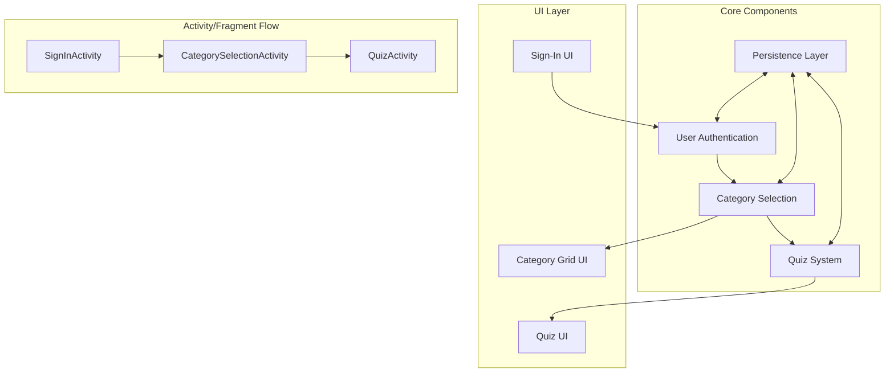
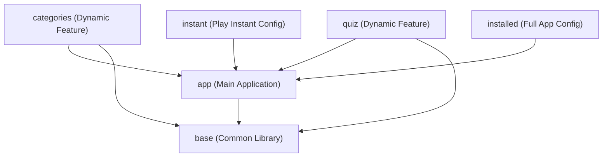
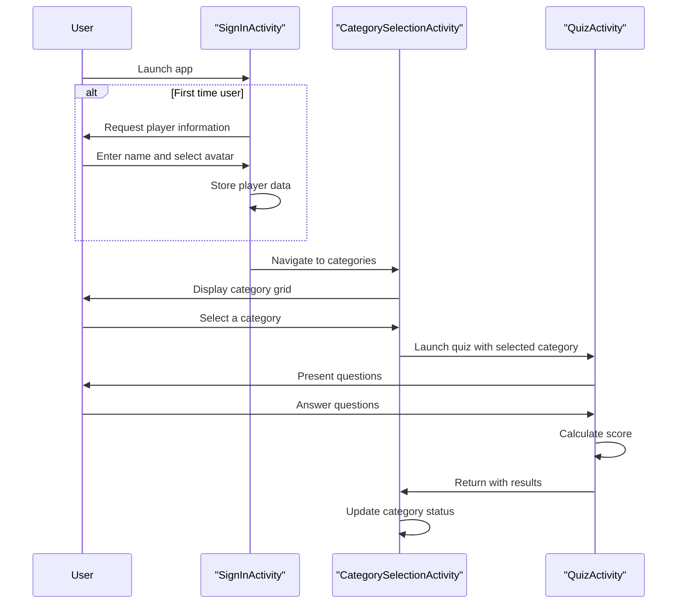
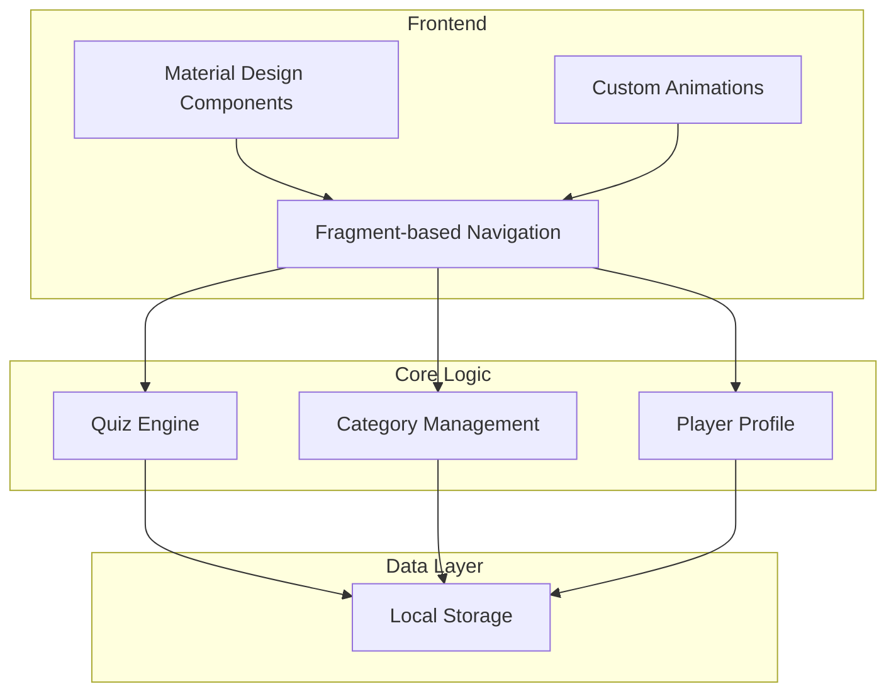

<!-- source: DeepWiki mcp.deepwiki.com · repo android/topeka · page 1 Overview · fetched 2026-10-23 -->

# Overview

Relevant source files

The following files were used as context for generating this wiki page:

- [.google/packaging.yaml](.google/packaging.yaml)
- [README.markdown](README.markdown)
- [app/src/main/AndroidManifest.xml](app/src/main/AndroidManifest.xml)
- [screenshots/categories.png](screenshots/categories.png)
- [screenshots/category_history.png](screenshots/category_history.png)
- [screenshots/ic_web.png](screenshots/ic_web.png)
- [screenshots/quiz_shakespeare.png](screenshots/quiz_shakespeare.png)

Topeka is an Android quiz application that showcases Google's material design principles through interactive gameplay. This document provides a high-level overview of the Topeka application architecture, its key components, and how they interact to create a cohesive user experience.

## Purpose and Scope

Topeka demonstrates how material design principles can be applied to create a visually appealing and functionally robust Android application. It serves as a reference implementation for developers looking to incorporate material design into their own applications. The app features a simple quiz format with multiple categories and question types, showcasing animations, transitions, and other material design elements.

For detailed information about the architecture and module structure, see [Architecture](#2) and [Module Structure](#2.1).

## High-Level Architecture

The Topeka application follows a modular design with several key components working together.

The application consists of three main functional areas:

1. **User Authentication**: Handles player profile creation and management
2. **Category Selection**: Presents available quiz categories to the user
3. **Quiz System**: Manages the quiz flow, questions, and scoring

These components are supported by a persistence layer that stores user information, category data, and quiz progress.

Sources: [README.markdown:1-84](), [app/src/main/AndroidManifest.xml:28-61]()

## Modular Structure

Topeka uses dynamic feature modules, allowing for efficient delivery and on-demand loading of features.

The modular structure enables:
- Core app functionality in the base module
- On-demand loading of feature modules (categories, quiz)
- Support for both instant apps and fully installed versions

Sources: [app/src/main/AndroidManifest.xml:17-27]()

## User Experience

Topeka provides a streamlined user journey from sign-in to quiz completion.

The user flow consists of:
1. **Sign-in**: Users create or update their profile
2. **Category selection**: Users choose from available quiz categories
3. **Quiz**: Users answer questions and receive immediate feedback
4. **Results**: Users see their score and return to the category selection

Sources: [app/src/main/AndroidManifest.xml:37-60](), [README.markdown:32-36]()

## Key Features

### Material Design Implementation

Topeka serves as a showcase for material design principles, including:
- Elevation and shadows
- Dynamic animations and transitions
- Responsive layouts
- Color schemes and typography
- Touch feedback

### Quiz Functionality

The app provides a variety of question types within different knowledge categories:

| Feature | Description |
|---------|-------------|
| Categories | Multiple knowledge areas with visual identifiers |
| Question Types | Multiple choice, true/false, fill-in-the-blank, etc. |
| Scoring | Point-based system with timing considerations |
| Progress Tracking | Visual indicators of completed categories |

Sources: [README.markdown:1-18]()

## Technical Implementation

Topeka is built using modern Android development practices:

### Main Components

- **SignInActivity**: Entry point handling user authentication
- **CategorySelectionActivity**: Displays available quiz categories
- **QuizActivity**: Manages the quiz flow and question presentation

The application is implemented primarily in Kotlin and follows modern Android architectural patterns.

Sources: [app/src/main/AndroidManifest.xml:37-60](), [.google/packaging.yaml:1-29]()

## Cross-Platform Design

Topeka demonstrates consistent branding and design across platforms:

- Originally launched as a [Polymer web app](https://github.com/Polymer/topeka)
- Android version maintains the same visual identity with platform-specific implementations
- Shows how material design principles can be applied consistently across different platforms

Sources: [README.markdown:11-14]()

## Conclusion

Topeka showcases Google's material design principles through a functional, interactive quiz application. Its modular structure, clean architecture, and attention to design details make it an excellent reference for developers looking to implement material design in their own Android applications.

The application demonstrates how to create a visually appealing, interactive experience while maintaining good architectural practices, including:

- Separation of concerns
- Modular design
- Dynamic feature delivery
- Responsive animations
- Consistent theming

For more detailed information about specific components, refer to the related documentation sections on [Architecture](#2), [Core Features](#4), and [Build System](#3).

---

