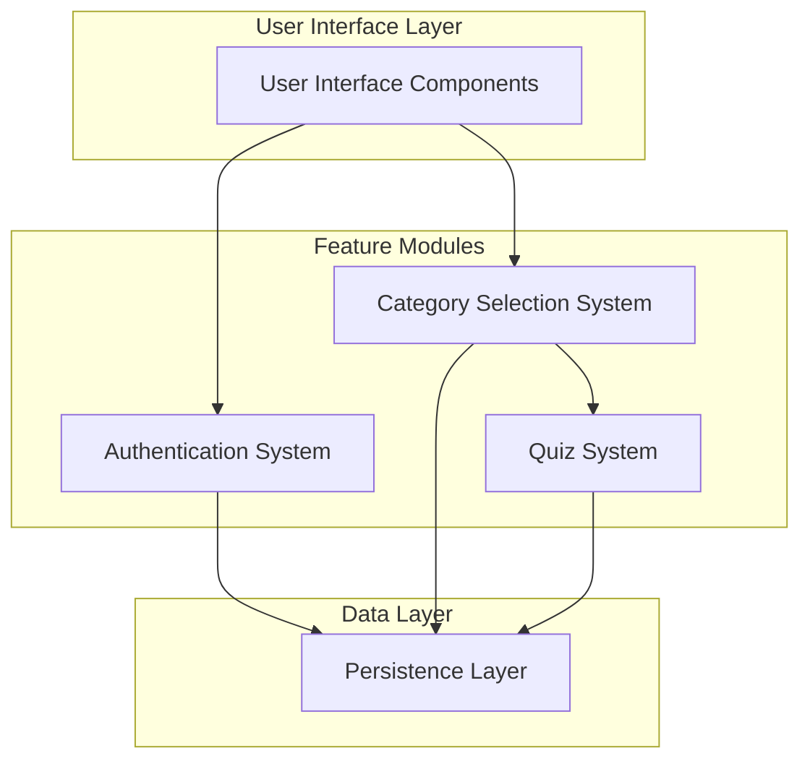
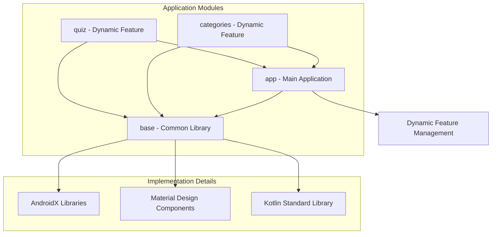
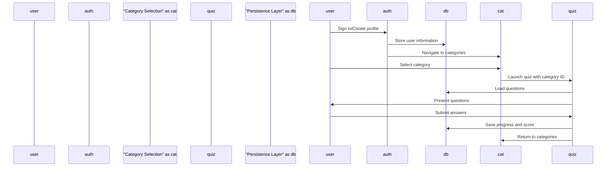
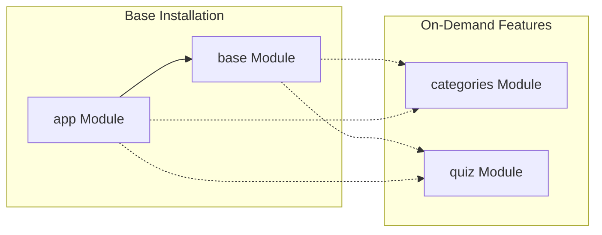
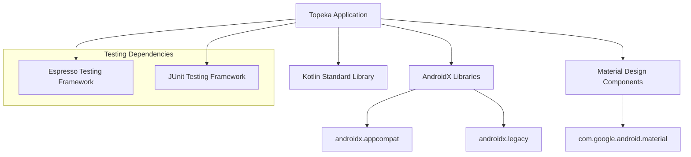
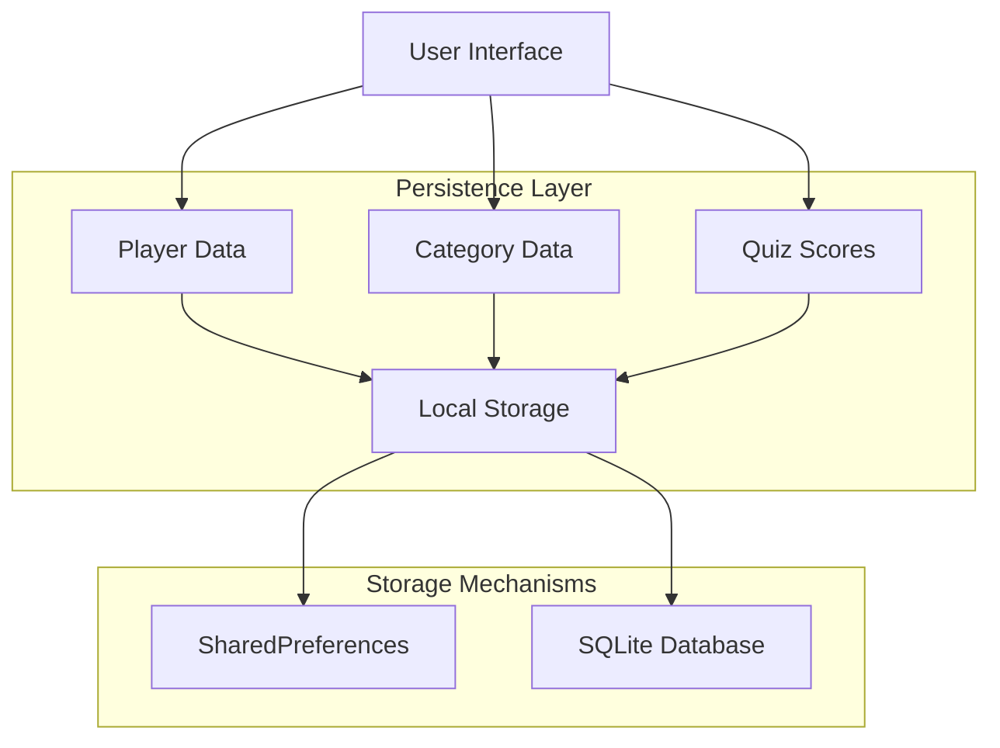
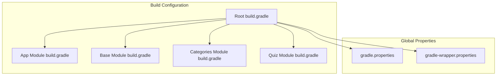

<!-- source: DeepWiki mcp.deepwiki.com · repo android/topeka · page 2 Architecture · fetched 2026-10-23 -->

# Architecture

Relevant source files

The following files were used as context for generating this wiki page:

- [.google/packaging.yaml](.google/packaging.yaml)
- [README.markdown](README.markdown)
- [app/build.gradle](app/build.gradle)
- [base/build.gradle](base/build.gradle)
- [build.gradle](build.gradle)
- [categories/build.gradle](categories/build.gradle)
- [categories/proguard.pro](categories/proguard.pro)
- [gradle/wrapper/gradle-wrapper.properties](gradle/wrapper/gradle-wrapper.properties)
- [quiz/build.gradle](quiz/build.gradle)
- [quiz/proguard.pro](quiz/proguard.pro)
- [screenshots/categories.png](screenshots/categories.png)
- [screenshots/category_history.png](screenshots/category_history.png)
- [screenshots/ic_web.png](screenshots/ic_web.png)
- [screenshots/quiz_shakespeare.png](screenshots/quiz_shakespeare.png)

This page describes the high-level architecture of the Topeka Android application, including its modular design and component relationships. It provides an overview of how the different parts of the system work together to deliver a quiz application that showcases Material Design principles. For details about the module structure, see [Module Structure](#2.1). For information about the user journey through the application, see [User Flow](#2.2).

## High-Level Architecture Overview

The Topeka application follows a modular architecture with clear separation of concerns between different components. It uses dynamic feature modules to enable on-demand loading of features, reducing the initial app size while providing a complete experience.

Sources: [build.gradle:33-40](). [app/build.gradle:35-36]().

## Module Structure

The application is organized into several modules, each with a specific responsibility. This modular approach allows for better separation of concerns, improved maintainability, and supports features like Google Play Instant.

Sources: [app/build.gradle:35-36](). [base/build.gradle:38-46](). [categories/build.gradle:17-19](). [quiz/build.gradle:17-19]().

## Core Components

The Topeka application consists of several core components that work together to provide a complete quiz experience:

| Component | Description | Module | Responsibility |
|-----------|-------------|--------|----------------|
| Authentication System | Handles user sign-in and profile creation | app | User management, avatar selection |
| Category Selection | Displays quiz categories in a grid | categories | Category browsing and selection |
| Quiz System | Presents questions and evaluates answers | quiz | Question rendering, score calculation |
| Persistence Layer | Manages application data | base | Store user data, quiz progress |

Sources: [app/build.gradle:39-40](). [categories/build.gradle:46-49](). [quiz/build.gradle:44-49]().

## Component Interactions

The different components of Topeka interact through well-defined interfaces, allowing for a loosely coupled architecture.

Sources: [app/build.gradle:35](). [categories/build.gradle:47-48](). [quiz/build.gradle:46-47]().

## Dynamic Feature Modules

Topeka uses Android's Dynamic Feature Modules to deliver features on-demand. This architectural decision allows the app to have a smaller initial download size while providing the full functionality when needed.

Sources: [app/build.gradle:35](). [categories/build.gradle:17](). [quiz/build.gradle:17]().

## Dependencies and Libraries

Topeka relies on several key libraries and dependencies to provide its functionality:

Sources: [base/build.gradle:40-44](). [categories/build.gradle:50-60](). [quiz/build.gradle:49-61]().

## Persistence Implementation

The application uses lightweight persistence mechanisms to store user information and quiz progress:

Sources: [base/build.gradle:40-44]().

## Build Configuration

The build system is organized to support multiple build types and product flavors, enabling both Google Play Instant and fully installed app experiences.

Sources: [build.gradle:19-31](). [build.gradle:41-47](). [gradle/wrapper/gradle-wrapper.properties:1-6]().

## Technology Stack

Topeka is built with a modern Android technology stack that enables a responsive and visually appealing user experience:

| Technology | Usage | Purpose |
|------------|-------|---------|
| Kotlin | Primary language | Modern language for Android development |
| AndroidX | UI components | Provides backwards-compatible UI components |
| Material Design | UI styling | Implements Google's Material Design guidelines |
| Dynamic Feature Modules | Modular delivery | Enables on-demand loading of features |
| SQLite | Data storage | Stores user data and quiz progress |
| Espresso | UI testing | Enables automated UI testing |

Sources: [build.gradle:20](). [base/build.gradle:40-44](). [app/build.gradle:17-18]().

## Summary

The Topeka Android application demonstrates a well-structured modular architecture that separates concerns into distinct components while maintaining a cohesive user experience. By leveraging dynamic feature modules, it provides an optimized install experience while still delivering rich functionality.

The architecture follows modern Android development practices, uses the Material Design language for its user interface, and organizes code into logical modules that can be developed, tested, and maintained independently.

Sources: [README.markdown:1-15](). [build.gradle:17-47](). [app/build.gradle:17-40]().

---

