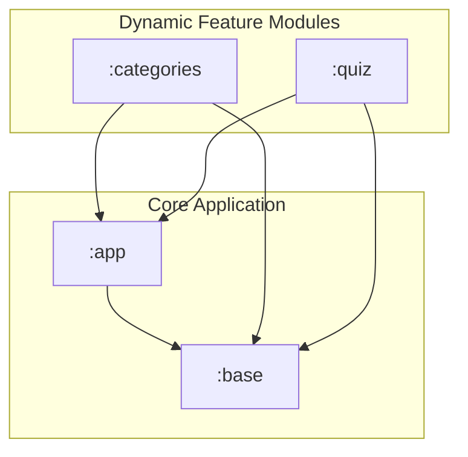
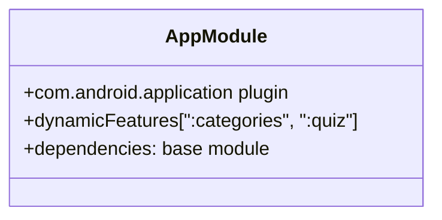
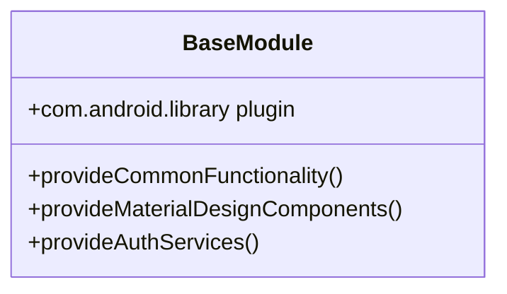
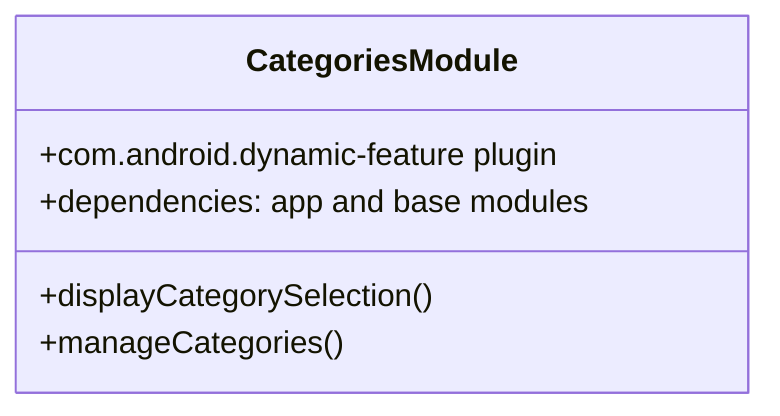
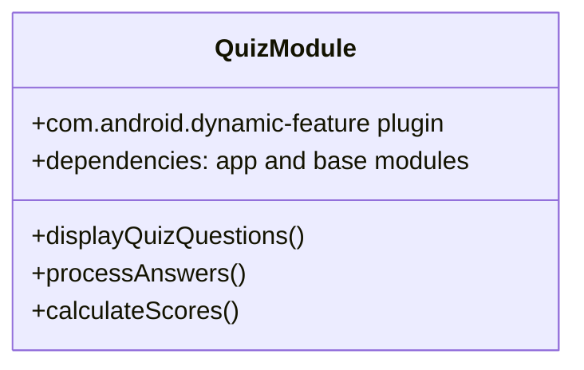
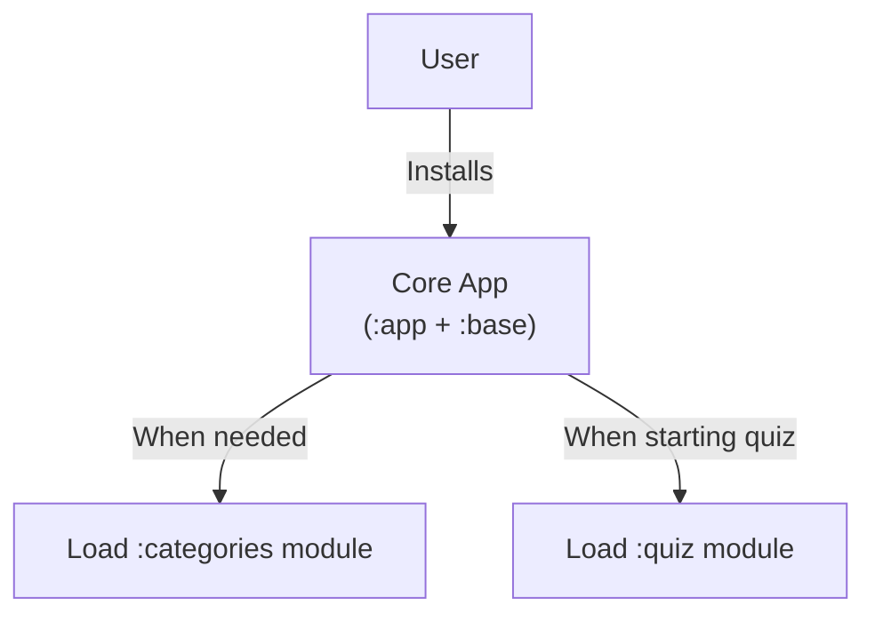
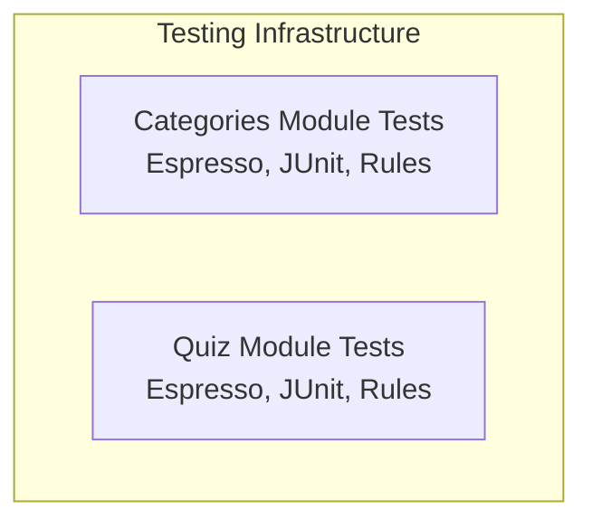

<!-- source: DeepWiki mcp.deepwiki.com · repo android/topeka · page 2.1 Module Structure · fetched 2026-10-23 -->

# Module Structure

<details>
<summary>Relevant source files</summary>

The following files were used as context for generating this wiki page:

- [app/build.gradle](app/build.gradle)
- [base/build.gradle](base/build.gradle)
- [build.gradle](build.gradle)
- [categories/build.gradle](categories/build.gradle)
- [categories/proguard.pro](categories/proguard.pro)
- [gradle/wrapper/gradle-wrapper.properties](gradle/wrapper/gradle-wrapper.properties)
- [quiz/build.gradle](quiz/build.gradle)
- [quiz/proguard.pro](quiz/proguard.pro)

</details>


This document details the modular architecture of the Topeka Android application, explaining the purpose of each module, their configuration, and how they interrelate. The application employs a combination of standard library modules and dynamic feature modules to optimize delivery size and support efficient loading of features.

## Module Organization Overview



The Topeka application is structured into four primary modules, with clear separation of concerns and dependencies between them.

Sources: [app/build.gradle:35-39](). [categories/build.gradle:47-48](). [quiz/build.gradle:46-47]().

## Module Details

### :app Module

The `:app` module serves as the main entry point for the application. It contains the core application components and is responsible for orchestrating the loading of dynamic feature modules.

**Configuration:**
- **Plugin:** `com.android.application`
- **Depends on:** `:base` module
- **Declares dynamic features:** `:categories` and `:quiz`



Sources: [app/build.gradle:17-35]().

### :base Module

The `:base` module is a library module that provides common functionality, resources, and dependencies used by all other modules. It contains shared utilities, models, and third-party library integrations.

**Configuration:**
- **Plugin:** `com.android.library`
- **Key dependencies:**
  - AndroidX AppCompat
  - Material Design components
  - AndroidX Legacy Support
  - Google Instant Apps
  - Kotlin Standard Library
  - Google Play Services Auth



Sources: [base/build.gradle:17-44]().

### :categories Module

The `:categories` module is a dynamic feature module responsible for displaying quiz categories to the user. By implementing this as a dynamic feature, the initial app download size is reduced and the categories functionality can be loaded on demand.

**Configuration:**
- **Plugin:** `com.android.dynamic-feature`
- **Depends on:** `:app` and `:base` modules
- **Min SDK:** Same as the app module (14)



Sources: [categories/build.gradle:17-48]().

### :quiz Module

The `:quiz` module is a dynamic feature module that implements the quiz experience, allowing users to answer questions and receive feedback. Like the categories module, it is loaded on demand to optimize app size.

**Configuration:**
- **Plugin:** `com.android.dynamic-feature`
- **Depends on:** `:app` and `:base` modules
- **Min SDK:** Same as the app module (14)
- **Notable dependency:** Espresso idling resources for testing



Sources: [quiz/build.gradle:17-49]().

## Module Dependency Relationships

The following diagram illustrates the dependency relationships between the modules:

```mermaid
flowchart TD
    subgraph "Module Dependencies"
        AppGradle["app/build.gradle\ndynamicFeatures = [\":categories\", \":quiz\"]\nimplementation project(\":base\")"]
        
        BaseGradle["base/build.gradle\napply plugin: 'com.android.library'\napi 'androidx.appcompat:appcompat'\napi 'com.google.android.material:material'"]
        
        CategoriesGradle["categories/build.gradle\napply plugin: 'com.android.dynamic-feature'\nimplementation project(\":app\")\nimplementation project(':base')"]
        
        QuizGradle["quiz/build.gradle\napply plugin: 'com.android.dynamic-feature'\nimplementation project(\":app\")\nimplementation project(\":base\")"]
        
        AppGradle --> BaseGradle
        CategoriesGradle --> AppGradle
        CategoriesGradle --> BaseGradle
        QuizGradle --> AppGradle
        QuizGradle --> BaseGradle
    end
```

Sources: [app/build.gradle:35-39](). [base/build.gradle:17-44](). [categories/build.gradle:17-48](). [quiz/build.gradle:17-49]().

## SDK Configuration

The application uses a consistent SDK configuration across all modules, defined in the root project's build.gradle file:

| Configuration | Value |
|---------------|-------|
| compileSdk    | 29    |
| targetSdk     | 29    |
| minSdk        | 14    |
| minSdkInstant | 21    |

Sources: [build.gradle:41-46]().

## Dynamic Feature Benefits

The Topeka app's use of dynamic feature modules provides several advantages:

1. **Reduced Initial Download Size**: Users only download the core app initially
2. **On-Demand Loading**: Features are loaded only when needed
3. **Faster Installation**: Smaller initial APK means faster installation
4. **Resource Optimization**: Resources are only loaded when their module is active
5. **Separate Testing**: Each module can be tested independently



Sources: [app/build.gradle:35](). [categories/build.gradle:17](). [quiz/build.gradle:17]().

## Testing Configuration

Both dynamic feature modules include testing dependencies, allowing for isolated testing of each feature:



Both modules include similar testing dependencies:
- Espresso for UI testing
- AndroidX Test Rules
- JUnit for assertions
- Hamcrest for matchers

Sources: [categories/build.gradle:50-60](). [quiz/build.gradle:49-61]().

## ProGuard Configuration

The dynamic feature modules include minimal ProGuard configurations, with both containing only a directive not to obfuscate the code:

```
-dontobfuscate
```

Sources: [categories/proguard.pro:1](). [quiz/proguard.pro:1]().

## Build System Integration

The Topeka app's module structure is managed through Gradle with the following key components:

1. **Root build.gradle**: Defines common configuration for all modules, including Kotlin version and SDK versions
2. **Module-specific build.gradle files**: Configure each module separately
3. **Gradle wrapper**: Ensures consistent Gradle version (6.1.1) across all builds

Sources: [build.gradle:19-47](). [gradle/wrapper/gradle-wrapper.properties:1-6]().

---

