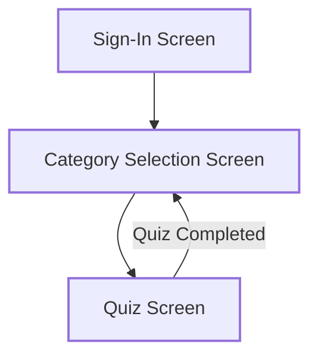
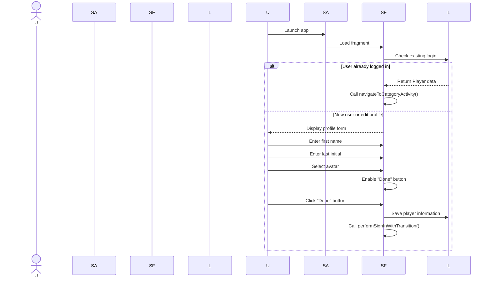
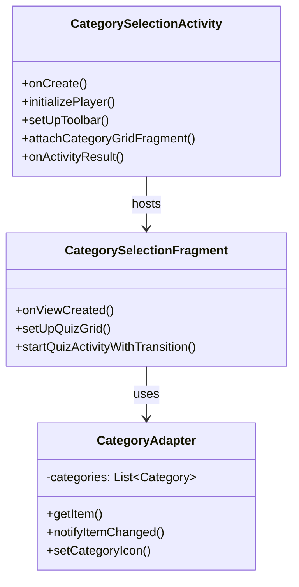
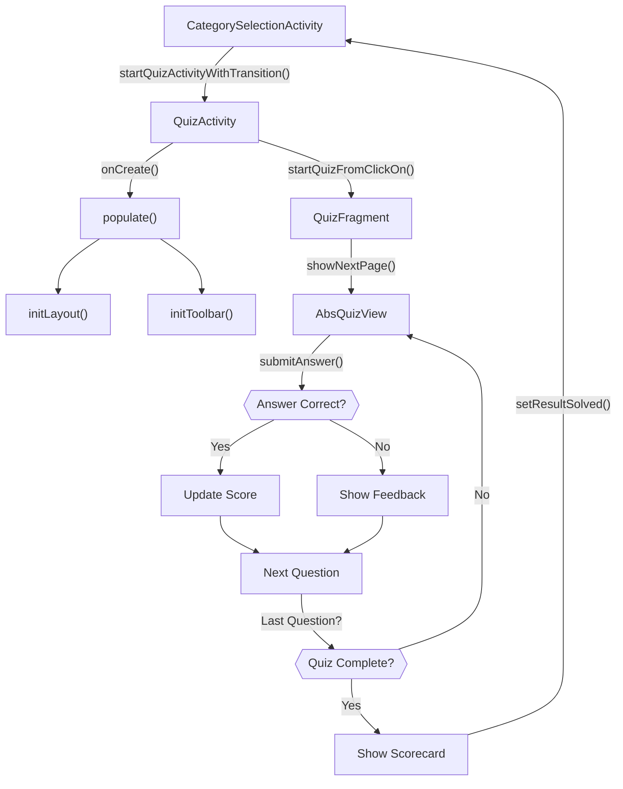
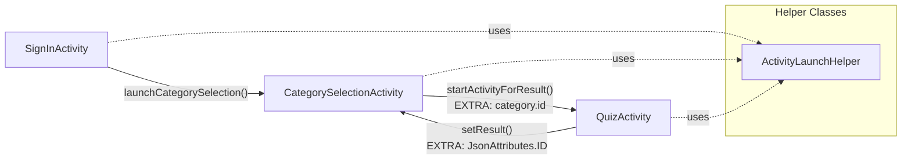

<!-- source: DeepWiki mcp.deepwiki.com · repo android/topeka · page 2.2 User Flow · fetched 2026-10-23 -->

# User Flow

<details>
<summary>Relevant source files</summary>

The following files were used as context for generating this wiki page:

- [base/src/androidTest/java/com/google/samples/apps/topeka/activity/SignInActivityTest.kt](base/src/androidTest/java/com/google/samples/apps/topeka/activity/SignInActivityTest.kt)
- [base/src/main/java/com/google/samples/apps/topeka/activity/SignInActivity.kt](base/src/main/java/com/google/samples/apps/topeka/activity/SignInActivity.kt)
- [base/src/main/java/com/google/samples/apps/topeka/fragment/SignInFragment.kt](base/src/main/java/com/google/samples/apps/topeka/fragment/SignInFragment.kt)
- [base/src/main/java/com/google/samples/apps/topeka/helper/ActivityLaunchHelper.kt](base/src/main/java/com/google/samples/apps/topeka/helper/ActivityLaunchHelper.kt)
- [categories/src/main/java/com/google/samples/apps/topeka/activity/CategorySelectionActivity.kt](categories/src/main/java/com/google/samples/apps/topeka/activity/CategorySelectionActivity.kt)
- [categories/src/main/java/com/google/samples/apps/topeka/adapter/CategoryAdapter.kt](categories/src/main/java/com/google/samples/apps/topeka/adapter/CategoryAdapter.kt)
- [categories/src/main/java/com/google/samples/apps/topeka/fragment/CategorySelectionFragment.kt](categories/src/main/java/com/google/samples/apps/topeka/fragment/CategorySelectionFragment.kt)
- [categories/src/main/res/layout/fragment_categories.xml](categories/src/main/res/layout/fragment_categories.xml)
- [quiz/src/main/java/com/google/samples/apps/topeka/activity/QuizActivity.kt](quiz/src/main/java/com/google/samples/apps/topeka/activity/QuizActivity.kt)
- [quiz/src/main/java/com/google/samples/apps/topeka/fragment/QuizFragment.kt](quiz/src/main/java/com/google/samples/apps/topeka/fragment/QuizFragment.kt)
- [quiz/src/main/java/com/google/samples/apps/topeka/widget/quiz/AbsQuizView.kt](quiz/src/main/java/com/google/samples/apps/topeka/widget/quiz/AbsQuizView.kt)

</details>


This document outlines the typical user journey through the Topeka quiz application, from initial sign-in to quiz completion. It covers the sequence of screens users navigate through, the interactions available at each step, and the underlying code components that facilitate this flow.

## Overview

The Topeka user flow consists of three main phases:

1. **Authentication** - User creates a profile or logs in with existing credentials
2. **Category Selection** - User browses and selects quiz categories 
3. **Quiz Participation** - User answers questions and receives feedback



Sources:
- [base/src/main/java/com/google/samples/apps/topeka/fragment/SignInFragment.kt:55-317]()
- [categories/src/main/java/com/google/samples/apps/topeka/activity/CategorySelectionActivity.kt:45-131]()
- [quiz/src/main/java/com/google/samples/apps/topeka/activity/QuizActivity.kt:69-443]()

## Authentication Flow

When users first launch Topeka, they encounter the sign-in process. This is managed by `SignInActivity` which hosts `SignInFragment`.

### Sign-In Process



Sources:
- [base/src/main/java/com/google/samples/apps/topeka/activity/SignInActivity.kt:30-52]()
- [base/src/main/java/com/google/samples/apps/topeka/fragment/SignInFragment.kt:67-108]()
- [base/src/main/java/com/google/samples/apps/topeka/fragment/SignInFragment.kt:193-235]()

The sign-in screen requires three pieces of information:
1. First name
2. Last initial
3. Avatar selection

All three fields must be completed before the "Done" button appears. Input validation is performed in real-time as the user types, with the `allowAnswer()` function controlling when the submission is enabled.

Sources:
- [base/src/main/java/com/google/samples/apps/topeka/fragment/SignInFragment.kt:193-205]()
- [base/src/main/java/com/google/samples/apps/topeka/fragment/SignInFragment.kt:295-302]()

## Category Selection Flow

After authentication, users are presented with a grid of quiz categories. Each category has a distinctive theme color and icon.



Sources:
- [categories/src/main/java/com/google/samples/apps/topeka/activity/CategorySelectionActivity.kt:45-59]()
- [categories/src/main/java/com/google/samples/apps/topeka/fragment/CategorySelectionFragment.kt:43-105]()
- [categories/src/main/java/com/google/samples/apps/topeka/adapter/CategoryAdapter.kt:40-176]()

### Category Screen Behavior

The categories are displayed in a `RecyclerView` using a grid layout. Each category item shows:
- An icon representing the category
- The category name
- A visual indicator if the category has been completed

When a user selects a category, `startQuizActivityWithTransition()` is called to launch the quiz activity with a smooth material design transition.

Sources:
- [categories/src/main/res/layout/fragment_categories.xml:17-32]()
- [categories/src/main/java/com/google/samples/apps/topeka/fragment/CategorySelectionFragment.kt:81-98]()

Categories that have been completed are visually marked with a check mark overlay on the category icon. This state is managed through the `CategoryAdapter` class.

Sources:
- [categories/src/main/java/com/google/samples/apps/topeka/adapter/CategoryAdapter.kt:105-110]()
- [categories/src/main/java/com/google/samples/apps/topeka/adapter/CategoryAdapter.kt:121-128]()

## Quiz Flow

When a user selects a category, they enter the quiz experience managed by `QuizActivity` and `QuizFragment`.



Sources:
- [quiz/src/main/java/com/google/samples/apps/topeka/activity/QuizActivity.kt:147-155]()
- [quiz/src/main/java/com/google/samples/apps/topeka/activity/QuizActivity.kt:266-278]()
- [quiz/src/main/java/com/google/samples/apps/topeka/fragment/QuizFragment.kt:98-116]()
- [quiz/src/main/java/com/google/samples/apps/topeka/fragment/QuizFragment.kt:190-202]()
- [quiz/src/main/java/com/google/samples/apps/topeka/widget/quiz/AbsQuizView.kt:201-204]()

### Quiz Experience

The quiz experience follows these steps:

1. User views the category information with a "Play" FAB
2. User taps the FAB to begin the quiz
3. Questions are presented one at a time
4. User submits answers which are validated immediately
5. Visual feedback indicates correct or incorrect answers
6. Upon completion, a scorecard displays performance

The quiz interface uses custom view animations and transitions to provide a rich material design experience.

Sources: 
- [quiz/src/main/java/com/google/samples/apps/topeka/activity/QuizActivity.kt:180-184]()
- [quiz/src/main/java/com/google/samples/apps/topeka/activity/QuizActivity.kt:406-424]()
- [quiz/src/main/java/com/google/samples/apps/topeka/widget/quiz/AbsQuizView.kt:211-224]()

## Complete User Journey

The following sequence diagram shows the complete user journey through the application, from launch to quiz completion:

```mermaid
sequenceDiagram
    actor "User" as U
    participant "SignInActivity" as SA
    participant "CategorySelection<br>Activity" as CSA
    participant "QuizActivity" as QA
    participant "Database" as DB
    
    U->>SA: Launch app
    
    alt First launch or not logged in
        SA-->>U: Show sign-in form
        U->>SA: Enter name & select avatar
        SA->>DB: Save player info
    else Already logged in
        SA->>DB: Retrieve player info
    end
    
    SA->>CSA: Navigate to categories
    CSA->>DB: Get categories
    CSA-->>U: Display category grid
    
    U->>CSA: Select category
    CSA->>QA: Launch with category ID
    QA->>DB: Get category details
    QA-->>U: Display category intro
    
    U->>QA: Click "Play" button
    QA-->>U: Show first question
    
    loop For each question
        U->>QA: Input answer
        U->>QA: Submit answer
        QA->>QA: Validate answer
        QA-->>U: Provide feedback
        QA->>DB: Update progress
        QA-->>U: Show next question
    end
    
    QA-->>U: Display scorecard
    QA->>DB: Mark category as solved
    QA->>CSA: Return with completion status
    CSA->>DB: Update category display
    CSA-->>U: Show updated category grid
```

Sources:
- [base/src/main/java/com/google/samples/apps/topeka/fragment/SignInFragment.kt:67-115]()
- [categories/src/main/java/com/google/samples/apps/topeka/fragment/CategorySelectionFragment.kt:81-98]()
- [quiz/src/main/java/com/google/samples/apps/topeka/activity/QuizActivity.kt:266-280]()
- [quiz/src/main/java/com/google/samples/apps/topeka/activity/QuizActivity.kt:407-424]()
- [quiz/src/main/java/com/google/samples/apps/topeka/fragment/QuizFragment.kt:190-207]()

## Activity and Intent Flow

The application uses Android's activity system with intents to navigate between screens. The following diagram shows the flow and key intent extras used:



Sources:
- [base/src/main/java/com/google/samples/apps/topeka/helper/ActivityLaunchHelper.kt:38-51]()
- [categories/src/main/java/com/google/samples/apps/topeka/fragment/CategorySelectionFragment.kt:93-97]() 
- [quiz/src/main/java/com/google/samples/apps/topeka/activity/QuizActivity.kt:358-359]()

The application leverages `ActivityLaunchHelper` to standardize intent creation and activity transitions. Key methods include:

- `launchCategorySelection()`: Transitions from sign-in to category selection
- `launchSignIn()`: Launches the sign-in activity when needed
- `quizIntent()`: Creates an intent for launching a specific quiz category

Sources:
- [base/src/main/java/com/google/samples/apps/topeka/helper/ActivityLaunchHelper.kt:38-59]()

## State Management

Throughout the user flow, the application manages several key states:

| State | Persisted In | Used By | Purpose |
|-------|--------------|---------|---------|
| Player Profile | `SharedPreferences` | `SignInFragment`<br>`CategorySelectionActivity` | Stores user name and avatar selection |
| Category Completion | Database | `CategoryAdapter`<br>`QuizFragment` | Tracks which categories are solved |
| Quiz Progress | `Bundle` | `QuizFragment`<br>`AbsQuizView` | Preserves current quiz state during configuration changes |
| Current Score | Database | `CategorySelectionActivity` | Displays total score across all categories |

Sources:
- [base/src/main/java/com/google/samples/apps/topeka/fragment/SignInFragment.kt:224-227]()
- [quiz/src/main/java/com/google/samples/apps/topeka/fragment/QuizFragment.kt:154-182]()
- [categories/src/main/java/com/google/samples/apps/topeka/activity/CategorySelectionActivity.kt:83-88]()
- [quiz/src/main/java/com/google/samples/apps/topeka/fragment/QuizFragment.kt:204-206]()

## Summary

The Topeka user flow implements a straightforward yet engaging journey from sign-in to quiz completion. Key aspects of this implementation include:

1. A modular architecture with separate activities for authentication, category selection, and quiz participation
2. Material design transitions between screens for a polished user experience
3. Immediate feedback on quiz answers with visual cues
4. Persistent state management across app launches
5. Clean separation between UI components and data management

For details on the specific module structure that enables this user flow, see [Module Structure](#2.1).

---

