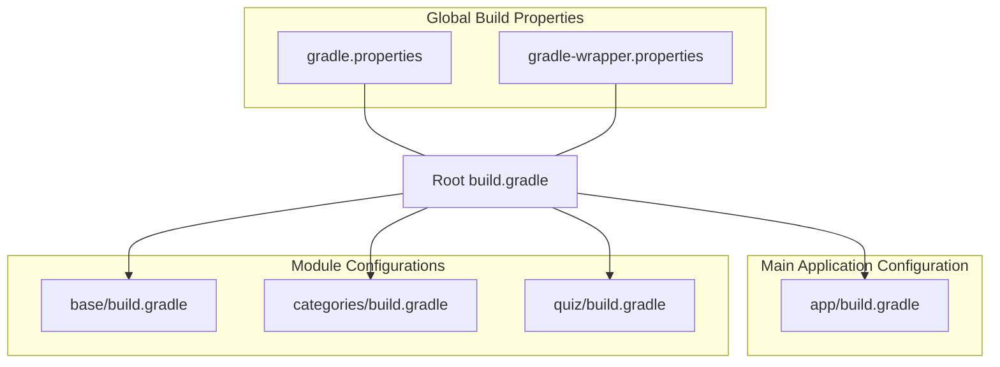
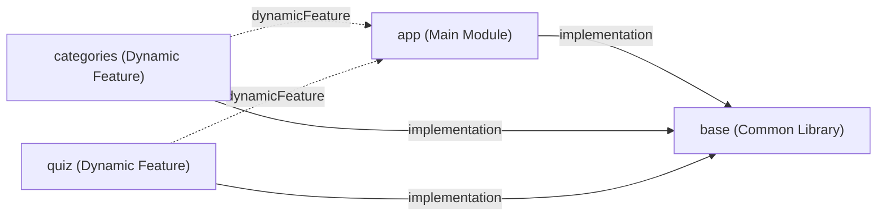
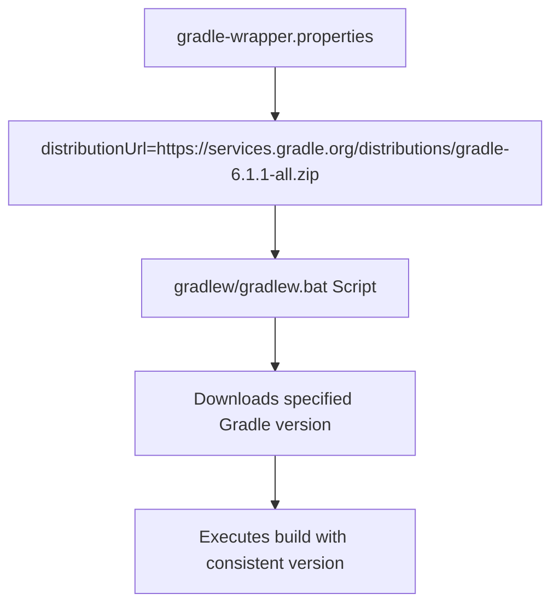
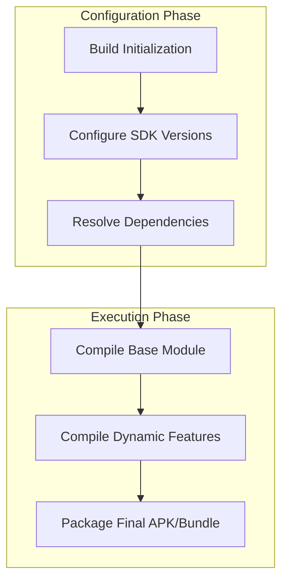

<!-- source: DeepWiki mcp.deepwiki.com · repo android/topeka · page 3 Build System · fetched 2026-10-23 -->

# Build System

Relevant source files

The following files were used as context for generating this wiki page:

- [app/build.gradle](app/build.gradle)
- [build.gradle](build.gradle)
- [gradle.properties](gradle.properties)
- [gradle/wrapper/gradle-wrapper.properties](gradle/wrapper/gradle-wrapper.properties)

## Purpose and Overview

The Topeka Android app utilizes Gradle as its build system to manage dependencies, configure build variants, and support dynamic feature modules. This document provides an overview of how the build system is structured and configured. For specific details on gradle file configurations, see [Main Gradle Configuration](#3.1); for module-specific build settings, see [Module Configuration](#3.2).

The build system enables Topeka's modular architecture by configuring:
- The app's core module and its dependencies
- Dynamic feature modules (categories and quiz)
- SDK version requirements
- Gradle execution parameters

## Build System Architecture

Sources: [build.gradle](), [app/build.gradle](), [gradle/wrapper/gradle-wrapper.properties](), [gradle.properties]()

## Core Build Files

### Root build.gradle

The root `build.gradle` file defines configuration options common to all modules:

- Sets the Kotlin version (1.4.0)
- Configures repositories (Google and JCenter)
- Defines the Android Gradle plugin version (4.0.1)
- Declares SDK version constants:
  - `compileSdk`: 29
  - `targetSdk`: 29
  - `minSdkInstant`: 21 (for Instant App)
  - `minSdk`: 14 (for installed app)

Sources: [build.gradle:19-47]()

### App Module build.gradle

The `app/build.gradle` file configures the main application module:

- Applies the Android application plugin
- Applies the Kotlin Android plugin
- Uses SDK versions from the root project
- Configures signing for release builds
- Declares dynamic feature modules (`:categories` and `:quiz`)
- Includes dependencies on the `:base` project

Sources: [app/build.gradle:17-40]()

## Module Structure and Dynamic Features

Topeka implements a modular architecture with dynamic feature modules, which allows for more efficient app delivery and on-demand feature loading.

This diagram shows how the app module depends on the base module for common functionality, while the categories and quiz modules are implemented as dynamic features that can be loaded on demand.

Sources: [app/build.gradle:35-39]()

## Gradle Properties and Configuration

### Key Gradle Properties

The `gradle.properties` file contains important settings that affect build performance and behavior:

| Property | Value | Purpose |
|----------|-------|---------|
| org.gradle.jvmargs | -Xmx2048m -XX:MaxPermSize=512m -XX:+HeapDumpOnOutOfMemoryError -Dfile.encoding=UTF-8 | Configures JVM memory settings for Gradle daemon |
| org.gradle.daemon | true | Enables the Gradle daemon for faster builds |
| android.useAndroidX | true | Enables AndroidX support |
| android.enableJetifier | true | Enables automatic migration to AndroidX |

Sources: [gradle.properties:29-37]()

### Gradle Wrapper

The Gradle Wrapper ensures consistent builds across different development environments by providing a specific version of Gradle (6.1.1). This eliminates "works on my machine" problems and makes it easier for new developers to get started.

Sources: [gradle/wrapper/gradle-wrapper.properties:1-6]()

## Build Process Overview

The build system handles several critical aspects of the app's compilation and packaging:

During the build process, Gradle first resolves all dependencies before compiling the base module, followed by the dynamic feature modules. These are then packaged together into the final APK or Android App Bundle.

Sources: [build.gradle](), [app/build.gradle]()

## SDK Version Management

Topeka manages SDK versions centrally in the root `build.gradle` file to ensure consistency across modules:

| SDK Property | Version | Purpose |
|--------------|---------|---------|
| compileSdk | 29 | Android API level used for compilation |
| targetSdk | 29 | Target API level for runtime behavior |
| minSdkInstant | 21 | Minimum API level for Google Play Instant |
| minSdk | 14 | Minimum API level for installed app |

This centralized configuration makes it easy to update SDK versions across the entire project.

Sources: [build.gradle:41-46]()

## Summary

The Topeka app's build system is designed to support a modular architecture with dynamic feature modules, providing several benefits:

1. **Modular development** - Separates concerns into distinct modules
2. **On-demand delivery** - Enables dynamic loading of features when needed
3. **Consistent configuration** - Centralizes SDK versions and other settings
4. **Build performance** - Optimizes the build process through Gradle configuration

This architecture allows the app to maintain separation of concerns while providing efficient delivery mechanisms for users.

---

