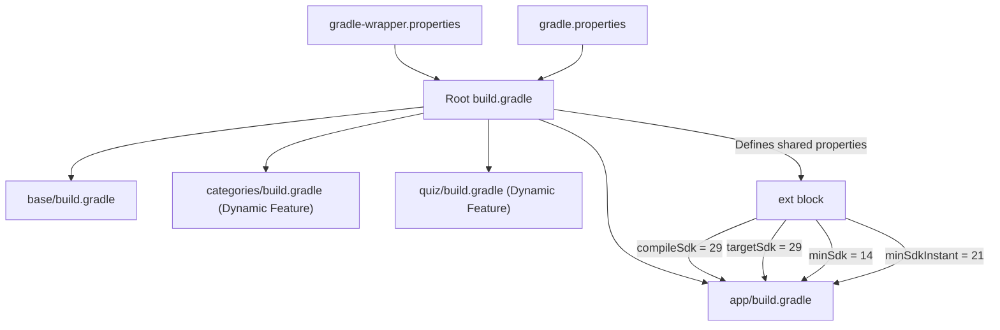
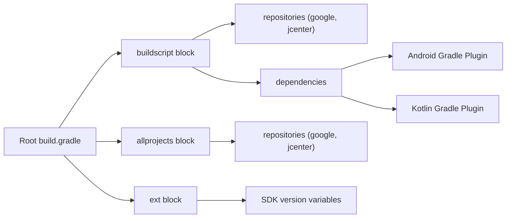
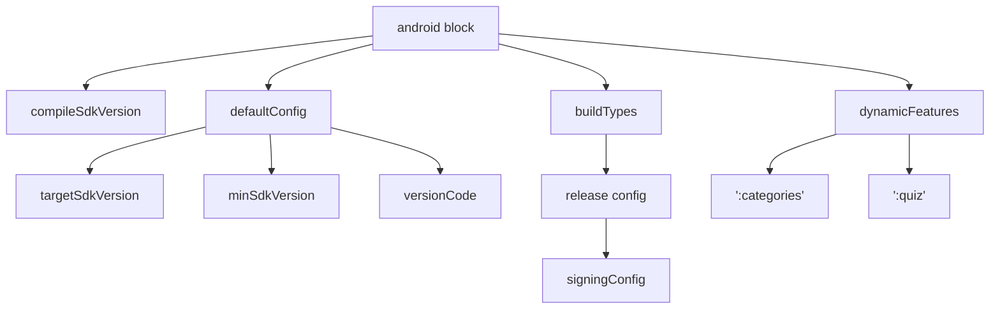
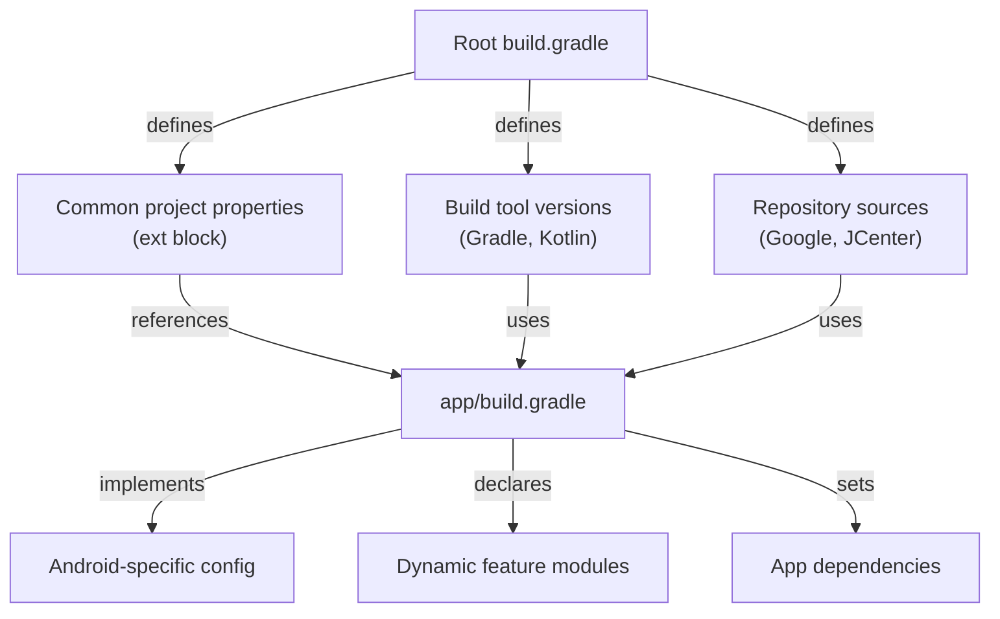
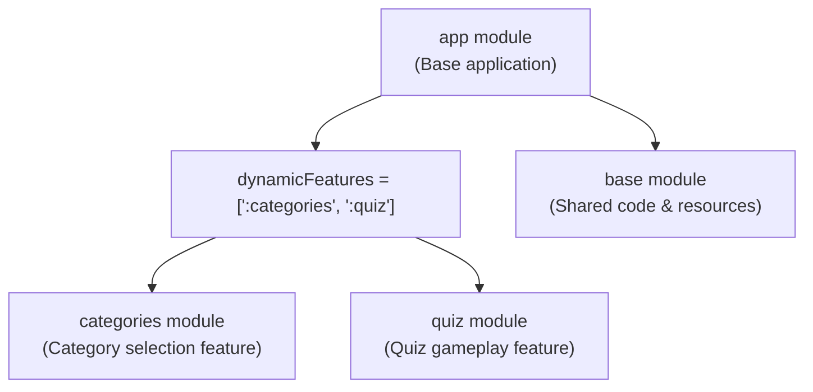

<!-- source: DeepWiki mcp.deepwiki.com · repo android/topeka · page 3.1 Main Gradle Configuration · fetched 2026-10-23 -->

# Main Gradle Configuration

<details>
<summary>Relevant source files</summary>

The following files were used as context for generating this wiki page:

- [app/build.gradle](app/build.gradle)
- [build.gradle](build.gradle)
- [gradle/wrapper/gradle-wrapper.properties](gradle/wrapper/gradle-wrapper.properties)

</details>


## Purpose and Scope

This document details the main Gradle configuration files in the Topeka Android application, focusing on the top-level and app-level build.gradle files. These files establish the foundational build configuration that applies across all modules. For module-specific configurations, see [Module Configuration](#3.2), and for Gradle properties, see [Gradle Properties](#3.3).

## Gradle Configuration Structure

The Topeka app uses a hierarchical Gradle configuration structure where settings flow from the top-level build file down to individual module build files.



Sources: [build.gradle:1-48](), [app/build.gradle:1-40](), [gradle/wrapper/gradle-wrapper.properties:1-6]()

## Top-level build.gradle File

The top-level `build.gradle` file defines project-wide configurations that apply to all modules.

### Key Components



Sources: [build.gradle:17-47]()

### BuildScript Configuration

The buildscript block configures how the build itself operates.

```
buildscript {
    ext.kotlin_version = '1.4.0'
    repositories {
        google()
        jcenter()
    }
    dependencies {
        classpath 'com.android.tools.build:gradle:4.0.1'
        classpath "org.jetbrains.kotlin:kotlin-gradle-plugin:$kotlin_version"
    }
}
```

Key components:
- Kotlin version is defined as '1.4.0'
- Repository sources include Google and JCenter
- Android Gradle Plugin version 4.0.1
- Kotlin Gradle Plugin using the defined Kotlin version

Sources: [build.gradle:19-32]()

### Project-wide Repository Configuration

The allprojects block defines repositories available to all modules in the project:

```
allprojects {
    repositories {
        google()
        jcenter()
    }
}
```

Sources: [build.gradle:34-39]()

### Shared Project Properties

The ext block defines project-wide properties:

| Property | Value | Description |
|----------|-------|-------------|
| compileSdk | 29 | Android API level to compile against |
| targetSdk | 29 | Target Android API level |
| minSdkInstant | 21 | Minimum SDK for Instant app variant |
| minSdk | 14 | Minimum SDK for installed app variant |

Sources: [build.gradle:41-47]()

## App Module build.gradle File

The app module's build.gradle file configures the main application module.

### Plugin Application

```
apply plugin: 'com.android.application'
apply plugin: 'kotlin-android'
```

The file applies:
- The Android application plugin (indicating this is the main app module)
- The Kotlin Android plugin (enabling Kotlin support)

Sources: [app/build.gradle:17-18]()

### Android Configuration Block



Sources: [app/build.gradle:20-36]()

The android block includes:

1. **SDK Configuration**:
   - Uses `rootProject.compileSdk` reference from the top-level ext block

2. **Default Configuration**:
   - References target and minimum SDK versions from root project
   - Sets the version code to 1

3. **Build Types**:
   - Configures the release build type with debug signing config

4. **Dynamic Features**:
   - Declares `:categories` and `:quiz` as dynamic feature modules

Sources: [app/build.gradle:20-35]()

### Dependencies

```
dependencies {
    implementation project(":base")
}
```

The app module depends only on the `:base` module, which contains shared code used by all modules.

Sources: [app/build.gradle:38-40]()

## Relationship Between Build Files

The top-level build.gradle file and the app-level build.gradle file have a clear hierarchical relationship:



The top-level build.gradle file establishes the project environment by:
1. Defining SDK versions and other shared properties
2. Setting up build tools (Gradle, Kotlin)
3. Configuring repositories

The app-level build.gradle file then:
1. References these shared properties (e.g., `rootProject.compileSdk`)
2. Configures Android-specific settings
3. Declares dependencies and dynamic feature modules

This pattern ensures consistency across the project while allowing module-specific customizations.

Sources: [build.gradle:1-48](), [app/build.gradle:1-40]()

## Dynamic Feature Module Configuration

One of the key aspects of the Topeka app's build configuration is the use of dynamic feature modules:



Dynamic feature modules allow:
- On-demand delivery of features
- Reduced initial app size
- Modular architecture

In Topeka, the app module serves as the base application while categories and quiz functionality are delivered as dynamic feature modules.

Sources: [app/build.gradle:35]()

## Gradle Version

The Gradle build system version is specified in the gradle-wrapper.properties file:

```
distributionUrl=https\://services.gradle.org/distributions/gradle-6.1.1-all.zip
```

This ensures consistent builds across different development environments.

Sources: [gradle/wrapper/gradle-wrapper.properties:6]()

## Summary

The Gradle configuration in the Topeka app follows a structured approach:

1. **Top-level build.gradle**:
   - Establishes project-wide build tools and versions
   - Defines common properties through the ext block
   - Configures repositories for all modules

2. **App-level build.gradle**:
   - References shared properties from the root project
   - Configures Android-specific settings
   - Declares dynamic feature modules
   - Defines dependencies

This hierarchical configuration allows for consistent settings across modules while supporting the app's modular architecture with dynamic feature modules.

---

