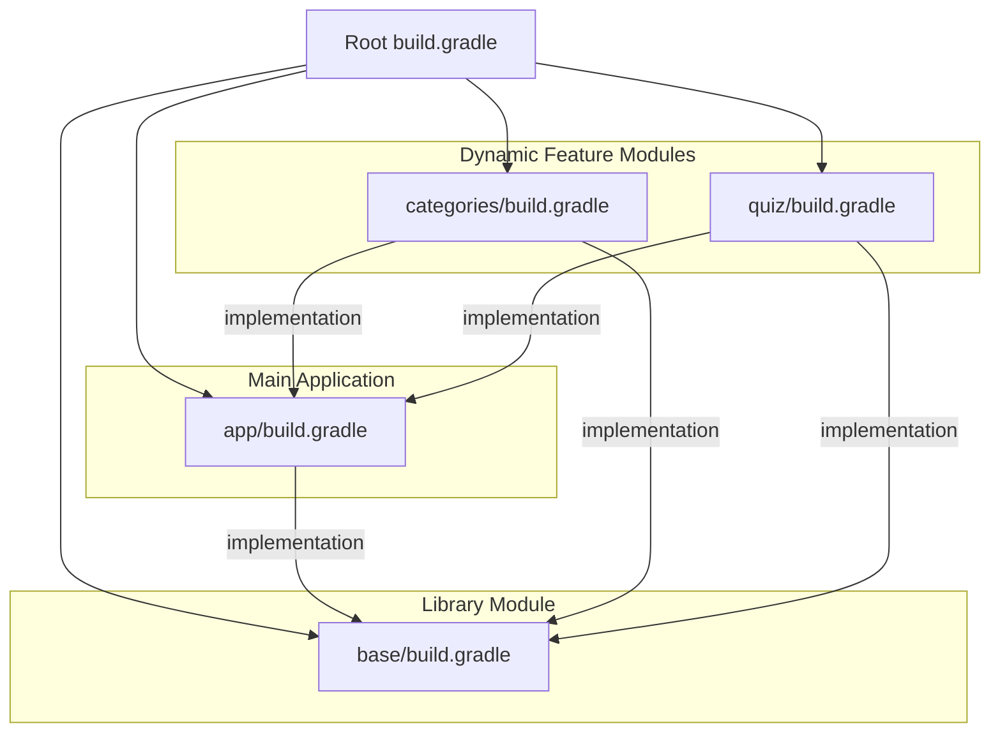
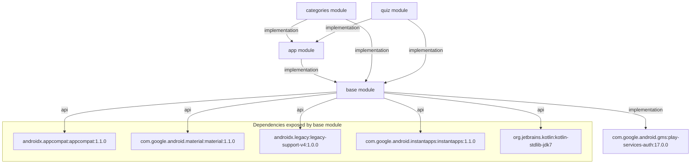
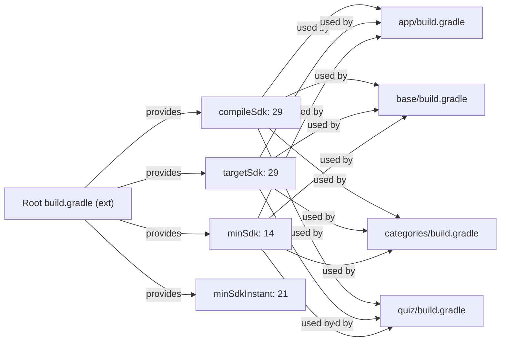

<!-- source: DeepWiki mcp.deepwiki.com · repo android/topeka · page 3.2 Module Configuration · fetched 2026-10-23 -->

# Module Configuration

<details>
<summary>Relevant source files</summary>

The following files were used as context for generating this wiki page:

- [app/build.gradle](app/build.gradle)
- [base/build.gradle](base/build.gradle)
- [build.gradle](build.gradle)
- [categories/build.gradle](categories/build.gradle)
- [categories/proguard.pro](categories/proguard.pro)
- [gradle/wrapper/gradle-wrapper.properties](gradle/wrapper/gradle-wrapper.properties)
- [quiz/build.gradle](quiz/build.gradle)
- [quiz/proguard.pro](quiz/proguard.pro)

</details>


## Purpose and Scope

This page documents the build configuration for each module in the Topeka Android app, including their individual settings, dependencies, and relationships. It explains how the project's modular architecture is implemented at the build system level. For information about the main Gradle configuration, see [Main Gradle Configuration](#3.1).

## Module Structure Overview

The Topeka application uses a modular architecture consisting of a main app module, a base library module, and dynamic feature modules. Each module has its own build.gradle file that defines its specific configuration.



**Module Types in Topeka:**
- **app**: Main application module (com.android.application)
- **base**: Common library module (com.android.library)
- **categories**: Dynamic feature module (com.android.dynamic-feature)
- **quiz**: Dynamic feature module (com.android.dynamic-feature)

Sources: [build.gradle](), [app/build.gradle](), [base/build.gradle](), [categories/build.gradle](), [quiz/build.gradle]()

## Root Project Configuration

The root build.gradle file defines global settings that apply to all modules in the project.

```mermaid
classDiagram
    class "Root build.gradle" {
        +String kotlin_version = '1.4.0'
        +repositories()
        +dependencies()
        +allprojects()
        +ext{
            compileSdk = 29
            targetSdk = 29
            minSdkInstant = 21
            minSdk = 14
        }
    }
```

### Key Configurations

| Configuration | Value | Description |
|---------------|-------|-------------|
| kotlin_version | 1.4.0 | Kotlin version used throughout the project |
| compileSdk | 29 | Android SDK compilation version |
| targetSdk | 29 | Target Android SDK version |
| minSdkInstant | 21 | Minimum SDK for instant app features |
| minSdk | 14 | Minimum SDK for installed app |

These properties are referenced by module-specific build.gradle files using the `rootProject.<property>` syntax.

Sources: [build.gradle:19-47]()

## App Module Configuration

The app module is the main entry point for the application and integrates the dynamic feature modules.

```mermaid
classDiagram
    class "app/build.gradle" {
        +plugin: 'com.android.application'
        +plugin: 'kotlin-android'
        +compileSdkVersion rootProject.compileSdk
        +defaultConfig
        +buildTypes
        +dynamicFeatures = [":categories", ":quiz"]
        +dependencies {
            implementation project(":base")
        }
    }
```

Key aspects of the app module configuration:

1. Uses the Android application plugin
2. Includes the Kotlin Android plugin
3. References SDK versions from the root project
4. Defines dynamic feature modules `:categories` and `:quiz`
5. Depends on the `:base` module

The app module acts as the container for dynamic feature modules which can be loaded on demand.

Sources: [app/build.gradle:17-40]()

## Base Module Configuration

The base module serves as a common library providing shared functionality across the application.

```mermaid
classDiagram
    class "base/build.gradle" {
        +plugin: 'com.android.library'
        +plugin: 'kotlin-android'
        +compileSdkVersion rootProject.compileSdk
        +defaultConfig
        +buildTypes
        +dependencies {
            api androidx.appcompat
            api material
            api legacy-support
            api instantapps
            api kotlin-stdlib
            implementation play-services-auth
            testImplementation junit
            androidTestImplementation ...
        }
    }
```

The base module:
1. Is configured as an Android library
2. Provides common dependencies through the `api` configuration, making them available to dependent modules
3. Includes essential Android libraries like AppCompat and Material Design
4. Contains test dependencies for both unit and instrumentation tests

Sources: [base/build.gradle:17-62]()

## Dynamic Feature Modules

Topeka implements two dynamic feature modules: categories and quiz. These modules can be loaded on demand, reducing the initial app size.

### Categories Module

```mermaid
classDiagram
    class "categories/build.gradle" {
        +plugin: 'com.android.dynamic-feature'
        +plugin: 'kotlin-android'
        +compileSdkVersion rootProject.compileSdk
        +defaultConfig
        +buildTypes
        +packagingOptions
        +flavorDimensions 'delivery'
        +dependencies {
            implementation project(":app")
            implementation project(':base')
            androidTestImplementation ...
        }
    }
```

Key configurations:
1. Uses the dynamic-feature plugin
2. Depends on both app and base modules
3. Includes packaging options to handle duplicate files
4. Defines a flavor dimension 'delivery'
5. Contains test dependencies for instrumentation tests

Sources: [categories/build.gradle:17-61]()

### Quiz Module

```mermaid
classDiagram
    class "quiz/build.gradle" {
        +plugin: 'com.android.dynamic-feature'
        +plugin: 'kotlin-android'
        +compileSdkVersion rootProject.compileSdk
        +defaultConfig
        +buildTypes
        +packagingOptions
        +dependencies {
            implementation project(":app")
            implementation project(":base")
            implementation espresso-idling-resource
            androidTestImplementation ...
        }
    }
```

Similar to the categories module, the quiz module:
1. Uses the dynamic-feature plugin
2. Depends on both app and base modules
3. Has packaging options, but uses 'merge' instead of 'pickFirst'
4. Includes Espresso idling resources for testing
5. Contains test dependencies for instrumentation tests

Sources: [quiz/build.gradle:17-62]()

## Dependencies Management

The Topeka app implements a dependencies hierarchy that ensures common libraries are shared efficiently.



### Dependency Strategy

1. **Base Module**: Uses `api` configuration for shared libraries, making them available to all modules that depend on base.
2. **App Module**: Implements the base module, gaining access to all its exposed dependencies.
3. **Dynamic Feature Modules**: Implement both app and base modules to access required dependencies.

This approach reduces redundancy in the dependency tree and ensures consistent library versions across modules.

Sources: [base/build.gradle:38-62](), [app/build.gradle:38-40](), [categories/build.gradle:46-61](), [quiz/build.gradle:44-62]()

## ProGuard Configuration

Both dynamic feature modules include minimal ProGuard configuration files.

| Module | Configuration | File |
|--------|--------------|------|
| categories | `-dontobfuscate` | categories/proguard.pro |
| quiz | `-dontobfuscate` | quiz/proguard.pro |

These configurations prevent code obfuscation in the dynamic feature modules, which can help with debugging and ensure compatibility with dynamically loaded features.

Sources: [categories/proguard.pro:1](), [quiz/proguard.pro:1]()

## Module Version Management

All modules in the Topeka project use consistent version configurations sourced from the root project.



This centralized approach ensures consistent SDK targets across all modules and simplifies updates to these values.

Sources: [build.gradle:41-47](), [app/build.gradle:21-26](), [base/build.gradle:21-26](), [categories/build.gradle:21-27](), [quiz/build.gradle:21-27]()

## Summary

The module configuration in Topeka demonstrates a well-organized modular Android application architecture:

1. A root build.gradle file provides common settings and version definitions
2. An app module acts as the main application container and integrates dynamic features
3. A base module provides shared functionality and dependencies
4. Dynamic feature modules (categories and quiz) implement specific functionality that can be loaded on demand
5. Dependencies are managed efficiently to minimize duplication and ensure consistency

This modular structure allows for better code organization, on-demand loading of features, and improved build times.

---

