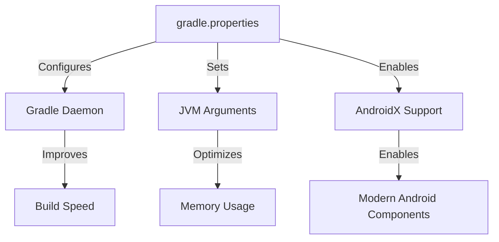
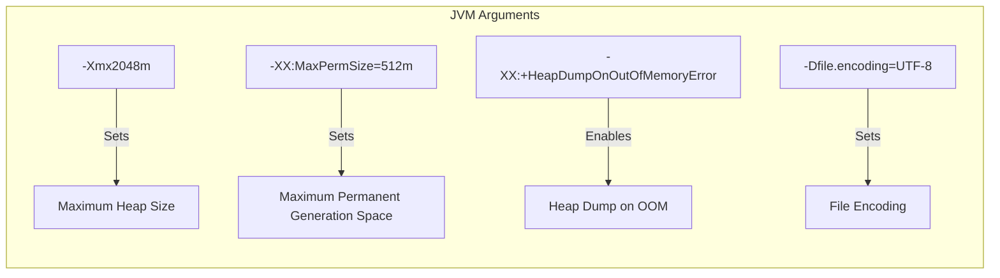
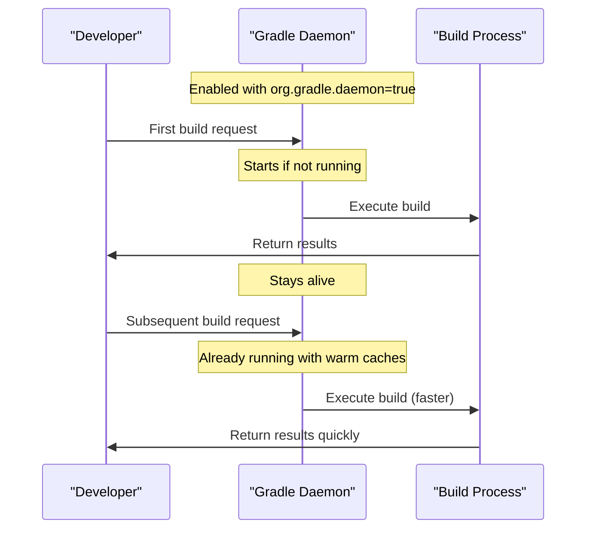
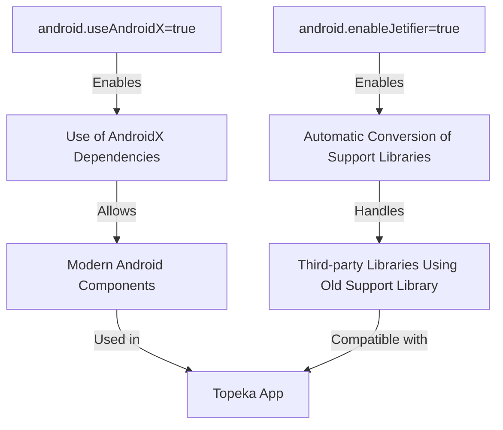
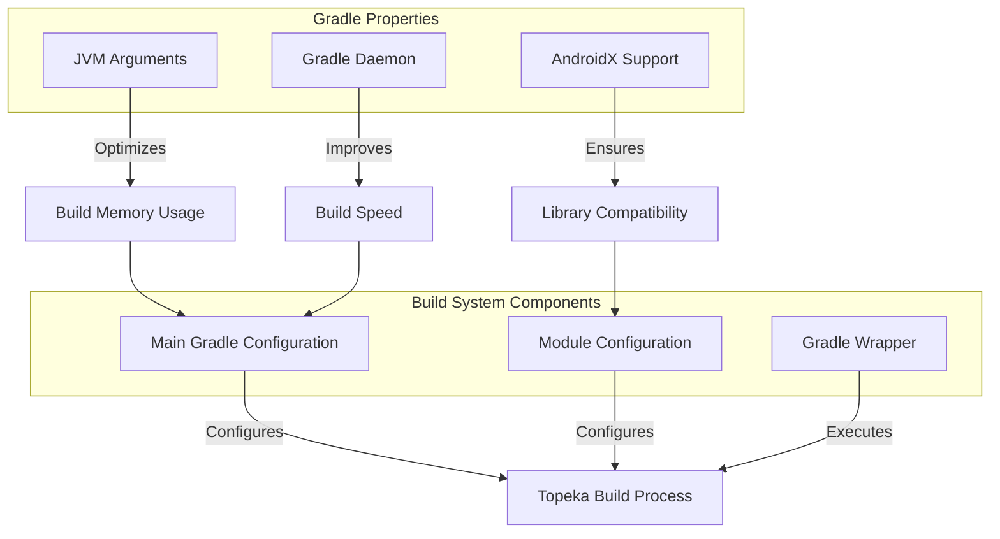

<!-- source: DeepWiki mcp.deepwiki.com · repo android/topeka · page 3.3 Gradle Properties · fetched 2026-10-23 -->

# Gradle Properties

Relevant source files

The following files were used as context for generating this wiki page:

- [gradle.properties](gradle.properties)

## Purpose

This document explains the Gradle properties configuration in the Topeka Android application and how these properties affect the build process. Gradle properties are global settings that influence how Gradle executes builds across the entire project. For information about module-specific Gradle configurations, see [Module Configuration](#3.2), and for details about the Gradle wrapper, see [Gradle Wrapper](#3.4).

## Overview of gradle.properties

The `gradle.properties` file contains project-wide Gradle settings that override any IDE-configured Gradle settings. In Topeka, this file defines crucial build performance optimizations and AndroidX compatibility settings.

Sources: [gradle.properties:17-38]()

## Key Properties in Topeka

The Topeka application uses several important Gradle properties to optimize build performance and ensure compatibility with modern Android development practices.

| Property | Value | Purpose |
|----------|-------|---------|
| `org.gradle.jvmargs` | `-Xmx2048m -XX:MaxPermSize=512m -XX:+HeapDumpOnOutOfMemoryError -Dfile.encoding=UTF-8` | Configure JVM memory settings for the build process |
| `org.gradle.daemon` | `true` | Enable Gradle daemon for faster builds |
| `android.useAndroidX` | `true` | Enable AndroidX libraries support |
| `android.enableJetifier` | `true` | Automatically convert third-party libraries to AndroidX |

Sources: [gradle.properties:29-38]()

## JVM Arguments Configuration

The JVM arguments configure how the Gradle daemon process operates, particularly regarding memory allocation and error handling.

The JVM arguments configured in Topeka are:

- **-Xmx2048m**: Sets the maximum heap size to 2GB, allowing for memory-intensive build operations
- **-XX:MaxPermSize=512m**: Allocates 512MB for permanent generation space (though deprecated in newer Java versions)
- **-XX:+HeapDumpOnOutOfMemoryError**: Creates a heap dump if an out-of-memory error occurs, aiding in diagnostics
- **-Dfile.encoding=UTF-8**: Ensures consistent UTF-8 file encoding for the build process

Sources: [gradle.properties:29]()

## Gradle Daemon

The Gradle Daemon is a background process that speeds up build times by keeping Gradle running in the background between builds, maintaining build caches and avoiding startup costs.

In Topeka, the Gradle daemon is explicitly enabled with `org.gradle.daemon=true`, which significantly improves build times, especially for repeated builds during development.

Sources: [gradle.properties:36]()

## AndroidX Configuration

Topeka uses AndroidX, which is the modern replacement for the Android Support Library. Two properties in `gradle.properties` control AndroidX behavior:

- **android.useAndroidX=true**: Indicates that the project uses AndroidX dependencies directly
- **android.enableJetifier=true**: Automatically converts third-party libraries that still use the old support library to use AndroidX

These settings ensure that all components in the application use the same dependency structure, preventing conflicts between AndroidX and the old support library.

Sources: [gradle.properties:37-38]()

## Commented Properties

The `gradle.properties` file also contains commented properties that aren't currently enabled but could be activated if needed:

- **org.gradle.parallel**: Would enable Gradle to build projects in parallel, potentially improving build performance for multi-module projects like Topeka

This setting is useful for decoupled projects but is kept commented out in the current configuration, likely because the benefits weren't significant enough or to avoid potential issues.

Sources: [gradle.properties:31-34]()

## Impact on Build System

The Gradle properties defined in Topeka have a direct impact on the overall build system performance and functionality.

The properties work together to ensure that:

1. Build processes have sufficient memory allocation
2. Builds run efficiently with daemon processes
3. All dependencies use the same modern AndroidX libraries
4. Third-party libraries are automatically migrated to AndroidX

Sources: [gradle.properties:17-38]()

## Best Practices

The Gradle properties configuration in Topeka follows several Android development best practices:

1. **Optimized memory settings**: Allocating appropriate memory to avoid out-of-memory errors during complex builds
2. **Enabled daemon**: Using the Gradle daemon to speed up development builds
3. **AndroidX migration**: Complete migration to AndroidX for all dependencies
4. **Clear documentation**: Each property is well-documented with comments explaining its purpose

These practices ensure consistent, efficient builds across different development environments.

Sources: [gradle.properties:17-38]()

---

