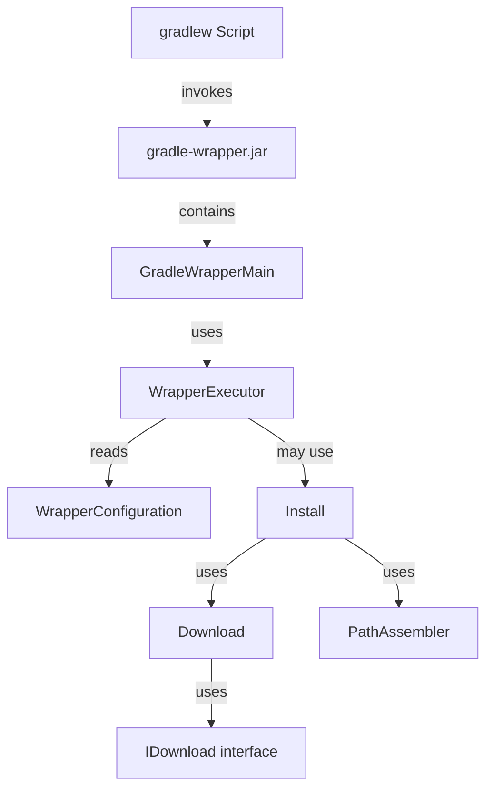
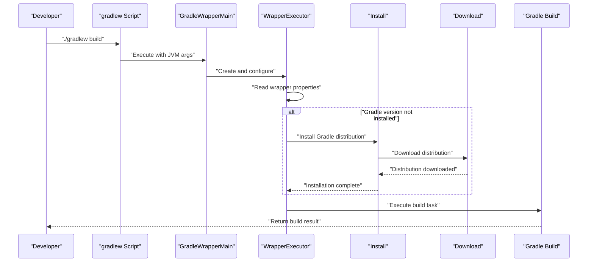
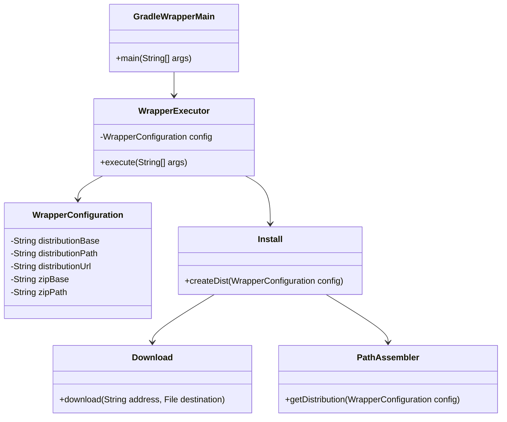
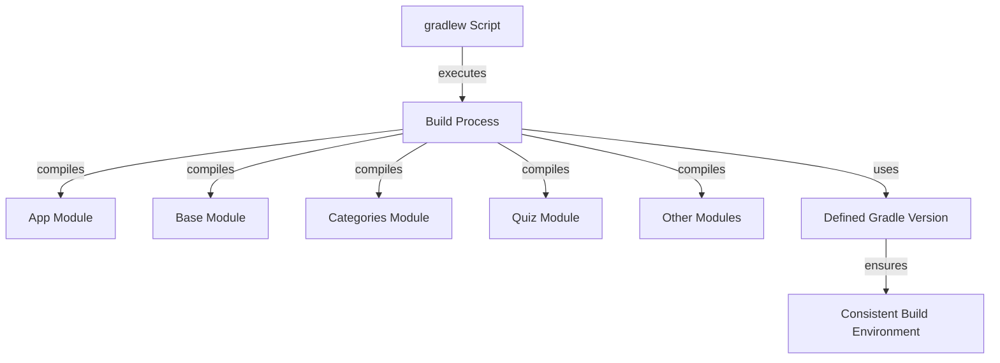

<!-- source: DeepWiki mcp.deepwiki.com · repo android/topeka · page 3.4 Gradle Wrapper · fetched 2026-10-23 -->

# Gradle Wrapper

<details>
<summary>Relevant source files</summary>

The following files were used as context for generating this wiki page:

- [gradle/wrapper/gradle-wrapper.jar](gradle/wrapper/gradle-wrapper.jar)
- [gradlew](gradlew)

</details>


The Gradle Wrapper is a critical component of the Topeka Android application's build system that ensures consistent build environment across different development machines. It allows developers to run Gradle tasks without having to manually install the specific version of Gradle required by the project.

For information about the overall build system configuration, see [Main Gradle Configuration](#3.1).

## Purpose

The Gradle Wrapper serves several key purposes in the Topeka project:

1. Ensures that all developers use exactly the same Gradle version
2. Eliminates the "works on my machine" problem caused by different Gradle versions
3. Removes the need for manual Gradle installation
4. Simplifies setup for new developers and CI/CD environments
5. Guarantees build script compatibility with the required Gradle version

Sources: [gradlew](), [gradle/wrapper/gradle-wrapper.jar]()

## Components

The Gradle Wrapper system in Topeka consists of the following key components:



| Component | Purpose |
|-----------|---------|
| `gradlew` | Bash script that serves as the entry point for Unix/macOS systems |
| `gradle/wrapper/gradle-wrapper.jar` | JAR file containing the wrapper implementation classes |
| `GradleWrapperMain` | Main class that initiates the wrapper execution process |
| `WrapperExecutor` | Handles the execution of Gradle with the correct version |
| `Install` | Manages installation of the Gradle distribution if needed |
| `Download` | Handles downloading the Gradle distribution |
| `PathAssembler` | Determines paths for Gradle installations |

Sources: [gradlew](), [gradle/wrapper/gradle-wrapper.jar:151-177](), [gradle/wrapper/gradle-wrapper.jar:129-150](), [gradle/wrapper/gradle-wrapper.jar:80-118](), [gradle/wrapper/gradle-wrapper.jar:198-222](), [gradle/wrapper/gradle-wrapper.jar:70-79](), [gradle/wrapper/gradle-wrapper.jar:38-46]()

## Execution Flow

When a developer runs the Gradle Wrapper in the Topeka project, the following sequence of operations occurs:



This process ensures that the correct Gradle version is used regardless of what may be installed on the developer's machine.

Sources: [gradlew:160](), [gradle/wrapper/gradle-wrapper.jar:151-177]()

## Wrapper Script Operation

The `gradlew` script in Topeka's root directory performs several crucial steps:

1. **Environment Setup**: Sets default JVM options and determines the operating system.
   ```bash
   # OS specific support (must be 'true' or 'false').
   cygwin=false
   msys=false
   darwin=false
   ```

2. **Java Command Detection**: Locates the Java executable to use.
   ```bash
   # Determine the Java command to use to start the JVM.
   if [ -n "$JAVA_HOME" ] ; then
       JAVACMD="$JAVA_HOME/bin/java"
   else
       JAVACMD="java"
   fi
   ```

3. **Classpath Setup**: Sets the classpath to include the wrapper JAR.
   ```bash
   CLASSPATH=$APP_HOME/gradle/wrapper/gradle-wrapper.jar
   ```

4. **Wrapper Execution**: Invokes the wrapper's main class.
   ```bash
   exec "$JAVACMD" "${JVM_OPTS[@]}" -classpath "$CLASSPATH" org.gradle.wrapper.GradleWrapperMain "$@"
   ```

Sources: [gradlew:30-43](), [gradlew:66-85](), [gradlew:63](), [gradlew:160]()

## Internal Wrapper Classes

The JAR file contains several key Java classes that power the Gradle Wrapper functionality:

| Class | Purpose |
|-------|---------|
| `org.gradle.wrapper.GradleWrapperMain` | Entry point class that bootstraps the wrapper process |
| `org.gradle.wrapper.WrapperExecutor` | Coordinates the wrapper execution flow |
| `org.gradle.wrapper.WrapperConfiguration` | Holds configuration details like distribution URL |
| `org.gradle.wrapper.Install` | Handles the installation of Gradle distributions |
| `org.gradle.wrapper.Download` | Manages the downloading of Gradle distributions |
| `org.gradle.wrapper.PathAssembler` | Determines the paths for Gradle installations |
| `org.gradle.wrapper.ExclusiveFileAccessManager` | Manages file access to avoid conflicts |



Sources: [gradle/wrapper/gradle-wrapper.jar:151-177](), [gradle/wrapper/gradle-wrapper.jar:129-150](), [gradle/wrapper/gradle-wrapper.jar:38-46](), [gradle/wrapper/gradle-wrapper.jar:80-118](), [gradle/wrapper/gradle-wrapper.jar:198-222](), [gradle/wrapper/gradle-wrapper.jar:70-79](), [gradle/wrapper/gradle-wrapper.jar:22-37]()

## Using the Gradle Wrapper

To execute a Gradle task using the wrapper in the Topeka project, use the following command:

```bash
# On Unix-like systems (Linux/macOS)
./gradlew [task]

# On Windows
gradlew.bat [task]
```

Common tasks in the Topeka Android project include:

| Task | Purpose |
|------|---------|
| `assembleDebug` | Build the debug APK |
| `assembleRelease` | Build the release APK |
| `test` | Run unit tests |
| `connectedAndroidTest` | Run instrumented tests on a connected device |
| `clean` | Clean the build directory |
| `installDebug` | Install the debug APK on a connected device |

For example, to build a debug version of the Topeka app:

```bash
./gradlew assembleDebug
```

Sources: [gradlew]()

## Integration with Topeka's Build System

The Gradle Wrapper integrates with Topeka's modular architecture:



This integration ensures that Topeka's modular structure, which consists of the app module, base module, and dynamic feature modules, is built consistently across all development environments.

Sources: [gradlew]()

## Benefits for Development Workflow

Using the Gradle Wrapper in the Topeka project provides several key benefits:

1. **Consistent Environment**: Every developer uses exactly the same Gradle version
2. **Zero Configuration**: New team members can build the project immediately without installing Gradle
3. **CI/CD Compatibility**: Continuous integration systems can build without pre-installing Gradle
4. **Version Control**: The wrapper files are versioned with the project
5. **Automatic Updates**: The Gradle version can be centrally updated for all developers

Sources: [gradlew](), [gradle/wrapper/gradle-wrapper.jar]()

## Updating the Gradle Wrapper

While not explicitly documented in the files provided, the standard way to update the Gradle Wrapper in an Android project like Topeka is:

```bash
./gradlew wrapper --gradle-version=X.Y.Z
```

This command updates the wrapper configuration to use the specified Gradle version, ensuring all builds use that version going forward.

Sources: [gradlew]()

## Summary

The Gradle Wrapper is a fundamental component of the Topeka Android application that ensures build consistency across all development environments. By providing a version-specific, self-contained Gradle distribution mechanism, it eliminates environment-related build issues and simplifies project setup for new developers.

Sources: [gradlew](), [gradle/wrapper/gradle-wrapper.jar]()

---

