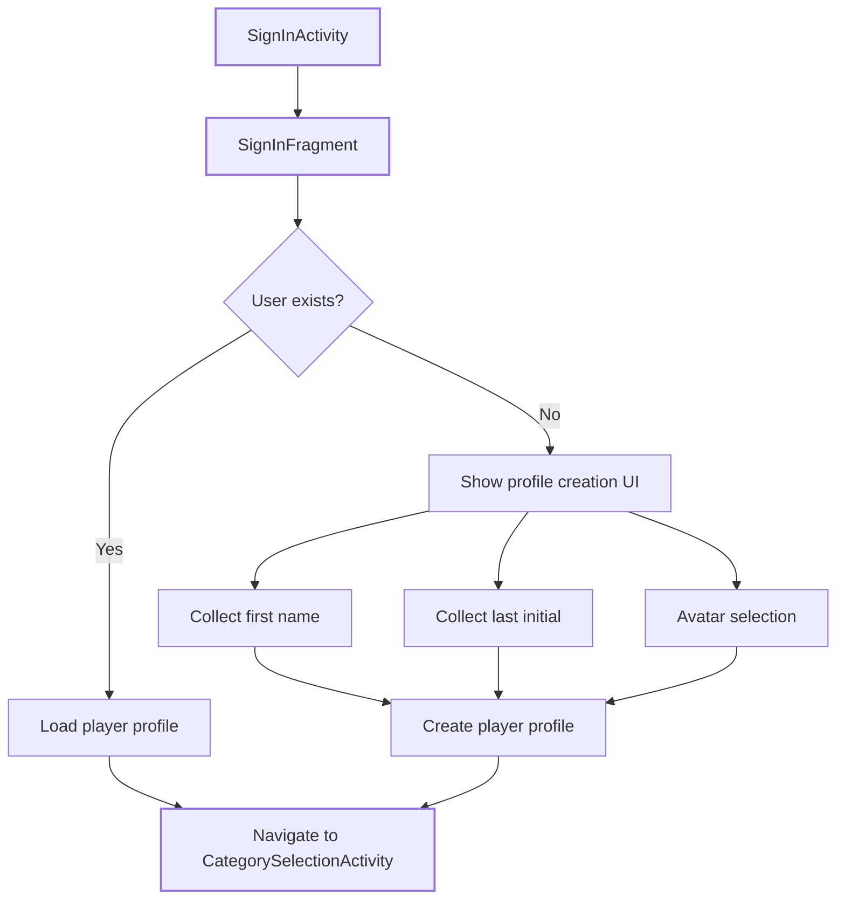
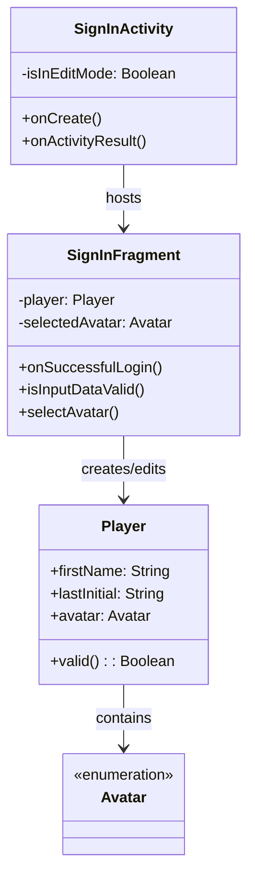
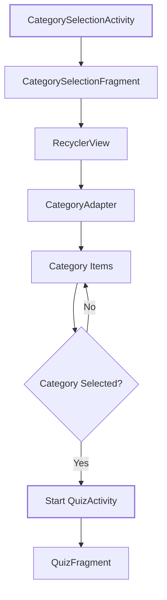
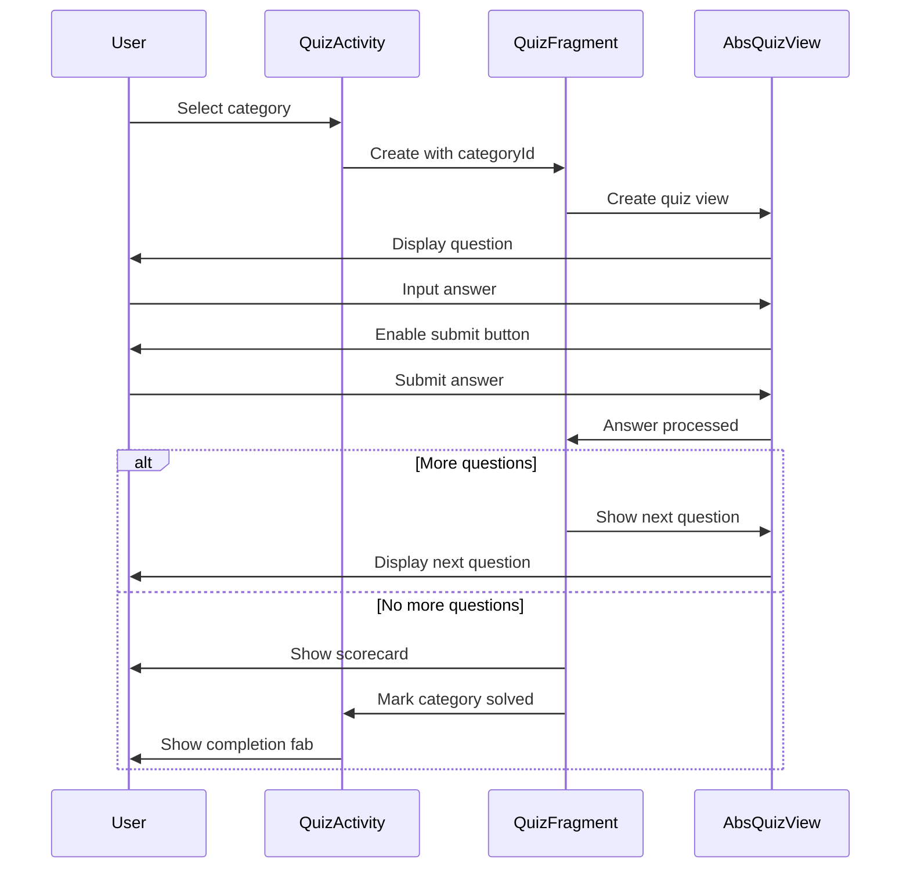
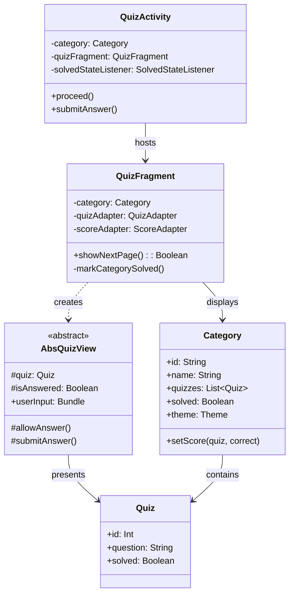
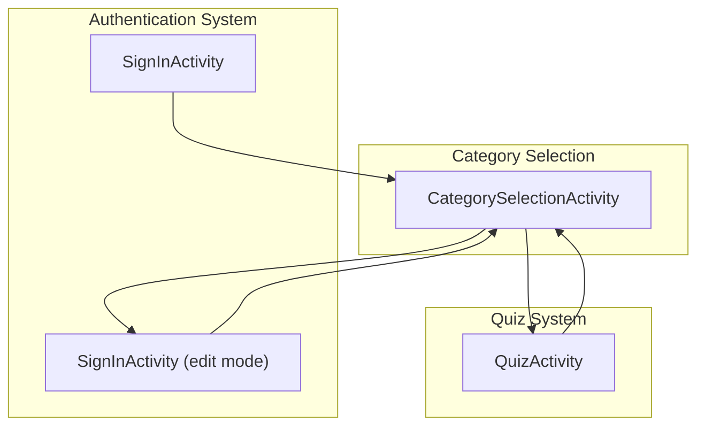
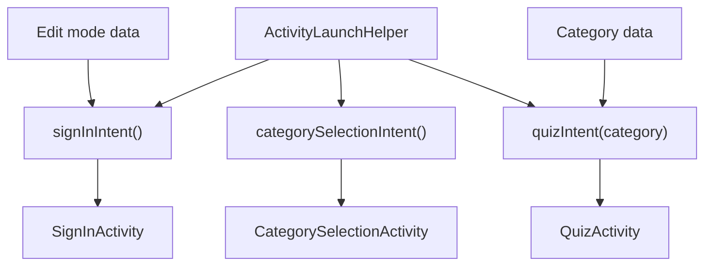

<!-- source: DeepWiki mcp.deepwiki.com · repo android/topeka · page 4 Core Features · fetched 2026-10-23 -->

# Core Features

Relevant source files

The following files were used as context for generating this wiki page:

- [base/src/androidTest/java/com/google/samples/apps/topeka/activity/SignInActivityTest.kt](base/src/androidTest/java/com/google/samples/apps/topeka/activity/SignInActivityTest.kt)
- [base/src/main/java/com/google/samples/apps/topeka/activity/SignInActivity.kt](base/src/main/java/com/google/samples/apps/topeka/activity/SignInActivity.kt)
- [base/src/main/java/com/google/samples/apps/topeka/fragment/SignInFragment.kt](base/src/main/java/com/google/samples/apps/topeka/fragment/SignInFragment.kt)
- [base/src/main/java/com/google/samples/apps/topeka/helper/ActivityLaunchHelper.kt](base/src/main/java/com/google/samples/apps/topeka/helper/ActivityLaunchHelper.kt)
- [categories/src/main/java/com/google/samples/apps/topeka/activity/CategorySelectionActivity.kt](categories/src/main/java/com/google/samples/apps/topeka/activity/CategorySelectionActivity.kt)
- [categories/src/main/java/com/google/samples/apps/topeka/adapter/CategoryAdapter.kt](categories/src/main/java/com/google/samples/apps/topeka/adapter/CategoryAdapter.kt)
- [categories/src/main/java/com/google/samples/apps/topeka/fragment/CategorySelectionFragment.kt](categories/src/main/java/com/google/samples/apps/topeka/fragment/CategorySelectionFragment.kt)
- [categories/src/main/res/layout/fragment_categories.xml](categories/src/main/res/layout/fragment_categories.xml)
- [quiz/src/main/java/com/google/samples/apps/topeka/activity/QuizActivity.kt](quiz/src/main/java/com/google/samples/apps/topeka/activity/QuizActivity.kt)
- [quiz/src/main/java/com/google/samples/apps/topeka/fragment/QuizFragment.kt](quiz/src/main/java/com/google/samples/apps/topeka/fragment/QuizFragment.kt)
- [quiz/src/main/java/com/google/samples/apps/topeka/widget/quiz/AbsQuizView.kt](quiz/src/main/java/com/google/samples/apps/topeka/widget/quiz/AbsQuizView.kt)

This document provides an overview of the main functional components that form the core of the Topeka quiz application. It covers the key features that enable user authentication, category selection, and quiz interactions. For details on the high-level architecture, see [Architecture](#2), and for information about the build system, see [Build System](#3).

## Authentication System

The authentication system in Topeka handles user profiles and provides a simple sign-in experience without requiring passwords. It manages player data, including name and avatar selection.

### Sign-In Flow

Sources: [base/src/main/java/com/google/samples/apps/topeka/fragment/SignInFragment.kt:55-317](), [base/src/main/java/com/google/samples/apps/topeka/activity/SignInActivity.kt:30-52]()

### Key Components

- **SignInActivity**: Entry point for the authentication process
- **SignInFragment**: Handles profile creation and editing with fields for:
  - First name (required)
  - Last initial (required)
  - Avatar selection from a grid (required)
- **Player Model**: Stores user information and preferences

The authentication system uses a simple non-password approach, making it easy for users to create profiles or continue with existing ones. The system validates that all required fields are provided before allowing the user to proceed.

Sources: [base/src/main/java/com/google/samples/apps/topeka/fragment/SignInFragment.kt:55-317](), [base/src/main/java/com/google/samples/apps/topeka/activity/SignInActivity.kt:30-52]()

## Category Selection

After authentication, users are presented with a grid of quiz categories they can choose from. Each category contains a set of quizzes on a specific topic, with visual indicators showing which categories the user has already completed.

### Category Display

Sources: [categories/src/main/java/com/google/samples/apps/topeka/activity/CategorySelectionActivity.kt:45-131](), [categories/src/main/java/com/google/samples/apps/topeka/fragment/CategorySelectionFragment.kt:43-105](), [categories/src/main/java/com/google/samples/apps/topeka/adapter/CategoryAdapter.kt:40-176]()

### Key Components

- **CategorySelectionActivity**: Main screen after sign-in
- **CategorySelectionFragment**: Handles the display and selection of categories
- **CategoryAdapter**: Manages the grid of categories with the following features:
  - Visual theming for each category
  - Status indicators for solved categories
  - Transitions to QuizActivity on selection

Each category has its own theme color and icon that makes it visually distinct. Categories that have been completed are marked with a checkmark indicator.

| Property | Description |
|----------|-------------|
| Category ID | Unique identifier for the category |
| Name | Display name of the category |
| Theme | Color scheme and styling information |
| Icon | Visual representation of the category |
| Solved | Boolean indicating if category is completed |
| Quizzes | Collection of quiz questions in this category |

Sources: [categories/src/main/java/com/google/samples/apps/topeka/adapter/CategoryAdapter.kt:40-176](), [categories/src/main/res/layout/fragment_categories.xml:1-33]()

## Quiz System

The quiz system is responsible for presenting questions to users, validating answers, and tracking progress. It supports multiple question types and provides immediate feedback on answers.

### Quiz Interaction Flow

Sources: [quiz/src/main/java/com/google/samples/apps/topeka/activity/QuizActivity.kt:69-443](), [quiz/src/main/java/com/google/samples/apps/topeka/fragment/QuizFragment.kt:48-240](), [quiz/src/main/java/com/google/samples/apps/topeka/widget/quiz/AbsQuizView.kt:69-282]()

### Key Components

- **QuizActivity**: Manages the quiz session and transitions
- **QuizFragment**: Handles the quiz flow and progress tracking
- **AbsQuizView**: Base class for different quiz question types with features:
  - Question display
  - Answer validation
  - Visual feedback on answers
  - Score tracking

The quiz system uses an adapter pattern to present different question types through a consistent interface. When a user completes all questions in a category, the system:

1. Marks the category as solved
2. Updates the user's score
3. Shows a scorecard with results
4. Provides visual feedback

Sources: [quiz/src/main/java/com/google/samples/apps/topeka/activity/QuizActivity.kt:69-443](), [quiz/src/main/java/com/google/samples/apps/topeka/fragment/QuizFragment.kt:48-240](), [quiz/src/main/java/com/google/samples/apps/topeka/widget/quiz/AbsQuizView.kt:69-282]()

## Integration Between Components

The core features of Topeka work together to create a cohesive user experience. The application flow connects these components through well-defined transitions and data sharing.

### Application Flow

Sources: [base/src/main/java/com/google/samples/apps/topeka/helper/ActivityLaunchHelper.kt:27-71](), [categories/src/main/java/com/google/samples/apps/topeka/activity/CategorySelectionActivity.kt:45-131](), [quiz/src/main/java/com/google/samples/apps/topeka/activity/QuizActivity.kt:69-443]()

### Data and State Management

The core features maintain application state through several mechanisms:

1. **Player Data**: Persisted through login/logout cycles
2. **Category Completion**: Tracked and visually indicated in the UI
3. **Quiz Answers**: Saved during quiz navigation and configuration changes
4. **Score Tracking**: Maintained across the application

ActivityLaunchHelper orchestrates navigation between components using intents with specific data:

Sources: [base/src/main/java/com/google/samples/apps/topeka/helper/ActivityLaunchHelper.kt:27-71]()

## Summary

The core features of Topeka form an interconnected system that provides users with a complete quiz experience:

1. **Authentication**: Simple profile creation with name and avatar
2. **Category Selection**: Visual grid of quiz categories with completion indicators
3. **Quiz System**: Interactive quiz experience with multiple question types and feedback

These features work together through well-defined interfaces and transitions, creating a cohesive user experience aligned with Material Design principles. Each component is responsible for a specific aspect of functionality while sharing data and state with the others.

---

