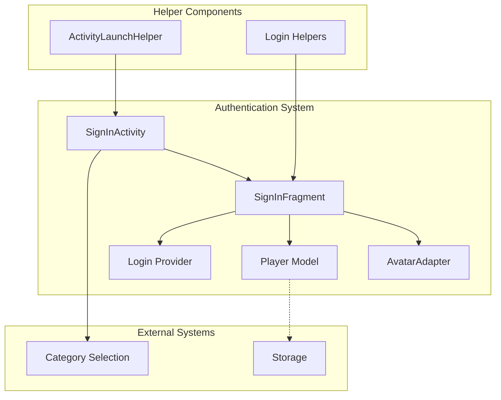
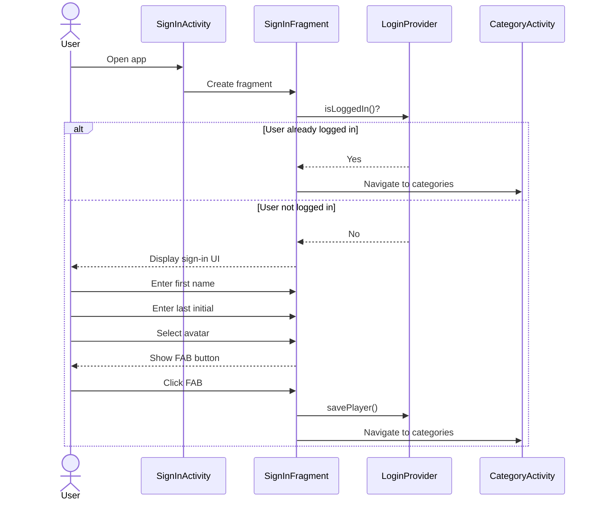
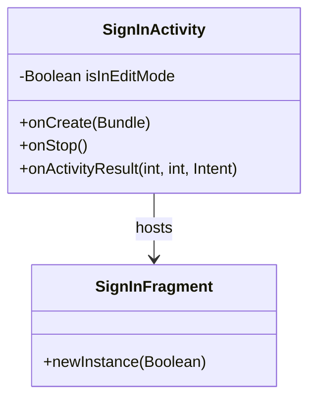
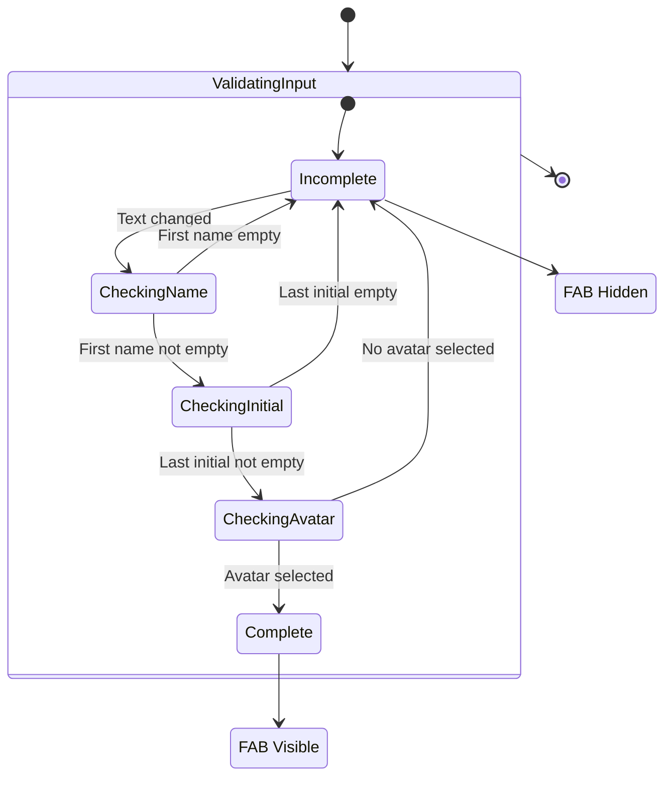
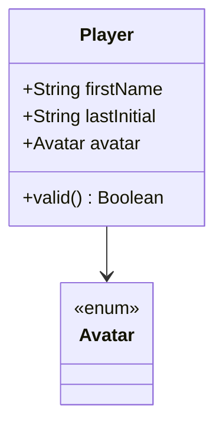
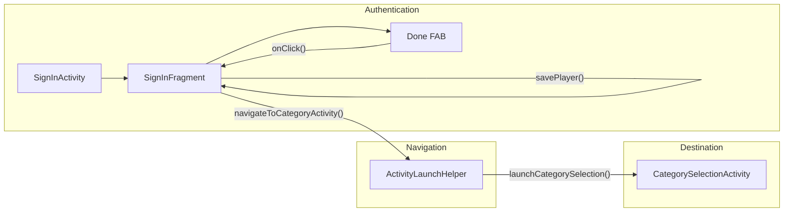

<!-- source: DeepWiki mcp.deepwiki.com · repo android/topeka · page 4.1 Authentication System · fetched 2026-10-23 -->

# Authentication System

<details>
<summary>Relevant source files</summary>

The following files were used as context for generating this wiki page:

- [base/src/androidTest/java/com/google/samples/apps/topeka/activity/SignInActivityTest.kt](base/src/androidTest/java/com/google/samples/apps/topeka/activity/SignInActivityTest.kt)
- [base/src/main/java/com/google/samples/apps/topeka/activity/SignInActivity.kt](base/src/main/java/com/google/samples/apps/topeka/activity/SignInActivity.kt)
- [base/src/main/java/com/google/samples/apps/topeka/fragment/SignInFragment.kt](base/src/main/java/com/google/samples/apps/topeka/fragment/SignInFragment.kt)
- [base/src/main/java/com/google/samples/apps/topeka/helper/ActivityLaunchHelper.kt](base/src/main/java/com/google/samples/apps/topeka/helper/ActivityLaunchHelper.kt)

</details>


## Purpose and Scope

This document details the authentication system of the Topeka Android app. The authentication system is responsible for user sign-in, profile creation, and storing user information. It provides a lightweight authentication mechanism allowing users to create profiles with basic information and an avatar selection, without requiring passwords or external authentication providers.

For information about how authenticated users interact with quiz categories, see [Category Selection](#4.2).

## Authentication Components Overview

The Topeka authentication system consists of the following main components:



Sources: 
- [base/src/main/java/com/google/samples/apps/topeka/activity/SignInActivity.kt:30-52]()
- [base/src/main/java/com/google/samples/apps/topeka/fragment/SignInFragment.kt:55-317]()

## User Authentication Flow

The following diagram illustrates the authentication flow in the Topeka app:



Sources:
- [base/src/main/java/com/google/samples/apps/topeka/activity/SignInActivity.kt:32-44]()
- [base/src/main/java/com/google/samples/apps/topeka/fragment/SignInFragment.kt:68-82]()
- [base/src/main/java/com/google/samples/apps/topeka/fragment/SignInFragment.kt:213-232]()

## Sign-in Activity

The `SignInActivity` serves as the container for the authentication UI. It has minimal responsibilities:

1. Host the `SignInFragment`
2. Forward activity results to the fragment
3. Handle edit mode (for profile editing)
4. Finish itself when user is logged in



The activity finishes automatically in `onStop()` if the user is successfully logged in, ensuring that the sign-in screen doesn't remain in the back stack.

Sources:
- [base/src/main/java/com/google/samples/apps/topeka/activity/SignInActivity.kt:30-52]()

## Sign-in Fragment

The `SignInFragment` handles the core authentication functionality:

1. User information input (first name, last initial)
2. Avatar selection via a grid
3. Validation of input data
4. Creating and saving the player profile
5. Transition to the category selection screen

Key UI elements in the fragment include:
- First name text field
- Last initial text field
- Avatar grid view
- "Done" floating action button (FAB)

The fragment has two operational modes:
- **New user**: Empty fields for creating a new profile
- **Edit mode**: Pre-filled fields for updating an existing profile

Sources:
- [base/src/main/java/com/google/samples/apps/topeka/fragment/SignInFragment.kt:55-317]()

## Input Validation

The `SignInFragment` performs real-time validation to ensure all required information is provided before allowing sign-in:

| Field | Validation Rule |
|-------|----------------|
| First Name | Must not be empty |
| Last Initial | Must not be empty |
| Avatar | Must be selected |

The "Done" FAB is only displayed when all validation criteria are met, preventing incomplete profile creation.



Sources:
- [base/src/main/java/com/google/samples/apps/topeka/fragment/SignInFragment.kt:194-208]()
- [base/src/main/java/com/google/samples/apps/topeka/fragment/SignInFragment.kt:284-302]()

## Player Data Model

User profiles in Topeka are represented by the `Player` class:



The `Avatar` is an enum representing the different avatar options that users can select during sign-in.

When saving a player profile, the fragment either:
1. Updates an existing player object with new values
2. Creates a new player instance if none exists

```kotlin
val toSave = player?.apply {
    // either update the existing player object
    firstName = first
    lastInitial = last
    avatar = selectedAvatar
} ?: Player(first, last, selectedAvatar) /* or create a new one */
```

Sources:
- [base/src/main/java/com/google/samples/apps/topeka/fragment/SignInFragment.kt:213-227]()

## Login Provider

The authentication system uses a login provider abstraction (`login`) that offers two key operations:

1. `loginPlayer()`: Attempts to retrieve existing player data
2. `savePlayer()`: Stores player data for future sessions

This abstraction allows for different implementations of login functionality, including:
- Default login (local storage)
- Test login (for testing purposes)

Sources:
- [base/src/main/java/com/google/samples/apps/topeka/fragment/SignInFragment.kt:80-82]()
- [base/src/main/java/com/google/samples/apps/topeka/fragment/SignInFragment.kt:213-227]()

## Navigation

After successful sign-in, the app navigates to the category selection screen:



The navigation is handled through the `ActivityLaunchHelper` which creates the appropriate intents and launches activities.

Sources:
- [base/src/main/java/com/google/samples/apps/topeka/fragment/SignInFragment.kt:111-116]()
- [base/src/main/java/com/google/samples/apps/topeka/helper/ActivityLaunchHelper.kt:38-45]()

## Editing Existing Profiles

The authentication system supports editing existing user profiles through an "edit mode":

1. The `SignInActivity` can be launched with an `EXTRA_EDIT` parameter
2. In edit mode, existing player data is loaded and displayed
3. The user can modify their information and save changes
4. The player object is updated rather than creating a new one

Sources:
- [base/src/main/java/com/google/samples/apps/topeka/activity/SignInActivity.kt:37]()
- [base/src/main/java/com/google/samples/apps/topeka/fragment/SignInFragment.kt:92-105]()
- [base/src/main/java/com/google/samples/apps/topeka/helper/ActivityLaunchHelper.kt:30-31]()
- [base/src/main/java/com/google/samples/apps/topeka/helper/ActivityLaunchHelper.kt:58-59]()

## User Interface Components

The sign-in UI is composed of several key components:

| Component | Purpose | Implementation |
|-----------|---------|----------------|
| First Name Field | Input for user's first name | EditText with TextWatcher |
| Last Initial Field | Input for user's last initial | EditText with TextWatcher (limited to one character) |
| Avatar Grid | Visual selection of user avatar | GridView with AvatarAdapter |
| Done FAB | Submit button for sign-in | FloatingActionButton with visibility control |

The UI features dynamic behavior with real-time validation:
- Text watchers monitor input fields and show/hide the FAB accordingly
- Avatar selection is tracked to ensure a complete profile
- Animation is used when showing/hiding the FAB and transitioning to the next screen

Sources:
- [base/src/main/java/com/google/samples/apps/topeka/fragment/SignInFragment.kt:174-185]()
- [base/src/main/java/com/google/samples/apps/topeka/fragment/SignInFragment.kt:194-208]()

## Testing

The authentication system includes comprehensive testing:

1. UI tests for input validation:
   - Empty field validation
   - Character limits
   - Avatar selection
   - FAB visibility based on input state

2. Flow tests for sign-in process:
   - New user creation
   - Edit mode functionality
   - Navigation after sign-in

The test code uses a `TestLogin` implementation to isolate the testing environment from the production login provider.

Sources:
- [base/src/androidTest/java/com/google/samples/apps/topeka/activity/SignInActivityTest.kt:57-157]()

---

