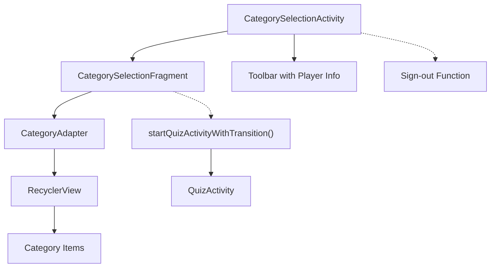
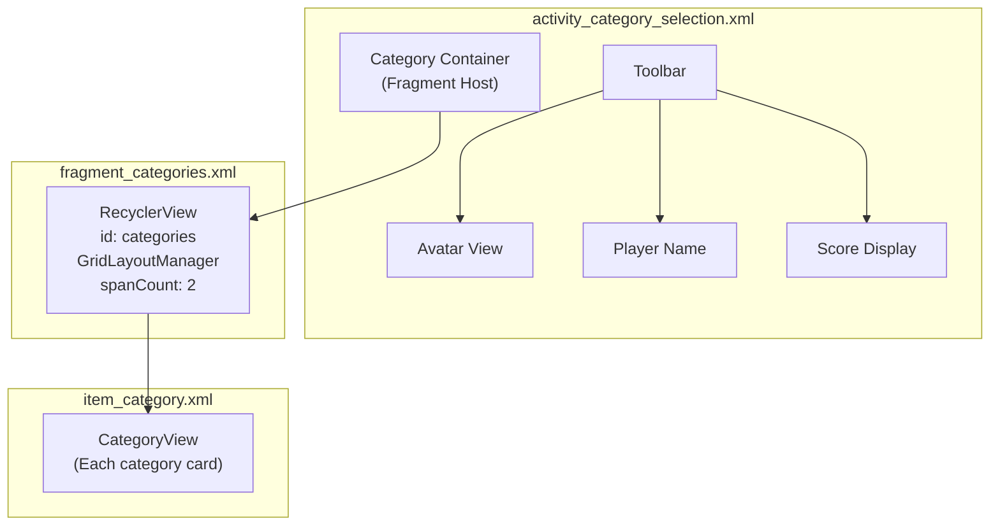
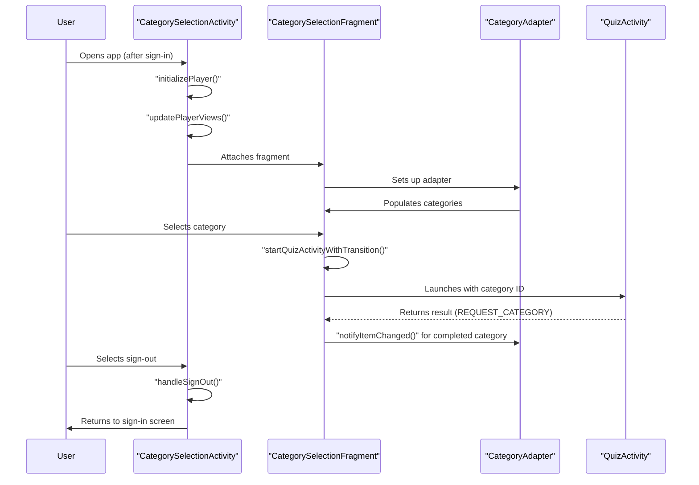

<!-- source: DeepWiki mcp.deepwiki.com · repo android/topeka · page 4.2 Category Selection · fetched 2026-10-23 -->

# Category Selection

<details>
<summary>Relevant source files</summary>

The following files were used as context for generating this wiki page:

- [categories/src/main/java/com/google/samples/apps/topeka/activity/CategorySelectionActivity.kt](categories/src/main/java/com/google/samples/apps/topeka/activity/CategorySelectionActivity.kt)
- [categories/src/main/java/com/google/samples/apps/topeka/fragment/CategorySelectionFragment.kt](categories/src/main/java/com/google/samples/apps/topeka/fragment/CategorySelectionFragment.kt)
- [categories/src/main/res/layout/fragment_categories.xml](categories/src/main/res/layout/fragment_categories.xml)

</details>


## Purpose and Scope

This document details the Category Selection system in the Topeka Android app. This system is responsible for displaying quiz categories to users and handling the selection process that transitions users to the quiz experience. It serves as the central hub of the application, connecting the [Authentication System](#4.1) to the [Quiz System](#4.3).

## Architecture Overview

The Category Selection system follows a standard Android architecture pattern using an Activity and Fragment combination, with RecyclerView for displaying the grid of categories.



The system is organized with clear separation of responsibilities:
- `CategorySelectionActivity` manages the overall screen, player information, and toolbar
- `CategorySelectionFragment` handles the display and interaction with category grid
- `CategoryAdapter` populates the RecyclerView with category data

Sources: [categories/src/main/java/com/google/samples/apps/topeka/activity/CategorySelectionActivity.kt:45-131](), [categories/src/main/java/com/google/samples/apps/topeka/fragment/CategorySelectionFragment.kt:43-105]()

## User Interface Components

The user interface consists of a toolbar showing player information and a grid of category cards.



The category grid is implemented as a RecyclerView with a GridLayoutManager configured to display two columns of categories. Each category is represented by a custom view that displays the category's theme color, icon, and title.

Sources: [categories/src/main/res/layout/fragment_categories.xml:17-32](), [categories/src/main/java/com/google/samples/apps/topeka/fragment/CategorySelectionFragment.kt:57-70]()

## Data Flow and Interactions

The Category Selection system interacts with both the Authentication system and the Quiz system through a well-defined flow:



Sources: [categories/src/main/java/com/google/samples/apps/topeka/fragment/CategorySelectionFragment.kt:43-105](), [categories/src/main/java/com/google/samples/apps/topeka/activity/CategorySelectionActivity.kt:45-131]()

## Implementation Details

### Activity Implementation

The `CategorySelectionActivity` serves as the main container for the category selection screen with several key responsibilities:

1. Initializing and displaying player information in the toolbar
2. Attaching the `CategorySelectionFragment` to display categories
3. Handling menu options including sign-out functionality
4. Managing activity results from the Quiz system

Key methods include:

- `onCreate()`: Sets up the activity layout and initializes components
- `initializePlayer()`: Requests player login information
- `updatePlayerViews()`: Updates UI elements with player information
- `attachCategoryGridFragment()`: Adds the fragment displaying categories
- `handleSignOut()`: Manages the sign-out process and transition to sign-in screen

Sources: [categories/src/main/java/com/google/samples/apps/topeka/activity/CategorySelectionActivity.kt:47-130]()

### Fragment Implementation

The `CategorySelectionFragment` handles the display of categories and the interaction with them:

1. Setting up the RecyclerView with a grid layout
2. Managing the CategoryAdapter that populates the grid
3. Handling item click events to launch the Quiz activity
4. Processing results from Quiz activity to update completed categories

Key methods include:

- `onViewCreated()`: Initializes the RecyclerView
- `setUpQuizGrid()`: Configures the RecyclerView with appropriate decoration and adapter
- `startQuizActivityWithTransition()`: Launches the Quiz activity with proper animations
- `onActivityResult()`: Processes results from the Quiz activity

Sources: [categories/src/main/java/com/google/samples/apps/topeka/fragment/CategorySelectionFragment.kt:57-103]()

### UI Element Configuration

The categories display is implemented using a RecyclerView with specific configuration to create a visually appealing grid:

```
RecyclerView characteristics:
- 2-column grid layout (spanCount="2")
- Padding: spacing_nano
- Vertical scrollbars outside content area
- OffsetDecoration for spacing between items
- Supports material design transitions
```

Sources: [categories/src/main/res/layout/fragment_categories.xml:17-32](), [categories/src/main/java/com/google/samples/apps/topeka/fragment/CategorySelectionFragment.kt:62-69]()

## Transitions and Animation

The system implements material design transitions for smooth navigation between screens:

1. When entering the category selection screen, a postponed shared element transition is used to animate the entry
2. When selecting a category, a custom transition animates the toolbar between the category selection and quiz screens
3. When signing out, a specific exit transition is applied

This creates a seamless user experience with visually connected screens.

Sources: [categories/src/main/java/com/google/samples/apps/topeka/fragment/CategorySelectionFragment.kt:81-98](), [categories/src/main/java/com/google/samples/apps/topeka/activity/CategorySelectionActivity.kt:122-129]()

## Category Data Structure

Each category in the grid represents a quiz topic and contains specific properties:

| Property | Description |
|----------|-------------|
| id | Unique identifier for the category |
| name | Display name of the category |
| theme | Color theme associated with the category |
| icon | Visual representation for the category |
| quizzes | Collection of quiz questions in this category |
| solved | Boolean indicating if user has completed this category |

When a user selects a category, its ID is passed to the Quiz activity, which then loads the appropriate questions.

Sources: [categories/src/main/java/com/google/samples/apps/topeka/fragment/CategorySelectionFragment.kt:82-93]()

## Integration with Other Systems

### Authentication Integration

The Category Selection system relies on the Authentication system to:
- Obtain player information for display in the toolbar
- Handle sign-out requests
- Redirect to sign-in when needed

The `initializePlayer()` method uses the `requestLogin` helper to acquire player information, and the `handleSignOut()` method uses the `logout` helper to clear authentication.

Sources: [categories/src/main/java/com/google/samples/apps/topeka/activity/CategorySelectionActivity.kt:61-66](), [categories/src/main/java/com/google/samples/apps/topeka/activity/CategorySelectionActivity.kt:122-129]()

### Quiz System Integration

The Category Selection system communicates with the Quiz system by:
- Launching the Quiz activity with the selected category's ID
- Processing results from completed quizzes to update the UI
- Displaying the player's overall score from all completed quizzes

This integration uses activity results and intents to pass data between systems.

Sources: [categories/src/main/java/com/google/samples/apps/topeka/fragment/CategorySelectionFragment.kt:72-79](), [categories/src/main/java/com/google/samples/apps/topeka/fragment/CategorySelectionFragment.kt:82-98]()

---

