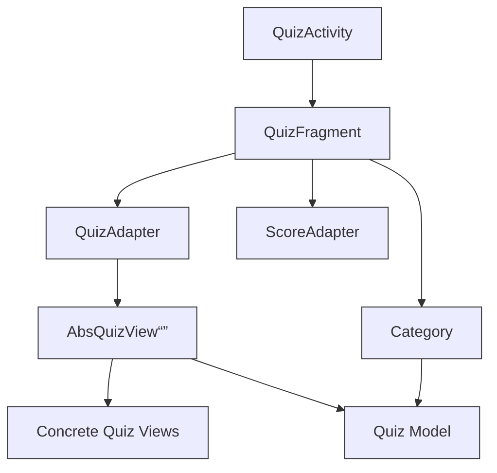
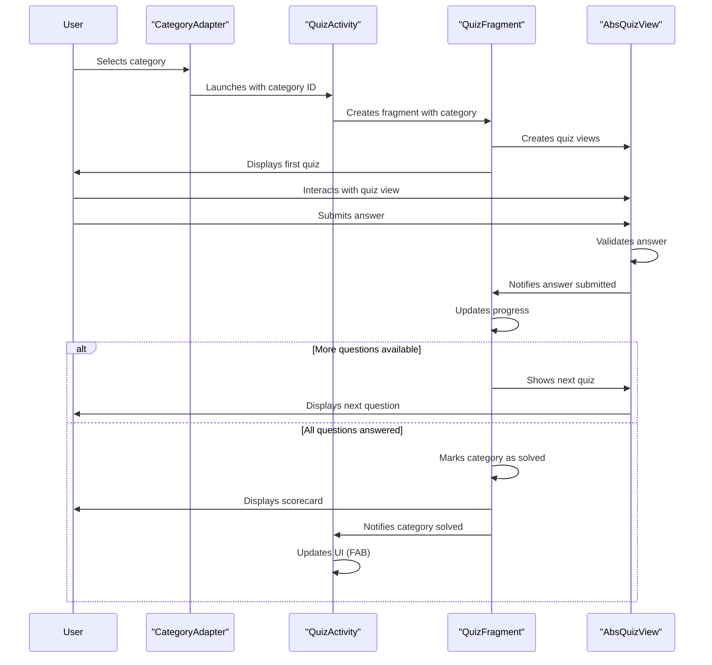
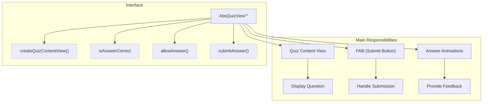
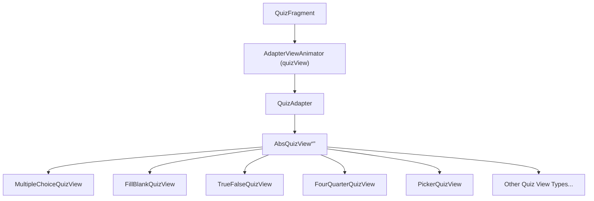
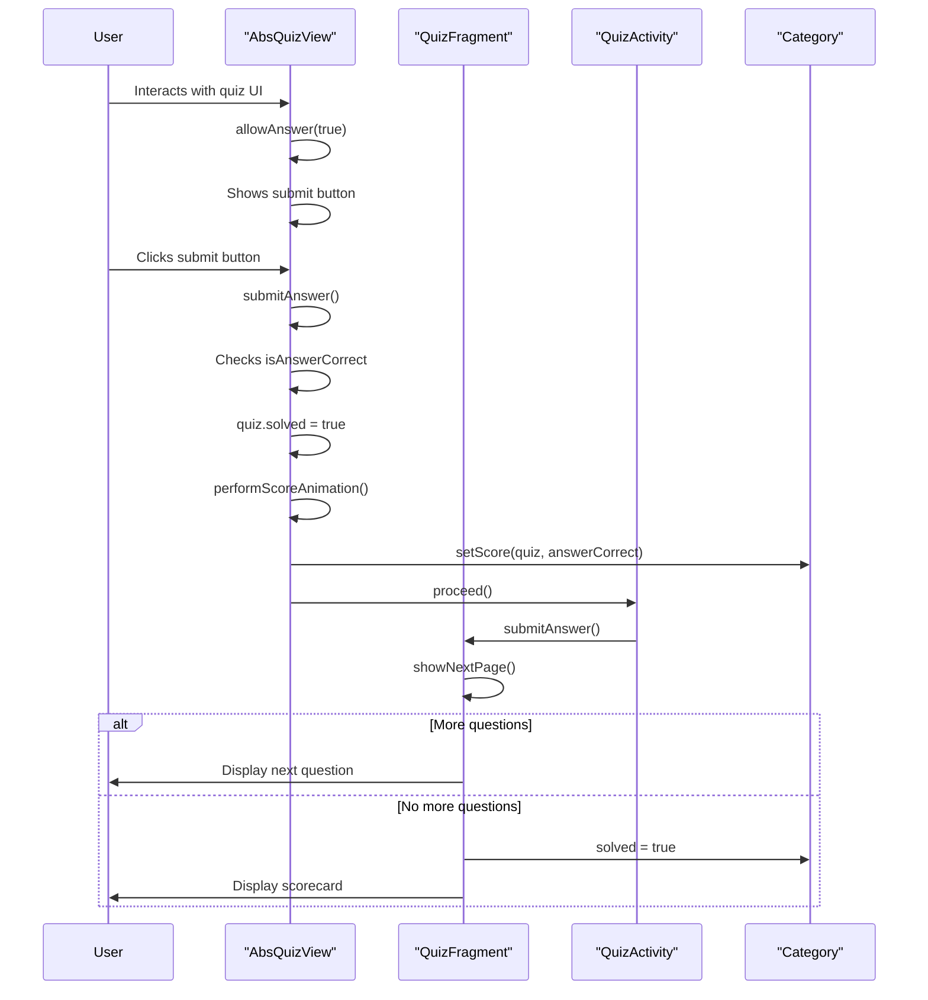
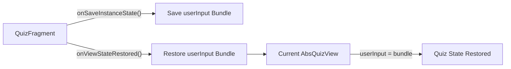
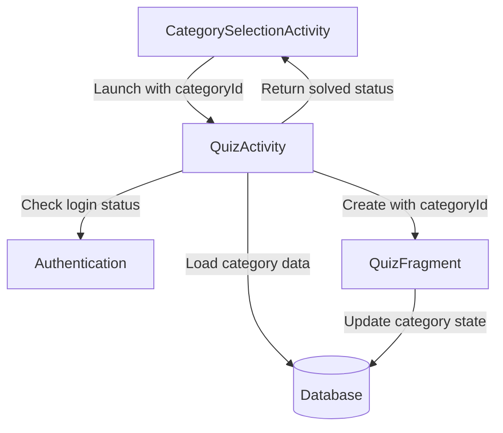

<!-- source: DeepWiki mcp.deepwiki.com · repo android/topeka · page 4.3 Quiz System · fetched 2026-10-23 -->

# Quiz System

Relevant source files

The following files were used as context for generating this wiki page:

- [app/src/main/AndroidManifest.xml](app/src/main/AndroidManifest.xml)
- [categories/src/main/java/com/google/samples/apps/topeka/adapter/CategoryAdapter.kt](categories/src/main/java/com/google/samples/apps/topeka/adapter/CategoryAdapter.kt)
- [quiz/src/main/java/com/google/samples/apps/topeka/activity/QuizActivity.kt](quiz/src/main/java/com/google/samples/apps/topeka/activity/QuizActivity.kt)
- [quiz/src/main/java/com/google/samples/apps/topeka/fragment/QuizFragment.kt](quiz/src/main/java/com/google/samples/apps/topeka/fragment/QuizFragment.kt)
- [quiz/src/main/java/com/google/samples/apps/topeka/widget/quiz/AbsQuizView.kt](quiz/src/main/java/com/google/samples/apps/topeka/widget/quiz/AbsQuizView.kt)

The Quiz System in Topeka manages the presentation, interaction, and scoring of quizzes within the application. This document details how quizzes are presented to users, how user answers are processed, and how scores are calculated. For information about category selection, see [Category Selection](#4.2).

## System Architecture Overview

The Quiz System consists of several key components that work together to deliver the quiz experience:

Sources:
- [quiz/src/main/java/com/google/samples/apps/topeka/activity/QuizActivity.kt:1-443]()
- [quiz/src/main/java/com/google/samples/apps/topeka/fragment/QuizFragment.kt:1-240]()
- [quiz/src/main/java/com/google/samples/apps/topeka/widget/quiz/AbsQuizView.kt:1-283]()

## Quiz Flow

The following sequence diagram illustrates the lifecycle of a quiz from selection to completion:

Sources:
- [quiz/src/main/java/com/google/samples/apps/topeka/fragment/QuizFragment.kt:185-202]()
- [quiz/src/main/java/com/google/samples/apps/topeka/activity/QuizActivity.kt:361-405]()
- [quiz/src/main/java/com/google/samples/apps/topeka/widget/quiz/AbsQuizView.kt:201-204]()

## Key Components

### QuizActivity

The `QuizActivity` is the main entry point for the quiz experience and is responsible for:

1. Initializing the UI with the selected category
2. Managing transitions and animations
3. Handling the quiz completion state
4. Communicating with the CategorySelection activity when completed

Notable methods:
- `onCreate()`: Sets up the activity and loads the category
- `proceed()`: Advances to the next quiz question
- `submitAnswer()`: Processes the current answer and moves forward
- `setResultSolved()`: Updates the result when a category is completed

Sources:
- [quiz/src/main/java/com/google/samples/apps/topeka/activity/QuizActivity.kt:93-146]()
- [quiz/src/main/java/com/google/samples/apps/topeka/activity/QuizActivity.kt:407-424]()
- [quiz/src/main/java/com/google/samples/apps/topeka/activity/QuizActivity.kt:358-360]()

### QuizFragment

The `QuizFragment` encapsulates quiz-solving logic and is responsible for:

1. Displaying quizzes from a category
2. Tracking progress through quizzes
3. Handling state persistence
4. Displaying the scorecard upon completion

Key methods:
- `showNextPage()`: Displays the next quiz or completes the category
- `setSolvedStateListener()`: Sets a listener for category completion
- `onSaveInstanceState()`: Preserves user input during configuration changes

Sources:
- [quiz/src/main/java/com/google/samples/apps/topeka/fragment/QuizFragment.kt:190-202]()
- [quiz/src/main/java/com/google/samples/apps/topeka/fragment/QuizFragment.kt:211-214]()
- [quiz/src/main/java/com/google/samples/apps/topeka/fragment/QuizFragment.kt:154-163]()

### AbsQuizView

`AbsQuizView` is the abstract base class for all quiz views and handles:

1. Basic quiz UI layout (question + specific quiz content)
2. Answer submission logic
3. Animations for correct/incorrect answers
4. State management

Sources:
- [quiz/src/main/java/com/google/samples/apps/topeka/widget/quiz/AbsQuizView.kt:69-80]()
- [quiz/src/main/java/com/google/samples/apps/topeka/widget/quiz/AbsQuizView.kt:135-140]()
- [quiz/src/main/java/com/google/samples/apps/topeka/widget/quiz/AbsQuizView.kt:186-186]()
- [quiz/src/main/java/com/google/samples/apps/topeka/widget/quiz/AbsQuizView.kt:193-196]()
- [quiz/src/main/java/com/google/samples/apps/topeka/widget/quiz/AbsQuizView.kt:201-204]()

## Quiz Presentation

The quiz system presents questions through a hierarchy of specialized view classes. Each quiz type has its own implementation that extends from `AbsQuizView`.

### Quiz View Hierarchy

Quiz views are presented using an `AdapterViewAnimator` within `QuizFragment` that shows one quiz at a time:

Sources:
- [quiz/src/main/java/com/google/samples/apps/topeka/fragment/QuizFragment.kt:67-69]()
- [quiz/src/main/java/com/google/samples/apps/topeka/fragment/QuizFragment.kt:111-115]()

### Quiz Layout Structure

Each quiz view follows a common structure defined in `AbsQuizView`:

| Component | Purpose | Implementation |
|-----------|---------|----------------|
| Question TextView | Displays the quiz question | Inflated from question.xml |
| Quiz Content View | Contains the specific quiz UI | Created by subclass implementation |
| Submit FAB | Allows answer submission | CheckableFab inflated from answer_submit.xml |

Sources:
- [quiz/src/main/java/com/google/samples/apps/topeka/widget/quiz/AbsQuizView.kt:142-160]()
- [quiz/src/main/java/com/google/samples/apps/topeka/widget/quiz/AbsQuizView.kt:162-178]()
- [quiz/src/main/java/com/google/samples/apps/topeka/widget/quiz/AbsQuizView.kt:110-120]()

## Answer Processing

### Answer Submission Flow

When a user answers a quiz, the following process occurs:

Sources:
- [quiz/src/main/java/com/google/samples/apps/topeka/widget/quiz/AbsQuizView.kt:193-196]()
- [quiz/src/main/java/com/google/samples/apps/topeka/widget/quiz/AbsQuizView.kt:201-204]()
- [quiz/src/main/java/com/google/samples/apps/topeka/widget/quiz/AbsQuizView.kt:211-223]()
- [quiz/src/main/java/com/google/samples/apps/topeka/activity/QuizActivity.kt:407-424]()
- [quiz/src/main/java/com/google/samples/apps/topeka/fragment/QuizFragment.kt:190-202]()

### Scoring and Feedback

1. Each quiz view is responsible for determining if an answer is correct via the `isAnswerCorrect` property
2. Visual feedback is provided through animations:
   - Background color changes to green (correct) or red (incorrect)
   - The FAB changes to a checkmark (correct) or X (incorrect)
   - The view performs a scale animation

3. Scores are stored in the Category model:
   - Correct answers increase the score
   - The category tracks overall completion status

Sources:
- [quiz/src/main/java/com/google/samples/apps/topeka/widget/quiz/AbsQuizView.kt:135-135]()
- [quiz/src/main/java/com/google/samples/apps/topeka/widget/quiz/AbsQuizView.kt:211-223]()
- [quiz/src/main/java/com/google/samples/apps/topeka/widget/quiz/AbsQuizView.kt:265-265]()

## State Management

The Quiz System maintains state across configuration changes through several mechanisms:

### User Input Preservation

1. Each `AbsQuizView` implementation must provide a `userInput` property
2. When the fragment is about to be destroyed, the current quiz view's state is saved
3. When restored, the state is applied to the current quiz view

Sources:
- [quiz/src/main/java/com/google/samples/apps/topeka/fragment/QuizFragment.kt:154-163]()
- [quiz/src/main/java/com/google/samples/apps/topeka/fragment/QuizFragment.kt:165-183]()
- [quiz/src/main/java/com/google/samples/apps/topeka/widget/quiz/AbsQuizView.kt:140-140]()

### Quiz Progress Tracking

1. The Category model tracks which quizzes have been solved
2. When a quiz is solved, it is marked in the database
3. When returning to a category, it resumes from the first unsolved quiz

Sources:
- [quiz/src/main/java/com/google/samples/apps/topeka/widget/quiz/AbsQuizView.kt:202-202]()
- [quiz/src/main/java/com/google/samples/apps/topeka/fragment/QuizFragment.kt:92-92]()
- [quiz/src/main/java/com/google/samples/apps/topeka/fragment/QuizFragment.kt:196-196]()
- [quiz/src/main/java/com/google/samples/apps/topeka/fragment/QuizFragment.kt:204-207]()

## Integration with Other Systems

The Quiz System integrates with other parts of the Topeka application:

1. **Category Selection System**: Provides the category for the quiz
2. **Persistence Layer**: Updates quiz and category state
3. **Authentication System**: Ensures the user is logged in

The `QuizActivity` also serves as a bridge between systems:

Sources:
- [quiz/src/main/java/com/google/samples/apps/topeka/activity/QuizActivity.kt:93-146]()
- [quiz/src/main/java/com/google/samples/apps/topeka/activity/QuizActivity.kt:148-155]()
- [quiz/src/main/java/com/google/samples/apps/topeka/activity/QuizActivity.kt:143-143]()
- [quiz/src/main/java/com/google/samples/apps/topeka/activity/QuizActivity.kt:359-359]()

## Animations and Transitions

The Quiz System employs several animations to enhance the user experience:

1. **Quiz Transition**: Circular reveal animation when starting a quiz
2. **Answer Feedback**: Color changes and scaling animations after submitting an answer
3. **Quiz Navigation**: Slide animations when moving between questions

Sources:
- [quiz/src/main/java/com/google/samples/apps/topeka/activity/QuizActivity.kt:283-317]()
- [quiz/src/main/java/com/google/samples/apps/topeka/widget/quiz/AbsQuizView.kt:211-269]()
- [quiz/src/main/java/com/google/samples/apps/topeka/fragment/QuizFragment.kt:118-126]()

## Summary

The Quiz System in Topeka provides a comprehensive and engaging quiz experience through:

1. A modular architecture that separates presentation, logic, and data
2. Specialized quiz view implementations for different question types
3. Smooth animations and transitions for engaging user feedback
4. Robust state management for preserving user progress
5. Integration with other application systems for a cohesive experience

This system handles the entire lifecycle of quizzes from presentation to scoring, providing users with an interactive and visually appealing way to test their knowledge.

---

