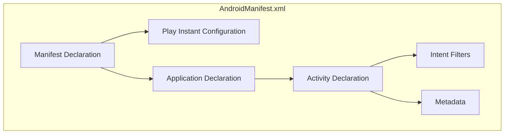
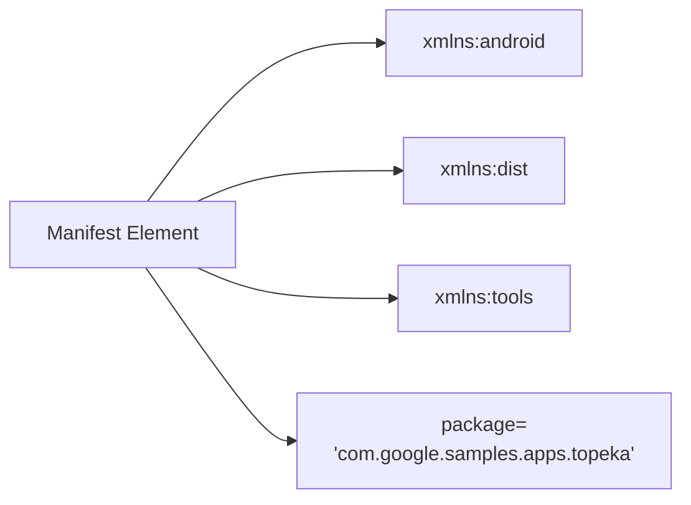
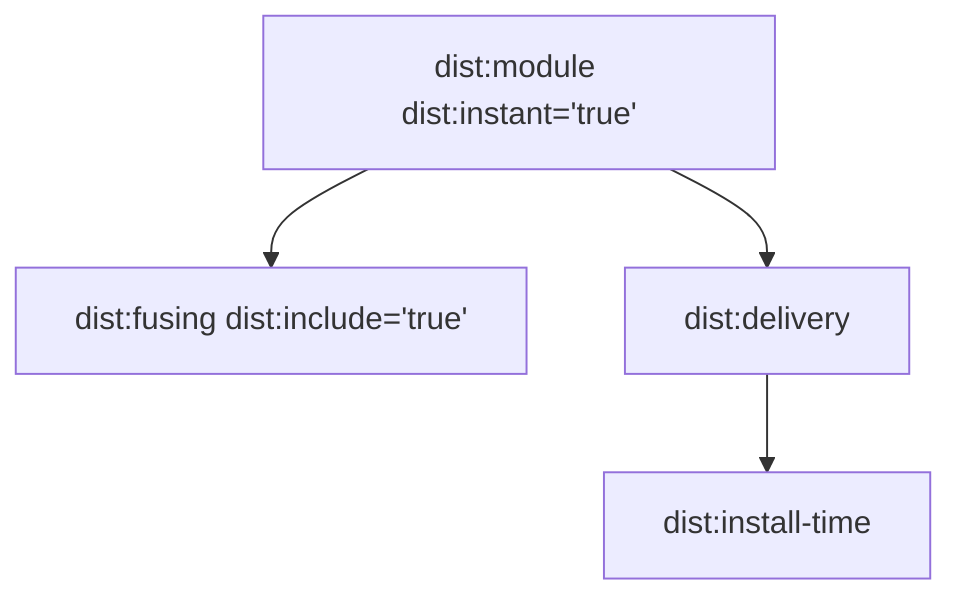
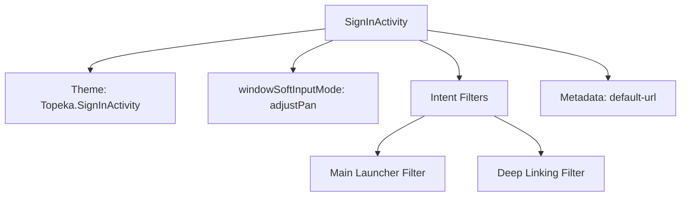
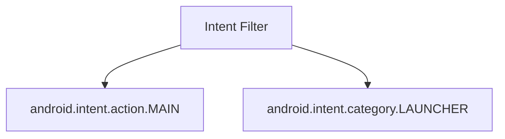
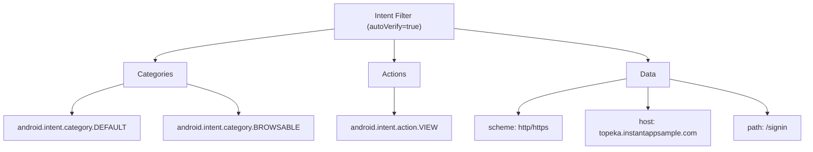
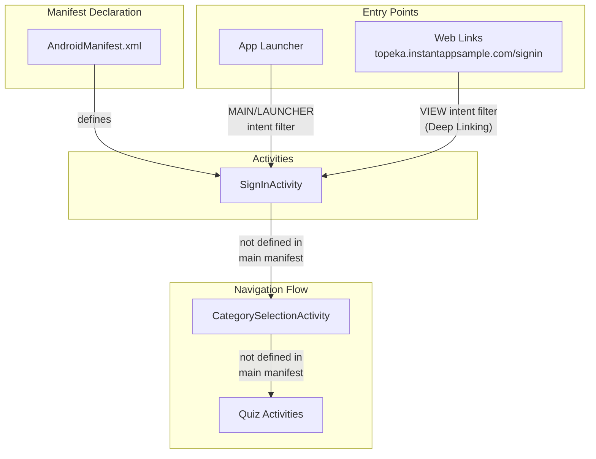

<!-- source: DeepWiki mcp.deepwiki.com · repo android/topeka · page 4.4 Application Manifest · fetched 2026-10-23 -->

# Application Manifest

<details>
<summary>Relevant source files</summary>

The following files were used as context for generating this wiki page:

- [app/src/main/AndroidManifest.xml](app/src/main/AndroidManifest.xml)

</details>


## Purpose and Scope

This document explains the AndroidManifest.xml configuration in the Topeka application and its role in defining the application components, permissions, and other essential declarations. The AndroidManifest.xml serves as the central configuration file that describes the fundamental characteristics of the app and defines each of its components. For information about specific components implemented within the app, see [Core Features](#4).

## Manifest Overview

The Android manifest file provides essential information about the application to the Android system. In Topeka, it defines:

1. The application package name
2. App components (activities)
3. Google Play Instant support configuration
4. Deep linking capabilities
5. Application attributes and themes



Sources: [app/src/main/AndroidManifest.xml:17-63]()

## Package and Namespace Declaration

The manifest begins with the XML namespace declarations and the package name:



This declaration establishes:
- Standard Android XML namespace
- Distribution namespace for Play Instant features
- Tools namespace for build-time tooling
- Application package identifier

Sources: [app/src/main/AndroidManifest.xml:17-20]()

## Google Play Instant Configuration

Topeka supports Google Play Instant, allowing users to try the app without installation. This is configured in the manifest:



The `dist:module` element indicates that the app module supports Google Play Instant. The `dist:fusing` element enables app bundle optimization, while the `dist:delivery` with `dist:install-time` specifies that the module should be downloaded at install time rather than on-demand.

Sources: [app/src/main/AndroidManifest.xml:22-27]()

## Application Configuration

The `application` element defines global application attributes:

| Attribute | Value | Purpose |
|-----------|-------|---------|
| allowBackup | false | Disables automatic data backup |
| fullBackupContent | false | Disables full backup operations |
| hardwareAccelerated | true | Enables hardware acceleration for better rendering performance |
| icon | @mipmap/ic_launcher | Specifies the app icon resource |
| label | @string/app_name | Specifies the app name (from strings.xml) |
| supportsRtl | false | Indicates no support for right-to-left layouts |
| theme | @style/Topeka | Applies the default app theme |

The `tools:ignore="GoogleAppIndexingWarning,UnusedAttribute"` attribute suppresses warnings related to Google App Indexing and unused attributes during build.

Sources: [app/src/main/AndroidManifest.xml:29-36]()

## Activity Declaration

Topeka's manifest declares one activity, which serves as the app's entry point:



The SignInActivity is declared with:
- Custom theme (`@style/Topeka.SignInActivity`)
- Input mode configuration to adjust the window when the keyboard appears
- Intent filters for app launching and deep linking
- Default URL metadata for instant app launching

Sources: [app/src/main/AndroidManifest.xml:38-61]()

## Intent Filters

The application defines two intent filters for SignInActivity:

### Main Launcher Filter



This filter makes SignInActivity appear in the device's application launcher as the main entry point for the app.

### Deep Linking Filter



This filter enables deep linking to the app via web URLs. When a user clicks a link to `https://topeka.instantappsample.com/signin`, the system opens the SignInActivity. The `autoVerify="true"` attribute enables App Links verification, allowing the app to automatically handle these links without a disambiguation dialog.

Sources: [app/src/main/AndroidManifest.xml:42-57]()

## Default URL Configuration

The manifest includes metadata specifying a default URL for instant app launching:

```xml
<meta-data android:name="default-url" android:value="https://topeka.instantappsample.com/signin" />
```

This URL is used when the instant app is launched directly (not through a link), providing the default entry point to the application.

Sources: [app/src/main/AndroidManifest.xml:59-60]()

## Manifest Integration With App Architecture

The following diagram illustrates how the manifest declarations integrate with the app's component architecture:



The main manifest defines only the entry point (SignInActivity) while other activities are likely defined in their respective module manifests.

Sources: [app/src/main/AndroidManifest.xml:38-61]()

## Manifest Specialization for Topeka

The Topeka manifest is notable for:

1. **Instant App Support**: Configuration enabling Google Play Instant functionality
2. **No Permissions**: Unlike many apps, Topeka doesn't request any special permissions
3. **Single Activity Declaration**: Only the entry point activity is declared in the main manifest
4. **Deep Linking Support**: Complete configuration for handling web links
5. **Backup Disabled**: Data backup features are explicitly disabled
6. **No RTL Support**: Right-to-left layout support is disabled

These characteristics reflect Topeka's design as a demonstration app for Material Design and modular architecture principles.

Sources: [app/src/main/AndroidManifest.xml:17-63]()

---

