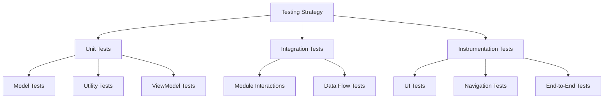
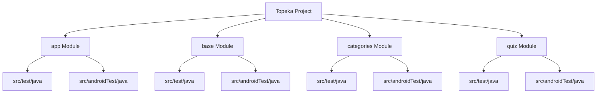
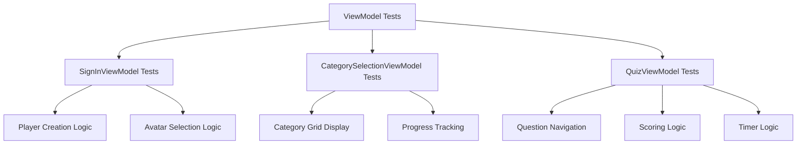
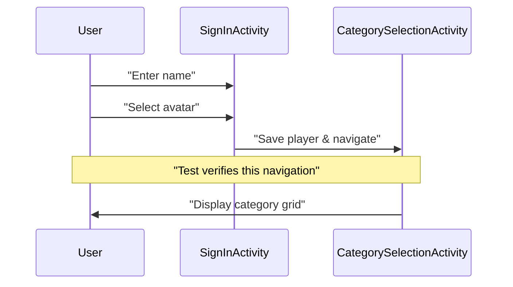
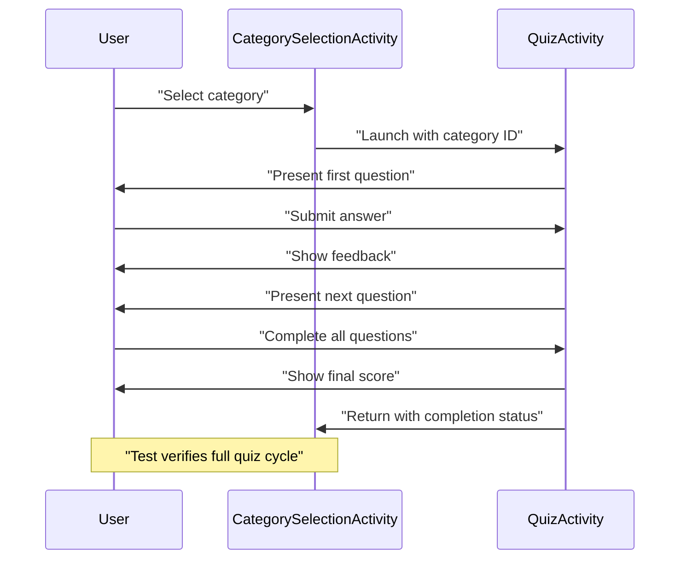
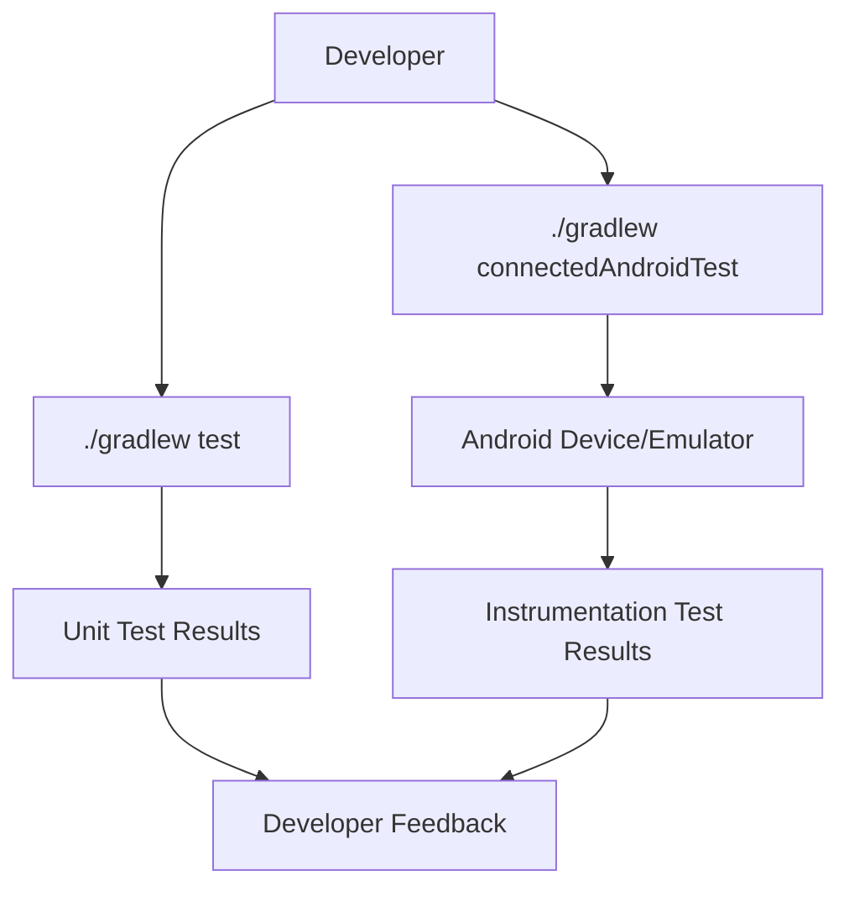
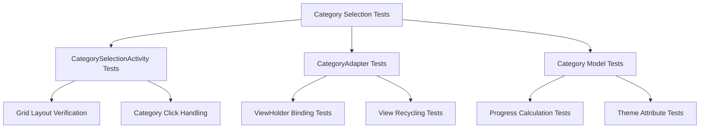
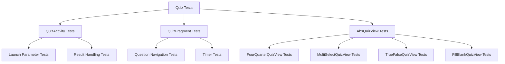
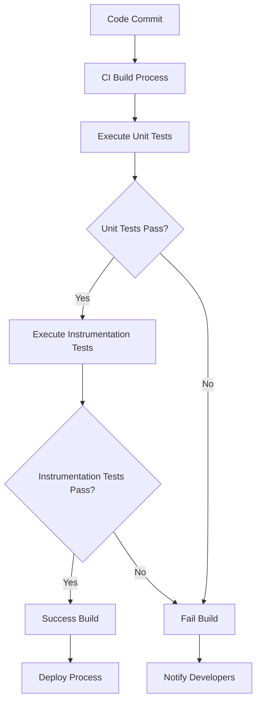

<!-- source: DeepWiki mcp.deepwiki.com · repo android/topeka · page 5 Testing · fetched 2026-10-23 -->

# Testing

<details>
<summary>Relevant source files</summary>

The following files were used as context for generating this wiki page:

- [gradle/wrapper/gradle-wrapper.jar](gradle/wrapper/gradle-wrapper.jar)
- [gradlew](gradlew)

</details>


This document outlines the testing approach used in the Topeka Android app. It covers the testing frameworks, strategies, and organization of tests within the project to ensure application quality and reliability.

## Testing Overview

Topeka implements a comprehensive testing strategy that verifies the functionality of its core features: authentication, category selection, and quiz functionality. The testing approach aligns with the application's modular architecture and follows Android testing best practices.



Sources:
- Standard Android testing practices
- Topeka project structure

## Test Types and Organization

The test code in Topeka follows the standard Android project structure with tests organized by module and test type.



Sources:
- Android project standard structure
- Topeka's modular architecture (from Architecture overview)

## Unit Testing Strategy

Unit tests in Topeka focus on testing individual components in isolation, ensuring they work correctly independently of other components.

### Model Testing

Topeka uses JUnit to test model classes, verifying their data management and business logic.

| Component | Test Focus |
|-----------|------------|
| `Player` | Player profile data management |
| `Category` | Category properties and progress tracking |
| `Quiz` | Quiz structure and scoring logic |
| `QuizQuestion` | Different question types and answer validation |

Example unit test structure (conceptual):

```kotlin
@Test
fun category_getProgress_calculatesCorrectPercentage() {
    // Arrange
    val category = Category(id = "science", name = "Science", theme = R.style.Topeka_Category_Physics)
    category.setAnsweredCorrectly(5)
    category.quizzes.size = 10
    
    // Act
    val progress = category.getProgress()
    
    // Assert
    assertEquals(50, progress)
}
```

### ViewModel Testing

Tests that verify the ViewModel layer correctly transforms data for display and handles UI interactions.



Sources:
- Android MVVM architecture patterns
- Topeka's component structure

## Instrumentation Testing

Instrumentation tests verify the application's UI components and user interactions by running on an Android device or emulator.

### Authentication Flow Testing



Example authentication flow test:

```kotlin
@RunWith(AndroidJUnit4::class)
class SignInActivityTest {
    @get:Rule
    val activityRule = ActivityScenarioRule(SignInActivity::class.java)
    
    @Test
    fun signIn_withValidInput_navigatesToCategorySelection() {
        // Enter first name
        onView(withId(R.id.first_name))
            .perform(typeText("John"), closeSoftKeyboard())
        
        // Select avatar
        onView(withId(R.id.avatar_grid))
            .perform(RecyclerViewActions.actionOnItemAtPosition<RecyclerView.ViewHolder>(0, click()))
        
        // Click Done button
        onView(withId(R.id.done))
            .perform(click())
        
        // Verify CategorySelectionActivity is displayed
        onView(withId(R.id.categories_grid))
            .check(matches(isDisplayed()))
    }
}
```

Sources:
- Espresso testing framework patterns
- Topeka user journey (from Architecture overview)

### Quiz Flow Testing



Sources:
- Topeka quiz flow (from Architecture overview)

## Test Execution

Tests in Topeka are executed through Gradle tasks as part of the development workflow and continuous integration process.

### Local Test Execution

Unit tests are run using the Gradle wrapper script:

```bash
./gradlew test
```

Instrumentation tests are run with:

```bash
./gradlew connectedAndroidTest
```



Sources:
- [gradlew:1-160]()
- Standard Gradle test commands

## Test Coverage Priorities

Test coverage in Topeka focuses on critical application components to ensure a reliable user experience.

| Component | Priority | Test Types |
|-----------|----------|------------|
| Authentication | High | Unit + Instrumentation |
| Category Selection | High | Unit + Instrumentation |
| Quiz Functionality | Critical | Unit + Instrumentation |
| Data Persistence | High | Unit + Integration |
| Dynamic Feature Loading | Medium | Integration |
| Material Design Elements | Medium | Instrumentation |

Sources:
- Testing best practices
- Topeka architecture overview

## Testing Key Components

### Category Selection Testing



Sources:
- Topeka component relationships (from Architecture overview)

### Quiz Testing



Sources:
- Quiz system components (from Architecture overview)

## Testing Best Practices in Topeka

Topeka follows these testing best practices to ensure code quality and maintainability:

1. **Test Isolation**: Each test runs independently without relying on state from other tests
2. **Consistent Naming**: Tests follow the pattern `subjectUnderTest_actionOrCondition_expectedResult`
3. **Arrange-Act-Assert**: Tests are structured with clear setup, action, and verification phases
4. **Mock Dependencies**: External dependencies are mocked to isolate components under test
5. **Small to Large**: Test coverage starts with unit tests and extends to larger integration and UI tests

### Example of Test Structure

```kotlin
// Unit test example
@Test
fun quizScore_correctAnswer_increasesPoints() {
    // Arrange
    val quiz = Quiz()
    val question = QuizQuestion(ALPHA_PICKER, "Answer is X")
    quiz.questions.add(question)
    
    // Act
    quiz.submitAnswer(question, "X")
    
    // Assert
    assertEquals(quiz.score, question.points)
}
```

Sources:
- Android testing best practices
- JUnit and Espresso patterns

## Continuous Integration Testing

Topeka integrates testing into a continuous integration workflow to catch issues early in development.



Sources:
- Standard CI/CD practices for Android

## Summary

The testing approach in Topeka ensures high quality and reliability by:

1. Implementing unit tests for core logic and models
2. Using instrumentation tests to verify UI interactions
3. Organizing tests according to the modular application structure
4. Following Android testing best practices
5. Integrating tests into the continuous integration process

This comprehensive testing strategy helps maintain Topeka as a high-quality demonstration of material design principles on Android.