# Page: Overview

# Overview

<details>
<summary>Relevant source files</summary>

The following files were used as context for generating this wiki page:

- [.google/packaging.yaml](.google/packaging.yaml)
- [README.markdown](README.markdown)
- [app/src/main/AndroidManifest.xml](app/src/main/AndroidManifest.xml)
- [screenshots/categories.png](screenshots/categories.png)
- [screenshots/category_history.png](screenshots/category_history.png)
- [screenshots/ic_web.png](screenshots/ic_web.png)
- [screenshots/quiz_shakespeare.png](screenshots/quiz_shakespeare.png)

</details>


Topeka is an Android quiz application that showcases Google's material design principles through interactive gameplay. This document provides a high-level overview of the Topeka application architecture, its key components, and how they interact to create a cohesive user experience.

## Purpose and Scope

Topeka demonstrates how material design principles can be applied to create a visually appealing and functionally robust Android application. It serves as a reference implementation for developers looking to incorporate material design into their own applications. The app features a simple quiz format with multiple categories and question types, showcasing animations, transitions, and other material design elements.

For detailed information about the architecture and module structure, see [Architecture](#2) and [Module Structure](#2.1).

## High-Level Architecture

The Topeka application follows a modular design with several key components working together.

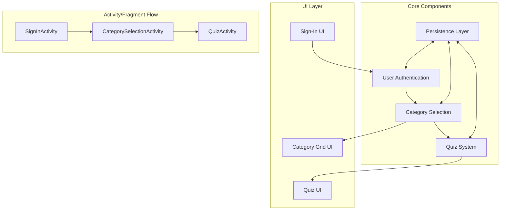

The application consists of three main functional areas:

1. **User Authentication**: Handles player profile creation and management
2. **Category Selection**: Presents available quiz categories to the user
3. **Quiz System**: Manages the quiz flow, questions, and scoring

These components are supported by a persistence layer that stores user information, category data, and quiz progress.

Sources: [README.markdown:1-84](), [app/src/main/AndroidManifest.xml:28-61]()

## Modular Structure

Topeka uses dynamic feature modules, allowing for efficient delivery and on-demand loading of features.

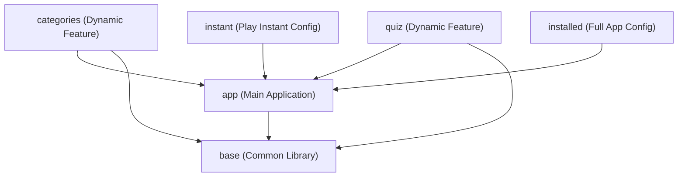

The modular structure enables:
- Core app functionality in the base module
- On-demand loading of feature modules (categories, quiz)
- Support for both instant apps and fully installed versions

Sources: [app/src/main/AndroidManifest.xml:17-27]()

## User Experience

Topeka provides a streamlined user journey from sign-in to quiz completion.

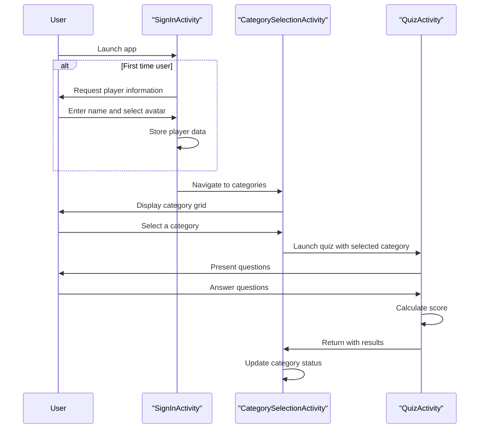

The user flow consists of:
1. **Sign-in**: Users create or update their profile
2. **Category selection**: Users choose from available quiz categories
3. **Quiz**: Users answer questions and receive immediate feedback
4. **Results**: Users see their score and return to the category selection

Sources: [app/src/main/AndroidManifest.xml:37-60](), [README.markdown:32-36]()

## Key Features

### Material Design Implementation

Topeka serves as a showcase for material design principles, including:
- Elevation and shadows
- Dynamic animations and transitions
- Responsive layouts
- Color schemes and typography
- Touch feedback

### Quiz Functionality

The app provides a variety of question types within different knowledge categories:

| Feature | Description |
|---------|-------------|
| Categories | Multiple knowledge areas with visual identifiers |
| Question Types | Multiple choice, true/false, fill-in-the-blank, etc. |
| Scoring | Point-based system with timing considerations |
| Progress Tracking | Visual indicators of completed categories |

Sources: [README.markdown:1-18]()

## Technical Implementation

Topeka is built using modern Android development practices:

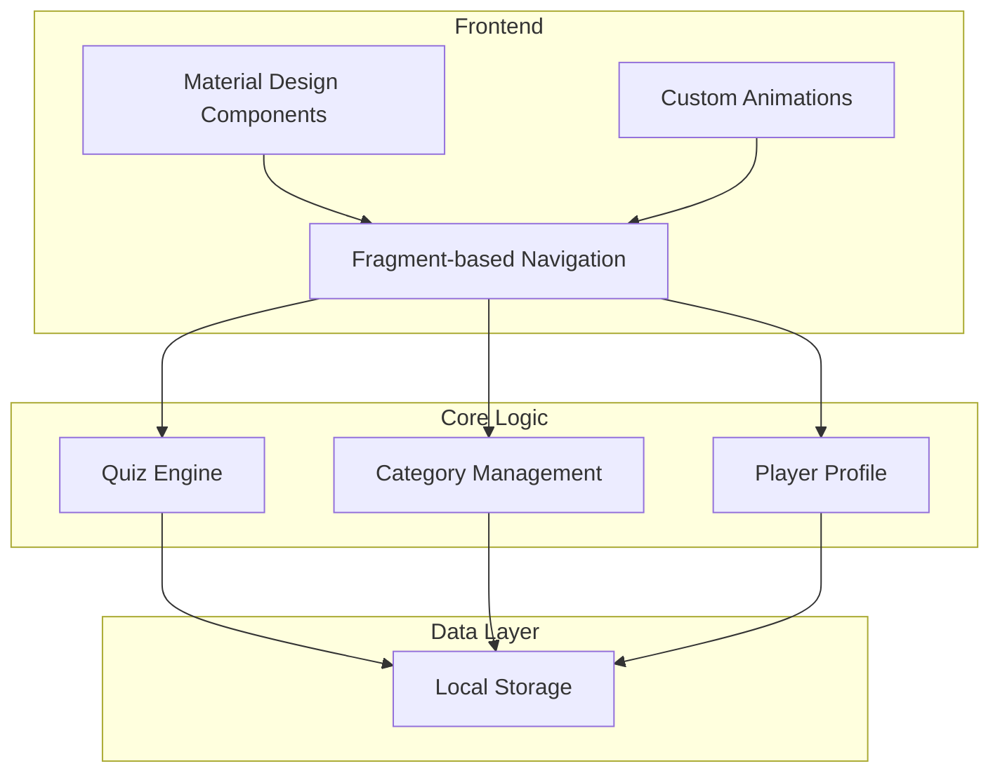

### Main Components

- **SignInActivity**: Entry point handling user authentication
- **CategorySelectionActivity**: Displays available quiz categories
- **QuizActivity**: Manages the quiz flow and question presentation

The application is implemented primarily in Kotlin and follows modern Android architectural patterns.

Sources: [app/src/main/AndroidManifest.xml:37-60](), [.google/packaging.yaml:1-29]()

## Cross-Platform Design

Topeka demonstrates consistent branding and design across platforms:

- Originally launched as a [Polymer web app](https://github.com/Polymer/topeka)
- Android version maintains the same visual identity with platform-specific implementations
- Shows how material design principles can be applied consistently across different platforms

Sources: [README.markdown:11-14]()

## Conclusion

Topeka showcases Google's material design principles through a functional, interactive quiz application. Its modular structure, clean architecture, and attention to design details make it an excellent reference for developers looking to implement material design in their own Android applications.

The application demonstrates how to create a visually appealing, interactive experience while maintaining good architectural practices, including:

- Separation of concerns
- Modular design
- Dynamic feature delivery
- Responsive animations
- Consistent theming

For more detailed information about specific components, refer to the related documentation sections on [Architecture](#2), [Core Features](#4), and [Build System](#3).

---

# Page: Architecture

# Architecture

<details>
<summary>Relevant source files</summary>

The following files were used as context for generating this wiki page:

- [.google/packaging.yaml](.google/packaging.yaml)
- [README.markdown](README.markdown)
- [app/build.gradle](app/build.gradle)
- [base/build.gradle](base/build.gradle)
- [build.gradle](build.gradle)
- [categories/build.gradle](categories/build.gradle)
- [categories/proguard.pro](categories/proguard.pro)
- [gradle/wrapper/gradle-wrapper.properties](gradle/wrapper/gradle-wrapper.properties)
- [quiz/build.gradle](quiz/build.gradle)
- [quiz/proguard.pro](quiz/proguard.pro)
- [screenshots/categories.png](screenshots/categories.png)
- [screenshots/category_history.png](screenshots/category_history.png)
- [screenshots/ic_web.png](screenshots/ic_web.png)
- [screenshots/quiz_shakespeare.png](screenshots/quiz_shakespeare.png)

</details>


This page describes the high-level architecture of the Topeka Android application, including its modular design and component relationships. It provides an overview of how the different parts of the system work together to deliver a quiz application that showcases Material Design principles. For details about the module structure, see [Module Structure](#2.1). For information about the user journey through the application, see [User Flow](#2.2).

## High-Level Architecture Overview

The Topeka application follows a modular architecture with clear separation of concerns between different components. It uses dynamic feature modules to enable on-demand loading of features, reducing the initial app size while providing a complete experience.

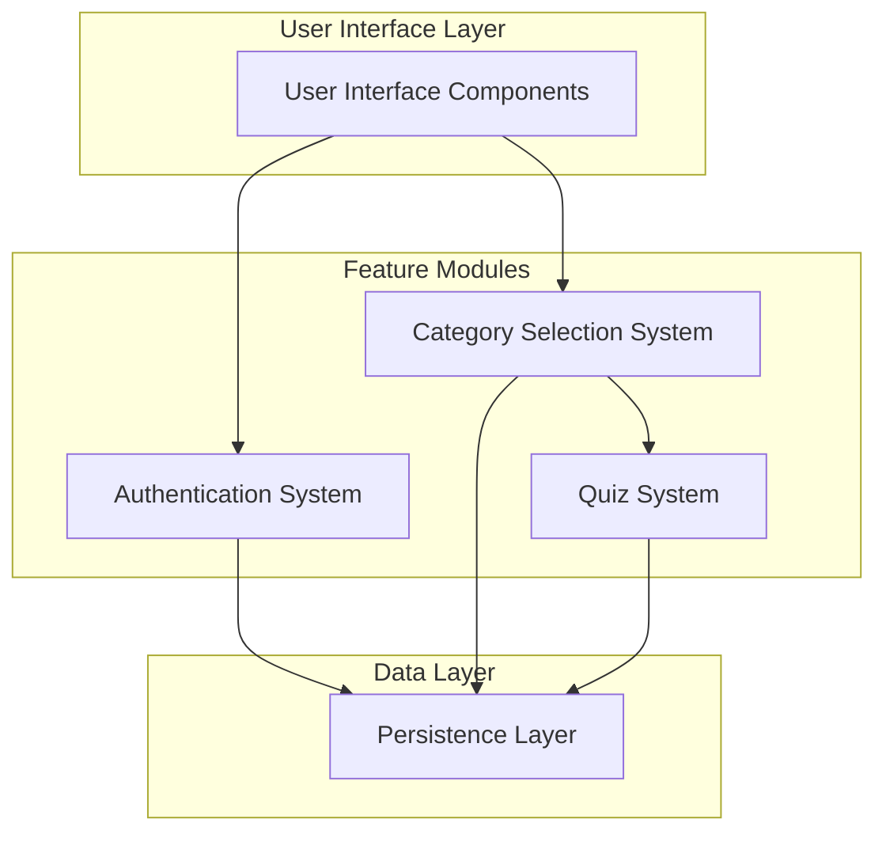

Sources: [build.gradle:33-40](). [app/build.gradle:35-36]().

## Module Structure

The application is organized into several modules, each with a specific responsibility. This modular approach allows for better separation of concerns, improved maintainability, and supports features like Google Play Instant.

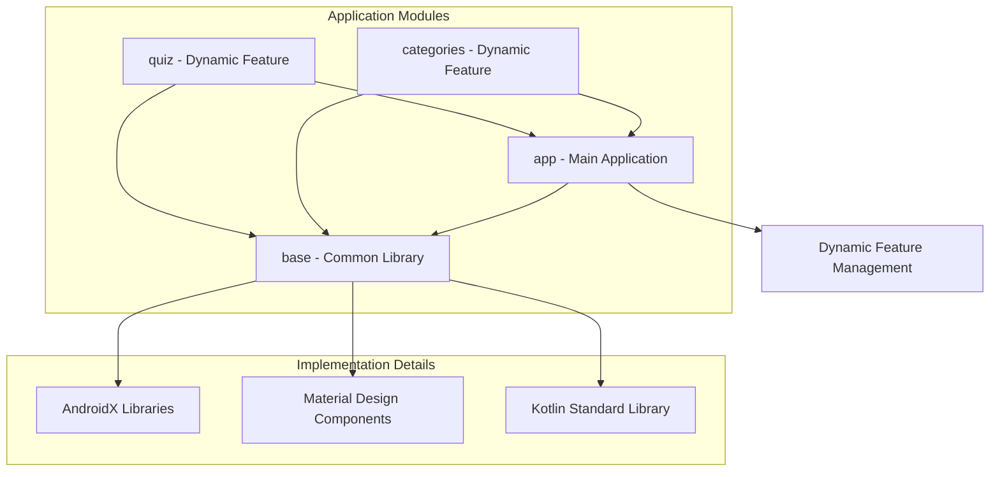

Sources: [app/build.gradle:35-36](). [base/build.gradle:38-46](). [categories/build.gradle:17-19](). [quiz/build.gradle:17-19]().

## Core Components

The Topeka application consists of several core components that work together to provide a complete quiz experience:

| Component | Description | Module | Responsibility |
|-----------|-------------|--------|----------------|
| Authentication System | Handles user sign-in and profile creation | app | User management, avatar selection |
| Category Selection | Displays quiz categories in a grid | categories | Category browsing and selection |
| Quiz System | Presents questions and evaluates answers | quiz | Question rendering, score calculation |
| Persistence Layer | Manages application data | base | Store user data, quiz progress |

Sources: [app/build.gradle:39-40](). [categories/build.gradle:46-49](). [quiz/build.gradle:44-49]().

## Component Interactions

The different components of Topeka interact through well-defined interfaces, allowing for a loosely coupled architecture.

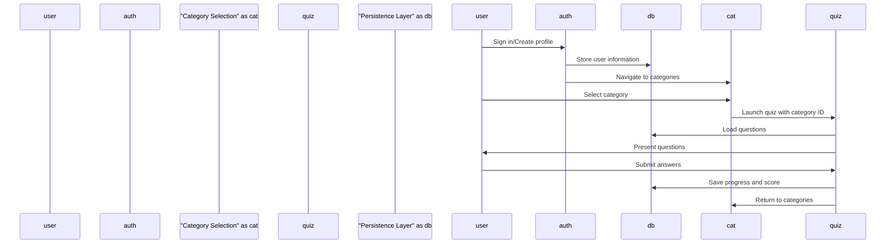

Sources: [app/build.gradle:35](). [categories/build.gradle:47-48](). [quiz/build.gradle:46-47]().

## Dynamic Feature Modules

Topeka uses Android's Dynamic Feature Modules to deliver features on-demand. This architectural decision allows the app to have a smaller initial download size while providing the full functionality when needed.

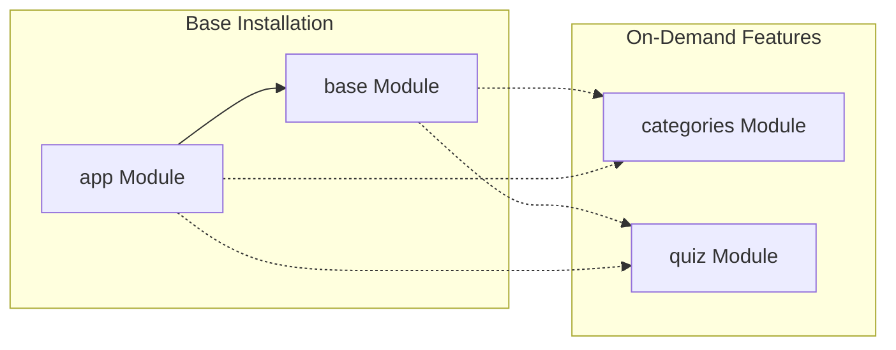

Sources: [app/build.gradle:35](). [categories/build.gradle:17](). [quiz/build.gradle:17]().

## Dependencies and Libraries

Topeka relies on several key libraries and dependencies to provide its functionality:

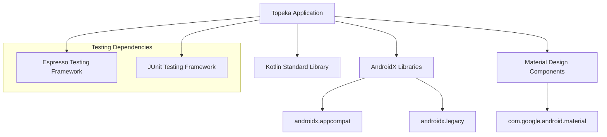

Sources: [base/build.gradle:40-44](). [categories/build.gradle:50-60](). [quiz/build.gradle:49-61]().

## Persistence Implementation

The application uses lightweight persistence mechanisms to store user information and quiz progress:

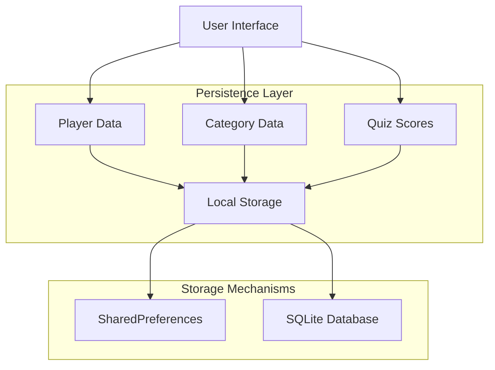

Sources: [base/build.gradle:40-44]().

## Build Configuration

The build system is organized to support multiple build types and product flavors, enabling both Google Play Instant and fully installed app experiences.

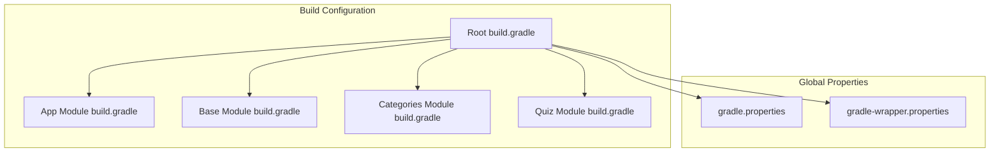

Sources: [build.gradle:19-31](). [build.gradle:41-47](). [gradle/wrapper/gradle-wrapper.properties:1-6]().

## Technology Stack

Topeka is built with a modern Android technology stack that enables a responsive and visually appealing user experience:

| Technology | Usage | Purpose |
|------------|-------|---------|
| Kotlin | Primary language | Modern language for Android development |
| AndroidX | UI components | Provides backwards-compatible UI components |
| Material Design | UI styling | Implements Google's Material Design guidelines |
| Dynamic Feature Modules | Modular delivery | Enables on-demand loading of features |
| SQLite | Data storage | Stores user data and quiz progress |
| Espresso | UI testing | Enables automated UI testing |

Sources: [build.gradle:20](). [base/build.gradle:40-44](). [app/build.gradle:17-18]().

## Summary

The Topeka Android application demonstrates a well-structured modular architecture that separates concerns into distinct components while maintaining a cohesive user experience. By leveraging dynamic feature modules, it provides an optimized install experience while still delivering rich functionality.

The architecture follows modern Android development practices, uses the Material Design language for its user interface, and organizes code into logical modules that can be developed, tested, and maintained independently.

Sources: [README.markdown:1-15](). [build.gradle:17-47](). [app/build.gradle:17-40]().

---

# Page: Module Structure

# Module Structure

<details>
<summary>Relevant source files</summary>

The following files were used as context for generating this wiki page:

- [app/build.gradle](app/build.gradle)
- [base/build.gradle](base/build.gradle)
- [build.gradle](build.gradle)
- [categories/build.gradle](categories/build.gradle)
- [categories/proguard.pro](categories/proguard.pro)
- [gradle/wrapper/gradle-wrapper.properties](gradle/wrapper/gradle-wrapper.properties)
- [quiz/build.gradle](quiz/build.gradle)
- [quiz/proguard.pro](quiz/proguard.pro)

</details>


This document details the modular architecture of the Topeka Android application, explaining the purpose of each module, their configuration, and how they interrelate. The application employs a combination of standard library modules and dynamic feature modules to optimize delivery size and support efficient loading of features.

## Module Organization Overview

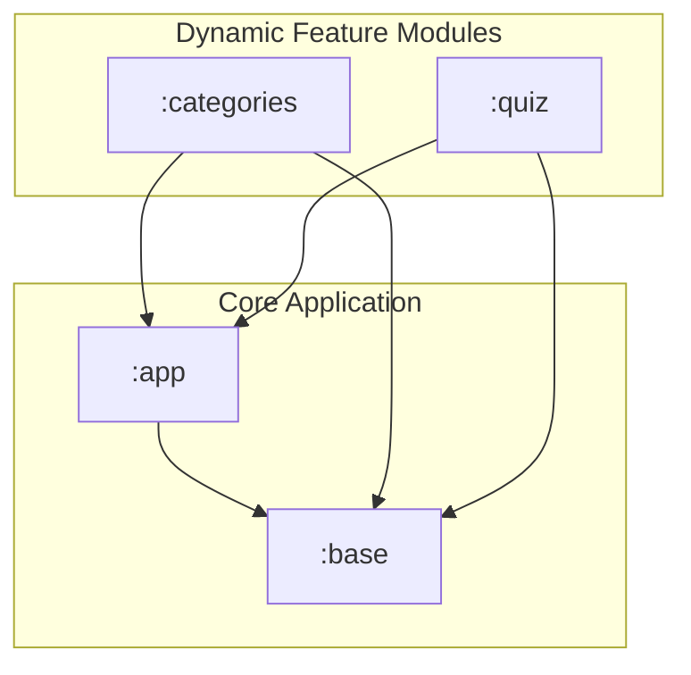

The Topeka application is structured into four primary modules, with clear separation of concerns and dependencies between them.

Sources: [app/build.gradle:35-39](). [categories/build.gradle:47-48](). [quiz/build.gradle:46-47]().

## Module Details

### :app Module

The `:app` module serves as the main entry point for the application. It contains the core application components and is responsible for orchestrating the loading of dynamic feature modules.

**Configuration:**
- **Plugin:** `com.android.application`
- **Depends on:** `:base` module
- **Declares dynamic features:** `:categories` and `:quiz`

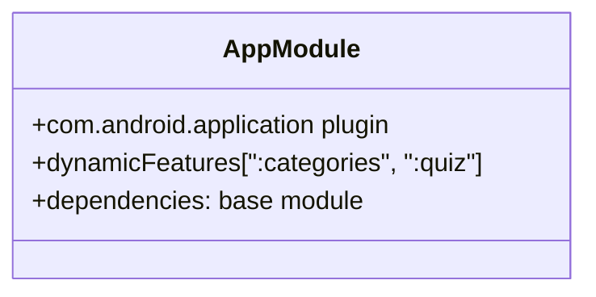

Sources: [app/build.gradle:17-35]().

### :base Module

The `:base` module is a library module that provides common functionality, resources, and dependencies used by all other modules. It contains shared utilities, models, and third-party library integrations.

**Configuration:**
- **Plugin:** `com.android.library`
- **Key dependencies:**
  - AndroidX AppCompat
  - Material Design components
  - AndroidX Legacy Support
  - Google Instant Apps
  - Kotlin Standard Library
  - Google Play Services Auth

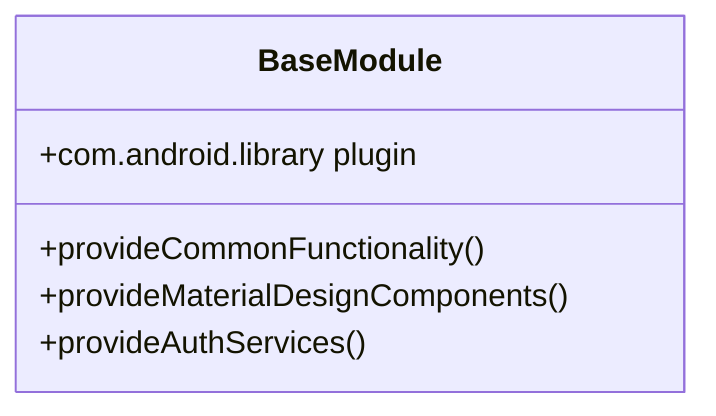

Sources: [base/build.gradle:17-44]().

### :categories Module

The `:categories` module is a dynamic feature module responsible for displaying quiz categories to the user. By implementing this as a dynamic feature, the initial app download size is reduced and the categories functionality can be loaded on demand.

**Configuration:**
- **Plugin:** `com.android.dynamic-feature`
- **Depends on:** `:app` and `:base` modules
- **Min SDK:** Same as the app module (14)

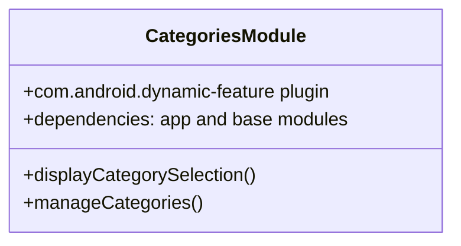

Sources: [categories/build.gradle:17-48]().

### :quiz Module

The `:quiz` module is a dynamic feature module that implements the quiz experience, allowing users to answer questions and receive feedback. Like the categories module, it is loaded on demand to optimize app size.

**Configuration:**
- **Plugin:** `com.android.dynamic-feature`
- **Depends on:** `:app` and `:base` modules
- **Min SDK:** Same as the app module (14)
- **Notable dependency:** Espresso idling resources for testing

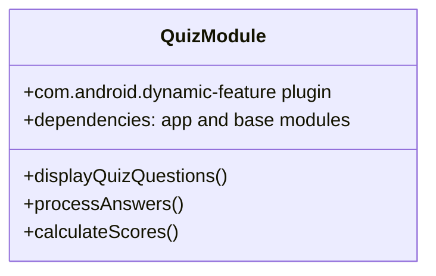

Sources: [quiz/build.gradle:17-49]().

## Module Dependency Relationships

The following diagram illustrates the dependency relationships between the modules:

```mermaid
flowchart TD
    subgraph "Module Dependencies"
        AppGradle["app/build.gradle\ndynamicFeatures = [\":categories\", \":quiz\"]\nimplementation project(\":base\")"]
        
        BaseGradle["base/build.gradle\napply plugin: 'com.android.library'\napi 'androidx.appcompat:appcompat'\napi 'com.google.android.material:material'"]
        
        CategoriesGradle["categories/build.gradle\napply plugin: 'com.android.dynamic-feature'\nimplementation project(\":app\")\nimplementation project(':base')"]
        
        QuizGradle["quiz/build.gradle\napply plugin: 'com.android.dynamic-feature'\nimplementation project(\":app\")\nimplementation project(\":base\")"]
        
        AppGradle --> BaseGradle
        CategoriesGradle --> AppGradle
        CategoriesGradle --> BaseGradle
        QuizGradle --> AppGradle
        QuizGradle --> BaseGradle
    end
```

Sources: [app/build.gradle:35-39](). [base/build.gradle:17-44](). [categories/build.gradle:17-48](). [quiz/build.gradle:17-49]().

## SDK Configuration

The application uses a consistent SDK configuration across all modules, defined in the root project's build.gradle file:

| Configuration | Value |
|---------------|-------|
| compileSdk    | 29    |
| targetSdk     | 29    |
| minSdk        | 14    |
| minSdkInstant | 21    |

Sources: [build.gradle:41-46]().

## Dynamic Feature Benefits

The Topeka app's use of dynamic feature modules provides several advantages:

1. **Reduced Initial Download Size**: Users only download the core app initially
2. **On-Demand Loading**: Features are loaded only when needed
3. **Faster Installation**: Smaller initial APK means faster installation
4. **Resource Optimization**: Resources are only loaded when their module is active
5. **Separate Testing**: Each module can be tested independently

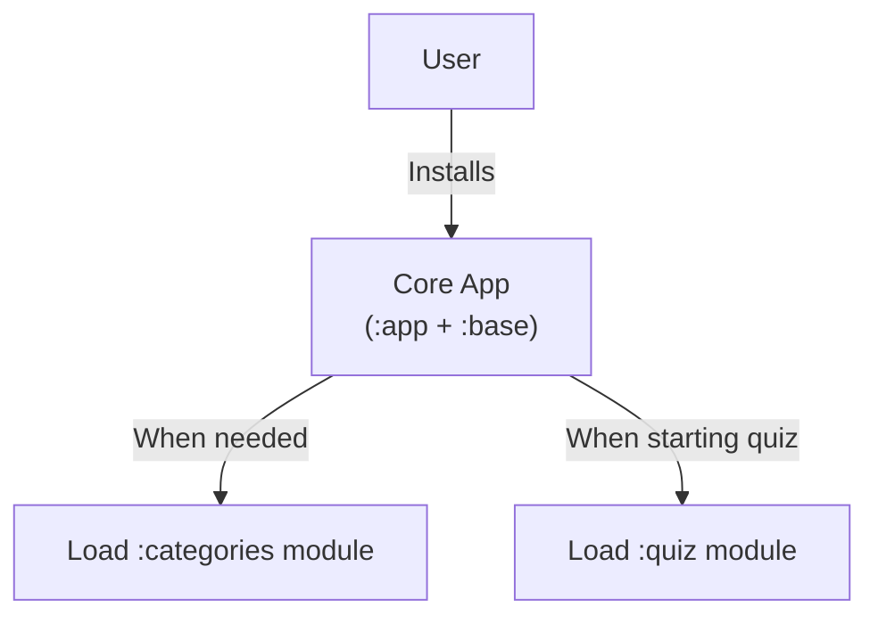

Sources: [app/build.gradle:35](). [categories/build.gradle:17](). [quiz/build.gradle:17]().

## Testing Configuration

Both dynamic feature modules include testing dependencies, allowing for isolated testing of each feature:

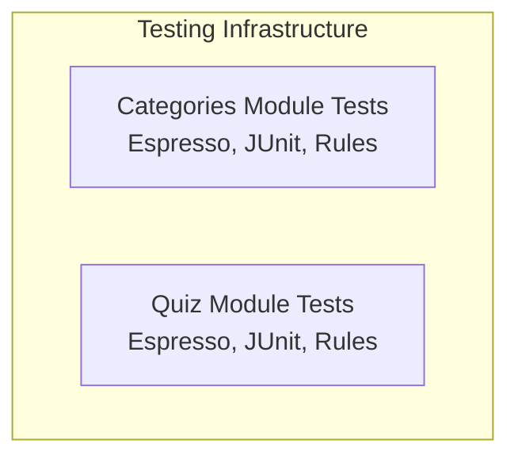

Both modules include similar testing dependencies:
- Espresso for UI testing
- AndroidX Test Rules
- JUnit for assertions
- Hamcrest for matchers

Sources: [categories/build.gradle:50-60](). [quiz/build.gradle:49-61]().

## ProGuard Configuration

The dynamic feature modules include minimal ProGuard configurations, with both containing only a directive not to obfuscate the code:

```
-dontobfuscate
```

Sources: [categories/proguard.pro:1](). [quiz/proguard.pro:1]().

## Build System Integration

The Topeka app's module structure is managed through Gradle with the following key components:

1. **Root build.gradle**: Defines common configuration for all modules, including Kotlin version and SDK versions
2. **Module-specific build.gradle files**: Configure each module separately
3. **Gradle wrapper**: Ensures consistent Gradle version (6.1.1) across all builds

Sources: [build.gradle:19-47](). [gradle/wrapper/gradle-wrapper.properties:1-6]().

---

# Page: User Flow

# User Flow

<details>
<summary>Relevant source files</summary>

The following files were used as context for generating this wiki page:

- [base/src/androidTest/java/com/google/samples/apps/topeka/activity/SignInActivityTest.kt](base/src/androidTest/java/com/google/samples/apps/topeka/activity/SignInActivityTest.kt)
- [base/src/main/java/com/google/samples/apps/topeka/activity/SignInActivity.kt](base/src/main/java/com/google/samples/apps/topeka/activity/SignInActivity.kt)
- [base/src/main/java/com/google/samples/apps/topeka/fragment/SignInFragment.kt](base/src/main/java/com/google/samples/apps/topeka/fragment/SignInFragment.kt)
- [base/src/main/java/com/google/samples/apps/topeka/helper/ActivityLaunchHelper.kt](base/src/main/java/com/google/samples/apps/topeka/helper/ActivityLaunchHelper.kt)
- [categories/src/main/java/com/google/samples/apps/topeka/activity/CategorySelectionActivity.kt](categories/src/main/java/com/google/samples/apps/topeka/activity/CategorySelectionActivity.kt)
- [categories/src/main/java/com/google/samples/apps/topeka/adapter/CategoryAdapter.kt](categories/src/main/java/com/google/samples/apps/topeka/adapter/CategoryAdapter.kt)
- [categories/src/main/java/com/google/samples/apps/topeka/fragment/CategorySelectionFragment.kt](categories/src/main/java/com/google/samples/apps/topeka/fragment/CategorySelectionFragment.kt)
- [categories/src/main/res/layout/fragment_categories.xml](categories/src/main/res/layout/fragment_categories.xml)
- [quiz/src/main/java/com/google/samples/apps/topeka/activity/QuizActivity.kt](quiz/src/main/java/com/google/samples/apps/topeka/activity/QuizActivity.kt)
- [quiz/src/main/java/com/google/samples/apps/topeka/fragment/QuizFragment.kt](quiz/src/main/java/com/google/samples/apps/topeka/fragment/QuizFragment.kt)
- [quiz/src/main/java/com/google/samples/apps/topeka/widget/quiz/AbsQuizView.kt](quiz/src/main/java/com/google/samples/apps/topeka/widget/quiz/AbsQuizView.kt)

</details>


This document outlines the typical user journey through the Topeka quiz application, from initial sign-in to quiz completion. It covers the sequence of screens users navigate through, the interactions available at each step, and the underlying code components that facilitate this flow.

## Overview

The Topeka user flow consists of three main phases:

1. **Authentication** - User creates a profile or logs in with existing credentials
2. **Category Selection** - User browses and selects quiz categories 
3. **Quiz Participation** - User answers questions and receives feedback

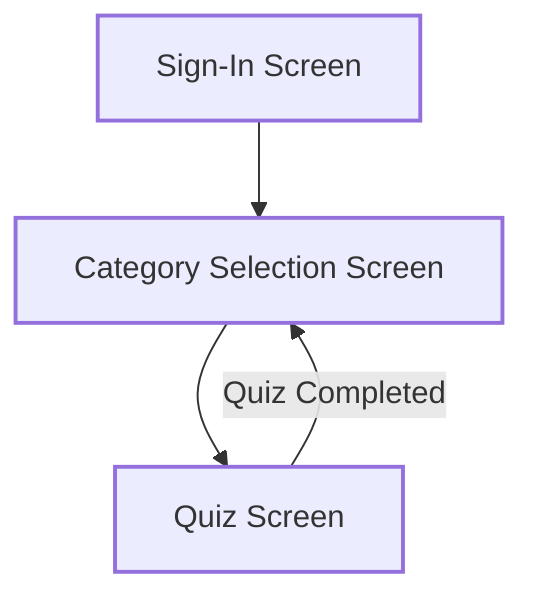

Sources:
- [base/src/main/java/com/google/samples/apps/topeka/fragment/SignInFragment.kt:55-317]()
- [categories/src/main/java/com/google/samples/apps/topeka/activity/CategorySelectionActivity.kt:45-131]()
- [quiz/src/main/java/com/google/samples/apps/topeka/activity/QuizActivity.kt:69-443]()

## Authentication Flow

When users first launch Topeka, they encounter the sign-in process. This is managed by `SignInActivity` which hosts `SignInFragment`.

### Sign-In Process

```mermaid
sequenceDiagram
    actor "User" as U
    participant "SignInActivity" as SA
    participant "SignInFragment" as SF
    participant "login" as L
    
    U->>SA: Launch app
    SA->>SF: Load fragment
    SF->>L: Check existing login
    
    alt User already logged in
        L-->>SF: Return Player data
        SF->>SF: Call navigateToCategoryActivity()
    else New user or edit profile
        SF-->>U: Display profile form
        U->>SF: Enter first name
        U->>SF: Enter last initial
        U->>SF: Select avatar
        SF->>SF: Enable "Done" button
        U->>SF: Click "Done" button
        SF->>L: Save player information
        SF->>SF: Call performSignInWithTransition()
    end
```

Sources:
- [base/src/main/java/com/google/samples/apps/topeka/activity/SignInActivity.kt:30-52]()
- [base/src/main/java/com/google/samples/apps/topeka/fragment/SignInFragment.kt:67-108]()
- [base/src/main/java/com/google/samples/apps/topeka/fragment/SignInFragment.kt:193-235]()

The sign-in screen requires three pieces of information:
1. First name
2. Last initial
3. Avatar selection

All three fields must be completed before the "Done" button appears. Input validation is performed in real-time as the user types, with the `allowAnswer()` function controlling when the submission is enabled.

Sources:
- [base/src/main/java/com/google/samples/apps/topeka/fragment/SignInFragment.kt:193-205]()
- [base/src/main/java/com/google/samples/apps/topeka/fragment/SignInFragment.kt:295-302]()

## Category Selection Flow

After authentication, users are presented with a grid of quiz categories. Each category has a distinctive theme color and icon.

```mermaid
classDiagram
    class CategorySelectionActivity {
        +onCreate()
        +initializePlayer()
        +setUpToolbar()
        +attachCategoryGridFragment()
        +onActivityResult()
    }
    
    class CategorySelectionFragment {
        +onViewCreated()
        +setUpQuizGrid()
        +startQuizActivityWithTransition()
    }
    
    class CategoryAdapter {
        -categories: List~Category~
        +getItem()
        +notifyItemChanged()
        +setCategoryIcon()
    }
    
    CategorySelectionActivity --> CategorySelectionFragment: hosts
    CategorySelectionFragment --> CategoryAdapter: uses
```

Sources:
- [categories/src/main/java/com/google/samples/apps/topeka/activity/CategorySelectionActivity.kt:45-59]()
- [categories/src/main/java/com/google/samples/apps/topeka/fragment/CategorySelectionFragment.kt:43-105]()
- [categories/src/main/java/com/google/samples/apps/topeka/adapter/CategoryAdapter.kt:40-176]()

### Category Screen Behavior

The categories are displayed in a `RecyclerView` using a grid layout. Each category item shows:
- An icon representing the category
- The category name
- A visual indicator if the category has been completed

When a user selects a category, `startQuizActivityWithTransition()` is called to launch the quiz activity with a smooth material design transition.

Sources:
- [categories/src/main/res/layout/fragment_categories.xml:17-32]()
- [categories/src/main/java/com/google/samples/apps/topeka/fragment/CategorySelectionFragment.kt:81-98]()

Categories that have been completed are visually marked with a check mark overlay on the category icon. This state is managed through the `CategoryAdapter` class.

Sources:
- [categories/src/main/java/com/google/samples/apps/topeka/adapter/CategoryAdapter.kt:105-110]()
- [categories/src/main/java/com/google/samples/apps/topeka/adapter/CategoryAdapter.kt:121-128]()

## Quiz Flow

When a user selects a category, they enter the quiz experience managed by `QuizActivity` and `QuizFragment`.

```mermaid
flowchart TD
    A["CategorySelectionActivity"] -->|"startQuizActivityWithTransition()"| B["QuizActivity"]
    B -->|"onCreate()"| C["populate()"]
    C --> D["initLayout()"]
    C --> E["initToolbar()"]
    
    B -->|"startQuizFromClickOn()"| F["QuizFragment"]
    F -->|"showNextPage()"| G["AbsQuizView"]
    G -->|"submitAnswer()"| H{{"Answer Correct?"}}
    
    H -->|"Yes"| I["Update Score"]
    H -->|"No"| J["Show Feedback"]
    
    I --> K["Next Question"]
    J --> K
    
    K -->|"Last Question?"| L{{"Quiz Complete?"}}
    L -->|"Yes"| M["Show Scorecard"]
    L -->|"No"| G
    
    M -->|"setResultSolved()"| A
```

Sources:
- [quiz/src/main/java/com/google/samples/apps/topeka/activity/QuizActivity.kt:147-155]()
- [quiz/src/main/java/com/google/samples/apps/topeka/activity/QuizActivity.kt:266-278]()
- [quiz/src/main/java/com/google/samples/apps/topeka/fragment/QuizFragment.kt:98-116]()
- [quiz/src/main/java/com/google/samples/apps/topeka/fragment/QuizFragment.kt:190-202]()
- [quiz/src/main/java/com/google/samples/apps/topeka/widget/quiz/AbsQuizView.kt:201-204]()

### Quiz Experience

The quiz experience follows these steps:

1. User views the category information with a "Play" FAB
2. User taps the FAB to begin the quiz
3. Questions are presented one at a time
4. User submits answers which are validated immediately
5. Visual feedback indicates correct or incorrect answers
6. Upon completion, a scorecard displays performance

The quiz interface uses custom view animations and transitions to provide a rich material design experience.

Sources: 
- [quiz/src/main/java/com/google/samples/apps/topeka/activity/QuizActivity.kt:180-184]()
- [quiz/src/main/java/com/google/samples/apps/topeka/activity/QuizActivity.kt:406-424]()
- [quiz/src/main/java/com/google/samples/apps/topeka/widget/quiz/AbsQuizView.kt:211-224]()

## Complete User Journey

The following sequence diagram shows the complete user journey through the application, from launch to quiz completion:

```mermaid
sequenceDiagram
    actor "User" as U
    participant "SignInActivity" as SA
    participant "CategorySelection<br>Activity" as CSA
    participant "QuizActivity" as QA
    participant "Database" as DB
    
    U->>SA: Launch app
    
    alt First launch or not logged in
        SA-->>U: Show sign-in form
        U->>SA: Enter name & select avatar
        SA->>DB: Save player info
    else Already logged in
        SA->>DB: Retrieve player info
    end
    
    SA->>CSA: Navigate to categories
    CSA->>DB: Get categories
    CSA-->>U: Display category grid
    
    U->>CSA: Select category
    CSA->>QA: Launch with category ID
    QA->>DB: Get category details
    QA-->>U: Display category intro
    
    U->>QA: Click "Play" button
    QA-->>U: Show first question
    
    loop For each question
        U->>QA: Input answer
        U->>QA: Submit answer
        QA->>QA: Validate answer
        QA-->>U: Provide feedback
        QA->>DB: Update progress
        QA-->>U: Show next question
    end
    
    QA-->>U: Display scorecard
    QA->>DB: Mark category as solved
    QA->>CSA: Return with completion status
    CSA->>DB: Update category display
    CSA-->>U: Show updated category grid
```

Sources:
- [base/src/main/java/com/google/samples/apps/topeka/fragment/SignInFragment.kt:67-115]()
- [categories/src/main/java/com/google/samples/apps/topeka/fragment/CategorySelectionFragment.kt:81-98]()
- [quiz/src/main/java/com/google/samples/apps/topeka/activity/QuizActivity.kt:266-280]()
- [quiz/src/main/java/com/google/samples/apps/topeka/activity/QuizActivity.kt:407-424]()
- [quiz/src/main/java/com/google/samples/apps/topeka/fragment/QuizFragment.kt:190-207]()

## Activity and Intent Flow

The application uses Android's activity system with intents to navigate between screens. The following diagram shows the flow and key intent extras used:

```mermaid
flowchart LR
    A["SignInActivity"] -->|"launchCategorySelection()"| B["CategorySelectionActivity"]
    B -->|"startActivityForResult()<br>EXTRA: category.id"| C["QuizActivity"]
    C -->|"setResult()<br>EXTRA: JsonAttributes.ID"| B
    
    subgraph "Helper Classes"
        D["ActivityLaunchHelper"]
    end
    
    A -.->|"uses"| D
    B -.->|"uses"| D
    C -.->|"uses"| D
```

Sources:
- [base/src/main/java/com/google/samples/apps/topeka/helper/ActivityLaunchHelper.kt:38-51]()
- [categories/src/main/java/com/google/samples/apps/topeka/fragment/CategorySelectionFragment.kt:93-97]() 
- [quiz/src/main/java/com/google/samples/apps/topeka/activity/QuizActivity.kt:358-359]()

The application leverages `ActivityLaunchHelper` to standardize intent creation and activity transitions. Key methods include:

- `launchCategorySelection()`: Transitions from sign-in to category selection
- `launchSignIn()`: Launches the sign-in activity when needed
- `quizIntent()`: Creates an intent for launching a specific quiz category

Sources:
- [base/src/main/java/com/google/samples/apps/topeka/helper/ActivityLaunchHelper.kt:38-59]()

## State Management

Throughout the user flow, the application manages several key states:

| State | Persisted In | Used By | Purpose |
|-------|--------------|---------|---------|
| Player Profile | `SharedPreferences` | `SignInFragment`<br>`CategorySelectionActivity` | Stores user name and avatar selection |
| Category Completion | Database | `CategoryAdapter`<br>`QuizFragment` | Tracks which categories are solved |
| Quiz Progress | `Bundle` | `QuizFragment`<br>`AbsQuizView` | Preserves current quiz state during configuration changes |
| Current Score | Database | `CategorySelectionActivity` | Displays total score across all categories |

Sources:
- [base/src/main/java/com/google/samples/apps/topeka/fragment/SignInFragment.kt:224-227]()
- [quiz/src/main/java/com/google/samples/apps/topeka/fragment/QuizFragment.kt:154-182]()
- [categories/src/main/java/com/google/samples/apps/topeka/activity/CategorySelectionActivity.kt:83-88]()
- [quiz/src/main/java/com/google/samples/apps/topeka/fragment/QuizFragment.kt:204-206]()

## Summary

The Topeka user flow implements a straightforward yet engaging journey from sign-in to quiz completion. Key aspects of this implementation include:

1. A modular architecture with separate activities for authentication, category selection, and quiz participation
2. Material design transitions between screens for a polished user experience
3. Immediate feedback on quiz answers with visual cues
4. Persistent state management across app launches
5. Clean separation between UI components and data management

For details on the specific module structure that enables this user flow, see [Module Structure](#2.1).

---

# Page: Build System

# Build System

<details>
<summary>Relevant source files</summary>

The following files were used as context for generating this wiki page:

- [app/build.gradle](app/build.gradle)
- [build.gradle](build.gradle)
- [gradle.properties](gradle.properties)
- [gradle/wrapper/gradle-wrapper.properties](gradle/wrapper/gradle-wrapper.properties)

</details>


## Purpose and Overview

The Topeka Android app utilizes Gradle as its build system to manage dependencies, configure build variants, and support dynamic feature modules. This document provides an overview of how the build system is structured and configured. For specific details on gradle file configurations, see [Main Gradle Configuration](#3.1); for module-specific build settings, see [Module Configuration](#3.2).

The build system enables Topeka's modular architecture by configuring:
- The app's core module and its dependencies
- Dynamic feature modules (categories and quiz)
- SDK version requirements
- Gradle execution parameters

## Build System Architecture

```mermaid
graph TD
    id1["Root build.gradle"]
    id2["app/build.gradle"]
    id3["base/build.gradle"]
    id4["categories/build.gradle"]
    id5["quiz/build.gradle"]
    id6["gradle.properties"]
    id7["gradle-wrapper.properties"]

    id1 --> id2
    id1 --> id3
    id1 --> id4
    id1 --> id5
    id6 --- id1
    id7 --- id1

    subgraph "Main Application Configuration"
        id2
    end

    subgraph "Module Configurations"
        id3
        id4
        id5
    end

    subgraph "Global Build Properties"
        id6
        id7
    end
```

Sources: [build.gradle](), [app/build.gradle](), [gradle/wrapper/gradle-wrapper.properties](), [gradle.properties]()

## Core Build Files

### Root build.gradle

The root `build.gradle` file defines configuration options common to all modules:

- Sets the Kotlin version (1.4.0)
- Configures repositories (Google and JCenter)
- Defines the Android Gradle plugin version (4.0.1)
- Declares SDK version constants:
  - `compileSdk`: 29
  - `targetSdk`: 29
  - `minSdkInstant`: 21 (for Instant App)
  - `minSdk`: 14 (for installed app)

Sources: [build.gradle:19-47]()

### App Module build.gradle

The `app/build.gradle` file configures the main application module:

- Applies the Android application plugin
- Applies the Kotlin Android plugin
- Uses SDK versions from the root project
- Configures signing for release builds
- Declares dynamic feature modules (`:categories` and `:quiz`)
- Includes dependencies on the `:base` project

Sources: [app/build.gradle:17-40]()

## Module Structure and Dynamic Features

Topeka implements a modular architecture with dynamic feature modules, which allows for more efficient app delivery and on-demand feature loading.

```mermaid
graph LR
    id1["app (Main Module)"]
    id2["base (Common Library)"]
    id3["categories (Dynamic Feature)"]
    id4["quiz (Dynamic Feature)"]

    id1 -- "implementation" --> id2
    id3 -. "dynamicFeature" .-> id1
    id4 -. "dynamicFeature" .-> id1
    id3 -- "implementation" --> id2
    id4 -- "implementation" --> id2
```

This diagram shows how the app module depends on the base module for common functionality, while the categories and quiz modules are implemented as dynamic features that can be loaded on demand.

Sources: [app/build.gradle:35-39]()

## Gradle Properties and Configuration

### Key Gradle Properties

The `gradle.properties` file contains important settings that affect build performance and behavior:

| Property | Value | Purpose |
|----------|-------|---------|
| org.gradle.jvmargs | -Xmx2048m -XX:MaxPermSize=512m -XX:+HeapDumpOnOutOfMemoryError -Dfile.encoding=UTF-8 | Configures JVM memory settings for Gradle daemon |
| org.gradle.daemon | true | Enables the Gradle daemon for faster builds |
| android.useAndroidX | true | Enables AndroidX support |
| android.enableJetifier | true | Enables automatic migration to AndroidX |

Sources: [gradle.properties:29-37]()

### Gradle Wrapper

The Gradle Wrapper ensures consistent builds across different development environments by providing a specific version of Gradle (6.1.1). This eliminates "works on my machine" problems and makes it easier for new developers to get started.

```mermaid
flowchart TD
    id1["gradle-wrapper.properties"]
    id2["distributionUrl=https://services.gradle.org/distributions/gradle-6.1.1-all.zip"]
    id3["gradlew/gradlew.bat Script"]
    id4["Downloads specified Gradle version"]
    id5["Executes build with consistent version"]

    id1 --> id2
    id2 --> id3
    id3 --> id4
    id4 --> id5
```

Sources: [gradle/wrapper/gradle-wrapper.properties:1-6]()

## Build Process Overview

The build system handles several critical aspects of the app's compilation and packaging:

```mermaid
flowchart TD
    id1["Build Initialization"]
    id2["Configure SDK Versions"]
    id3["Resolve Dependencies"]
    id4["Compile Base Module"]
    id5["Compile Dynamic Features"]
    id6["Package Final APK/Bundle"]

    id1 --> id2
    id2 --> id3
    id3 --> id4
    id4 --> id5
    id5 --> id6

    subgraph "Configuration Phase"
        id1
        id2
        id3
    end

    subgraph "Execution Phase"
        id4
        id5
        id6
    end
```

During the build process, Gradle first resolves all dependencies before compiling the base module, followed by the dynamic feature modules. These are then packaged together into the final APK or Android App Bundle.

Sources: [build.gradle](), [app/build.gradle]()

## SDK Version Management

Topeka manages SDK versions centrally in the root `build.gradle` file to ensure consistency across modules:

| SDK Property | Version | Purpose |
|--------------|---------|---------|
| compileSdk | 29 | Android API level used for compilation |
| targetSdk | 29 | Target API level for runtime behavior |
| minSdkInstant | 21 | Minimum API level for Google Play Instant |
| minSdk | 14 | Minimum API level for installed app |

This centralized configuration makes it easy to update SDK versions across the entire project.

Sources: [build.gradle:41-46]()

## Summary

The Topeka app's build system is designed to support a modular architecture with dynamic feature modules, providing several benefits:

1. **Modular development** - Separates concerns into distinct modules
2. **On-demand delivery** - Enables dynamic loading of features when needed
3. **Consistent configuration** - Centralizes SDK versions and other settings
4. **Build performance** - Optimizes the build process through Gradle configuration

This architecture allows the app to maintain separation of concerns while providing efficient delivery mechanisms for users.

---

# Page: Main Gradle Configuration

# Main Gradle Configuration

<details>
<summary>Relevant source files</summary>

The following files were used as context for generating this wiki page:

- [app/build.gradle](app/build.gradle)
- [build.gradle](build.gradle)
- [gradle/wrapper/gradle-wrapper.properties](gradle/wrapper/gradle-wrapper.properties)

</details>


## Purpose and Scope

This document details the main Gradle configuration files in the Topeka Android application, focusing on the top-level and app-level build.gradle files. These files establish the foundational build configuration that applies across all modules. For module-specific configurations, see [Module Configuration](#3.2), and for Gradle properties, see [Gradle Properties](#3.3).

## Gradle Configuration Structure

The Topeka app uses a hierarchical Gradle configuration structure where settings flow from the top-level build file down to individual module build files.

```mermaid
graph TD
    A["Root build.gradle"] --> B["app/build.gradle"]
    A --> C["base/build.gradle"]
    A --> D["categories/build.gradle (Dynamic Feature)"]
    A --> E["quiz/build.gradle (Dynamic Feature)"]
    F["gradle-wrapper.properties"] --> A
    G["gradle.properties"] --> A
    
    A -- "Defines shared properties" --> H["ext block"]
    H -- "compileSdk = 29" --> B
    H -- "targetSdk = 29" --> B
    H -- "minSdk = 14" --> B
    H -- "minSdkInstant = 21" --> B
```

Sources: [build.gradle:1-48](), [app/build.gradle:1-40](), [gradle/wrapper/gradle-wrapper.properties:1-6]()

## Top-level build.gradle File

The top-level `build.gradle` file defines project-wide configurations that apply to all modules.

### Key Components

```mermaid
graph LR
    A["Root build.gradle"] --> B["buildscript block"]
    A --> C["allprojects block"]
    A --> D["ext block"]
    
    B --> E["repositories (google, jcenter)"]
    B --> F["dependencies"]
    F --> G["Android Gradle Plugin"]
    F --> H["Kotlin Gradle Plugin"]
    
    C --> I["repositories (google, jcenter)"]
    
    D --> J["SDK version variables"]
```

Sources: [build.gradle:17-47]()

### BuildScript Configuration

The buildscript block configures how the build itself operates.

```
buildscript {
    ext.kotlin_version = '1.4.0'
    repositories {
        google()
        jcenter()
    }
    dependencies {
        classpath 'com.android.tools.build:gradle:4.0.1'
        classpath "org.jetbrains.kotlin:kotlin-gradle-plugin:$kotlin_version"
    }
}
```

Key components:
- Kotlin version is defined as '1.4.0'
- Repository sources include Google and JCenter
- Android Gradle Plugin version 4.0.1
- Kotlin Gradle Plugin using the defined Kotlin version

Sources: [build.gradle:19-32]()

### Project-wide Repository Configuration

The allprojects block defines repositories available to all modules in the project:

```
allprojects {
    repositories {
        google()
        jcenter()
    }
}
```

Sources: [build.gradle:34-39]()

### Shared Project Properties

The ext block defines project-wide properties:

| Property | Value | Description |
|----------|-------|-------------|
| compileSdk | 29 | Android API level to compile against |
| targetSdk | 29 | Target Android API level |
| minSdkInstant | 21 | Minimum SDK for Instant app variant |
| minSdk | 14 | Minimum SDK for installed app variant |

Sources: [build.gradle:41-47]()

## App Module build.gradle File

The app module's build.gradle file configures the main application module.

### Plugin Application

```
apply plugin: 'com.android.application'
apply plugin: 'kotlin-android'
```

The file applies:
- The Android application plugin (indicating this is the main app module)
- The Kotlin Android plugin (enabling Kotlin support)

Sources: [app/build.gradle:17-18]()

### Android Configuration Block

```mermaid
graph TD
    A["android block"] --> B["compileSdkVersion"]
    A --> C["defaultConfig"]
    A --> D["buildTypes"]
    A --> E["dynamicFeatures"]
    
    C --> F["targetSdkVersion"]
    C --> G["minSdkVersion"]
    C --> H["versionCode"]
    
    D --> I["release config"]
    I --> J["signingConfig"]
    
    E --> K["':categories'"]
    E --> L["':quiz'"]
```

Sources: [app/build.gradle:20-36]()

The android block includes:

1. **SDK Configuration**:
   - Uses `rootProject.compileSdk` reference from the top-level ext block

2. **Default Configuration**:
   - References target and minimum SDK versions from root project
   - Sets the version code to 1

3. **Build Types**:
   - Configures the release build type with debug signing config

4. **Dynamic Features**:
   - Declares `:categories` and `:quiz` as dynamic feature modules

Sources: [app/build.gradle:20-35]()

### Dependencies

```
dependencies {
    implementation project(":base")
}
```

The app module depends only on the `:base` module, which contains shared code used by all modules.

Sources: [app/build.gradle:38-40]()

## Relationship Between Build Files

The top-level build.gradle file and the app-level build.gradle file have a clear hierarchical relationship:

```mermaid
flowchart TD
    A["Root build.gradle"] -->|"defines"| B["Common project properties\n(ext block)"]
    A -->|"defines"| C["Build tool versions\n(Gradle, Kotlin)"]
    A -->|"defines"| D["Repository sources\n(Google, JCenter)"]
    
    B -->|"references"| E["app/build.gradle"]
    C -->|"uses"| E
    D -->|"uses"| E
    
    E -->|"implements"| F["Android-specific config"]
    E -->|"declares"| G["Dynamic feature modules"]
    E -->|"sets"| H["App dependencies"]
```

The top-level build.gradle file establishes the project environment by:
1. Defining SDK versions and other shared properties
2. Setting up build tools (Gradle, Kotlin)
3. Configuring repositories

The app-level build.gradle file then:
1. References these shared properties (e.g., `rootProject.compileSdk`)
2. Configures Android-specific settings
3. Declares dependencies and dynamic feature modules

This pattern ensures consistency across the project while allowing module-specific customizations.

Sources: [build.gradle:1-48](), [app/build.gradle:1-40]()

## Dynamic Feature Module Configuration

One of the key aspects of the Topeka app's build configuration is the use of dynamic feature modules:

```mermaid
graph TD
    A["app module\n(Base application)"] --> B["dynamicFeatures = [':categories', ':quiz']"]
    B --> C["categories module\n(Category selection feature)"]
    B --> D["quiz module\n(Quiz gameplay feature)"]
    A --> E["base module\n(Shared code & resources)"]
```

Dynamic feature modules allow:
- On-demand delivery of features
- Reduced initial app size
- Modular architecture

In Topeka, the app module serves as the base application while categories and quiz functionality are delivered as dynamic feature modules.

Sources: [app/build.gradle:35]()

## Gradle Version

The Gradle build system version is specified in the gradle-wrapper.properties file:

```
distributionUrl=https\://services.gradle.org/distributions/gradle-6.1.1-all.zip
```

This ensures consistent builds across different development environments.

Sources: [gradle/wrapper/gradle-wrapper.properties:6]()

## Summary

The Gradle configuration in the Topeka app follows a structured approach:

1. **Top-level build.gradle**:
   - Establishes project-wide build tools and versions
   - Defines common properties through the ext block
   - Configures repositories for all modules

2. **App-level build.gradle**:
   - References shared properties from the root project
   - Configures Android-specific settings
   - Declares dynamic feature modules
   - Defines dependencies

This hierarchical configuration allows for consistent settings across modules while supporting the app's modular architecture with dynamic feature modules.

---

# Page: Module Configuration

# Module Configuration

<details>
<summary>Relevant source files</summary>

The following files were used as context for generating this wiki page:

- [app/build.gradle](app/build.gradle)
- [base/build.gradle](base/build.gradle)
- [build.gradle](build.gradle)
- [categories/build.gradle](categories/build.gradle)
- [categories/proguard.pro](categories/proguard.pro)
- [gradle/wrapper/gradle-wrapper.properties](gradle/wrapper/gradle-wrapper.properties)
- [quiz/build.gradle](quiz/build.gradle)
- [quiz/proguard.pro](quiz/proguard.pro)

</details>


## Purpose and Scope

This page documents the build configuration for each module in the Topeka Android app, including their individual settings, dependencies, and relationships. It explains how the project's modular architecture is implemented at the build system level. For information about the main Gradle configuration, see [Main Gradle Configuration](#3.1).

## Module Structure Overview

The Topeka application uses a modular architecture consisting of a main app module, a base library module, and dynamic feature modules. Each module has its own build.gradle file that defines its specific configuration.

```mermaid
graph TD
    A["Root build.gradle"] --> B["app/build.gradle"]
    A --> C["base/build.gradle"]
    A --> D["categories/build.gradle"]
    A --> E["quiz/build.gradle"]
    
    B -->|"implementation"| C
    D -->|"implementation"| B
    D -->|"implementation"| C
    E -->|"implementation"| B
    E -->|"implementation"| C
    
    subgraph "Main Application"
        B
    end
    
    subgraph "Library Module"
        C
    end
    
    subgraph "Dynamic Feature Modules"
        D
        E
    end
```

**Module Types in Topeka:**
- **app**: Main application module (com.android.application)
- **base**: Common library module (com.android.library)
- **categories**: Dynamic feature module (com.android.dynamic-feature)
- **quiz**: Dynamic feature module (com.android.dynamic-feature)

Sources: [build.gradle](), [app/build.gradle](), [base/build.gradle](), [categories/build.gradle](), [quiz/build.gradle]()

## Root Project Configuration

The root build.gradle file defines global settings that apply to all modules in the project.

```mermaid
classDiagram
    class "Root build.gradle" {
        +String kotlin_version = '1.4.0'
        +repositories()
        +dependencies()
        +allprojects()
        +ext{
            compileSdk = 29
            targetSdk = 29
            minSdkInstant = 21
            minSdk = 14
        }
    }
```

### Key Configurations

| Configuration | Value | Description |
|---------------|-------|-------------|
| kotlin_version | 1.4.0 | Kotlin version used throughout the project |
| compileSdk | 29 | Android SDK compilation version |
| targetSdk | 29 | Target Android SDK version |
| minSdkInstant | 21 | Minimum SDK for instant app features |
| minSdk | 14 | Minimum SDK for installed app |

These properties are referenced by module-specific build.gradle files using the `rootProject.<property>` syntax.

Sources: [build.gradle:19-47]()

## App Module Configuration

The app module is the main entry point for the application and integrates the dynamic feature modules.

```mermaid
classDiagram
    class "app/build.gradle" {
        +plugin: 'com.android.application'
        +plugin: 'kotlin-android'
        +compileSdkVersion rootProject.compileSdk
        +defaultConfig
        +buildTypes
        +dynamicFeatures = [":categories", ":quiz"]
        +dependencies {
            implementation project(":base")
        }
    }
```

Key aspects of the app module configuration:

1. Uses the Android application plugin
2. Includes the Kotlin Android plugin
3. References SDK versions from the root project
4. Defines dynamic feature modules `:categories` and `:quiz`
5. Depends on the `:base` module

The app module acts as the container for dynamic feature modules which can be loaded on demand.

Sources: [app/build.gradle:17-40]()

## Base Module Configuration

The base module serves as a common library providing shared functionality across the application.

```mermaid
classDiagram
    class "base/build.gradle" {
        +plugin: 'com.android.library'
        +plugin: 'kotlin-android'
        +compileSdkVersion rootProject.compileSdk
        +defaultConfig
        +buildTypes
        +dependencies {
            api androidx.appcompat
            api material
            api legacy-support
            api instantapps
            api kotlin-stdlib
            implementation play-services-auth
            testImplementation junit
            androidTestImplementation ...
        }
    }
```

The base module:
1. Is configured as an Android library
2. Provides common dependencies through the `api` configuration, making them available to dependent modules
3. Includes essential Android libraries like AppCompat and Material Design
4. Contains test dependencies for both unit and instrumentation tests

Sources: [base/build.gradle:17-62]()

## Dynamic Feature Modules

Topeka implements two dynamic feature modules: categories and quiz. These modules can be loaded on demand, reducing the initial app size.

### Categories Module

```mermaid
classDiagram
    class "categories/build.gradle" {
        +plugin: 'com.android.dynamic-feature'
        +plugin: 'kotlin-android'
        +compileSdkVersion rootProject.compileSdk
        +defaultConfig
        +buildTypes
        +packagingOptions
        +flavorDimensions 'delivery'
        +dependencies {
            implementation project(":app")
            implementation project(':base')
            androidTestImplementation ...
        }
    }
```

Key configurations:
1. Uses the dynamic-feature plugin
2. Depends on both app and base modules
3. Includes packaging options to handle duplicate files
4. Defines a flavor dimension 'delivery'
5. Contains test dependencies for instrumentation tests

Sources: [categories/build.gradle:17-61]()

### Quiz Module

```mermaid
classDiagram
    class "quiz/build.gradle" {
        +plugin: 'com.android.dynamic-feature'
        +plugin: 'kotlin-android'
        +compileSdkVersion rootProject.compileSdk
        +defaultConfig
        +buildTypes
        +packagingOptions
        +dependencies {
            implementation project(":app")
            implementation project(":base")
            implementation espresso-idling-resource
            androidTestImplementation ...
        }
    }
```

Similar to the categories module, the quiz module:
1. Uses the dynamic-feature plugin
2. Depends on both app and base modules
3. Has packaging options, but uses 'merge' instead of 'pickFirst'
4. Includes Espresso idling resources for testing
5. Contains test dependencies for instrumentation tests

Sources: [quiz/build.gradle:17-62]()

## Dependencies Management

The Topeka app implements a dependencies hierarchy that ensures common libraries are shared efficiently.

```mermaid
graph TD
    A["app module"] -->|"implementation"| B["base module"]
    C["categories module"] -->|"implementation"| A
    C -->|"implementation"| B
    D["quiz module"] -->|"implementation"| A
    D -->|"implementation"| B
    
    subgraph "Dependencies exposed by base module"
        E["androidx.appcompat:appcompat:1.1.0"]
        F["com.google.android.material:material:1.1.0"]
        G["androidx.legacy:legacy-support-v4:1.0.0"]
        H["com.google.android.instantapps:instantapps:1.1.0"]
        I["org.jetbrains.kotlin:kotlin-stdlib-jdk7"]
    end
    
    B -->|"api"| E
    B -->|"api"| F
    B -->|"api"| G
    B -->|"api"| H
    B -->|"api"| I
    
    B -->|"implementation"| J["com.google.android.gms:play-services-auth:17.0.0"]
```

### Dependency Strategy

1. **Base Module**: Uses `api` configuration for shared libraries, making them available to all modules that depend on base.
2. **App Module**: Implements the base module, gaining access to all its exposed dependencies.
3. **Dynamic Feature Modules**: Implement both app and base modules to access required dependencies.

This approach reduces redundancy in the dependency tree and ensures consistent library versions across modules.

Sources: [base/build.gradle:38-62](), [app/build.gradle:38-40](), [categories/build.gradle:46-61](), [quiz/build.gradle:44-62]()

## ProGuard Configuration

Both dynamic feature modules include minimal ProGuard configuration files.

| Module | Configuration | File |
|--------|--------------|------|
| categories | `-dontobfuscate` | categories/proguard.pro |
| quiz | `-dontobfuscate` | quiz/proguard.pro |

These configurations prevent code obfuscation in the dynamic feature modules, which can help with debugging and ensure compatibility with dynamically loaded features.

Sources: [categories/proguard.pro:1](), [quiz/proguard.pro:1]()

## Module Version Management

All modules in the Topeka project use consistent version configurations sourced from the root project.

```mermaid
graph LR
    A["Root build.gradle (ext)"] -->|"provides"| B["compileSdk: 29"]
    A -->|"provides"| C["targetSdk: 29"]
    A -->|"provides"| D["minSdk: 14"]
    A -->|"provides"| E["minSdkInstant: 21"]
    
    B -->|"used by"| F["app/build.gradle"]
    B -->|"used by"| G["base/build.gradle"]
    B -->|"used by"| H["categories/build.gradle"]
    B -->|"used by"| I["quiz/build.gradle"]
    
    C -->|"used by"| F
    C -->|"used by"| G
    C -->|"used by"| H
    C -->|"used by"| I
    
    D -->|"used by"| F
    D -->|"used by"| G
    D -->|"used by"| H
    D -->|"used by"| I
```

This centralized approach ensures consistent SDK targets across all modules and simplifies updates to these values.

Sources: [build.gradle:41-47](), [app/build.gradle:21-26](), [base/build.gradle:21-26](), [categories/build.gradle:21-27](), [quiz/build.gradle:21-27]()

## Summary

The module configuration in Topeka demonstrates a well-organized modular Android application architecture:

1. A root build.gradle file provides common settings and version definitions
2. An app module acts as the main application container and integrates dynamic features
3. A base module provides shared functionality and dependencies
4. Dynamic feature modules (categories and quiz) implement specific functionality that can be loaded on demand
5. Dependencies are managed efficiently to minimize duplication and ensure consistency

This modular structure allows for better code organization, on-demand loading of features, and improved build times.

---

# Page: Gradle Properties

# Gradle Properties

<details>
<summary>Relevant source files</summary>

The following files were used as context for generating this wiki page:

- [gradle.properties](gradle.properties)

</details>


## Purpose

This document explains the Gradle properties configuration in the Topeka Android application and how these properties affect the build process. Gradle properties are global settings that influence how Gradle executes builds across the entire project. For information about module-specific Gradle configurations, see [Module Configuration](#3.2), and for details about the Gradle wrapper, see [Gradle Wrapper](#3.4).

## Overview of gradle.properties

The `gradle.properties` file contains project-wide Gradle settings that override any IDE-configured Gradle settings. In Topeka, this file defines crucial build performance optimizations and AndroidX compatibility settings.

```mermaid
graph TD
    A["gradle.properties"] -->|"Configures"| B["Gradle Daemon"]
    A -->|"Sets"| C["JVM Arguments"]
    A -->|"Enables"| D["AndroidX Support"]
    B -->|"Improves"| E["Build Speed"]
    C -->|"Optimizes"| F["Memory Usage"]
    D -->|"Enables"| G["Modern Android Components"]
```

Sources: [gradle.properties:17-38]()

## Key Properties in Topeka

The Topeka application uses several important Gradle properties to optimize build performance and ensure compatibility with modern Android development practices.

| Property | Value | Purpose |
|----------|-------|---------|
| `org.gradle.jvmargs` | `-Xmx2048m -XX:MaxPermSize=512m -XX:+HeapDumpOnOutOfMemoryError -Dfile.encoding=UTF-8` | Configure JVM memory settings for the build process |
| `org.gradle.daemon` | `true` | Enable Gradle daemon for faster builds |
| `android.useAndroidX` | `true` | Enable AndroidX libraries support |
| `android.enableJetifier` | `true` | Automatically convert third-party libraries to AndroidX |

Sources: [gradle.properties:29-38]()

## JVM Arguments Configuration

The JVM arguments configure how the Gradle daemon process operates, particularly regarding memory allocation and error handling.

```mermaid
graph LR
    subgraph "JVM Arguments"
        A["-Xmx2048m"] -->|"Sets"| B["Maximum Heap Size"]
        C["-XX:MaxPermSize=512m"] -->|"Sets"| D["Maximum Permanent Generation Space"]
        E["-XX:+HeapDumpOnOutOfMemoryError"] -->|"Enables"| F["Heap Dump on OOM"]
        G["-Dfile.encoding=UTF-8"] -->|"Sets"| H["File Encoding"]
    end
```

The JVM arguments configured in Topeka are:

- **-Xmx2048m**: Sets the maximum heap size to 2GB, allowing for memory-intensive build operations
- **-XX:MaxPermSize=512m**: Allocates 512MB for permanent generation space (though deprecated in newer Java versions)
- **-XX:+HeapDumpOnOutOfMemoryError**: Creates a heap dump if an out-of-memory error occurs, aiding in diagnostics
- **-Dfile.encoding=UTF-8**: Ensures consistent UTF-8 file encoding for the build process

Sources: [gradle.properties:29]()

## Gradle Daemon

The Gradle Daemon is a background process that speeds up build times by keeping Gradle running in the background between builds, maintaining build caches and avoiding startup costs.

```mermaid
sequenceDiagram
    participant Developer as "Developer"
    participant Daemon as "Gradle Daemon"
    participant Build as "Build Process"
    
    Note over Daemon: Enabled with org.gradle.daemon=true
    
    Developer->>Daemon: First build request
    Note over Daemon: Starts if not running
    Daemon->>Build: Execute build
    Build->>Developer: Return results
    Note over Daemon: Stays alive
    
    Developer->>Daemon: Subsequent build request
    Note over Daemon: Already running with warm caches
    Daemon->>Build: Execute build (faster)
    Build->>Developer: Return results quickly
```

In Topeka, the Gradle daemon is explicitly enabled with `org.gradle.daemon=true`, which significantly improves build times, especially for repeated builds during development.

Sources: [gradle.properties:36]()

## AndroidX Configuration

Topeka uses AndroidX, which is the modern replacement for the Android Support Library. Two properties in `gradle.properties` control AndroidX behavior:

```mermaid
graph TD
    A["android.useAndroidX=true"] -->|"Enables"| B["Use of AndroidX Dependencies"]
    C["android.enableJetifier=true"] -->|"Enables"| D["Automatic Conversion of Support Libraries"]
    
    B -->|"Allows"| E["Modern Android Components"]
    D -->|"Handles"| F["Third-party Libraries Using Old Support Library"]
    
    E -->|"Used in"| G["Topeka App"]
    F -->|"Compatible with"| G
```

- **android.useAndroidX=true**: Indicates that the project uses AndroidX dependencies directly
- **android.enableJetifier=true**: Automatically converts third-party libraries that still use the old support library to use AndroidX

These settings ensure that all components in the application use the same dependency structure, preventing conflicts between AndroidX and the old support library.

Sources: [gradle.properties:37-38]()

## Commented Properties

The `gradle.properties` file also contains commented properties that aren't currently enabled but could be activated if needed:

- **org.gradle.parallel**: Would enable Gradle to build projects in parallel, potentially improving build performance for multi-module projects like Topeka

This setting is useful for decoupled projects but is kept commented out in the current configuration, likely because the benefits weren't significant enough or to avoid potential issues.

Sources: [gradle.properties:31-34]()

## Impact on Build System

The Gradle properties defined in Topeka have a direct impact on the overall build system performance and functionality.

```mermaid
graph TD
    subgraph "Gradle Properties"
        A["JVM Arguments"] 
        B["Gradle Daemon"]
        C["AndroidX Support"]
    end
    
    subgraph "Build System Components"
        D["Main Gradle Configuration"]
        E["Module Configuration"]
        F["Gradle Wrapper"]
    end
    
    A -->|"Optimizes"| G["Build Memory Usage"]
    B -->|"Improves"| H["Build Speed"]
    C -->|"Ensures"| I["Library Compatibility"]
    
    G --> D
    H --> D
    I --> E
    
    D -->|"Configures"| J["Topeka Build Process"]
    E -->|"Configures"| J
    F -->|"Executes"| J
```

The properties work together to ensure that:

1. Build processes have sufficient memory allocation
2. Builds run efficiently with daemon processes
3. All dependencies use the same modern AndroidX libraries
4. Third-party libraries are automatically migrated to AndroidX

Sources: [gradle.properties:17-38]()

## Best Practices

The Gradle properties configuration in Topeka follows several Android development best practices:

1. **Optimized memory settings**: Allocating appropriate memory to avoid out-of-memory errors during complex builds
2. **Enabled daemon**: Using the Gradle daemon to speed up development builds
3. **AndroidX migration**: Complete migration to AndroidX for all dependencies
4. **Clear documentation**: Each property is well-documented with comments explaining its purpose

These practices ensure consistent, efficient builds across different development environments.

Sources: [gradle.properties:17-38]()

---

# Page: Gradle Wrapper

# Gradle Wrapper

<details>
<summary>Relevant source files</summary>

The following files were used as context for generating this wiki page:

- [gradle/wrapper/gradle-wrapper.jar](gradle/wrapper/gradle-wrapper.jar)
- [gradlew](gradlew)

</details>


The Gradle Wrapper is a critical component of the Topeka Android application's build system that ensures consistent build environment across different development machines. It allows developers to run Gradle tasks without having to manually install the specific version of Gradle required by the project.

For information about the overall build system configuration, see [Main Gradle Configuration](#3.1).

## Purpose

The Gradle Wrapper serves several key purposes in the Topeka project:

1. Ensures that all developers use exactly the same Gradle version
2. Eliminates the "works on my machine" problem caused by different Gradle versions
3. Removes the need for manual Gradle installation
4. Simplifies setup for new developers and CI/CD environments
5. Guarantees build script compatibility with the required Gradle version

Sources: [gradlew](), [gradle/wrapper/gradle-wrapper.jar]()

## Components

The Gradle Wrapper system in Topeka consists of the following key components:

```mermaid
graph TD
    A["gradlew Script"] -->|"invokes"| B["gradle-wrapper.jar"]
    B -->|"contains"| C["GradleWrapperMain"]
    C -->|"uses"| D["WrapperExecutor"]
    D -->|"reads"| E["WrapperConfiguration"]
    D -->|"may use"| F["Install"]
    F -->|"uses"| G["Download"]
    F -->|"uses"| H["PathAssembler"]
    G -->|"uses"| I["IDownload interface"]
```

| Component | Purpose |
|-----------|---------|
| `gradlew` | Bash script that serves as the entry point for Unix/macOS systems |
| `gradle/wrapper/gradle-wrapper.jar` | JAR file containing the wrapper implementation classes |
| `GradleWrapperMain` | Main class that initiates the wrapper execution process |
| `WrapperExecutor` | Handles the execution of Gradle with the correct version |
| `Install` | Manages installation of the Gradle distribution if needed |
| `Download` | Handles downloading the Gradle distribution |
| `PathAssembler` | Determines paths for Gradle installations |

Sources: [gradlew](), [gradle/wrapper/gradle-wrapper.jar:151-177](), [gradle/wrapper/gradle-wrapper.jar:129-150](), [gradle/wrapper/gradle-wrapper.jar:80-118](), [gradle/wrapper/gradle-wrapper.jar:198-222](), [gradle/wrapper/gradle-wrapper.jar:70-79](), [gradle/wrapper/gradle-wrapper.jar:38-46]()

## Execution Flow

When a developer runs the Gradle Wrapper in the Topeka project, the following sequence of operations occurs:

```mermaid
sequenceDiagram
    participant D as "Developer"
    participant G as "gradlew Script"
    participant M as "GradleWrapperMain"
    participant W as "WrapperExecutor"
    participant I as "Install"
    participant DL as "Download"
    participant B as "Gradle Build"
    
    D->>G: "./gradlew build"
    G->>M: "Execute with JVM args"
    M->>W: "Create and configure"
    W->>W: "Read wrapper properties"
    
    alt "Gradle version not installed"
        W->>I: "Install Gradle distribution"
        I->>DL: "Download distribution"
        DL-->>I: "Distribution downloaded"
        I-->>W: "Installation complete"
    end
    
    W->>B: "Execute build task"
    B-->>D: "Return build result"
```

This process ensures that the correct Gradle version is used regardless of what may be installed on the developer's machine.

Sources: [gradlew:160](), [gradle/wrapper/gradle-wrapper.jar:151-177]()

## Wrapper Script Operation

The `gradlew` script in Topeka's root directory performs several crucial steps:

1. **Environment Setup**: Sets default JVM options and determines the operating system.
   ```bash
   # OS specific support (must be 'true' or 'false').
   cygwin=false
   msys=false
   darwin=false
   ```

2. **Java Command Detection**: Locates the Java executable to use.
   ```bash
   # Determine the Java command to use to start the JVM.
   if [ -n "$JAVA_HOME" ] ; then
       JAVACMD="$JAVA_HOME/bin/java"
   else
       JAVACMD="java"
   fi
   ```

3. **Classpath Setup**: Sets the classpath to include the wrapper JAR.
   ```bash
   CLASSPATH=$APP_HOME/gradle/wrapper/gradle-wrapper.jar
   ```

4. **Wrapper Execution**: Invokes the wrapper's main class.
   ```bash
   exec "$JAVACMD" "${JVM_OPTS[@]}" -classpath "$CLASSPATH" org.gradle.wrapper.GradleWrapperMain "$@"
   ```

Sources: [gradlew:30-43](), [gradlew:66-85](), [gradlew:63](), [gradlew:160]()

## Internal Wrapper Classes

The JAR file contains several key Java classes that power the Gradle Wrapper functionality:

| Class | Purpose |
|-------|---------|
| `org.gradle.wrapper.GradleWrapperMain` | Entry point class that bootstraps the wrapper process |
| `org.gradle.wrapper.WrapperExecutor` | Coordinates the wrapper execution flow |
| `org.gradle.wrapper.WrapperConfiguration` | Holds configuration details like distribution URL |
| `org.gradle.wrapper.Install` | Handles the installation of Gradle distributions |
| `org.gradle.wrapper.Download` | Manages the downloading of Gradle distributions |
| `org.gradle.wrapper.PathAssembler` | Determines the paths for Gradle installations |
| `org.gradle.wrapper.ExclusiveFileAccessManager` | Manages file access to avoid conflicts |

```mermaid
classDiagram
    class GradleWrapperMain {
        +main(String[] args)
    }
    
    class WrapperExecutor {
        -WrapperConfiguration config
        +execute(String[] args)
    }
    
    class WrapperConfiguration {
        -String distributionBase
        -String distributionPath
        -String distributionUrl
        -String zipBase
        -String zipPath
    }
    
    class Install {
        +createDist(WrapperConfiguration config)
    }
    
    class Download {
        +download(String address, File destination)
    }
    
    class PathAssembler {
        +getDistribution(WrapperConfiguration config)
    }
    
    GradleWrapperMain --> WrapperExecutor
    WrapperExecutor --> WrapperConfiguration
    WrapperExecutor --> Install
    Install --> Download
    Install --> PathAssembler
```

Sources: [gradle/wrapper/gradle-wrapper.jar:151-177](), [gradle/wrapper/gradle-wrapper.jar:129-150](), [gradle/wrapper/gradle-wrapper.jar:38-46](), [gradle/wrapper/gradle-wrapper.jar:80-118](), [gradle/wrapper/gradle-wrapper.jar:198-222](), [gradle/wrapper/gradle-wrapper.jar:70-79](), [gradle/wrapper/gradle-wrapper.jar:22-37]()

## Using the Gradle Wrapper

To execute a Gradle task using the wrapper in the Topeka project, use the following command:

```bash
# On Unix-like systems (Linux/macOS)
./gradlew [task]

# On Windows
gradlew.bat [task]
```

Common tasks in the Topeka Android project include:

| Task | Purpose |
|------|---------|
| `assembleDebug` | Build the debug APK |
| `assembleRelease` | Build the release APK |
| `test` | Run unit tests |
| `connectedAndroidTest` | Run instrumented tests on a connected device |
| `clean` | Clean the build directory |
| `installDebug` | Install the debug APK on a connected device |

For example, to build a debug version of the Topeka app:

```bash
./gradlew assembleDebug
```

Sources: [gradlew]()

## Integration with Topeka's Build System

The Gradle Wrapper integrates with Topeka's modular architecture:

```mermaid
graph TD
    A["gradlew Script"] -->|"executes"| B["Build Process"]
    B -->|"compiles"| C["App Module"]
    B -->|"compiles"| D["Base Module"]
    B -->|"compiles"| E["Categories Module"]
    B -->|"compiles"| F["Quiz Module"]
    B -->|"compiles"| G["Other Modules"]
    
    B -->|"uses"| H["Defined Gradle Version"]
    H -->|"ensures"| I["Consistent Build Environment"]
```

This integration ensures that Topeka's modular structure, which consists of the app module, base module, and dynamic feature modules, is built consistently across all development environments.

Sources: [gradlew]()

## Benefits for Development Workflow

Using the Gradle Wrapper in the Topeka project provides several key benefits:

1. **Consistent Environment**: Every developer uses exactly the same Gradle version
2. **Zero Configuration**: New team members can build the project immediately without installing Gradle
3. **CI/CD Compatibility**: Continuous integration systems can build without pre-installing Gradle
4. **Version Control**: The wrapper files are versioned with the project
5. **Automatic Updates**: The Gradle version can be centrally updated for all developers

Sources: [gradlew](), [gradle/wrapper/gradle-wrapper.jar]()

## Updating the Gradle Wrapper

While not explicitly documented in the files provided, the standard way to update the Gradle Wrapper in an Android project like Topeka is:

```bash
./gradlew wrapper --gradle-version=X.Y.Z
```

This command updates the wrapper configuration to use the specified Gradle version, ensuring all builds use that version going forward.

Sources: [gradlew]()

## Summary

The Gradle Wrapper is a fundamental component of the Topeka Android application that ensures build consistency across all development environments. By providing a version-specific, self-contained Gradle distribution mechanism, it eliminates environment-related build issues and simplifies project setup for new developers.

Sources: [gradlew](), [gradle/wrapper/gradle-wrapper.jar]()

---

# Page: Core Features

# Core Features

<details>
<summary>Relevant source files</summary>

The following files were used as context for generating this wiki page:

- [base/src/androidTest/java/com/google/samples/apps/topeka/activity/SignInActivityTest.kt](base/src/androidTest/java/com/google/samples/apps/topeka/activity/SignInActivityTest.kt)
- [base/src/main/java/com/google/samples/apps/topeka/activity/SignInActivity.kt](base/src/main/java/com/google/samples/apps/topeka/activity/SignInActivity.kt)
- [base/src/main/java/com/google/samples/apps/topeka/fragment/SignInFragment.kt](base/src/main/java/com/google/samples/apps/topeka/fragment/SignInFragment.kt)
- [base/src/main/java/com/google/samples/apps/topeka/helper/ActivityLaunchHelper.kt](base/src/main/java/com/google/samples/apps/topeka/helper/ActivityLaunchHelper.kt)
- [categories/src/main/java/com/google/samples/apps/topeka/activity/CategorySelectionActivity.kt](categories/src/main/java/com/google/samples/apps/topeka/activity/CategorySelectionActivity.kt)
- [categories/src/main/java/com/google/samples/apps/topeka/adapter/CategoryAdapter.kt](categories/src/main/java/com/google/samples/apps/topeka/adapter/CategoryAdapter.kt)
- [categories/src/main/java/com/google/samples/apps/topeka/fragment/CategorySelectionFragment.kt](categories/src/main/java/com/google/samples/apps/topeka/fragment/CategorySelectionFragment.kt)
- [categories/src/main/res/layout/fragment_categories.xml](categories/src/main/res/layout/fragment_categories.xml)
- [quiz/src/main/java/com/google/samples/apps/topeka/activity/QuizActivity.kt](quiz/src/main/java/com/google/samples/apps/topeka/activity/QuizActivity.kt)
- [quiz/src/main/java/com/google/samples/apps/topeka/fragment/QuizFragment.kt](quiz/src/main/java/com/google/samples/apps/topeka/fragment/QuizFragment.kt)
- [quiz/src/main/java/com/google/samples/apps/topeka/widget/quiz/AbsQuizView.kt](quiz/src/main/java/com/google/samples/apps/topeka/widget/quiz/AbsQuizView.kt)

</details>


This document provides an overview of the main functional components that form the core of the Topeka quiz application. It covers the key features that enable user authentication, category selection, and quiz interactions. For details on the high-level architecture, see [Architecture](#2), and for information about the build system, see [Build System](#3).

## Authentication System

The authentication system in Topeka handles user profiles and provides a simple sign-in experience without requiring passwords. It manages player data, including name and avatar selection.

### Sign-In Flow

```mermaid
flowchart TD
    A["SignInActivity"] --> B["SignInFragment"]
    B --> C{"User exists?"}
    C -->|"Yes"| D["Load player profile"]
    C -->|"No"| E["Show profile creation UI"]
    E --> F["Collect first name"]
    E --> G["Collect last initial"]
    E --> H["Avatar selection"]
    F & G & H --> I["Create player profile"]
    D & I --> J["Navigate to CategorySelectionActivity"]
    
    style A stroke-width:2px
    style B stroke-width:2px
    style J stroke-width:2px
```

Sources: [base/src/main/java/com/google/samples/apps/topeka/fragment/SignInFragment.kt:55-317](), [base/src/main/java/com/google/samples/apps/topeka/activity/SignInActivity.kt:30-52]()

### Key Components

- **SignInActivity**: Entry point for the authentication process
- **SignInFragment**: Handles profile creation and editing with fields for:
  - First name (required)
  - Last initial (required)
  - Avatar selection from a grid (required)
- **Player Model**: Stores user information and preferences

The authentication system uses a simple non-password approach, making it easy for users to create profiles or continue with existing ones. The system validates that all required fields are provided before allowing the user to proceed.

```mermaid
classDiagram
    class SignInActivity {
        -isInEditMode: Boolean
        +onCreate()
        +onActivityResult()
    }
    
    class SignInFragment {
        -player: Player
        -selectedAvatar: Avatar
        +onSuccessfulLogin()
        +isInputDataValid()
        +selectAvatar()
    }
    
    class Player {
        +firstName: String
        +lastInitial: String
        +avatar: Avatar
        +valid(): Boolean
    }
    
    class Avatar {
        <<enumeration>>
    }
    
    SignInActivity --> SignInFragment: hosts
    SignInFragment --> Player: creates/edits
    Player --> Avatar: contains
```

Sources: [base/src/main/java/com/google/samples/apps/topeka/fragment/SignInFragment.kt:55-317](), [base/src/main/java/com/google/samples/apps/topeka/activity/SignInActivity.kt:30-52]()

## Category Selection

After authentication, users are presented with a grid of quiz categories they can choose from. Each category contains a set of quizzes on a specific topic, with visual indicators showing which categories the user has already completed.

### Category Display

```mermaid
flowchart TD
    A["CategorySelectionActivity"] --> B["CategorySelectionFragment"]
    B --> C["RecyclerView"]
    C --> D["CategoryAdapter"]
    D --> E["Category Items"]
    E --> F{"Category Selected?"}
    F -->|"Yes"| G["Start QuizActivity"]
    G --> H["QuizFragment"]
    F -->|"No"| E
    
    style A stroke-width:2px
    style G stroke-width:2px
```

Sources: [categories/src/main/java/com/google/samples/apps/topeka/activity/CategorySelectionActivity.kt:45-131](), [categories/src/main/java/com/google/samples/apps/topeka/fragment/CategorySelectionFragment.kt:43-105](), [categories/src/main/java/com/google/samples/apps/topeka/adapter/CategoryAdapter.kt:40-176]()

### Key Components

- **CategorySelectionActivity**: Main screen after sign-in
- **CategorySelectionFragment**: Handles the display and selection of categories
- **CategoryAdapter**: Manages the grid of categories with the following features:
  - Visual theming for each category
  - Status indicators for solved categories
  - Transitions to QuizActivity on selection

Each category has its own theme color and icon that makes it visually distinct. Categories that have been completed are marked with a checkmark indicator.

| Property | Description |
|----------|-------------|
| Category ID | Unique identifier for the category |
| Name | Display name of the category |
| Theme | Color scheme and styling information |
| Icon | Visual representation of the category |
| Solved | Boolean indicating if category is completed |
| Quizzes | Collection of quiz questions in this category |

Sources: [categories/src/main/java/com/google/samples/apps/topeka/adapter/CategoryAdapter.kt:40-176](), [categories/src/main/res/layout/fragment_categories.xml:1-33]()

## Quiz System

The quiz system is responsible for presenting questions to users, validating answers, and tracking progress. It supports multiple question types and provides immediate feedback on answers.

### Quiz Interaction Flow

```mermaid
sequenceDiagram
    participant User
    participant QuizActivity
    participant QuizFragment
    participant AbsQuizView
    
    User->>QuizActivity: Select category
    QuizActivity->>QuizFragment: Create with categoryId
    QuizFragment->>AbsQuizView: Create quiz view
    AbsQuizView->>User: Display question
    User->>AbsQuizView: Input answer
    AbsQuizView->>User: Enable submit button
    User->>AbsQuizView: Submit answer
    AbsQuizView->>QuizFragment: Answer processed
    
    alt More questions
        QuizFragment->>AbsQuizView: Show next question
        AbsQuizView->>User: Display next question
    else No more questions
        QuizFragment->>User: Show scorecard
        QuizFragment->>QuizActivity: Mark category solved
        QuizActivity->>User: Show completion fab
    end
```

Sources: [quiz/src/main/java/com/google/samples/apps/topeka/activity/QuizActivity.kt:69-443](), [quiz/src/main/java/com/google/samples/apps/topeka/fragment/QuizFragment.kt:48-240](), [quiz/src/main/java/com/google/samples/apps/topeka/widget/quiz/AbsQuizView.kt:69-282]()

### Key Components

- **QuizActivity**: Manages the quiz session and transitions
- **QuizFragment**: Handles the quiz flow and progress tracking
- **AbsQuizView**: Base class for different quiz question types with features:
  - Question display
  - Answer validation
  - Visual feedback on answers
  - Score tracking

The quiz system uses an adapter pattern to present different question types through a consistent interface. When a user completes all questions in a category, the system:

1. Marks the category as solved
2. Updates the user's score
3. Shows a scorecard with results
4. Provides visual feedback

```mermaid
classDiagram
    class QuizActivity {
        -category: Category
        -quizFragment: QuizFragment
        +proceed()
        +submitAnswer()
        -solvedStateListener: SolvedStateListener
    }
    
    class QuizFragment {
        -category: Category
        -quizAdapter: QuizAdapter
        -scoreAdapter: ScoreAdapter
        +showNextPage(): Boolean
        -markCategorySolved()
    }
    
    class AbsQuizView {
        <<abstract>>
        #quiz: Quiz
        #isAnswered: Boolean
        #allowAnswer()
        #submitAnswer()
        +userInput: Bundle
    }
    
    class Category {
        +id: String
        +name: String
        +quizzes: List~Quiz~
        +solved: Boolean
        +theme: Theme
        +setScore(quiz, correct)
    }
    
    class Quiz {
        +id: Int
        +question: String
        +solved: Boolean
    }
    
    QuizActivity --> QuizFragment: hosts
    QuizFragment --> Category: displays
    QuizFragment ..> AbsQuizView: creates
    AbsQuizView --> Quiz: presents
    Category --> Quiz: contains
```

Sources: [quiz/src/main/java/com/google/samples/apps/topeka/activity/QuizActivity.kt:69-443](), [quiz/src/main/java/com/google/samples/apps/topeka/fragment/QuizFragment.kt:48-240](), [quiz/src/main/java/com/google/samples/apps/topeka/widget/quiz/AbsQuizView.kt:69-282]()

## Integration Between Components

The core features of Topeka work together to create a cohesive user experience. The application flow connects these components through well-defined transitions and data sharing.

### Application Flow

```mermaid
graph TD
    A["SignInActivity"] --> B["CategorySelectionActivity"]
    B --> C["QuizActivity"]
    C --> B
    B --> D["SignInActivity (edit mode)"]
    D --> B
    
    subgraph "Authentication System"
        A
        D
    end
    
    subgraph "Category Selection"
        B
    end
    
    subgraph "Quiz System"
        C
    end
```

Sources: [base/src/main/java/com/google/samples/apps/topeka/helper/ActivityLaunchHelper.kt:27-71](), [categories/src/main/java/com/google/samples/apps/topeka/activity/CategorySelectionActivity.kt:45-131](), [quiz/src/main/java/com/google/samples/apps/topeka/activity/QuizActivity.kt:69-443]()

### Data and State Management

The core features maintain application state through several mechanisms:

1. **Player Data**: Persisted through login/logout cycles
2. **Category Completion**: Tracked and visually indicated in the UI
3. **Quiz Answers**: Saved during quiz navigation and configuration changes
4. **Score Tracking**: Maintained across the application

ActivityLaunchHelper orchestrates navigation between components using intents with specific data:

```mermaid
flowchart TD
    A["ActivityLaunchHelper"] --> B["signInIntent()"]
    A --> C["categorySelectionIntent()"]
    A --> D["quizIntent(category)"]
    
    B --> E["SignInActivity"]
    C --> F["CategorySelectionActivity"]
    D --> G["QuizActivity"]
    
    H["Category data"] --> D
    I["Edit mode data"] --> B
```

Sources: [base/src/main/java/com/google/samples/apps/topeka/helper/ActivityLaunchHelper.kt:27-71]()

## Summary

The core features of Topeka form an interconnected system that provides users with a complete quiz experience:

1. **Authentication**: Simple profile creation with name and avatar
2. **Category Selection**: Visual grid of quiz categories with completion indicators
3. **Quiz System**: Interactive quiz experience with multiple question types and feedback

These features work together through well-defined interfaces and transitions, creating a cohesive user experience aligned with Material Design principles. Each component is responsible for a specific aspect of functionality while sharing data and state with the others.

---

# Page: Authentication System

# Authentication System

<details>
<summary>Relevant source files</summary>

The following files were used as context for generating this wiki page:

- [base/src/androidTest/java/com/google/samples/apps/topeka/activity/SignInActivityTest.kt](base/src/androidTest/java/com/google/samples/apps/topeka/activity/SignInActivityTest.kt)
- [base/src/main/java/com/google/samples/apps/topeka/activity/SignInActivity.kt](base/src/main/java/com/google/samples/apps/topeka/activity/SignInActivity.kt)
- [base/src/main/java/com/google/samples/apps/topeka/fragment/SignInFragment.kt](base/src/main/java/com/google/samples/apps/topeka/fragment/SignInFragment.kt)
- [base/src/main/java/com/google/samples/apps/topeka/helper/ActivityLaunchHelper.kt](base/src/main/java/com/google/samples/apps/topeka/helper/ActivityLaunchHelper.kt)

</details>


## Purpose and Scope

This document details the authentication system of the Topeka Android app. The authentication system is responsible for user sign-in, profile creation, and storing user information. It provides a lightweight authentication mechanism allowing users to create profiles with basic information and an avatar selection, without requiring passwords or external authentication providers.

For information about how authenticated users interact with quiz categories, see [Category Selection](#4.2).

## Authentication Components Overview

The Topeka authentication system consists of the following main components:

```mermaid
flowchart TD
    subgraph "Authentication System"
        SA["SignInActivity"] --> SF["SignInFragment"]
        SF --> AA["AvatarAdapter"]
        SF --> PM["Player Model"]
        SF --> LP["Login Provider"]
    end
    
    subgraph "Helper Components"
        ALH["ActivityLaunchHelper"]
        LH["Login Helpers"]
    end

    ALH --> SA
    LH --> SF
    
    subgraph "External Systems"
        SA --> CS["Category Selection"]
        PM -.-> S["Storage"]
    end
```

Sources: 
- [base/src/main/java/com/google/samples/apps/topeka/activity/SignInActivity.kt:30-52]()
- [base/src/main/java/com/google/samples/apps/topeka/fragment/SignInFragment.kt:55-317]()

## User Authentication Flow

The following diagram illustrates the authentication flow in the Topeka app:

```mermaid
sequenceDiagram
    actor User
    participant SignInActivity
    participant SignInFragment
    participant LoginProvider
    participant CategoryActivity

    User->>SignInActivity: Open app
    SignInActivity->>SignInFragment: Create fragment
    SignInFragment->>LoginProvider: isLoggedIn()?
    
    alt User already logged in
        LoginProvider-->>SignInFragment: Yes
        SignInFragment->>CategoryActivity: Navigate to categories
    else User not logged in
        LoginProvider-->>SignInFragment: No
        SignInFragment-->>User: Display sign-in UI
        User->>SignInFragment: Enter first name
        User->>SignInFragment: Enter last initial
        User->>SignInFragment: Select avatar
        SignInFragment-->>User: Show FAB button
        User->>SignInFragment: Click FAB
        SignInFragment->>LoginProvider: savePlayer()
        SignInFragment->>CategoryActivity: Navigate to categories
    end
```

Sources:
- [base/src/main/java/com/google/samples/apps/topeka/activity/SignInActivity.kt:32-44]()
- [base/src/main/java/com/google/samples/apps/topeka/fragment/SignInFragment.kt:68-82]()
- [base/src/main/java/com/google/samples/apps/topeka/fragment/SignInFragment.kt:213-232]()

## Sign-in Activity

The `SignInActivity` serves as the container for the authentication UI. It has minimal responsibilities:

1. Host the `SignInFragment`
2. Forward activity results to the fragment
3. Handle edit mode (for profile editing)
4. Finish itself when user is logged in

```mermaid
classDiagram
    class SignInActivity {
        -Boolean isInEditMode
        +onCreate(Bundle)
        +onStop()
        +onActivityResult(int, int, Intent)
    }
    
    class SignInFragment {
        +newInstance(Boolean)
    }
    
    SignInActivity --> SignInFragment : hosts
```

The activity finishes automatically in `onStop()` if the user is successfully logged in, ensuring that the sign-in screen doesn't remain in the back stack.

Sources:
- [base/src/main/java/com/google/samples/apps/topeka/activity/SignInActivity.kt:30-52]()

## Sign-in Fragment

The `SignInFragment` handles the core authentication functionality:

1. User information input (first name, last initial)
2. Avatar selection via a grid
3. Validation of input data
4. Creating and saving the player profile
5. Transition to the category selection screen

Key UI elements in the fragment include:
- First name text field
- Last initial text field
- Avatar grid view
- "Done" floating action button (FAB)

The fragment has two operational modes:
- **New user**: Empty fields for creating a new profile
- **Edit mode**: Pre-filled fields for updating an existing profile

Sources:
- [base/src/main/java/com/google/samples/apps/topeka/fragment/SignInFragment.kt:55-317]()

## Input Validation

The `SignInFragment` performs real-time validation to ensure all required information is provided before allowing sign-in:

| Field | Validation Rule |
|-------|----------------|
| First Name | Must not be empty |
| Last Initial | Must not be empty |
| Avatar | Must be selected |

The "Done" FAB is only displayed when all validation criteria are met, preventing incomplete profile creation.

```mermaid
stateDiagram-v2
    [*] --> ValidatingInput
    
    state ValidatingInput {
        [*] --> Incomplete
        Incomplete --> CheckingName: Text changed
        CheckingName --> CheckingInitial: First name not empty
        CheckingName --> Incomplete: First name empty
        CheckingInitial --> CheckingAvatar: Last initial not empty
        CheckingInitial --> Incomplete: Last initial empty
        CheckingAvatar --> Complete: Avatar selected
        CheckingAvatar --> Incomplete: No avatar selected
    }
    
    ValidatingInput --> [*]
    
    state "FAB Hidden" as FABHidden
    state "FAB Visible" as FABVisible
    
    Incomplete --> FABHidden
    Complete --> FABVisible
```

Sources:
- [base/src/main/java/com/google/samples/apps/topeka/fragment/SignInFragment.kt:194-208]()
- [base/src/main/java/com/google/samples/apps/topeka/fragment/SignInFragment.kt:284-302]()

## Player Data Model

User profiles in Topeka are represented by the `Player` class:

```mermaid
classDiagram
    class Player {
        +String firstName
        +String lastInitial
        +Avatar avatar
        +valid() Boolean
    }
    
    class Avatar {
        <<enum>>
    }
    
    Player --> Avatar
```

The `Avatar` is an enum representing the different avatar options that users can select during sign-in.

When saving a player profile, the fragment either:
1. Updates an existing player object with new values
2. Creates a new player instance if none exists

```kotlin
val toSave = player?.apply {
    // either update the existing player object
    firstName = first
    lastInitial = last
    avatar = selectedAvatar
} ?: Player(first, last, selectedAvatar) /* or create a new one */
```

Sources:
- [base/src/main/java/com/google/samples/apps/topeka/fragment/SignInFragment.kt:213-227]()

## Login Provider

The authentication system uses a login provider abstraction (`login`) that offers two key operations:

1. `loginPlayer()`: Attempts to retrieve existing player data
2. `savePlayer()`: Stores player data for future sessions

This abstraction allows for different implementations of login functionality, including:
- Default login (local storage)
- Test login (for testing purposes)

Sources:
- [base/src/main/java/com/google/samples/apps/topeka/fragment/SignInFragment.kt:80-82]()
- [base/src/main/java/com/google/samples/apps/topeka/fragment/SignInFragment.kt:213-227]()

## Navigation

After successful sign-in, the app navigates to the category selection screen:

```mermaid
flowchart LR
    subgraph "Authentication"
        direction LR
        SA["SignInActivity"] --> SF["SignInFragment"]
        SF --> Done["Done FAB"]
    end
    
    subgraph "Navigation"
        ALH["ActivityLaunchHelper"]
    end
    
    subgraph "Destination"
        CSA["CategorySelectionActivity"]
    end
    
    Done -- "onClick()" --> SF
    SF -- "savePlayer()" --> SF
    SF -- "navigateToCategoryActivity()" --> ALH
    ALH -- "launchCategorySelection()" --> CSA
```

The navigation is handled through the `ActivityLaunchHelper` which creates the appropriate intents and launches activities.

Sources:
- [base/src/main/java/com/google/samples/apps/topeka/fragment/SignInFragment.kt:111-116]()
- [base/src/main/java/com/google/samples/apps/topeka/helper/ActivityLaunchHelper.kt:38-45]()

## Editing Existing Profiles

The authentication system supports editing existing user profiles through an "edit mode":

1. The `SignInActivity` can be launched with an `EXTRA_EDIT` parameter
2. In edit mode, existing player data is loaded and displayed
3. The user can modify their information and save changes
4. The player object is updated rather than creating a new one

Sources:
- [base/src/main/java/com/google/samples/apps/topeka/activity/SignInActivity.kt:37]()
- [base/src/main/java/com/google/samples/apps/topeka/fragment/SignInFragment.kt:92-105]()
- [base/src/main/java/com/google/samples/apps/topeka/helper/ActivityLaunchHelper.kt:30-31]()
- [base/src/main/java/com/google/samples/apps/topeka/helper/ActivityLaunchHelper.kt:58-59]()

## User Interface Components

The sign-in UI is composed of several key components:

| Component | Purpose | Implementation |
|-----------|---------|----------------|
| First Name Field | Input for user's first name | EditText with TextWatcher |
| Last Initial Field | Input for user's last initial | EditText with TextWatcher (limited to one character) |
| Avatar Grid | Visual selection of user avatar | GridView with AvatarAdapter |
| Done FAB | Submit button for sign-in | FloatingActionButton with visibility control |

The UI features dynamic behavior with real-time validation:
- Text watchers monitor input fields and show/hide the FAB accordingly
- Avatar selection is tracked to ensure a complete profile
- Animation is used when showing/hiding the FAB and transitioning to the next screen

Sources:
- [base/src/main/java/com/google/samples/apps/topeka/fragment/SignInFragment.kt:174-185]()
- [base/src/main/java/com/google/samples/apps/topeka/fragment/SignInFragment.kt:194-208]()

## Testing

The authentication system includes comprehensive testing:

1. UI tests for input validation:
   - Empty field validation
   - Character limits
   - Avatar selection
   - FAB visibility based on input state

2. Flow tests for sign-in process:
   - New user creation
   - Edit mode functionality
   - Navigation after sign-in

The test code uses a `TestLogin` implementation to isolate the testing environment from the production login provider.

Sources:
- [base/src/androidTest/java/com/google/samples/apps/topeka/activity/SignInActivityTest.kt:57-157]()

---

# Page: Category Selection

# Category Selection

<details>
<summary>Relevant source files</summary>

The following files were used as context for generating this wiki page:

- [categories/src/main/java/com/google/samples/apps/topeka/activity/CategorySelectionActivity.kt](categories/src/main/java/com/google/samples/apps/topeka/activity/CategorySelectionActivity.kt)
- [categories/src/main/java/com/google/samples/apps/topeka/fragment/CategorySelectionFragment.kt](categories/src/main/java/com/google/samples/apps/topeka/fragment/CategorySelectionFragment.kt)
- [categories/src/main/res/layout/fragment_categories.xml](categories/src/main/res/layout/fragment_categories.xml)

</details>


## Purpose and Scope

This document details the Category Selection system in the Topeka Android app. This system is responsible for displaying quiz categories to users and handling the selection process that transitions users to the quiz experience. It serves as the central hub of the application, connecting the [Authentication System](#4.1) to the [Quiz System](#4.3).

## Architecture Overview

The Category Selection system follows a standard Android architecture pattern using an Activity and Fragment combination, with RecyclerView for displaying the grid of categories.

```mermaid
flowchart TD
    A["CategorySelectionActivity"] --> B["CategorySelectionFragment"]
    B --> C["CategoryAdapter"]
    C --> D["RecyclerView"]
    D --> E["Category Items"]
    
    A --> F["Toolbar with Player Info"]
    A -.-> G["Sign-out Function"]
    
    B -.-> H["startQuizActivityWithTransition()"]
    H --> I["QuizActivity"]
```

The system is organized with clear separation of responsibilities:
- `CategorySelectionActivity` manages the overall screen, player information, and toolbar
- `CategorySelectionFragment` handles the display and interaction with category grid
- `CategoryAdapter` populates the RecyclerView with category data

Sources: [categories/src/main/java/com/google/samples/apps/topeka/activity/CategorySelectionActivity.kt:45-131](), [categories/src/main/java/com/google/samples/apps/topeka/fragment/CategorySelectionFragment.kt:43-105]()

## User Interface Components

The user interface consists of a toolbar showing player information and a grid of category cards.

```mermaid
graph TD
    subgraph "activity_category_selection.xml"
        A["Toolbar"] --> B["Avatar View"]
        A --> C["Player Name"]
        A --> D["Score Display"]
        E["Category Container<br>(Fragment Host)"]
    end
    
    subgraph "fragment_categories.xml"
        F["RecyclerView<br>id: categories<br>GridLayoutManager<br>spanCount: 2"]
    end
    
    subgraph "item_category.xml"
        G["CategoryView<br>(Each category card)"]
    end
    
    E --> F
    F --> G
```

The category grid is implemented as a RecyclerView with a GridLayoutManager configured to display two columns of categories. Each category is represented by a custom view that displays the category's theme color, icon, and title.

Sources: [categories/src/main/res/layout/fragment_categories.xml:17-32](), [categories/src/main/java/com/google/samples/apps/topeka/fragment/CategorySelectionFragment.kt:57-70]()

## Data Flow and Interactions

The Category Selection system interacts with both the Authentication system and the Quiz system through a well-defined flow:

```mermaid
sequenceDiagram
    participant User
    participant CSA as "CategorySelectionActivity"
    participant CSF as "CategorySelectionFragment"
    participant CA as "CategoryAdapter"
    participant QA as "QuizActivity"
    
    User->>CSA: Opens app (after sign-in)
    CSA->>CSA: "initializePlayer()"
    CSA->>CSA: "updatePlayerViews()"
    CSA->>CSF: Attaches fragment
    CSF->>CA: Sets up adapter
    CA->>CSF: Populates categories
    
    User->>CSF: Selects category
    CSF->>CSF: "startQuizActivityWithTransition()"
    CSF->>QA: Launches with category ID
    
    QA-->>CSF: Returns result (REQUEST_CATEGORY)
    CSF->>CA: "notifyItemChanged()" for completed category
    
    User->>CSA: Selects sign-out
    CSA->>CSA: "handleSignOut()"
    CSA->>User: Returns to sign-in screen
```

Sources: [categories/src/main/java/com/google/samples/apps/topeka/fragment/CategorySelectionFragment.kt:43-105](), [categories/src/main/java/com/google/samples/apps/topeka/activity/CategorySelectionActivity.kt:45-131]()

## Implementation Details

### Activity Implementation

The `CategorySelectionActivity` serves as the main container for the category selection screen with several key responsibilities:

1. Initializing and displaying player information in the toolbar
2. Attaching the `CategorySelectionFragment` to display categories
3. Handling menu options including sign-out functionality
4. Managing activity results from the Quiz system

Key methods include:

- `onCreate()`: Sets up the activity layout and initializes components
- `initializePlayer()`: Requests player login information
- `updatePlayerViews()`: Updates UI elements with player information
- `attachCategoryGridFragment()`: Adds the fragment displaying categories
- `handleSignOut()`: Manages the sign-out process and transition to sign-in screen

Sources: [categories/src/main/java/com/google/samples/apps/topeka/activity/CategorySelectionActivity.kt:47-130]()

### Fragment Implementation

The `CategorySelectionFragment` handles the display of categories and the interaction with them:

1. Setting up the RecyclerView with a grid layout
2. Managing the CategoryAdapter that populates the grid
3. Handling item click events to launch the Quiz activity
4. Processing results from Quiz activity to update completed categories

Key methods include:

- `onViewCreated()`: Initializes the RecyclerView
- `setUpQuizGrid()`: Configures the RecyclerView with appropriate decoration and adapter
- `startQuizActivityWithTransition()`: Launches the Quiz activity with proper animations
- `onActivityResult()`: Processes results from the Quiz activity

Sources: [categories/src/main/java/com/google/samples/apps/topeka/fragment/CategorySelectionFragment.kt:57-103]()

### UI Element Configuration

The categories display is implemented using a RecyclerView with specific configuration to create a visually appealing grid:

```
RecyclerView characteristics:
- 2-column grid layout (spanCount="2")
- Padding: spacing_nano
- Vertical scrollbars outside content area
- OffsetDecoration for spacing between items
- Supports material design transitions
```

Sources: [categories/src/main/res/layout/fragment_categories.xml:17-32](), [categories/src/main/java/com/google/samples/apps/topeka/fragment/CategorySelectionFragment.kt:62-69]()

## Transitions and Animation

The system implements material design transitions for smooth navigation between screens:

1. When entering the category selection screen, a postponed shared element transition is used to animate the entry
2. When selecting a category, a custom transition animates the toolbar between the category selection and quiz screens
3. When signing out, a specific exit transition is applied

This creates a seamless user experience with visually connected screens.

Sources: [categories/src/main/java/com/google/samples/apps/topeka/fragment/CategorySelectionFragment.kt:81-98](), [categories/src/main/java/com/google/samples/apps/topeka/activity/CategorySelectionActivity.kt:122-129]()

## Category Data Structure

Each category in the grid represents a quiz topic and contains specific properties:

| Property | Description |
|----------|-------------|
| id | Unique identifier for the category |
| name | Display name of the category |
| theme | Color theme associated with the category |
| icon | Visual representation for the category |
| quizzes | Collection of quiz questions in this category |
| solved | Boolean indicating if user has completed this category |

When a user selects a category, its ID is passed to the Quiz activity, which then loads the appropriate questions.

Sources: [categories/src/main/java/com/google/samples/apps/topeka/fragment/CategorySelectionFragment.kt:82-93]()

## Integration with Other Systems

### Authentication Integration

The Category Selection system relies on the Authentication system to:
- Obtain player information for display in the toolbar
- Handle sign-out requests
- Redirect to sign-in when needed

The `initializePlayer()` method uses the `requestLogin` helper to acquire player information, and the `handleSignOut()` method uses the `logout` helper to clear authentication.

Sources: [categories/src/main/java/com/google/samples/apps/topeka/activity/CategorySelectionActivity.kt:61-66](), [categories/src/main/java/com/google/samples/apps/topeka/activity/CategorySelectionActivity.kt:122-129]()

### Quiz System Integration

The Category Selection system communicates with the Quiz system by:
- Launching the Quiz activity with the selected category's ID
- Processing results from completed quizzes to update the UI
- Displaying the player's overall score from all completed quizzes

This integration uses activity results and intents to pass data between systems.

Sources: [categories/src/main/java/com/google/samples/apps/topeka/fragment/CategorySelectionFragment.kt:72-79](), [categories/src/main/java/com/google/samples/apps/topeka/fragment/CategorySelectionFragment.kt:82-98]()

---

# Page: Quiz System

# Quiz System

<details>
<summary>Relevant source files</summary>

The following files were used as context for generating this wiki page:

- [app/src/main/AndroidManifest.xml](app/src/main/AndroidManifest.xml)
- [categories/src/main/java/com/google/samples/apps/topeka/adapter/CategoryAdapter.kt](categories/src/main/java/com/google/samples/apps/topeka/adapter/CategoryAdapter.kt)
- [quiz/src/main/java/com/google/samples/apps/topeka/activity/QuizActivity.kt](quiz/src/main/java/com/google/samples/apps/topeka/activity/QuizActivity.kt)
- [quiz/src/main/java/com/google/samples/apps/topeka/fragment/QuizFragment.kt](quiz/src/main/java/com/google/samples/apps/topeka/fragment/QuizFragment.kt)
- [quiz/src/main/java/com/google/samples/apps/topeka/widget/quiz/AbsQuizView.kt](quiz/src/main/java/com/google/samples/apps/topeka/widget/quiz/AbsQuizView.kt)

</details>


The Quiz System in Topeka manages the presentation, interaction, and scoring of quizzes within the application. This document details how quizzes are presented to users, how user answers are processed, and how scores are calculated. For information about category selection, see [Category Selection](#4.2).

## System Architecture Overview

The Quiz System consists of several key components that work together to deliver the quiz experience:

```mermaid
graph TD
    A["QuizActivity"] --> B["QuizFragment"]
    B --> C["QuizAdapter"]
    C --> D["AbsQuizView<Q>"]
    D --> E["Concrete Quiz Views"]
    B --> F["ScoreAdapter"]
    G["Category"] --> H["Quiz Model"]
    B --> G
    D --> H
    
    classDef component stroke-width:1px,stroke:#333
    class A,B,C,D,E,F,G,H component
```

Sources:
- [quiz/src/main/java/com/google/samples/apps/topeka/activity/QuizActivity.kt:1-443]()
- [quiz/src/main/java/com/google/samples/apps/topeka/fragment/QuizFragment.kt:1-240]()
- [quiz/src/main/java/com/google/samples/apps/topeka/widget/quiz/AbsQuizView.kt:1-283]()

## Quiz Flow

The following sequence diagram illustrates the lifecycle of a quiz from selection to completion:

```mermaid
sequenceDiagram
    participant User
    participant CA as "CategoryAdapter"
    participant QA as "QuizActivity"
    participant QF as "QuizFragment"
    participant QV as "AbsQuizView"
    
    User->>CA: Selects category
    CA->>QA: Launches with category ID
    QA->>QF: Creates fragment with category
    QF->>QV: Creates quiz views
    QF->>User: Displays first quiz
    User->>QV: Interacts with quiz view
    User->>QV: Submits answer
    QV->>QV: Validates answer
    QV->>QF: Notifies answer submitted
    QF->>QF: Updates progress
    
    alt More questions available
        QF->>QV: Shows next quiz
        QV->>User: Displays next question
    else All questions answered
        QF->>QF: Marks category as solved
        QF->>User: Displays scorecard
        QF->>QA: Notifies category solved
        QA->>QA: Updates UI (FAB)
    end
```

Sources:
- [quiz/src/main/java/com/google/samples/apps/topeka/fragment/QuizFragment.kt:185-202]()
- [quiz/src/main/java/com/google/samples/apps/topeka/activity/QuizActivity.kt:361-405]()
- [quiz/src/main/java/com/google/samples/apps/topeka/widget/quiz/AbsQuizView.kt:201-204]()

## Key Components

### QuizActivity

The `QuizActivity` is the main entry point for the quiz experience and is responsible for:

1. Initializing the UI with the selected category
2. Managing transitions and animations
3. Handling the quiz completion state
4. Communicating with the CategorySelection activity when completed

Notable methods:
- `onCreate()`: Sets up the activity and loads the category
- `proceed()`: Advances to the next quiz question
- `submitAnswer()`: Processes the current answer and moves forward
- `setResultSolved()`: Updates the result when a category is completed

Sources:
- [quiz/src/main/java/com/google/samples/apps/topeka/activity/QuizActivity.kt:93-146]()
- [quiz/src/main/java/com/google/samples/apps/topeka/activity/QuizActivity.kt:407-424]()
- [quiz/src/main/java/com/google/samples/apps/topeka/activity/QuizActivity.kt:358-360]()

### QuizFragment

The `QuizFragment` encapsulates quiz-solving logic and is responsible for:

1. Displaying quizzes from a category
2. Tracking progress through quizzes
3. Handling state persistence
4. Displaying the scorecard upon completion

Key methods:
- `showNextPage()`: Displays the next quiz or completes the category
- `setSolvedStateListener()`: Sets a listener for category completion
- `onSaveInstanceState()`: Preserves user input during configuration changes

Sources:
- [quiz/src/main/java/com/google/samples/apps/topeka/fragment/QuizFragment.kt:190-202]()
- [quiz/src/main/java/com/google/samples/apps/topeka/fragment/QuizFragment.kt:211-214]()
- [quiz/src/main/java/com/google/samples/apps/topeka/fragment/QuizFragment.kt:154-163]()

### AbsQuizView

`AbsQuizView` is the abstract base class for all quiz views and handles:

1. Basic quiz UI layout (question + specific quiz content)
2. Answer submission logic
3. Animations for correct/incorrect answers
4. State management

```mermaid
graph TD
    AQV["AbsQuizView<Q>"] --> QCV["Quiz Content View"]
    AQV --> FL["FAB (Submit Button)"]
    AQV --> ANM["Answer Animations"]
    
    subgraph "Main Responsibilities"
        QCV --> DISP["Display Question"]
        FL --> SUB["Handle Submission"]
        ANM --> FEED["Provide Feedback"]
    end
    
    subgraph "Interface"
        AQV --> CQV["createQuizContentView()"]
        AQV --> IAC["isAnswerCorrect"]
        AQV --> ALLOW["allowAnswer()"]
        AQV --> SUBMIT["submitAnswer()"]
    end
    
    classDef method stroke-dasharray: 5 5
    class CQV,IAC,ALLOW,SUBMIT method
```

Sources:
- [quiz/src/main/java/com/google/samples/apps/topeka/widget/quiz/AbsQuizView.kt:69-80]()
- [quiz/src/main/java/com/google/samples/apps/topeka/widget/quiz/AbsQuizView.kt:135-140]()
- [quiz/src/main/java/com/google/samples/apps/topeka/widget/quiz/AbsQuizView.kt:186-186]()
- [quiz/src/main/java/com/google/samples/apps/topeka/widget/quiz/AbsQuizView.kt:193-196]()
- [quiz/src/main/java/com/google/samples/apps/topeka/widget/quiz/AbsQuizView.kt:201-204]()

## Quiz Presentation

The quiz system presents questions through a hierarchy of specialized view classes. Each quiz type has its own implementation that extends from `AbsQuizView`.

### Quiz View Hierarchy

Quiz views are presented using an `AdapterViewAnimator` within `QuizFragment` that shows one quiz at a time:

```mermaid
graph TD
    QF["QuizFragment"] --> AV["AdapterViewAnimator (quizView)"]
    AV --> QA["QuizAdapter"]
    QA --> AQV["AbsQuizView<Q>"]
    
    AQV --> MC["MultipleChoiceQuizView"]
    AQV --> FIB["FillBlankQuizView"]
    AQV --> TF["TrueFalseQuizView"]
    AQV --> FQ["FourQuarterQuizView"]
    AQV --> PIC["PickerQuizView"]
    AQV --> OTHER["Other Quiz View Types..."]
```

Sources:
- [quiz/src/main/java/com/google/samples/apps/topeka/fragment/QuizFragment.kt:67-69]()
- [quiz/src/main/java/com/google/samples/apps/topeka/fragment/QuizFragment.kt:111-115]()

### Quiz Layout Structure

Each quiz view follows a common structure defined in `AbsQuizView`:

| Component | Purpose | Implementation |
|-----------|---------|----------------|
| Question TextView | Displays the quiz question | Inflated from question.xml |
| Quiz Content View | Contains the specific quiz UI | Created by subclass implementation |
| Submit FAB | Allows answer submission | CheckableFab inflated from answer_submit.xml |

Sources:
- [quiz/src/main/java/com/google/samples/apps/topeka/widget/quiz/AbsQuizView.kt:142-160]()
- [quiz/src/main/java/com/google/samples/apps/topeka/widget/quiz/AbsQuizView.kt:162-178]()
- [quiz/src/main/java/com/google/samples/apps/topeka/widget/quiz/AbsQuizView.kt:110-120]()

## Answer Processing

### Answer Submission Flow

When a user answers a quiz, the following process occurs:

```mermaid
sequenceDiagram
    participant User
    participant QV as "AbsQuizView"
    participant QF as "QuizFragment"
    participant QA as "QuizActivity"
    participant Cat as "Category"
    
    User->>QV: Interacts with quiz UI
    QV->>QV: allowAnswer(true)
    QV->>QV: Shows submit button
    User->>QV: Clicks submit button
    QV->>QV: submitAnswer()
    QV->>QV: Checks isAnswerCorrect
    QV->>QV: quiz.solved = true
    QV->>QV: performScoreAnimation()
    QV->>Cat: setScore(quiz, answerCorrect)
    QV->>QA: proceed()
    QA->>QF: submitAnswer()
    QF->>QF: showNextPage()
    
    alt More questions
        QF->>User: Display next question
    else No more questions
        QF->>Cat: solved = true
        QF->>User: Display scorecard
    end
```

Sources:
- [quiz/src/main/java/com/google/samples/apps/topeka/widget/quiz/AbsQuizView.kt:193-196]()
- [quiz/src/main/java/com/google/samples/apps/topeka/widget/quiz/AbsQuizView.kt:201-204]()
- [quiz/src/main/java/com/google/samples/apps/topeka/widget/quiz/AbsQuizView.kt:211-223]()
- [quiz/src/main/java/com/google/samples/apps/topeka/activity/QuizActivity.kt:407-424]()
- [quiz/src/main/java/com/google/samples/apps/topeka/fragment/QuizFragment.kt:190-202]()

### Scoring and Feedback

1. Each quiz view is responsible for determining if an answer is correct via the `isAnswerCorrect` property
2. Visual feedback is provided through animations:
   - Background color changes to green (correct) or red (incorrect)
   - The FAB changes to a checkmark (correct) or X (incorrect)
   - The view performs a scale animation

3. Scores are stored in the Category model:
   - Correct answers increase the score
   - The category tracks overall completion status

Sources:
- [quiz/src/main/java/com/google/samples/apps/topeka/widget/quiz/AbsQuizView.kt:135-135]()
- [quiz/src/main/java/com/google/samples/apps/topeka/widget/quiz/AbsQuizView.kt:211-223]()
- [quiz/src/main/java/com/google/samples/apps/topeka/widget/quiz/AbsQuizView.kt:265-265]()

## State Management

The Quiz System maintains state across configuration changes through several mechanisms:

### User Input Preservation

1. Each `AbsQuizView` implementation must provide a `userInput` property
2. When the fragment is about to be destroyed, the current quiz view's state is saved
3. When restored, the state is applied to the current quiz view

```mermaid
graph LR
    QF["QuizFragment"] -->|"onSaveInstanceState()"| SAVE["Save userInput Bundle"]
    QF -->|"onViewStateRestored()"| REST["Restore userInput Bundle"]
    REST --> QV["Current AbsQuizView"]
    QV -->|"userInput = bundle"| STATE["Quiz State Restored"]
```

Sources:
- [quiz/src/main/java/com/google/samples/apps/topeka/fragment/QuizFragment.kt:154-163]()
- [quiz/src/main/java/com/google/samples/apps/topeka/fragment/QuizFragment.kt:165-183]()
- [quiz/src/main/java/com/google/samples/apps/topeka/widget/quiz/AbsQuizView.kt:140-140]()

### Quiz Progress Tracking

1. The Category model tracks which quizzes have been solved
2. When a quiz is solved, it is marked in the database
3. When returning to a category, it resumes from the first unsolved quiz

Sources:
- [quiz/src/main/java/com/google/samples/apps/topeka/widget/quiz/AbsQuizView.kt:202-202]()
- [quiz/src/main/java/com/google/samples/apps/topeka/fragment/QuizFragment.kt:92-92]()
- [quiz/src/main/java/com/google/samples/apps/topeka/fragment/QuizFragment.kt:196-196]()
- [quiz/src/main/java/com/google/samples/apps/topeka/fragment/QuizFragment.kt:204-207]()

## Integration with Other Systems

The Quiz System integrates with other parts of the Topeka application:

1. **Category Selection System**: Provides the category for the quiz
2. **Persistence Layer**: Updates quiz and category state
3. **Authentication System**: Ensures the user is logged in

The `QuizActivity` also serves as a bridge between systems:

```mermaid
graph TD
    CSA["CategorySelectionActivity"] -->|"Launch with categoryId"| QA["QuizActivity"]
    QA -->|"Return solved status"| CSA
    
    QA -->|"Load category data"| DB[("Database")]
    QA -->|"Check login status"| AUTH["Authentication"]
    
    QA -->|"Create with categoryId"| QF["QuizFragment"]
    QF -->|"Update category state"| DB
```

Sources:
- [quiz/src/main/java/com/google/samples/apps/topeka/activity/QuizActivity.kt:93-146]()
- [quiz/src/main/java/com/google/samples/apps/topeka/activity/QuizActivity.kt:148-155]()
- [quiz/src/main/java/com/google/samples/apps/topeka/activity/QuizActivity.kt:143-143]()
- [quiz/src/main/java/com/google/samples/apps/topeka/activity/QuizActivity.kt:359-359]()

## Animations and Transitions

The Quiz System employs several animations to enhance the user experience:

1. **Quiz Transition**: Circular reveal animation when starting a quiz
2. **Answer Feedback**: Color changes and scaling animations after submitting an answer
3. **Quiz Navigation**: Slide animations when moving between questions

Sources:
- [quiz/src/main/java/com/google/samples/apps/topeka/activity/QuizActivity.kt:283-317]()
- [quiz/src/main/java/com/google/samples/apps/topeka/widget/quiz/AbsQuizView.kt:211-269]()
- [quiz/src/main/java/com/google/samples/apps/topeka/fragment/QuizFragment.kt:118-126]()

## Summary

The Quiz System in Topeka provides a comprehensive and engaging quiz experience through:

1. A modular architecture that separates presentation, logic, and data
2. Specialized quiz view implementations for different question types
3. Smooth animations and transitions for engaging user feedback
4. Robust state management for preserving user progress
5. Integration with other application systems for a cohesive experience

This system handles the entire lifecycle of quizzes from presentation to scoring, providing users with an interactive and visually appealing way to test their knowledge.

---

# Page: Application Manifest

# Application Manifest

<details>
<summary>Relevant source files</summary>

The following files were used as context for generating this wiki page:

- [app/src/main/AndroidManifest.xml](app/src/main/AndroidManifest.xml)

</details>


## Purpose and Scope

This document explains the AndroidManifest.xml configuration in the Topeka application and its role in defining the application components, permissions, and other essential declarations. The AndroidManifest.xml serves as the central configuration file that describes the fundamental characteristics of the app and defines each of its components. For information about specific components implemented within the app, see [Core Features](#4).

## Manifest Overview

The Android manifest file provides essential information about the application to the Android system. In Topeka, it defines:

1. The application package name
2. App components (activities)
3. Google Play Instant support configuration
4. Deep linking capabilities
5. Application attributes and themes

```mermaid
graph TD
    subgraph "AndroidManifest.xml"
        A["Manifest Declaration"]
        B["Play Instant Configuration"]
        C["Application Declaration"]
        D["Activity Declaration"]
        E["Intent Filters"]
        F["Metadata"]
        
        A --> B
        A --> C
        C --> D
        D --> E
        D --> F
    end
```

Sources: [app/src/main/AndroidManifest.xml:17-63]()

## Package and Namespace Declaration

The manifest begins with the XML namespace declarations and the package name:

```mermaid
graph LR
    A["Manifest Element"] --> B["xmlns:android"]
    A --> C["xmlns:dist"]
    A --> D["xmlns:tools"]
    A --> E["package=<br>'com.google.samples.apps.topeka'"]
```

This declaration establishes:
- Standard Android XML namespace
- Distribution namespace for Play Instant features
- Tools namespace for build-time tooling
- Application package identifier

Sources: [app/src/main/AndroidManifest.xml:17-20]()

## Google Play Instant Configuration

Topeka supports Google Play Instant, allowing users to try the app without installation. This is configured in the manifest:

```mermaid
graph TD
    A["dist:module dist:instant='true'"] --> B["dist:fusing dist:include='true'"]
    A --> C["dist:delivery"]
    C --> D["dist:install-time"]
```

The `dist:module` element indicates that the app module supports Google Play Instant. The `dist:fusing` element enables app bundle optimization, while the `dist:delivery` with `dist:install-time` specifies that the module should be downloaded at install time rather than on-demand.

Sources: [app/src/main/AndroidManifest.xml:22-27]()

## Application Configuration

The `application` element defines global application attributes:

| Attribute | Value | Purpose |
|-----------|-------|---------|
| allowBackup | false | Disables automatic data backup |
| fullBackupContent | false | Disables full backup operations |
| hardwareAccelerated | true | Enables hardware acceleration for better rendering performance |
| icon | @mipmap/ic_launcher | Specifies the app icon resource |
| label | @string/app_name | Specifies the app name (from strings.xml) |
| supportsRtl | false | Indicates no support for right-to-left layouts |
| theme | @style/Topeka | Applies the default app theme |

The `tools:ignore="GoogleAppIndexingWarning,UnusedAttribute"` attribute suppresses warnings related to Google App Indexing and unused attributes during build.

Sources: [app/src/main/AndroidManifest.xml:29-36]()

## Activity Declaration

Topeka's manifest declares one activity, which serves as the app's entry point:

```mermaid
graph TD
    A["SignInActivity"] --> B["Theme: Topeka.SignInActivity"]
    A --> C["windowSoftInputMode: adjustPan"]
    A --> D["Intent Filters"]
    D --> E["Main Launcher Filter"]
    D --> F["Deep Linking Filter"]
    A --> G["Metadata: default-url"]
```

The SignInActivity is declared with:
- Custom theme (`@style/Topeka.SignInActivity`)
- Input mode configuration to adjust the window when the keyboard appears
- Intent filters for app launching and deep linking
- Default URL metadata for instant app launching

Sources: [app/src/main/AndroidManifest.xml:38-61]()

## Intent Filters

The application defines two intent filters for SignInActivity:

### Main Launcher Filter

```mermaid
flowchart TD
    A["Intent Filter"] --> B["android.intent.action.MAIN"]
    A --> C["android.intent.category.LAUNCHER"]
```

This filter makes SignInActivity appear in the device's application launcher as the main entry point for the app.

### Deep Linking Filter

```mermaid
flowchart TD
    A["Intent Filter (autoVerify=true)"] --> B["Categories"]
    A --> C["Actions"]
    A --> D["Data"]
    
    B --> B1["android.intent.category.DEFAULT"]
    B --> B2["android.intent.category.BROWSABLE"]
    
    C --> C1["android.intent.action.VIEW"]
    
    D --> D1["scheme: http/https"]
    D --> D2["host: topeka.instantappsample.com"]
    D --> D3["path: /signin"]
```

This filter enables deep linking to the app via web URLs. When a user clicks a link to `https://topeka.instantappsample.com/signin`, the system opens the SignInActivity. The `autoVerify="true"` attribute enables App Links verification, allowing the app to automatically handle these links without a disambiguation dialog.

Sources: [app/src/main/AndroidManifest.xml:42-57]()

## Default URL Configuration

The manifest includes metadata specifying a default URL for instant app launching:

```xml
<meta-data android:name="default-url" android:value="https://topeka.instantappsample.com/signin" />
```

This URL is used when the instant app is launched directly (not through a link), providing the default entry point to the application.

Sources: [app/src/main/AndroidManifest.xml:59-60]()

## Manifest Integration With App Architecture

The following diagram illustrates how the manifest declarations integrate with the app's component architecture:

```mermaid
graph TD
    subgraph "Manifest Declaration"
        M["AndroidManifest.xml"]
    end
    
    subgraph "Entry Points"
        E1["App Launcher"]
        E2["Web Links<br>topeka.instantappsample.com/signin"]
    end
    
    subgraph "Activities"
        A1["SignInActivity"]
    end
    
    subgraph "Navigation Flow"
        N1["CategorySelectionActivity"]
        N2["Quiz Activities"]
    end
    
    M -->|"defines"| A1
    E1 -->|"MAIN/LAUNCHER<br>intent filter"| A1
    E2 -->|"VIEW intent filter<br>(Deep Linking)"| A1
    A1 -->|"not defined in<br>main manifest"| N1
    N1 -->|"not defined in<br>main manifest"| N2
```

The main manifest defines only the entry point (SignInActivity) while other activities are likely defined in their respective module manifests.

Sources: [app/src/main/AndroidManifest.xml:38-61]()

## Manifest Specialization for Topeka

The Topeka manifest is notable for:

1. **Instant App Support**: Configuration enabling Google Play Instant functionality
2. **No Permissions**: Unlike many apps, Topeka doesn't request any special permissions
3. **Single Activity Declaration**: Only the entry point activity is declared in the main manifest
4. **Deep Linking Support**: Complete configuration for handling web links
5. **Backup Disabled**: Data backup features are explicitly disabled
6. **No RTL Support**: Right-to-left layout support is disabled

These characteristics reflect Topeka's design as a demonstration app for Material Design and modular architecture principles.

Sources: [app/src/main/AndroidManifest.xml:17-63]()

---

# Page: Testing

# Testing

<details>
<summary>Relevant source files</summary>

The following files were used as context for generating this wiki page:

- [gradle/wrapper/gradle-wrapper.jar](gradle/wrapper/gradle-wrapper.jar)
- [gradlew](gradlew)

</details>


This document outlines the testing approach used in the Topeka Android app. It covers the testing frameworks, strategies, and organization of tests within the project to ensure application quality and reliability.

## Testing Overview

Topeka implements a comprehensive testing strategy that verifies the functionality of its core features: authentication, category selection, and quiz functionality. The testing approach aligns with the application's modular architecture and follows Android testing best practices.

```mermaid
graph TD
    Testing["Testing Strategy"] --> UnitTests["Unit Tests"]
    Testing --> IntegrationTests["Integration Tests"]
    Testing --> InstrumentationTests["Instrumentation Tests"]
    
    UnitTests --> ModelTests["Model Tests"]
    UnitTests --> UtilTests["Utility Tests"]
    UnitTests --> ViewModelTests["ViewModel Tests"]
    
    IntegrationTests --> ModuleInteractions["Module Interactions"]
    IntegrationTests --> DataFlow["Data Flow Tests"]
    
    InstrumentationTests --> UITests["UI Tests"]
    InstrumentationTests --> NavigationTests["Navigation Tests"]
    InstrumentationTests --> EndToEndTests["End-to-End Tests"]
```

Sources:
- Standard Android testing practices
- Topeka project structure

## Test Types and Organization

The test code in Topeka follows the standard Android project structure with tests organized by module and test type.

```mermaid
graph TD
    ProjectRoot["Topeka Project"] --> AppModule["app Module"]
    ProjectRoot --> BaseModule["base Module"]
    ProjectRoot --> CategoriesModule["categories Module"]
    ProjectRoot --> QuizModule["quiz Module"]
    
    AppModule --> AppUnitTests["src/test/java"]
    AppModule --> AppInstrumentationTests["src/androidTest/java"]
    
    BaseModule --> BaseUnitTests["src/test/java"]
    BaseModule --> BaseInstrumentationTests["src/androidTest/java"]
    
    CategoriesModule --> CategoryUnitTests["src/test/java"]
    CategoriesModule --> CategoryInstrumentationTests["src/androidTest/java"]
    
    QuizModule --> QuizUnitTests["src/test/java"]
    QuizModule --> QuizInstrumentationTests["src/androidTest/java"]
```

Sources:
- Android project standard structure
- Topeka's modular architecture (from Architecture overview)

## Unit Testing Strategy

Unit tests in Topeka focus on testing individual components in isolation, ensuring they work correctly independently of other components.

### Model Testing

Topeka uses JUnit to test model classes, verifying their data management and business logic.

| Component | Test Focus |
|-----------|------------|
| `Player` | Player profile data management |
| `Category` | Category properties and progress tracking |
| `Quiz` | Quiz structure and scoring logic |
| `QuizQuestion` | Different question types and answer validation |

Example unit test structure (conceptual):

```kotlin
@Test
fun category_getProgress_calculatesCorrectPercentage() {
    // Arrange
    val category = Category(id = "science", name = "Science", theme = R.style.Topeka_Category_Physics)
    category.setAnsweredCorrectly(5)
    category.quizzes.size = 10
    
    // Act
    val progress = category.getProgress()
    
    // Assert
    assertEquals(50, progress)
}
```

### ViewModel Testing

Tests that verify the ViewModel layer correctly transforms data for display and handles UI interactions.

```mermaid
graph TD
    ViewModelTests["ViewModel Tests"] --> SignInVM["SignInViewModel Tests"]
    ViewModelTests --> CategoryVM["CategorySelectionViewModel Tests"]
    ViewModelTests --> QuizVM["QuizViewModel Tests"]
    
    SignInVM --> PlayerCreation["Player Creation Logic"]
    SignInVM --> AvatarSelection["Avatar Selection Logic"]
    
    CategoryVM --> CategoryDisplay["Category Grid Display"]
    CategoryVM --> CategoryProgress["Progress Tracking"]
    
    QuizVM --> QuestionNavigation["Question Navigation"]
    QuizVM --> ScoringLogic["Scoring Logic"]
    QuizVM --> TimerLogic["Timer Logic"]
```

Sources:
- Android MVVM architecture patterns
- Topeka's component structure

## Instrumentation Testing

Instrumentation tests verify the application's UI components and user interactions by running on an Android device or emulator.

### Authentication Flow Testing

```mermaid
sequenceDiagram
    participant User
    participant SignInActivity
    participant CategorySelectionActivity
    
    User->>SignInActivity: "Enter name"
    User->>SignInActivity: "Select avatar"
    SignInActivity->>CategorySelectionActivity: "Save player & navigate"
    Note over User,CategorySelectionActivity: "Test verifies this navigation"
    
    CategorySelectionActivity->>User: "Display category grid"
```

Example authentication flow test:

```kotlin
@RunWith(AndroidJUnit4::class)
class SignInActivityTest {
    @get:Rule
    val activityRule = ActivityScenarioRule(SignInActivity::class.java)
    
    @Test
    fun signIn_withValidInput_navigatesToCategorySelection() {
        // Enter first name
        onView(withId(R.id.first_name))
            .perform(typeText("John"), closeSoftKeyboard())
        
        // Select avatar
        onView(withId(R.id.avatar_grid))
            .perform(RecyclerViewActions.actionOnItemAtPosition<RecyclerView.ViewHolder>(0, click()))
        
        // Click Done button
        onView(withId(R.id.done))
            .perform(click())
        
        // Verify CategorySelectionActivity is displayed
        onView(withId(R.id.categories_grid))
            .check(matches(isDisplayed()))
    }
}
```

Sources:
- Espresso testing framework patterns
- Topeka user journey (from Architecture overview)

### Quiz Flow Testing

```mermaid
sequenceDiagram
    participant User
    participant CategorySelectionActivity
    participant QuizActivity
    
    User->>CategorySelectionActivity: "Select category"
    CategorySelectionActivity->>QuizActivity: "Launch with category ID"
    QuizActivity->>User: "Present first question"
    User->>QuizActivity: "Submit answer"
    QuizActivity->>User: "Show feedback"
    QuizActivity->>User: "Present next question"
    User->>QuizActivity: "Complete all questions"
    QuizActivity->>User: "Show final score"
    QuizActivity->>CategorySelectionActivity: "Return with completion status"
    Note over User,CategorySelectionActivity: "Test verifies full quiz cycle"
```

Sources:
- Topeka quiz flow (from Architecture overview)

## Test Execution

Tests in Topeka are executed through Gradle tasks as part of the development workflow and continuous integration process.

### Local Test Execution

Unit tests are run using the Gradle wrapper script:

```bash
./gradlew test
```

Instrumentation tests are run with:

```bash
./gradlew connectedAndroidTest
```

```mermaid
flowchart TD
    Developer["Developer"] --> UnitTesting["./gradlew test"]
    Developer --> InstrumentationTesting["./gradlew connectedAndroidTest"]
    
    UnitTesting --> UnitTestResults["Unit Test Results"]
    InstrumentationTesting --> DeviceOrEmulator["Android Device/Emulator"]
    DeviceOrEmulator --> InstrumentationResults["Instrumentation Test Results"]
    
    UnitTestResults --> DeveloperFeedback["Developer Feedback"]
    InstrumentationResults --> DeveloperFeedback
```

Sources:
- [gradlew:1-160]()
- Standard Gradle test commands

## Test Coverage Priorities

Test coverage in Topeka focuses on critical application components to ensure a reliable user experience.

| Component | Priority | Test Types |
|-----------|----------|------------|
| Authentication | High | Unit + Instrumentation |
| Category Selection | High | Unit + Instrumentation |
| Quiz Functionality | Critical | Unit + Instrumentation |
| Data Persistence | High | Unit + Integration |
| Dynamic Feature Loading | Medium | Integration |
| Material Design Elements | Medium | Instrumentation |

Sources:
- Testing best practices
- Topeka architecture overview

## Testing Key Components

### Category Selection Testing

```mermaid
graph TD
    CategoryTests["Category Selection Tests"] --> CategoryActivityTests["CategorySelectionActivity Tests"]
    CategoryTests --> CategoryAdapterTests["CategoryAdapter Tests"]
    CategoryTests --> CategoryModelTests["Category Model Tests"]
    
    CategoryActivityTests --> GridLayoutTests["Grid Layout Verification"]
    CategoryActivityTests --> CategoryClickTests["Category Click Handling"]
    
    CategoryAdapterTests --> ViewHolderBindingTests["ViewHolder Binding Tests"]
    CategoryAdapterTests --> RecyclingTests["View Recycling Tests"]
    
    CategoryModelTests --> ProgressCalculationTests["Progress Calculation Tests"]
    CategoryModelTests --> ThemeAttributeTests["Theme Attribute Tests"]
```

Sources:
- Topeka component relationships (from Architecture overview)

### Quiz Testing

```mermaid
graph TD
    QuizTests["Quiz Tests"] --> QuizActivityTests["QuizActivity Tests"]
    QuizTests --> QuizFragmentTests["QuizFragment Tests"]
    QuizTests --> QuestionViewTests["AbsQuizView Tests"]
    
    QuizActivityTests --> LaunchTests["Launch Parameter Tests"]
    QuizActivityTests --> ResultHandlingTests["Result Handling Tests"]
    
    QuizFragmentTests --> QuestionNavigationTests["Question Navigation Tests"]
    QuizFragmentTests --> TimerTests["Timer Tests"]
    
    QuestionViewTests --> FourQuarterTests["FourQuarterQuizView Tests"]
    QuestionViewTests --> MultiSelectTests["MultiSelectQuizView Tests"]
    QuestionViewTests --> TrueFalseTests["TrueFalseQuizView Tests"]
    QuestionViewTests --> FillBlankTests["FillBlankQuizView Tests"]
```

Sources:
- Quiz system components (from Architecture overview)

## Testing Best Practices in Topeka

Topeka follows these testing best practices to ensure code quality and maintainability:

1. **Test Isolation**: Each test runs independently without relying on state from other tests
2. **Consistent Naming**: Tests follow the pattern `subjectUnderTest_actionOrCondition_expectedResult`
3. **Arrange-Act-Assert**: Tests are structured with clear setup, action, and verification phases
4. **Mock Dependencies**: External dependencies are mocked to isolate components under test
5. **Small to Large**: Test coverage starts with unit tests and extends to larger integration and UI tests

### Example of Test Structure

```kotlin
// Unit test example
@Test
fun quizScore_correctAnswer_increasesPoints() {
    // Arrange
    val quiz = Quiz()
    val question = QuizQuestion(ALPHA_PICKER, "Answer is X")
    quiz.questions.add(question)
    
    // Act
    quiz.submitAnswer(question, "X")
    
    // Assert
    assertEquals(quiz.score, question.points)
}
```

Sources:
- Android testing best practices
- JUnit and Espresso patterns

## Continuous Integration Testing

Topeka integrates testing into a continuous integration workflow to catch issues early in development.

```mermaid
flowchart TD
    CodeCommit["Code Commit"] --> BuildProcess["CI Build Process"]
    BuildProcess --> UnitTests["Execute Unit Tests"]
    UnitTests --> CheckUnitResults{Unit Tests Pass?}
    
    CheckUnitResults -->|Yes| InstrumentationTests["Execute Instrumentation Tests"]
    CheckUnitResults -->|No| FailBuild["Fail Build"]
    
    InstrumentationTests --> CheckInstrumentationResults{Instrumentation Tests Pass?}
    CheckInstrumentationResults -->|Yes| SuccessBuild["Success Build"]
    CheckInstrumentationResults -->|No| FailBuild
    
    SuccessBuild --> DeployProcess["Deploy Process"]
    FailBuild --> NotifyDevelopers["Notify Developers"]
```

Sources:
- Standard CI/CD practices for Android

## Summary

The testing approach in Topeka ensures high quality and reliability by:

1. Implementing unit tests for core logic and models
2. Using instrumentation tests to verify UI interactions
3. Organizing tests according to the modular application structure
4. Following Android testing best practices
5. Integrating tests into the continuous integration process

This comprehensive testing strategy helps maintain Topeka as a high-quality demonstration of material design principles on Android.