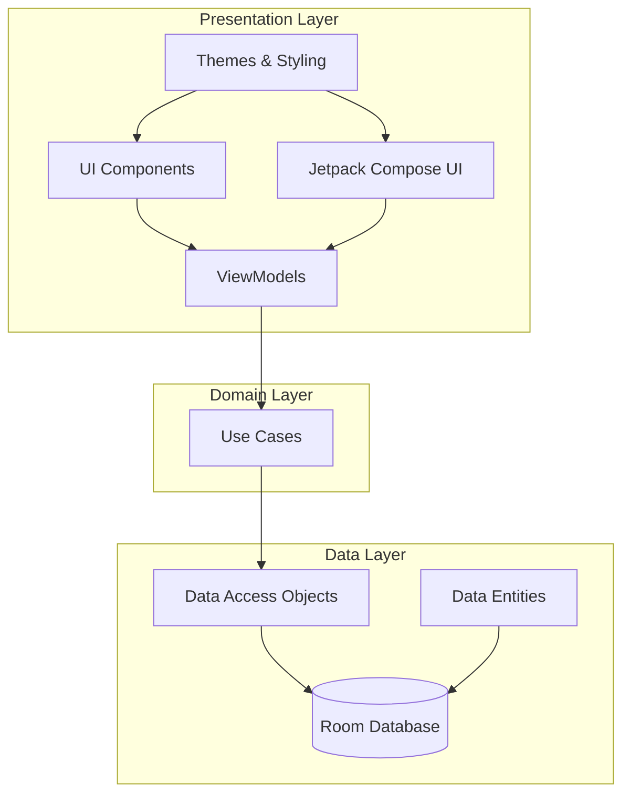
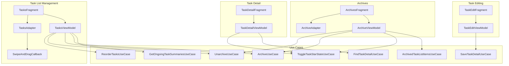
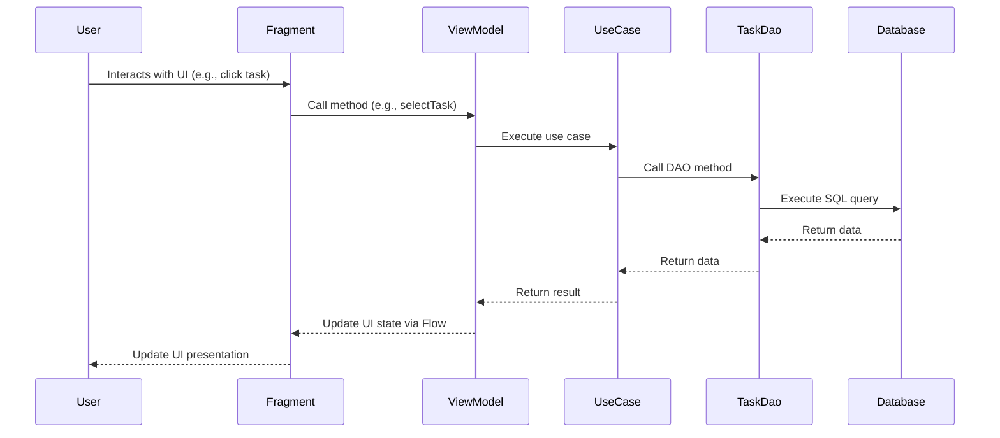
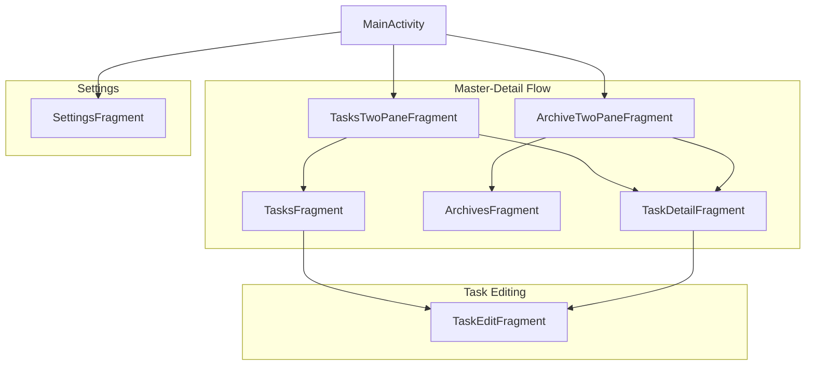
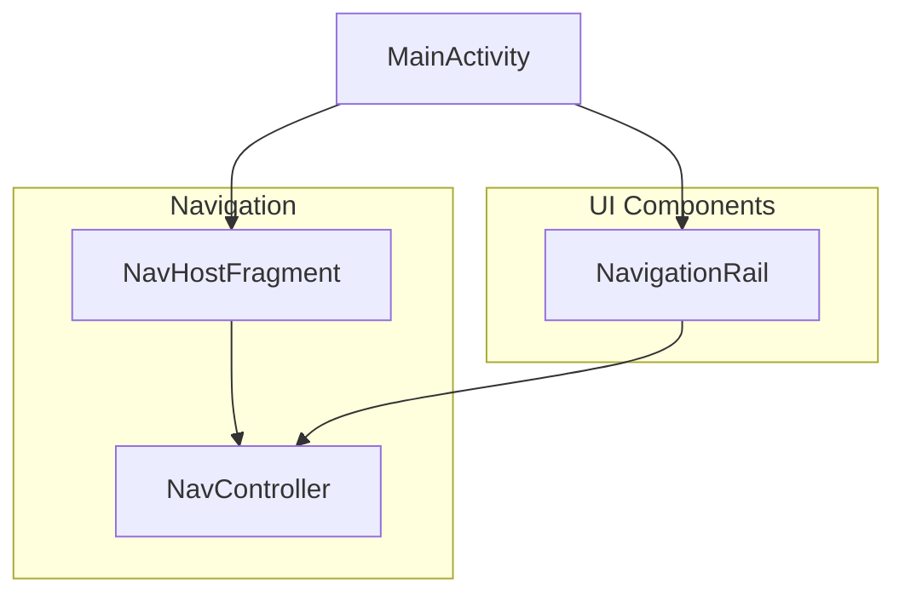

<!-- source: DeepWiki mcp.deepwiki.com · repo android/trackr · page 1 Trackr: Task Management with Accessibility · fetched 2026-10-23 -->

# Trackr: Task Management with Accessibility

Relevant source files

The following files were used as context for generating this wiki page:

- [README.md](README.md)
- [app/src/main/java/com/example/android/trackr/MainActivity.kt](app/src/main/java/com/example/android/trackr/MainActivity.kt)
- [app/src/main/res/layout/archive_fragment.xml](app/src/main/res/layout/archive_fragment.xml)
- [app/src/main/res/layout/main_activity.xml](app/src/main/res/layout/main_activity.xml)
- [app/src/main/res/layout/tasks_fragment.xml](app/src/main/res/layout/tasks_fragment.xml)
- [screenshots/detail_dark.png](screenshots/detail_dark.png)
- [screenshots/edit.png](screenshots/edit.png)
- [screenshots/talkback_home.png](screenshots/talkback_home.png)

Trackr is a sample Android application designed to demonstrate task management functionality with a strong focus on accessibility. This document provides an overview of Trackr's architecture, core components, and accessibility features. For detailed information about the project structure and build configuration, see [Project Structure and Build Configuration](#1.1). For in-depth coverage of the app's accessibility features, see [Accessibility Features](#1.3).

## Purpose and Overview

Trackr showcases how to build a task management application that properly supports accessibility services like TalkBack and Switch Access. The application allows users to:

- Create, view, and edit tasks
- Assign tasks to team members
- Associate tags with tasks
- Archive tasks by swiping right
- Modify task priority by dragging up or down

The app is specifically designed to ensure that all functionality remains accessible to users with disabilities, including those who may not be able to perform gestures like swipe or drag-and-drop but use screen readers or other assistive technologies.

Sources: [README.md:6-30]()

## High-Level Architecture

Trackr follows the MVVM (Model-View-ViewModel) architecture pattern with clean architecture principles, organized into three main layers:

### System Architecture Diagram

- **Presentation Layer**: Contains UI components (Fragments and Activities), ViewModels that manage UI state, and theme resources
- **Domain Layer**: Contains Use Cases that encapsulate business logic
- **Data Layer**: Contains DAOs (Data Access Objects), entities, and Room database for data persistence

This architecture promotes separation of concerns and makes the application more maintainable and testable.

Sources: [MainActivity.kt:19-31]()

## Core Task Management Components

The task management functionality is divided into distinct features, each with dedicated UI components and ViewModels:

### Task Management Components Diagram

1. **Task List Management**:
   - `TasksFragment`: Main UI for displaying the list of tasks
   - `TasksViewModel`: Manages task list state and operations
   - `TasksAdapter`: RecyclerView adapter for displaying tasks
   - `SwipeAndDragCallback`: Handles swipe-to-archive and drag-to-reorder gestures

2. **Task Detail**:
   - `TaskDetailFragment`: Displays detailed information about a selected task
   - `TaskDetailViewModel`: Manages the task detail state

3. **Task Editing**:
   - `TaskEditFragment`: UI for creating or editing tasks
   - `TaskEditViewModel`: Manages the task editing state

4. **Archives**:
   - `ArchivesFragment`: Displays archived tasks
   - `ArchiveViewModel`: Manages the archive view state
   - `ArchiveAdapter`: RecyclerView adapter for displaying archived tasks

Sources: [tasks_fragment.xml:1-87](), [archive_fragment.xml:1-86]()

## Data Flow for Task Operations

The following diagram illustrates how data flows through the system when a user interacts with the UI:

### Task Operation Data Flow Diagram

This unidirectional data flow pattern enhances predictability and makes it easier to track changes in the application state. Kotlin Flows are used to expose state updates from ViewModels to UI components.

Sources: [MainActivity.kt:35-91]()

## UI Component Hierarchy

The app's UI is structured around a master-detail pattern, which adapts to different screen sizes:

### UI Component Hierarchy Diagram

- `MainActivity`: The main entry point of the application
- `TasksTwoPaneFragment` & `ArchiveTwoPaneFragment`: Implement the master-detail pattern using SlidingPaneLayout for larger screens
- `TasksFragment` & `ArchivesFragment`: Display lists of ongoing and archived tasks
- `TaskDetailFragment`: Shows detailed information about a selected task
- `TaskEditFragment`: Allows creating or editing tasks
- `SettingsFragment`: Contains application settings

Sources: [main_activity.xml:1-40](), [MainActivity.kt:32-91]()

## Accessibility Features

Trackr demonstrates several Android accessibility best practices to ensure that all users, including those with disabilities, can use the app effectively:

### Key Accessibility APIs

1. **Custom Accessibility Actions**:
   - `ViewCompat.addAccessibilityAction()`: Adds custom actions to elements like tasks, enabling screen reader users to access features like swipe-to-archive or drag-and-drop reordering.
   - `ViewCompat.replaceAccessibilityAction()`: Customizes the label for accessibility actions to provide clearer context.

2. **State Descriptions**:
   - `ViewCompat.setStateDescription()`: Provides additional context about an element's state, such as whether a task is starred or not.

3. **Timeout Management**:
   - `AccessibilityManager.getRecommendedTimeoutMillis()`: Adjusts timeout duration for ephemeral content based on user's accessibility settings.

These APIs ensure that functionality like swipe-to-archive and drag-and-drop reordering remains accessible to users who cannot perform these gestures but use assistive technologies like screen readers.

Sources: [README.md:32-44]()

### Accessibility Implementation Table

| Feature | Standard Interaction | Accessible Alternative | API Used |
|---------|---------------------|------------------------|----------|
| Archive Task | Swipe right gesture | Custom accessibility action | ViewCompat.addAccessibilityAction() |
| Reorder Tasks | Drag and drop gesture | Custom accessibility actions for moving up/down | ViewCompat.addAccessibilityAction() |
| Task State | Visual indicators | State descriptions | ViewCompat.setStateDescription() |
| Ephemeral Messages | Timed notifications | Adjusted timeout based on accessibility settings | AccessibilityManager.getRecommendedTimeoutMillis() |

## Main Activity Structure

The `MainActivity` serves as the entry point to the application and sets up the navigation system:

Key components:
- `MainActivity`: Sets up the app layout and handles window insets
- `NavHostFragment`: Container for navigation destinations
- `NavController`: Manages navigation between destinations
- `NavigationRail`: Side navigation for larger screen layouts

The MainActivity uses Data Binding and handles window insets properly for edge-to-edge UI.

Sources: [MainActivity.kt:32-91](), [main_activity.xml:1-40]()

## Conclusion

Trackr demonstrates how to implement a task management application with a focus on accessibility. By utilizing Android's accessibility APIs and following best practices, Trackr ensures that all users, including those with disabilities, can access the full functionality of the app. The MVVM architecture with clean separation of concerns makes the codebase maintainable and easy to understand.

For more detailed information about specific components, please see the related wiki pages:
- For Project Structure: [Project Structure and Build Configuration](#1.1)
- For Accessibility Features: [Accessibility Features](#1.3)
- For UI Components: [UI Components and Theming](#2)
- For Data Management: [Data Management](#3)

Sources: [README.md:1-99](), [MainActivity.kt:17-92]()

---

