<!-- source: DeepWiki mcp.deepwiki.com · repo android/trackr · page 1.1 Project Structure and Build Configuration · fetched 2026-10-23 -->

# Project Structure and Build Configuration

Relevant source files

The following files were used as context for generating this wiki page:

- [app-compose/build.gradle](app-compose/build.gradle)
- [app-compose/src/main/java/com/example/android/trackr/compose/ui/TaskSummaryCard.kt](app-compose/src/main/java/com/example/android/trackr/compose/ui/TaskSummaryCard.kt)
- [app-compose/src/main/java/com/example/android/trackr/compose/ui/Theme.kt](app-compose/src/main/java/com/example/android/trackr/compose/ui/Theme.kt)
- [app-compose/src/main/java/com/example/android/trackr/compose/ui/tasks/TasksViewModel.kt](app-compose/src/main/java/com/example/android/trackr/compose/ui/tasks/TasksViewModel.kt)
- [app/build.gradle](app/build.gradle)
- [build.gradle](build.gradle)
- [gradle/wrapper/gradle-wrapper.properties](gradle/wrapper/gradle-wrapper.properties)
- [shared/build.gradle](shared/build.gradle)

This document explains the project's directory structure, module organization, and Gradle build configuration for the Trackr Android application. For information about the application's architecture and design patterns, see [Application Architecture](#1.2).

## 1. Project Overview

Trackr is organized as a multi-module Android project with a Gradle-based build system. The project demonstrates modern Android development practices including multiple UI implementations, shared business logic, and comprehensive test coverage.

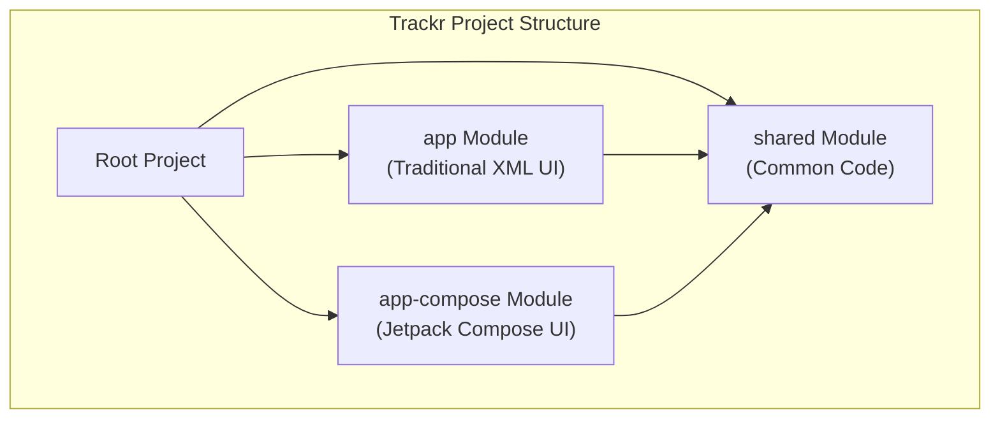

Sources: [build.gradle:17-89](), [app/build.gradle:17-33](), [shared/build.gradle:17-41](), [app-compose/build.gradle:17-41]()

## 2. Module Organization

The Trackr project consists of three main modules, each with a specific responsibility:

| Module | Description | Primary Features |
|--------|-------------|------------------|
| **app** | Main application with traditional XML-based UI | Fragment-based UI, ViewModels, Data Binding |
| **app-compose** | Alternative UI implementation using Jetpack Compose | Declarative UI, Compose Navigation |
| **shared** | Common code library used by both UI implementations | Data models, Room database, Business logic |

Sources: [app/build.gradle:17-33](), [shared/build.gradle:17-41](), [app-compose/build.gradle:17-41]()

## 3. Build System Configuration

### 3.1 Root Project Configuration

The root `build.gradle` file defines common configuration, dependency versions, and repositories for all modules in the project.

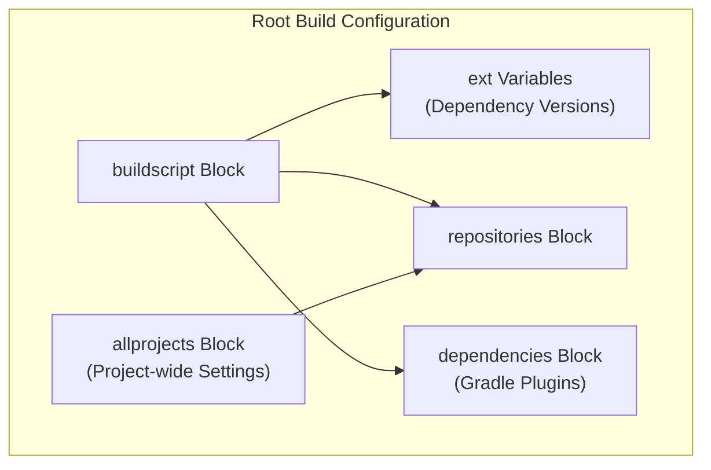

Key components of the root configuration:
- Version management for all dependencies
- Common repository configuration
- Gradle plugin dependencies

Sources: [build.gradle:17-89]()

### 3.2 Module-Specific Gradle Configuration

Each module has its own `build.gradle` file that defines module-specific configuration.

#### App Module Configuration

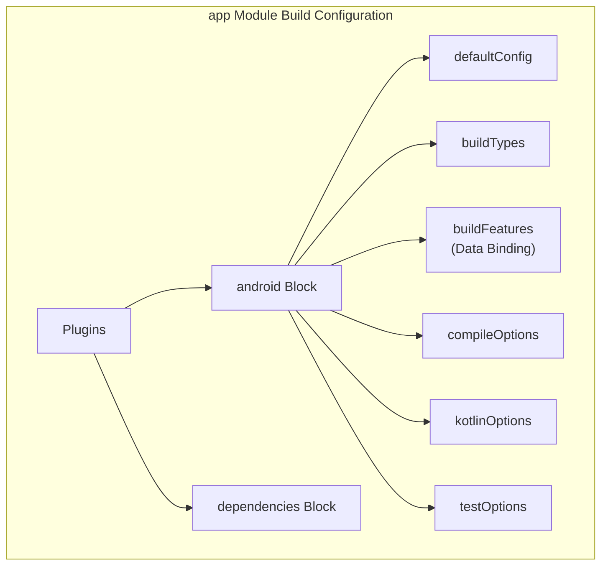

The app module includes these key build configurations:
- Android-specific build settings (SDK versions, application ID)
- Data binding enabled
- Java 8 language features with desugaring
- Dependencies on AndroidX libraries and the shared module

Sources: [app/build.gradle:17-133]()

#### Shared Module Configuration

The shared module is configured as an Android library with Room database support and core business logic.

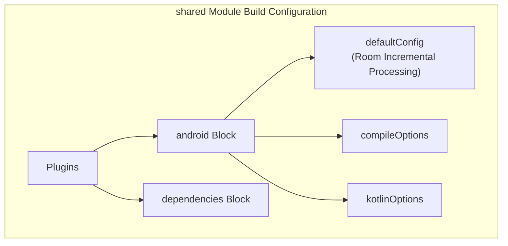

Sources: [shared/build.gradle:17-102]()

#### App-Compose Module Configuration

The app-compose module provides an alternative UI implementation using Jetpack Compose.

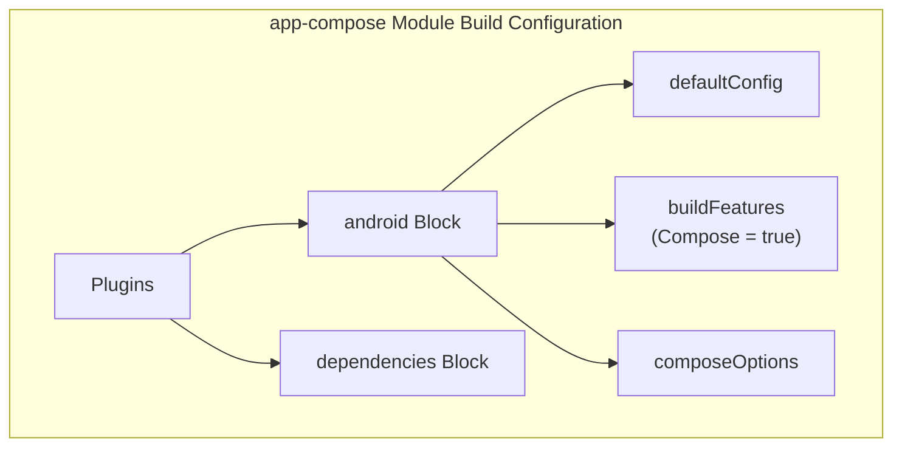

Key features:
- Jetpack Compose enabled
- Compose-specific configuration and dependencies
- Shared data layer from shared module

Sources: [app-compose/build.gradle:17-118]()

## 4. Key Dependencies and Versions

The project uses a wide range of libraries and frameworks, with versions defined in the root `build.gradle` file:

### 4.1 Foundation Libraries

| Library | Version | Purpose |
|---------|---------|---------|
| Kotlin | 1.5.21 | Programming language |
| AndroidX Core | 1.6.0 | Core Android functionality |
| Material Components | 1.4.0 | Material Design implementation |

### 4.2 Architecture Components

| Library | Version | Purpose |
|---------|---------|---------|
| Room | 2.4.2 | Database ORM |
| Lifecycle | 2.4.0-alpha01 | Lifecycle-aware components |
| Navigation | 2.4.0-alpha05 | Navigation framework |
| Hilt | 2.36 | Dependency injection |

### 4.3 UI Components

| Library | Version | Purpose |
|---------|---------|---------|
| Compose | 1.0.1 | Declarative UI framework |
| RecyclerView | 1.1.0 | List display |
| ConstraintLayout | 2.0.4 | Complex layouts |
| SlidingPaneLayout | 1.2.0-alpha03 | Master-detail UI patterns |

Sources: [build.gradle:19-62]()

## 5. Build Features and Configurations

### 5.1 Data Binding

The app module uses data binding to connect UI elements with data sources:

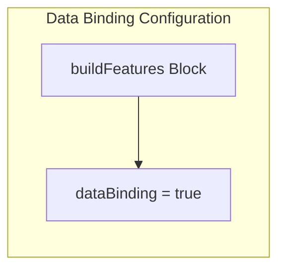

Sources: [app/build.gradle:42-44]()

### 5.2 Compose Configuration

The app-compose module enables and configures Jetpack Compose:

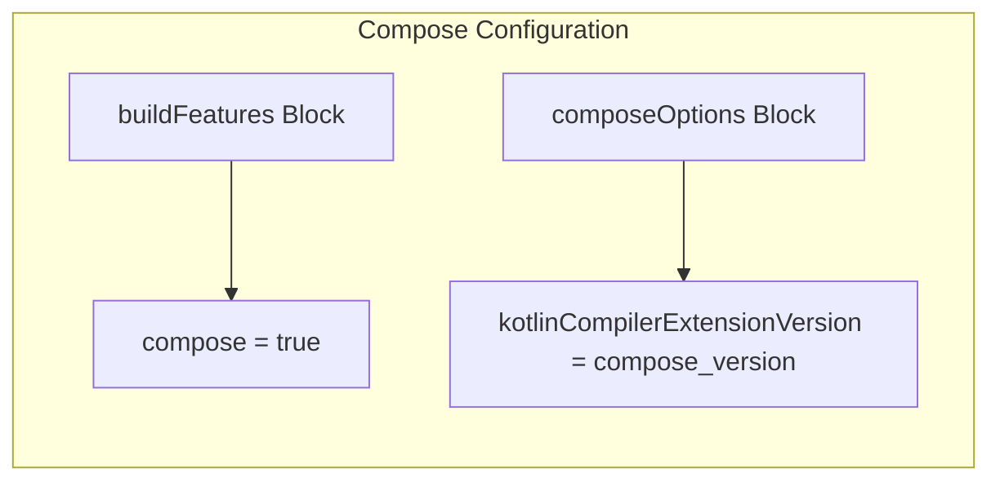

Sources: [app-compose/build.gradle:50-56]()

### 5.3 Java 8 Language Features

All modules enable Java 8 language features with desugaring for compatibility with older Android versions:

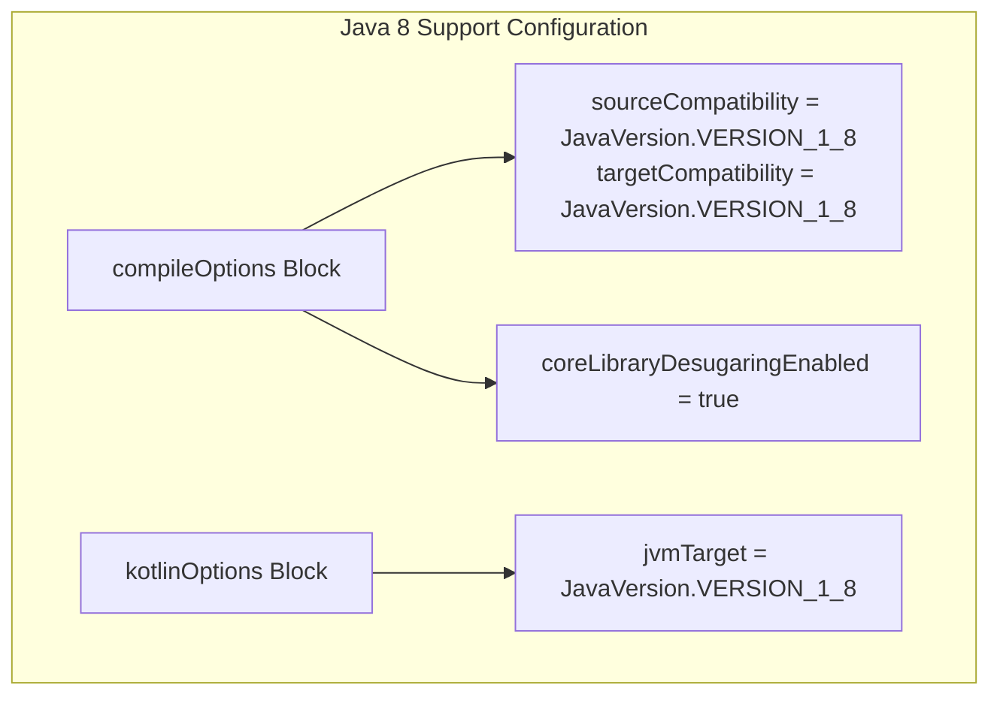

Sources: [app/build.gradle:46-54](), [shared/build.gradle:43-51](), [app-compose/build.gradle:41-49]()

## 6. Testing Configuration

The project includes comprehensive test configuration for unit tests and instrumentation tests:

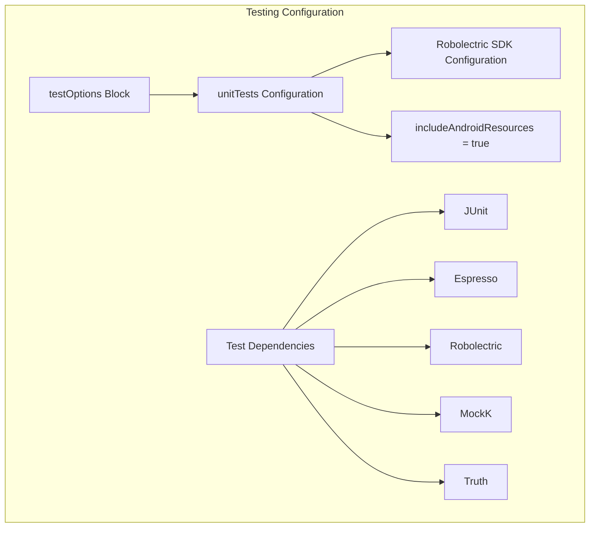

Key testing components:
- JUnit for unit testing
- Espresso for UI testing
- Robolectric for testing without device
- Truth for assertions
- MockK for mocking

Sources: [app/build.gradle:67-74](), [app/build.gradle:117-132](), [shared/build.gradle:64-71](), [app-compose/build.gradle:57-68]()

## 7. Gradle Wrapper

The project uses Gradle 7.1.1 via the Gradle Wrapper, ensuring build system consistency across development environments.

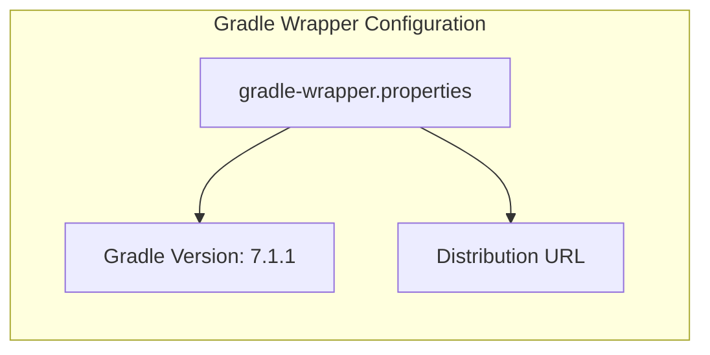

Sources: [gradle/wrapper/gradle-wrapper.properties:1-7]()

## 8. Build Process Flow

The following diagram illustrates how the build process flows through the Gradle configuration:

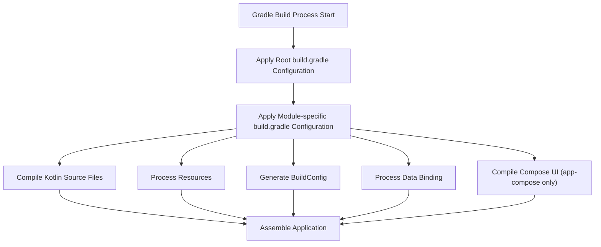

Sources: [build.gradle:17-89](), [app/build.gradle:17-133](), [shared/build.gradle:17-102](), [app-compose/build.gradle:17-118]()

---

