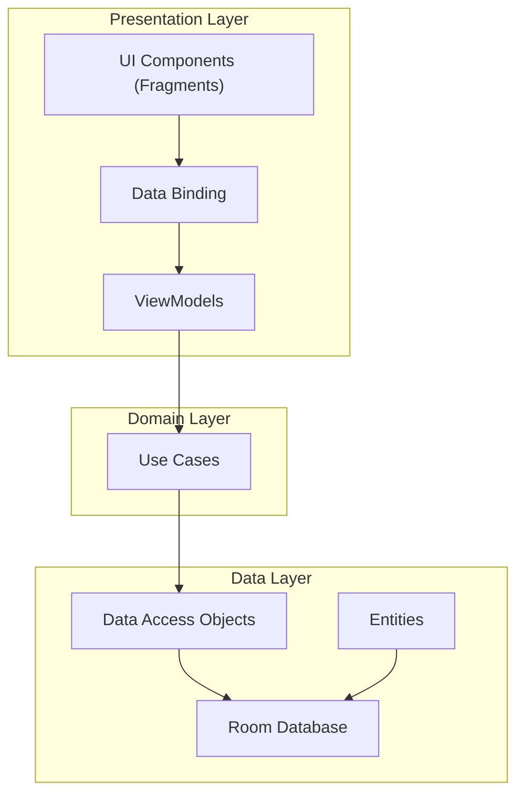
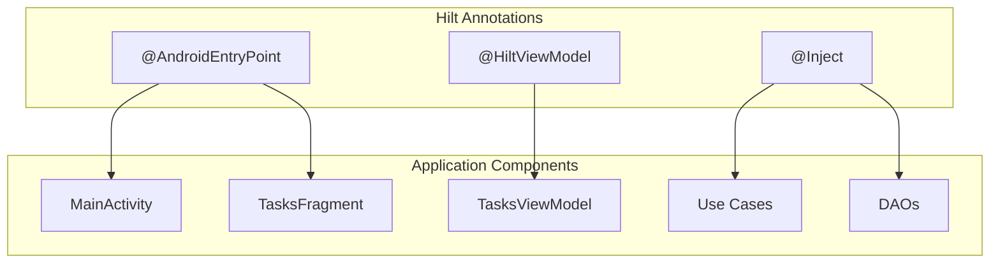

<!-- source: DeepWiki mcp.deepwiki.com · repo android/trackr · page 1.2 Application Architecture · fetched 2026-10-23 -->

# Application Architecture

<details>
<summary>Relevant source files</summary>

The following files were used as context for generating this wiki page:

- [app/src/main/java/com/example/android/trackr/MainActivity.kt](app/src/main/java/com/example/android/trackr/MainActivity.kt)
- [app/src/main/java/com/example/android/trackr/ui/tasks/TasksFragment.kt](app/src/main/java/com/example/android/trackr/ui/tasks/TasksFragment.kt)
- [app/src/main/java/com/example/android/trackr/ui/tasks/TasksViewModel.kt](app/src/main/java/com/example/android/trackr/ui/tasks/TasksViewModel.kt)
- [app/src/main/res/layout/archive_fragment.xml](app/src/main/res/layout/archive_fragment.xml)
- [app/src/main/res/layout/main_activity.xml](app/src/main/res/layout/main_activity.xml)
- [app/src/main/res/layout/tasks_fragment.xml](app/src/main/res/layout/tasks_fragment.xml)
- [shared/src/main/java/com/example/android/trackr/data/Views.kt](shared/src/main/java/com/example/android/trackr/data/Views.kt)
- [shared/src/main/java/com/example/android/trackr/db/dao/TaskDao.kt](shared/src/main/java/com/example/android/trackr/db/dao/TaskDao.kt)
- [shared/src/main/java/com/example/android/trackr/usecase/ArchivedTaskListItemsUseCase.kt](shared/src/main/java/com/example/android/trackr/usecase/ArchivedTaskListItemsUseCase.kt)
- [shared/src/main/java/com/example/android/trackr/usecase/GetOngoingTaskSummariesUseCase.kt](shared/src/main/java/com/example/android/trackr/usecase/GetOngoingTaskSummariesUseCase.kt)
- [shared/src/test/java/com/example/android/trackr/db/dao/TaskDaoTest.kt](shared/src/test/java/com/example/android/trackr/db/dao/TaskDaoTest.kt)

</details>


This document describes the architectural design of the Trackr application, outlining the key components, patterns, and frameworks used. Trackr follows the MVVM (Model-View-ViewModel) architecture pattern with clean architecture principles, which promotes separation of concerns and maintainability.

For information about the project's directory structure and build configuration, see [Project Structure and Build Configuration](#1.1). For details about UI components and theming, see [UI Components and Theming](#2).

## 1. Architectural Overview

Trackr is built using a layered architecture approach that separates the application into distinct layers with specific responsibilities. This separation helps in maintaining, testing, and evolving the application over time.



Sources:
- [app/src/main/java/com/example/android/trackr/MainActivity.kt]()
- [app/src/main/java/com/example/android/trackr/ui/tasks/TasksFragment.kt:46-96]()
- [app/src/main/java/com/example/android/trackr/ui/tasks/TasksViewModel.kt:39-77]()

## 2. MVVM Implementation

The application implements MVVM (Model-View-ViewModel) pattern, which is recommended by Google for Android applications. This pattern helps separate UI logic from business logic and data management.

### 2.1 Key Components in MVVM

```mermaid
classDiagram
    class "Fragment" {
        - binding: ViewBinding
        - viewModel: ViewModel
        + onViewCreated()
        + bindViews()
    }
    
    class "ViewModel" {
        - useCases: List~UseCase~
        - _state: MutableStateFlow
        + state: StateFlow
        + performAction()
    }
    
    class "UseCase" {
        - dao: DAO
        + invoke()
    }
    
    class "DAO" {
        + query()
        + insert()
        + update()
        + delete()
    }
    
    "Fragment" --> "ViewModel" : observes
    "ViewModel" --> "UseCase" : uses
    "UseCase" --> "DAO" : uses
```

Sources:
- [app/src/main/java/com/example/android/trackr/ui/tasks/TasksFragment.kt:47-50]()
- [app/src/main/java/com/example/android/trackr/ui/tasks/TasksViewModel.kt:38-47]()
- [shared/src/main/java/com/example/android/trackr/usecase/GetOngoingTaskSummariesUseCase.kt]()

### 2.2 Data Flow

The data flow in Trackr follows a unidirectional pattern:

1. **User Interaction**: User interacts with the UI (Fragments)
2. **ViewModel Notification**: UI notifies the ViewModel about the action
3. **Business Logic Execution**: ViewModel executes appropriate use cases
4. **Data Modification**: Use cases interact with DAOs to modify data
5. **State Updates**: Changes are emitted as state updates via StateFlow
6. **UI Updates**: UI observes state changes and updates accordingly

Sources:
- [app/src/main/java/com/example/android/trackr/ui/tasks/TasksViewModel.kt:69-77]()
- [app/src/main/java/com/example/android/trackr/ui/tasks/TasksFragment.kt:113-152]()

## 3. Presentation Layer

The presentation layer consists of Activities, Fragments, ViewModels, and UI-related resources.

### 3.1 Activities

The application has a single `MainActivity` that serves as the entry point and hosts a `NavHostFragment` for fragment-based navigation.

Sources:
- [app/src/main/java/com/example/android/trackr/MainActivity.kt:32-92]()
- [app/src/main/res/layout/main_activity.xml:22-40]()

### 3.2 Fragments

Fragments represent different screens in the application. For example:

- `TasksFragment`: Displays the list of ongoing tasks
- `ArchivesFragment`: Shows archived tasks
- `TaskDetailFragment`: Shows task details
- `TaskEditFragment`: Allows editing of tasks

Each fragment binds to its corresponding layout using data binding.

Sources:
- [app/src/main/java/com/example/android/trackr/ui/tasks/TasksFragment.kt:46-210]()
- [app/src/main/res/layout/tasks_fragment.xml:17-87]()
- [app/src/main/res/layout/archive_fragment.xml:17-86]()

### 3.3 ViewModels

ViewModels manage UI-related data and handle business logic. They are lifecycle-aware and survive configuration changes. Trackr uses Hilt to inject dependencies into ViewModels.

```mermaid
classDiagram
    class "TasksViewModel" {
        - getOngoingTaskSummariesUseCase: GetOngoingTaskSummariesUseCase
        - toggleTaskStarStateUseCase: ToggleTaskStarStateUseCase
        - reorderTasksUseCase: ReorderTasksUseCase
        - archiveUseCase: ArchiveUseCase
        - unarchiveUseCase: UnarchiveUseCase
        - currentUser: User
        + listItems: StateFlow~List~ListItem~~
        + archivedItem: Flow~ArchivedItem~
        + showTaskDetailEvents: Flow~ShowTaskDetailEvent~
        + toggleExpandedState()
        + toggleTaskStarState()
        + archiveTask()
        + unarchiveTask()
        + reorderTasks()
        + showTaskDetail()
    }
```

Sources:
- [app/src/main/java/com/example/android/trackr/ui/tasks/TasksViewModel.kt:39-144]()

### 3.4 Data Binding

Trackr uses data binding to connect UI elements with data sources, eliminating the need for boilerplate code to update the UI.

```kotlin
// Example of how data binding is used in fragments
private val binding by dataBindings(TasksFragmentBinding::bind)
```

Sources:
- [app/src/main/java/com/example/android/trackr/ui/tasks/TasksFragment.kt:50]()
- [app/src/main/res/layout/tasks_fragment.xml:17-35]()

## 4. Domain Layer

The domain layer contains use cases that encapsulate business logic. These are small, focused classes that implement specific operations.

### 4.1 Use Cases

Use cases follow the single responsibility principle and are designed to be reusable. They typically:
- Accept input parameters
- Interact with the data layer
- Return results (often as Kotlin Flow)

Examples of use cases in Trackr:
- `GetOngoingTaskSummariesUseCase`: Retrieves ongoing task summaries
- `ArchivedTaskListItemsUseCase`: Retrieves archived tasks
- `ToggleTaskStarStateUseCase`: Toggles the star state of a task
- `ArchiveUseCase`: Archives one or more tasks
- `UnarchiveUseCase`: Unarchives tasks
- `ReorderTasksUseCase`: Reorders tasks within a category

Sources:
- [shared/src/main/java/com/example/android/trackr/usecase/GetOngoingTaskSummariesUseCase.kt:22-26]()
- [shared/src/main/java/com/example/android/trackr/usecase/ArchivedTaskListItemsUseCase.kt:22-26]()
- [app/src/main/java/com/example/android/trackr/ui/tasks/TasksViewModel.kt:40-46]()

## 5. Data Layer

The data layer is responsible for data management and persistence. It consists of the Room database, DAOs, entities, and views.

### 5.1 Room Database

Trackr uses Room, an abstraction layer over SQLite, for data persistence. Room provides compile-time verification of SQL queries and reduces boilerplate code.

### 5.2 Data Access Objects (DAOs)

DAOs define methods for interacting with the database. They use annotations to specify SQL operations.

```mermaid
classDiagram
    class "TaskDao" {
        + insertUsers()
        + insertTasks()
        + getTasks(): Flow~List~Task~~
        + getOngoingTaskSummaries(): Flow~List~TaskSummary~~
        + getArchivedTaskSummaries(): Flow~List~TaskSummary~~
        + findTaskDetailById(): Flow~TaskDetail?~
        + updateTaskStatus()
        + setIsArchived()
        + reorderTasks()
        + saveTaskDetail()
    }
```

Sources:
- [shared/src/main/java/com/example/android/trackr/db/dao/TaskDao.kt:35-198]()
- [shared/src/test/java/com/example/android/trackr/db/dao/TaskDaoTest.kt:80-198]()

### 5.3 Entities and Views

The data model consists of several entities and database views:

**Entities:**
- `Task`: Represents a task with properties like title, description, status
- `User`: Represents a user with username and avatar
- `Tag`: Represents a tag with label and color
- `TaskTag`: Junction table for the many-to-many relationship between tasks and tags
- `UserTask`: Junction table for tracking starred tasks per user

**Database Views:**
- `TaskSummary`: Summary information about tasks
- `TaskDetail`: Detailed information about a task including its relationships

Sources:
- [shared/src/main/java/com/example/android/trackr/data/Views.kt:25-124]()

## 6. Dependency Injection with Hilt

Trackr uses Hilt, a dependency injection library built on top of Dagger, to manage dependencies throughout the application.

### 6.1 Hilt Components

Hilt provides dependency injection at various Android components:
- Activities (`@AndroidEntryPoint`)
- Fragments (`@AndroidEntryPoint`)
- ViewModels (`@HiltViewModel`)



Sources:
- [app/src/main/java/com/example/android/trackr/MainActivity.kt:32]()
- [app/src/main/java/com/example/android/trackr/ui/tasks/TasksFragment.kt:46]()
- [app/src/main/java/com/example/android/trackr/ui/tasks/TasksViewModel.kt:39]()
- [shared/src/main/java/com/example/android/trackr/usecase/GetOngoingTaskSummariesUseCase.kt:22]()

## 7. Reactive Programming with Kotlin Flows

Trackr uses Kotlin Flows extensively for reactive programming, which enables the application to respond to data changes efficiently.

### 7.1 StateFlow for UI State

ViewModels expose UI state using `StateFlow` or `Flow`, which fragments observe to update the UI:

```kotlin
// StateFlow in ViewModel
val listItems = combine(taskSummaries, expandedStatesMap) { ... }
    .stateIn(viewModelScope, WhileViewSubscribed, emptyList())

// Flow collection in Fragment
repeatWithViewLifecycle {
    launch {
        tasksViewModel.listItems.collect {
            tasksAdapter.submitList(it) {
                updateStickyHeader()
            }
        }
    }
}
```

Sources:
- [app/src/main/java/com/example/android/trackr/ui/tasks/TasksViewModel.kt:69-77]()
- [app/src/main/java/com/example/android/trackr/ui/tasks/TasksFragment.kt:113-121]()

### 7.2 Flow from Room Database

Room generates Flow objects that emit new values when the database changes:

```kotlin
// Flow return type in DAO
@Query("SELECT * FROM tasks")
fun getTasks(): Flow<List<Task>>

@Transaction
@Query("""
    SELECT s.*,
        EXISTS(
            SELECT id
            FROM user_tasks AS t
            WHERE t.taskId = s.id AND t.userId = :userId
        ) AS starred
    FROM TaskSummary AS s WHERE s.isArchived = 0
    ORDER BY s.status, s.orderInCategory
""")
fun getOngoingTaskSummaries(userId: Long): Flow<List<TaskSummary>>
```

Sources:
- [shared/src/main/java/com/example/android/trackr/db/dao/TaskDao.kt:58-58]()
- [shared/src/main/java/com/example/android/trackr/db/dao/TaskDao.kt:72-82]()

## 8. Summary

The Trackr application demonstrates a well-structured architecture that follows modern Android development practices:

- **MVVM architecture** for separation of concerns
- **Clean architecture principles** for maintainable and testable code
- **Room database** for efficient data persistence
- **Kotlin Flows** for reactive programming
- **Hilt** for dependency injection
- **Data Binding** for connecting UI with data sources

This architecture makes the application more maintainable, testable, and extensible while providing a good user experience.

Sources:
- [app/src/main/java/com/example/android/trackr/ui/tasks/TasksFragment.kt]()
- [app/src/main/java/com/example/android/trackr/ui/tasks/TasksViewModel.kt]()
- [shared/src/main/java/com/example/android/trackr/db/dao/TaskDao.kt]()
- [shared/src/main/java/com/example/android/trackr/data/Views.kt]()

---

