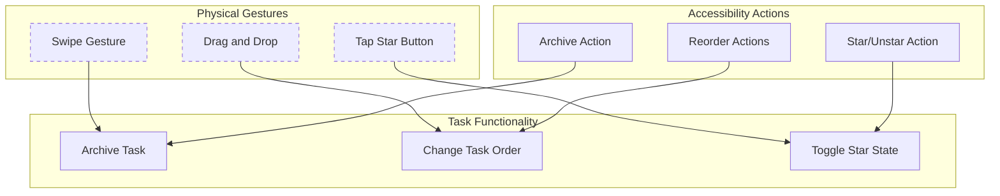
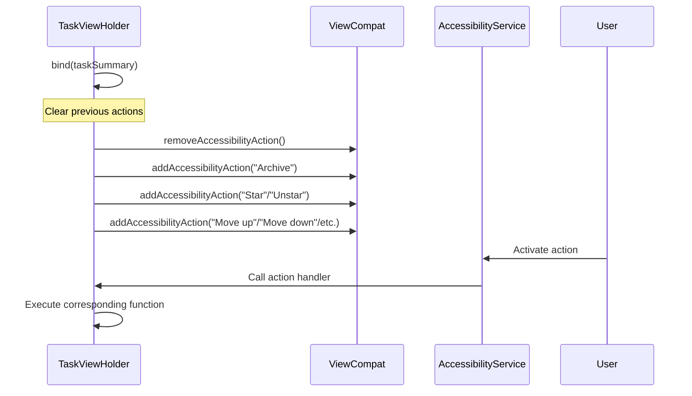
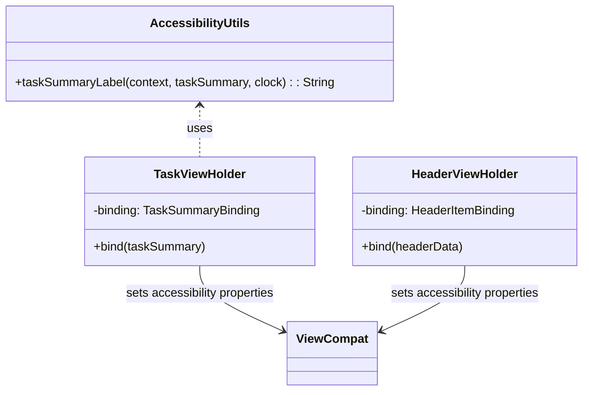
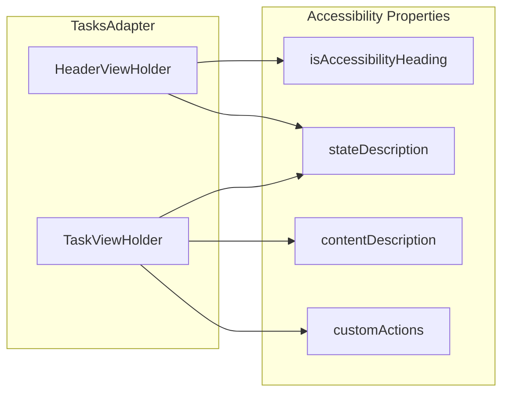
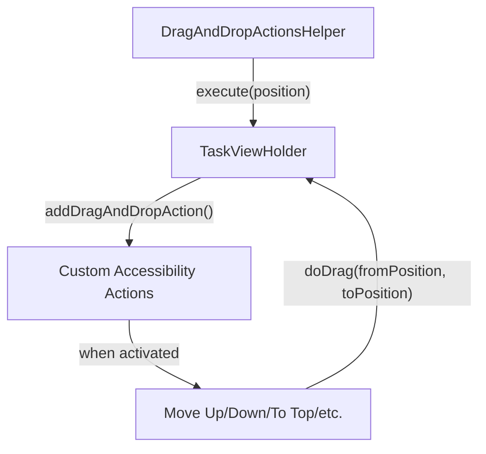
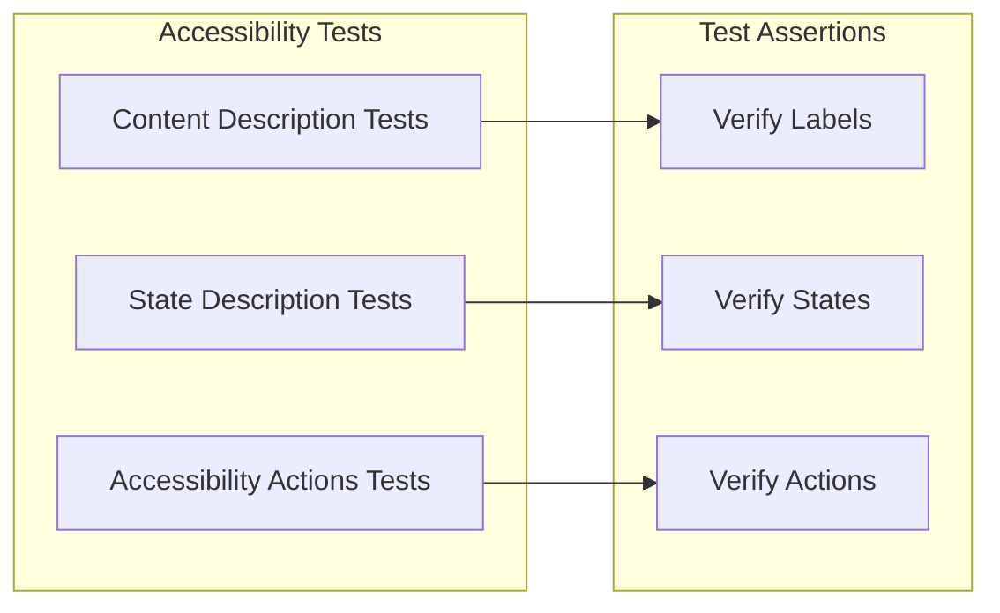
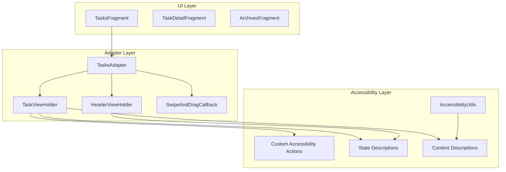

<!-- source: DeepWiki mcp.deepwiki.com · repo android/trackr · page 1.3 Accessibility Features · fetched 2026-10-23 -->

# Accessibility Features

<details>
<summary>Relevant source files</summary>

The following files were used as context for generating this wiki page:

- [README.md](README.md)
- [app/src/main/java/com/example/android/trackr/ui/tasks/SwipeAndDragActionCallback.kt](app/src/main/java/com/example/android/trackr/ui/tasks/SwipeAndDragActionCallback.kt)
- [app/src/main/java/com/example/android/trackr/ui/tasks/TasksAdapter.kt](app/src/main/java/com/example/android/trackr/ui/tasks/TasksAdapter.kt)
- [app/src/main/java/com/example/android/trackr/ui/utils/AccessibilityUtils.kt](app/src/main/java/com/example/android/trackr/ui/utils/AccessibilityUtils.kt)
- [app/src/test/java/com/example/android/trackr/ui/tasks/TasksAdapterTest.kt](app/src/test/java/com/example/android/trackr/ui/tasks/TasksAdapterTest.kt)
- [app/src/test/java/com/example/android/trackr/ui/utils/AccessibilityUtilsTest.kt](app/src/test/java/com/example/android/trackr/ui/utils/AccessibilityUtilsTest.kt)
- [screenshots/detail_dark.png](screenshots/detail_dark.png)
- [screenshots/edit.png](screenshots/edit.png)
- [screenshots/talkback_home.png](screenshots/talkback_home.png)

</details>


## Purpose and Scope

This document details the accessibility features implemented throughout the Trackr application. It covers how Trackr ensures core functionality is accessible to all users, including those with disabilities who may interact with their devices using accessibility services such as TalkBack or Switch Access. The focus is on the technical implementation of these features and how they enable alternative interaction methods beyond direct touch gestures.

For information about the overall application architecture, see [Application Architecture](#1.2).

## Introduction to Trackr's Accessibility Philosophy

Trackr is designed with accessibility as a core principle rather than an afterthought. The app ensures that all users—including those with visual, motor, or other impairments—can access the full functionality of the application.

Key accessibility goals in Trackr include:

- Providing alternative methods to access gesture-based functionality
- Ensuring proper content descriptions and context for screen readers
- Maintaining proper state information for UI elements
- Supporting device accessibility settings like dark mode and font scaling

Sources: [README.md:10-29]()

## Core Accessibility Features

### Custom Accessibility Actions

One of Trackr's most important accessibility features is providing equivalent functionality for gesture-based interactions through custom accessibility actions. This allows users who cannot perform gestures like swipe or drag-and-drop to access the same features through their accessibility service.

For example, Trackr implements the following custom accessibility actions:

1. **Archive Task** - Alternative to swipe-to-archive gesture
2. **Star/Unstar Task** - Alternative to tapping the star button
3. **Drag and Drop** - Alternatives for reordering tasks with precise positioning



Sources: [app/src/main/java/com/example/android/trackr/ui/tasks/TasksAdapter.kt:219-262](), [app/src/main/java/com/example/android/trackr/ui/tasks/TasksAdapter.kt:273-287]()

### Implementation of Custom Accessibility Actions

Custom accessibility actions are implemented primarily in the `TaskViewHolder` class of the `TasksAdapter`. When binding a task view:

1. Previous accessibility actions are cleared to prevent duplication
2. New actions are added for archive, star/unstar, and drag/drop operations
3. Each action is associated with appropriate functionality via lambdas



Sources: [app/src/main/java/com/example/android/trackr/ui/tasks/TasksAdapter.kt:165-197](), [app/src/main/java/com/example/android/trackr/ui/tasks/TasksAdapter.kt:226-236](), [app/src/main/java/com/example/android/trackr/ui/tasks/TasksAdapter.kt:242-253]()

### Content Descriptions and Labels

Trackr implements comprehensive content descriptions to ensure screen reader users understand the purpose and state of UI elements:

1. **Task Summary Labels**: Each task item includes a content description with the title, owner, due date, and tags
2. **Header Accessibility**: Section headers are properly marked as headings for better screen reader navigation
3. **State Information**: UI elements communicate their states (expanded/collapsed, starred/unstarred)

The `AccessibilityUtils` class provides centralized utilities for generating proper content descriptions:



Sources: [app/src/main/java/com/example/android/trackr/ui/utils/AccessibilityUtils.kt:26-55](), [app/src/main/java/com/example/android/trackr/ui/tasks/TasksAdapter.kt:171-172](), [app/src/main/java/com/example/android/trackr/ui/tasks/TasksAdapter.kt:137-139]()

### State Descriptions

State descriptions provide additional context about the current state of UI elements to accessibility service users. Trackr uses this to convey information such as:

1. Whether a task is starred or unstarred
2. Whether a section header is expanded or collapsed
3. The current status of a task (NOT_STARTED, IN_PROGRESS, COMPLETED, etc.)

This is implemented using `ViewCompat.setStateDescription()` to set appropriate state descriptions based on the current state of the UI element.

Sources: [app/src/main/java/com/example/android/trackr/ui/tasks/TasksAdapter.kt:135-138](), [app/src/main/java/com/example/android/trackr/ui/tasks/TasksAdapter.kt:174-179](), [app/src/test/java/com/example/android/trackr/ui/tasks/TasksAdapterTest.kt:112-137]()

### Proper Heading Structure

Section headers in Trackr are properly marked as headings for accessibility services using `ViewCompat.setAccessibilityHeading()`. This allows screen reader users to navigate between sections more efficiently.



Sources: [app/src/main/java/com/example/android/trackr/ui/tasks/TasksAdapter.kt:139](), [app/src/test/java/com/example/android/trackr/ui/tasks/TasksAdapterTest.kt:103-108]()

## Accessibility Actions Implementation Details

### Archive Task Action

The archive action provides an alternative to the swipe gesture for archiving tasks:

```
private fun addArchiveAccessibilityAction(taskSummary: TaskSummary) {
    accessibilityActionIds.add(
        ViewCompat.addAccessibilityAction(
            binding.root,
            // The label surfaced to end user by an accessibility service.
            binding.root.context.getString(R.string.archive)
        ) { _, _ ->
            // The functionality associated with the label.
            itemListener.onTaskArchived(taskSummary)
            true
        })
}
```

Sources: [app/src/main/java/com/example/android/trackr/ui/tasks/TasksAdapter.kt:226-236]()

### Star/Unstar Task Action

Similar to the archive action, the star/unstar action provides an alternative way to toggle the star state:

```
private fun addStarAccessibilityAction(taskSummary: TaskSummary) {
    accessibilityActionIds.add(
        ViewCompat.addAccessibilityAction(
            binding.root,
            // The label surfaced to end user by an accessibility service.
            if (taskSummary.starred) {
                binding.root.context.getString(R.string.unstar)
            } else {
                binding.root.context.getString(R.string.star)
            }
        ) { _, _ ->
            // The functionality associated with the label.
            itemListener.onStarClicked(taskSummary)
            true
        })
}
```

Sources: [app/src/main/java/com/example/android/trackr/ui/tasks/TasksAdapter.kt:273-287]()

### Drag and Drop Actions

The drag and drop functionality is made accessible through a set of custom actions that allow precise positioning of tasks:



The `DragAndDropActionsHelper` determines what drag and drop actions are available for a given position, and the appropriate actions are added to the task view.

Sources: [app/src/main/java/com/example/android/trackr/ui/tasks/TasksAdapter.kt:242-253](), [app/src/main/java/com/example/android/trackr/ui/tasks/TasksAdapter.kt:255-262]()

## Comprehensive Content Descriptions

Trackr generates thorough content descriptions for task items to ensure screen reader users get all the necessary information about a task. The `AccessibilityUtils.taskSummaryLabel()` method creates these descriptions:

```
fun taskSummaryLabel(context: Context, taskSummary: TaskSummary, clock: Clock): String {
    val sb = StringBuffer()

    sb.append(taskSummary.title).append(PERIOD_SEPARATOR_AND_SPACE)

    sb.append(context.getString(R.string.owner)).append(COLON_SEPARATOR)
    sb.append(taskSummary.owner.username).append(PERIOD_SEPARATOR_AND_SPACE)

    sb.append(
        DateTimeUtils.durationMessageOrDueDate(
            context.resources,
            taskSummary.dueAt,
            clock
        )
    )
    sb.append(if (taskSummary.tags.isEmpty()) PERIOD_SEPARATOR else PERIOD_SEPARATOR_AND_SPACE)

    sb.append(
        TextUtils.join(
            PERIOD_SEPARATOR_AND_SPACE,
            taskSummary.tags.map { context.getString(R.string.tag_label, it.label) })
    )

    return sb.toString()
}
```

This creates descriptions like: "task 2. Owner: user. Due today. Tag: tag1. Tag: tag2"

Sources: [app/src/main/java/com/example/android/trackr/ui/utils/AccessibilityUtils.kt:31-55](), [app/src/test/java/com/example/android/trackr/ui/utils/AccessibilityUtilsTest.kt:65-84]()

## Testing Accessibility Features

Trackr includes specific unit tests for its accessibility features to ensure they continue to function correctly as the codebase evolves. These tests verify:

1. Proper content descriptions are generated
2. State descriptions are correctly set based on item state
3. Accessibility actions work as expected
4. Accessibility settings are applied correctly to view elements



Sources: [app/src/test/java/com/example/android/trackr/ui/utils/AccessibilityUtilsTest.kt:41-114](), [app/src/test/java/com/example/android/trackr/ui/tasks/TasksAdapterTest.kt:74-234]()

## Integration with Accessibility Services

Trackr works well with Android accessibility services like TalkBack and Switch Access. Here's how different accessibility services interact with the app:

| Accessibility Service | Supported Features | Implementation Details |
|------------------------|-------------------|------------------------|
| TalkBack               | Content descriptions<br>Custom actions<br>Heading navigation | Uses Android's accessibility framework to read screen content aloud |
| Switch Access          | Custom actions<br>Focus navigation | Provides alternative actions for gestures like swipe and drag |
| Voice Access           | Command-based interaction | Works with content descriptions and custom actions |
| Screen Magnification   | UI magnification | Standard Android support through proper layout practices |
| Display Adjustments    | Dark mode<br>Text scaling | Implemented through proper theming and layout practices |

Sources: [README.md:16-29](), [screenshots/detail_dark.png]()

## Best Practices Demonstrated

The Trackr application demonstrates several accessibility best practices that developers can learn from:

1. **Provide alternatives for gestures**: Custom accessibility actions for swipe and drag gestures
2. **Meaningful content descriptions**: Detailed content descriptions that include all relevant information
3. **State communication**: Clear state descriptions for UI elements
4. **Proper heading structure**: Marking headers appropriately for screen reader navigation
5. **Action labeling**: Custom labels for actions to make their purpose clear
6. **Maintaining accessibility action state**: Clearing and recreating actions when recycling views

Sources: [app/src/main/java/com/example/android/trackr/ui/tasks/TasksAdapter.kt:219-262](), [app/src/main/java/com/example/android/trackr/ui/tasks/TasksAdapter.kt:165-179]()

## Accessibility Implementation Hierarchy



Sources: [app/src/main/java/com/example/android/trackr/ui/tasks/TasksAdapter.kt:39-307](), [app/src/main/java/com/example/android/trackr/ui/utils/AccessibilityUtils.kt:26-55]()

## Conclusion

Trackr demonstrates how to make a feature-rich Android application fully accessible to all users, including those who rely on accessibility services. By providing alternative methods to access gesture-based functionality, comprehensive content descriptions, and proper state information, Trackr ensures that all users can enjoy its core features regardless of how they interact with their devices.

---

