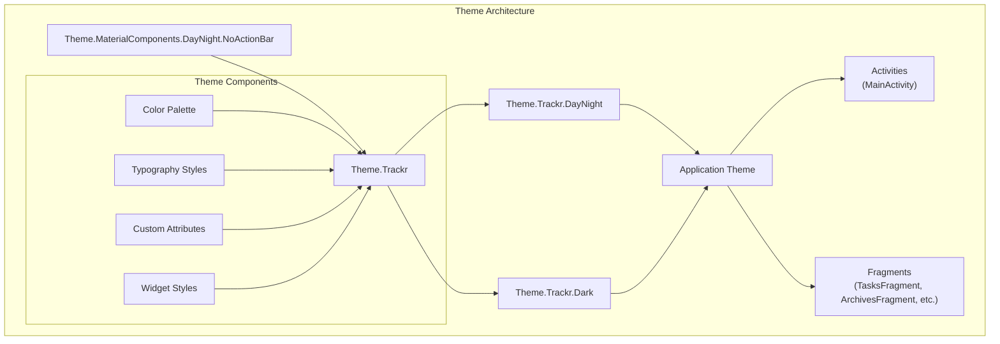
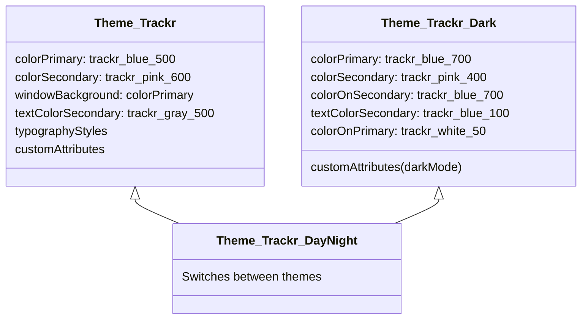
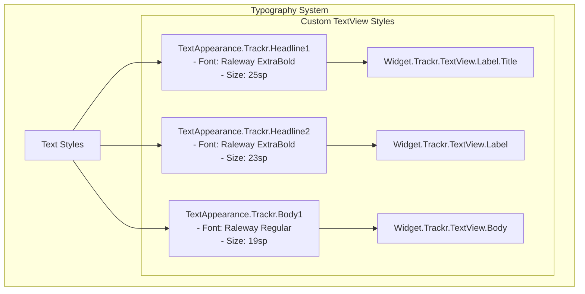
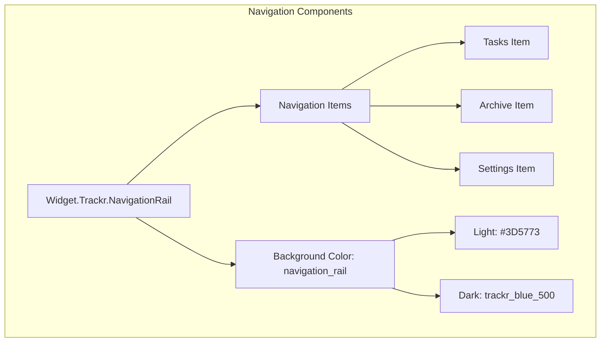
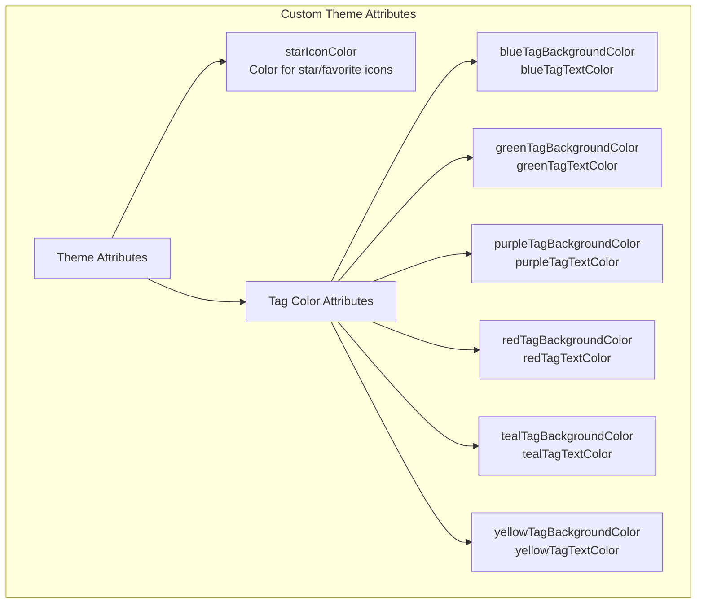
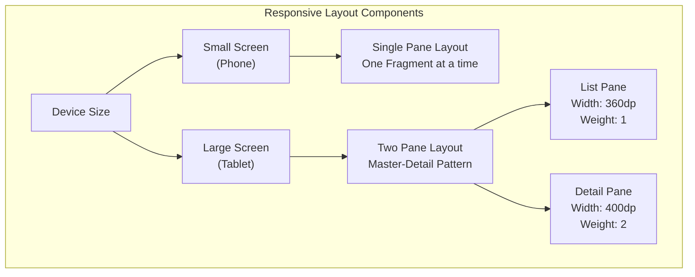

<!-- source: DeepWiki mcp.deepwiki.com · repo android/trackr · page 2 UI Components and Theming · fetched 2026-10-23 -->

# UI Components and Theming

Relevant source files

The following files were used as context for generating this wiki page:

- [app-compose/src/main/java/com/example/android/trackr/compose/ui/tasks/Tasks.kt](app-compose/src/main/java/com/example/android/trackr/compose/ui/tasks/Tasks.kt)
- [app/src/main/AndroidManifest.xml](app/src/main/AndroidManifest.xml)
- [app/src/main/res/drawable/ic_star.xml](app/src/main/res/drawable/ic_star.xml)
- [app/src/main/res/drawable/ic_star_border.xml](app/src/main/res/drawable/ic_star_border.xml)
- [app/src/main/res/values-night/colors.xml](app/src/main/res/values-night/colors.xml)
- [app/src/main/res/values-night/themes.xml](app/src/main/res/values-night/themes.xml)
- [app/src/main/res/values/attrs.xml](app/src/main/res/values/attrs.xml)
- [app/src/main/res/values/colors.xml](app/src/main/res/values/colors.xml)
- [app/src/main/res/values/dimens.xml](app/src/main/res/values/dimens.xml)
- [app/src/main/res/values/strings.xml](app/src/main/res/values/strings.xml)
- [app/src/main/res/values/styles.xml](app/src/main/res/values/styles.xml)
- [app/src/main/res/values/themes.xml](app/src/main/res/values/themes.xml)
- [app/src/main/res/values/type.xml](app/src/main/res/values/type.xml)
- [shared/src/main/res/values/strings.xml](shared/src/main/res/values/strings.xml)

This document provides an overview of the Trackr application's UI components and theming system. It covers the design language, theme implementation, color palette, typography, and key UI components used throughout the application. For information about specific screens and their implementations, see [Task List Implementation](#2.1), [Task Detail View](#2.2), and [Responsive Layout: Two-Pane Implementation](#2.5).

## 1. Theme Architecture

Trackr implements a comprehensive theming system based on Material Design guidelines with support for both light and dark modes. The theme structure is designed to maintain visual consistency across the application while adapting to user preferences and system settings.

Sources:
- [app/src/main/res/values/themes.xml:18-64]()
- [app/src/main/res/values-night/themes.xml:17-51]()
- [app/src/main/AndroidManifest.xml:20-27]()

### 1.1 Light and Dark Theme Implementation

Trackr implements a dual-theme approach with dedicated styles for light and dark modes:

- **Light Theme (Default)**: Defined in `Theme.Trackr` with bright backgrounds and darker text colors
- **Dark Theme**: Defined in `Theme.Trackr.Dark` with dark backgrounds and lighter text colors

The application uses `Theme.Trackr.DayNight` as its primary theme, which automatically switches between light and dark modes based on system settings or user preferences configured in the Settings screen.

Sources:
- [app/src/main/res/values/themes.xml:21-21]()
- [app/src/main/res/values/themes.xml:23-64]()
- [app/src/main/res/values-night/themes.xml:18-18]()
- [app/src/main/res/values-night/themes.xml:20-50]()

## 2. Color System

The Trackr application uses a comprehensive color palette defined in the colors.xml files, with specific color values for both light and dark themes.

### 2.1 Primary Color Palette

| Color Group | Light Theme | Dark Theme | Usage |
|-------------|-------------|------------|-------|
| Primary     | trackr_blue_500 | trackr_blue_700 | Main app color, app bars, backgrounds |
| Secondary   | trackr_pink_600 | trackr_pink_400 | Buttons, accents, highlights |
| Background  | Varies | trackr_blue_700 | Screen backgrounds |
| Text        | trackr_gray_500 | trackr_blue_100 | Secondary text |
| Star Icon   | trackr_yellow_500 | trackr_yellow_300 | Star/favorite indicators |

### 2.2 Tag Color System

Trackr uses a color-coded tag system with different background and text colors for various tag categories. Each tag color has specific background and text color pairs defined for both light and dark themes.

| Tag Color | Light Theme Background | Light Theme Text | Dark Theme Background | Dark Theme Text |
|-----------|------------------------|------------------|----------------------|----------------|
| Blue      | trackr_blue_100       | trackr_blue_700  | trackr_blue_700     | trackr_blue_100 |
| Green     | trackr_green_100      | trackr_green_700 | trackr_green_800    | trackr_green_200 |
| Purple    | trackr_purple_100     | trackr_purple_700 | trackr_purple_800  | trackr_purple_200 |
| Red       | trackr_red_100        | trackr_red_700   | trackr_pink_800     | trackr_white_50 |
| Teal      | trackr_teal_100       | trackr_teal_800  | trackr_teal_800     | trackr_teal_100 |
| Yellow    | trackr_yellow_100     | trackr_yellow_700 | trackr_yellow_700  | trackr_yellow_100 |

Sources:
- [app/src/main/res/values/colors.xml:18-73]()
- [app/src/main/res/values-night/colors.xml:18-24]()
- [app/src/main/res/values/themes.xml:45-63]()
- [app/src/main/res/values-night/themes.xml:31-49]()

## 3. Typography System

Trackr implements a consistent typography system using the Raleway font family. The system defines three main text styles that are applied throughout the application.

Sources:
- [app/src/main/res/values/type.xml:18-37]()
- [app/src/main/res/values/styles.xml:19-39]()
- [app/src/main/res/values/dimens.xml:19-22]()

## 4. UI Components

### 4.1 Text Components

Trackr defines custom TextView styles for consistent text presentation:

1. **Label TextView** (`Widget.Trackr.TextView.Label`):
   - Used for section headers and field labels
   - Applies Headline2 text appearance
   - Includes consistent padding and drawable spacing

2. **Title TextView** (`Widget.Trackr.TextView.Label.Title`):
   - Used for page titles and major headings
   - Applies Headline1 text appearance

3. **Body TextView** (`Widget.Trackr.TextView.Body`):
   - Used for descriptive text and content
   - Applies Body1 text appearance

Sources:
- [app/src/main/res/values/styles.xml:19-39]()

### 4.2 Navigation Components

The application implements a custom navigation rail style for tablet/large screen layouts:

Sources:
- [app/src/main/res/values/styles.xml:41-45]()
- [app/src/main/res/values/colors.xml:72-72]()
- [app/src/main/res/values-night/colors.xml:23-23]()

### 4.3 Dialog Components

Trackr implements custom dialog styles for consistent presentation across the application:

1. **Alert Dialog** (`MaterialAlertDialog`):
   - Custom button styling with consistent text colors
   - Applied to confirmation dialogs (like discard changes)

2. **Task Edit Dialog** (`ThemeOverlay.Trackr.DialogWhenLarge`):
   - Used when editing tasks on larger screens
   - Prevents closing on outside touch
   - Applies consistent insets for proper spacing

Sources:
- [app/src/main/res/values/styles.xml:54-66]()
- [app/src/main/res/values/themes.xml:66-84]()

## 5. Custom Theme Attributes

Trackr defines several custom theme attributes to maintain consistency across the application:

These custom attributes are defined in the theme and used throughout the application to maintain visual consistency, particularly for specialized UI elements like task tags and star icons.

Sources:
- [app/src/main/res/values/attrs.xml:17-19]()
- [app/src/main/res/values/themes.xml:45-63]()
- [app/src/main/res/values-night/themes.xml:31-49]()
- [app/src/main/res/drawable/ic_star.xml:17-25]()
- [app/src/main/res/drawable/ic_star_border.xml:17-25]()

## 6. Responsive Design Support

Trackr implements responsive design principles to provide optimal experiences across device sizes:

### 6.1 Two-Pane Layout

For larger screens (tablets), the application uses a two-pane layout that displays the task list and task detail simultaneously:

This layout is configurable through dimension resources which define the width and weight of each pane, making it adaptable to different screen sizes.

Sources:
- [app/src/main/res/values/dimens.xml:33-36]()

### 6.2 Dialog-Style Task Editing

On larger screens, the task edit interface is presented as a dialog rather than a full-screen activity:

- Uses `ThemeOverlay.Trackr.TaskEdit` for consistent styling
- Applies `ThemeOverlay.Trackr.DialogWhenLarge` for proper dialog appearance
- Custom toolbar styling with `ThemeOverlay.Trackr.Toolbar.TaskEdit`

Sources:
- [app/src/main/res/values/themes.xml:66-84]()
- [app/src/main/res/values/dimens.xml:51-51]()

## 7. Dark Mode Support

The application includes comprehensive support for dark mode through:

1. **Settings Option**: Users can toggle between light, dark, and system default modes
2. **Theme Resources**: Separate theme resources for light and dark modes
3. **Color Adaptations**: Adapted color palette for better visibility in dark environments

The settings screen allows users to choose their preferred theme through a preference setting that changes the application's theme at runtime.

Sources:
- [app/src/main/res/values/strings.xml:78-86]()
- [app/src/main/res/values-night/themes.xml:17-51]()

## 8. Jetpack Compose Implementation

In addition to the traditional View-based UI, Trackr also implements UIs using Jetpack Compose in a separate module. The Compose implementation follows the same design language and theme principles.

Key Compose UI components include:
- Tasks screen with expandable status sections
- Animated task items
- Bottom app bar with menu and navigation options
- Floating action button for adding tasks

All Compose components are styled using the TrackrTheme composable which applies the appropriate colors, typography, and shapes consistent with the View-based implementation.

Sources:
- [app-compose/src/main/java/com/example/android/trackr/compose/ui/tasks/Tasks.kt:71-252]()

---

