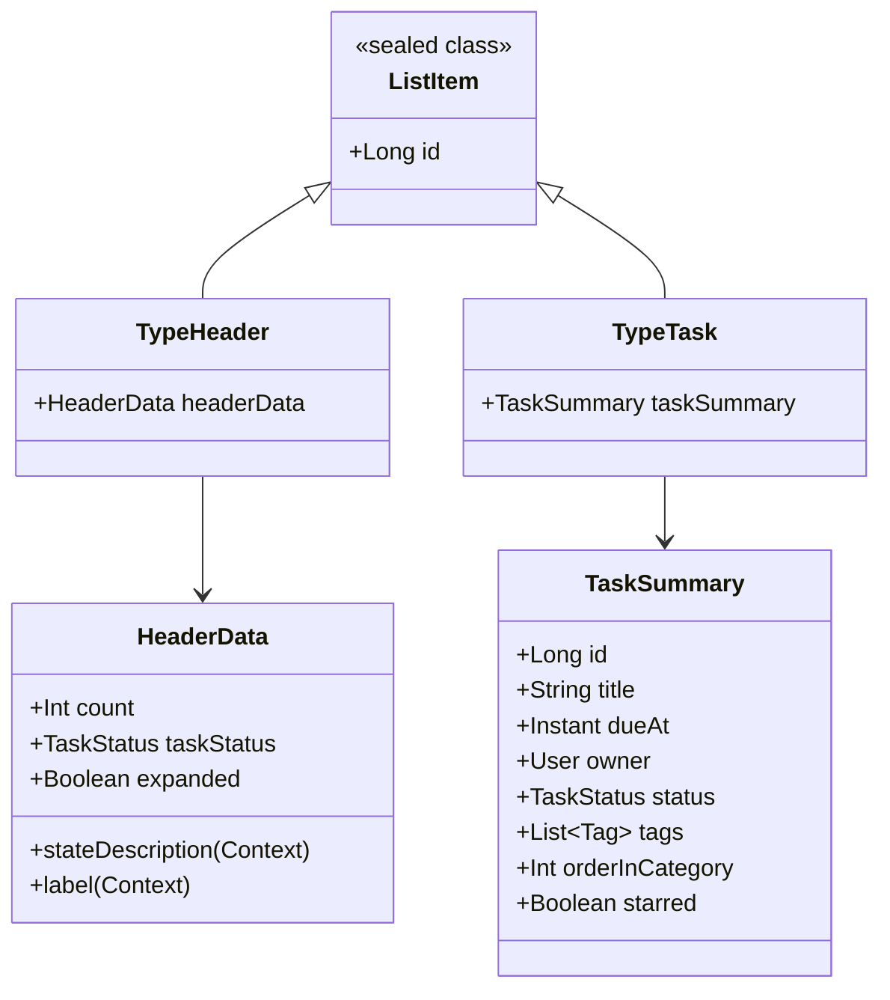
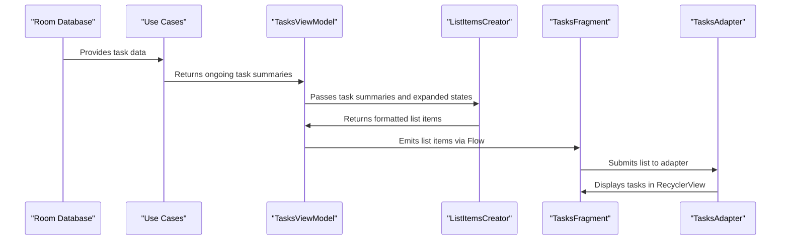
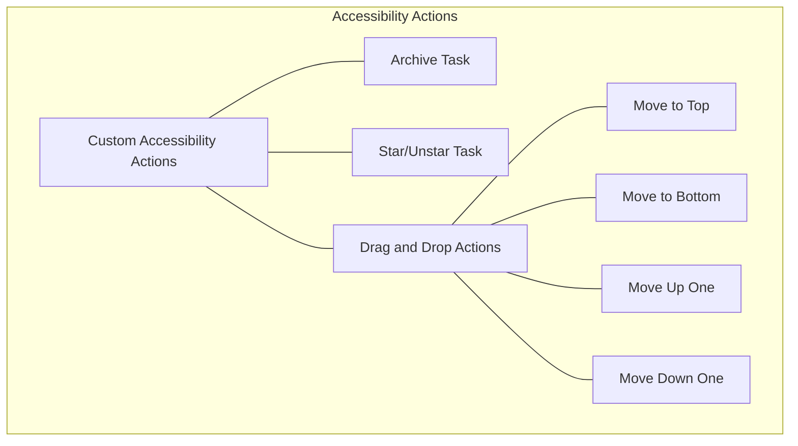

<!-- source: DeepWiki mcp.deepwiki.com · repo android/trackr · page 2.1 Task List Implementation · fetched 2026-10-23 -->

# Task List Implementation

<details>
<summary>Relevant source files</summary>

The following files were used as context for generating this wiki page:

- [app/src/main/java/com/example/android/trackr/ui/tasks/ListItemsCreator.kt](app/src/main/java/com/example/android/trackr/ui/tasks/ListItemsCreator.kt)
- [app/src/main/java/com/example/android/trackr/ui/tasks/SwipeAndDragActionCallback.kt](app/src/main/java/com/example/android/trackr/ui/tasks/SwipeAndDragActionCallback.kt)
- [app/src/main/java/com/example/android/trackr/ui/tasks/TasksAdapter.kt](app/src/main/java/com/example/android/trackr/ui/tasks/TasksAdapter.kt)
- [app/src/main/java/com/example/android/trackr/ui/tasks/TasksFragment.kt](app/src/main/java/com/example/android/trackr/ui/tasks/TasksFragment.kt)
- [app/src/main/java/com/example/android/trackr/ui/tasks/TasksViewModel.kt](app/src/main/java/com/example/android/trackr/ui/tasks/TasksViewModel.kt)
- [app/src/test/java/com/example/android/trackr/ui/tasks/DragAndDropActionsHelperTest.kt](app/src/test/java/com/example/android/trackr/ui/tasks/DragAndDropActionsHelperTest.kt)
- [app/src/test/java/com/example/android/trackr/ui/tasks/ListItemsCreatorTest.kt](app/src/test/java/com/example/android/trackr/ui/tasks/ListItemsCreatorTest.kt)
- [app/src/test/java/com/example/android/trackr/ui/tasks/TasksAdapterTest.kt](app/src/test/java/com/example/android/trackr/ui/tasks/TasksAdapterTest.kt)

</details>


The Task List Implementation is the core feature of the Trackr application that allows users to view, organize, and manage their tasks. This page details the architecture, components, and interactions of the task list screen, including its implementation of grouping, sorting, expanding/collapsing sections, and drag-and-drop reordering functionality.

For information about task details, see [Task Detail View](#2.2). For task creation and editing, see [Task Creation and Editing](#2.3).

## Overview and Architecture

The task list implementation follows the MVVM (Model-View-ViewModel) architecture pattern and consists of several key components that work together to display and manage tasks.

```mermaid
flowchart TD
    subgraph "UI Layer"
        TF["TasksFragment"]
        TA["TasksAdapter"]
        TVH["TaskViewHolder"]
        HVH["HeaderViewHolder"]
        SDC["SwipeAndDragCallback"]
    end
    
    subgraph "ViewModel Layer"
        TVM["TasksViewModel"]
        LIC["ListItemsCreator"]
    end
    
    subgraph "Domain Layer"
        GOTSU["GetOngoingTaskSummariesUseCase"]
        TTSSU["ToggleTaskStarStateUseCase"]
        AU["ArchiveUseCase"]
        UU["UnarchiveUseCase"]
        RTU["ReorderTasksUseCase"]
    end
    
    TF --> TVM: "observes data"
    TF --> TA: "sets adapter"
    TA --> TVH: "creates/binds"
    TA --> HVH: "creates/binds"
    TA --> SDC: "uses for gestures" 
    
    TVM --> LIC: "creates list items"
    TVM --> GOTSU: "gets task data"
    TVM --> TTSSU: "toggles star state"
    TVM --> AU: "archives tasks"
    TVM --> UU: "unarchives tasks"
    TVM --> RTU: "reorders tasks"
    
    TF -.-> TVH: "handles interactions"
    TF -.-> HVH: "handles interactions"
```

Sources: [app/src/main/java/com/example/android/trackr/ui/tasks/TasksFragment.kt](), [app/src/main/java/com/example/android/trackr/ui/tasks/TasksViewModel.kt](), [app/src/main/java/com/example/android/trackr/ui/tasks/TasksAdapter.kt]()

## List Structure and Data Model

The task list is structured as a hierarchical view with header items that group tasks by their status (Not Started, In Progress, Completed). Each status category can be expanded or collapsed.



Sources: [app/src/main/java/com/example/android/trackr/ui/tasks/TasksAdapter.kt:326-354](), [app/src/main/java/com/example/android/trackr/ui/tasks/ListItemsCreator.kt]()

## Component Details

### TasksFragment

`TasksFragment` is the main UI component that displays the task list. It observes data from `TasksViewModel` and handles user interactions.

Key responsibilities:
- Sets up the RecyclerView with `TasksAdapter` and `SwipeAndDragCallback`
- Observes task list data from the ViewModel and updates the UI
- Handles UI events like clicking on a task, starring a task, and expanding/collapsing headers
- Provides navigation to task detail, task edit, archives, and settings screens
- Shows Snackbar notifications for archived tasks with undo functionality

Sources: [app/src/main/java/com/example/android/trackr/ui/tasks/TasksFragment.kt:47-154]()

### TasksAdapter

`TasksAdapter` is responsible for binding task data to the RecyclerView. It manages two types of view holders:

1. **HeaderViewHolder**: Displays status category headers with counts and expand/collapse functionality
2. **TaskViewHolder**: Displays task items with their details, star button, and handles gestures

The adapter also implements:
- Different view types and layouts for headers vs tasks
- Lookup of header items for the sticky header functionality
- Logic for changing task positions during drag and drop operations

Sources: [app/src/main/java/com/example/android/trackr/ui/tasks/TasksAdapter.kt:39-312]()

### View Holders

#### HeaderViewHolder
Displays the task status category (Not Started, In Progress, Completed) with a count of tasks and an expand/collapse chevron.

#### TaskViewHolder
Displays task details including:
- Title
- Due date
- Owner avatar
- Star/unstar button
- Status tags

The task view holder also implements the `ItemTouchListener` interface to handle swipe and drag gestures.

Sources: [app/src/main/java/com/example/android/trackr/ui/tasks/TasksAdapter.kt:126-306]()

## Data Flow

The task list data flow follows a unidirectional pattern:



Sources: [app/src/main/java/com/example/android/trackr/ui/tasks/TasksViewModel.kt:62-77](), [app/src/main/java/com/example/android/trackr/ui/tasks/ListItemsCreator.kt:31-56]()

## User Interactions

### Expanding and Collapsing Categories

Task categories can be expanded or collapsed by clicking on the header. The expanded state is managed in the `TasksViewModel` using a `MutableStateFlow` that maps each `TaskStatus` to a boolean indicating whether it's expanded.

```kotlin
private val expandedStatesMap = MutableStateFlow(
    TaskStatus.values().associateWith { true }
)

fun toggleExpandedState(headerData: HeaderData) {
    val map = expandedStatesMap.value.toMutableMap()
    val previous = map[headerData.taskStatus] ?: return
    map[headerData.taskStatus] = !previous
    expandedStatesMap.value = map
}
```

Sources: [app/src/main/java/com/example/android/trackr/ui/tasks/TasksViewModel.kt:65-84]()

### Swipe to Archive

Users can archive tasks by swiping them left or right. This functionality is implemented using the `SwipeAndDragCallback` class which extends `ItemTouchHelper.SimpleCallback`.

When a task is swiped, the callback notifies the `TaskViewHolder` which then calls the `onTaskArchived` method on the `ItemListener` (implemented by `TasksFragment`). The fragment delegates to the ViewModel to archive the task.

A Snackbar with an undo option appears after archiving, allowing users to restore the task.

Sources: [app/src/main/java/com/example/android/trackr/ui/tasks/SwipeAndDragActionCallback.kt:27-141](), [app/src/main/java/com/example/android/trackr/ui/tasks/TasksFragment.kt:122-136]()

### Drag and Drop Reordering

The task list supports drag and drop reordering within the same status category. This is implemented through:

1. `SwipeAndDragCallback` - Handles the drag and drop gestures
2. `TasksAdapter.changeTaskPosition` - Updates the list to reflect the new order
3. `TasksViewModel.reorderTasks` - Persists the new order in the database

The reordering also supports undo functionality via a Snackbar notification.

```mermaid
flowchart TD
    subgraph "Drag and Drop Flow"
        DG["User Drag Gesture"]
        CB["SwipeAndDragCallback"]
        VH["TaskViewHolder"]
        AD["TasksAdapter"]
        FR["TasksFragment"]
        VM["TasksViewModel"]
        UC["ReorderTasksUseCase"]
        
        DG --> CB
        CB --> VH: "onItemMoved"
        VH --> FR: "onTaskDragged"
        FR --> AD: "changeTaskPosition"
        FR --> VM: "reorderTasks"
        VM --> UC: "Updates database"
        VM --> FR: "Emits undo event"
    end
```

Sources: [app/src/main/java/com/example/android/trackr/ui/tasks/SwipeAndDragActionCallback.kt:84-129](), [app/src/main/java/com/example/android/trackr/ui/tasks/TasksAdapter.kt:112-124](), [app/src/main/java/com/example/android/trackr/ui/tasks/TasksViewModel.kt:105-136]()

### Star/Unstar Tasks

Users can star or unstar tasks by clicking the star icon. This action is handled by the `TasksViewModel.toggleTaskStarState` method, which delegates to the `ToggleTaskStarStateUseCase`.

Sources: [app/src/main/java/com/example/android/trackr/ui/tasks/TasksFragment.kt:162-164](), [app/src/main/java/com/example/android/trackr/ui/tasks/TasksViewModel.kt:86-90]()

## Accessibility Features

The task list implementation includes several accessibility features:

### Custom Accessibility Actions

For users who can't perform swipe or drag gestures, the implementation provides custom accessibility actions:

1. **Archive action** - Provides the same functionality as swipe-to-archive
2. **Star/Unstar action** - Toggles the starred state of a task
3. **Drag and Drop actions** - Multiple actions for repositioning tasks (Move to Top, Move to Bottom, Move Up One, Move Down One)



Sources: [app/src/main/java/com/example/android/trackr/ui/tasks/TasksAdapter.kt:226-288](), [app/src/main/java/com/example/android/trackr/ui/tasks/DragAndDropActionsHelperTest.kt]()

### State Descriptions

Headers and tasks include state descriptions to provide context about their status:

- Headers indicate whether they're expanded or collapsed
- Tasks include information about their status and starred state

Sources: [app/src/main/java/com/example/android/trackr/ui/tasks/TasksAdapter.kt:136-138](), [app/src/main/java/com/example/android/trackr/ui/tasks/TasksAdapter.kt:174-180]()

### Accessibility Heading

Headers are marked as accessibility headings to improve navigation for screen reader users:

```kotlin
ViewCompat.setAccessibilityHeading(binding.root, true)
```

Sources: [app/src/main/java/com/example/android/trackr/ui/tasks/TasksAdapter.kt:139]()

## ListItem Management

The `ListItemsCreator` class is responsible for organizing task summaries into a structured list for display:

1. It groups tasks by their status
2. It adds header items for each status group
3. It includes tasks under their headers only if the section is expanded
4. It preserves the original sorting order of tasks

Sources: [app/src/main/java/com/example/android/trackr/ui/tasks/ListItemsCreator.kt:31-56]()

## Sticky Header Implementation

The task list includes a sticky header that remains at the top of the list while scrolling. This is implemented in the `TasksFragment` using the `updateStickyHeader` method, which finds the header item corresponding to the first visible item in the list.

Sources: [app/src/main/java/com/example/android/trackr/ui/tasks/TasksFragment.kt:155-160]()

## Window Insets Handling

The implementation properly handles window insets to ensure the task list is displayed correctly with system UI elements like status bar, navigation bar, and the bottom app bar.

Sources: [app/src/main/java/com/example/android/trackr/ui/tasks/TasksFragment.kt:74-94]()

## Summary

The Task List Implementation provides a comprehensive and accessible way for users to view and manage their tasks. It follows modern Android development practices with MVVM architecture, Kotlin Flows, and extensive accessibility support. The implementation enables users to organize tasks by status, reorder them within categories, archive completed tasks, and navigate to other parts of the application.

---

