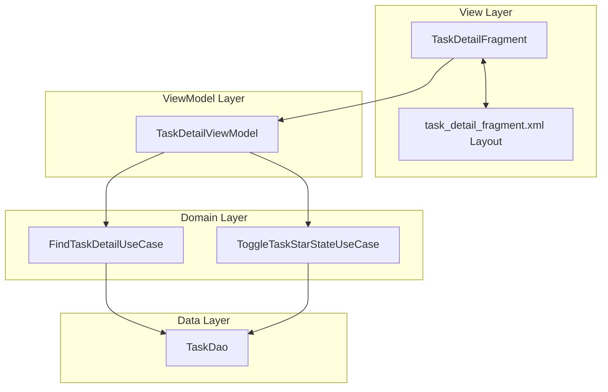
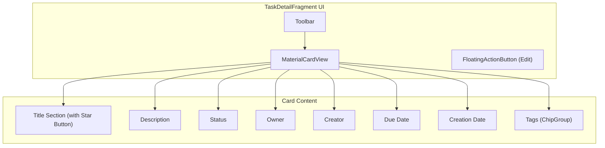
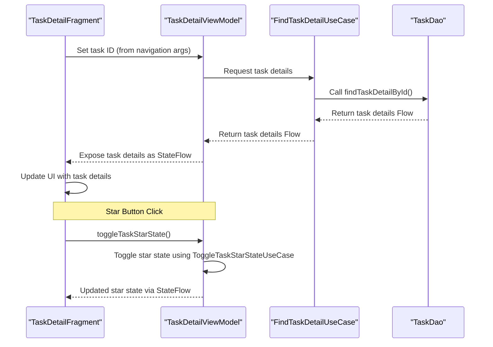
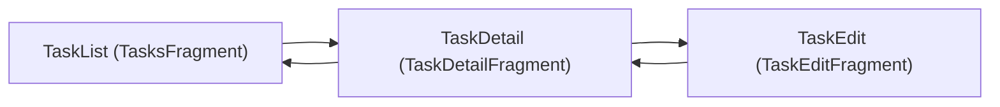
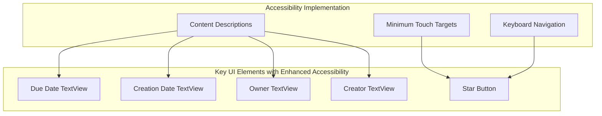

<!-- source: DeepWiki mcp.deepwiki.com · repo android/trackr · page 2.2 Task Detail View · fetched 2026-10-23 -->

# Task Detail View

Relevant source files

The following files were used as context for generating this wiki page:

- [app/src/main/java/com/example/android/trackr/ui/detail/TaskDetailFragment.kt](app/src/main/java/com/example/android/trackr/ui/detail/TaskDetailFragment.kt)
- [app/src/main/java/com/example/android/trackr/ui/detail/TaskDetailViewModel.kt](app/src/main/java/com/example/android/trackr/ui/detail/TaskDetailViewModel.kt)
- [app/src/main/res/layout/task_detail_fragment.xml](app/src/main/res/layout/task_detail_fragment.xml)
- [app/src/main/res/menu/task_detail.xml](app/src/main/res/menu/task_detail.xml)
- [app/src/main/res/navigation/mobile_navigation.xml](app/src/main/res/navigation/mobile_navigation.xml)
- [shared/src/main/java/com/example/android/trackr/usecase/FindTaskDetailUseCase.kt](shared/src/main/java/com/example/android/trackr/usecase/FindTaskDetailUseCase.kt)

## Purpose and Overview

The Task Detail View in Trackr displays comprehensive information about a single task, allowing users to view all task properties in a structured layout. This view serves as the second screen in the master-detail pattern, showing detailed information after a user selects a task from the task list. For information about the task list implementation, see [Task List Implementation](#2.1).

Sources: [app/src/main/java/com/example/android/trackr/ui/detail/TaskDetailFragment.kt:40-117]()

## Component Architecture

The Task Detail View implements the MVVM (Model-View-ViewModel) architecture pattern, consisting of the following components:

Sources: 
- [app/src/main/java/com/example/android/trackr/ui/detail/TaskDetailFragment.kt:40-117]()
- [app/src/main/java/com/example/android/trackr/ui/detail/TaskDetailViewModel.kt:35-58]()
- [shared/src/main/java/com/example/android/trackr/usecase/FindTaskDetailUseCase.kt:22-26]()

## UI Layout and Elements

The Task Detail View is organized in a scrollable card layout with the following components:

The UI layout is defined in `task_detail_fragment.xml` and uses data binding to connect UI elements to the ViewModel. Key UI elements include:

- **Toolbar** with a navigation back button and an Edit action item
- **Title Section** with the task title and a star button for favoriting tasks
- **Description** section showing the task description text
- **Status** showing the current task status (e.g., "Not started")
- **Owner** showing the task owner's username and avatar
- **Creator** showing the task creator's username and avatar
- **Due Date** showing formatted due date and relative time (e.g., "Due in 3 days")
- **Creation Date** showing when the task was created
- **Tags** showing all tags associated with the task as chips
- **Edit FAB** (Floating Action Button) for editing the task

Sources:
- [app/src/main/res/layout/task_detail_fragment.xml:17-278]()
- [app/src/main/res/menu/task_detail.xml:17-28]()

## Data Flow and State Management

The Task Detail View implements a unidirectional data flow pattern:

The `TaskDetailViewModel` exposes two main state flows:

1. `detail` - A StateFlow that provides the full task details
2. `starred` - A derived StateFlow that indicates whether the current user has starred the task

The Fragment observes these StateFlows and updates the UI accordingly whenever the data changes.

Sources:
- [app/src/main/java/com/example/android/trackr/ui/detail/TaskDetailViewModel.kt:41-57]()
- [app/src/main/java/com/example/android/trackr/ui/detail/TaskDetailFragment.kt:73-78]()

## Navigation and User Interactions

The Task Detail View supports several user interactions:

1. **Back Navigation**: Users can navigate back to the task list by clicking the back arrow in the toolbar
2. **Starring/Unstarring**: Users can star or unstar a task by clicking the star button
3. **Editing**: Users can edit the task by clicking either the Edit button in the toolbar or the Edit FAB

### Navigation Flow

The Task Detail View interacts with the `TwoPaneViewModel` to handle navigation, which supports both single-pane (phone) and two-pane (tablet/foldable) layouts. In two-pane mode, the navigation icon is hidden since both the task list and detail are visible simultaneously.

Sources:
- [app/src/main/java/com/example/android/trackr/ui/detail/TaskDetailFragment.kt:61-92]()
- [app/src/main/res/navigation/mobile_navigation.xml:23-65]()

## Accessibility Features

The Task Detail View implements several accessibility features:

1. **Content Descriptions**: Dynamic content descriptions are set for key UI elements to ensure screen readers provide meaningful information:
   - Due date with formatted date
   - Creation date with formatted date
   - Owner information
   - Creator information

2. **Minimum Touch Targets**: The star button ensures a minimum touch target size for better tap accessibility

3. **Keyboard Navigation**: All interactive elements can be accessed via keyboard navigation

The content descriptions are updated whenever the task details change to ensure they remain accurate.

Sources:
- [app/src/main/java/com/example/android/trackr/ui/detail/TaskDetailFragment.kt:99-115]()
- [app/src/main/res/layout/task_detail_fragment.xml:100-101]()

## Integration with Room Database

The Task Detail View retrieves data from the Room database through the `FindTaskDetailUseCase`. The use case acts as an intermediary between the ViewModel and the data access layer, providing a clean separation of concerns.

| Component | Responsibility |
|-----------|----------------|
| TaskDetailFragment | UI presentation and user interaction handling |
| TaskDetailViewModel | Business logic and state management |
| FindTaskDetailUseCase | Retrieval of task details from the data layer |
| TaskDao | Database access and query execution |

Sources:
- [shared/src/main/java/com/example/android/trackr/usecase/FindTaskDetailUseCase.kt:22-26]()
- [app/src/main/java/com/example/android/trackr/ui/detail/TaskDetailViewModel.kt:35-58]()

---

