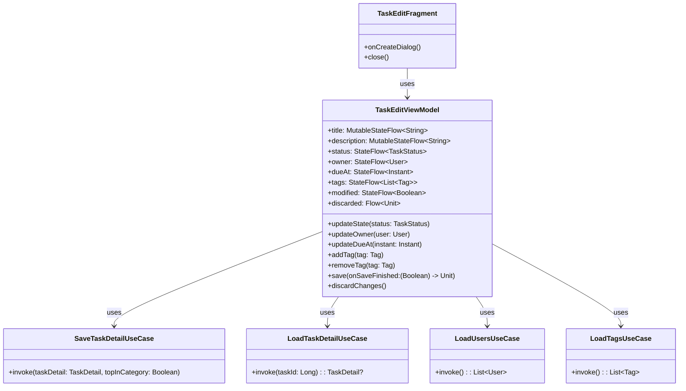
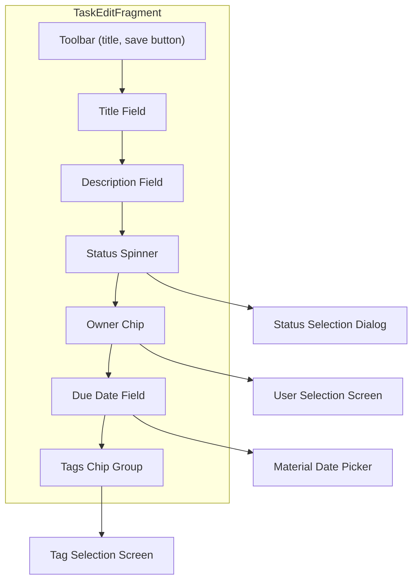
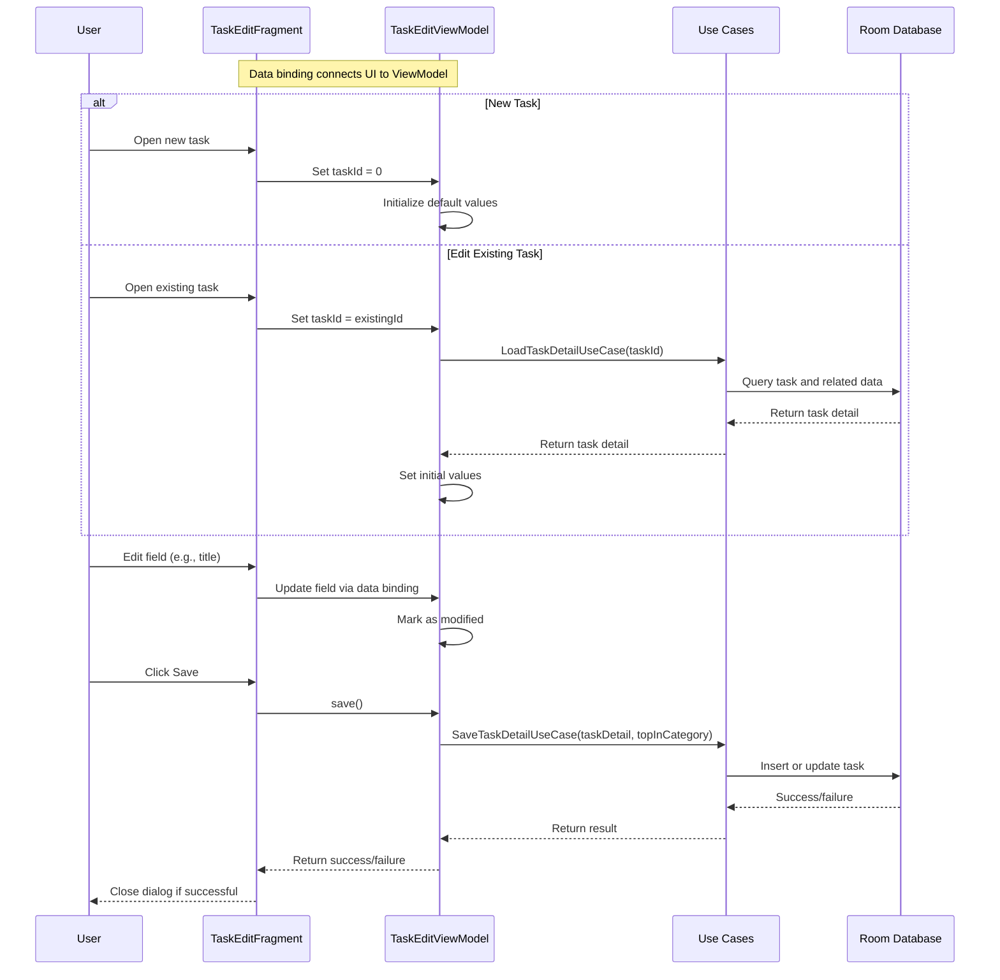
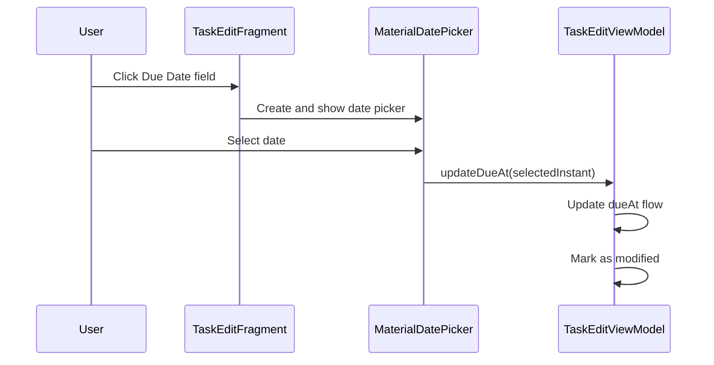
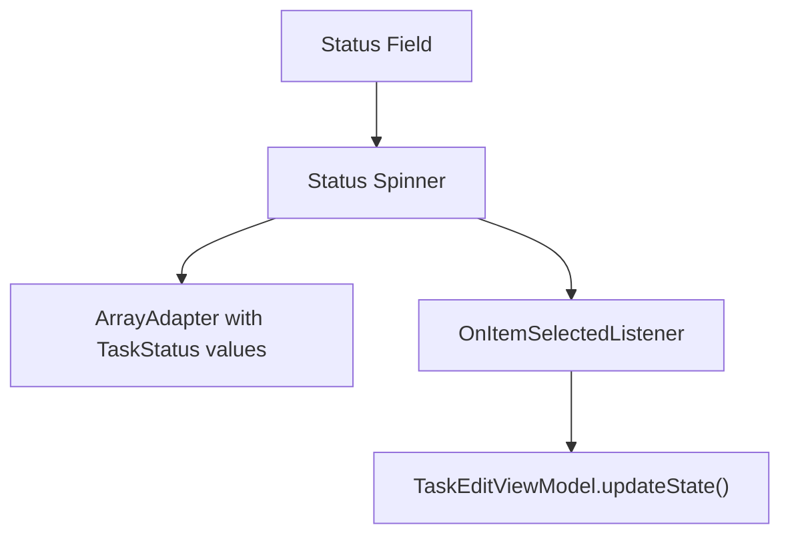
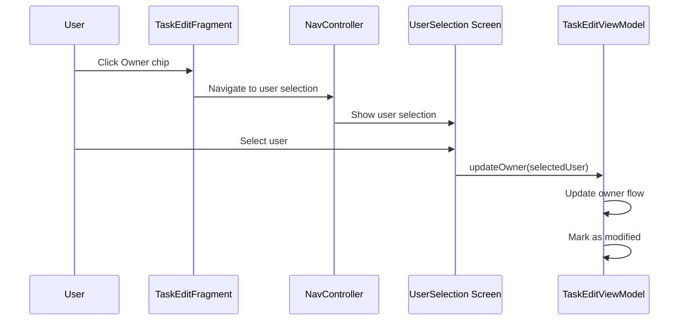
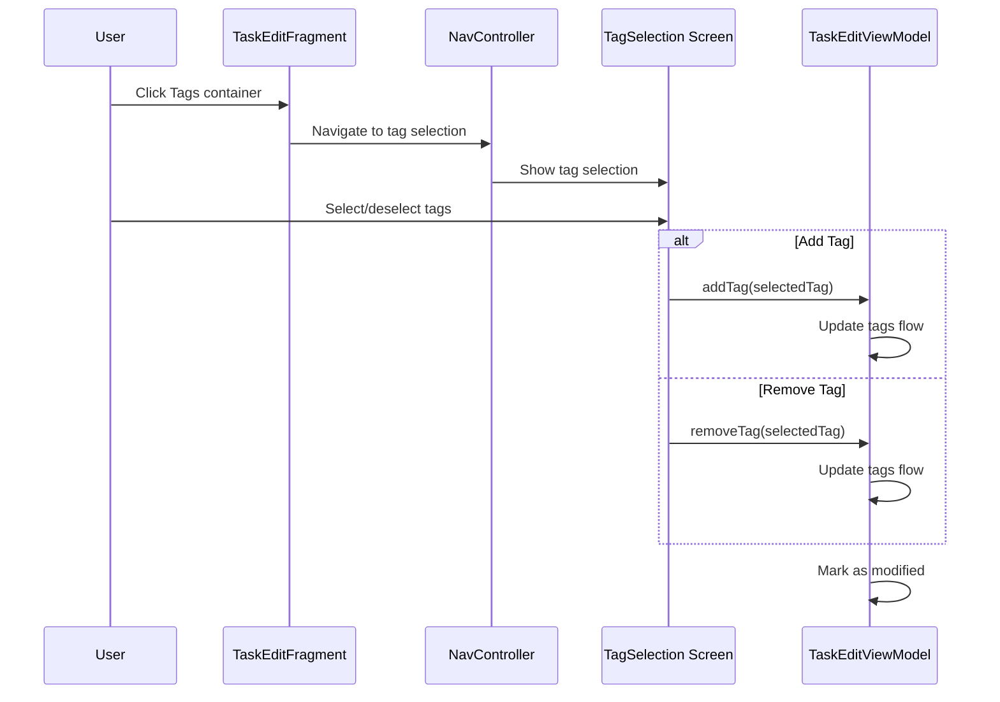
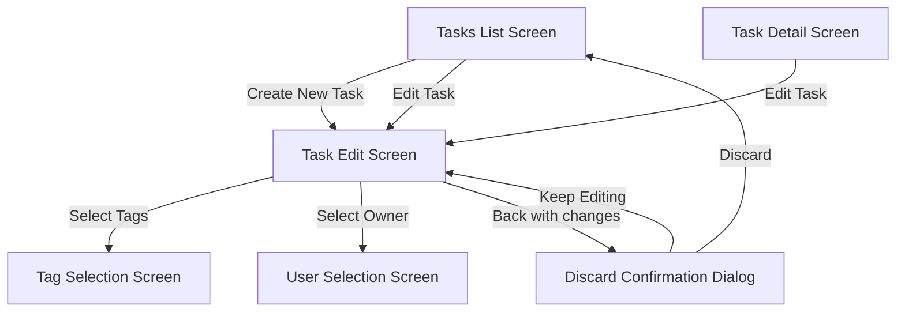

<!-- source: DeepWiki mcp.deepwiki.com · repo android/trackr · page 2.3 Task Creation and Editing · fetched 2026-10-23 -->

# Task Creation and Editing

<details>
<summary>Relevant source files</summary>

The following files were used as context for generating this wiki page:

- [app/src/main/java/com/example/android/trackr/ui/edit/TaskEditFragment.kt](app/src/main/java/com/example/android/trackr/ui/edit/TaskEditFragment.kt)
- [app/src/main/java/com/example/android/trackr/ui/edit/TaskEditViewModel.kt](app/src/main/java/com/example/android/trackr/ui/edit/TaskEditViewModel.kt)
- [app/src/main/res/layout-large/task_edit_fragment.xml](app/src/main/res/layout-large/task_edit_fragment.xml)
- [app/src/main/res/layout/include_task_edit_content.xml](app/src/main/res/layout/include_task_edit_content.xml)
- [app/src/main/res/layout/task_edit_fragment.xml](app/src/main/res/layout/task_edit_fragment.xml)
- [app/src/main/res/menu/task_edit.xml](app/src/main/res/menu/task_edit.xml)
- [app/src/main/res/values-large/dimens.xml](app/src/main/res/values-large/dimens.xml)
- [app/src/main/res/values-large/themes.xml](app/src/main/res/values-large/themes.xml)
- [app/src/test/java/com/example/android/trackr/ui/edit/TaskEditViewModelTest.kt](app/src/test/java/com/example/android/trackr/ui/edit/TaskEditViewModelTest.kt)

</details>


## Overview

This page documents the task creation and editing functionality in the Trackr application. This system allows users to create new tasks and edit existing ones, providing a user interface for modifying task properties such as title, description, status, owner, due date, and tags. For information about viewing task details, see [Task Detail View](#2.2), and for information about the task list, see [Task List Implementation](#2.1).

Sources: [app/src/main/java/com/example/android/trackr/ui/edit/TaskEditFragment.kt:53-199]()

## Component Architecture

The task editing system follows the MVVM architecture pattern and is implemented as a dialog that can be opened from various parts of the application.



Sources: [app/src/main/java/com/example/android/trackr/ui/edit/TaskEditFragment.kt:53-199](), [app/src/main/java/com/example/android/trackr/ui/edit/TaskEditViewModel.kt:43-222]()

## User Interface

The task editing interface is implemented as a dialog and provides fields for all editable task properties.



Sources: [app/src/main/res/layout/task_edit_fragment.xml:16-87](), [app/src/main/res/layout/include_task_edit_content.xml:18-202]()

## Data Flow

The following diagram illustrates the data flow in the task editing system:



Sources: [app/src/main/java/com/example/android/trackr/ui/edit/TaskEditViewModel.kt:150-217](), [app/src/main/java/com/example/android/trackr/ui/edit/TaskEditFragment.kt:65-109]()

## Key Features

### Field Management and Validation

The TaskEditViewModel maintains the state of all editable fields using Kotlin Flow. Each field has its own MutableStateFlow that is updated when the user makes changes. The system tracks whether any modifications have been made by comparing current values with initial values.

Title validation is performed when the user attempts to save a task:

```kotlin
if (binding.content.title.text.toString().isEmpty()) {
    binding.content.title.error = resources.getString(R.string.missing_title_error)
} else {
    viewModel.save { success ->
        if (success) {
            findNavController().popBackStack()
        }
    }
}
```

Sources: [app/src/main/java/com/example/android/trackr/ui/edit/TaskEditViewModel.kt:56-77](), [app/src/main/java/com/example/android/trackr/ui/edit/TaskEditFragment.kt:95-104]()

### Date Selection

Due dates are selected using the Material Date Picker component:



Sources: [app/src/main/java/com/example/android/trackr/ui/edit/TaskEditFragment.kt:155-161](), [app/src/main/java/com/example/android/trackr/ui/edit/TaskEditViewModel.kt:166-169]()

### Status Selection

Task status is selected using a Spinner component with a custom adapter that displays all available TaskStatus values:



Sources: [app/src/main/java/com/example/android/trackr/ui/edit/TaskEditFragment.kt:112-122](), [app/src/main/java/com/example/android/trackr/ui/edit/TaskEditViewModel.kt:152-159]()

### Owner Assignment

Task owners can be changed by clicking the owner chip, which navigates to a user selection screen:



Sources: [app/src/main/java/com/example/android/trackr/ui/edit/TaskEditFragment.kt:126-128](), [app/src/main/java/com/example/android/trackr/ui/edit/TaskEditViewModel.kt:161-164]()

### Tag Management

Task tags can be added or removed by clicking the tag container, which navigates to a tag selection screen:



Sources: [app/src/main/java/com/example/android/trackr/ui/edit/TaskEditFragment.kt:123-125](), [app/src/main/java/com/example/android/trackr/ui/edit/TaskEditViewModel.kt:171-189]()

## Change Tracking and Saving

The TaskEditViewModel maintains a `modified` flow that tracks whether any changes have been made to the task. This is used to:

1. Show/hide the save button
2. Prompt for confirmation when closing with unsaved changes
3. Prevent closing the dialog if no changes were made

When the user clicks the save button, the ViewModel constructs a TaskDetail object with all the current field values and passes it to the SaveTaskDetailUseCase.

```kotlin
fun save(onSaveFinished: (Boolean) -> Unit) {
    viewModelScope.launch {
        try {
            saveTaskDetailUseCase(
                TaskDetail(
                    id = taskId,
                    title = title.value,
                    description = description.value,
                    status = _status.value,
                    createdAt = _createdAt.value,
                    dueAt = _dueAt.value,
                    orderInCategory = orderInCategory,
                    isArchived = isArchived,
                    owner = _owner.value,
                    creator = _creator.value,
                    tags = _tags.value,
                    starUsers = starUsers
                ),
                topInCategory
            )
            onSaveFinished(true)
        } catch (e: RuntimeException) {
            e.printStackTrace()
            onSaveFinished(false)
        }
    }
}
```

Sources: [app/src/main/java/com/example/android/trackr/ui/edit/TaskEditViewModel.kt:104-115](), [app/src/main/java/com/example/android/trackr/ui/edit/TaskEditViewModel.kt:191-217]()

## Responsive Layout

The task editing UI adapts to different screen sizes using variant layouts:

| Screen Size | Behavior |
|-------------|----------|
| Standard    | Displays as a dialog with rounded corners |
| Large       | Displays with a more dialog-specific layout |

The layout file `task_edit_fragment.xml` is used for standard screens, while `layout-large/task_edit_fragment.xml` is used for larger screens.

Sources: [app/src/main/res/layout/task_edit_fragment.xml:16-87](), [app/src/main/res/layout-large/task_edit_fragment.xml:18-74]()

## Accessibility Considerations

The task edit screen implements several accessibility features:

1. Content descriptions for owner and due date fields are dynamically set based on their values
2. Form fields are properly labeled for screen readers
3. Minimum touch target sizes are enforced
4. Proper navigation patterns are maintained

```kotlin
binding.content.owner.contentDescription =
    resources.getString(R.string.owner_with_value, it.username)

binding.content.dueAt.contentDescription = resources.getString(
    R.string.due_date_with_value,
    DateTimeUtils.formattedDate(resources, it, clock)
)
```

Sources: [app/src/main/java/com/example/android/trackr/ui/edit/TaskEditFragment.kt:143-153](), [app/src/main/res/layout/include_task_edit_content.xml:54-196]()

## Integration with Navigation Component

The task editing system uses the Android Navigation Component for navigation between related screens:



Sources: [app/src/main/java/com/example/android/trackr/ui/edit/TaskEditFragment.kt:77-109](), [app/src/main/java/com/example/android/trackr/ui/edit/TaskEditFragment.kt:123-185]()

---

