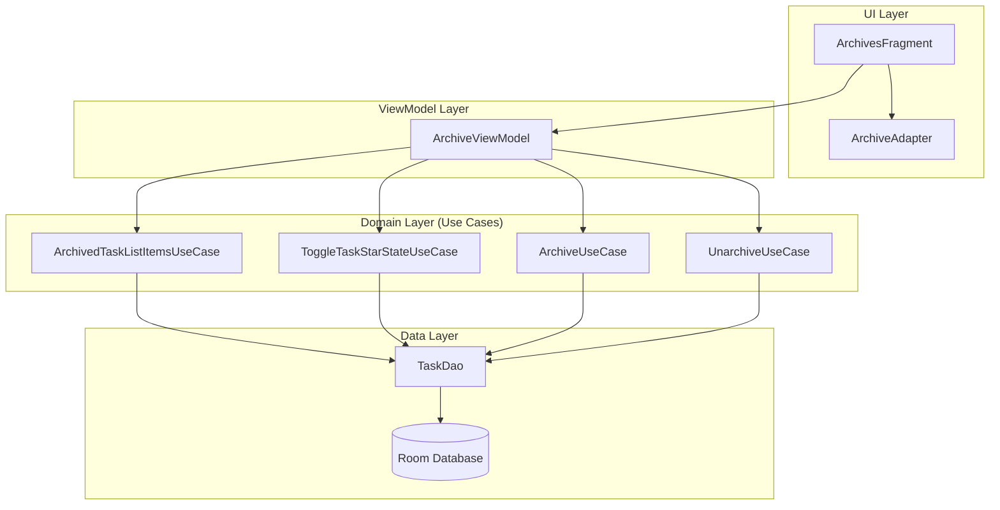
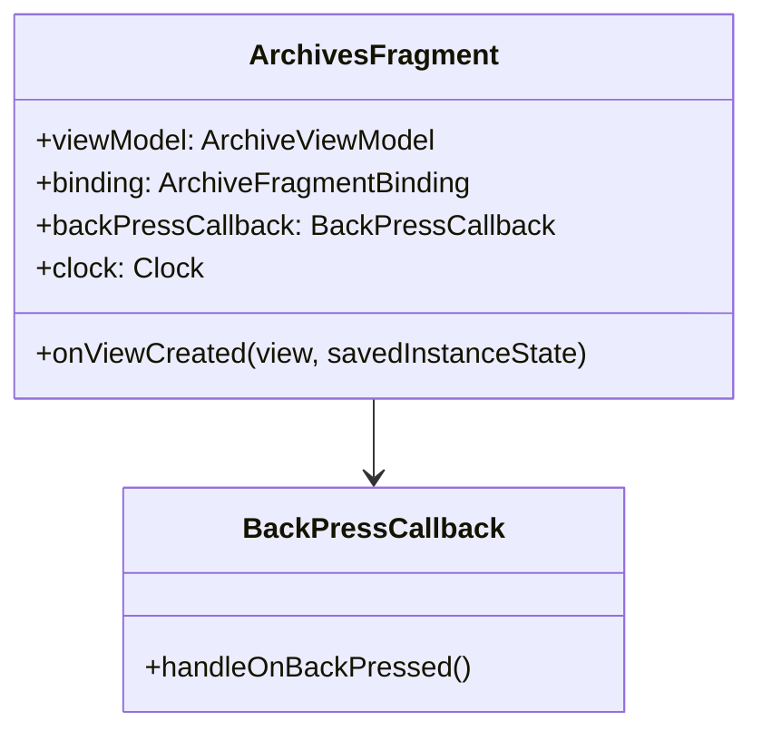
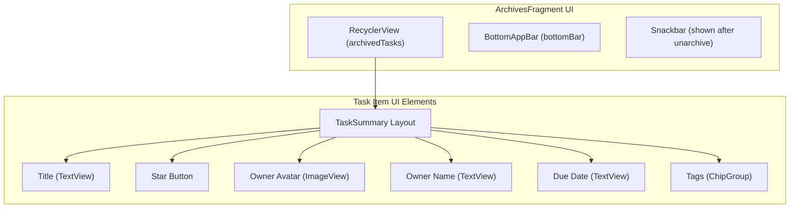
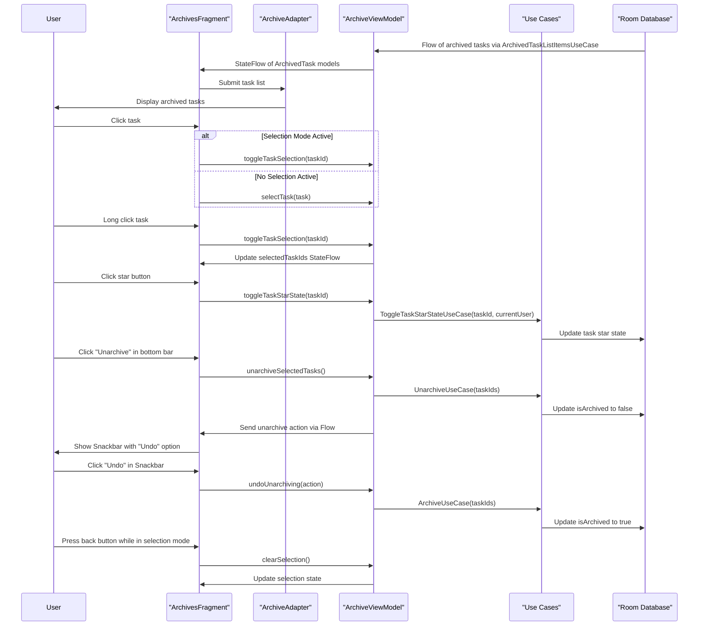

<!-- source: DeepWiki mcp.deepwiki.com · repo android/trackr · page 2.4 Archive Management · fetched 2026-10-23 -->

# Archive Management

Relevant source files

The following files were used as context for generating this wiki page:

- [app/src/main/java/com/example/android/trackr/ui/archives/ArchiveAdapter.kt](app/src/main/java/com/example/android/trackr/ui/archives/ArchiveAdapter.kt)
- [app/src/main/java/com/example/android/trackr/ui/archives/ArchiveViewModel.kt](app/src/main/java/com/example/android/trackr/ui/archives/ArchiveViewModel.kt)
- [app/src/main/java/com/example/android/trackr/ui/archives/ArchivesFragment.kt](app/src/main/java/com/example/android/trackr/ui/archives/ArchivesFragment.kt)
- [app/src/main/res/layout/task_summary.xml](app/src/main/res/layout/task_summary.xml)

## Purpose and Scope

This document details the Archive Management system in Trackr, which enables users to view, manage, and restore previously archived tasks. The system provides functionality for task selection, unarchiving operations with undo capability, and task star state toggling.

For information about task creation and editing, see [Task Creation and Editing](#2.3). For information about the main task list, see [Task List Implementation](#2.1).

## System Architecture

The Archive Management feature follows the app's MVVM architecture pattern, integrating with the overall system design through specialized components.

Sources: [app/src/main/java/com/example/android/trackr/ui/archives/ArchivesFragment.kt:40-123](), [app/src/main/java/com/example/android/trackr/ui/archives/ArchiveViewModel.kt:38-112]()

## Key Components

### ArchivesFragment

`ArchivesFragment` serves as the primary UI component for displaying and interacting with archived tasks. It:
- Initializes and configures the `ArchiveAdapter` for the RecyclerView
- Handles user interactions for selecting, unarchiving, and starring tasks
- Manages the bottom app bar for batch operations
- Displays Snackbars with undo functionality when tasks are unarchived

Sources: [app/src/main/java/com/example/android/trackr/ui/archives/ArchivesFragment.kt:40-130]()

### ArchiveViewModel

`ArchiveViewModel` manages the business logic and state for the Archives feature:
- Retrieves archived tasks via `ArchivedTaskListItemsUseCase`
- Maintains the selection state of tasks
- Processes task operations (selection, unarchiving, starring)
- Provides state flows for the UI to observe

Key data structures:
- `ArchivedTask`: Data class containing a task summary and its selection state
- `UnarchiveAction`: Data class for tracking unarchived tasks for undo operations
- `ShowTaskDetailEvent`: Data class for handling task detail navigation

Sources: [app/src/main/java/com/example/android/trackr/ui/archives/ArchiveViewModel.kt:38-125]()

### ArchiveAdapter

`ArchiveAdapter` is a RecyclerView adapter for displaying archived task items:
- Creates and binds `ArchiveHolder` instances
- Handles item click events and forwards them to the fragment
- Uses stable item IDs for efficient updates via DiffUtil

Sources: [app/src/main/java/com/example/android/trackr/ui/archives/ArchiveAdapter.kt:29-98]()

## User Interface

The Archive Management interface consists of a list of archived tasks displayed via RecyclerView, with each task represented by a card containing:

| Element | Description |
|---------|-------------|
| Title | The task's title |
| Star button | Toggle for marking task importance |
| Owner avatar and name | Visual identifier and name of task owner |
| Due date | Shows the task's due date information |
| Tags | Displays associated task tags (limited to 3 with "+n more" indicator) |

When one or more tasks are selected, a bottom app bar appears with:
- Selection count indicator
- Close selection button
- Unarchive action button

Sources: [app/src/main/java/com/example/android/trackr/ui/archives/ArchivesFragment.kt:49-105](), [app/src/main/res/layout/task_summary.xml:17-143]()

## Data Flow and User Interactions

The Archive Management system follows a unidirectional data flow pattern:

Sources: [app/src/main/java/com/example/android/trackr/ui/archives/ArchivesFragment.kt:49-105](), [app/src/main/java/com/example/android/trackr/ui/archives/ArchiveViewModel.kt:57-111]()

## Key Features

### Task Selection

The Archive Management system supports both single and multiple task selection:
- Single-click on a task when no selection is active: Shows task details
- Single-click on a task when selection is active: Toggles selection state
- Long-click on any task: Activates selection mode and selects the task

The back button behavior is customized to clear selection instead of navigating back when in selection mode.

Sources: [app/src/main/java/com/example/android/trackr/ui/archives/ArchivesFragment.kt:53-62](), [app/src/main/java/com/example/android/trackr/ui/archives/ArchiveViewModel.kt:72-79]()

### Unarchive with Undo

The system provides the ability to unarchive tasks with an undo capability:
1. Users select one or more tasks and tap the unarchive action
2. Selected tasks are unarchived via `UnarchiveUseCase`
3. A Snackbar appears with an "Undo" option, visible for 5 seconds
4. If "Undo" is tapped, the unarchive operation is reversed via `ArchiveUseCase`

This implementation uses a `Channel` to communicate unarchive actions from the ViewModel to the Fragment.

Sources: [app/src/main/java/com/example/android/trackr/ui/archives/ArchivesFragment.kt:73-88](), [app/src/main/java/com/example/android/trackr/ui/archives/ArchiveViewModel.kt:91-104]()

### Star State Management

Users can mark tasks as important by toggling their star state:
- The star button appears on each task card
- Clicking the star button toggles between starred and unstarred states
- The operation is handled by `ToggleTaskStarStateUseCase`

This functionality is consistent with the star behavior in the main task list.

Sources: [app/src/main/java/com/example/android/trackr/ui/archives/ArchivesFragment.kt:62](), [app/src/main/java/com/example/android/trackr/ui/archives/ArchiveViewModel.kt:81-85]()

### Responsive UI with Window Insets

The Archive Management UI adapts to system UI elements (status bar, navigation bar) using window insets:
- The task list adapts its padding based on system bars
- The bottom app bar is positioned correctly regardless of system UI elements
- The implementation ensures consistent UI across devices with different screen configurations

Sources: [app/src/main/java/com/example/android/trackr/ui/archives/ArchivesFragment.kt:107-119]()

---

