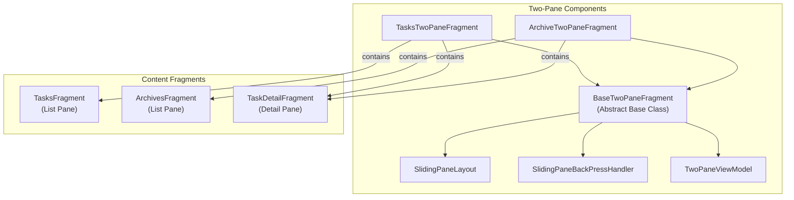
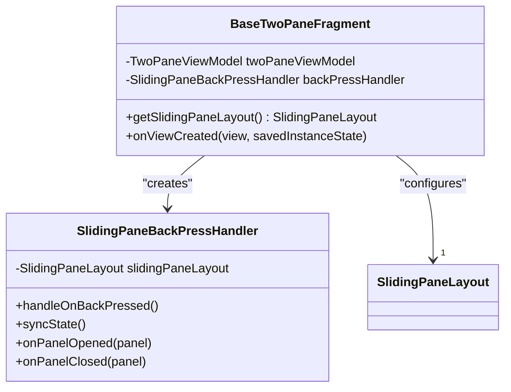
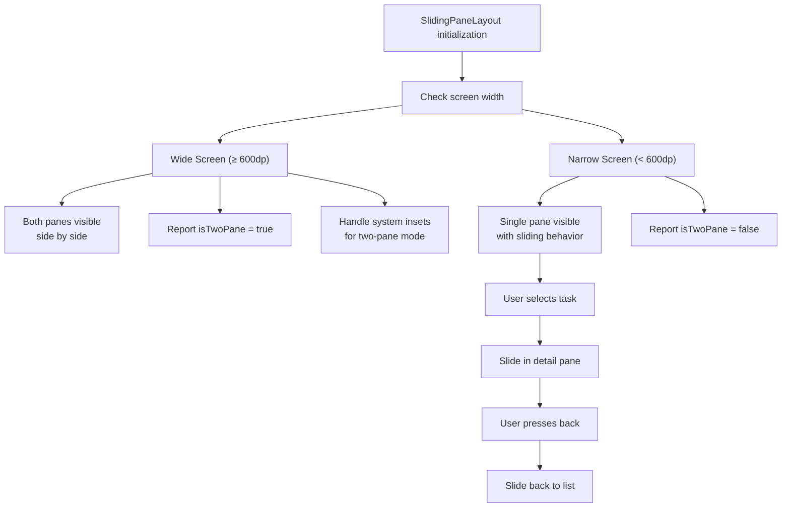
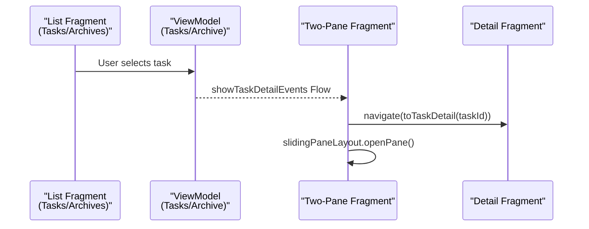

<!-- source: DeepWiki mcp.deepwiki.com · repo android/trackr · page 2.5 Responsive Layout: Two-Pane Implementation · fetched 2026-10-23 -->

# Responsive Layout: Two-Pane Implementation

<details>
<summary>Relevant source files</summary>

The following files were used as context for generating this wiki page:

- [app/src/main/java/com/example/android/trackr/ui/BaseTwoPaneFragment.kt](app/src/main/java/com/example/android/trackr/ui/BaseTwoPaneFragment.kt)
- [app/src/main/java/com/example/android/trackr/ui/archives/ArchiveTwoPaneFragment.kt](app/src/main/java/com/example/android/trackr/ui/archives/ArchiveTwoPaneFragment.kt)
- [app/src/main/java/com/example/android/trackr/ui/tasks/TasksTwoPaneFragment.kt](app/src/main/java/com/example/android/trackr/ui/tasks/TasksTwoPaneFragment.kt)
- [app/src/main/java/com/example/android/trackr/ui/utils/Extensions.kt](app/src/main/java/com/example/android/trackr/ui/utils/Extensions.kt)
- [app/src/main/res/layout-w600dp/main_activity.xml](app/src/main/res/layout-w600dp/main_activity.xml)
- [app/src/main/res/layout-w600dp/task_detail_fragment.xml](app/src/main/res/layout-w600dp/task_detail_fragment.xml)
- [app/src/main/res/layout-w600dp/tasks_fragment.xml](app/src/main/res/layout-w600dp/tasks_fragment.xml)
- [app/src/main/res/layout/archive_two_pane_fragment.xml](app/src/main/res/layout/archive_two_pane_fragment.xml)
- [app/src/main/res/layout/tasks_two_pane_fragment.xml](app/src/main/res/layout/tasks_two_pane_fragment.xml)

</details>


This document explains how the Trackr application implements responsive layouts for different screen sizes, focusing on the two-pane master-detail pattern used for larger screens. The implementation allows users to view a list of tasks (or archives) and their details simultaneously on larger screens, while providing an adaptive experience on smaller devices.

## Architecture Overview

The two-pane implementation uses Android's `SlidingPaneLayout` component to provide a master-detail view that adapts based on screen size. This approach allows for a consistent UI pattern regardless of device size, with different behaviors based on available screen real estate.



Sources:
- [app/src/main/java/com/example/android/trackr/ui/BaseTwoPaneFragment.kt:46-104]()
- [app/src/main/java/com/example/android/trackr/ui/tasks/TasksTwoPaneFragment.kt:35-63]()
- [app/src/main/java/com/example/android/trackr/ui/archives/ArchiveTwoPaneFragment.kt:35-63]()

## Core Components

### BaseTwoPaneFragment

The `BaseTwoPaneFragment` is an abstract base class that provides common functionality for all two-pane implementations. It handles:

- Configuration of the `SlidingPaneLayout`
- Back press behavior management
- Determining and reporting two-pane state
- Window insets handling



Sources:
- [app/src/main/java/com/example/android/trackr/ui/BaseTwoPaneFragment.kt:46-104]()
- [app/src/main/java/com/example/android/trackr/ui/BaseTwoPaneFragment.kt:110-140]()

### TasksTwoPaneFragment and ArchiveTwoPaneFragment

These concrete implementations of `BaseTwoPaneFragment` handle specific use cases for Tasks and Archives sections. They:

1. Provide the specific `SlidingPaneLayout` implementation
2. Observe view model events to manage navigation between list and detail panes
3. Handle the opening of the detail pane when an item is selected

Both fragments follow the same pattern, differing only in the specific fragments they host and the view model they observe.

Sources:
- [app/src/main/java/com/example/android/trackr/ui/tasks/TasksTwoPaneFragment.kt:35-63]()
- [app/src/main/java/com/example/android/trackr/ui/archives/ArchiveTwoPaneFragment.kt:35-63]()

## Layout Implementation

### XML Structure

The two-pane layout is defined in XML using `SlidingPaneLayout` with two child `FragmentContainerView` elements:

| Component | Purpose | Configuration |
|-----------|---------|---------------|
| `sliding_pane_layout` | Container that manages sliding behavior | Parent layout that fills the screen |
| `list_pane` | Shows list of tasks/archives | Fixed width with weight for responsive sizing |
| `detail_pane` | Shows selected item details | Fixed width with weight for responsive sizing |

```xml
<SlidingPaneLayout>
  <FragmentContainerView id="list_pane" />  <!-- Tasks or Archives list -->
  <FragmentContainerView id="detail_pane" /> <!-- Task details -->
</SlidingPaneLayout>
```

Sources:
- [app/src/main/res/layout/tasks_two_pane_fragment.xml:22-44]()
- [app/src/main/res/layout/archive_two_pane_fragment.xml:22-44]()

## Responsive Behavior

The implementation adapts to different screen sizes:



Key behaviors:

1. **On devices 600dp or wider**:
   - Both panes are visible simultaneously
   - The `SlidingPaneLayout` is locked (non-slideable)
   - Detail pane is pre-populated with initial task or placeholder

2. **On smaller devices**:
   - Only one pane is visible at a time
   - Selecting an item slides in the detail pane
   - Back press slides back to the list pane

This behavior is determined in `BaseTwoPaneFragment.onViewCreated()` by checking the `isSlideable` property of `SlidingPaneLayout`.

Sources:
- [app/src/main/java/com/example/android/trackr/ui/BaseTwoPaneFragment.kt:57-82]()
- [app/src/main/res/layout-w600dp/main_activity.xml:1-53]()
- [app/src/main/res/layout-w600dp/tasks_fragment.xml:1-70]()

## Navigation and Back Press Handling

The implementation includes a specialized back press handling system:

1. `SlidingPaneBackPressHandler` (inner class in `BaseTwoPaneFragment`) intercepts back presses
2. When detail pane is visible on smaller screens, back press closes the detail pane
3. When both panes are visible, back navigation works normally
4. The handler automatically enables/disables itself based on pane state

This creates a natural navigation experience:
- On tablets, users navigate directly through screens
- On phones, users can navigate back from detail view to list view

Sources:
- [app/src/main/java/com/example/android/trackr/ui/BaseTwoPaneFragment.kt:101-102]()
- [app/src/main/java/com/example/android/trackr/ui/BaseTwoPaneFragment.kt:110-140]()

## Fragment Communication

The two-pane fragments coordinate list and detail panes through ViewModel events:



The implementation uses Kotlin coroutines and Flows for reactive communication:

1. User selects a task in the list fragment
2. ViewModel emits an event through Flow
3. Two-pane fragment observes this Flow and:
   - Updates the detail pane content if needed
   - Opens the sliding pane if on a small screen

Sources:
- [app/src/main/java/com/example/android/trackr/ui/tasks/TasksTwoPaneFragment.kt:47-60]()
- [app/src/main/java/com/example/android/trackr/ui/archives/ArchiveTwoPaneFragment.kt:47-60]()
- [app/src/main/java/com/example/android/trackr/ui/utils/Extensions.kt:46-58]()

## Integration with Large Screen Layouts

The implementation leverages Android's resource system to provide optimized layouts for larger screens:

- Layouts in the `layout-w600dp` directory are automatically used on devices 600dp wide or wider
- These layouts include specific styling for better use of space
- `NavigationRailView` is used instead of bottom navigation on larger screens

The detail pane on larger screens also receives special styling with proper margins, elevation, and system bar insets handling.

Sources:
- [app/src/main/res/layout-w600dp/main_activity.xml:28-37]()
- [app/src/main/res/layout-w600dp/task_detail_fragment.xml:61-62]()
- [app/src/main/res/layout-w600dp/tasks_fragment.xml:36-66]()

## Window Insets Handling

A specialized approach to window insets ensures proper display across different Android versions:

1. For two-pane layouts, system bar insets are handled at the container level
2. Horizontal insets are consumed by the container and applied correctly to both panes
3. Only vertical insets are passed down to child views

This approach ensures consistent padding across the UI while maximizing usable screen space.

Sources:
- [app/src/main/java/com/example/android/trackr/ui/BaseTwoPaneFragment.kt:66-78]()

## Usage of Two-Pane Implementation

The two-pane layout is used in two main sections of the application:

1. **Tasks Screen**: Shows task list and task details side by side
2. **Archives Screen**: Shows archived tasks and their details side by side

Each implementation follows the same pattern but uses different specific fragments and view models, demonstrating the reusability of the base implementation.

---

