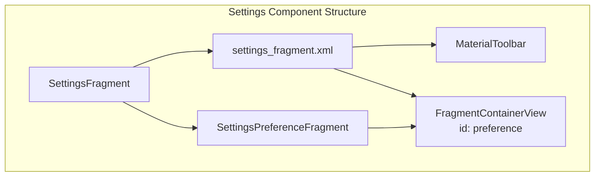
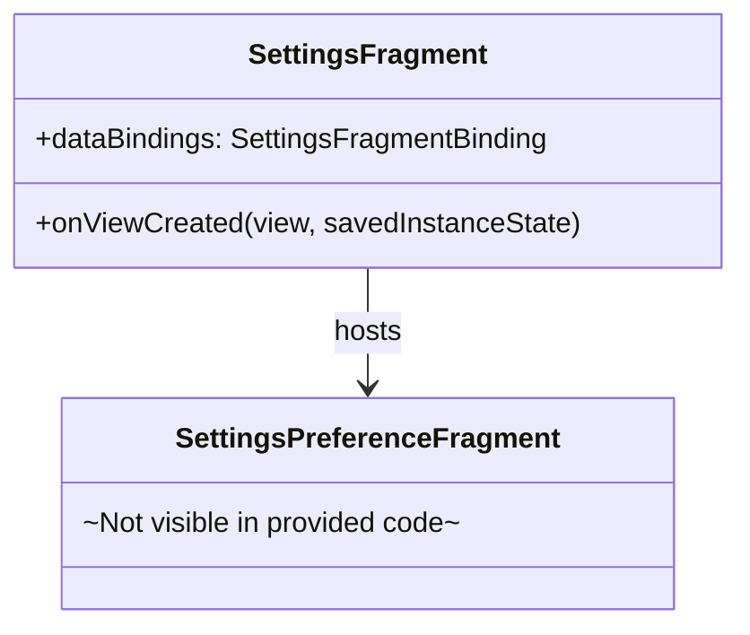
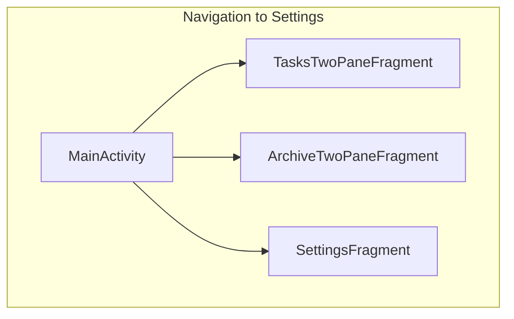
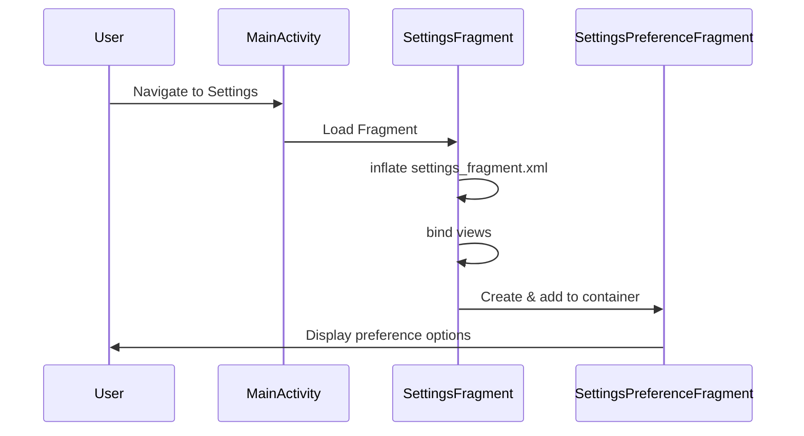

<!-- source: DeepWiki mcp.deepwiki.com · repo android/trackr · page 2.6 Settings Screen · fetched 2026-10-23 -->

# Settings Screen

<details>
<summary>Relevant source files</summary>

The following files were used as context for generating this wiki page:

- [app/src/main/java/com/example/android/trackr/ui/settings/SettingsFragment.kt](app/src/main/java/com/example/android/trackr/ui/settings/SettingsFragment.kt)
- [app/src/main/res/layout/header_item.xml](app/src/main/res/layout/header_item.xml)
- [app/src/main/res/layout/settings_fragment.xml](app/src/main/res/layout/settings_fragment.xml)

</details>


## Introduction

The Settings Screen in Trackr provides users with configuration options for customizing the application behavior. This page documents the architecture, UI components, and implementation details of the settings functionality. 

## Architecture

The Settings Screen follows a nested fragment pattern, utilizing the AndroidX Preferences library to create a standardized settings experience.



The settings implementation consists of two main components:

1. **SettingsFragment**: The host fragment that provides the overall structure and app bar
2. **SettingsPreferenceFragment**: A child fragment that contains the actual preference controls

Sources: [app/src/main/java/com/example/android/trackr/ui/settings/SettingsFragment.kt:27-40](), [app/src/main/res/layout/settings_fragment.xml:17-54]()

## UI Implementation

The Settings Screen consists of a standard Material Design layout with the following components:

- **CoordinatorLayout**: The root layout that enables advanced UI behaviors
- **AppBarLayout with MaterialToolbar**: Displays the "Settings" title
- **FragmentContainerView**: Hosts the preferences content

The layout properly handles system window insets through custom data binding attributes such as `paddingTopSystemBars`, `paddingLeftSystemBars`, `paddingRightSystemBars`, and `paddingBottomSystemBars`.



In the `onViewCreated` method, the `SettingsFragment` adds the `SettingsPreferenceFragment` to the fragment container if it doesn't already exist. This is done through the child fragment manager:

```
childFragmentManager.commitNow {
    replace(R.id.preference, SettingsPreferenceFragment())
}
```

Sources: [app/src/main/java/com/example/android/trackr/ui/settings/SettingsFragment.kt:31-38](), [app/src/main/res/layout/settings_fragment.xml:21-52]()

## Integration with Navigation

The Settings Screen appears to be a top-level destination in the application, accessible from the main navigation structure. Based on the high-level architecture diagrams, it is shown at the same level as the task management and archive screens.



Sources: Derived from the high-level UI Component Hierarchy diagram provided

## Settings Fragment Implementation

The `SettingsFragment` is a straightforward implementation that:

1. Extends the base `Fragment` class
2. Uses data binding to bind to the layout
3. Initializes the fragment by accessing the binding root (which triggers data binding)
4. Checks if the preference fragment already exists and adds it if needed



The actual preference values, categories, and behaviors are not visible in the provided code snippets but would typically be defined in a preferences XML resource file and managed by the `SettingsPreferenceFragment`.

Sources: [app/src/main/java/com/example/android/trackr/ui/settings/SettingsFragment.kt:27-40]()

## Layout Design

The settings fragment layout uses a modern Material Design structure:

| Component | Purpose |
|-----------|---------|
| CoordinatorLayout | Root container enabling material behaviors |
| AppBarLayout | Contains the toolbar and handles scrolling behaviors |
| MaterialToolbar | Displays the "Settings" title |
| FragmentContainerView | Container for the preference fragment |

The layout applies proper system window insets through custom data binding attributes to ensure the content displays correctly on different devices, including those with display cutouts or system UI elements like the status bar and navigation bar.

Sources: [app/src/main/res/layout/settings_fragment.xml:21-52]()

## Best Practices

The Settings Screen implementation in Trackr demonstrates several Android development best practices:

1. **Separation of concerns**: The host fragment handles layout and structure while the preference fragment manages settings content
2. **Fragment nesting**: Uses child fragments for modular UI components
3. **Data binding**: Leverages data binding for declarative UI and reduced boilerplate
4. **System insets handling**: Properly accounts for system UI elements on different devices
5. **Material Design**: Follows Material Design guidelines for consistent user experience

## Conclusion

The Settings Screen in Trackr provides a standardized way for users to configure the application. It follows modern Android development practices and Material Design guidelines, ensuring a consistent and accessible user experience. While the specific settings options are not available in the provided code snippets, the architecture provides a flexible foundation for managing user preferences.

---

