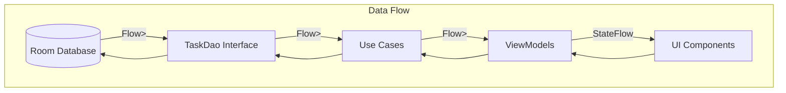
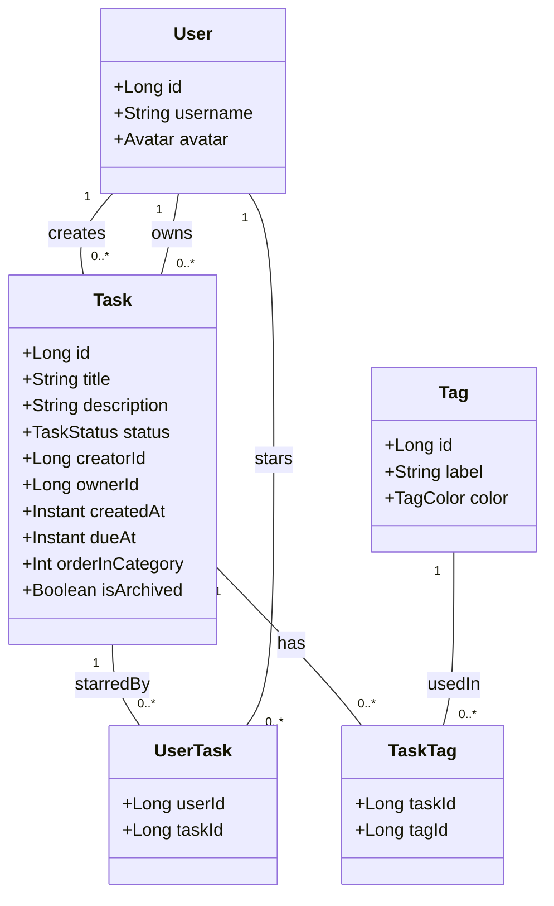
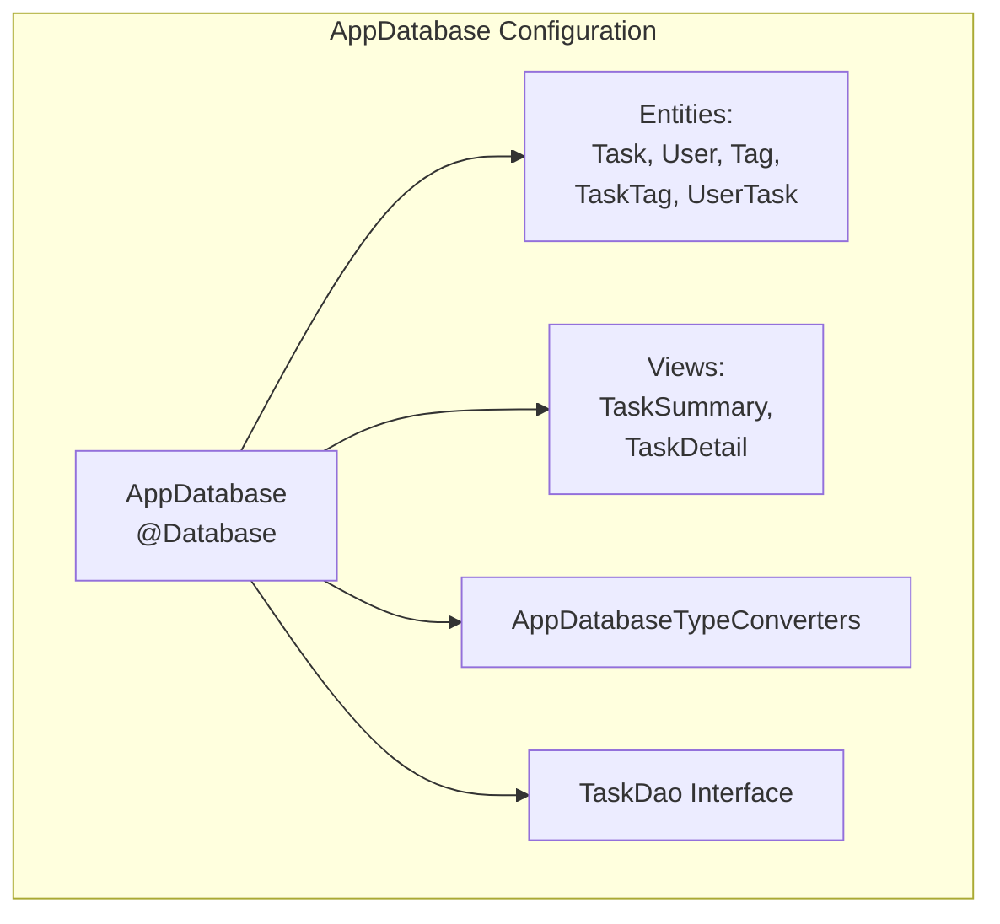
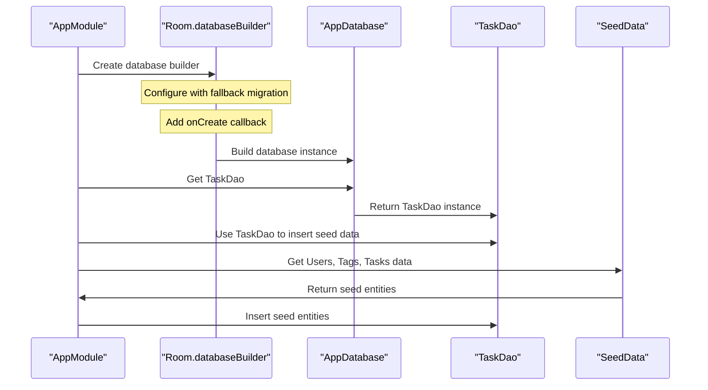
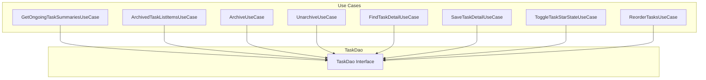
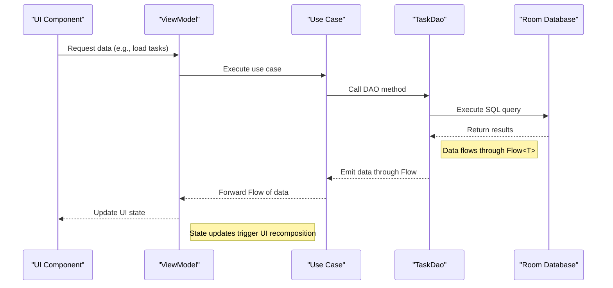

<!-- source: DeepWiki mcp.deepwiki.com · repo android/trackr · page 3 Data Management · fetched 2026-10-23 -->

# Data Management

<details>
<summary>Relevant source files</summary>

The following files were used as context for generating this wiki page:

- [app/src/test/java/com/example/android/trackr/ui/UiTestDatabase.kt](app/src/test/java/com/example/android/trackr/ui/UiTestDatabase.kt)
- [shared/src/main/java/com/example/android/trackr/data/Data.kt](shared/src/main/java/com/example/android/trackr/data/Data.kt)
- [shared/src/main/java/com/example/android/trackr/data/SeedData.kt](shared/src/main/java/com/example/android/trackr/data/SeedData.kt)
- [shared/src/main/java/com/example/android/trackr/data/Views.kt](shared/src/main/java/com/example/android/trackr/data/Views.kt)
- [shared/src/main/java/com/example/android/trackr/db/AppDatabase.kt](shared/src/main/java/com/example/android/trackr/db/AppDatabase.kt)
- [shared/src/main/java/com/example/android/trackr/db/dao/TaskDao.kt](shared/src/main/java/com/example/android/trackr/db/dao/TaskDao.kt)
- [shared/src/main/java/com/example/android/trackr/di/AppModule.kt](shared/src/main/java/com/example/android/trackr/di/AppModule.kt)
- [shared/src/main/java/com/example/android/trackr/usecase/ArchiveUseCase.kt](shared/src/main/java/com/example/android/trackr/usecase/ArchiveUseCase.kt)
- [shared/src/main/java/com/example/android/trackr/usecase/ArchivedTaskListItemsUseCase.kt](shared/src/main/java/com/example/android/trackr/usecase/ArchivedTaskListItemsUseCase.kt)
- [shared/src/main/java/com/example/android/trackr/usecase/GetOngoingTaskSummariesUseCase.kt](shared/src/main/java/com/example/android/trackr/usecase/GetOngoingTaskSummariesUseCase.kt)
- [shared/src/main/java/com/example/android/trackr/usecase/UnarchiveUseCase.kt](shared/src/main/java/com/example/android/trackr/usecase/UnarchiveUseCase.kt)
- [shared/src/test/java/com/example/android/trackr/db/dao/TaskDaoTest.kt](shared/src/test/java/com/example/android/trackr/db/dao/TaskDaoTest.kt)

</details>


This document details the data management system of the Trackr application, covering the data model, Room database implementation, data access layer, and how business logic interacts with persisted data. This system forms the foundation layer of the application's architecture, providing persistent storage and retrieval mechanisms for tasks, users, tags, and their relationships.

For information about how the UI components display and interact with this data, see [UI Components and Theming](#2). For detailed documentation of business logic implementation, see [Use Cases & Business Logic](#3.2).

## Data Architecture Overview

Trackr implements a layered data architecture with clear separation of concerns:



Sources:
- [shared/src/main/java/com/example/android/trackr/db/AppDatabase.kt]()
- [shared/src/main/java/com/example/android/trackr/db/dao/TaskDao.kt]()
- [shared/src/main/java/com/example/android/trackr/di/AppModule.kt]()

## Data Model

The Trackr data model consists of entities, relationships, and database views that provide the foundation for task management.

### Core Entities



The core entities are defined with the following relationships:
- `Task`: Central entity representing a work item
- `User`: Represents application users who create and own tasks
- `Tag`: Labels that can be applied to tasks
- `TaskTag`: Junction entity for task-tag many-to-many relationship
- `UserTask`: Junction entity for user-task "starring" relationship

Sources:
- [shared/src/main/java/com/example/android/trackr/data/Data.kt]()

### Database Views

Trackr uses Room database views to combine information from multiple tables into convenient representations for the UI.

#### TaskSummary View

```sql
SELECT
    t.id, t.title, t.status, t.dueAt, t.orderInCategory, t.isArchived,
    o.id AS owner_id, o.username AS owner_username, o.avatar AS owner_avatar
FROM tasks AS t
INNER JOIN users AS o ON o.id = t.ownerId
```

The `TaskSummary` view combines basic task information with owner details and is used for list displays. It is enhanced with tag information through `@Relation` annotations and includes a `starred` boolean that indicates whether the current user has starred the task.

#### TaskDetail View

```sql
SELECT
    t.id, t.title, t.description, t.status, t.createdAt, t.dueAt, t.orderInCategory,
    t.isArchived,
    o.id AS owner_id, o.username AS owner_username, o.avatar AS owner_avatar,
    c.id AS creator_id, c.username AS creator_username, c.avatar as creator_avatar
FROM tasks AS t
INNER JOIN users AS o ON o.id = t.ownerId
INNER JOIN users AS c ON c.id = t.creatorId
```

The `TaskDetail` view provides comprehensive task information including creator, owner, tags, and star status, used for detailed task displays.

Sources:
- [shared/src/main/java/com/example/android/trackr/data/Views.kt]()

## Room Database Implementation

### Database Configuration

The `AppDatabase` class configures the Room database with entities, views, and type converters:



The database is initialized through Dagger Hilt in `AppModule`:



Sources:
- [shared/src/main/java/com/example/android/trackr/db/AppDatabase.kt]()
- [shared/src/main/java/com/example/android/trackr/di/AppModule.kt]()
- [shared/src/main/java/com/example/android/trackr/data/SeedData.kt]()

## Data Access Layer

The data access layer is implemented through the `TaskDao` interface, which provides methods for interacting with the database.

### TaskDao Operations

| Operation Type | Methods | Description |
|----------------|---------|-------------|
| Insert | `insertUsers`, `insertTags`, `insertTasks`, etc. | Add entities to the database |
| Query | `getTasks`, `getUserById`, `findTaskDetailById` | Retrieve data from the database |
| Update | `updateTaskStatus`, `updateOrderInCategory`, `setIsArchived` | Modify existing entities |
| Complex | `saveTaskDetail`, `reorderTasks` | Perform transactions with multiple operations |

Key methods include:

#### Getting Task Lists

```kotlin
@Transaction
@Query("""
    SELECT s.*,
        EXISTS(
            SELECT id
            FROM user_tasks AS t
            WHERE t.taskId = s.id AND t.userId = :userId
        ) AS starred
    FROM TaskSummary AS s WHERE s.isArchived = 0
    ORDER BY s.status, s.orderInCategory
""")
fun getOngoingTaskSummaries(userId: Long): Flow<List<TaskSummary>>
```

This method retrieves non-archived tasks ordered by status and position, with a `starred` flag indicating whether the specified user has starred each task.

#### Finding Task Details

```kotlin
@Transaction
@Query("SELECT * FROM TaskDetail WHERE id = :id")
fun findTaskDetailById(id: Long): Flow<TaskDetail?>
```

This method retrieves detailed information about a specific task, including related data such as creator, owner, tags, and star users.

#### Saving Task Details

The `saveTaskDetail` transaction method [shared/src/main/java/com/example/android/trackr/db/dao/TaskDao.kt:138-166]() performs multiple operations:

1. Validates that the task has a non-empty title
2. Creates or updates the task record
3. Determines which tag relationships should be removed
4. Deletes removed relationships
5. Adds new tag relationships

This ensures that all aspects of a task are updated consistently in a single transaction.

Sources:
- [shared/src/main/java/com/example/android/trackr/db/dao/TaskDao.kt]()

## Use Cases

The use case layer implements business logic and provides a clean interface between the data and presentation layers.

### Task Management Use Cases



Each use case implements a specific business operation:

- `GetOngoingTaskSummariesUseCase`: Retrieves active tasks for the task list
- `ArchivedTaskListItemsUseCase`: Retrieves archived tasks
- `ArchiveUseCase`: Archives tasks
- `UnarchiveUseCase`: Unarchives tasks
- `FindTaskDetailUseCase`: Retrieves detailed task information
- `SaveTaskDetailUseCase`: Creates or updates tasks
- `ToggleTaskStarStateUseCase`: Stars or unstars tasks
- `ReorderTasksUseCase`: Changes the position of tasks in the list

These use cases typically follow a simple pattern:

```kotlin
class UseCase @Inject constructor(
    private val taskDao: TaskDao
) {
    // For queries returning Flow
    operator fun invoke(params) = taskDao.someQueryMethod(params)
    
    // For operations with side effects
    suspend operator fun invoke(params) {
        taskDao.someUpdateMethod(params)
    }
}
```

Sources:
- [shared/src/main/java/com/example/android/trackr/usecase/GetOngoingTaskSummariesUseCase.kt]()
- [shared/src/main/java/com/example/android/trackr/usecase/ArchivedTaskListItemsUseCase.kt]()
- [shared/src/main/java/com/example/android/trackr/usecase/ArchiveUseCase.kt]()
- [shared/src/main/java/com/example/android/trackr/usecase/UnarchiveUseCase.kt]()

## Data Flow and Reactive Programming

Trackr uses Kotlin Flow to implement reactive data flow from the database to the UI.

### Unidirectional Data Flow



This unidirectional data flow enables reactive UI updates:

1. Data access methods in `TaskDao` return `Flow<List<TaskSummary>>` or similar types
2. Use cases forward these Flow objects to ViewModels
3. ViewModels collect the Flow values and update their state
4. UI observes ViewModel state and updates accordingly

When database content changes (e.g., a task is updated), Room automatically emits new values through the Flow, triggering updates throughout the chain to the UI.

Sources:
- [shared/src/main/java/com/example/android/trackr/db/dao/TaskDao.kt]()
- [shared/src/main/java/com/example/android/trackr/usecase/GetOngoingTaskSummariesUseCase.kt]()
- [shared/src/main/java/com/example/android/trackr/usecase/ArchivedTaskListItemsUseCase.kt]()

## Testing Strategy

The data layer is tested through unit tests that verify DAO operations and use cases.

### DAO Testing

The `TaskDaoTest` class tests various DAO operations against an in-memory Room database:

- `getTasks_WhenNoTaskInserted`: Verifies that an empty list is returned when no tasks exist
- `getTasks_WhenTasksInserted`: Verifies that inserted tasks can be retrieved
- `findTaskDetailById`: Tests retrieval of detailed task information
- `getTaskSummary`: Verifies that task summaries include correct owner, tag, and star information
- `saveTaskDetail_create`: Tests creating a new task with tags
- `saveTaskDetail_update`: Tests updating an existing task's properties and tags

These tests ensure that the DAO correctly handles data operations and correctly manages relationships between entities.

Sources:
- [shared/src/test/java/com/example/android/trackr/db/dao/TaskDaoTest.kt]()

## Summary

The data management system in Trackr demonstrates a well-structured approach using Room database with:

1. **Clearly defined entities** (Task, User, Tag) and relationships
2. **Database views** (TaskSummary, TaskDetail) that simplify complex data retrieval
3. **A comprehensive DAO** (TaskDao) that handles all data operations
4. **Use cases** that encapsulate business logic
5. **Reactive data flow** using Kotlin Flow for automatic UI updates

This architecture supports the application's features while maintaining separation of concerns and testability.

---

