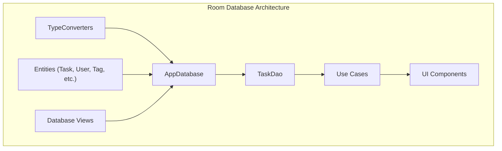
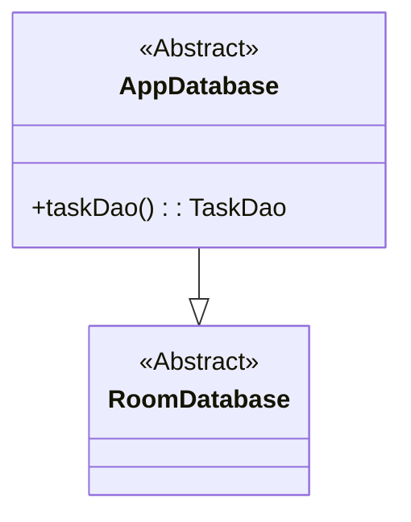
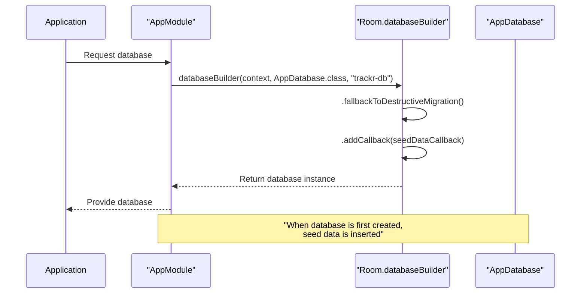
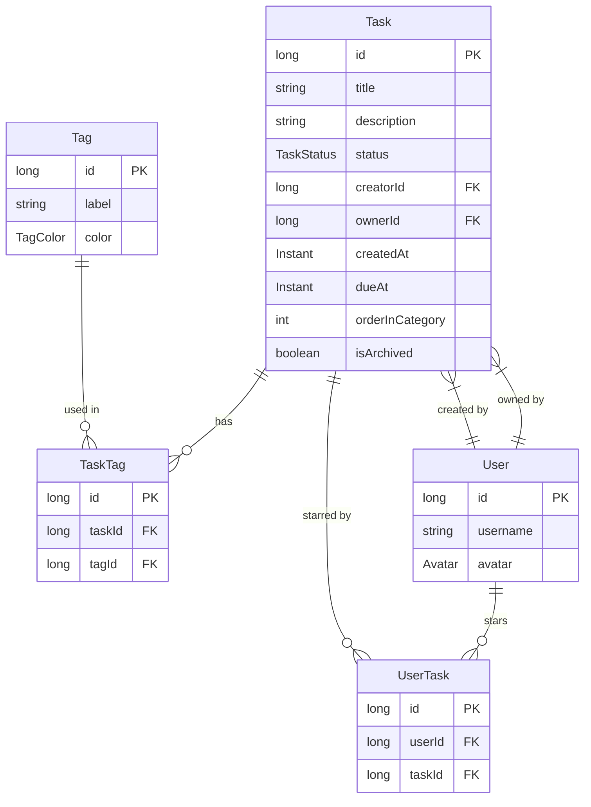
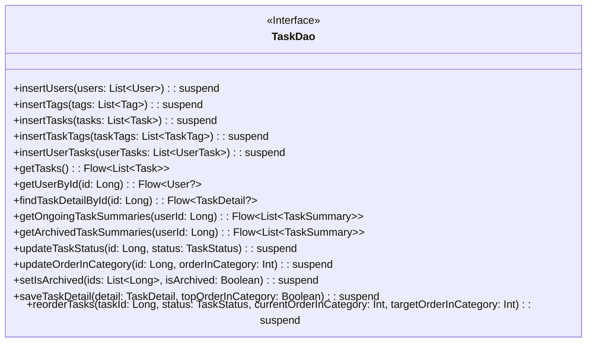
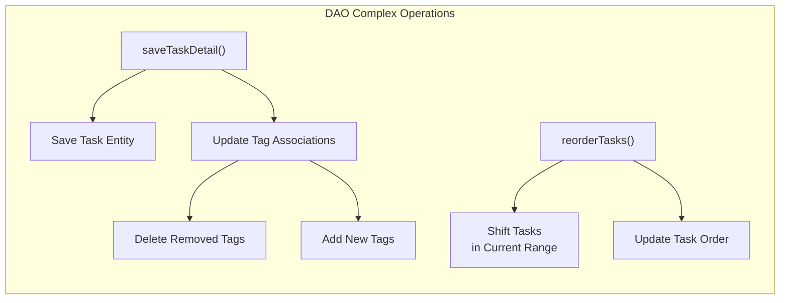
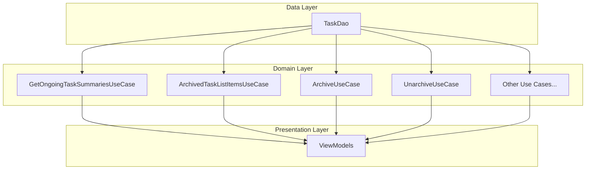

<!-- source: DeepWiki mcp.deepwiki.com · repo android/trackr · page 3.1 Room Database Implementation · fetched 2026-10-23 -->

# Room Database Implementation

<details>
<summary>Relevant source files</summary>

The following files were used as context for generating this wiki page:

- [app/src/test/java/com/example/android/trackr/ui/UiTestDatabase.kt](app/src/test/java/com/example/android/trackr/ui/UiTestDatabase.kt)
- [shared/src/main/java/com/example/android/trackr/data/Data.kt](shared/src/main/java/com/example/android/trackr/data/Data.kt)
- [shared/src/main/java/com/example/android/trackr/data/SeedData.kt](shared/src/main/java/com/example/android/trackr/data/SeedData.kt)
- [shared/src/main/java/com/example/android/trackr/data/Views.kt](shared/src/main/java/com/example/android/trackr/data/Views.kt)
- [shared/src/main/java/com/example/android/trackr/db/AppDatabase.kt](shared/src/main/java/com/example/android/trackr/db/AppDatabase.kt)
- [shared/src/main/java/com/example/android/trackr/db/dao/TaskDao.kt](shared/src/main/java/com/example/android/trackr/db/dao/TaskDao.kt)
- [shared/src/main/java/com/example/android/trackr/di/AppModule.kt](shared/src/main/java/com/example/android/trackr/di/AppModule.kt)
- [shared/src/main/java/com/example/android/trackr/usecase/ArchiveUseCase.kt](shared/src/main/java/com/example/android/trackr/usecase/ArchiveUseCase.kt)
- [shared/src/main/java/com/example/android/trackr/usecase/ArchivedTaskListItemsUseCase.kt](shared/src/main/java/com/example/android/trackr/usecase/ArchivedTaskListItemsUseCase.kt)
- [shared/src/main/java/com/example/android/trackr/usecase/GetOngoingTaskSummariesUseCase.kt](shared/src/main/java/com/example/android/trackr/usecase/GetOngoingTaskSummariesUseCase.kt)
- [shared/src/main/java/com/example/android/trackr/usecase/UnarchiveUseCase.kt](shared/src/main/java/com/example/android/trackr/usecase/UnarchiveUseCase.kt)
- [shared/src/test/java/com/example/android/trackr/db/dao/TaskDaoTest.kt](shared/src/test/java/com/example/android/trackr/db/dao/TaskDaoTest.kt)

</details>


This document details the Room database implementation in the Trackr application, covering the database structure, entities, relationships, queries, and data access patterns. For information about use cases and business logic that utilize this database, see [Use Cases & Business Logic](#3.2).

## 1. Database Overview

Trackr uses Android's Room persistence library to provide a robust abstraction layer over SQLite. The database architecture follows a clean separation of concerns with entities, data access objects (DAOs), database views, and type converters.



Sources: [shared/src/main/java/com/example/android/trackr/db/AppDatabase.kt]()

## 2. Database Configuration

The database is configured in the `AppDatabase` class with Room annotations to define entities, views, and type converters.



The database is created and configured in the `AppModule` class using dependency injection (Hilt):



Sources: 
- [shared/src/main/java/com/example/android/trackr/db/AppDatabase.kt]()
- [shared/src/main/java/com/example/android/trackr/di/AppModule.kt:46-65]()

## 3. Entity Relationships

The database consists of five main entities with relationships defined through foreign keys. 



Sources:
- [shared/src/main/java/com/example/android/trackr/data/Data.kt:28-217]()

### 3.1. Key Entities

#### Task Entity

The `Task` entity represents a task with its properties like title, description, status, due date, etc. 

```
Task
- id: Primary key, auto-generated
- title: Task title
- description: Optional detailed description
- status: TaskStatus enum (NOT_STARTED, IN_PROGRESS, COMPLETED)
- creatorId: Foreign key to User who created the task
- ownerId: Foreign key to User who is assigned the task
- createdAt: Timestamp when task was created
- dueAt: Deadline for the task
- orderInCategory: Controls the display order within a status category
- isArchived: Boolean flag indicating if task is archived
```

#### User Entity

The `User` entity represents a user in the system.

```
User
- id: Primary key
- username: Display name for the user
- avatar: Avatar enum representing user's profile picture
```

#### Tag Entity

The `Tag` entity represents labels that can be associated with tasks.

```
Tag
- id: Primary key
- label: Text displayed for the tag
- color: TagColor enum defining display color
```

#### Join Tables

- `TaskTag`: Represents many-to-many relationship between tasks and tags
- `UserTask`: Represents tasks starred by users (many-to-many)

Sources:
- [shared/src/main/java/com/example/android/trackr/data/Data.kt:28-217]()
- [shared/src/main/java/com/example/android/trackr/data/SeedData.kt:24-264]()

## 4. Database Views

Room database views provide pre-defined joined queries that simplify access to related data. Trackr defines two database views:

### 4.1. TaskSummary View

The `TaskSummary` view provides a lightweight representation of a task with its owner, tags, and star status:

```
TaskSummary
- Basic task info: id, title, status, dueAt, orderInCategory, isArchived
- owner: Embedded User (task assignee)
- tags: List of Tag objects associated with the task
- starred: Boolean indicating if the current user has starred the task
```

SQL View Definition:
```sql
SELECT
    t.id, t.title, t.status, t.dueAt, t.orderInCategory, t.isArchived,
    o.id AS owner_id, o.username AS owner_username, o.avatar AS owner_avatar
FROM tasks AS t
INNER JOIN users AS o ON o.id = t.ownerId
```

### 4.2. TaskDetail View

The `TaskDetail` view provides a comprehensive representation of a task with all associated data:

```
TaskDetail
- All task fields: id, title, description, status, createdAt, dueAt, orderInCategory, isArchived
- owner: Embedded User (task assignee)
- creator: Embedded User (who created the task)
- tags: List of Tag objects associated with the task
- starUsers: List of Users who have starred the task
```

SQL View Definition:
```sql
SELECT
    t.id, t.title, t.description, t.status, t.createdAt, t.dueAt, t.orderInCategory,
    t.isArchived,
    o.id AS owner_id, o.username AS owner_username, o.avatar AS owner_avatar,
    c.id AS creator_id, c.username AS creator_username, c.avatar as creator_avatar
FROM tasks AS t
INNER JOIN users AS o ON o.id = t.ownerId
INNER JOIN users AS c ON c.id = t.creatorId
```

Sources:
- [shared/src/main/java/com/example/android/trackr/data/Views.kt:1-124]()

## 5. Data Access Objects (DAOs)

The `TaskDao` interface provides methods to access and manipulate task data. It serves as the primary API for the database operations in the application.



### 5.1. Query Operations

The DAO provides various query operations to retrieve data:

- **Task Retrieval**:
  - `getTasks()`: Get all tasks
  - `findTaskDetailById(id)`: Get detailed task information by ID
  - `getOngoingTaskSummaries(userId)`: Get summaries of non-archived tasks with star status for a user
  - `getArchivedTaskSummaries(userId)`: Get summaries of archived tasks with star status for a user

- **User Operations**:
  - `getUserById(id)`: Get user by ID
  - `loadUsers()`: Load all users

- **Tag Operations**:
  - `loadTags()`: Load all tags

Most query methods return Kotlin `Flow` objects, enabling reactive UI updates when data changes.

### 5.2. Modification Operations

The DAO provides methods to modify the database:

- **Creation Operations**:
  - `insertUsers()`, `insertTags()`, `insertTasks()`, etc.: Insert entities
  - `insertTask()`: Insert a single task and return its ID

- **Update Operations**:
  - `updateTaskStatus()`: Change task status
  - `updateOrderInCategory()`: Change task order
  - `setIsArchived()`: Archive/unarchive tasks

- **Complex Operations**:
  - `saveTaskDetail()`: Save comprehensive task information (creates or updates task and manages tags)
  - `reorderTasks()`: Reorder tasks within a status category



Sources:
- [shared/src/main/java/com/example/android/trackr/db/dao/TaskDao.kt:17-198]()
- [shared/src/test/java/com/example/android/trackr/db/dao/TaskDaoTest.kt:17-484]()

## 6. Integration with Use Cases

The Room database is consumed by various use cases that encapsulate business logic. These use cases inject the TaskDao and provide higher-level operations to ViewModels.



For example:
- `GetOngoingTaskSummariesUseCase`: Retrieves non-archived task summaries
- `ArchivedTaskListItemsUseCase`: Retrieves archived task summaries
- `ArchiveUseCase`: Archives tasks
- `UnarchiveUseCase`: Unarchives tasks

Sources:
- [shared/src/main/java/com/example/android/trackr/usecase/GetOngoingTaskSummariesUseCase.kt]()
- [shared/src/main/java/com/example/android/trackr/usecase/ArchivedTaskListItemsUseCase.kt]()
- [shared/src/main/java/com/example/android/trackr/usecase/ArchiveUseCase.kt]()
- [shared/src/main/java/com/example/android/trackr/usecase/UnarchiveUseCase.kt]()

## 7. Initialization and Seed Data

The database is initialized with seed data to provide a useful starting state. This is done in the `AppModule` class where a callback is registered to insert sample data when the database is first created.

```mermaid
sequenceDiagram
    participant DB as "AppDatabase"
    participant Callback as "RoomDatabase.Callback"
    participant SeedData as "SeedData"
    participant TaskDao as "TaskDao"
    
    DB->>Callback: onCreate(db)
    Callback->>SeedData: Access seed data objects
    SeedData-->>Callback: Return predefined data
    Callback->>TaskDao: insertUsers(SeedData.Users)
    Callback->>TaskDao: insertTags(SeedData.Tags)
    Callback->>TaskDao: insertTasks(SeedData.Tasks)
    Callback->>TaskDao: insertTaskTags(SeedData.TaskTags)
    Callback->>TaskDao: insertUserTasks(SeedData.UserTasks)
```



The seed data includes:
- 3 users
- 6 tags with different colors
- 15 sample tasks (some ongoing, some completed, some archived)
- Task-tag associations
- User-starred tasks

Sources:
- [shared/src/main/java/com/example/android/trackr/di/AppModule.kt:17-98]()
- [shared/src/main/java/com/example/android/trackr/data/SeedData.kt:1-265]()

## 8. Testing

The database implementation includes comprehensive unit tests to verify correct behavior. The `TaskDaoTest` class demonstrates how to:

1. Create an in-memory test database
2. Insert test data
3. Perform database operations
4. Verify results

Key test areas include:
- Basic CRUD operations
- Task state transitions (archive/unarchive)
- Complex operations like task reordering
- Edge cases and validation (e.g., empty title validation)

Sources:
- [shared/src/test/java/com/example/android/trackr/db/dao/TaskDaoTest.kt:17-484]()
- [app/src/test/java/com/example/android/trackr/ui/UiTestDatabase.kt:1-98]()

## 9. Summary

The Room database implementation in Trackr provides a robust foundation for data persistence using a relational model. Key strengths of the implementation include:

- Clean entity relationships with proper foreign key constraints
- Efficient database views to simplify common queries
- Comprehensive DAO interface with both simple and complex operations
- Reactive data flow using Kotlin Flows for UI updates
- Transaction support for data consistency
- Strong test coverage

This database layer provides the foundation for the application's data management capabilities and interfaces with the domain layer through use cases.

---

