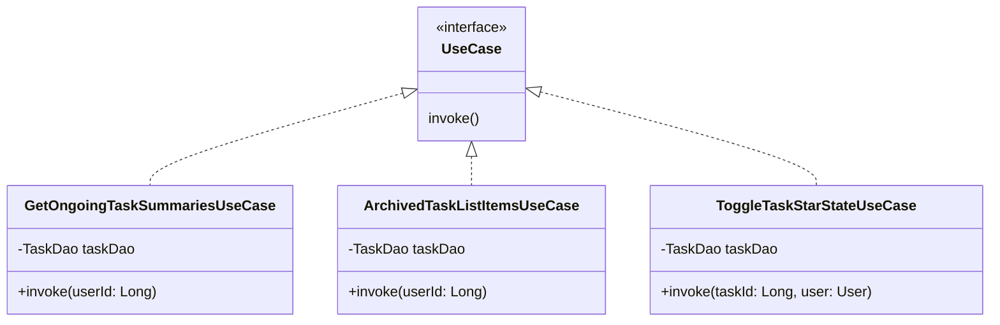
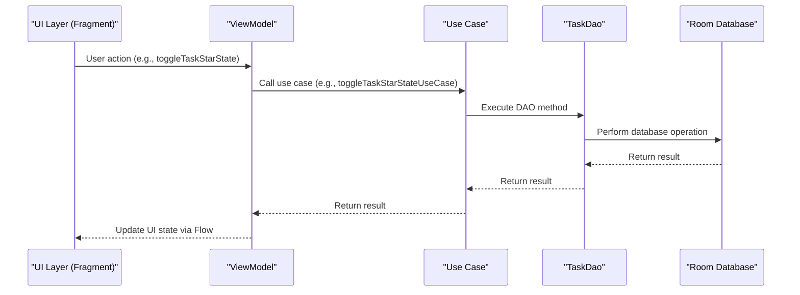
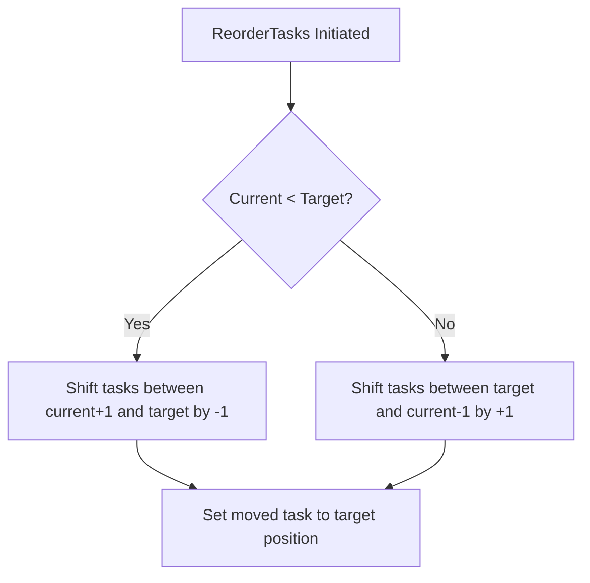
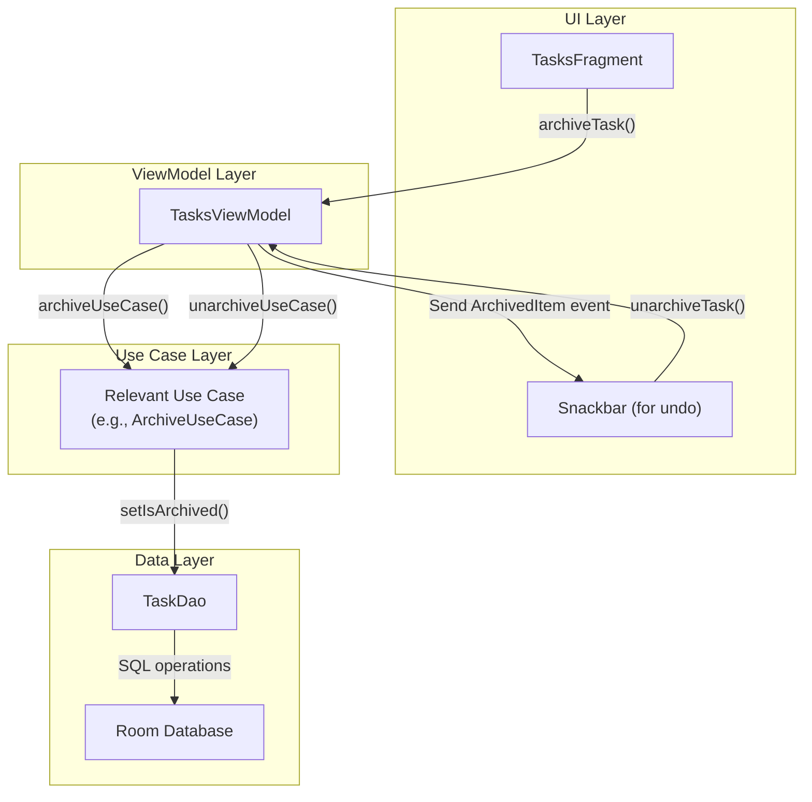

<!-- source: DeepWiki mcp.deepwiki.com · repo android/trackr · page 3.2 Use Cases & Business Logic · fetched 2026-10-23 -->

# Use Cases & Business Logic

<details>
<summary>Relevant source files</summary>

The following files were used as context for generating this wiki page:

- [app/src/main/java/com/example/android/trackr/ui/tasks/TasksFragment.kt](app/src/main/java/com/example/android/trackr/ui/tasks/TasksFragment.kt)
- [app/src/main/java/com/example/android/trackr/ui/tasks/TasksViewModel.kt](app/src/main/java/com/example/android/trackr/ui/tasks/TasksViewModel.kt)
- [shared/src/main/java/com/example/android/trackr/data/Views.kt](shared/src/main/java/com/example/android/trackr/data/Views.kt)
- [shared/src/main/java/com/example/android/trackr/db/dao/TaskDao.kt](shared/src/main/java/com/example/android/trackr/db/dao/TaskDao.kt)
- [shared/src/main/java/com/example/android/trackr/usecase/ArchivedTaskListItemsUseCase.kt](shared/src/main/java/com/example/android/trackr/usecase/ArchivedTaskListItemsUseCase.kt)
- [shared/src/main/java/com/example/android/trackr/usecase/GetOngoingTaskSummariesUseCase.kt](shared/src/main/java/com/example/android/trackr/usecase/GetOngoingTaskSummariesUseCase.kt)
- [shared/src/test/java/com/example/android/trackr/db/dao/TaskDaoTest.kt](shared/src/test/java/com/example/android/trackr/db/dao/TaskDaoTest.kt)

</details>


This document provides a detailed overview of the use cases and business logic in the Trackr application. Use cases serve as the bridge between the presentation layer (UI/ViewModels) and the data layer (DAOs/Database), encapsulating the application's business rules and operations. For information on the data model and database implementation, see [Room Database Implementation](#3.1).

## 1. Use Case Architecture

The Trackr application follows clean architecture principles, with use cases representing core business logic that is independent of UI and data storage implementations. Each use case is a focused class that performs a single well-defined operation.

```mermaid
classDiagram
    direction TB
    class ViewModels {
        TasksViewModel
        TaskDetailViewModel
        ArchiveViewModel
        TaskEditViewModel
    }
    
    class "Use Cases" {
        GetOngoingTaskSummariesUseCase
        ArchivedTaskListItemsUseCase
        ToggleTaskStarStateUseCase
        ArchiveUseCase
        UnarchiveUseCase
        ReorderTasksUseCase
        FindTaskDetailUseCase
        SaveTaskDetailUseCase
    }
    
    class DAOs {
        TaskDao
    }
    
    ViewModels --> "Use Cases" : calls
    "Use Cases" --> DAOs : calls
```

Sources: [shared/src/main/java/com/example/android/trackr/usecase/GetOngoingTaskSummariesUseCase.kt:22-26](), [app/src/main/java/com/example/android/trackr/ui/tasks/TasksViewModel.kt:39-47]()

### 1.1 Use Case Implementation Pattern

Use cases in Trackr follow a consistent implementation pattern:

1. Single responsibility - each use case performs one specific operation
2. Dependency injection via constructor
3. Implementation of the `invoke` operator, allowing use cases to be called like functions
4. Minimal business logic, focused on orchestrating data operations



Sources: [shared/src/main/java/com/example/android/trackr/usecase/GetOngoingTaskSummariesUseCase.kt:22-26](), [shared/src/main/java/com/example/android/trackr/usecase/ArchivedTaskListItemsUseCase.kt:22-26]()

## 2. Core Use Cases

### 2.1 Task Retrieval Use Cases

These use cases are responsible for retrieving task data from the database:

| Use Case | Purpose | Implementation |
|----------|---------|----------------|
| `GetOngoingTaskSummariesUseCase` | Retrieves non-archived tasks | Returns a Flow of `TaskSummary` objects |
| `ArchivedTaskListItemsUseCase` | Retrieves archived tasks | Returns a Flow of `TaskSummary` objects |
| `FindTaskDetailUseCase` | Retrieves detailed information for a specific task | Returns a Flow of a single `TaskDetail` object |

Example implementation:

```kotlin
class GetOngoingTaskSummariesUseCase @Inject constructor(
    private val taskDao: TaskDao
) {
    operator fun invoke(userId: Long) = taskDao.getOngoingTaskSummaries(userId)
}
```

Sources: [shared/src/main/java/com/example/android/trackr/usecase/GetOngoingTaskSummariesUseCase.kt:22-26](), [shared/src/main/java/com/example/android/trackr/usecase/ArchivedTaskListItemsUseCase.kt:22-26]()

### 2.2 Task Modification Use Cases

These use cases modify task properties:

| Use Case | Purpose | Implementation |
|----------|---------|----------------|
| `ToggleTaskStarStateUseCase` | Stars or unstars a task for a specific user | Adds or removes a `UserTask` entry |
| `ArchiveUseCase` | Archives one or more tasks | Sets `isArchived` flag to true |
| `UnarchiveUseCase` | Unarchives one or more tasks | Sets `isArchived` flag to false |
| `SaveTaskDetailUseCase` | Creates or updates a task | Saves task and related entities |

Sources: [app/src/main/java/com/example/android/trackr/ui/tasks/TasksViewModel.kt:86-90](), [app/src/main/java/com/example/android/trackr/ui/tasks/TasksViewModel.kt:92-103]()

### 2.3 Task Organization Use Cases

These use cases handle task organization:

| Use Case | Purpose | Implementation |
|----------|---------|----------------|
| `ReorderTasksUseCase` | Changes the order of tasks within a status category | Updates `orderInCategory` values |

Sources: [app/src/main/java/com/example/android/trackr/ui/tasks/TasksViewModel.kt:105-136](), [shared/src/main/java/com/example/android/trackr/db/dao/TaskDao.kt:184-197]()

## 3. Integration with ViewModels

ViewModels serve as the connection between the UI and use cases. They:
1. Inject and call use cases
2. Transform data for UI consumption
3. Handle events from the UI
4. Expose state as Flows for reactive UI updates



Sources: [app/src/main/java/com/example/android/trackr/ui/tasks/TasksViewModel.kt:39-78](), [app/src/main/java/com/example/android/trackr/ui/tasks/TasksFragment.kt:47-172]()

### 3.1 Example: Task Starring in TasksViewModel

The `TasksViewModel` uses multiple use cases to implement its functionality:

```kotlin
@HiltViewModel
class TasksViewModel @Inject constructor(
    getOngoingTaskSummariesUseCase: GetOngoingTaskSummariesUseCase,
    private val toggleTaskStarStateUseCase: ToggleTaskStarStateUseCase,
    private val reorderTasksUseCase: ReorderTasksUseCase,
    private val archiveUseCase: ArchiveUseCase,
    private val unarchiveUseCase: UnarchiveUseCase,
    private val currentUser: User
) : ViewModel() {
    // ...
    
    fun toggleTaskStarState(taskSummary: TaskSummary) {
        viewModelScope.launch {
            toggleTaskStarStateUseCase(taskSummary.id, currentUser)
        }
    }
    
    // ...
}
```

Sources: [app/src/main/java/com/example/android/trackr/ui/tasks/TasksViewModel.kt:39-47](), [app/src/main/java/com/example/android/trackr/ui/tasks/TasksViewModel.kt:86-90]()

## 4. Business Logic Implementation

### 4.1 Task State Management

Task state in Trackr is represented by the `TaskStatus` enum. Business logic in use cases and ViewModels manages transitions between states.

```mermaid
stateDiagram-v2
    direction LR
    [*] --> "NOT_STARTED"
    "NOT_STARTED" --> "IN_PROGRESS": updateTaskStatus
    "IN_PROGRESS" --> "COMPLETED": updateTaskStatus
    "COMPLETED" --> [*]: archiveTask
    
    state "Any Status" as ANY
    ANY --> "Archived": archiveUseCase
    "Archived" --> ANY: unarchiveUseCase
```

Sources: [shared/src/main/java/com/example/android/trackr/db/dao/TaskDao.kt:97-101](), [app/src/main/java/com/example/android/trackr/ui/tasks/TasksViewModel.kt:92-103]()

### 4.2 Task Reordering Logic

Task reordering is implemented with complex business logic in the `TaskDao.reorderTasks` method:

1. When a task is moved within a category, all tasks between the original and new positions must be shifted
2. Tasks are shifted up or down based on the direction of movement
3. After shifting other tasks, the moved task is placed at its target position



Sources: [shared/src/main/java/com/example/android/trackr/db/dao/TaskDao.kt:184-197](), [app/src/main/java/com/example/android/trackr/ui/tasks/TasksViewModel.kt:105-125]()

### 4.3 Undo Operations

Trackr implements undo functionality for certain operations, such as archiving and reordering tasks. The ViewModel handles this by:

1. Storing the information needed to reverse the operation
2. Exposing this via Flows for the UI to observe
3. Providing methods to execute the reverse operation

For reordering, this involves storing the task ID, status, and both the original and new positions:

```kotlin
data class UndoReorderTasks(
    val taskId: Long,
    val status: TaskStatus,
    val currentOrderInCategory: Int,
    val targetOrderInCategory: Int
)
```

Sources: [app/src/main/java/com/example/android/trackr/ui/tasks/TasksViewModel.kt:116-124](), [app/src/main/java/com/example/android/trackr/ui/tasks/TasksViewModel.kt:146-154]()

## 5. Data Flow in Task Operations

The complete flow for a typical task operation involves multiple components:



Sources: [app/src/main/java/com/example/android/trackr/ui/tasks/TasksFragment.kt:174-176](), [app/src/main/java/com/example/android/trackr/ui/tasks/TasksViewModel.kt:92-103](), [app/src/main/java/com/example/android/trackr/ui/tasks/TasksFragment.kt:122-136]()

## 6. Summary

The use case layer in Trackr implements the core business logic of the application, providing a clean separation between UI and data concerns. Key features of this architecture include:

1. **Single Responsibility**: Each use case performs a specific operation
2. **Clean Architecture**: Use cases maintain independence from UI and database implementations
3. **Reactive Programming**: Use of Kotlin Flows for reactive updates
4. **Testable Design**: Logic is isolated in use cases for easier testing
5. **Event Handling**: Support for complex operations like undo

This pattern provides a scalable and maintainable approach to implementing business logic in Android applications.

Sources: [shared/src/main/java/com/example/android/trackr/usecase/GetOngoingTaskSummariesUseCase.kt:22-26](), [app/src/main/java/com/example/android/trackr/ui/tasks/TasksViewModel.kt:39-47]()

---

