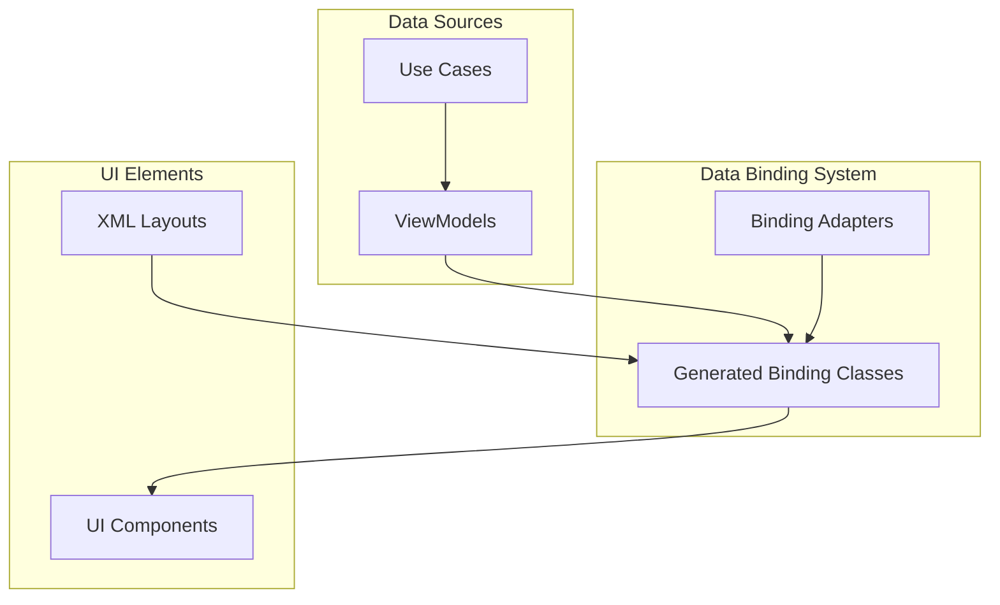
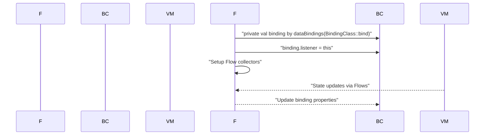
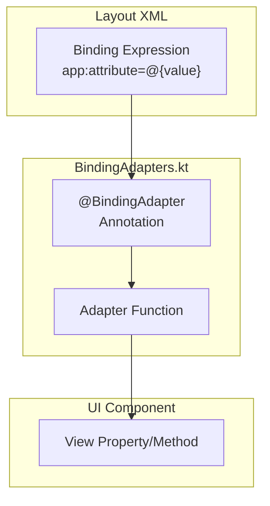
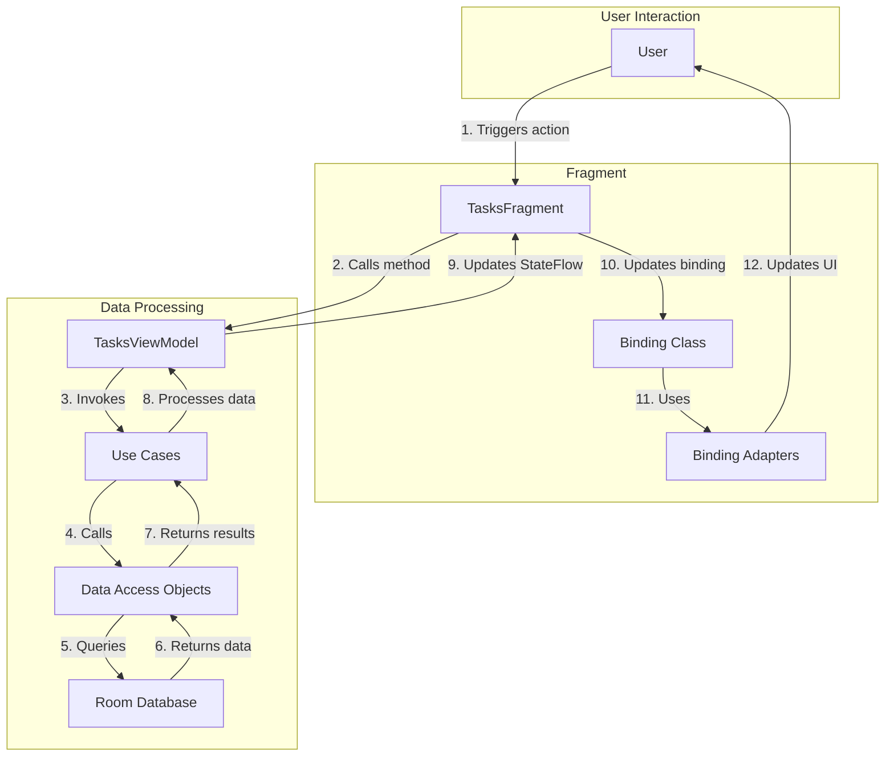

<!-- source: DeepWiki mcp.deepwiki.com · repo android/trackr · page 3.3 Data Binding Implementation · fetched 2026-10-23 -->

# Data Binding Implementation

<details>
<summary>Relevant source files</summary>

The following files were used as context for generating this wiki page:

- [app/src/main/java/com/example/android/trackr/ui/BindingAdapters.kt](app/src/main/java/com/example/android/trackr/ui/BindingAdapters.kt)
- [app/src/main/java/com/example/android/trackr/ui/tasks/TasksFragment.kt](app/src/main/java/com/example/android/trackr/ui/tasks/TasksFragment.kt)
- [app/src/main/java/com/example/android/trackr/ui/tasks/TasksViewModel.kt](app/src/main/java/com/example/android/trackr/ui/tasks/TasksViewModel.kt)
- [app/src/test/java/com/example/android/trackr/ui/BindingAdaptersTest.kt](app/src/test/java/com/example/android/trackr/ui/BindingAdaptersTest.kt)

</details>


This document explains how data binding is implemented and used in the Trackr Android application. Data binding is a powerful feature that connects UI elements in layouts directly to data sources in your code, eliminating the need for manual view references and updates. This page focuses specifically on the technical implementation of data binding in Trackr, including binding adapters, view bindings, and data flow patterns.

For information about Room database implementation, see [Room Database Implementation](#3.1). For details about the business logic implementation, see [Use Cases & Business Logic](#3.2).

## Overview of Data Binding Architecture

Data binding in Trackr serves as the bridge between the UI layer and the data sources (ViewModels). It provides a declarative way to bind observable data to UI elements, automatically updating the UI when the underlying data changes.



Sources: [app/src/main/java/com/example/android/trackr/ui/tasks/TasksViewModel.kt](), [app/src/main/java/com/example/android/trackr/ui/tasks/TasksFragment.kt](), [app/src/main/java/com/example/android/trackr/ui/BindingAdapters.kt]()

## Binding Initialization Pattern

In Trackr, Fragments initialize their bindings using a custom `dataBindings` delegate. This pattern ensures proper lifecycle management of the binding instance.



For example, in TasksFragment:

```kotlin
private val binding by dataBindings(TasksFragmentBinding::bind)
private val tasksViewModel: TasksViewModel by hiltNavGraphViewModels(R.id.nav_tasks)
```

The Fragment then establishes connections between the UI and data:

```kotlin
binding.listener = this  // Set the Fragment as the event listener

repeatWithViewLifecycle {
    launch {
        tasksViewModel.listItems.collect {
            tasksAdapter.submitList(it) {
                updateStickyHeader()
            }
        }
    }
    // Additional flow collectors...
}
```

Sources: [app/src/main/java/com/example/android/trackr/ui/tasks/TasksFragment.kt:50-52](), [app/src/main/java/com/example/android/trackr/ui/tasks/TasksFragment.kt:62](), [app/src/main/java/com/example/android/trackr/ui/tasks/TasksFragment.kt:113-152]()

## Custom Binding Adapters

Trackr extends the standard Android data binding capabilities through custom binding adapters defined in the `BindingAdapters.kt` file. These adapters enable specialized binding behavior for various UI components.



Sources: [app/src/main/java/com/example/android/trackr/ui/BindingAdapters.kt]()

### Key Binding Adapters

Trackr implements several categories of binding adapters:

#### 1. View Visibility Adapters

```kotlin
@BindingAdapter("isGone")
fun View.setIsGone(isGone: Boolean) {
    visibility = if (isGone) View.GONE else View.VISIBLE
}

@BindingAdapter("isInvisible")
fun View.setIsInvisible(isInvisible: Boolean) {
    visibility = if (isInvisible) View.INVISIBLE else View.VISIBLE
}
```

Sources: [app/src/main/java/com/example/android/trackr/ui/BindingAdapters.kt:45-60]()

#### 2. Tag Display Adapters

Complex adapters for displaying task tags in a ChipGroup:

```kotlin
@BindingAdapter("tags", "showAllTags")
fun ChipGroup.tags(tags: List<Tag>?, showAllTags: Boolean) {
    bind(tags ?: emptyList(), showAllTags)
}
```

This adapter handles both reusing existing chips and creating new ones as needed based on the data.

Sources: [app/src/main/java/com/example/android/trackr/ui/BindingAdapters.kt:70-112]()

#### 3. Date Formatting Adapters

Several adapters that convert `Instant` objects to human-readable date strings:

```kotlin
@BindingAdapter("dueMessageOrDueDate", "clock")
fun showFormattedDueMessageOrDueDate(view: TextView, instant: Instant?, clock: Clock?) {
    view.text = if (instant == null || clock == null) {
        ""
    } else {
        DateTimeUtils.durationMessageOrDueDate(view.resources, instant, clock)
    }
}
```

Sources: [app/src/main/java/com/example/android/trackr/ui/BindingAdapters.kt:126-156]()

#### 4. Accessibility Adapters

Adapters that enhance accessibility by providing better action descriptions:

```kotlin
@BindingAdapter("clickActionLabel")
fun addClickActionLabel(view: View, label: String) {
    ViewCompat.replaceAccessibilityAction(
        view,
        AccessibilityNodeInfoCompat.AccessibilityActionCompat.ACTION_CLICK,
        label,
        null
    )
}
```

Sources: [app/src/main/java/com/example/android/trackr/ui/BindingAdapters.kt:164-175]()

#### 5. Additional Utility Adapters

- Task status text adapter: [app/src/main/java/com/example/android/trackr/ui/BindingAdapters.kt:177-184]()
- Drawable resource adapter: [app/src/main/java/com/example/android/trackr/ui/BindingAdapters.kt:186-198]()
- Minimum touch area adapter: [app/src/main/java/com/example/android/trackr/ui/BindingAdapters.kt:213-243]()

## Data Flow in Trackr

Data binding in Trackr follows a unidirectional flow pattern, where data originates from ViewModels and flows to the UI components through binding expressions and Kotlin Flows.



Sources: [app/src/main/java/com/example/android/trackr/ui/tasks/TasksFragment.kt:113-152](), [app/src/main/java/com/example/android/trackr/ui/tasks/TasksViewModel.kt:62-77]()

### Example: Header Data Binding

When scrolling the task list, the TasksFragment updates the sticky header through data binding:

```kotlin
private fun updateStickyHeader() {
    val linearLayoutManager = binding.tasksList.layoutManager as? LinearLayoutManager ?: return
    tasksAdapter.findHeaderItem(linearLayoutManager.findFirstVisibleItemPosition())?.let {
        binding.headerData = it.headerData
    }
}
```

Sources: [app/src/main/java/com/example/android/trackr/ui/tasks/TasksFragment.kt:155-160]()

## Event Handling Through Data Binding

Trackr uses data binding not just for displaying data but also for handling user interactions. The Fragment implements appropriate listener interfaces and sets itself as the listener in the binding:

```kotlin
// In TasksFragment
binding.listener = this

// Interface implementation
override fun onTaskClicked(taskSummary: TaskSummary) {
    tasksViewModel.showTaskDetail(taskSummary)
}

override fun onHeaderClicked(headerData: HeaderData) {
    tasksViewModel.toggleExpandedState(headerData)
}
```

These methods are then referenced in the XML layout using binding expressions like:
```xml
android:onClick="@{() -> listener.onTaskClicked(task)}"
```

Sources: [app/src/main/java/com/example/android/trackr/ui/tasks/TasksFragment.kt:62](), [app/src/main/java/com/example/android/trackr/ui/tasks/TasksFragment.kt:162-176]()

## Testing Data Binding Components

Trackr includes unit tests specifically for its binding adapters to ensure they function correctly. These tests verify that:

1. Visibility adapters properly show or hide views
2. Date formatting adapters set the correct text
3. Accessibility adapters set proper action labels

For example:

```kotlin
@Test
fun showFormattedDueMessageOrHide_withNullDueDate() {
    assertThat(textView.visibility).isEqualTo(View.VISIBLE)
    
    showFormattedDueMessageOrHide(textView, null, fakeClock)
    
    assertThat(textView.visibility).isEqualTo(View.GONE)
}
```

Sources: [app/src/test/java/com/example/android/trackr/ui/BindingAdaptersTest.kt:57-126]()

## Data Binding in the Task List Implementation

The task list feature provides a comprehensive example of how data binding is used in Trackr:

| Component | Role in Data Binding |
|-----------|----------------------|
| TasksFragment | Initializes binding, sets event listeners, collects Flow updates |
| TasksViewModel | Provides StateFlows of data, processes user actions |
| TasksAdapter | Binds list items to individual row layouts |
| ListItem classes | Data objects that represent UI state |
| BindingAdapters | Provide custom binding behavior for specific attributes |

Sources: [app/src/main/java/com/example/android/trackr/ui/tasks/TasksFragment.kt](), [app/src/main/java/com/example/android/trackr/ui/tasks/TasksViewModel.kt]()

## Summary

Data binding in Trackr provides several key benefits:

1. **Declarative UI**: UI elements are declaratively bound to data sources in XML layouts
2. **Reduced Boilerplate**: No need for manual findViewById() calls or explicit view updates
3. **Type Safety**: Generated binding classes provide type-safe references to views
4. **Testability**: UI logic is separated from business logic, making testing easier
5. **Accessibility**: Custom binding adapters enhance accessibility features

The implementation follows Android best practices by using:
- Custom binding adapters for specialized binding behavior
- Kotlin property delegates for binding initialization
- Kotlin Flows for reactive UI updates
- Clean separation between UI and business logic

Sources: [app/src/main/java/com/example/android/trackr/ui/BindingAdapters.kt](), [app/src/main/java/com/example/android/trackr/ui/tasks/TasksFragment.kt](), [app/src/main/java/com/example/android/trackr/ui/tasks/TasksViewModel.kt]()

---

