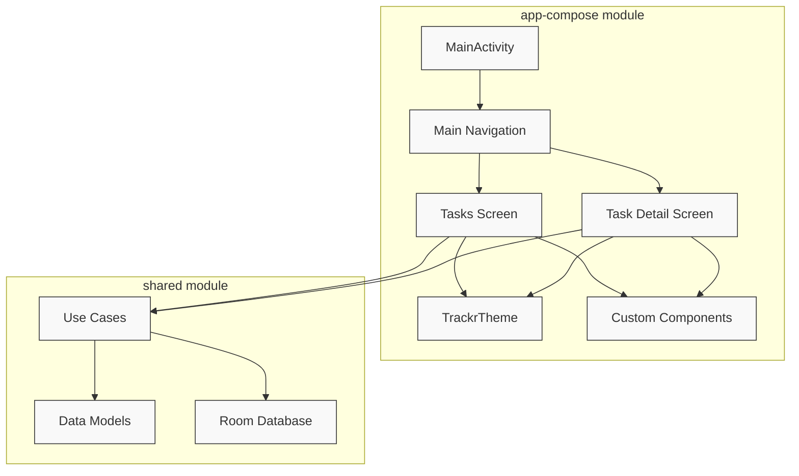
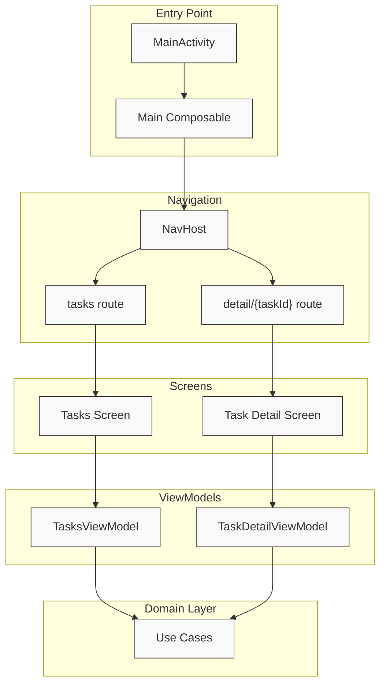
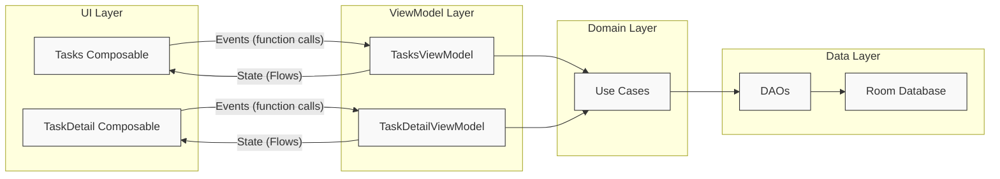
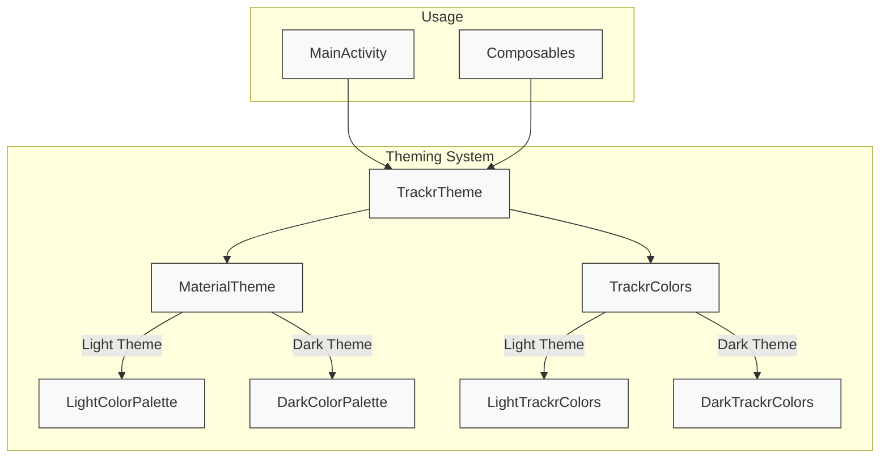
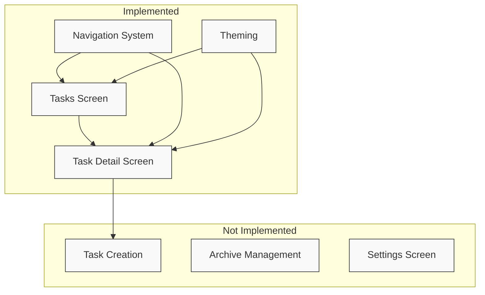

<!-- source: DeepWiki mcp.deepwiki.com · repo android/trackr · page 4 Jetpack Compose Implementation · fetched 2026-10-23 -->

# Jetpack Compose Implementation

<details>
<summary>Relevant source files</summary>

The following files were used as context for generating this wiki page:

- [app-compose/build.gradle](app-compose/build.gradle)
- [app-compose/src/main/AndroidManifest.xml](app-compose/src/main/AndroidManifest.xml)
- [app-compose/src/main/java/com/example/android/trackr/compose/MainActivity.kt](app-compose/src/main/java/com/example/android/trackr/compose/MainActivity.kt)
- [app-compose/src/main/java/com/example/android/trackr/compose/ui/Main.kt](app-compose/src/main/java/com/example/android/trackr/compose/ui/Main.kt)
- [app-compose/src/main/java/com/example/android/trackr/compose/ui/TaskSummaryCard.kt](app-compose/src/main/java/com/example/android/trackr/compose/ui/TaskSummaryCard.kt)
- [app-compose/src/main/java/com/example/android/trackr/compose/ui/Theme.kt](app-compose/src/main/java/com/example/android/trackr/compose/ui/Theme.kt)
- [app-compose/src/main/java/com/example/android/trackr/compose/ui/tasks/Tasks.kt](app-compose/src/main/java/com/example/android/trackr/compose/ui/tasks/Tasks.kt)
- [app-compose/src/main/java/com/example/android/trackr/compose/ui/tasks/TasksViewModel.kt](app-compose/src/main/java/com/example/android/trackr/compose/ui/tasks/TasksViewModel.kt)
- [app-compose/src/main/res/values/themes.xml](app-compose/src/main/res/values/themes.xml)
- [app/src/main/res/values/strings.xml](app/src/main/res/values/strings.xml)
- [shared/src/main/res/values/strings.xml](shared/src/main/res/values/strings.xml)

</details>


This document provides a technical overview of the Jetpack Compose implementation of Trackr, which serves as an alternative to the traditional View-based implementation discussed in the [UI Components and Theming](#2) section. Jetpack Compose is Android's modern declarative UI toolkit that simplifies and accelerates UI development.

## 1. Overview and Architecture

The Compose implementation of Trackr is organized as a separate module (`app-compose`) that shares the same data and domain layers with the main application through the `shared` module. This approach allows for maintaining both implementations simultaneously while reusing business logic.



Sources:
- [app-compose/build.gradle]()
- [app-compose/src/main/java/com/example/android/trackr/compose/ui/Main.kt]()
- [app-compose/src/main/java/com/example/android/trackr/compose/MainActivity.kt]()

## 2. Project Structure and Configuration

The Compose implementation is contained within the `app-compose` module with the following key configuration points:

- **Build Configuration**: Enables Compose with specific compiler options and dependencies
- **Application Theme**: Defines Material-based themes with custom colors
- **Navigation**: Uses Compose Navigation for screen transitions

### 2.1 Build Configuration

The module is configured with Compose-specific dependencies and compiler options:

```
Module: app-compose
├── buildFeatures { compose true }
├── composeOptions {
│   └── kotlinCompilerExtensionVersion
│   └── kotlinCompilerVersion
└── dependencies {
    └── Compose UI
    └── Material
    └── Navigation Compose
    └── Accompanist libraries
    └── Hilt with Compose
}
```

Sources:
- [app-compose/build.gradle:50-56]()
- [app-compose/build.gradle:79-95]()

## 3. Application Structure

The Compose implementation follows a similar architecture to the View-based implementation but with Compose-specific patterns:



Sources:
- [app-compose/src/main/java/com/example/android/trackr/compose/MainActivity.kt:26-34]()
- [app-compose/src/main/java/com/example/android/trackr/compose/ui/Main.kt:32-70]()

### 3.1 Entry Point

The application starts with `MainActivity` which sets the Compose content and configures edge-to-edge display:

```kotlin
@AndroidEntryPoint
class MainActivity : ComponentActivity() {
    override fun onCreate(savedInstanceState: Bundle?) {
        super.onCreate(savedInstanceState)
        WindowCompat.setDecorFitsSystemWindows(window, false)
        setContent { Main() }
    }
}
```

Sources:
- [app-compose/src/main/java/com/example/android/trackr/compose/MainActivity.kt:26-34]()

### 3.2 Navigation

Navigation is implemented using the Navigation Compose library, which defines routes for different screens and handles navigation between them:

```kotlin
NavHost(
    navController = navController,
    startDestination = "tasks",
) {
    composable("tasks") { /* ... */ }
    composable(
        route = "detail/{taskId}",
        arguments = listOf(navArgument("taskId") { type = NavType.LongType })
    ) { /* ... */ }
}
```

Sources:
- [app-compose/src/main/java/com/example/android/trackr/compose/ui/Main.kt:36-67]()

## 4. Screen Implementations

### 4.1 Tasks Screen

The Tasks screen displays a list of tasks grouped by their status. Key features include:

- **Expandable/collapsible status groups** with animated transitions
- **Task summary cards** showing task details
- **Bottom app bar** with menu options
- **Floating action button** to add new tasks

```mermaid
componentDiagram
    component "Tasks Screen" {
        component "TasksContent" {
            component "LazyColumn" {
                component "TaskStatusHeader" 
                component "TaskSummaryCard"
            }
            component "TasksBottomBar"
            component "AddTaskButton"
        }
    }

    component "TasksViewModel" {
        component "statusGroups:Flow"
        component "toggleTaskStarState()"
        component "toggleStatusExpanded()"
    }
    
    component "Domain Layer" {
        component "GetOngoingTaskSummariesUseCase"
        component "ToggleTaskStarStateUseCase"
    }
    
    "Tasks Screen" --> "TasksViewModel"
    "LazyColumn" --> "statusGroups:Flow"
    "TaskStatusHeader" --> "toggleStatusExpanded()"
    "TaskSummaryCard" --> "toggleTaskStarState()"
    "TasksViewModel" --> "GetOngoingTaskSummariesUseCase"
    "TasksViewModel" --> "ToggleTaskStarStateUseCase"
```

Sources:
- [app-compose/src/main/java/com/example/android/trackr/compose/ui/tasks/Tasks.kt:71-90]()
- [app-compose/src/main/java/com/example/android/trackr/compose/ui/tasks/Tasks.kt:92-163]()
- [app-compose/src/main/java/com/example/android/trackr/compose/ui/tasks/TasksViewModel.kt:33-66]()

### 4.2. Task Summary Card

The `TaskSummaryCard` component displays the key information for each task:

- Task title
- Owner information with avatar
- Due date with formatted time message
- Tags associated with the task
- Star button for marking favorite tasks

Sources:
- [app-compose/src/main/java/com/example/android/trackr/compose/ui/TaskSummaryCard.kt:52-95]()
- [app-compose/src/main/java/com/example/android/trackr/compose/ui/TaskSummaryCard.kt:97-107]()

## 5. State Management

The Compose implementation uses ViewModels with Kotlin Flows for state management. This approach follows the unidirectional data flow pattern:

1. UI events are sent to the ViewModel through function calls
2. ViewModel processes events and updates state
3. UI observes state through Flows and recomposes when state changes



Key state management patterns in the Trackr Compose implementation:

| Pattern | Implementation | Example |
|---------|----------------|---------|
| State Hoisting | State is managed at higher levels and passed down to composables | `statusGroups` in `TasksViewModel` |
| State Collection | UI collects state flows with `collectAsState()` | `val statusGroups by viewModel.statusGroups.collectAsState(emptyMap())` |
| Event Handling | Functions passed from parent to child composables | `onStarClick`, `onTaskClick` |
| Flow Combination | Multiple flows combined into a single state | `combine(statusExpanded, getOngoingTaskSummariesUseCase(currentUser.id))` |

Sources:
- [app-compose/src/main/java/com/example/android/trackr/compose/ui/tasks/Tasks.kt:71-90]()
- [app-compose/src/main/java/com/example/android/trackr/compose/ui/tasks/TasksViewModel.kt:43-53]()

## 6. Theming System

Trackr's Compose implementation uses a custom theming system built on Material Design components:



The theming system includes:

1. **Base Material Theme** - Defines colors, typography, and shapes
2. **Custom TrackrColors** - Extends the theme with application-specific colors
3. **Light and Dark Variants** - Different color schemes for light and dark modes
4. **Custom Shapes** - Rounded corners for cards and other components

Key theme elements include:

| Theme Component | Purpose | Implementation |
|-----------------|---------|----------------|
| Color Palettes | Define color schemes for light/dark themes | `LightColorPalette`/`DarkColorPalette` |
| TrackrColors | App-specific colors (tag colors, star color) | `LightTrackrColors`/`DarkTrackrColors` |
| Shapes | Consistent component shapes | `Shapes(medium = RoundedCornerShape(8.dp))` |
| Window Insets | Handle edge-to-edge design | `ProvideWindowInsets` from Accompanist |

Sources:
- [app-compose/src/main/java/com/example/android/trackr/compose/ui/Theme.kt:30-140]()
- [app-compose/src/main/java/com/example/android/trackr/compose/ui/Main.kt:32-35]()

## 7. Integration with Domain Layer

The Compose implementation maintains separation of concerns by connecting to the same domain layer as the View-based implementation. This allows both UI implementations to share business logic.

| Component | Responsibility | Example |
|-----------|----------------|---------|
| ViewModels | Connect UI to domain layer | `TasksViewModel` uses `GetOngoingTaskSummariesUseCase` |
| Use Cases | Encapsulate business logic | `ToggleTaskStarStateUseCase` handles starring/unstarring tasks |
| Data Models | Shared between both implementations | `TaskSummary`, `User`, `Tag` from shared module |

Sources:
- [app-compose/src/main/java/com/example/android/trackr/compose/ui/tasks/TasksViewModel.kt:34-38]()
- [app-compose/src/main/java/com/example/android/trackr/compose/ui/tasks/TasksViewModel.kt:55-59]()

## 8. Current Implementation Status

The Compose implementation is still in progress, with some features not yet implemented:

- Task creation functionality is marked as TODO
- Archive management screen is planned but not completed
- Settings screen is planned but not implemented



Sources:
- [app-compose/src/main/java/com/example/android/trackr/compose/ui/Main.kt:43-54]()

## 9. Key Differences from View-Based Implementation

While sharing the same domain and data layer, the Compose implementation differs from the View-based implementation in several ways:

| Feature | View-Based Implementation | Compose Implementation |
|---------|---------------------------|------------------------|
| UI Construction | XML layouts with Data Binding | Declarative Compose functions |
| Navigation | Navigation Component with XML | Navigation Compose |
| State Management | LiveData + ViewModels | Flow + ViewModels |
| List Rendering | RecyclerView with Adapters | LazyColumn with items |
| Animations | XML transitions, ObjectAnimators | Compose animations (AnimatedVisibility) |
| Theming | XML theme resources | Compose MaterialTheme |

Sources:
- [app-compose/src/main/java/com/example/android/trackr/compose/ui/tasks/Tasks.kt:92-163]()
- [app-compose/src/main/java/com/example/android/trackr/compose/ui/Main.kt:36-67]()

## 10. Advantages of the Compose Implementation

The Jetpack Compose implementation offers several benefits:

1. **Concise UI code** - Reduced boilerplate compared to XML and adapter-based UI
2. **Reactive UI updates** - Automatic UI updates based on state changes
3. **Animation integration** - Simpler animations with built-in Compose animation APIs
4. **Composability** - UI components that can be easily combined and reused
5. **Preview support** - Direct UI previews without running the app

Sources:
- [app-compose/src/main/java/com/example/android/trackr/compose/ui/TaskSummaryCard.kt:117-141]()
- [app-compose/src/main/java/com/example/android/trackr/compose/ui/tasks/Tasks.kt:144-159]()

---

