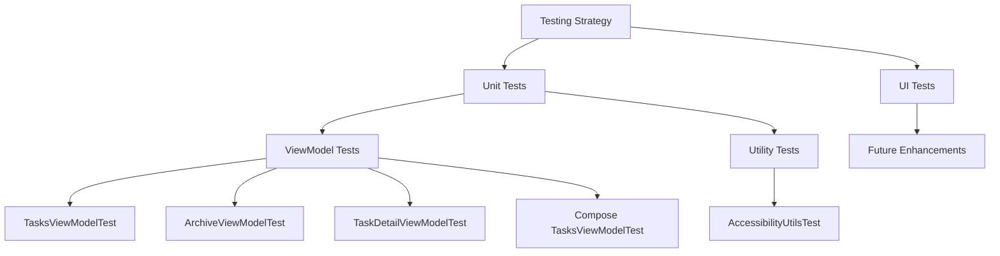
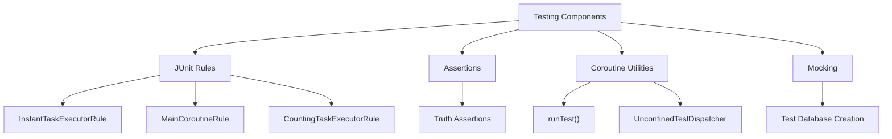
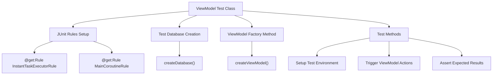
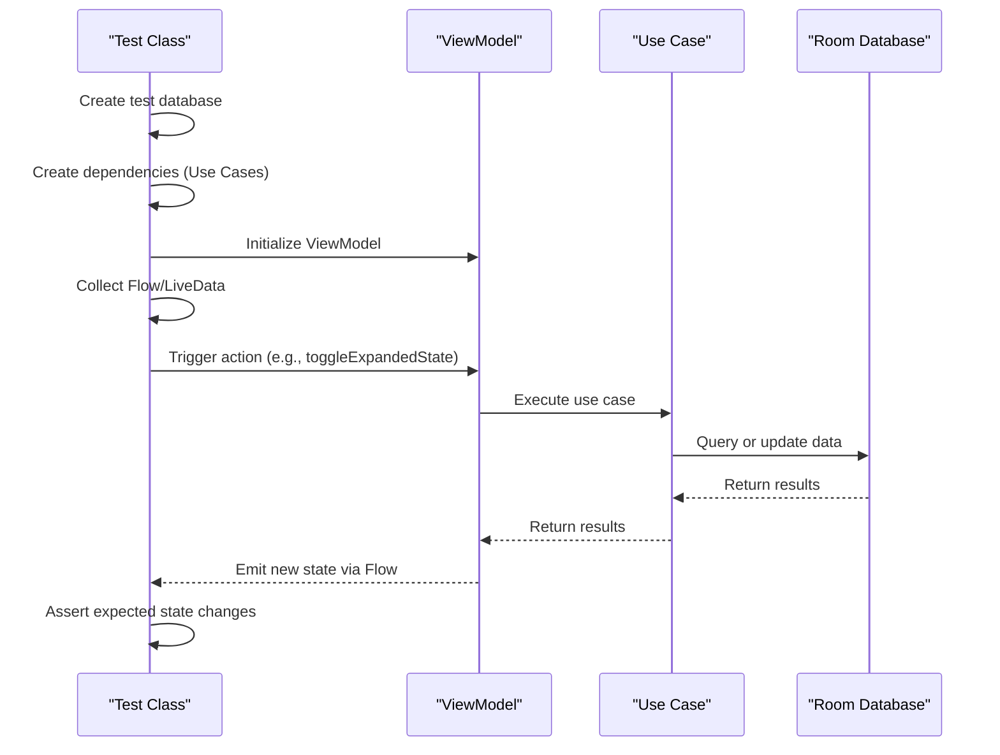

<!-- source: DeepWiki mcp.deepwiki.com · repo android/trackr · page 5 Testing Strategy · fetched 2026-10-23 -->

# Testing Strategy

<details>
<summary>Relevant source files</summary>

The following files were used as context for generating this wiki page:

- [app-compose/src/test/java/com/example/android/trackr/compose/MainCoroutineRule.kt](app-compose/src/test/java/com/example/android/trackr/compose/MainCoroutineRule.kt)
- [app-compose/src/test/java/com/example/android/trackr/compose/ui/tasks/TasksViewModelTest.kt](app-compose/src/test/java/com/example/android/trackr/compose/ui/tasks/TasksViewModelTest.kt)
- [app/src/main/java/com/example/android/trackr/ui/utils/AccessibilityUtils.kt](app/src/main/java/com/example/android/trackr/ui/utils/AccessibilityUtils.kt)
- [app/src/test/java/com/example/android/trackr/CoroutineTestRule.kt](app/src/test/java/com/example/android/trackr/CoroutineTestRule.kt)
- [app/src/test/java/com/example/android/trackr/ui/archive/ArchiveViewModelTest.kt](app/src/test/java/com/example/android/trackr/ui/archive/ArchiveViewModelTest.kt)
- [app/src/test/java/com/example/android/trackr/ui/detail/TaskDetailViewModelTest.kt](app/src/test/java/com/example/android/trackr/ui/detail/TaskDetailViewModelTest.kt)
- [app/src/test/java/com/example/android/trackr/ui/tasks/TasksViewModelTest.kt](app/src/test/java/com/example/android/trackr/ui/tasks/TasksViewModelTest.kt)
- [app/src/test/java/com/example/android/trackr/ui/utils/AccessibilityUtilsTest.kt](app/src/test/java/com/example/android/trackr/ui/utils/AccessibilityUtilsTest.kt)

</details>


This document outlines the testing approach implemented in the Trackr application. It provides an overview of the testing frameworks, tools, and methodologies used to ensure code quality and functionality across the codebase. This page focuses on unit testing strategies and test structure, with an emphasis on ViewModel testing.

## Overview of Testing Approach

Trackr implements a comprehensive testing strategy focused primarily on unit testing. The testing approach emphasizes verifying the behavior of ViewModels, which contain most of the application's business logic according to the MVVM architecture pattern.



Sources:
- [app/src/test/java/com/example/android/trackr/ui/tasks/TasksViewModelTest.kt]()
- [app/src/test/java/com/example/android/trackr/ui/archive/ArchiveViewModelTest.kt]()
- [app/src/test/java/com/example/android/trackr/ui/detail/TaskDetailViewModelTest.kt]()
- [app-compose/src/test/java/com/example/android/trackr/compose/ui/tasks/TasksViewModelTest.kt]()
- [app/src/test/java/com/example/android/trackr/ui/utils/AccessibilityUtilsTest.kt]()

## Test Structure and Components

### Core Testing Components

The testing framework in Trackr relies on several key components that facilitate writing effective and reliable tests.



Sources:
- [app/src/test/java/com/example/android/trackr/CoroutineTestRule.kt]()
- [app-compose/src/test/java/com/example/android/trackr/compose/MainCoroutineRule.kt]()
- [app/src/test/java/com/example/android/trackr/ui/detail/TaskDetailViewModelTest.kt:31-36]()

### ViewModel Test Structure

ViewModel tests in Trackr follow a consistent structure, making them easy to understand and maintain.



Sources:
- [app/src/test/java/com/example/android/trackr/ui/tasks/TasksViewModelTest.kt:45-62]()
- [app/src/test/java/com/example/android/trackr/ui/archive/ArchiveViewModelTest.kt:46-63]()
- [app/src/test/java/com/example/android/trackr/ui/detail/TaskDetailViewModelTest.kt:32-46]()

## Testing Frameworks and Tools

### JUnit and AndroidX Test

Trackr uses JUnit 4 with the AndroidJUnit4 runner for unit tests. The test classes leverage several important rules:

- `InstantTaskExecutorRule`: Ensures LiveData and other architecture components execute synchronously
- `MainCoroutineRule`: A custom rule that handles Kotlin coroutines by swapping the main dispatcher with a test dispatcher
- `CountingTaskExecutorRule`: Used specifically for Room database tests to manage background threads

Sources:
- [app/src/test/java/com/example/android/trackr/ui/tasks/TasksViewModelTest.kt:19-20]()
- [app/src/test/java/com/example/android/trackr/ui/tasks/TasksViewModelTest.kt:45-49]()
- [app/src/test/java/com/example/android/trackr/ui/detail/TaskDetailViewModelTest.kt:33-36]()

### Coroutines Testing

Since Trackr extensively uses Kotlin coroutines, the testing framework includes specialized utilities for testing coroutine-based code:

| Component | Purpose |
|-----------|---------|
| `MainCoroutineRule` | JUnit rule that replaces the main dispatcher with a test dispatcher |
| `runTest` | Creates a test coroutine scope for running test functions |
| `UnconfinedTestDispatcher` | Test dispatcher that processes coroutines eagerly |

```kotlin
@get:Rule
val coroutineRule = MainCoroutineRule()

@Test
fun myCoroutineTest() = runTest {
    // Test coroutine-based code here
}
```

Sources:
- [app/src/test/java/com/example/android/trackr/CoroutineTestRule.kt:27-40]()
- [app/src/test/java/com/example/android/trackr/ui/tasks/TasksViewModelTest.kt:65-72]()
- [app/src/test/java/com/example/android/trackr/ui/archive/ArchiveViewModelTest.kt:76-102]()

### Assertion Libraries

Trackr uses the Google Truth library for assertions, which provides more readable and expressive assertions than standard JUnit assertions:

```kotlin
// Example Truth assertion pattern
assertThat(actual).hasSize(4)
assertThat(condition).isTrue()
assertThat(value).isEqualTo(expected)
```

Sources:
- [app/src/test/java/com/example/android/trackr/ui/tasks/TasksViewModelTest.kt:68-70]()
- [app/src/test/java/com/example/android/trackr/ui/archive/ArchiveViewModelTest.kt:80-81]()
- [app/src/test/java/com/example/android/trackr/ui/utils/AccessibilityUtilsTest.kt:66-72]()

## Testing ViewModels

ViewModels are the core components tested in Trackr. The testing flow typically follows this pattern:



Sources:
- [app/src/test/java/com/example/android/trackr/ui/tasks/TasksViewModelTest.kt:51-62]()
- [app/src/test/java/com/example/android/trackr/ui/tasks/TasksViewModelTest.kt:65-72]()
- [app/src/test/java/com/example/android/trackr/ui/detail/TaskDetailViewModelTest.kt:61-89]()

### TasksViewModel Tests

Tests for `TasksViewModel` verify:
- List item generation and grouping
- Expanding/collapsing task status groups
- Task archiving and unarchiving functionality

Key test methods:
- `listItems()`: Verifies the correct task list items are generated
- `toggleExpandedState()`: Tests expanding/collapsing of task status groups
- `archiveTask()`: Tests archiving a task and verifies it can be unarchived

Sources:
- [app/src/test/java/com/example/android/trackr/ui/tasks/TasksViewModelTest.kt:64-119]()

### ArchiveViewModel Tests

Tests for `ArchiveViewModel` verify:
- Task selection in the archive
- Unarchiving of selected tasks
- Tracking of selected item count

Key test methods:
- `select()`: Tests selecting/deselecting archived tasks
- `unarchive()`: Tests unarchiving selected tasks and undoing the operation

Sources:
- [app/src/test/java/com/example/android/trackr/ui/archive/ArchiveViewModelTest.kt:76-144]()

### TaskDetailViewModel Tests

Tests for `TaskDetailViewModel` verify:
- Loading task details
- Toggling the starred state of a task

Key test methods:
- `loadsDetails()`: Tests loading details for a specific task
- `toggleStarred()`: Tests toggling the starred state of a task

Sources:
- [app/src/test/java/com/example/android/trackr/ui/detail/TaskDetailViewModelTest.kt:60-121]()

## Testing Utilities

### AccessibilityUtils Tests

Trackr includes tests for its accessibility utilities, which verify that correct accessibility labels are generated for task summaries:

- `taskSummaryLabel_noTags()`: Tests labels for tasks without tags
- `taskSummaryLabel_withTags()`: Tests labels for tasks with tags

Sources:
- [app/src/test/java/com/example/android/trackr/ui/utils/AccessibilityUtilsTest.kt:64-84]()

## Database Testing

The testing strategy includes a pattern for testing components that interact with the Room database:

1. Create an in-memory test database
2. Initialize the DAOs and other dependencies
3. Set up test data
4. Execute test operations
5. Verify expected database state

```kotlin
// Common pattern for database test setup
private fun createViewModel(): SomeViewModel {
    val db = createDatabase() // Creates in-memory database
    val dao = db.someDao()
    return SomeViewModel(UseCaseWithDao(dao))
}
```

Sources:
- [app/src/test/java/com/example/android/trackr/ui/tasks/TasksViewModelTest.kt:51-62]()
- [app/src/test/java/com/example/android/trackr/ui/archive/ArchiveViewModelTest.kt:54-68]()
- [app/src/test/java/com/example/android/trackr/ui/detail/TaskDetailViewModelTest.kt:40-57]()

## Best Practices and Patterns

Based on the testing code in Trackr, several best practices can be identified:

1. **Use of Test Rules**: JUnit rules are used to standardize test environment setup
2. **In-Memory Databases**: Tests use in-memory databases to avoid external dependencies
3. **Flow Collection**: Tests collect and verify Flow emissions to validate state changes
4. **Clean Test Structure**: Tests follow a consistent setup → execute → verify pattern
5. **Isolation of Dependencies**: Tests create isolated instances of dependencies

Sources:
- [app/src/test/java/com/example/android/trackr/ui/tasks/TasksViewModelTest.kt]()
- [app/src/test/java/com/example/android/trackr/ui/archive/ArchiveViewModelTest.kt]()
- [app/src/test/java/com/example/android/trackr/ui/detail/TaskDetailViewModelTest.kt]()

## Jetpack Compose Testing

The Compose version of Trackr also includes ViewModel tests that follow similar patterns, with some Compose-specific considerations:

Sources:
- [app-compose/src/test/java/com/example/android/trackr/compose/ui/tasks/TasksViewModelTest.kt]()
- [app-compose/src/test/java/com/example/android/trackr/compose/MainCoroutineRule.kt]()

## Potential Future Enhancements

While the current testing strategy focuses on unit tests, potential future enhancements could include:

1. UI tests using Espresso or Compose UI testing
2. Integration tests for verifying component interactions
3. End-to-end tests for complete user flows
4. Performance testing for critical paths