# Page: Trackr: Task Management with Accessibility

# Trackr: Task Management with Accessibility

<details>
<summary>Relevant source files</summary>

The following files were used as context for generating this wiki page:

- [README.md](README.md)
- [app/src/main/java/com/example/android/trackr/MainActivity.kt](app/src/main/java/com/example/android/trackr/MainActivity.kt)
- [app/src/main/res/layout/archive_fragment.xml](app/src/main/res/layout/archive_fragment.xml)
- [app/src/main/res/layout/main_activity.xml](app/src/main/res/layout/main_activity.xml)
- [app/src/main/res/layout/tasks_fragment.xml](app/src/main/res/layout/tasks_fragment.xml)
- [screenshots/detail_dark.png](screenshots/detail_dark.png)
- [screenshots/edit.png](screenshots/edit.png)
- [screenshots/talkback_home.png](screenshots/talkback_home.png)

</details>


Trackr is a sample Android application designed to demonstrate task management functionality with a strong focus on accessibility. This document provides an overview of Trackr's architecture, core components, and accessibility features. For detailed information about the project structure and build configuration, see [Project Structure and Build Configuration](#1.1). For in-depth coverage of the app's accessibility features, see [Accessibility Features](#1.3).

## Purpose and Overview

Trackr showcases how to build a task management application that properly supports accessibility services like TalkBack and Switch Access. The application allows users to:

- Create, view, and edit tasks
- Assign tasks to team members
- Associate tags with tasks
- Archive tasks by swiping right
- Modify task priority by dragging up or down

The app is specifically designed to ensure that all functionality remains accessible to users with disabilities, including those who may not be able to perform gestures like swipe or drag-and-drop but use screen readers or other assistive technologies.

Sources: [README.md:6-30]()

## High-Level Architecture

Trackr follows the MVVM (Model-View-ViewModel) architecture pattern with clean architecture principles, organized into three main layers:

### System Architecture Diagram

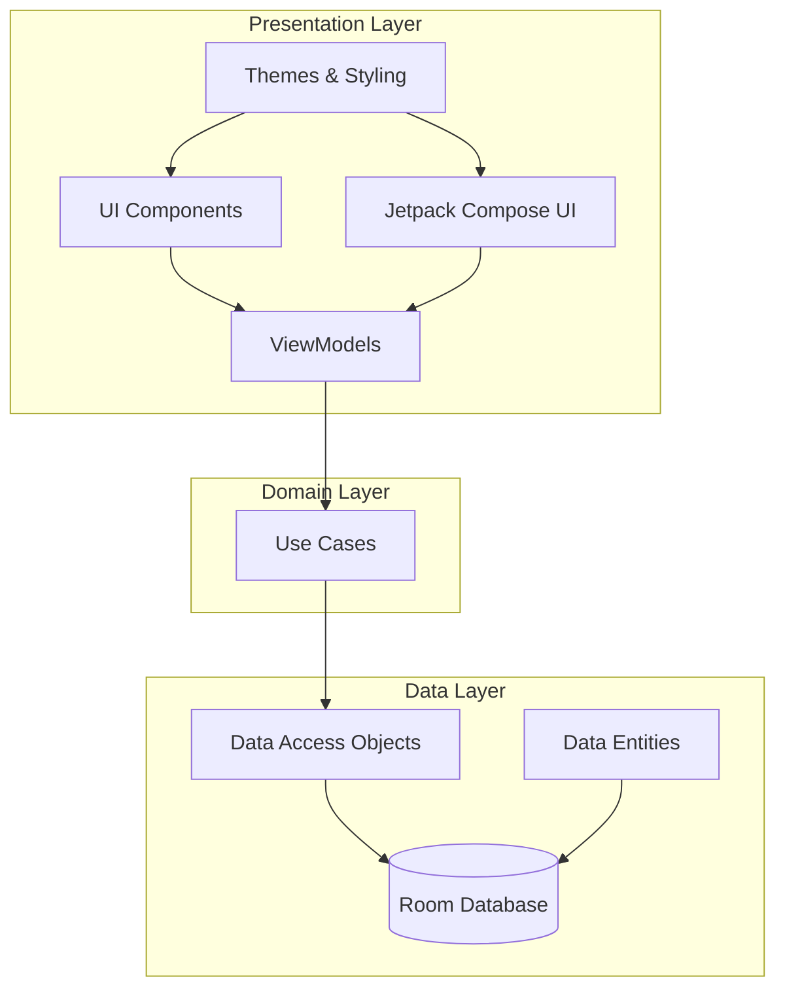

- **Presentation Layer**: Contains UI components (Fragments and Activities), ViewModels that manage UI state, and theme resources
- **Domain Layer**: Contains Use Cases that encapsulate business logic
- **Data Layer**: Contains DAOs (Data Access Objects), entities, and Room database for data persistence

This architecture promotes separation of concerns and makes the application more maintainable and testable.

Sources: [MainActivity.kt:19-31]()

## Core Task Management Components

The task management functionality is divided into distinct features, each with dedicated UI components and ViewModels:

### Task Management Components Diagram

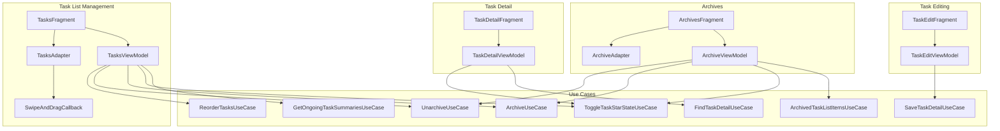

1. **Task List Management**:
   - `TasksFragment`: Main UI for displaying the list of tasks
   - `TasksViewModel`: Manages task list state and operations
   - `TasksAdapter`: RecyclerView adapter for displaying tasks
   - `SwipeAndDragCallback`: Handles swipe-to-archive and drag-to-reorder gestures

2. **Task Detail**:
   - `TaskDetailFragment`: Displays detailed information about a selected task
   - `TaskDetailViewModel`: Manages the task detail state

3. **Task Editing**:
   - `TaskEditFragment`: UI for creating or editing tasks
   - `TaskEditViewModel`: Manages the task editing state

4. **Archives**:
   - `ArchivesFragment`: Displays archived tasks
   - `ArchiveViewModel`: Manages the archive view state
   - `ArchiveAdapter`: RecyclerView adapter for displaying archived tasks

Sources: [tasks_fragment.xml:1-87](), [archive_fragment.xml:1-86]()

## Data Flow for Task Operations

The following diagram illustrates how data flows through the system when a user interacts with the UI:

### Task Operation Data Flow Diagram

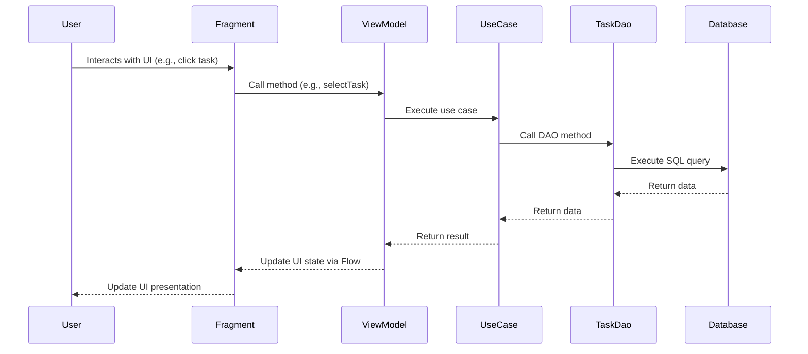

This unidirectional data flow pattern enhances predictability and makes it easier to track changes in the application state. Kotlin Flows are used to expose state updates from ViewModels to UI components.

Sources: [MainActivity.kt:35-91]()

## UI Component Hierarchy

The app's UI is structured around a master-detail pattern, which adapts to different screen sizes:

### UI Component Hierarchy Diagram

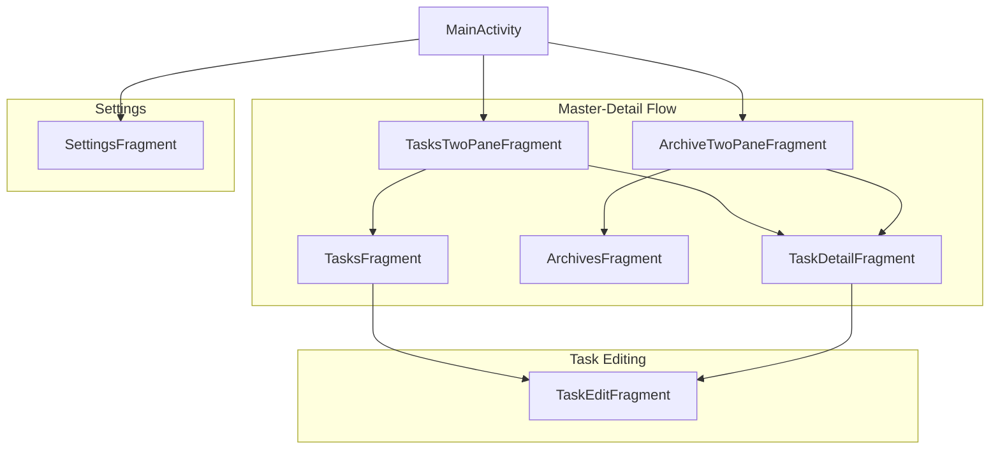

- `MainActivity`: The main entry point of the application
- `TasksTwoPaneFragment` & `ArchiveTwoPaneFragment`: Implement the master-detail pattern using SlidingPaneLayout for larger screens
- `TasksFragment` & `ArchivesFragment`: Display lists of ongoing and archived tasks
- `TaskDetailFragment`: Shows detailed information about a selected task
- `TaskEditFragment`: Allows creating or editing tasks
- `SettingsFragment`: Contains application settings

Sources: [main_activity.xml:1-40](), [MainActivity.kt:32-91]()

## Accessibility Features

Trackr demonstrates several Android accessibility best practices to ensure that all users, including those with disabilities, can use the app effectively:

### Key Accessibility APIs

1. **Custom Accessibility Actions**:
   - `ViewCompat.addAccessibilityAction()`: Adds custom actions to elements like tasks, enabling screen reader users to access features like swipe-to-archive or drag-and-drop reordering.
   - `ViewCompat.replaceAccessibilityAction()`: Customizes the label for accessibility actions to provide clearer context.

2. **State Descriptions**:
   - `ViewCompat.setStateDescription()`: Provides additional context about an element's state, such as whether a task is starred or not.

3. **Timeout Management**:
   - `AccessibilityManager.getRecommendedTimeoutMillis()`: Adjusts timeout duration for ephemeral content based on user's accessibility settings.

These APIs ensure that functionality like swipe-to-archive and drag-and-drop reordering remains accessible to users who cannot perform these gestures but use assistive technologies like screen readers.

Sources: [README.md:32-44]()

### Accessibility Implementation Table

| Feature | Standard Interaction | Accessible Alternative | API Used |
|---------|---------------------|------------------------|----------|
| Archive Task | Swipe right gesture | Custom accessibility action | ViewCompat.addAccessibilityAction() |
| Reorder Tasks | Drag and drop gesture | Custom accessibility actions for moving up/down | ViewCompat.addAccessibilityAction() |
| Task State | Visual indicators | State descriptions | ViewCompat.setStateDescription() |
| Ephemeral Messages | Timed notifications | Adjusted timeout based on accessibility settings | AccessibilityManager.getRecommendedTimeoutMillis() |

## Main Activity Structure

The `MainActivity` serves as the entry point to the application and sets up the navigation system:

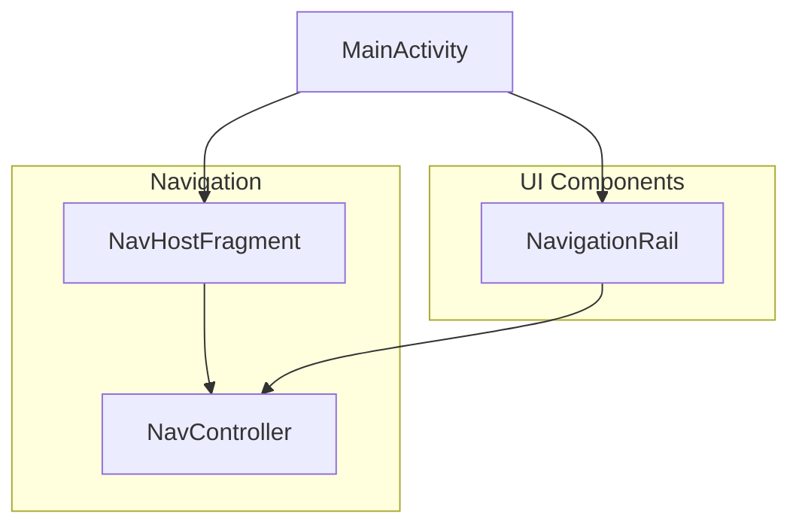

Key components:
- `MainActivity`: Sets up the app layout and handles window insets
- `NavHostFragment`: Container for navigation destinations
- `NavController`: Manages navigation between destinations
- `NavigationRail`: Side navigation for larger screen layouts

The MainActivity uses Data Binding and handles window insets properly for edge-to-edge UI.

Sources: [MainActivity.kt:32-91](), [main_activity.xml:1-40]()

## Conclusion

Trackr demonstrates how to implement a task management application with a focus on accessibility. By utilizing Android's accessibility APIs and following best practices, Trackr ensures that all users, including those with disabilities, can access the full functionality of the app. The MVVM architecture with clean separation of concerns makes the codebase maintainable and easy to understand.

For more detailed information about specific components, please see the related wiki pages:
- For Project Structure: [Project Structure and Build Configuration](#1.1)
- For Accessibility Features: [Accessibility Features](#1.3)
- For UI Components: [UI Components and Theming](#2)
- For Data Management: [Data Management](#3)

Sources: [README.md:1-99](), [MainActivity.kt:17-92]()

---

# Page: Project Structure and Build Configuration

# Project Structure and Build Configuration

<details>
<summary>Relevant source files</summary>

The following files were used as context for generating this wiki page:

- [app-compose/build.gradle](app-compose/build.gradle)
- [app-compose/src/main/java/com/example/android/trackr/compose/ui/TaskSummaryCard.kt](app-compose/src/main/java/com/example/android/trackr/compose/ui/TaskSummaryCard.kt)
- [app-compose/src/main/java/com/example/android/trackr/compose/ui/Theme.kt](app-compose/src/main/java/com/example/android/trackr/compose/ui/Theme.kt)
- [app-compose/src/main/java/com/example/android/trackr/compose/ui/tasks/TasksViewModel.kt](app-compose/src/main/java/com/example/android/trackr/compose/ui/tasks/TasksViewModel.kt)
- [app/build.gradle](app/build.gradle)
- [build.gradle](build.gradle)
- [gradle/wrapper/gradle-wrapper.properties](gradle/wrapper/gradle-wrapper.properties)
- [shared/build.gradle](shared/build.gradle)

</details>


This document explains the project's directory structure, module organization, and Gradle build configuration for the Trackr Android application. For information about the application's architecture and design patterns, see [Application Architecture](#1.2).

## 1. Project Overview

Trackr is organized as a multi-module Android project with a Gradle-based build system. The project demonstrates modern Android development practices including multiple UI implementations, shared business logic, and comprehensive test coverage.

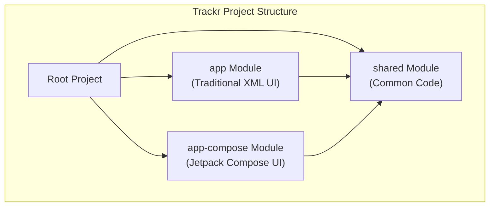

Sources: [build.gradle:17-89](), [app/build.gradle:17-33](), [shared/build.gradle:17-41](), [app-compose/build.gradle:17-41]()

## 2. Module Organization

The Trackr project consists of three main modules, each with a specific responsibility:

| Module | Description | Primary Features |
|--------|-------------|------------------|
| **app** | Main application with traditional XML-based UI | Fragment-based UI, ViewModels, Data Binding |
| **app-compose** | Alternative UI implementation using Jetpack Compose | Declarative UI, Compose Navigation |
| **shared** | Common code library used by both UI implementations | Data models, Room database, Business logic |

Sources: [app/build.gradle:17-33](), [shared/build.gradle:17-41](), [app-compose/build.gradle:17-41]()

## 3. Build System Configuration

### 3.1 Root Project Configuration

The root `build.gradle` file defines common configuration, dependency versions, and repositories for all modules in the project.

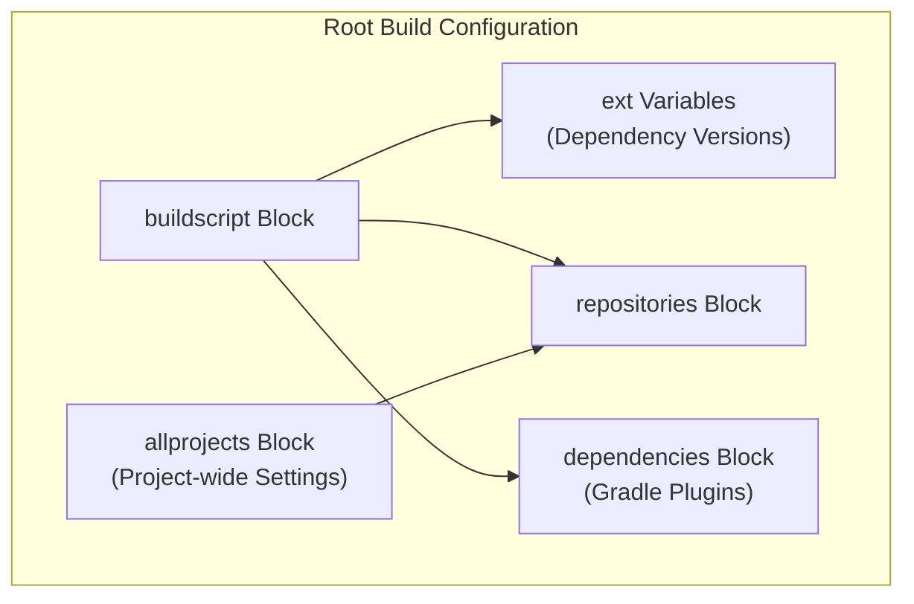

Key components of the root configuration:
- Version management for all dependencies
- Common repository configuration
- Gradle plugin dependencies

Sources: [build.gradle:17-89]()

### 3.2 Module-Specific Gradle Configuration

Each module has its own `build.gradle` file that defines module-specific configuration.

#### App Module Configuration

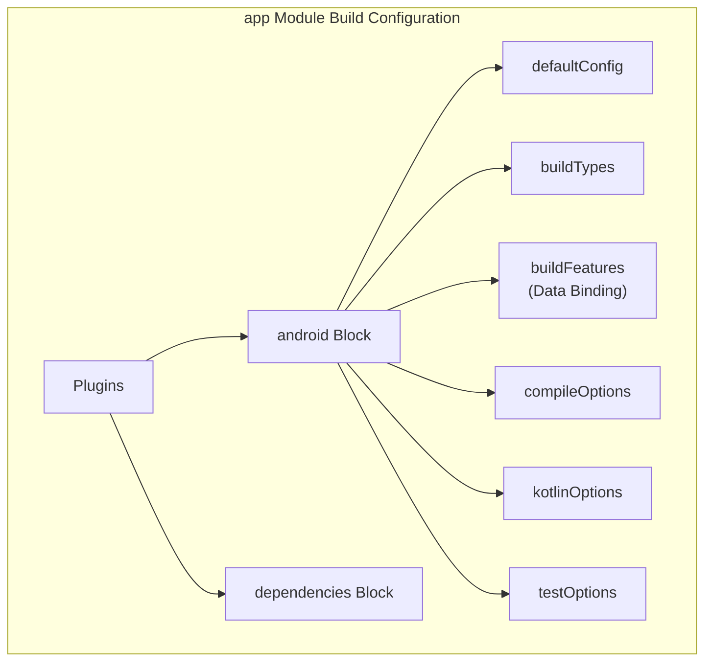

The app module includes these key build configurations:
- Android-specific build settings (SDK versions, application ID)
- Data binding enabled
- Java 8 language features with desugaring
- Dependencies on AndroidX libraries and the shared module

Sources: [app/build.gradle:17-133]()

#### Shared Module Configuration

The shared module is configured as an Android library with Room database support and core business logic.

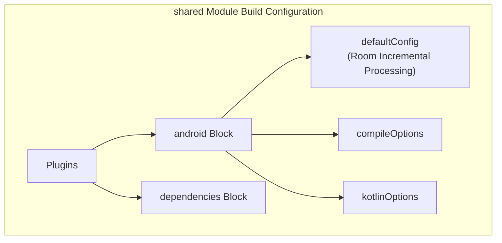

Sources: [shared/build.gradle:17-102]()

#### App-Compose Module Configuration

The app-compose module provides an alternative UI implementation using Jetpack Compose.

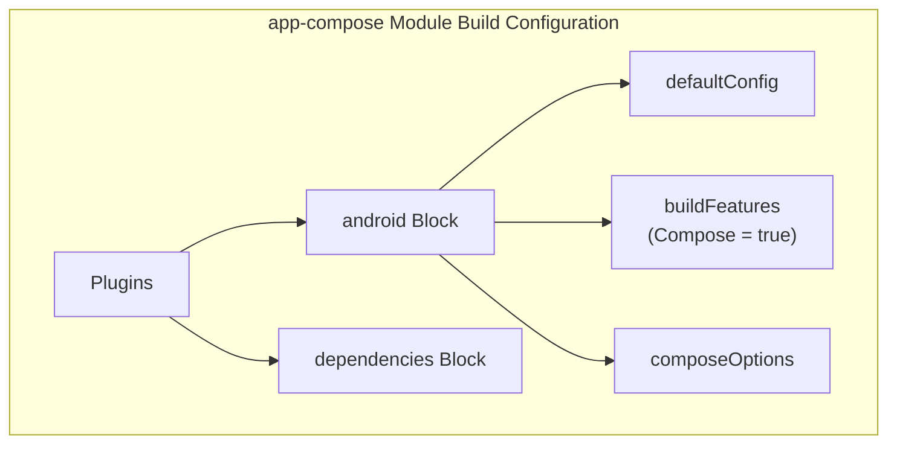

Key features:
- Jetpack Compose enabled
- Compose-specific configuration and dependencies
- Shared data layer from shared module

Sources: [app-compose/build.gradle:17-118]()

## 4. Key Dependencies and Versions

The project uses a wide range of libraries and frameworks, with versions defined in the root `build.gradle` file:

### 4.1 Foundation Libraries

| Library | Version | Purpose |
|---------|---------|---------|
| Kotlin | 1.5.21 | Programming language |
| AndroidX Core | 1.6.0 | Core Android functionality |
| Material Components | 1.4.0 | Material Design implementation |

### 4.2 Architecture Components

| Library | Version | Purpose |
|---------|---------|---------|
| Room | 2.4.2 | Database ORM |
| Lifecycle | 2.4.0-alpha01 | Lifecycle-aware components |
| Navigation | 2.4.0-alpha05 | Navigation framework |
| Hilt | 2.36 | Dependency injection |

### 4.3 UI Components

| Library | Version | Purpose |
|---------|---------|---------|
| Compose | 1.0.1 | Declarative UI framework |
| RecyclerView | 1.1.0 | List display |
| ConstraintLayout | 2.0.4 | Complex layouts |
| SlidingPaneLayout | 1.2.0-alpha03 | Master-detail UI patterns |

Sources: [build.gradle:19-62]()

## 5. Build Features and Configurations

### 5.1 Data Binding

The app module uses data binding to connect UI elements with data sources:

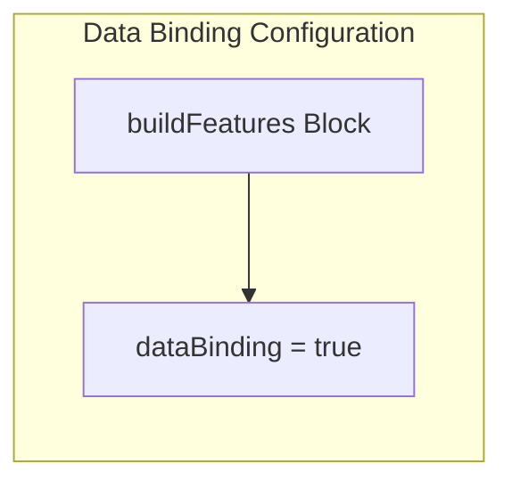

Sources: [app/build.gradle:42-44]()

### 5.2 Compose Configuration

The app-compose module enables and configures Jetpack Compose:

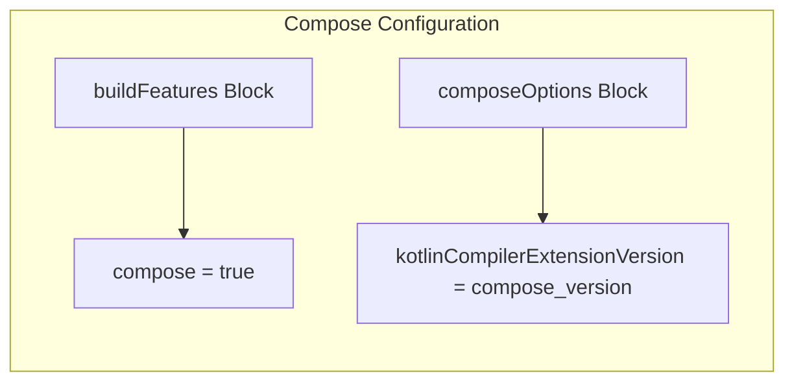

Sources: [app-compose/build.gradle:50-56]()

### 5.3 Java 8 Language Features

All modules enable Java 8 language features with desugaring for compatibility with older Android versions:

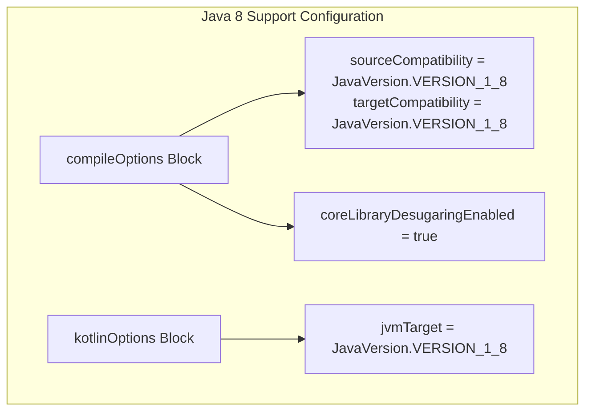

Sources: [app/build.gradle:46-54](), [shared/build.gradle:43-51](), [app-compose/build.gradle:41-49]()

## 6. Testing Configuration

The project includes comprehensive test configuration for unit tests and instrumentation tests:

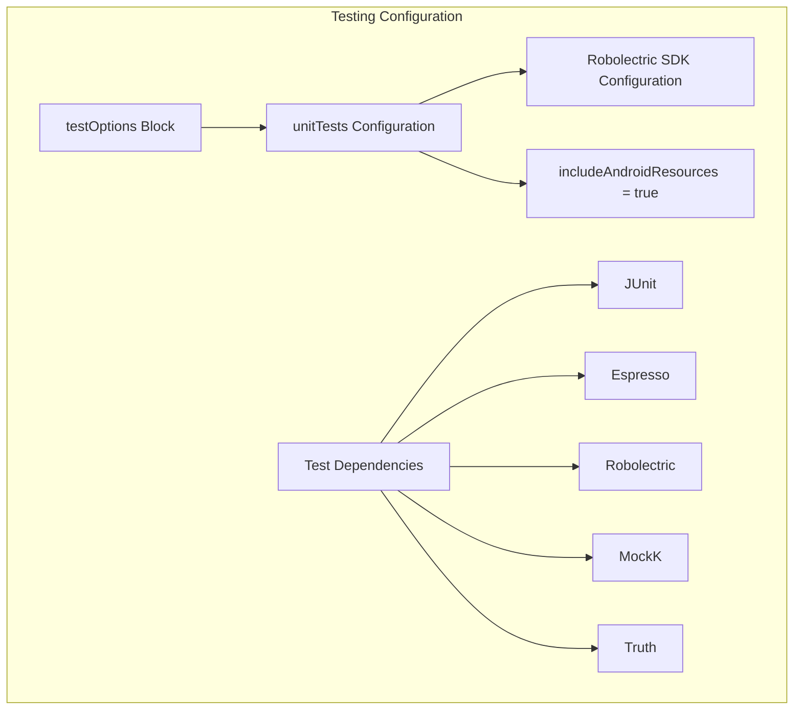

Key testing components:
- JUnit for unit testing
- Espresso for UI testing
- Robolectric for testing without device
- Truth for assertions
- MockK for mocking

Sources: [app/build.gradle:67-74](), [app/build.gradle:117-132](), [shared/build.gradle:64-71](), [app-compose/build.gradle:57-68]()

## 7. Gradle Wrapper

The project uses Gradle 7.1.1 via the Gradle Wrapper, ensuring build system consistency across development environments.

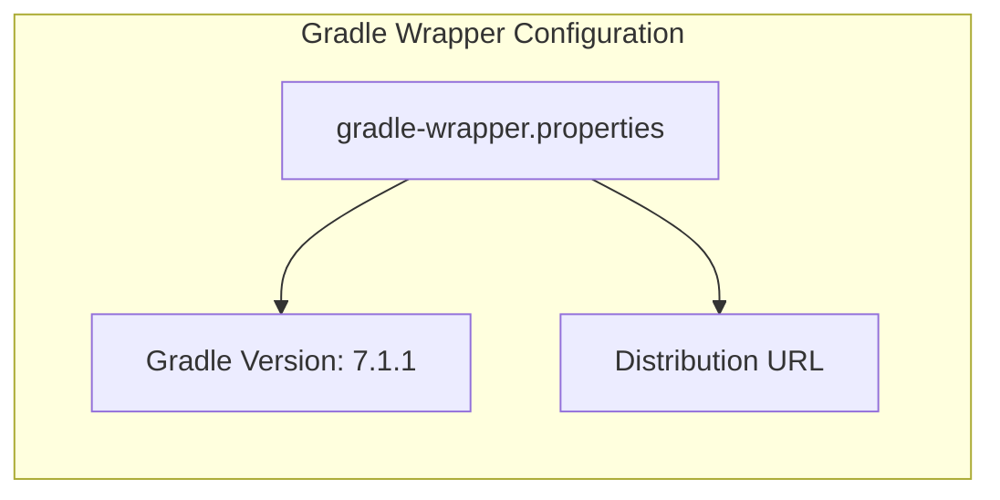

Sources: [gradle/wrapper/gradle-wrapper.properties:1-7]()

## 8. Build Process Flow

The following diagram illustrates how the build process flows through the Gradle configuration:

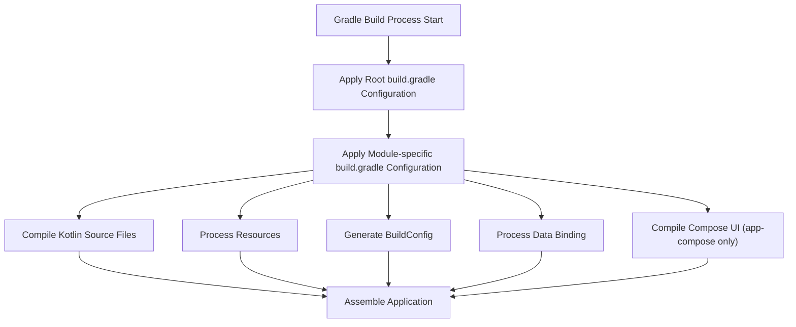

Sources: [build.gradle:17-89](), [app/build.gradle:17-133](), [shared/build.gradle:17-102](), [app-compose/build.gradle:17-118]()

---

# Page: Application Architecture

# Application Architecture

<details>
<summary>Relevant source files</summary>

The following files were used as context for generating this wiki page:

- [app/src/main/java/com/example/android/trackr/MainActivity.kt](app/src/main/java/com/example/android/trackr/MainActivity.kt)
- [app/src/main/java/com/example/android/trackr/ui/tasks/TasksFragment.kt](app/src/main/java/com/example/android/trackr/ui/tasks/TasksFragment.kt)
- [app/src/main/java/com/example/android/trackr/ui/tasks/TasksViewModel.kt](app/src/main/java/com/example/android/trackr/ui/tasks/TasksViewModel.kt)
- [app/src/main/res/layout/archive_fragment.xml](app/src/main/res/layout/archive_fragment.xml)
- [app/src/main/res/layout/main_activity.xml](app/src/main/res/layout/main_activity.xml)
- [app/src/main/res/layout/tasks_fragment.xml](app/src/main/res/layout/tasks_fragment.xml)
- [shared/src/main/java/com/example/android/trackr/data/Views.kt](shared/src/main/java/com/example/android/trackr/data/Views.kt)
- [shared/src/main/java/com/example/android/trackr/db/dao/TaskDao.kt](shared/src/main/java/com/example/android/trackr/db/dao/TaskDao.kt)
- [shared/src/main/java/com/example/android/trackr/usecase/ArchivedTaskListItemsUseCase.kt](shared/src/main/java/com/example/android/trackr/usecase/ArchivedTaskListItemsUseCase.kt)
- [shared/src/main/java/com/example/android/trackr/usecase/GetOngoingTaskSummariesUseCase.kt](shared/src/main/java/com/example/android/trackr/usecase/GetOngoingTaskSummariesUseCase.kt)
- [shared/src/test/java/com/example/android/trackr/db/dao/TaskDaoTest.kt](shared/src/test/java/com/example/android/trackr/db/dao/TaskDaoTest.kt)

</details>


This document describes the architectural design of the Trackr application, outlining the key components, patterns, and frameworks used. Trackr follows the MVVM (Model-View-ViewModel) architecture pattern with clean architecture principles, which promotes separation of concerns and maintainability.

For information about the project's directory structure and build configuration, see [Project Structure and Build Configuration](#1.1). For details about UI components and theming, see [UI Components and Theming](#2).

## 1. Architectural Overview

Trackr is built using a layered architecture approach that separates the application into distinct layers with specific responsibilities. This separation helps in maintaining, testing, and evolving the application over time.

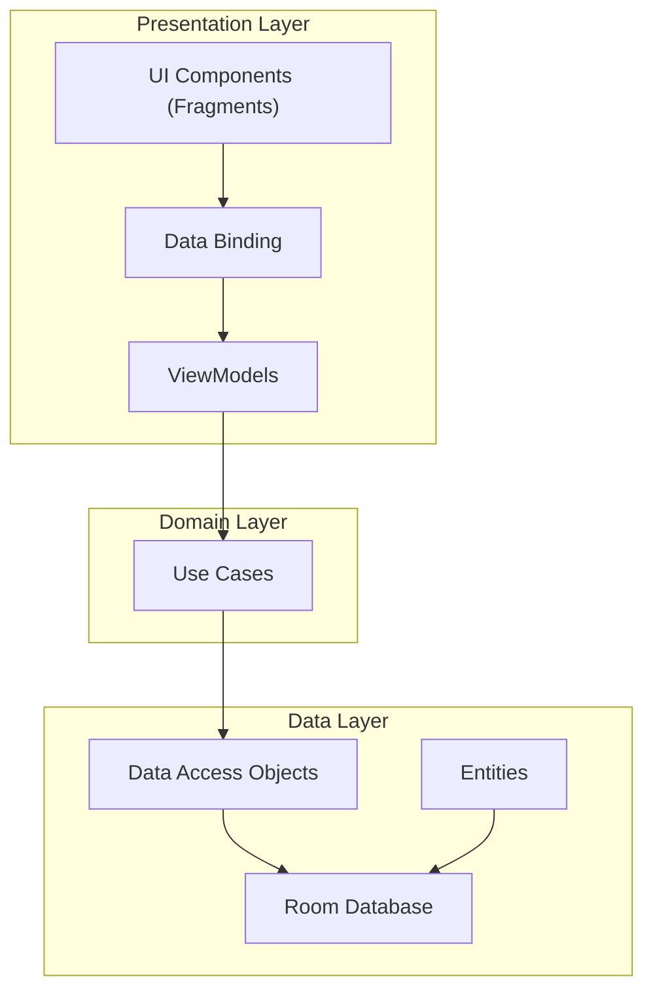

Sources:
- [app/src/main/java/com/example/android/trackr/MainActivity.kt]()
- [app/src/main/java/com/example/android/trackr/ui/tasks/TasksFragment.kt:46-96]()
- [app/src/main/java/com/example/android/trackr/ui/tasks/TasksViewModel.kt:39-77]()

## 2. MVVM Implementation

The application implements MVVM (Model-View-ViewModel) pattern, which is recommended by Google for Android applications. This pattern helps separate UI logic from business logic and data management.

### 2.1 Key Components in MVVM

```mermaid
classDiagram
    class "Fragment" {
        - binding: ViewBinding
        - viewModel: ViewModel
        + onViewCreated()
        + bindViews()
    }
    
    class "ViewModel" {
        - useCases: List~UseCase~
        - _state: MutableStateFlow
        + state: StateFlow
        + performAction()
    }
    
    class "UseCase" {
        - dao: DAO
        + invoke()
    }
    
    class "DAO" {
        + query()
        + insert()
        + update()
        + delete()
    }
    
    "Fragment" --> "ViewModel" : observes
    "ViewModel" --> "UseCase" : uses
    "UseCase" --> "DAO" : uses
```

Sources:
- [app/src/main/java/com/example/android/trackr/ui/tasks/TasksFragment.kt:47-50]()
- [app/src/main/java/com/example/android/trackr/ui/tasks/TasksViewModel.kt:38-47]()
- [shared/src/main/java/com/example/android/trackr/usecase/GetOngoingTaskSummariesUseCase.kt]()

### 2.2 Data Flow

The data flow in Trackr follows a unidirectional pattern:

1. **User Interaction**: User interacts with the UI (Fragments)
2. **ViewModel Notification**: UI notifies the ViewModel about the action
3. **Business Logic Execution**: ViewModel executes appropriate use cases
4. **Data Modification**: Use cases interact with DAOs to modify data
5. **State Updates**: Changes are emitted as state updates via StateFlow
6. **UI Updates**: UI observes state changes and updates accordingly

Sources:
- [app/src/main/java/com/example/android/trackr/ui/tasks/TasksViewModel.kt:69-77]()
- [app/src/main/java/com/example/android/trackr/ui/tasks/TasksFragment.kt:113-152]()

## 3. Presentation Layer

The presentation layer consists of Activities, Fragments, ViewModels, and UI-related resources.

### 3.1 Activities

The application has a single `MainActivity` that serves as the entry point and hosts a `NavHostFragment` for fragment-based navigation.

Sources:
- [app/src/main/java/com/example/android/trackr/MainActivity.kt:32-92]()
- [app/src/main/res/layout/main_activity.xml:22-40]()

### 3.2 Fragments

Fragments represent different screens in the application. For example:

- `TasksFragment`: Displays the list of ongoing tasks
- `ArchivesFragment`: Shows archived tasks
- `TaskDetailFragment`: Shows task details
- `TaskEditFragment`: Allows editing of tasks

Each fragment binds to its corresponding layout using data binding.

Sources:
- [app/src/main/java/com/example/android/trackr/ui/tasks/TasksFragment.kt:46-210]()
- [app/src/main/res/layout/tasks_fragment.xml:17-87]()
- [app/src/main/res/layout/archive_fragment.xml:17-86]()

### 3.3 ViewModels

ViewModels manage UI-related data and handle business logic. They are lifecycle-aware and survive configuration changes. Trackr uses Hilt to inject dependencies into ViewModels.

```mermaid
classDiagram
    class "TasksViewModel" {
        - getOngoingTaskSummariesUseCase: GetOngoingTaskSummariesUseCase
        - toggleTaskStarStateUseCase: ToggleTaskStarStateUseCase
        - reorderTasksUseCase: ReorderTasksUseCase
        - archiveUseCase: ArchiveUseCase
        - unarchiveUseCase: UnarchiveUseCase
        - currentUser: User
        + listItems: StateFlow~List~ListItem~~
        + archivedItem: Flow~ArchivedItem~
        + showTaskDetailEvents: Flow~ShowTaskDetailEvent~
        + toggleExpandedState()
        + toggleTaskStarState()
        + archiveTask()
        + unarchiveTask()
        + reorderTasks()
        + showTaskDetail()
    }
```

Sources:
- [app/src/main/java/com/example/android/trackr/ui/tasks/TasksViewModel.kt:39-144]()

### 3.4 Data Binding

Trackr uses data binding to connect UI elements with data sources, eliminating the need for boilerplate code to update the UI.

```kotlin
// Example of how data binding is used in fragments
private val binding by dataBindings(TasksFragmentBinding::bind)
```

Sources:
- [app/src/main/java/com/example/android/trackr/ui/tasks/TasksFragment.kt:50]()
- [app/src/main/res/layout/tasks_fragment.xml:17-35]()

## 4. Domain Layer

The domain layer contains use cases that encapsulate business logic. These are small, focused classes that implement specific operations.

### 4.1 Use Cases

Use cases follow the single responsibility principle and are designed to be reusable. They typically:
- Accept input parameters
- Interact with the data layer
- Return results (often as Kotlin Flow)

Examples of use cases in Trackr:
- `GetOngoingTaskSummariesUseCase`: Retrieves ongoing task summaries
- `ArchivedTaskListItemsUseCase`: Retrieves archived tasks
- `ToggleTaskStarStateUseCase`: Toggles the star state of a task
- `ArchiveUseCase`: Archives one or more tasks
- `UnarchiveUseCase`: Unarchives tasks
- `ReorderTasksUseCase`: Reorders tasks within a category

Sources:
- [shared/src/main/java/com/example/android/trackr/usecase/GetOngoingTaskSummariesUseCase.kt:22-26]()
- [shared/src/main/java/com/example/android/trackr/usecase/ArchivedTaskListItemsUseCase.kt:22-26]()
- [app/src/main/java/com/example/android/trackr/ui/tasks/TasksViewModel.kt:40-46]()

## 5. Data Layer

The data layer is responsible for data management and persistence. It consists of the Room database, DAOs, entities, and views.

### 5.1 Room Database

Trackr uses Room, an abstraction layer over SQLite, for data persistence. Room provides compile-time verification of SQL queries and reduces boilerplate code.

### 5.2 Data Access Objects (DAOs)

DAOs define methods for interacting with the database. They use annotations to specify SQL operations.

```mermaid
classDiagram
    class "TaskDao" {
        + insertUsers()
        + insertTasks()
        + getTasks(): Flow~List~Task~~
        + getOngoingTaskSummaries(): Flow~List~TaskSummary~~
        + getArchivedTaskSummaries(): Flow~List~TaskSummary~~
        + findTaskDetailById(): Flow~TaskDetail?~
        + updateTaskStatus()
        + setIsArchived()
        + reorderTasks()
        + saveTaskDetail()
    }
```

Sources:
- [shared/src/main/java/com/example/android/trackr/db/dao/TaskDao.kt:35-198]()
- [shared/src/test/java/com/example/android/trackr/db/dao/TaskDaoTest.kt:80-198]()

### 5.3 Entities and Views

The data model consists of several entities and database views:

**Entities:**
- `Task`: Represents a task with properties like title, description, status
- `User`: Represents a user with username and avatar
- `Tag`: Represents a tag with label and color
- `TaskTag`: Junction table for the many-to-many relationship between tasks and tags
- `UserTask`: Junction table for tracking starred tasks per user

**Database Views:**
- `TaskSummary`: Summary information about tasks
- `TaskDetail`: Detailed information about a task including its relationships

Sources:
- [shared/src/main/java/com/example/android/trackr/data/Views.kt:25-124]()

## 6. Dependency Injection with Hilt

Trackr uses Hilt, a dependency injection library built on top of Dagger, to manage dependencies throughout the application.

### 6.1 Hilt Components

Hilt provides dependency injection at various Android components:
- Activities (`@AndroidEntryPoint`)
- Fragments (`@AndroidEntryPoint`)
- ViewModels (`@HiltViewModel`)

```mermaid
flowchart TD
    subgraph "Hilt Annotations"
        AEP["@AndroidEntryPoint"]
        HVM["@HiltViewModel"]
        INJ["@Inject"]
    end
    
    subgraph "Application Components"
        ACT["MainActivity"]
        FRAG["TasksFragment"]
        VM["TasksViewModel"]
        UC["Use Cases"]
        REPOS["DAOs"]
    end
    
    AEP --> ACT
    AEP --> FRAG
    HVM --> VM
    INJ --> UC
    INJ --> REPOS
```

Sources:
- [app/src/main/java/com/example/android/trackr/MainActivity.kt:32]()
- [app/src/main/java/com/example/android/trackr/ui/tasks/TasksFragment.kt:46]()
- [app/src/main/java/com/example/android/trackr/ui/tasks/TasksViewModel.kt:39]()
- [shared/src/main/java/com/example/android/trackr/usecase/GetOngoingTaskSummariesUseCase.kt:22]()

## 7. Reactive Programming with Kotlin Flows

Trackr uses Kotlin Flows extensively for reactive programming, which enables the application to respond to data changes efficiently.

### 7.1 StateFlow for UI State

ViewModels expose UI state using `StateFlow` or `Flow`, which fragments observe to update the UI:

```kotlin
// StateFlow in ViewModel
val listItems = combine(taskSummaries, expandedStatesMap) { ... }
    .stateIn(viewModelScope, WhileViewSubscribed, emptyList())

// Flow collection in Fragment
repeatWithViewLifecycle {
    launch {
        tasksViewModel.listItems.collect {
            tasksAdapter.submitList(it) {
                updateStickyHeader()
            }
        }
    }
}
```

Sources:
- [app/src/main/java/com/example/android/trackr/ui/tasks/TasksViewModel.kt:69-77]()
- [app/src/main/java/com/example/android/trackr/ui/tasks/TasksFragment.kt:113-121]()

### 7.2 Flow from Room Database

Room generates Flow objects that emit new values when the database changes:

```kotlin
// Flow return type in DAO
@Query("SELECT * FROM tasks")
fun getTasks(): Flow<List<Task>>

@Transaction
@Query("""
    SELECT s.*,
        EXISTS(
            SELECT id
            FROM user_tasks AS t
            WHERE t.taskId = s.id AND t.userId = :userId
        ) AS starred
    FROM TaskSummary AS s WHERE s.isArchived = 0
    ORDER BY s.status, s.orderInCategory
""")
fun getOngoingTaskSummaries(userId: Long): Flow<List<TaskSummary>>
```

Sources:
- [shared/src/main/java/com/example/android/trackr/db/dao/TaskDao.kt:58-58]()
- [shared/src/main/java/com/example/android/trackr/db/dao/TaskDao.kt:72-82]()

## 8. Summary

The Trackr application demonstrates a well-structured architecture that follows modern Android development practices:

- **MVVM architecture** for separation of concerns
- **Clean architecture principles** for maintainable and testable code
- **Room database** for efficient data persistence
- **Kotlin Flows** for reactive programming
- **Hilt** for dependency injection
- **Data Binding** for connecting UI with data sources

This architecture makes the application more maintainable, testable, and extensible while providing a good user experience.

Sources:
- [app/src/main/java/com/example/android/trackr/ui/tasks/TasksFragment.kt]()
- [app/src/main/java/com/example/android/trackr/ui/tasks/TasksViewModel.kt]()
- [shared/src/main/java/com/example/android/trackr/db/dao/TaskDao.kt]()
- [shared/src/main/java/com/example/android/trackr/data/Views.kt]()

---

# Page: Accessibility Features

# Accessibility Features

<details>
<summary>Relevant source files</summary>

The following files were used as context for generating this wiki page:

- [README.md](README.md)
- [app/src/main/java/com/example/android/trackr/ui/tasks/SwipeAndDragActionCallback.kt](app/src/main/java/com/example/android/trackr/ui/tasks/SwipeAndDragActionCallback.kt)
- [app/src/main/java/com/example/android/trackr/ui/tasks/TasksAdapter.kt](app/src/main/java/com/example/android/trackr/ui/tasks/TasksAdapter.kt)
- [app/src/main/java/com/example/android/trackr/ui/utils/AccessibilityUtils.kt](app/src/main/java/com/example/android/trackr/ui/utils/AccessibilityUtils.kt)
- [app/src/test/java/com/example/android/trackr/ui/tasks/TasksAdapterTest.kt](app/src/test/java/com/example/android/trackr/ui/tasks/TasksAdapterTest.kt)
- [app/src/test/java/com/example/android/trackr/ui/utils/AccessibilityUtilsTest.kt](app/src/test/java/com/example/android/trackr/ui/utils/AccessibilityUtilsTest.kt)
- [screenshots/detail_dark.png](screenshots/detail_dark.png)
- [screenshots/edit.png](screenshots/edit.png)
- [screenshots/talkback_home.png](screenshots/talkback_home.png)

</details>


## Purpose and Scope

This document details the accessibility features implemented throughout the Trackr application. It covers how Trackr ensures core functionality is accessible to all users, including those with disabilities who may interact with their devices using accessibility services such as TalkBack or Switch Access. The focus is on the technical implementation of these features and how they enable alternative interaction methods beyond direct touch gestures.

For information about the overall application architecture, see [Application Architecture](#1.2).

## Introduction to Trackr's Accessibility Philosophy

Trackr is designed with accessibility as a core principle rather than an afterthought. The app ensures that all users—including those with visual, motor, or other impairments—can access the full functionality of the application.

Key accessibility goals in Trackr include:

- Providing alternative methods to access gesture-based functionality
- Ensuring proper content descriptions and context for screen readers
- Maintaining proper state information for UI elements
- Supporting device accessibility settings like dark mode and font scaling

Sources: [README.md:10-29]()

## Core Accessibility Features

### Custom Accessibility Actions

One of Trackr's most important accessibility features is providing equivalent functionality for gesture-based interactions through custom accessibility actions. This allows users who cannot perform gestures like swipe or drag-and-drop to access the same features through their accessibility service.

For example, Trackr implements the following custom accessibility actions:

1. **Archive Task** - Alternative to swipe-to-archive gesture
2. **Star/Unstar Task** - Alternative to tapping the star button
3. **Drag and Drop** - Alternatives for reordering tasks with precise positioning

```mermaid
flowchart TD
    subgraph "Physical Gestures"
        Swipe["Swipe Gesture"]
        DragDrop["Drag and Drop"]
        Tap["Tap Star Button"]
    end

    subgraph "Accessibility Actions"
        ArchiveAction["Archive Action"]
        StarAction["Star/Unstar Action"]
        DragDropAction["Reorder Actions"]
    end

    subgraph "Task Functionality"
        ArchiveTask["Archive Task"]
        ChangeOrder["Change Task Order"]
        ToggleStar["Toggle Star State"]
    end

    Swipe --> ArchiveTask
    ArchiveAction --> ArchiveTask

    DragDrop --> ChangeOrder
    DragDropAction --> ChangeOrder

    Tap --> ToggleStar
    StarAction --> ToggleStar

    style Swipe stroke-dasharray: 5 5
    style DragDrop stroke-dasharray: 5 5
    style Tap stroke-dasharray: 5 5
```

Sources: [app/src/main/java/com/example/android/trackr/ui/tasks/TasksAdapter.kt:219-262](), [app/src/main/java/com/example/android/trackr/ui/tasks/TasksAdapter.kt:273-287]()

### Implementation of Custom Accessibility Actions

Custom accessibility actions are implemented primarily in the `TaskViewHolder` class of the `TasksAdapter`. When binding a task view:

1. Previous accessibility actions are cleared to prevent duplication
2. New actions are added for archive, star/unstar, and drag/drop operations
3. Each action is associated with appropriate functionality via lambdas

```mermaid
sequenceDiagram
    participant TaskViewHolder
    participant ViewCompat
    participant AccessibilityService
    participant User
    
    TaskViewHolder->>TaskViewHolder: bind(taskSummary)
    Note over TaskViewHolder: Clear previous actions
    TaskViewHolder->>ViewCompat: removeAccessibilityAction()
    
    TaskViewHolder->>ViewCompat: addAccessibilityAction("Archive")
    TaskViewHolder->>ViewCompat: addAccessibilityAction("Star"/"Unstar")
    TaskViewHolder->>ViewCompat: addAccessibilityAction("Move up"/"Move down"/etc.)
    
    User->>AccessibilityService: Activate action
    AccessibilityService->>TaskViewHolder: Call action handler
    TaskViewHolder->>TaskViewHolder: Execute corresponding function
```

Sources: [app/src/main/java/com/example/android/trackr/ui/tasks/TasksAdapter.kt:165-197](), [app/src/main/java/com/example/android/trackr/ui/tasks/TasksAdapter.kt:226-236](), [app/src/main/java/com/example/android/trackr/ui/tasks/TasksAdapter.kt:242-253]()

### Content Descriptions and Labels

Trackr implements comprehensive content descriptions to ensure screen reader users understand the purpose and state of UI elements:

1. **Task Summary Labels**: Each task item includes a content description with the title, owner, due date, and tags
2. **Header Accessibility**: Section headers are properly marked as headings for better screen reader navigation
3. **State Information**: UI elements communicate their states (expanded/collapsed, starred/unstarred)

The `AccessibilityUtils` class provides centralized utilities for generating proper content descriptions:

```mermaid
classDiagram
    class AccessibilityUtils {
        +taskSummaryLabel(context, taskSummary, clock): String
    }
    
    class TaskViewHolder {
        -binding: TaskSummaryBinding
        +bind(taskSummary)
    }
    
    class HeaderViewHolder {
        -binding: HeaderItemBinding
        +bind(headerData)
    }
    
    AccessibilityUtils <.. TaskViewHolder: uses
    TaskViewHolder --> ViewCompat: sets accessibility properties
    HeaderViewHolder --> ViewCompat: sets accessibility properties
```

Sources: [app/src/main/java/com/example/android/trackr/ui/utils/AccessibilityUtils.kt:26-55](), [app/src/main/java/com/example/android/trackr/ui/tasks/TasksAdapter.kt:171-172](), [app/src/main/java/com/example/android/trackr/ui/tasks/TasksAdapter.kt:137-139]()

### State Descriptions

State descriptions provide additional context about the current state of UI elements to accessibility service users. Trackr uses this to convey information such as:

1. Whether a task is starred or unstarred
2. Whether a section header is expanded or collapsed
3. The current status of a task (NOT_STARTED, IN_PROGRESS, COMPLETED, etc.)

This is implemented using `ViewCompat.setStateDescription()` to set appropriate state descriptions based on the current state of the UI element.

Sources: [app/src/main/java/com/example/android/trackr/ui/tasks/TasksAdapter.kt:135-138](), [app/src/main/java/com/example/android/trackr/ui/tasks/TasksAdapter.kt:174-179](), [app/src/test/java/com/example/android/trackr/ui/tasks/TasksAdapterTest.kt:112-137]()

### Proper Heading Structure

Section headers in Trackr are properly marked as headings for accessibility services using `ViewCompat.setAccessibilityHeading()`. This allows screen reader users to navigate between sections more efficiently.

```mermaid
flowchart LR
    subgraph "TasksAdapter"
        Header["HeaderViewHolder"]
        Task["TaskViewHolder"]
    end
    
    subgraph "Accessibility Properties"
        IsHeading["isAccessibilityHeading"]
        StateDesc["stateDescription"]
        ContentDesc["contentDescription"]
        Actions["customActions"]
    end
    
    Header --> IsHeading
    Header --> StateDesc
    Task --> StateDesc
    Task --> ContentDesc
    Task --> Actions
```

Sources: [app/src/main/java/com/example/android/trackr/ui/tasks/TasksAdapter.kt:139](), [app/src/test/java/com/example/android/trackr/ui/tasks/TasksAdapterTest.kt:103-108]()

## Accessibility Actions Implementation Details

### Archive Task Action

The archive action provides an alternative to the swipe gesture for archiving tasks:

```
private fun addArchiveAccessibilityAction(taskSummary: TaskSummary) {
    accessibilityActionIds.add(
        ViewCompat.addAccessibilityAction(
            binding.root,
            // The label surfaced to end user by an accessibility service.
            binding.root.context.getString(R.string.archive)
        ) { _, _ ->
            // The functionality associated with the label.
            itemListener.onTaskArchived(taskSummary)
            true
        })
}
```

Sources: [app/src/main/java/com/example/android/trackr/ui/tasks/TasksAdapter.kt:226-236]()

### Star/Unstar Task Action

Similar to the archive action, the star/unstar action provides an alternative way to toggle the star state:

```
private fun addStarAccessibilityAction(taskSummary: TaskSummary) {
    accessibilityActionIds.add(
        ViewCompat.addAccessibilityAction(
            binding.root,
            // The label surfaced to end user by an accessibility service.
            if (taskSummary.starred) {
                binding.root.context.getString(R.string.unstar)
            } else {
                binding.root.context.getString(R.string.star)
            }
        ) { _, _ ->
            // The functionality associated with the label.
            itemListener.onStarClicked(taskSummary)
            true
        })
}
```

Sources: [app/src/main/java/com/example/android/trackr/ui/tasks/TasksAdapter.kt:273-287]()

### Drag and Drop Actions

The drag and drop functionality is made accessible through a set of custom actions that allow precise positioning of tasks:

```mermaid
flowchart TD
    DragDropHelper["DragAndDropActionsHelper"]
    TaskViewHolder["TaskViewHolder"]
    AccessibilityActions["Custom Accessibility Actions"]
    MoveActions["Move Up/Down/To Top/etc."]
    
    DragDropHelper -->|"execute(position)"| TaskViewHolder
    TaskViewHolder -->|"addDragAndDropAction()"| AccessibilityActions
    AccessibilityActions -->|"when activated"| MoveActions
    MoveActions -->|"doDrag(fromPosition, toPosition)"| TaskViewHolder
```

The `DragAndDropActionsHelper` determines what drag and drop actions are available for a given position, and the appropriate actions are added to the task view.

Sources: [app/src/main/java/com/example/android/trackr/ui/tasks/TasksAdapter.kt:242-253](), [app/src/main/java/com/example/android/trackr/ui/tasks/TasksAdapter.kt:255-262]()

## Comprehensive Content Descriptions

Trackr generates thorough content descriptions for task items to ensure screen reader users get all the necessary information about a task. The `AccessibilityUtils.taskSummaryLabel()` method creates these descriptions:

```
fun taskSummaryLabel(context: Context, taskSummary: TaskSummary, clock: Clock): String {
    val sb = StringBuffer()

    sb.append(taskSummary.title).append(PERIOD_SEPARATOR_AND_SPACE)

    sb.append(context.getString(R.string.owner)).append(COLON_SEPARATOR)
    sb.append(taskSummary.owner.username).append(PERIOD_SEPARATOR_AND_SPACE)

    sb.append(
        DateTimeUtils.durationMessageOrDueDate(
            context.resources,
            taskSummary.dueAt,
            clock
        )
    )
    sb.append(if (taskSummary.tags.isEmpty()) PERIOD_SEPARATOR else PERIOD_SEPARATOR_AND_SPACE)

    sb.append(
        TextUtils.join(
            PERIOD_SEPARATOR_AND_SPACE,
            taskSummary.tags.map { context.getString(R.string.tag_label, it.label) })
    )

    return sb.toString()
}
```

This creates descriptions like: "task 2. Owner: user. Due today. Tag: tag1. Tag: tag2"

Sources: [app/src/main/java/com/example/android/trackr/ui/utils/AccessibilityUtils.kt:31-55](), [app/src/test/java/com/example/android/trackr/ui/utils/AccessibilityUtilsTest.kt:65-84]()

## Testing Accessibility Features

Trackr includes specific unit tests for its accessibility features to ensure they continue to function correctly as the codebase evolves. These tests verify:

1. Proper content descriptions are generated
2. State descriptions are correctly set based on item state
3. Accessibility actions work as expected
4. Accessibility settings are applied correctly to view elements

```mermaid
flowchart LR
    subgraph "Accessibility Tests"
        ContentDescTest["Content Description Tests"]
        StateDescTest["State Description Tests"]
        ActionsTest["Accessibility Actions Tests"]
    end
    
    subgraph "Test Assertions"
        VerifyLabels["Verify Labels"]
        VerifyStates["Verify States"]
        VerifyActions["Verify Actions"]
    end
    
    ContentDescTest --> VerifyLabels
    StateDescTest --> VerifyStates
    ActionsTest --> VerifyActions
```

Sources: [app/src/test/java/com/example/android/trackr/ui/utils/AccessibilityUtilsTest.kt:41-114](), [app/src/test/java/com/example/android/trackr/ui/tasks/TasksAdapterTest.kt:74-234]()

## Integration with Accessibility Services

Trackr works well with Android accessibility services like TalkBack and Switch Access. Here's how different accessibility services interact with the app:

| Accessibility Service | Supported Features | Implementation Details |
|------------------------|-------------------|------------------------|
| TalkBack               | Content descriptions<br>Custom actions<br>Heading navigation | Uses Android's accessibility framework to read screen content aloud |
| Switch Access          | Custom actions<br>Focus navigation | Provides alternative actions for gestures like swipe and drag |
| Voice Access           | Command-based interaction | Works with content descriptions and custom actions |
| Screen Magnification   | UI magnification | Standard Android support through proper layout practices |
| Display Adjustments    | Dark mode<br>Text scaling | Implemented through proper theming and layout practices |

Sources: [README.md:16-29](), [screenshots/detail_dark.png]()

## Best Practices Demonstrated

The Trackr application demonstrates several accessibility best practices that developers can learn from:

1. **Provide alternatives for gestures**: Custom accessibility actions for swipe and drag gestures
2. **Meaningful content descriptions**: Detailed content descriptions that include all relevant information
3. **State communication**: Clear state descriptions for UI elements
4. **Proper heading structure**: Marking headers appropriately for screen reader navigation
5. **Action labeling**: Custom labels for actions to make their purpose clear
6. **Maintaining accessibility action state**: Clearing and recreating actions when recycling views

Sources: [app/src/main/java/com/example/android/trackr/ui/tasks/TasksAdapter.kt:219-262](), [app/src/main/java/com/example/android/trackr/ui/tasks/TasksAdapter.kt:165-179]()

## Accessibility Implementation Hierarchy

```mermaid
flowchart TD
    subgraph "UI Layer"
        TasksFragment["TasksFragment"]
        TaskDetailFragment["TaskDetailFragment"]
        ArchivesFragment["ArchivesFragment"]
    end

    subgraph "Adapter Layer"
        TasksAdapter["TasksAdapter"]
        TaskViewHolder["TaskViewHolder"]
        HeaderViewHolder["HeaderViewHolder"]
        SwipeAndDragCallback["SwipeAndDragCallback"]
    end

    subgraph "Accessibility Layer"
        AccessibilityUtils["AccessibilityUtils"]
        AddActions["Custom Accessibility Actions"]
        StateDesc["State Descriptions"]
        ContentDesc["Content Descriptions"]
    end

    TasksFragment --> TasksAdapter
    TasksAdapter --> TaskViewHolder
    TasksAdapter --> HeaderViewHolder
    TasksAdapter --> SwipeAndDragCallback
    
    TaskViewHolder --> AddActions
    TaskViewHolder --> StateDesc
    TaskViewHolder --> ContentDesc
    HeaderViewHolder --> StateDesc
    
    AccessibilityUtils --> ContentDesc
```

Sources: [app/src/main/java/com/example/android/trackr/ui/tasks/TasksAdapter.kt:39-307](), [app/src/main/java/com/example/android/trackr/ui/utils/AccessibilityUtils.kt:26-55]()

## Conclusion

Trackr demonstrates how to make a feature-rich Android application fully accessible to all users, including those who rely on accessibility services. By providing alternative methods to access gesture-based functionality, comprehensive content descriptions, and proper state information, Trackr ensures that all users can enjoy its core features regardless of how they interact with their devices.

---

# Page: UI Components and Theming

# UI Components and Theming

<details>
<summary>Relevant source files</summary>

The following files were used as context for generating this wiki page:

- [app-compose/src/main/java/com/example/android/trackr/compose/ui/tasks/Tasks.kt](app-compose/src/main/java/com/example/android/trackr/compose/ui/tasks/Tasks.kt)
- [app/src/main/AndroidManifest.xml](app/src/main/AndroidManifest.xml)
- [app/src/main/res/drawable/ic_star.xml](app/src/main/res/drawable/ic_star.xml)
- [app/src/main/res/drawable/ic_star_border.xml](app/src/main/res/drawable/ic_star_border.xml)
- [app/src/main/res/values-night/colors.xml](app/src/main/res/values-night/colors.xml)
- [app/src/main/res/values-night/themes.xml](app/src/main/res/values-night/themes.xml)
- [app/src/main/res/values/attrs.xml](app/src/main/res/values/attrs.xml)
- [app/src/main/res/values/colors.xml](app/src/main/res/values/colors.xml)
- [app/src/main/res/values/dimens.xml](app/src/main/res/values/dimens.xml)
- [app/src/main/res/values/strings.xml](app/src/main/res/values/strings.xml)
- [app/src/main/res/values/styles.xml](app/src/main/res/values/styles.xml)
- [app/src/main/res/values/themes.xml](app/src/main/res/values/themes.xml)
- [app/src/main/res/values/type.xml](app/src/main/res/values/type.xml)
- [shared/src/main/res/values/strings.xml](shared/src/main/res/values/strings.xml)

</details>


This document provides an overview of the Trackr application's UI components and theming system. It covers the design language, theme implementation, color palette, typography, and key UI components used throughout the application. For information about specific screens and their implementations, see [Task List Implementation](#2.1), [Task Detail View](#2.2), and [Responsive Layout: Two-Pane Implementation](#2.5).

## 1. Theme Architecture

Trackr implements a comprehensive theming system based on Material Design guidelines with support for both light and dark modes. The theme structure is designed to maintain visual consistency across the application while adapting to user preferences and system settings.

```mermaid
flowchart TD
    subgraph "Theme Architecture"
        ThemeMaterial["Theme.MaterialComponents.DayNight.NoActionBar"] --> ThemeTrackr["Theme.Trackr"]
        ThemeTrackr --> ThemeTrackrDayNight["Theme.Trackr.DayNight"]
        ThemeTrackr --> ThemeTrackrDark["Theme.Trackr.Dark"]
        
        subgraph "Theme Components"
            ColorPalette["Color Palette"] --> ThemeTrackr
            Typography["Typography Styles"] --> ThemeTrackr
            CustomAttrs["Custom Attributes"] --> ThemeTrackr
            WidgetStyles["Widget Styles"] --> ThemeTrackr
        end
        
        ThemeTrackrDayNight --> AppTheme["Application Theme"]
        ThemeTrackrDark --> AppTheme
        
        AppTheme --> Activities["Activities\n(MainActivity)"]
        AppTheme --> Fragments["Fragments\n(TasksFragment, ArchivesFragment, etc.)"]
    end
```

Sources:
- [app/src/main/res/values/themes.xml:18-64]()
- [app/src/main/res/values-night/themes.xml:17-51]()
- [app/src/main/AndroidManifest.xml:20-27]()

### 1.1 Light and Dark Theme Implementation

Trackr implements a dual-theme approach with dedicated styles for light and dark modes:

- **Light Theme (Default)**: Defined in `Theme.Trackr` with bright backgrounds and darker text colors
- **Dark Theme**: Defined in `Theme.Trackr.Dark` with dark backgrounds and lighter text colors

The application uses `Theme.Trackr.DayNight` as its primary theme, which automatically switches between light and dark modes based on system settings or user preferences configured in the Settings screen.

```mermaid
classDiagram
    class Theme_Trackr {
        colorPrimary: trackr_blue_500
        colorSecondary: trackr_pink_600
        windowBackground: colorPrimary
        textColorSecondary: trackr_gray_500
        typographyStyles
        customAttributes
    }
    
    class Theme_Trackr_Dark {
        colorPrimary: trackr_blue_700
        colorSecondary: trackr_pink_400
        colorOnSecondary: trackr_blue_700
        textColorSecondary: trackr_blue_100
        colorOnPrimary: trackr_white_50
        customAttributes(darkMode)
    }
    
    class Theme_Trackr_DayNight {
        Switches between themes
    }
    
    Theme_Trackr <|-- Theme_Trackr_DayNight
    Theme_Trackr_Dark <|-- Theme_Trackr_DayNight
```

Sources:
- [app/src/main/res/values/themes.xml:21-21]()
- [app/src/main/res/values/themes.xml:23-64]()
- [app/src/main/res/values-night/themes.xml:18-18]()
- [app/src/main/res/values-night/themes.xml:20-50]()

## 2. Color System

The Trackr application uses a comprehensive color palette defined in the colors.xml files, with specific color values for both light and dark themes.

### 2.1 Primary Color Palette

| Color Group | Light Theme | Dark Theme | Usage |
|-------------|-------------|------------|-------|
| Primary     | trackr_blue_500 | trackr_blue_700 | Main app color, app bars, backgrounds |
| Secondary   | trackr_pink_600 | trackr_pink_400 | Buttons, accents, highlights |
| Background  | Varies | trackr_blue_700 | Screen backgrounds |
| Text        | trackr_gray_500 | trackr_blue_100 | Secondary text |
| Star Icon   | trackr_yellow_500 | trackr_yellow_300 | Star/favorite indicators |

### 2.2 Tag Color System

Trackr uses a color-coded tag system with different background and text colors for various tag categories. Each tag color has specific background and text color pairs defined for both light and dark themes.

| Tag Color | Light Theme Background | Light Theme Text | Dark Theme Background | Dark Theme Text |
|-----------|------------------------|------------------|----------------------|----------------|
| Blue      | trackr_blue_100       | trackr_blue_700  | trackr_blue_700     | trackr_blue_100 |
| Green     | trackr_green_100      | trackr_green_700 | trackr_green_800    | trackr_green_200 |
| Purple    | trackr_purple_100     | trackr_purple_700 | trackr_purple_800  | trackr_purple_200 |
| Red       | trackr_red_100        | trackr_red_700   | trackr_pink_800     | trackr_white_50 |
| Teal      | trackr_teal_100       | trackr_teal_800  | trackr_teal_800     | trackr_teal_100 |
| Yellow    | trackr_yellow_100     | trackr_yellow_700 | trackr_yellow_700  | trackr_yellow_100 |

Sources:
- [app/src/main/res/values/colors.xml:18-73]()
- [app/src/main/res/values-night/colors.xml:18-24]()
- [app/src/main/res/values/themes.xml:45-63]()
- [app/src/main/res/values-night/themes.xml:31-49]()

## 3. Typography System

Trackr implements a consistent typography system using the Raleway font family. The system defines three main text styles that are applied throughout the application.

```mermaid
graph TD
    subgraph "Typography System"
        TextStyles["Text Styles"] --> Headline1["TextAppearance.Trackr.Headline1\n- Font: Raleway ExtraBold\n- Size: 25sp"]
        TextStyles --> Headline2["TextAppearance.Trackr.Headline2\n- Font: Raleway ExtraBold\n- Size: 23sp"]
        TextStyles --> Body1["TextAppearance.Trackr.Body1\n- Font: Raleway Regular\n- Size: 19sp"]
        
        subgraph "Custom TextView Styles"
            Headline1 --> LabelTitle["Widget.Trackr.TextView.Label.Title"]
            Headline2 --> Label["Widget.Trackr.TextView.Label"]
            Body1 --> Body["Widget.Trackr.TextView.Body"]
        end
    end
```

Sources:
- [app/src/main/res/values/type.xml:18-37]()
- [app/src/main/res/values/styles.xml:19-39]()
- [app/src/main/res/values/dimens.xml:19-22]()

## 4. UI Components

### 4.1 Text Components

Trackr defines custom TextView styles for consistent text presentation:

1. **Label TextView** (`Widget.Trackr.TextView.Label`):
   - Used for section headers and field labels
   - Applies Headline2 text appearance
   - Includes consistent padding and drawable spacing

2. **Title TextView** (`Widget.Trackr.TextView.Label.Title`):
   - Used for page titles and major headings
   - Applies Headline1 text appearance

3. **Body TextView** (`Widget.Trackr.TextView.Body`):
   - Used for descriptive text and content
   - Applies Body1 text appearance

Sources:
- [app/src/main/res/values/styles.xml:19-39]()

### 4.2 Navigation Components

The application implements a custom navigation rail style for tablet/large screen layouts:

```mermaid
graph TD
    subgraph "Navigation Components"
        NavRail["Widget.Trackr.NavigationRail"] --> NavItems["Navigation Items"]
        NavRail --> NavBackground["Background Color: navigation_rail"]
        
        NavItems --> TasksItem["Tasks Item"]
        NavItems --> ArchiveItem["Archive Item"]
        NavItems --> SettingsItem["Settings Item"]
        
        NavBackground --> LightMode["Light: #3D5773"]
        NavBackground --> DarkMode["Dark: trackr_blue_500"]
    end
```

Sources:
- [app/src/main/res/values/styles.xml:41-45]()
- [app/src/main/res/values/colors.xml:72-72]()
- [app/src/main/res/values-night/colors.xml:23-23]()

### 4.3 Dialog Components

Trackr implements custom dialog styles for consistent presentation across the application:

1. **Alert Dialog** (`MaterialAlertDialog`):
   - Custom button styling with consistent text colors
   - Applied to confirmation dialogs (like discard changes)

2. **Task Edit Dialog** (`ThemeOverlay.Trackr.DialogWhenLarge`):
   - Used when editing tasks on larger screens
   - Prevents closing on outside touch
   - Applies consistent insets for proper spacing

Sources:
- [app/src/main/res/values/styles.xml:54-66]()
- [app/src/main/res/values/themes.xml:66-84]()

## 5. Custom Theme Attributes

Trackr defines several custom theme attributes to maintain consistency across the application:

```mermaid
graph TD
    subgraph "Custom Theme Attributes"
        ThemeAttrs["Theme Attributes"] --> StarIcon["starIconColor\nColor for star/favorite icons"]
        ThemeAttrs --> TagColors["Tag Color Attributes"]
        
        TagColors --> BlueTag["blueTagBackgroundColor\nblueTagTextColor"]
        TagColors --> GreenTag["greenTagBackgroundColor\ngreenTagTextColor"]
        TagColors --> PurpleTag["purpleTagBackgroundColor\npurpleTagTextColor"]
        TagColors --> RedTag["redTagBackgroundColor\nredTagTextColor"]
        TagColors --> TealTag["tealTagBackgroundColor\ntealTagTextColor"]
        TagColors --> YellowTag["yellowTagBackgroundColor\nyellowTagTextColor"]
    end
```

These custom attributes are defined in the theme and used throughout the application to maintain visual consistency, particularly for specialized UI elements like task tags and star icons.

Sources:
- [app/src/main/res/values/attrs.xml:17-19]()
- [app/src/main/res/values/themes.xml:45-63]()
- [app/src/main/res/values-night/themes.xml:31-49]()
- [app/src/main/res/drawable/ic_star.xml:17-25]()
- [app/src/main/res/drawable/ic_star_border.xml:17-25]()

## 6. Responsive Design Support

Trackr implements responsive design principles to provide optimal experiences across device sizes:

### 6.1 Two-Pane Layout

For larger screens (tablets), the application uses a two-pane layout that displays the task list and task detail simultaneously:

```mermaid
graph TD
    subgraph "Responsive Layout Components"
        Device["Device Size"] --> SmallScreen["Small Screen\n(Phone)"]
        Device --> LargeScreen["Large Screen\n(Tablet)"]
        
        SmallScreen --> SinglePane["Single Pane Layout\nOne Fragment at a time"]
        LargeScreen --> TwoPane["Two Pane Layout\nMaster-Detail Pattern"]
        
        TwoPane --> ListPane["List Pane\nWidth: 360dp\nWeight: 1"]
        TwoPane --> DetailPane["Detail Pane\nWidth: 400dp\nWeight: 2"]
    end
```

This layout is configurable through dimension resources which define the width and weight of each pane, making it adaptable to different screen sizes.

Sources:
- [app/src/main/res/values/dimens.xml:33-36]()

### 6.2 Dialog-Style Task Editing

On larger screens, the task edit interface is presented as a dialog rather than a full-screen activity:

- Uses `ThemeOverlay.Trackr.TaskEdit` for consistent styling
- Applies `ThemeOverlay.Trackr.DialogWhenLarge` for proper dialog appearance
- Custom toolbar styling with `ThemeOverlay.Trackr.Toolbar.TaskEdit`

Sources:
- [app/src/main/res/values/themes.xml:66-84]()
- [app/src/main/res/values/dimens.xml:51-51]()

## 7. Dark Mode Support

The application includes comprehensive support for dark mode through:

1. **Settings Option**: Users can toggle between light, dark, and system default modes
2. **Theme Resources**: Separate theme resources for light and dark modes
3. **Color Adaptations**: Adapted color palette for better visibility in dark environments

The settings screen allows users to choose their preferred theme through a preference setting that changes the application's theme at runtime.

Sources:
- [app/src/main/res/values/strings.xml:78-86]()
- [app/src/main/res/values-night/themes.xml:17-51]()

## 8. Jetpack Compose Implementation

In addition to the traditional View-based UI, Trackr also implements UIs using Jetpack Compose in a separate module. The Compose implementation follows the same design language and theme principles.

Key Compose UI components include:
- Tasks screen with expandable status sections
- Animated task items
- Bottom app bar with menu and navigation options
- Floating action button for adding tasks

All Compose components are styled using the TrackrTheme composable which applies the appropriate colors, typography, and shapes consistent with the View-based implementation.

Sources:
- [app-compose/src/main/java/com/example/android/trackr/compose/ui/tasks/Tasks.kt:71-252]()

---

# Page: Task List Implementation

# Task List Implementation

<details>
<summary>Relevant source files</summary>

The following files were used as context for generating this wiki page:

- [app/src/main/java/com/example/android/trackr/ui/tasks/ListItemsCreator.kt](app/src/main/java/com/example/android/trackr/ui/tasks/ListItemsCreator.kt)
- [app/src/main/java/com/example/android/trackr/ui/tasks/SwipeAndDragActionCallback.kt](app/src/main/java/com/example/android/trackr/ui/tasks/SwipeAndDragActionCallback.kt)
- [app/src/main/java/com/example/android/trackr/ui/tasks/TasksAdapter.kt](app/src/main/java/com/example/android/trackr/ui/tasks/TasksAdapter.kt)
- [app/src/main/java/com/example/android/trackr/ui/tasks/TasksFragment.kt](app/src/main/java/com/example/android/trackr/ui/tasks/TasksFragment.kt)
- [app/src/main/java/com/example/android/trackr/ui/tasks/TasksViewModel.kt](app/src/main/java/com/example/android/trackr/ui/tasks/TasksViewModel.kt)
- [app/src/test/java/com/example/android/trackr/ui/tasks/DragAndDropActionsHelperTest.kt](app/src/test/java/com/example/android/trackr/ui/tasks/DragAndDropActionsHelperTest.kt)
- [app/src/test/java/com/example/android/trackr/ui/tasks/ListItemsCreatorTest.kt](app/src/test/java/com/example/android/trackr/ui/tasks/ListItemsCreatorTest.kt)
- [app/src/test/java/com/example/android/trackr/ui/tasks/TasksAdapterTest.kt](app/src/test/java/com/example/android/trackr/ui/tasks/TasksAdapterTest.kt)

</details>


The Task List Implementation is the core feature of the Trackr application that allows users to view, organize, and manage their tasks. This page details the architecture, components, and interactions of the task list screen, including its implementation of grouping, sorting, expanding/collapsing sections, and drag-and-drop reordering functionality.

For information about task details, see [Task Detail View](#2.2). For task creation and editing, see [Task Creation and Editing](#2.3).

## Overview and Architecture

The task list implementation follows the MVVM (Model-View-ViewModel) architecture pattern and consists of several key components that work together to display and manage tasks.

```mermaid
flowchart TD
    subgraph "UI Layer"
        TF["TasksFragment"]
        TA["TasksAdapter"]
        TVH["TaskViewHolder"]
        HVH["HeaderViewHolder"]
        SDC["SwipeAndDragCallback"]
    end
    
    subgraph "ViewModel Layer"
        TVM["TasksViewModel"]
        LIC["ListItemsCreator"]
    end
    
    subgraph "Domain Layer"
        GOTSU["GetOngoingTaskSummariesUseCase"]
        TTSSU["ToggleTaskStarStateUseCase"]
        AU["ArchiveUseCase"]
        UU["UnarchiveUseCase"]
        RTU["ReorderTasksUseCase"]
    end
    
    TF --> TVM: "observes data"
    TF --> TA: "sets adapter"
    TA --> TVH: "creates/binds"
    TA --> HVH: "creates/binds"
    TA --> SDC: "uses for gestures" 
    
    TVM --> LIC: "creates list items"
    TVM --> GOTSU: "gets task data"
    TVM --> TTSSU: "toggles star state"
    TVM --> AU: "archives tasks"
    TVM --> UU: "unarchives tasks"
    TVM --> RTU: "reorders tasks"
    
    TF -.-> TVH: "handles interactions"
    TF -.-> HVH: "handles interactions"
```

Sources: [app/src/main/java/com/example/android/trackr/ui/tasks/TasksFragment.kt](), [app/src/main/java/com/example/android/trackr/ui/tasks/TasksViewModel.kt](), [app/src/main/java/com/example/android/trackr/ui/tasks/TasksAdapter.kt]()

## List Structure and Data Model

The task list is structured as a hierarchical view with header items that group tasks by their status (Not Started, In Progress, Completed). Each status category can be expanded or collapsed.

```mermaid
classDiagram
    class ListItem {
        <<sealed class>>
        +Long id
    }
    
    class TypeHeader {
        +HeaderData headerData
    }
    
    class TypeTask {
        +TaskSummary taskSummary
    }
    
    class HeaderData {
        +Int count
        +TaskStatus taskStatus
        +Boolean expanded
        +stateDescription(Context)
        +label(Context)
    }
    
    class TaskSummary {
        +Long id
        +String title
        +Instant dueAt
        +User owner
        +TaskStatus status
        +List~Tag~ tags
        +Int orderInCategory
        +Boolean starred
    }
    
    ListItem <|-- TypeHeader
    ListItem <|-- TypeTask
    TypeHeader --> HeaderData
    TypeTask --> TaskSummary
```

Sources: [app/src/main/java/com/example/android/trackr/ui/tasks/TasksAdapter.kt:326-354](), [app/src/main/java/com/example/android/trackr/ui/tasks/ListItemsCreator.kt]()

## Component Details

### TasksFragment

`TasksFragment` is the main UI component that displays the task list. It observes data from `TasksViewModel` and handles user interactions.

Key responsibilities:
- Sets up the RecyclerView with `TasksAdapter` and `SwipeAndDragCallback`
- Observes task list data from the ViewModel and updates the UI
- Handles UI events like clicking on a task, starring a task, and expanding/collapsing headers
- Provides navigation to task detail, task edit, archives, and settings screens
- Shows Snackbar notifications for archived tasks with undo functionality

Sources: [app/src/main/java/com/example/android/trackr/ui/tasks/TasksFragment.kt:47-154]()

### TasksAdapter

`TasksAdapter` is responsible for binding task data to the RecyclerView. It manages two types of view holders:

1. **HeaderViewHolder**: Displays status category headers with counts and expand/collapse functionality
2. **TaskViewHolder**: Displays task items with their details, star button, and handles gestures

The adapter also implements:
- Different view types and layouts for headers vs tasks
- Lookup of header items for the sticky header functionality
- Logic for changing task positions during drag and drop operations

Sources: [app/src/main/java/com/example/android/trackr/ui/tasks/TasksAdapter.kt:39-312]()

### View Holders

#### HeaderViewHolder
Displays the task status category (Not Started, In Progress, Completed) with a count of tasks and an expand/collapse chevron.

#### TaskViewHolder
Displays task details including:
- Title
- Due date
- Owner avatar
- Star/unstar button
- Status tags

The task view holder also implements the `ItemTouchListener` interface to handle swipe and drag gestures.

Sources: [app/src/main/java/com/example/android/trackr/ui/tasks/TasksAdapter.kt:126-306]()

## Data Flow

The task list data flow follows a unidirectional pattern:

```mermaid
sequenceDiagram
    participant DB as "Room Database"
    participant UC as "Use Cases"
    participant VM as "TasksViewModel"
    participant LC as "ListItemsCreator"
    participant TF as "TasksFragment"
    participant TA as "TasksAdapter"
    
    DB ->> UC: Provides task data
    UC ->> VM: Returns ongoing task summaries
    VM ->> LC: Passes task summaries and expanded states
    LC ->> VM: Returns formatted list items
    VM ->> TF: Emits list items via Flow
    TF ->> TA: Submits list to adapter
    TA ->> TF: Displays tasks in RecyclerView
```

Sources: [app/src/main/java/com/example/android/trackr/ui/tasks/TasksViewModel.kt:62-77](), [app/src/main/java/com/example/android/trackr/ui/tasks/ListItemsCreator.kt:31-56]()

## User Interactions

### Expanding and Collapsing Categories

Task categories can be expanded or collapsed by clicking on the header. The expanded state is managed in the `TasksViewModel` using a `MutableStateFlow` that maps each `TaskStatus` to a boolean indicating whether it's expanded.

```kotlin
private val expandedStatesMap = MutableStateFlow(
    TaskStatus.values().associateWith { true }
)

fun toggleExpandedState(headerData: HeaderData) {
    val map = expandedStatesMap.value.toMutableMap()
    val previous = map[headerData.taskStatus] ?: return
    map[headerData.taskStatus] = !previous
    expandedStatesMap.value = map
}
```

Sources: [app/src/main/java/com/example/android/trackr/ui/tasks/TasksViewModel.kt:65-84]()

### Swipe to Archive

Users can archive tasks by swiping them left or right. This functionality is implemented using the `SwipeAndDragCallback` class which extends `ItemTouchHelper.SimpleCallback`.

When a task is swiped, the callback notifies the `TaskViewHolder` which then calls the `onTaskArchived` method on the `ItemListener` (implemented by `TasksFragment`). The fragment delegates to the ViewModel to archive the task.

A Snackbar with an undo option appears after archiving, allowing users to restore the task.

Sources: [app/src/main/java/com/example/android/trackr/ui/tasks/SwipeAndDragActionCallback.kt:27-141](), [app/src/main/java/com/example/android/trackr/ui/tasks/TasksFragment.kt:122-136]()

### Drag and Drop Reordering

The task list supports drag and drop reordering within the same status category. This is implemented through:

1. `SwipeAndDragCallback` - Handles the drag and drop gestures
2. `TasksAdapter.changeTaskPosition` - Updates the list to reflect the new order
3. `TasksViewModel.reorderTasks` - Persists the new order in the database

The reordering also supports undo functionality via a Snackbar notification.

```mermaid
flowchart TD
    subgraph "Drag and Drop Flow"
        DG["User Drag Gesture"]
        CB["SwipeAndDragCallback"]
        VH["TaskViewHolder"]
        AD["TasksAdapter"]
        FR["TasksFragment"]
        VM["TasksViewModel"]
        UC["ReorderTasksUseCase"]
        
        DG --> CB
        CB --> VH: "onItemMoved"
        VH --> FR: "onTaskDragged"
        FR --> AD: "changeTaskPosition"
        FR --> VM: "reorderTasks"
        VM --> UC: "Updates database"
        VM --> FR: "Emits undo event"
    end
```

Sources: [app/src/main/java/com/example/android/trackr/ui/tasks/SwipeAndDragActionCallback.kt:84-129](), [app/src/main/java/com/example/android/trackr/ui/tasks/TasksAdapter.kt:112-124](), [app/src/main/java/com/example/android/trackr/ui/tasks/TasksViewModel.kt:105-136]()

### Star/Unstar Tasks

Users can star or unstar tasks by clicking the star icon. This action is handled by the `TasksViewModel.toggleTaskStarState` method, which delegates to the `ToggleTaskStarStateUseCase`.

Sources: [app/src/main/java/com/example/android/trackr/ui/tasks/TasksFragment.kt:162-164](), [app/src/main/java/com/example/android/trackr/ui/tasks/TasksViewModel.kt:86-90]()

## Accessibility Features

The task list implementation includes several accessibility features:

### Custom Accessibility Actions

For users who can't perform swipe or drag gestures, the implementation provides custom accessibility actions:

1. **Archive action** - Provides the same functionality as swipe-to-archive
2. **Star/Unstar action** - Toggles the starred state of a task
3. **Drag and Drop actions** - Multiple actions for repositioning tasks (Move to Top, Move to Bottom, Move Up One, Move Down One)

```mermaid
flowchart TD
    subgraph "Accessibility Actions"
        AA["Custom Accessibility Actions"]
        ARCH["Archive Task"]
        STAR["Star/Unstar Task"]
        DD["Drag and Drop Actions"]
        
        AA --- ARCH
        AA --- STAR
        AA --- DD
        
        DD --- MT["Move to Top"]
        DD --- MB["Move to Bottom"] 
        DD --- MU["Move Up One"]
        DD --- MD["Move Down One"]
    end
```

Sources: [app/src/main/java/com/example/android/trackr/ui/tasks/TasksAdapter.kt:226-288](), [app/src/main/java/com/example/android/trackr/ui/tasks/DragAndDropActionsHelperTest.kt]()

### State Descriptions

Headers and tasks include state descriptions to provide context about their status:

- Headers indicate whether they're expanded or collapsed
- Tasks include information about their status and starred state

Sources: [app/src/main/java/com/example/android/trackr/ui/tasks/TasksAdapter.kt:136-138](), [app/src/main/java/com/example/android/trackr/ui/tasks/TasksAdapter.kt:174-180]()

### Accessibility Heading

Headers are marked as accessibility headings to improve navigation for screen reader users:

```kotlin
ViewCompat.setAccessibilityHeading(binding.root, true)
```

Sources: [app/src/main/java/com/example/android/trackr/ui/tasks/TasksAdapter.kt:139]()

## ListItem Management

The `ListItemsCreator` class is responsible for organizing task summaries into a structured list for display:

1. It groups tasks by their status
2. It adds header items for each status group
3. It includes tasks under their headers only if the section is expanded
4. It preserves the original sorting order of tasks

Sources: [app/src/main/java/com/example/android/trackr/ui/tasks/ListItemsCreator.kt:31-56]()

## Sticky Header Implementation

The task list includes a sticky header that remains at the top of the list while scrolling. This is implemented in the `TasksFragment` using the `updateStickyHeader` method, which finds the header item corresponding to the first visible item in the list.

Sources: [app/src/main/java/com/example/android/trackr/ui/tasks/TasksFragment.kt:155-160]()

## Window Insets Handling

The implementation properly handles window insets to ensure the task list is displayed correctly with system UI elements like status bar, navigation bar, and the bottom app bar.

Sources: [app/src/main/java/com/example/android/trackr/ui/tasks/TasksFragment.kt:74-94]()

## Summary

The Task List Implementation provides a comprehensive and accessible way for users to view and manage their tasks. It follows modern Android development practices with MVVM architecture, Kotlin Flows, and extensive accessibility support. The implementation enables users to organize tasks by status, reorder them within categories, archive completed tasks, and navigate to other parts of the application.

---

# Page: Task Detail View

# Task Detail View

<details>
<summary>Relevant source files</summary>

The following files were used as context for generating this wiki page:

- [app/src/main/java/com/example/android/trackr/ui/detail/TaskDetailFragment.kt](app/src/main/java/com/example/android/trackr/ui/detail/TaskDetailFragment.kt)
- [app/src/main/java/com/example/android/trackr/ui/detail/TaskDetailViewModel.kt](app/src/main/java/com/example/android/trackr/ui/detail/TaskDetailViewModel.kt)
- [app/src/main/res/layout/task_detail_fragment.xml](app/src/main/res/layout/task_detail_fragment.xml)
- [app/src/main/res/menu/task_detail.xml](app/src/main/res/menu/task_detail.xml)
- [app/src/main/res/navigation/mobile_navigation.xml](app/src/main/res/navigation/mobile_navigation.xml)
- [shared/src/main/java/com/example/android/trackr/usecase/FindTaskDetailUseCase.kt](shared/src/main/java/com/example/android/trackr/usecase/FindTaskDetailUseCase.kt)

</details>


## Purpose and Overview

The Task Detail View in Trackr displays comprehensive information about a single task, allowing users to view all task properties in a structured layout. This view serves as the second screen in the master-detail pattern, showing detailed information after a user selects a task from the task list. For information about the task list implementation, see [Task List Implementation](#2.1).

Sources: [app/src/main/java/com/example/android/trackr/ui/detail/TaskDetailFragment.kt:40-117]()

## Component Architecture

The Task Detail View implements the MVVM (Model-View-ViewModel) architecture pattern, consisting of the following components:

```mermaid
graph TD
    subgraph "View Layer"
        TDF["TaskDetailFragment"]
        XML["task_detail_fragment.xml Layout"]
    end
    
    subgraph "ViewModel Layer"
        TDVM["TaskDetailViewModel"]
    end
    
    subgraph "Domain Layer"
        FTDU["FindTaskDetailUseCase"]
        TTSSU["ToggleTaskStarStateUseCase"]
    end
    
    subgraph "Data Layer"
        TaskDao["TaskDao"]
    end
    
    TDF <--> XML
    TDF --> TDVM
    TDVM --> FTDU
    TDVM --> TTSSU
    FTDU --> TaskDao
    TTSSU --> TaskDao
```

Sources: 
- [app/src/main/java/com/example/android/trackr/ui/detail/TaskDetailFragment.kt:40-117]()
- [app/src/main/java/com/example/android/trackr/ui/detail/TaskDetailViewModel.kt:35-58]()
- [shared/src/main/java/com/example/android/trackr/usecase/FindTaskDetailUseCase.kt:22-26]()

## UI Layout and Elements

The Task Detail View is organized in a scrollable card layout with the following components:

```mermaid
graph TD
    subgraph "TaskDetailFragment UI"
        Toolbar["Toolbar"]
        CardView["MaterialCardView"]
        FAB["FloatingActionButton (Edit)"]
    end
    
    subgraph "Card Content"
        TitleSection["Title Section (with Star Button)"]
        Description["Description"]
        Status["Status"]
        Owner["Owner"]
        Creator["Creator"]
        DueDate["Due Date"]
        CreationDate["Creation Date"]
        Tags["Tags (ChipGroup)"]
    end
    
    Toolbar --> CardView
    CardView --> TitleSection
    CardView --> Description
    CardView --> Status
    CardView --> Owner
    CardView --> Creator
    CardView --> DueDate
    CardView --> CreationDate
    CardView --> Tags
    FAB
```

The UI layout is defined in `task_detail_fragment.xml` and uses data binding to connect UI elements to the ViewModel. Key UI elements include:

- **Toolbar** with a navigation back button and an Edit action item
- **Title Section** with the task title and a star button for favoriting tasks
- **Description** section showing the task description text
- **Status** showing the current task status (e.g., "Not started")
- **Owner** showing the task owner's username and avatar
- **Creator** showing the task creator's username and avatar
- **Due Date** showing formatted due date and relative time (e.g., "Due in 3 days")
- **Creation Date** showing when the task was created
- **Tags** showing all tags associated with the task as chips
- **Edit FAB** (Floating Action Button) for editing the task

Sources:
- [app/src/main/res/layout/task_detail_fragment.xml:17-278]()
- [app/src/main/res/menu/task_detail.xml:17-28]()

## Data Flow and State Management

The Task Detail View implements a unidirectional data flow pattern:

```mermaid
sequenceDiagram
    participant F as "TaskDetailFragment"
    participant VM as "TaskDetailViewModel"
    participant UC as "FindTaskDetailUseCase"
    participant DAO as "TaskDao"
    
    F->>VM: Set task ID (from navigation args)
    VM->>UC: Request task details
    UC->>DAO: Call findTaskDetailById()
    DAO-->>UC: Return task details Flow
    UC-->>VM: Return task details Flow
    VM-->>F: Expose task details as StateFlow
    F->>F: Update UI with task details
    
    Note over F,VM: Star Button Click
    F->>VM: toggleTaskStarState()
    VM->>VM: Toggle star state using ToggleTaskStarStateUseCase
    VM-->>F: Updated star state via StateFlow
```

The `TaskDetailViewModel` exposes two main state flows:

1. `detail` - A StateFlow that provides the full task details
2. `starred` - A derived StateFlow that indicates whether the current user has starred the task

The Fragment observes these StateFlows and updates the UI accordingly whenever the data changes.

Sources:
- [app/src/main/java/com/example/android/trackr/ui/detail/TaskDetailViewModel.kt:41-57]()
- [app/src/main/java/com/example/android/trackr/ui/detail/TaskDetailFragment.kt:73-78]()

## Navigation and User Interactions

The Task Detail View supports several user interactions:

1. **Back Navigation**: Users can navigate back to the task list by clicking the back arrow in the toolbar
2. **Starring/Unstarring**: Users can star or unstar a task by clicking the star button
3. **Editing**: Users can edit the task by clicking either the Edit button in the toolbar or the Edit FAB

### Navigation Flow

```mermaid
graph LR
    TaskList["TaskList (TasksFragment)"] --> TaskDetail["TaskDetail (TaskDetailFragment)"]
    TaskDetail --> TaskList
    TaskDetail --> TaskEdit["TaskEdit (TaskEditFragment)"]
    TaskEdit --> TaskDetail
```

The Task Detail View interacts with the `TwoPaneViewModel` to handle navigation, which supports both single-pane (phone) and two-pane (tablet/foldable) layouts. In two-pane mode, the navigation icon is hidden since both the task list and detail are visible simultaneously.

Sources:
- [app/src/main/java/com/example/android/trackr/ui/detail/TaskDetailFragment.kt:61-92]()
- [app/src/main/res/navigation/mobile_navigation.xml:23-65]()

## Accessibility Features

The Task Detail View implements several accessibility features:

1. **Content Descriptions**: Dynamic content descriptions are set for key UI elements to ensure screen readers provide meaningful information:
   - Due date with formatted date
   - Creation date with formatted date
   - Owner information
   - Creator information

2. **Minimum Touch Targets**: The star button ensures a minimum touch target size for better tap accessibility

3. **Keyboard Navigation**: All interactive elements can be accessed via keyboard navigation

The content descriptions are updated whenever the task details change to ensure they remain accurate.

```mermaid
graph TD
    subgraph "Accessibility Implementation"
        CD["Content Descriptions"]
        MT["Minimum Touch Targets"]
        KB["Keyboard Navigation"]
    end
    
    subgraph "Key UI Elements with Enhanced Accessibility"
        DueDate["Due Date TextView"]
        CreatedDate["Creation Date TextView"]
        Owner["Owner TextView"]
        Creator["Creator TextView"]
        Star["Star Button"]
    end
    
    CD --> DueDate
    CD --> CreatedDate
    CD --> Owner
    CD --> Creator
    MT --> Star
    KB --> Star
```

Sources:
- [app/src/main/java/com/example/android/trackr/ui/detail/TaskDetailFragment.kt:99-115]()
- [app/src/main/res/layout/task_detail_fragment.xml:100-101]()

## Integration with Room Database

The Task Detail View retrieves data from the Room database through the `FindTaskDetailUseCase`. The use case acts as an intermediary between the ViewModel and the data access layer, providing a clean separation of concerns.

| Component | Responsibility |
|-----------|----------------|
| TaskDetailFragment | UI presentation and user interaction handling |
| TaskDetailViewModel | Business logic and state management |
| FindTaskDetailUseCase | Retrieval of task details from the data layer |
| TaskDao | Database access and query execution |

Sources:
- [shared/src/main/java/com/example/android/trackr/usecase/FindTaskDetailUseCase.kt:22-26]()
- [app/src/main/java/com/example/android/trackr/ui/detail/TaskDetailViewModel.kt:35-58]()

---

# Page: Task Creation and Editing

# Task Creation and Editing

<details>
<summary>Relevant source files</summary>

The following files were used as context for generating this wiki page:

- [app/src/main/java/com/example/android/trackr/ui/edit/TaskEditFragment.kt](app/src/main/java/com/example/android/trackr/ui/edit/TaskEditFragment.kt)
- [app/src/main/java/com/example/android/trackr/ui/edit/TaskEditViewModel.kt](app/src/main/java/com/example/android/trackr/ui/edit/TaskEditViewModel.kt)
- [app/src/main/res/layout-large/task_edit_fragment.xml](app/src/main/res/layout-large/task_edit_fragment.xml)
- [app/src/main/res/layout/include_task_edit_content.xml](app/src/main/res/layout/include_task_edit_content.xml)
- [app/src/main/res/layout/task_edit_fragment.xml](app/src/main/res/layout/task_edit_fragment.xml)
- [app/src/main/res/menu/task_edit.xml](app/src/main/res/menu/task_edit.xml)
- [app/src/main/res/values-large/dimens.xml](app/src/main/res/values-large/dimens.xml)
- [app/src/main/res/values-large/themes.xml](app/src/main/res/values-large/themes.xml)
- [app/src/test/java/com/example/android/trackr/ui/edit/TaskEditViewModelTest.kt](app/src/test/java/com/example/android/trackr/ui/edit/TaskEditViewModelTest.kt)

</details>


## Overview

This page documents the task creation and editing functionality in the Trackr application. This system allows users to create new tasks and edit existing ones, providing a user interface for modifying task properties such as title, description, status, owner, due date, and tags. For information about viewing task details, see [Task Detail View](#2.2), and for information about the task list, see [Task List Implementation](#2.1).

Sources: [app/src/main/java/com/example/android/trackr/ui/edit/TaskEditFragment.kt:53-199]()

## Component Architecture

The task editing system follows the MVVM architecture pattern and is implemented as a dialog that can be opened from various parts of the application.

```mermaid
classDiagram
    class TaskEditFragment {
        +onCreateDialog()
        +close()
    }
    class TaskEditViewModel {
        +title: MutableStateFlow~String~
        +description: MutableStateFlow~String~
        +status: StateFlow~TaskStatus~
        +owner: StateFlow~User~
        +dueAt: StateFlow~Instant~
        +tags: StateFlow~List~Tag~~
        +modified: StateFlow~Boolean~
        +discarded: Flow~Unit~
        +updateState(status: TaskStatus)
        +updateOwner(user: User)
        +updateDueAt(instant: Instant)
        +addTag(tag: Tag)
        +removeTag(tag: Tag)
        +save(onSaveFinished: (Boolean) -> Unit)
        +discardChanges()
    }
    class SaveTaskDetailUseCase {
        +invoke(taskDetail: TaskDetail, topInCategory: Boolean)
    }
    class LoadTaskDetailUseCase {
        +invoke(taskId: Long): TaskDetail?
    }
    class LoadUsersUseCase {
        +invoke(): List~User~
    }
    class LoadTagsUseCase {
        +invoke(): List~Tag~
    }
    
    TaskEditFragment --> TaskEditViewModel : uses
    TaskEditViewModel --> SaveTaskDetailUseCase : uses
    TaskEditViewModel --> LoadTaskDetailUseCase : uses
    TaskEditViewModel --> LoadUsersUseCase : uses
    TaskEditViewModel --> LoadTagsUseCase : uses
```

Sources: [app/src/main/java/com/example/android/trackr/ui/edit/TaskEditFragment.kt:53-199](), [app/src/main/java/com/example/android/trackr/ui/edit/TaskEditViewModel.kt:43-222]()

## User Interface

The task editing interface is implemented as a dialog and provides fields for all editable task properties.

```mermaid
graph TD
    subgraph "TaskEditFragment"
        Toolbar["Toolbar (title, save button)"]
        TitleField["Title Field"]
        DescriptionField["Description Field"]
        StatusSpinner["Status Spinner"]
        OwnerChip["Owner Chip"]
        DueDateField["Due Date Field"]
        TagsChipGroup["Tags Chip Group"]
    end
    
    Toolbar --> TitleField
    TitleField --> DescriptionField
    DescriptionField --> StatusSpinner
    StatusSpinner --> OwnerChip
    OwnerChip --> DueDateField
    DueDateField --> TagsChipGroup
    
    StatusSpinner --> StatusSelection["Status Selection Dialog"]
    OwnerChip --> UserSelection["User Selection Screen"]
    DueDateField --> DatePicker["Material Date Picker"]
    TagsChipGroup --> TagSelection["Tag Selection Screen"]
```

Sources: [app/src/main/res/layout/task_edit_fragment.xml:16-87](), [app/src/main/res/layout/include_task_edit_content.xml:18-202]()

## Data Flow

The following diagram illustrates the data flow in the task editing system:

```mermaid
sequenceDiagram
    participant U as User
    participant F as TaskEditFragment
    participant VM as TaskEditViewModel
    participant UC as Use Cases
    participant DB as Room Database
    
    Note over F,VM: Data binding connects UI to ViewModel
    
    alt New Task
        U->>F: Open new task
        F->>VM: Set taskId = 0
        VM->>VM: Initialize default values
    else Edit Existing Task
        U->>F: Open existing task
        F->>VM: Set taskId = existingId
        VM->>UC: LoadTaskDetailUseCase(taskId)
        UC->>DB: Query task and related data
        DB-->>UC: Return task detail
        UC-->>VM: Return task detail
        VM->>VM: Set initial values
    end
    
    U->>F: Edit field (e.g., title)
    F->>VM: Update field via data binding
    VM->>VM: Mark as modified
    
    U->>F: Click Save
    F->>VM: save()
    VM->>UC: SaveTaskDetailUseCase(taskDetail, topInCategory)
    UC->>DB: Insert or update task
    DB-->>UC: Success/failure
    UC-->>VM: Return result
    VM-->>F: Return success/failure
    F-->>U: Close dialog if successful
```

Sources: [app/src/main/java/com/example/android/trackr/ui/edit/TaskEditViewModel.kt:150-217](), [app/src/main/java/com/example/android/trackr/ui/edit/TaskEditFragment.kt:65-109]()

## Key Features

### Field Management and Validation

The TaskEditViewModel maintains the state of all editable fields using Kotlin Flow. Each field has its own MutableStateFlow that is updated when the user makes changes. The system tracks whether any modifications have been made by comparing current values with initial values.

Title validation is performed when the user attempts to save a task:

```kotlin
if (binding.content.title.text.toString().isEmpty()) {
    binding.content.title.error = resources.getString(R.string.missing_title_error)
} else {
    viewModel.save { success ->
        if (success) {
            findNavController().popBackStack()
        }
    }
}
```

Sources: [app/src/main/java/com/example/android/trackr/ui/edit/TaskEditViewModel.kt:56-77](), [app/src/main/java/com/example/android/trackr/ui/edit/TaskEditFragment.kt:95-104]()

### Date Selection

Due dates are selected using the Material Date Picker component:

```mermaid
sequenceDiagram
    participant U as User
    participant F as TaskEditFragment
    participant DP as MaterialDatePicker
    participant VM as TaskEditViewModel
    
    U->>F: Click Due Date field
    F->>DP: Create and show date picker
    U->>DP: Select date
    DP->>VM: updateDueAt(selectedInstant)
    VM->>VM: Update dueAt flow
    VM->>VM: Mark as modified
```

Sources: [app/src/main/java/com/example/android/trackr/ui/edit/TaskEditFragment.kt:155-161](), [app/src/main/java/com/example/android/trackr/ui/edit/TaskEditViewModel.kt:166-169]()

### Status Selection

Task status is selected using a Spinner component with a custom adapter that displays all available TaskStatus values:

```mermaid
graph TD
    StatusField["Status Field"]
    StatusSpinner["Status Spinner"]
    ArrayAdapter["ArrayAdapter with TaskStatus values"]
    Listener["OnItemSelectedListener"]
    ViewModel["TaskEditViewModel.updateState()"]
    
    StatusField --> StatusSpinner
    StatusSpinner --> ArrayAdapter
    StatusSpinner --> Listener
    Listener --> ViewModel
```

Sources: [app/src/main/java/com/example/android/trackr/ui/edit/TaskEditFragment.kt:112-122](), [app/src/main/java/com/example/android/trackr/ui/edit/TaskEditViewModel.kt:152-159]()

### Owner Assignment

Task owners can be changed by clicking the owner chip, which navigates to a user selection screen:

```mermaid
sequenceDiagram
    participant U as User
    participant F as TaskEditFragment
    participant N as NavController
    participant US as UserSelection Screen
    participant VM as TaskEditViewModel
    
    U->>F: Click Owner chip
    F->>N: Navigate to user selection
    N->>US: Show user selection
    U->>US: Select user
    US->>VM: updateOwner(selectedUser)
    VM->>VM: Update owner flow
    VM->>VM: Mark as modified
```

Sources: [app/src/main/java/com/example/android/trackr/ui/edit/TaskEditFragment.kt:126-128](), [app/src/main/java/com/example/android/trackr/ui/edit/TaskEditViewModel.kt:161-164]()

### Tag Management

Task tags can be added or removed by clicking the tag container, which navigates to a tag selection screen:

```mermaid
sequenceDiagram
    participant U as User
    participant F as TaskEditFragment
    participant N as NavController
    participant TS as TagSelection Screen
    participant VM as TaskEditViewModel
    
    U->>F: Click Tags container
    F->>N: Navigate to tag selection
    N->>TS: Show tag selection
    U->>TS: Select/deselect tags
    alt Add Tag
        TS->>VM: addTag(selectedTag)
        VM->>VM: Update tags flow
    else Remove Tag
        TS->>VM: removeTag(selectedTag)
        VM->>VM: Update tags flow
    end
    VM->>VM: Mark as modified
```

Sources: [app/src/main/java/com/example/android/trackr/ui/edit/TaskEditFragment.kt:123-125](), [app/src/main/java/com/example/android/trackr/ui/edit/TaskEditViewModel.kt:171-189]()

## Change Tracking and Saving

The TaskEditViewModel maintains a `modified` flow that tracks whether any changes have been made to the task. This is used to:

1. Show/hide the save button
2. Prompt for confirmation when closing with unsaved changes
3. Prevent closing the dialog if no changes were made

When the user clicks the save button, the ViewModel constructs a TaskDetail object with all the current field values and passes it to the SaveTaskDetailUseCase.

```kotlin
fun save(onSaveFinished: (Boolean) -> Unit) {
    viewModelScope.launch {
        try {
            saveTaskDetailUseCase(
                TaskDetail(
                    id = taskId,
                    title = title.value,
                    description = description.value,
                    status = _status.value,
                    createdAt = _createdAt.value,
                    dueAt = _dueAt.value,
                    orderInCategory = orderInCategory,
                    isArchived = isArchived,
                    owner = _owner.value,
                    creator = _creator.value,
                    tags = _tags.value,
                    starUsers = starUsers
                ),
                topInCategory
            )
            onSaveFinished(true)
        } catch (e: RuntimeException) {
            e.printStackTrace()
            onSaveFinished(false)
        }
    }
}
```

Sources: [app/src/main/java/com/example/android/trackr/ui/edit/TaskEditViewModel.kt:104-115](), [app/src/main/java/com/example/android/trackr/ui/edit/TaskEditViewModel.kt:191-217]()

## Responsive Layout

The task editing UI adapts to different screen sizes using variant layouts:

| Screen Size | Behavior |
|-------------|----------|
| Standard    | Displays as a dialog with rounded corners |
| Large       | Displays with a more dialog-specific layout |

The layout file `task_edit_fragment.xml` is used for standard screens, while `layout-large/task_edit_fragment.xml` is used for larger screens.

Sources: [app/src/main/res/layout/task_edit_fragment.xml:16-87](), [app/src/main/res/layout-large/task_edit_fragment.xml:18-74]()

## Accessibility Considerations

The task edit screen implements several accessibility features:

1. Content descriptions for owner and due date fields are dynamically set based on their values
2. Form fields are properly labeled for screen readers
3. Minimum touch target sizes are enforced
4. Proper navigation patterns are maintained

```kotlin
binding.content.owner.contentDescription =
    resources.getString(R.string.owner_with_value, it.username)

binding.content.dueAt.contentDescription = resources.getString(
    R.string.due_date_with_value,
    DateTimeUtils.formattedDate(resources, it, clock)
)
```

Sources: [app/src/main/java/com/example/android/trackr/ui/edit/TaskEditFragment.kt:143-153](), [app/src/main/res/layout/include_task_edit_content.xml:54-196]()

## Integration with Navigation Component

The task editing system uses the Android Navigation Component for navigation between related screens:

```mermaid
graph TD
    TasksList["Tasks List Screen"]
    TaskDetail["Task Detail Screen"]
    TaskEdit["Task Edit Screen"]
    TagSelection["Tag Selection Screen"]
    UserSelection["User Selection Screen"]
    DiscardConfirmation["Discard Confirmation Dialog"]
    
    TasksList -->|"Create New Task"| TaskEdit
    TasksList -->|"Edit Task"| TaskEdit
    TaskDetail -->|"Edit Task"| TaskEdit
    TaskEdit -->|"Select Tags"| TagSelection
    TaskEdit -->|"Select Owner"| UserSelection
    TaskEdit -->|"Back with changes"| DiscardConfirmation
    DiscardConfirmation -->|"Discard"| TasksList
    DiscardConfirmation -->|"Keep Editing"| TaskEdit
```

Sources: [app/src/main/java/com/example/android/trackr/ui/edit/TaskEditFragment.kt:77-109](), [app/src/main/java/com/example/android/trackr/ui/edit/TaskEditFragment.kt:123-185]()

---

# Page: Archive Management

# Archive Management

<details>
<summary>Relevant source files</summary>

The following files were used as context for generating this wiki page:

- [app/src/main/java/com/example/android/trackr/ui/archives/ArchiveAdapter.kt](app/src/main/java/com/example/android/trackr/ui/archives/ArchiveAdapter.kt)
- [app/src/main/java/com/example/android/trackr/ui/archives/ArchiveViewModel.kt](app/src/main/java/com/example/android/trackr/ui/archives/ArchiveViewModel.kt)
- [app/src/main/java/com/example/android/trackr/ui/archives/ArchivesFragment.kt](app/src/main/java/com/example/android/trackr/ui/archives/ArchivesFragment.kt)
- [app/src/main/res/layout/task_summary.xml](app/src/main/res/layout/task_summary.xml)

</details>


## Purpose and Scope

This document details the Archive Management system in Trackr, which enables users to view, manage, and restore previously archived tasks. The system provides functionality for task selection, unarchiving operations with undo capability, and task star state toggling.

For information about task creation and editing, see [Task Creation and Editing](#2.3). For information about the main task list, see [Task List Implementation](#2.1).

## System Architecture

The Archive Management feature follows the app's MVVM architecture pattern, integrating with the overall system design through specialized components.

```mermaid
graph TD
    subgraph "UI Layer"
        AF["ArchivesFragment"]
        AA["ArchiveAdapter"]
    end
    
    subgraph "ViewModel Layer"
        AVM["ArchiveViewModel"]
    end
    
    subgraph "Domain Layer (Use Cases)"
        ATLU["ArchivedTaskListItemsUseCase"]
        TTSSU["ToggleTaskStarStateUseCase"]
        AU["ArchiveUseCase"]
        UU["UnarchiveUseCase"]
    end
    
    subgraph "Data Layer"
        DAO["TaskDao"]
        DB[(Room Database)]
    end
    
    AF --> AVM
    AF --> AA
    AVM --> ATLU
    AVM --> TTSSU
    AVM --> AU
    AVM --> UU
    ATLU --> DAO
    TTSSU --> DAO
    AU --> DAO
    UU --> DAO
    DAO --> DB
```

Sources: [app/src/main/java/com/example/android/trackr/ui/archives/ArchivesFragment.kt:40-123](), [app/src/main/java/com/example/android/trackr/ui/archives/ArchiveViewModel.kt:38-112]()

## Key Components

### ArchivesFragment

`ArchivesFragment` serves as the primary UI component for displaying and interacting with archived tasks. It:
- Initializes and configures the `ArchiveAdapter` for the RecyclerView
- Handles user interactions for selecting, unarchiving, and starring tasks
- Manages the bottom app bar for batch operations
- Displays Snackbars with undo functionality when tasks are unarchived

```mermaid
classDiagram
    class ArchivesFragment {
        +viewModel: ArchiveViewModel
        +binding: ArchiveFragmentBinding
        +backPressCallback: BackPressCallback
        +clock: Clock
        +onViewCreated(view, savedInstanceState)
    }
    
    class BackPressCallback {
        +handleOnBackPressed()
    }
    
    ArchivesFragment --> BackPressCallback
```

Sources: [app/src/main/java/com/example/android/trackr/ui/archives/ArchivesFragment.kt:40-130]()

### ArchiveViewModel

`ArchiveViewModel` manages the business logic and state for the Archives feature:
- Retrieves archived tasks via `ArchivedTaskListItemsUseCase`
- Maintains the selection state of tasks
- Processes task operations (selection, unarchiving, starring)
- Provides state flows for the UI to observe

Key data structures:
- `ArchivedTask`: Data class containing a task summary and its selection state
- `UnarchiveAction`: Data class for tracking unarchived tasks for undo operations
- `ShowTaskDetailEvent`: Data class for handling task detail navigation

Sources: [app/src/main/java/com/example/android/trackr/ui/archives/ArchiveViewModel.kt:38-125]()

### ArchiveAdapter

`ArchiveAdapter` is a RecyclerView adapter for displaying archived task items:
- Creates and binds `ArchiveHolder` instances
- Handles item click events and forwards them to the fragment
- Uses stable item IDs for efficient updates via DiffUtil

Sources: [app/src/main/java/com/example/android/trackr/ui/archives/ArchiveAdapter.kt:29-98]()

## User Interface

The Archive Management interface consists of a list of archived tasks displayed via RecyclerView, with each task represented by a card containing:

| Element | Description |
|---------|-------------|
| Title | The task's title |
| Star button | Toggle for marking task importance |
| Owner avatar and name | Visual identifier and name of task owner |
| Due date | Shows the task's due date information |
| Tags | Displays associated task tags (limited to 3 with "+n more" indicator) |

When one or more tasks are selected, a bottom app bar appears with:
- Selection count indicator
- Close selection button
- Unarchive action button

```mermaid
graph TD
    subgraph "ArchivesFragment UI"
        RV["RecyclerView (archivedTasks)"]
        BAB["BottomAppBar (bottomBar)"]
        SB["Snackbar (shown after unarchive)"]
    end
    
    subgraph "Task Item UI Elements"
        TS["TaskSummary Layout"]
        TB["Title (TextView)"]
        SBT["Star Button"]
        OA["Owner Avatar (ImageView)"]
        ON["Owner Name (TextView)"]
        DD["Due Date (TextView)"]
        TG["Tags (ChipGroup)"]
    end
    
    RV --> TS
    TS --> TB
    TS --> SBT
    TS --> OA
    TS --> ON
    TS --> DD
    TS --> TG
```

Sources: [app/src/main/java/com/example/android/trackr/ui/archives/ArchivesFragment.kt:49-105](), [app/src/main/res/layout/task_summary.xml:17-143]()

## Data Flow and User Interactions

The Archive Management system follows a unidirectional data flow pattern:

```mermaid
sequenceDiagram
    participant User
    participant AF as "ArchivesFragment"
    participant AA as "ArchiveAdapter"
    participant AVM as "ArchiveViewModel"
    participant UC as "Use Cases"
    participant DB as "Room Database"
    
    DB->>AVM: Flow of archived tasks via ArchivedTaskListItemsUseCase
    AVM->>AF: StateFlow of ArchivedTask models
    AF->>AA: Submit task list
    AA->>User: Display archived tasks
    
    User->>AF: Click task
    alt Selection Mode Active
        AF->>AVM: toggleTaskSelection(taskId)
    else No Selection Active
        AF->>AVM: selectTask(task)
    end
    
    User->>AF: Long click task
    AF->>AVM: toggleTaskSelection(taskId)
    AVM->>AF: Update selectedTaskIds StateFlow
    
    User->>AF: Click star button
    AF->>AVM: toggleTaskStarState(taskId)
    AVM->>UC: ToggleTaskStarStateUseCase(taskId, currentUser)
    UC->>DB: Update task star state
    
    User->>AF: Click "Unarchive" in bottom bar
    AF->>AVM: unarchiveSelectedTasks()
    AVM->>UC: UnarchiveUseCase(taskIds)
    UC->>DB: Update isArchived to false
    AVM->>AF: Send unarchive action via Flow
    AF->>User: Show Snackbar with "Undo" option
    
    User->>AF: Click "Undo" in Snackbar
    AF->>AVM: undoUnarchiving(action)
    AVM->>UC: ArchiveUseCase(taskIds)
    UC->>DB: Update isArchived to true
    
    User->>AF: Press back button while in selection mode
    AF->>AVM: clearSelection()
    AVM->>AF: Update selection state
```

Sources: [app/src/main/java/com/example/android/trackr/ui/archives/ArchivesFragment.kt:49-105](), [app/src/main/java/com/example/android/trackr/ui/archives/ArchiveViewModel.kt:57-111]()

## Key Features

### Task Selection

The Archive Management system supports both single and multiple task selection:
- Single-click on a task when no selection is active: Shows task details
- Single-click on a task when selection is active: Toggles selection state
- Long-click on any task: Activates selection mode and selects the task

The back button behavior is customized to clear selection instead of navigating back when in selection mode.

Sources: [app/src/main/java/com/example/android/trackr/ui/archives/ArchivesFragment.kt:53-62](), [app/src/main/java/com/example/android/trackr/ui/archives/ArchiveViewModel.kt:72-79]()

### Unarchive with Undo

The system provides the ability to unarchive tasks with an undo capability:
1. Users select one or more tasks and tap the unarchive action
2. Selected tasks are unarchived via `UnarchiveUseCase`
3. A Snackbar appears with an "Undo" option, visible for 5 seconds
4. If "Undo" is tapped, the unarchive operation is reversed via `ArchiveUseCase`

This implementation uses a `Channel` to communicate unarchive actions from the ViewModel to the Fragment.

Sources: [app/src/main/java/com/example/android/trackr/ui/archives/ArchivesFragment.kt:73-88](), [app/src/main/java/com/example/android/trackr/ui/archives/ArchiveViewModel.kt:91-104]()

### Star State Management

Users can mark tasks as important by toggling their star state:
- The star button appears on each task card
- Clicking the star button toggles between starred and unstarred states
- The operation is handled by `ToggleTaskStarStateUseCase`

This functionality is consistent with the star behavior in the main task list.

Sources: [app/src/main/java/com/example/android/trackr/ui/archives/ArchivesFragment.kt:62](), [app/src/main/java/com/example/android/trackr/ui/archives/ArchiveViewModel.kt:81-85]()

### Responsive UI with Window Insets

The Archive Management UI adapts to system UI elements (status bar, navigation bar) using window insets:
- The task list adapts its padding based on system bars
- The bottom app bar is positioned correctly regardless of system UI elements
- The implementation ensures consistent UI across devices with different screen configurations

Sources: [app/src/main/java/com/example/android/trackr/ui/archives/ArchivesFragment.kt:107-119]()

---

# Page: Responsive Layout: Two-Pane Implementation

# Responsive Layout: Two-Pane Implementation

<details>
<summary>Relevant source files</summary>

The following files were used as context for generating this wiki page:

- [app/src/main/java/com/example/android/trackr/ui/BaseTwoPaneFragment.kt](app/src/main/java/com/example/android/trackr/ui/BaseTwoPaneFragment.kt)
- [app/src/main/java/com/example/android/trackr/ui/archives/ArchiveTwoPaneFragment.kt](app/src/main/java/com/example/android/trackr/ui/archives/ArchiveTwoPaneFragment.kt)
- [app/src/main/java/com/example/android/trackr/ui/tasks/TasksTwoPaneFragment.kt](app/src/main/java/com/example/android/trackr/ui/tasks/TasksTwoPaneFragment.kt)
- [app/src/main/java/com/example/android/trackr/ui/utils/Extensions.kt](app/src/main/java/com/example/android/trackr/ui/utils/Extensions.kt)
- [app/src/main/res/layout-w600dp/main_activity.xml](app/src/main/res/layout-w600dp/main_activity.xml)
- [app/src/main/res/layout-w600dp/task_detail_fragment.xml](app/src/main/res/layout-w600dp/task_detail_fragment.xml)
- [app/src/main/res/layout-w600dp/tasks_fragment.xml](app/src/main/res/layout-w600dp/tasks_fragment.xml)
- [app/src/main/res/layout/archive_two_pane_fragment.xml](app/src/main/res/layout/archive_two_pane_fragment.xml)
- [app/src/main/res/layout/tasks_two_pane_fragment.xml](app/src/main/res/layout/tasks_two_pane_fragment.xml)

</details>


This document explains how the Trackr application implements responsive layouts for different screen sizes, focusing on the two-pane master-detail pattern used for larger screens. The implementation allows users to view a list of tasks (or archives) and their details simultaneously on larger screens, while providing an adaptive experience on smaller devices.

## Architecture Overview

The two-pane implementation uses Android's `SlidingPaneLayout` component to provide a master-detail view that adapts based on screen size. This approach allows for a consistent UI pattern regardless of device size, with different behaviors based on available screen real estate.

```mermaid
graph TD
    subgraph "Two-Pane Components"
        BTP["BaseTwoPaneFragment<br>(Abstract Base Class)"]
        TTP["TasksTwoPaneFragment"]
        ATP["ArchiveTwoPaneFragment"]
        SPL["SlidingPaneLayout"]
        SPBPH["SlidingPaneBackPressHandler"]
        TPVM["TwoPaneViewModel"]
    end
    
    subgraph "Content Fragments"
        TF["TasksFragment<br>(List Pane)"]
        AF["ArchivesFragment<br>(List Pane)"]
        TDF["TaskDetailFragment<br>(Detail Pane)"]
    end
    
    BTP --> SPL
    BTP --> SPBPH
    BTP --> TPVM
    
    TTP --> BTP
    ATP --> BTP
    
    TTP -->|"contains"| TF
    TTP -->|"contains"| TDF
    
    ATP -->|"contains"| AF
    ATP -->|"contains"| TDF
```

Sources:
- [app/src/main/java/com/example/android/trackr/ui/BaseTwoPaneFragment.kt:46-104]()
- [app/src/main/java/com/example/android/trackr/ui/tasks/TasksTwoPaneFragment.kt:35-63]()
- [app/src/main/java/com/example/android/trackr/ui/archives/ArchiveTwoPaneFragment.kt:35-63]()

## Core Components

### BaseTwoPaneFragment

The `BaseTwoPaneFragment` is an abstract base class that provides common functionality for all two-pane implementations. It handles:

- Configuration of the `SlidingPaneLayout`
- Back press behavior management
- Determining and reporting two-pane state
- Window insets handling

```mermaid
classDiagram
    class BaseTwoPaneFragment {
        -TwoPaneViewModel twoPaneViewModel
        -SlidingPaneBackPressHandler backPressHandler
        +getSlidingPaneLayout() SlidingPaneLayout
        +onViewCreated(view, savedInstanceState)
    }
    
    class SlidingPaneBackPressHandler {
        -SlidingPaneLayout slidingPaneLayout
        +handleOnBackPressed()
        +syncState()
        +onPanelOpened(panel)
        +onPanelClosed(panel)
    }
    
    BaseTwoPaneFragment --> SlidingPaneBackPressHandler: "creates"
    BaseTwoPaneFragment --> "1" SlidingPaneLayout: "configures"
```

Sources:
- [app/src/main/java/com/example/android/trackr/ui/BaseTwoPaneFragment.kt:46-104]()
- [app/src/main/java/com/example/android/trackr/ui/BaseTwoPaneFragment.kt:110-140]()

### TasksTwoPaneFragment and ArchiveTwoPaneFragment

These concrete implementations of `BaseTwoPaneFragment` handle specific use cases for Tasks and Archives sections. They:

1. Provide the specific `SlidingPaneLayout` implementation
2. Observe view model events to manage navigation between list and detail panes
3. Handle the opening of the detail pane when an item is selected

Both fragments follow the same pattern, differing only in the specific fragments they host and the view model they observe.

Sources:
- [app/src/main/java/com/example/android/trackr/ui/tasks/TasksTwoPaneFragment.kt:35-63]()
- [app/src/main/java/com/example/android/trackr/ui/archives/ArchiveTwoPaneFragment.kt:35-63]()

## Layout Implementation

### XML Structure

The two-pane layout is defined in XML using `SlidingPaneLayout` with two child `FragmentContainerView` elements:

| Component | Purpose | Configuration |
|-----------|---------|---------------|
| `sliding_pane_layout` | Container that manages sliding behavior | Parent layout that fills the screen |
| `list_pane` | Shows list of tasks/archives | Fixed width with weight for responsive sizing |
| `detail_pane` | Shows selected item details | Fixed width with weight for responsive sizing |

```xml
<SlidingPaneLayout>
  <FragmentContainerView id="list_pane" />  <!-- Tasks or Archives list -->
  <FragmentContainerView id="detail_pane" /> <!-- Task details -->
</SlidingPaneLayout>
```

Sources:
- [app/src/main/res/layout/tasks_two_pane_fragment.xml:22-44]()
- [app/src/main/res/layout/archive_two_pane_fragment.xml:22-44]()

## Responsive Behavior

The implementation adapts to different screen sizes:

```mermaid
flowchart TD
    start["SlidingPaneLayout initialization"] --> check["Check screen width"]
    check --> wide["Wide Screen (≥ 600dp)"]
    check --> narrow["Narrow Screen (< 600dp)"]
    
    wide --> bothVisible["Both panes visible<br>side by side"]
    wide --> reportState["Report isTwoPane = true"]
    wide --> handleInsets["Handle system insets<br>for two-pane mode"]
    
    narrow --> singlePane["Single pane visible<br>with sliding behavior"]
    narrow --> reportFalse["Report isTwoPane = false"]
    
    singlePane --> selectTask["User selects task"]
    selectTask --> slideDetail["Slide in detail pane"]
    slideDetail --> backPress["User presses back"]
    backPress --> slideBack["Slide back to list"]
```

Key behaviors:

1. **On devices 600dp or wider**:
   - Both panes are visible simultaneously
   - The `SlidingPaneLayout` is locked (non-slideable)
   - Detail pane is pre-populated with initial task or placeholder

2. **On smaller devices**:
   - Only one pane is visible at a time
   - Selecting an item slides in the detail pane
   - Back press slides back to the list pane

This behavior is determined in `BaseTwoPaneFragment.onViewCreated()` by checking the `isSlideable` property of `SlidingPaneLayout`.

Sources:
- [app/src/main/java/com/example/android/trackr/ui/BaseTwoPaneFragment.kt:57-82]()
- [app/src/main/res/layout-w600dp/main_activity.xml:1-53]()
- [app/src/main/res/layout-w600dp/tasks_fragment.xml:1-70]()

## Navigation and Back Press Handling

The implementation includes a specialized back press handling system:

1. `SlidingPaneBackPressHandler` (inner class in `BaseTwoPaneFragment`) intercepts back presses
2. When detail pane is visible on smaller screens, back press closes the detail pane
3. When both panes are visible, back navigation works normally
4. The handler automatically enables/disables itself based on pane state

This creates a natural navigation experience:
- On tablets, users navigate directly through screens
- On phones, users can navigate back from detail view to list view

Sources:
- [app/src/main/java/com/example/android/trackr/ui/BaseTwoPaneFragment.kt:101-102]()
- [app/src/main/java/com/example/android/trackr/ui/BaseTwoPaneFragment.kt:110-140]()

## Fragment Communication

The two-pane fragments coordinate list and detail panes through ViewModel events:

```mermaid
sequenceDiagram
    participant ListFragment as "List Fragment<br>(Tasks/Archives)"
    participant ViewModel as "ViewModel<br>(Tasks/Archive)"
    participant TwoPane as "Two-Pane Fragment"
    participant DetailFragment as "Detail Fragment"
    
    ListFragment->>ViewModel: User selects task
    ViewModel-->>TwoPane: showTaskDetailEvents Flow
    TwoPane->>DetailFragment: navigate(toTaskDetail(taskId))
    TwoPane->>TwoPane: slidingPaneLayout.openPane()
```

The implementation uses Kotlin coroutines and Flows for reactive communication:

1. User selects a task in the list fragment
2. ViewModel emits an event through Flow
3. Two-pane fragment observes this Flow and:
   - Updates the detail pane content if needed
   - Opens the sliding pane if on a small screen

Sources:
- [app/src/main/java/com/example/android/trackr/ui/tasks/TasksTwoPaneFragment.kt:47-60]()
- [app/src/main/java/com/example/android/trackr/ui/archives/ArchiveTwoPaneFragment.kt:47-60]()
- [app/src/main/java/com/example/android/trackr/ui/utils/Extensions.kt:46-58]()

## Integration with Large Screen Layouts

The implementation leverages Android's resource system to provide optimized layouts for larger screens:

- Layouts in the `layout-w600dp` directory are automatically used on devices 600dp wide or wider
- These layouts include specific styling for better use of space
- `NavigationRailView` is used instead of bottom navigation on larger screens

The detail pane on larger screens also receives special styling with proper margins, elevation, and system bar insets handling.

Sources:
- [app/src/main/res/layout-w600dp/main_activity.xml:28-37]()
- [app/src/main/res/layout-w600dp/task_detail_fragment.xml:61-62]()
- [app/src/main/res/layout-w600dp/tasks_fragment.xml:36-66]()

## Window Insets Handling

A specialized approach to window insets ensures proper display across different Android versions:

1. For two-pane layouts, system bar insets are handled at the container level
2. Horizontal insets are consumed by the container and applied correctly to both panes
3. Only vertical insets are passed down to child views

This approach ensures consistent padding across the UI while maximizing usable screen space.

Sources:
- [app/src/main/java/com/example/android/trackr/ui/BaseTwoPaneFragment.kt:66-78]()

## Usage of Two-Pane Implementation

The two-pane layout is used in two main sections of the application:

1. **Tasks Screen**: Shows task list and task details side by side
2. **Archives Screen**: Shows archived tasks and their details side by side

Each implementation follows the same pattern but uses different specific fragments and view models, demonstrating the reusability of the base implementation.

---

# Page: Settings Screen

# Settings Screen

<details>
<summary>Relevant source files</summary>

The following files were used as context for generating this wiki page:

- [app/src/main/java/com/example/android/trackr/ui/settings/SettingsFragment.kt](app/src/main/java/com/example/android/trackr/ui/settings/SettingsFragment.kt)
- [app/src/main/res/layout/header_item.xml](app/src/main/res/layout/header_item.xml)
- [app/src/main/res/layout/settings_fragment.xml](app/src/main/res/layout/settings_fragment.xml)

</details>


## Introduction

The Settings Screen in Trackr provides users with configuration options for customizing the application behavior. This page documents the architecture, UI components, and implementation details of the settings functionality. 

## Architecture

The Settings Screen follows a nested fragment pattern, utilizing the AndroidX Preferences library to create a standardized settings experience.

```mermaid
graph TD
    subgraph "Settings Component Structure"
        SF["SettingsFragment"]
        SPF["SettingsPreferenceFragment"]
        Layout["settings_fragment.xml"]
        Toolbar["MaterialToolbar"]
        PrefContainer["FragmentContainerView<br>id: preference"]
    end
    
    SF --> Layout
    Layout --> Toolbar
    Layout --> PrefContainer
    SF --> SPF
    SPF --> PrefContainer
```

The settings implementation consists of two main components:

1. **SettingsFragment**: The host fragment that provides the overall structure and app bar
2. **SettingsPreferenceFragment**: A child fragment that contains the actual preference controls

Sources: [app/src/main/java/com/example/android/trackr/ui/settings/SettingsFragment.kt:27-40](), [app/src/main/res/layout/settings_fragment.xml:17-54]()

## UI Implementation

The Settings Screen consists of a standard Material Design layout with the following components:

- **CoordinatorLayout**: The root layout that enables advanced UI behaviors
- **AppBarLayout with MaterialToolbar**: Displays the "Settings" title
- **FragmentContainerView**: Hosts the preferences content

The layout properly handles system window insets through custom data binding attributes such as `paddingTopSystemBars`, `paddingLeftSystemBars`, `paddingRightSystemBars`, and `paddingBottomSystemBars`.

```mermaid
classDiagram
    class SettingsFragment {
        +dataBindings: SettingsFragmentBinding
        +onViewCreated(view, savedInstanceState)
    }
    
    class SettingsPreferenceFragment {
        ~Not visible in provided code~
    }
    
    SettingsFragment --> SettingsPreferenceFragment : hosts
```

In the `onViewCreated` method, the `SettingsFragment` adds the `SettingsPreferenceFragment` to the fragment container if it doesn't already exist. This is done through the child fragment manager:

```
childFragmentManager.commitNow {
    replace(R.id.preference, SettingsPreferenceFragment())
}
```

Sources: [app/src/main/java/com/example/android/trackr/ui/settings/SettingsFragment.kt:31-38](), [app/src/main/res/layout/settings_fragment.xml:21-52]()

## Integration with Navigation

The Settings Screen appears to be a top-level destination in the application, accessible from the main navigation structure. Based on the high-level architecture diagrams, it is shown at the same level as the task management and archive screens.

```mermaid
graph TD
    subgraph "Navigation to Settings"
        MA["MainActivity"]
        TPF["TasksTwoPaneFragment"]
        ATP["ArchiveTwoPaneFragment"]
        SF["SettingsFragment"]
    end
    
    MA --> TPF
    MA --> ATP
    MA --> SF
```

Sources: Derived from the high-level UI Component Hierarchy diagram provided

## Settings Fragment Implementation

The `SettingsFragment` is a straightforward implementation that:

1. Extends the base `Fragment` class
2. Uses data binding to bind to the layout
3. Initializes the fragment by accessing the binding root (which triggers data binding)
4. Checks if the preference fragment already exists and adds it if needed

```mermaid
sequenceDiagram
    participant U as User
    participant A as MainActivity
    participant SF as SettingsFragment
    participant SPF as SettingsPreferenceFragment
    
    U->>A: Navigate to Settings
    A->>SF: Load Fragment
    SF->>SF: inflate settings_fragment.xml
    SF->>SF: bind views
    SF->>SPF: Create & add to container
    SPF->>U: Display preference options
```

The actual preference values, categories, and behaviors are not visible in the provided code snippets but would typically be defined in a preferences XML resource file and managed by the `SettingsPreferenceFragment`.

Sources: [app/src/main/java/com/example/android/trackr/ui/settings/SettingsFragment.kt:27-40]()

## Layout Design

The settings fragment layout uses a modern Material Design structure:

| Component | Purpose |
|-----------|---------|
| CoordinatorLayout | Root container enabling material behaviors |
| AppBarLayout | Contains the toolbar and handles scrolling behaviors |
| MaterialToolbar | Displays the "Settings" title |
| FragmentContainerView | Container for the preference fragment |

The layout applies proper system window insets through custom data binding attributes to ensure the content displays correctly on different devices, including those with display cutouts or system UI elements like the status bar and navigation bar.

Sources: [app/src/main/res/layout/settings_fragment.xml:21-52]()

## Best Practices

The Settings Screen implementation in Trackr demonstrates several Android development best practices:

1. **Separation of concerns**: The host fragment handles layout and structure while the preference fragment manages settings content
2. **Fragment nesting**: Uses child fragments for modular UI components
3. **Data binding**: Leverages data binding for declarative UI and reduced boilerplate
4. **System insets handling**: Properly accounts for system UI elements on different devices
5. **Material Design**: Follows Material Design guidelines for consistent user experience

## Conclusion

The Settings Screen in Trackr provides a standardized way for users to configure the application. It follows modern Android development practices and Material Design guidelines, ensuring a consistent and accessible user experience. While the specific settings options are not available in the provided code snippets, the architecture provides a flexible foundation for managing user preferences.

---

# Page: Data Management

# Data Management

<details>
<summary>Relevant source files</summary>

The following files were used as context for generating this wiki page:

- [app/src/test/java/com/example/android/trackr/ui/UiTestDatabase.kt](app/src/test/java/com/example/android/trackr/ui/UiTestDatabase.kt)
- [shared/src/main/java/com/example/android/trackr/data/Data.kt](shared/src/main/java/com/example/android/trackr/data/Data.kt)
- [shared/src/main/java/com/example/android/trackr/data/SeedData.kt](shared/src/main/java/com/example/android/trackr/data/SeedData.kt)
- [shared/src/main/java/com/example/android/trackr/data/Views.kt](shared/src/main/java/com/example/android/trackr/data/Views.kt)
- [shared/src/main/java/com/example/android/trackr/db/AppDatabase.kt](shared/src/main/java/com/example/android/trackr/db/AppDatabase.kt)
- [shared/src/main/java/com/example/android/trackr/db/dao/TaskDao.kt](shared/src/main/java/com/example/android/trackr/db/dao/TaskDao.kt)
- [shared/src/main/java/com/example/android/trackr/di/AppModule.kt](shared/src/main/java/com/example/android/trackr/di/AppModule.kt)
- [shared/src/main/java/com/example/android/trackr/usecase/ArchiveUseCase.kt](shared/src/main/java/com/example/android/trackr/usecase/ArchiveUseCase.kt)
- [shared/src/main/java/com/example/android/trackr/usecase/ArchivedTaskListItemsUseCase.kt](shared/src/main/java/com/example/android/trackr/usecase/ArchivedTaskListItemsUseCase.kt)
- [shared/src/main/java/com/example/android/trackr/usecase/GetOngoingTaskSummariesUseCase.kt](shared/src/main/java/com/example/android/trackr/usecase/GetOngoingTaskSummariesUseCase.kt)
- [shared/src/main/java/com/example/android/trackr/usecase/UnarchiveUseCase.kt](shared/src/main/java/com/example/android/trackr/usecase/UnarchiveUseCase.kt)
- [shared/src/test/java/com/example/android/trackr/db/dao/TaskDaoTest.kt](shared/src/test/java/com/example/android/trackr/db/dao/TaskDaoTest.kt)

</details>


This document details the data management system of the Trackr application, covering the data model, Room database implementation, data access layer, and how business logic interacts with persisted data. This system forms the foundation layer of the application's architecture, providing persistent storage and retrieval mechanisms for tasks, users, tags, and their relationships.

For information about how the UI components display and interact with this data, see [UI Components and Theming](#2). For detailed documentation of business logic implementation, see [Use Cases & Business Logic](#3.2).

## Data Architecture Overview

Trackr implements a layered data architecture with clear separation of concerns:

```mermaid
graph TD
    subgraph "Data Flow"
        DB[("Room Database")]
        DAO["TaskDao Interface"]
        UC["Use Cases"]
        VM["ViewModels"]
        UI["UI Components"]
    end
    
    UI --> VM
    VM --> UC
    UC --> DAO
    DAO --> DB
    
    DB -->|"Flow<List<Entity>>"| DAO
    DAO -->|"Flow<List<Entity>>"| UC
    UC -->|"Flow<List<Entity>>"| VM
    VM -->|"StateFlow<UiState>"| UI
```

Sources:
- [shared/src/main/java/com/example/android/trackr/db/AppDatabase.kt]()
- [shared/src/main/java/com/example/android/trackr/db/dao/TaskDao.kt]()
- [shared/src/main/java/com/example/android/trackr/di/AppModule.kt]()

## Data Model

The Trackr data model consists of entities, relationships, and database views that provide the foundation for task management.

### Core Entities

```mermaid
classDiagram
    class Task {
        +Long id
        +String title
        +String description
        +TaskStatus status
        +Long creatorId
        +Long ownerId
        +Instant createdAt
        +Instant dueAt
        +Int orderInCategory
        +Boolean isArchived
    }
    
    class User {
        +Long id
        +String username
        +Avatar avatar
    }
    
    class Tag {
        +Long id
        +String label
        +TagColor color
    }
    
    class TaskTag {
        +Long taskId
        +Long tagId
    }
    
    class UserTask {
        +Long userId
        +Long taskId
    }
    
    Task "1" -- "0..*" TaskTag : has
    Tag "1" -- "0..*" TaskTag : usedIn
    Task "1" -- "0..*" UserTask : starredBy
    User "1" -- "0..*" UserTask : stars
    User "1" -- "0..*" Task : creates
    User "1" -- "0..*" Task : owns
```

The core entities are defined with the following relationships:
- `Task`: Central entity representing a work item
- `User`: Represents application users who create and own tasks
- `Tag`: Labels that can be applied to tasks
- `TaskTag`: Junction entity for task-tag many-to-many relationship
- `UserTask`: Junction entity for user-task "starring" relationship

Sources:
- [shared/src/main/java/com/example/android/trackr/data/Data.kt]()

### Database Views

Trackr uses Room database views to combine information from multiple tables into convenient representations for the UI.

#### TaskSummary View

```sql
SELECT
    t.id, t.title, t.status, t.dueAt, t.orderInCategory, t.isArchived,
    o.id AS owner_id, o.username AS owner_username, o.avatar AS owner_avatar
FROM tasks AS t
INNER JOIN users AS o ON o.id = t.ownerId
```

The `TaskSummary` view combines basic task information with owner details and is used for list displays. It is enhanced with tag information through `@Relation` annotations and includes a `starred` boolean that indicates whether the current user has starred the task.

#### TaskDetail View

```sql
SELECT
    t.id, t.title, t.description, t.status, t.createdAt, t.dueAt, t.orderInCategory,
    t.isArchived,
    o.id AS owner_id, o.username AS owner_username, o.avatar AS owner_avatar,
    c.id AS creator_id, c.username AS creator_username, c.avatar as creator_avatar
FROM tasks AS t
INNER JOIN users AS o ON o.id = t.ownerId
INNER JOIN users AS c ON c.id = t.creatorId
```

The `TaskDetail` view provides comprehensive task information including creator, owner, tags, and star status, used for detailed task displays.

Sources:
- [shared/src/main/java/com/example/android/trackr/data/Views.kt]()

## Room Database Implementation

### Database Configuration

The `AppDatabase` class configures the Room database with entities, views, and type converters:

```mermaid
graph TD
    subgraph "AppDatabase Configuration"
        AD["AppDatabase<br>@Database"]
        TC["AppDatabaseTypeConverters"]
        TDao["TaskDao Interface"]
        
        E["Entities:<br>Task, User, Tag,<br>TaskTag, UserTask"]
        V["Views:<br>TaskSummary,<br>TaskDetail"]
    end
    
    AD --> E
    AD --> V
    AD --> TC
    AD --> TDao
```

The database is initialized through Dagger Hilt in `AppModule`:

```mermaid
sequenceDiagram
    participant AM as "AppModule"
    participant RB as "Room.databaseBuilder"
    participant DB as "AppDatabase"
    participant TD as "TaskDao"
    participant SD as "SeedData"
    
    AM->>RB: Create database builder
    Note over RB: Configure with fallback migration
    Note over RB: Add onCreate callback
    RB->>DB: Build database instance
    AM->>DB: Get TaskDao
    DB->>TD: Return TaskDao instance
    AM->>TD: Use TaskDao to insert seed data
    AM->>SD: Get Users, Tags, Tasks data
    SD->>AM: Return seed entities
    AM->>TD: Insert seed entities
```

Sources:
- [shared/src/main/java/com/example/android/trackr/db/AppDatabase.kt]()
- [shared/src/main/java/com/example/android/trackr/di/AppModule.kt]()
- [shared/src/main/java/com/example/android/trackr/data/SeedData.kt]()

## Data Access Layer

The data access layer is implemented through the `TaskDao` interface, which provides methods for interacting with the database.

### TaskDao Operations

| Operation Type | Methods | Description |
|----------------|---------|-------------|
| Insert | `insertUsers`, `insertTags`, `insertTasks`, etc. | Add entities to the database |
| Query | `getTasks`, `getUserById`, `findTaskDetailById` | Retrieve data from the database |
| Update | `updateTaskStatus`, `updateOrderInCategory`, `setIsArchived` | Modify existing entities |
| Complex | `saveTaskDetail`, `reorderTasks` | Perform transactions with multiple operations |

Key methods include:

#### Getting Task Lists

```kotlin
@Transaction
@Query("""
    SELECT s.*,
        EXISTS(
            SELECT id
            FROM user_tasks AS t
            WHERE t.taskId = s.id AND t.userId = :userId
        ) AS starred
    FROM TaskSummary AS s WHERE s.isArchived = 0
    ORDER BY s.status, s.orderInCategory
""")
fun getOngoingTaskSummaries(userId: Long): Flow<List<TaskSummary>>
```

This method retrieves non-archived tasks ordered by status and position, with a `starred` flag indicating whether the specified user has starred each task.

#### Finding Task Details

```kotlin
@Transaction
@Query("SELECT * FROM TaskDetail WHERE id = :id")
fun findTaskDetailById(id: Long): Flow<TaskDetail?>
```

This method retrieves detailed information about a specific task, including related data such as creator, owner, tags, and star users.

#### Saving Task Details

The `saveTaskDetail` transaction method [shared/src/main/java/com/example/android/trackr/db/dao/TaskDao.kt:138-166]() performs multiple operations:

1. Validates that the task has a non-empty title
2. Creates or updates the task record
3. Determines which tag relationships should be removed
4. Deletes removed relationships
5. Adds new tag relationships

This ensures that all aspects of a task are updated consistently in a single transaction.

Sources:
- [shared/src/main/java/com/example/android/trackr/db/dao/TaskDao.kt]()

## Use Cases

The use case layer implements business logic and provides a clean interface between the data and presentation layers.

### Task Management Use Cases

```mermaid
graph TD
    subgraph "TaskDao"
        DAO["TaskDao Interface"]
    end
    
    subgraph "Use Cases"
        GOTSU["GetOngoingTaskSummariesUseCase"]
        ATLU["ArchivedTaskListItemsUseCase"]
        AU["ArchiveUseCase"]
        UU["UnarchiveUseCase"]
        FTDU["FindTaskDetailUseCase"]
        STDU["SaveTaskDetailUseCase"]
        TTSSU["ToggleTaskStarStateUseCase"]
        RTU["ReorderTasksUseCase"]
    end
    
    GOTSU --> DAO
    ATLU --> DAO
    AU --> DAO
    UU --> DAO
    FTDU --> DAO
    STDU --> DAO
    TTSSU --> DAO
    RTU --> DAO
```

Each use case implements a specific business operation:

- `GetOngoingTaskSummariesUseCase`: Retrieves active tasks for the task list
- `ArchivedTaskListItemsUseCase`: Retrieves archived tasks
- `ArchiveUseCase`: Archives tasks
- `UnarchiveUseCase`: Unarchives tasks
- `FindTaskDetailUseCase`: Retrieves detailed task information
- `SaveTaskDetailUseCase`: Creates or updates tasks
- `ToggleTaskStarStateUseCase`: Stars or unstars tasks
- `ReorderTasksUseCase`: Changes the position of tasks in the list

These use cases typically follow a simple pattern:

```kotlin
class UseCase @Inject constructor(
    private val taskDao: TaskDao
) {
    // For queries returning Flow
    operator fun invoke(params) = taskDao.someQueryMethod(params)
    
    // For operations with side effects
    suspend operator fun invoke(params) {
        taskDao.someUpdateMethod(params)
    }
}
```

Sources:
- [shared/src/main/java/com/example/android/trackr/usecase/GetOngoingTaskSummariesUseCase.kt]()
- [shared/src/main/java/com/example/android/trackr/usecase/ArchivedTaskListItemsUseCase.kt]()
- [shared/src/main/java/com/example/android/trackr/usecase/ArchiveUseCase.kt]()
- [shared/src/main/java/com/example/android/trackr/usecase/UnarchiveUseCase.kt]()

## Data Flow and Reactive Programming

Trackr uses Kotlin Flow to implement reactive data flow from the database to the UI.

### Unidirectional Data Flow

```mermaid
sequenceDiagram
    participant UI as "UI Component"
    participant VM as "ViewModel"
    participant UC as "Use Case"
    participant DAO as "TaskDao"
    participant DB as "Room Database"
    
    UI->>VM: Request data (e.g., load tasks)
    VM->>UC: Execute use case
    UC->>DAO: Call DAO method
    DAO->>DB: Execute SQL query
    DB-->>DAO: Return results
    
    Note right of DAO: Data flows through Flow<T>
    
    DAO-->>UC: Emit data through Flow
    UC-->>VM: Forward Flow of data
    VM-->>UI: Update UI state
    
    Note right of VM: State updates trigger UI recomposition
```

This unidirectional data flow enables reactive UI updates:

1. Data access methods in `TaskDao` return `Flow<List<TaskSummary>>` or similar types
2. Use cases forward these Flow objects to ViewModels
3. ViewModels collect the Flow values and update their state
4. UI observes ViewModel state and updates accordingly

When database content changes (e.g., a task is updated), Room automatically emits new values through the Flow, triggering updates throughout the chain to the UI.

Sources:
- [shared/src/main/java/com/example/android/trackr/db/dao/TaskDao.kt]()
- [shared/src/main/java/com/example/android/trackr/usecase/GetOngoingTaskSummariesUseCase.kt]()
- [shared/src/main/java/com/example/android/trackr/usecase/ArchivedTaskListItemsUseCase.kt]()

## Testing Strategy

The data layer is tested through unit tests that verify DAO operations and use cases.

### DAO Testing

The `TaskDaoTest` class tests various DAO operations against an in-memory Room database:

- `getTasks_WhenNoTaskInserted`: Verifies that an empty list is returned when no tasks exist
- `getTasks_WhenTasksInserted`: Verifies that inserted tasks can be retrieved
- `findTaskDetailById`: Tests retrieval of detailed task information
- `getTaskSummary`: Verifies that task summaries include correct owner, tag, and star information
- `saveTaskDetail_create`: Tests creating a new task with tags
- `saveTaskDetail_update`: Tests updating an existing task's properties and tags

These tests ensure that the DAO correctly handles data operations and correctly manages relationships between entities.

Sources:
- [shared/src/test/java/com/example/android/trackr/db/dao/TaskDaoTest.kt]()

## Summary

The data management system in Trackr demonstrates a well-structured approach using Room database with:

1. **Clearly defined entities** (Task, User, Tag) and relationships
2. **Database views** (TaskSummary, TaskDetail) that simplify complex data retrieval
3. **A comprehensive DAO** (TaskDao) that handles all data operations
4. **Use cases** that encapsulate business logic
5. **Reactive data flow** using Kotlin Flow for automatic UI updates

This architecture supports the application's features while maintaining separation of concerns and testability.

---

# Page: Room Database Implementation

# Room Database Implementation

<details>
<summary>Relevant source files</summary>

The following files were used as context for generating this wiki page:

- [app/src/test/java/com/example/android/trackr/ui/UiTestDatabase.kt](app/src/test/java/com/example/android/trackr/ui/UiTestDatabase.kt)
- [shared/src/main/java/com/example/android/trackr/data/Data.kt](shared/src/main/java/com/example/android/trackr/data/Data.kt)
- [shared/src/main/java/com/example/android/trackr/data/SeedData.kt](shared/src/main/java/com/example/android/trackr/data/SeedData.kt)
- [shared/src/main/java/com/example/android/trackr/data/Views.kt](shared/src/main/java/com/example/android/trackr/data/Views.kt)
- [shared/src/main/java/com/example/android/trackr/db/AppDatabase.kt](shared/src/main/java/com/example/android/trackr/db/AppDatabase.kt)
- [shared/src/main/java/com/example/android/trackr/db/dao/TaskDao.kt](shared/src/main/java/com/example/android/trackr/db/dao/TaskDao.kt)
- [shared/src/main/java/com/example/android/trackr/di/AppModule.kt](shared/src/main/java/com/example/android/trackr/di/AppModule.kt)
- [shared/src/main/java/com/example/android/trackr/usecase/ArchiveUseCase.kt](shared/src/main/java/com/example/android/trackr/usecase/ArchiveUseCase.kt)
- [shared/src/main/java/com/example/android/trackr/usecase/ArchivedTaskListItemsUseCase.kt](shared/src/main/java/com/example/android/trackr/usecase/ArchivedTaskListItemsUseCase.kt)
- [shared/src/main/java/com/example/android/trackr/usecase/GetOngoingTaskSummariesUseCase.kt](shared/src/main/java/com/example/android/trackr/usecase/GetOngoingTaskSummariesUseCase.kt)
- [shared/src/main/java/com/example/android/trackr/usecase/UnarchiveUseCase.kt](shared/src/main/java/com/example/android/trackr/usecase/UnarchiveUseCase.kt)
- [shared/src/test/java/com/example/android/trackr/db/dao/TaskDaoTest.kt](shared/src/test/java/com/example/android/trackr/db/dao/TaskDaoTest.kt)

</details>


This document details the Room database implementation in the Trackr application, covering the database structure, entities, relationships, queries, and data access patterns. For information about use cases and business logic that utilize this database, see [Use Cases & Business Logic](#3.2).

## 1. Database Overview

Trackr uses Android's Room persistence library to provide a robust abstraction layer over SQLite. The database architecture follows a clean separation of concerns with entities, data access objects (DAOs), database views, and type converters.

```mermaid
graph TD
    subgraph "Room Database Architecture"
        AppDB["AppDatabase"]
        TC["TypeConverters"]
        Entities["Entities (Task, User, Tag, etc.)"]
        Views["Database Views"]
        DAO["TaskDao"]
        UC["Use Cases"]
        UI["UI Components"]
    end
    
    AppDB --> DAO
    TC --> AppDB
    Entities --> AppDB
    Views --> AppDB
    DAO --> UC
    UC --> UI
```

Sources: [shared/src/main/java/com/example/android/trackr/db/AppDatabase.kt]()

## 2. Database Configuration

The database is configured in the `AppDatabase` class with Room annotations to define entities, views, and type converters.

```mermaid
classDiagram
    class AppDatabase {
        <<Abstract>>
        +taskDao(): TaskDao
    }
    
    class RoomDatabase {
        <<Abstract>>
    }
    
    AppDatabase --|> RoomDatabase
```

The database is created and configured in the `AppModule` class using dependency injection (Hilt):

```mermaid
sequenceDiagram
    participant Application
    participant AppModule as "AppModule"
    participant Room as "Room.databaseBuilder"
    participant DB as "AppDatabase"
    
    Application->>AppModule: Request database
    AppModule->>Room: databaseBuilder(context, AppDatabase.class, "trackr-db")
    Room->>Room: .fallbackToDestructiveMigration()
    Room->>Room: .addCallback(seedDataCallback)
    Room-->>AppModule: Return database instance
    AppModule-->>Application: Provide database
    
    Note over AppModule,DB: "When database is first created,<br>seed data is inserted"
```

Sources: 
- [shared/src/main/java/com/example/android/trackr/db/AppDatabase.kt]()
- [shared/src/main/java/com/example/android/trackr/di/AppModule.kt:46-65]()

## 3. Entity Relationships

The database consists of five main entities with relationships defined through foreign keys. 

```mermaid
erDiagram
    Task ||--o{ TaskTag : "has"
    Task ||--o{ UserTask : "starred by"
    Task }|--|| User : "created by"
    Task }|--|| User : "owned by"
    Tag ||--o{ TaskTag : "used in"
    User ||--o{ UserTask : "stars"
    
    Task {
        long id PK
        string title
        string description
        TaskStatus status
        long creatorId FK
        long ownerId FK
        Instant createdAt
        Instant dueAt
        int orderInCategory
        boolean isArchived
    }
    
    Tag {
        long id PK
        string label
        TagColor color
    }
    
    User {
        long id PK
        string username
        Avatar avatar
    }
    
    TaskTag {
        long id PK
        long taskId FK
        long tagId FK
    }
    
    UserTask {
        long id PK
        long userId FK
        long taskId FK
    }
```

Sources:
- [shared/src/main/java/com/example/android/trackr/data/Data.kt:28-217]()

### 3.1. Key Entities

#### Task Entity

The `Task` entity represents a task with its properties like title, description, status, due date, etc. 

```
Task
- id: Primary key, auto-generated
- title: Task title
- description: Optional detailed description
- status: TaskStatus enum (NOT_STARTED, IN_PROGRESS, COMPLETED)
- creatorId: Foreign key to User who created the task
- ownerId: Foreign key to User who is assigned the task
- createdAt: Timestamp when task was created
- dueAt: Deadline for the task
- orderInCategory: Controls the display order within a status category
- isArchived: Boolean flag indicating if task is archived
```

#### User Entity

The `User` entity represents a user in the system.

```
User
- id: Primary key
- username: Display name for the user
- avatar: Avatar enum representing user's profile picture
```

#### Tag Entity

The `Tag` entity represents labels that can be associated with tasks.

```
Tag
- id: Primary key
- label: Text displayed for the tag
- color: TagColor enum defining display color
```

#### Join Tables

- `TaskTag`: Represents many-to-many relationship between tasks and tags
- `UserTask`: Represents tasks starred by users (many-to-many)

Sources:
- [shared/src/main/java/com/example/android/trackr/data/Data.kt:28-217]()
- [shared/src/main/java/com/example/android/trackr/data/SeedData.kt:24-264]()

## 4. Database Views

Room database views provide pre-defined joined queries that simplify access to related data. Trackr defines two database views:

### 4.1. TaskSummary View

The `TaskSummary` view provides a lightweight representation of a task with its owner, tags, and star status:

```
TaskSummary
- Basic task info: id, title, status, dueAt, orderInCategory, isArchived
- owner: Embedded User (task assignee)
- tags: List of Tag objects associated with the task
- starred: Boolean indicating if the current user has starred the task
```

SQL View Definition:
```sql
SELECT
    t.id, t.title, t.status, t.dueAt, t.orderInCategory, t.isArchived,
    o.id AS owner_id, o.username AS owner_username, o.avatar AS owner_avatar
FROM tasks AS t
INNER JOIN users AS o ON o.id = t.ownerId
```

### 4.2. TaskDetail View

The `TaskDetail` view provides a comprehensive representation of a task with all associated data:

```
TaskDetail
- All task fields: id, title, description, status, createdAt, dueAt, orderInCategory, isArchived
- owner: Embedded User (task assignee)
- creator: Embedded User (who created the task)
- tags: List of Tag objects associated with the task
- starUsers: List of Users who have starred the task
```

SQL View Definition:
```sql
SELECT
    t.id, t.title, t.description, t.status, t.createdAt, t.dueAt, t.orderInCategory,
    t.isArchived,
    o.id AS owner_id, o.username AS owner_username, o.avatar AS owner_avatar,
    c.id AS creator_id, c.username AS creator_username, c.avatar as creator_avatar
FROM tasks AS t
INNER JOIN users AS o ON o.id = t.ownerId
INNER JOIN users AS c ON c.id = t.creatorId
```

Sources:
- [shared/src/main/java/com/example/android/trackr/data/Views.kt:1-124]()

## 5. Data Access Objects (DAOs)

The `TaskDao` interface provides methods to access and manipulate task data. It serves as the primary API for the database operations in the application.

```mermaid
classDiagram
    class TaskDao {
        <<Interface>>
        +insertUsers(users: List~User~): suspend
        +insertTags(tags: List~Tag~): suspend
        +insertTasks(tasks: List~Task~): suspend
        +insertTaskTags(taskTags: List~TaskTag~): suspend
        +insertUserTasks(userTasks: List~UserTask~): suspend
        +getTasks(): Flow~List~Task~~
        +getUserById(id: Long): Flow~User?~
        +findTaskDetailById(id: Long): Flow~TaskDetail?~
        +getOngoingTaskSummaries(userId: Long): Flow~List~TaskSummary~~
        +getArchivedTaskSummaries(userId: Long): Flow~List~TaskSummary~~
        +updateTaskStatus(id: Long, status: TaskStatus): suspend
        +updateOrderInCategory(id: Long, orderInCategory: Int): suspend
        +setIsArchived(ids: List~Long~, isArchived: Boolean): suspend
        +saveTaskDetail(detail: TaskDetail, topOrderInCategory: Boolean): suspend
        +reorderTasks(taskId: Long, status: TaskStatus, currentOrderInCategory: Int, targetOrderInCategory: Int): suspend
    }
```

### 5.1. Query Operations

The DAO provides various query operations to retrieve data:

- **Task Retrieval**:
  - `getTasks()`: Get all tasks
  - `findTaskDetailById(id)`: Get detailed task information by ID
  - `getOngoingTaskSummaries(userId)`: Get summaries of non-archived tasks with star status for a user
  - `getArchivedTaskSummaries(userId)`: Get summaries of archived tasks with star status for a user

- **User Operations**:
  - `getUserById(id)`: Get user by ID
  - `loadUsers()`: Load all users

- **Tag Operations**:
  - `loadTags()`: Load all tags

Most query methods return Kotlin `Flow` objects, enabling reactive UI updates when data changes.

### 5.2. Modification Operations

The DAO provides methods to modify the database:

- **Creation Operations**:
  - `insertUsers()`, `insertTags()`, `insertTasks()`, etc.: Insert entities
  - `insertTask()`: Insert a single task and return its ID

- **Update Operations**:
  - `updateTaskStatus()`: Change task status
  - `updateOrderInCategory()`: Change task order
  - `setIsArchived()`: Archive/unarchive tasks

- **Complex Operations**:
  - `saveTaskDetail()`: Save comprehensive task information (creates or updates task and manages tags)
  - `reorderTasks()`: Reorder tasks within a status category

```mermaid
flowchart TD
    subgraph "DAO Complex Operations"
        direction TB
        A["saveTaskDetail()"] --> B["Save Task Entity"]
        A --> C["Update Tag Associations"]
        C --> D["Delete Removed Tags"]
        C --> E["Add New Tags"]
        
        F["reorderTasks()"] --> G["Shift Tasks<br>in Current Range"]
        F --> H["Update Task Order"]
    end
```

Sources:
- [shared/src/main/java/com/example/android/trackr/db/dao/TaskDao.kt:17-198]()
- [shared/src/test/java/com/example/android/trackr/db/dao/TaskDaoTest.kt:17-484]()

## 6. Integration with Use Cases

The Room database is consumed by various use cases that encapsulate business logic. These use cases inject the TaskDao and provide higher-level operations to ViewModels.

```mermaid
graph TD
    subgraph "Data Layer"
        DAO["TaskDao"]
    end
    
    subgraph "Domain Layer"
        GOTSU["GetOngoingTaskSummariesUseCase"]
        ATLU["ArchivedTaskListItemsUseCase"]
        AU["ArchiveUseCase"]
        UU["UnarchiveUseCase"]
        Other["Other Use Cases..."]
    end
    
    subgraph "Presentation Layer"
        VM["ViewModels"]
    end
    
    DAO --> GOTSU
    DAO --> ATLU
    DAO --> AU
    DAO --> UU
    DAO --> Other
    
    GOTSU --> VM
    ATLU --> VM
    AU --> VM
    UU --> VM
    Other --> VM
```

For example:
- `GetOngoingTaskSummariesUseCase`: Retrieves non-archived task summaries
- `ArchivedTaskListItemsUseCase`: Retrieves archived task summaries
- `ArchiveUseCase`: Archives tasks
- `UnarchiveUseCase`: Unarchives tasks

Sources:
- [shared/src/main/java/com/example/android/trackr/usecase/GetOngoingTaskSummariesUseCase.kt]()
- [shared/src/main/java/com/example/android/trackr/usecase/ArchivedTaskListItemsUseCase.kt]()
- [shared/src/main/java/com/example/android/trackr/usecase/ArchiveUseCase.kt]()
- [shared/src/main/java/com/example/android/trackr/usecase/UnarchiveUseCase.kt]()

## 7. Initialization and Seed Data

The database is initialized with seed data to provide a useful starting state. This is done in the `AppModule` class where a callback is registered to insert sample data when the database is first created.

```mermaid
sequenceDiagram
    participant DB as "AppDatabase"
    participant Callback as "RoomDatabase.Callback"
    participant SeedData as "SeedData"
    participant TaskDao as "TaskDao"
    
    DB->>Callback: onCreate(db)
    Callback->>SeedData: Access seed data objects
    SeedData-->>Callback: Return predefined data
    Callback->>TaskDao: insertUsers(SeedData.Users)
    Callback->>TaskDao: insertTags(SeedData.Tags)
    Callback->>TaskDao: insertTasks(SeedData.Tasks)
    Callback->>TaskDao: insertTaskTags(SeedData.TaskTags)
    Callback->>TaskDao: insertUserTasks(SeedData.UserTasks)
```

The seed data includes:
- 3 users
- 6 tags with different colors
- 15 sample tasks (some ongoing, some completed, some archived)
- Task-tag associations
- User-starred tasks

Sources:
- [shared/src/main/java/com/example/android/trackr/di/AppModule.kt:17-98]()
- [shared/src/main/java/com/example/android/trackr/data/SeedData.kt:1-265]()

## 8. Testing

The database implementation includes comprehensive unit tests to verify correct behavior. The `TaskDaoTest` class demonstrates how to:

1. Create an in-memory test database
2. Insert test data
3. Perform database operations
4. Verify results

Key test areas include:
- Basic CRUD operations
- Task state transitions (archive/unarchive)
- Complex operations like task reordering
- Edge cases and validation (e.g., empty title validation)

Sources:
- [shared/src/test/java/com/example/android/trackr/db/dao/TaskDaoTest.kt:17-484]()
- [app/src/test/java/com/example/android/trackr/ui/UiTestDatabase.kt:1-98]()

## 9. Summary

The Room database implementation in Trackr provides a robust foundation for data persistence using a relational model. Key strengths of the implementation include:

- Clean entity relationships with proper foreign key constraints
- Efficient database views to simplify common queries
- Comprehensive DAO interface with both simple and complex operations
- Reactive data flow using Kotlin Flows for UI updates
- Transaction support for data consistency
- Strong test coverage

This database layer provides the foundation for the application's data management capabilities and interfaces with the domain layer through use cases.

---

# Page: Use Cases & Business Logic

# Use Cases & Business Logic

<details>
<summary>Relevant source files</summary>

The following files were used as context for generating this wiki page:

- [app/src/main/java/com/example/android/trackr/ui/tasks/TasksFragment.kt](app/src/main/java/com/example/android/trackr/ui/tasks/TasksFragment.kt)
- [app/src/main/java/com/example/android/trackr/ui/tasks/TasksViewModel.kt](app/src/main/java/com/example/android/trackr/ui/tasks/TasksViewModel.kt)
- [shared/src/main/java/com/example/android/trackr/data/Views.kt](shared/src/main/java/com/example/android/trackr/data/Views.kt)
- [shared/src/main/java/com/example/android/trackr/db/dao/TaskDao.kt](shared/src/main/java/com/example/android/trackr/db/dao/TaskDao.kt)
- [shared/src/main/java/com/example/android/trackr/usecase/ArchivedTaskListItemsUseCase.kt](shared/src/main/java/com/example/android/trackr/usecase/ArchivedTaskListItemsUseCase.kt)
- [shared/src/main/java/com/example/android/trackr/usecase/GetOngoingTaskSummariesUseCase.kt](shared/src/main/java/com/example/android/trackr/usecase/GetOngoingTaskSummariesUseCase.kt)
- [shared/src/test/java/com/example/android/trackr/db/dao/TaskDaoTest.kt](shared/src/test/java/com/example/android/trackr/db/dao/TaskDaoTest.kt)

</details>


This document provides a detailed overview of the use cases and business logic in the Trackr application. Use cases serve as the bridge between the presentation layer (UI/ViewModels) and the data layer (DAOs/Database), encapsulating the application's business rules and operations. For information on the data model and database implementation, see [Room Database Implementation](#3.1).

## 1. Use Case Architecture

The Trackr application follows clean architecture principles, with use cases representing core business logic that is independent of UI and data storage implementations. Each use case is a focused class that performs a single well-defined operation.

```mermaid
classDiagram
    direction TB
    class ViewModels {
        TasksViewModel
        TaskDetailViewModel
        ArchiveViewModel
        TaskEditViewModel
    }
    
    class "Use Cases" {
        GetOngoingTaskSummariesUseCase
        ArchivedTaskListItemsUseCase
        ToggleTaskStarStateUseCase
        ArchiveUseCase
        UnarchiveUseCase
        ReorderTasksUseCase
        FindTaskDetailUseCase
        SaveTaskDetailUseCase
    }
    
    class DAOs {
        TaskDao
    }
    
    ViewModels --> "Use Cases" : calls
    "Use Cases" --> DAOs : calls
```

Sources: [shared/src/main/java/com/example/android/trackr/usecase/GetOngoingTaskSummariesUseCase.kt:22-26](), [app/src/main/java/com/example/android/trackr/ui/tasks/TasksViewModel.kt:39-47]()

### 1.1 Use Case Implementation Pattern

Use cases in Trackr follow a consistent implementation pattern:

1. Single responsibility - each use case performs one specific operation
2. Dependency injection via constructor
3. Implementation of the `invoke` operator, allowing use cases to be called like functions
4. Minimal business logic, focused on orchestrating data operations

```mermaid
classDiagram
    direction TB
    class UseCase {
        <<interface>>
        invoke()
    }
    
    class GetOngoingTaskSummariesUseCase {
        -TaskDao taskDao
        +invoke(userId: Long)
    }
    
    class ArchivedTaskListItemsUseCase {
        -TaskDao taskDao
        +invoke(userId: Long)
    }
    
    class ToggleTaskStarStateUseCase {
        -TaskDao taskDao
        +invoke(taskId: Long, user: User)
    }
    
    UseCase <|.. GetOngoingTaskSummariesUseCase
    UseCase <|.. ArchivedTaskListItemsUseCase
    UseCase <|.. ToggleTaskStarStateUseCase
```

Sources: [shared/src/main/java/com/example/android/trackr/usecase/GetOngoingTaskSummariesUseCase.kt:22-26](), [shared/src/main/java/com/example/android/trackr/usecase/ArchivedTaskListItemsUseCase.kt:22-26]()

## 2. Core Use Cases

### 2.1 Task Retrieval Use Cases

These use cases are responsible for retrieving task data from the database:

| Use Case | Purpose | Implementation |
|----------|---------|----------------|
| `GetOngoingTaskSummariesUseCase` | Retrieves non-archived tasks | Returns a Flow of `TaskSummary` objects |
| `ArchivedTaskListItemsUseCase` | Retrieves archived tasks | Returns a Flow of `TaskSummary` objects |
| `FindTaskDetailUseCase` | Retrieves detailed information for a specific task | Returns a Flow of a single `TaskDetail` object |

Example implementation:

```kotlin
class GetOngoingTaskSummariesUseCase @Inject constructor(
    private val taskDao: TaskDao
) {
    operator fun invoke(userId: Long) = taskDao.getOngoingTaskSummaries(userId)
}
```

Sources: [shared/src/main/java/com/example/android/trackr/usecase/GetOngoingTaskSummariesUseCase.kt:22-26](), [shared/src/main/java/com/example/android/trackr/usecase/ArchivedTaskListItemsUseCase.kt:22-26]()

### 2.2 Task Modification Use Cases

These use cases modify task properties:

| Use Case | Purpose | Implementation |
|----------|---------|----------------|
| `ToggleTaskStarStateUseCase` | Stars or unstars a task for a specific user | Adds or removes a `UserTask` entry |
| `ArchiveUseCase` | Archives one or more tasks | Sets `isArchived` flag to true |
| `UnarchiveUseCase` | Unarchives one or more tasks | Sets `isArchived` flag to false |
| `SaveTaskDetailUseCase` | Creates or updates a task | Saves task and related entities |

Sources: [app/src/main/java/com/example/android/trackr/ui/tasks/TasksViewModel.kt:86-90](), [app/src/main/java/com/example/android/trackr/ui/tasks/TasksViewModel.kt:92-103]()

### 2.3 Task Organization Use Cases

These use cases handle task organization:

| Use Case | Purpose | Implementation |
|----------|---------|----------------|
| `ReorderTasksUseCase` | Changes the order of tasks within a status category | Updates `orderInCategory` values |

Sources: [app/src/main/java/com/example/android/trackr/ui/tasks/TasksViewModel.kt:105-136](), [shared/src/main/java/com/example/android/trackr/db/dao/TaskDao.kt:184-197]()

## 3. Integration with ViewModels

ViewModels serve as the connection between the UI and use cases. They:
1. Inject and call use cases
2. Transform data for UI consumption
3. Handle events from the UI
4. Expose state as Flows for reactive UI updates

```mermaid
sequenceDiagram
    participant UI as "UI Layer (Fragment)"
    participant VM as "ViewModel"
    participant UC as "Use Case"
    participant DAO as "TaskDao"
    participant DB as "Room Database"
    
    UI->>VM: User action (e.g., toggleTaskStarState)
    VM->>UC: Call use case (e.g., toggleTaskStarStateUseCase)
    UC->>DAO: Execute DAO method
    DAO->>DB: Perform database operation
    DB-->>DAO: Return result
    DAO-->>UC: Return result
    UC-->>VM: Return result
    VM-->>UI: Update UI state via Flow
```

Sources: [app/src/main/java/com/example/android/trackr/ui/tasks/TasksViewModel.kt:39-78](), [app/src/main/java/com/example/android/trackr/ui/tasks/TasksFragment.kt:47-172]()

### 3.1 Example: Task Starring in TasksViewModel

The `TasksViewModel` uses multiple use cases to implement its functionality:

```kotlin
@HiltViewModel
class TasksViewModel @Inject constructor(
    getOngoingTaskSummariesUseCase: GetOngoingTaskSummariesUseCase,
    private val toggleTaskStarStateUseCase: ToggleTaskStarStateUseCase,
    private val reorderTasksUseCase: ReorderTasksUseCase,
    private val archiveUseCase: ArchiveUseCase,
    private val unarchiveUseCase: UnarchiveUseCase,
    private val currentUser: User
) : ViewModel() {
    // ...
    
    fun toggleTaskStarState(taskSummary: TaskSummary) {
        viewModelScope.launch {
            toggleTaskStarStateUseCase(taskSummary.id, currentUser)
        }
    }
    
    // ...
}
```

Sources: [app/src/main/java/com/example/android/trackr/ui/tasks/TasksViewModel.kt:39-47](), [app/src/main/java/com/example/android/trackr/ui/tasks/TasksViewModel.kt:86-90]()

## 4. Business Logic Implementation

### 4.1 Task State Management

Task state in Trackr is represented by the `TaskStatus` enum. Business logic in use cases and ViewModels manages transitions between states.

```mermaid
stateDiagram-v2
    direction LR
    [*] --> "NOT_STARTED"
    "NOT_STARTED" --> "IN_PROGRESS": updateTaskStatus
    "IN_PROGRESS" --> "COMPLETED": updateTaskStatus
    "COMPLETED" --> [*]: archiveTask
    
    state "Any Status" as ANY
    ANY --> "Archived": archiveUseCase
    "Archived" --> ANY: unarchiveUseCase
```

Sources: [shared/src/main/java/com/example/android/trackr/db/dao/TaskDao.kt:97-101](), [app/src/main/java/com/example/android/trackr/ui/tasks/TasksViewModel.kt:92-103]()

### 4.2 Task Reordering Logic

Task reordering is implemented with complex business logic in the `TaskDao.reorderTasks` method:

1. When a task is moved within a category, all tasks between the original and new positions must be shifted
2. Tasks are shifted up or down based on the direction of movement
3. After shifting other tasks, the moved task is placed at its target position

```mermaid
flowchart TD
    A["ReorderTasks Initiated"] --> B{"Current < Target?"}
    B -->|Yes| C["Shift tasks between current+1 and target by -1"]
    B -->|No| D["Shift tasks between target and current-1 by +1"]
    C --> E["Set moved task to target position"]
    D --> E
```

Sources: [shared/src/main/java/com/example/android/trackr/db/dao/TaskDao.kt:184-197](), [app/src/main/java/com/example/android/trackr/ui/tasks/TasksViewModel.kt:105-125]()

### 4.3 Undo Operations

Trackr implements undo functionality for certain operations, such as archiving and reordering tasks. The ViewModel handles this by:

1. Storing the information needed to reverse the operation
2. Exposing this via Flows for the UI to observe
3. Providing methods to execute the reverse operation

For reordering, this involves storing the task ID, status, and both the original and new positions:

```kotlin
data class UndoReorderTasks(
    val taskId: Long,
    val status: TaskStatus,
    val currentOrderInCategory: Int,
    val targetOrderInCategory: Int
)
```

Sources: [app/src/main/java/com/example/android/trackr/ui/tasks/TasksViewModel.kt:116-124](), [app/src/main/java/com/example/android/trackr/ui/tasks/TasksViewModel.kt:146-154]()

## 5. Data Flow in Task Operations

The complete flow for a typical task operation involves multiple components:

```mermaid
flowchart TD
    subgraph "UI Layer"
        TF["TasksFragment"]
        TSNK["Snackbar (for undo)"]
    end
    
    subgraph "ViewModel Layer"
        TVM["TasksViewModel"]
    end
    
    subgraph "Use Case Layer"
        UC["Relevant Use Case\n(e.g., ArchiveUseCase)"]
    end
    
    subgraph "Data Layer"
        TDAO["TaskDao"]
        DB["Room Database"]
    end
    
    TF -->|"archiveTask()"| TVM
    TVM -->|"archiveUseCase()"| UC
    UC -->|"setIsArchived()"| TDAO
    TDAO -->|"SQL operations"| DB
    
    TVM -->|"Send ArchivedItem event"| TSNK
    TSNK -->|"unarchiveTask()"| TVM
    TVM -->|"unarchiveUseCase()"| UC
```

Sources: [app/src/main/java/com/example/android/trackr/ui/tasks/TasksFragment.kt:174-176](), [app/src/main/java/com/example/android/trackr/ui/tasks/TasksViewModel.kt:92-103](), [app/src/main/java/com/example/android/trackr/ui/tasks/TasksFragment.kt:122-136]()

## 6. Summary

The use case layer in Trackr implements the core business logic of the application, providing a clean separation between UI and data concerns. Key features of this architecture include:

1. **Single Responsibility**: Each use case performs a specific operation
2. **Clean Architecture**: Use cases maintain independence from UI and database implementations
3. **Reactive Programming**: Use of Kotlin Flows for reactive updates
4. **Testable Design**: Logic is isolated in use cases for easier testing
5. **Event Handling**: Support for complex operations like undo

This pattern provides a scalable and maintainable approach to implementing business logic in Android applications.

Sources: [shared/src/main/java/com/example/android/trackr/usecase/GetOngoingTaskSummariesUseCase.kt:22-26](), [app/src/main/java/com/example/android/trackr/ui/tasks/TasksViewModel.kt:39-47]()

---

# Page: Data Binding Implementation

# Data Binding Implementation

<details>
<summary>Relevant source files</summary>

The following files were used as context for generating this wiki page:

- [app/src/main/java/com/example/android/trackr/ui/BindingAdapters.kt](app/src/main/java/com/example/android/trackr/ui/BindingAdapters.kt)
- [app/src/main/java/com/example/android/trackr/ui/tasks/TasksFragment.kt](app/src/main/java/com/example/android/trackr/ui/tasks/TasksFragment.kt)
- [app/src/main/java/com/example/android/trackr/ui/tasks/TasksViewModel.kt](app/src/main/java/com/example/android/trackr/ui/tasks/TasksViewModel.kt)
- [app/src/test/java/com/example/android/trackr/ui/BindingAdaptersTest.kt](app/src/test/java/com/example/android/trackr/ui/BindingAdaptersTest.kt)

</details>


This document explains how data binding is implemented and used in the Trackr Android application. Data binding is a powerful feature that connects UI elements in layouts directly to data sources in your code, eliminating the need for manual view references and updates. This page focuses specifically on the technical implementation of data binding in Trackr, including binding adapters, view bindings, and data flow patterns.

For information about Room database implementation, see [Room Database Implementation](#3.1). For details about the business logic implementation, see [Use Cases & Business Logic](#3.2).

## Overview of Data Binding Architecture

Data binding in Trackr serves as the bridge between the UI layer and the data sources (ViewModels). It provides a declarative way to bind observable data to UI elements, automatically updating the UI when the underlying data changes.

```mermaid
graph TD
    subgraph "Data Sources"
        VM["ViewModels"]
        UC["Use Cases"]
    end
    
    subgraph "Data Binding System"
        BA["Binding Adapters"]
        BC["Generated Binding Classes"]
    end
    
    subgraph "UI Elements"
        XML["XML Layouts"]
        Views["UI Components"]
    end
    
    VM-->BC
    BC-->Views
    XML-->BC
    BA-->BC
    UC-->VM
```

Sources: [app/src/main/java/com/example/android/trackr/ui/tasks/TasksViewModel.kt](), [app/src/main/java/com/example/android/trackr/ui/tasks/TasksFragment.kt](), [app/src/main/java/com/example/android/trackr/ui/BindingAdapters.kt]()

## Binding Initialization Pattern

In Trackr, Fragments initialize their bindings using a custom `dataBindings` delegate. This pattern ensures proper lifecycle management of the binding instance.

```mermaid
sequenceDiagram
    participant "Fragment" as F
    participant "BindingClass" as BC
    participant "ViewModel" as VM
    
    F->>BC: "private val binding by dataBindings(BindingClass::bind)"
    F->>BC: "binding.listener = this"
    F->>F: "Setup Flow collectors"
    VM-->>F: "State updates via Flows"
    F-->>BC: "Update binding properties"
```

For example, in TasksFragment:

```kotlin
private val binding by dataBindings(TasksFragmentBinding::bind)
private val tasksViewModel: TasksViewModel by hiltNavGraphViewModels(R.id.nav_tasks)
```

The Fragment then establishes connections between the UI and data:

```kotlin
binding.listener = this  // Set the Fragment as the event listener

repeatWithViewLifecycle {
    launch {
        tasksViewModel.listItems.collect {
            tasksAdapter.submitList(it) {
                updateStickyHeader()
            }
        }
    }
    // Additional flow collectors...
}
```

Sources: [app/src/main/java/com/example/android/trackr/ui/tasks/TasksFragment.kt:50-52](), [app/src/main/java/com/example/android/trackr/ui/tasks/TasksFragment.kt:62](), [app/src/main/java/com/example/android/trackr/ui/tasks/TasksFragment.kt:113-152]()

## Custom Binding Adapters

Trackr extends the standard Android data binding capabilities through custom binding adapters defined in the `BindingAdapters.kt` file. These adapters enable specialized binding behavior for various UI components.

```mermaid
graph TD
    subgraph "Layout XML"
        BE["Binding Expression<br/>app:attribute=@{value}"]
    end
    
    subgraph "BindingAdapters.kt"
        BA["@BindingAdapter<br/>Annotation"]
        AF["Adapter Function"]
    end
    
    subgraph "UI Component"
        V["View Property/Method"]
    end
    
    BE-->BA
    BA-->AF
    AF-->V
```

Sources: [app/src/main/java/com/example/android/trackr/ui/BindingAdapters.kt]()

### Key Binding Adapters

Trackr implements several categories of binding adapters:

#### 1. View Visibility Adapters

```kotlin
@BindingAdapter("isGone")
fun View.setIsGone(isGone: Boolean) {
    visibility = if (isGone) View.GONE else View.VISIBLE
}

@BindingAdapter("isInvisible")
fun View.setIsInvisible(isInvisible: Boolean) {
    visibility = if (isInvisible) View.INVISIBLE else View.VISIBLE
}
```

Sources: [app/src/main/java/com/example/android/trackr/ui/BindingAdapters.kt:45-60]()

#### 2. Tag Display Adapters

Complex adapters for displaying task tags in a ChipGroup:

```kotlin
@BindingAdapter("tags", "showAllTags")
fun ChipGroup.tags(tags: List<Tag>?, showAllTags: Boolean) {
    bind(tags ?: emptyList(), showAllTags)
}
```

This adapter handles both reusing existing chips and creating new ones as needed based on the data.

Sources: [app/src/main/java/com/example/android/trackr/ui/BindingAdapters.kt:70-112]()

#### 3. Date Formatting Adapters

Several adapters that convert `Instant` objects to human-readable date strings:

```kotlin
@BindingAdapter("dueMessageOrDueDate", "clock")
fun showFormattedDueMessageOrDueDate(view: TextView, instant: Instant?, clock: Clock?) {
    view.text = if (instant == null || clock == null) {
        ""
    } else {
        DateTimeUtils.durationMessageOrDueDate(view.resources, instant, clock)
    }
}
```

Sources: [app/src/main/java/com/example/android/trackr/ui/BindingAdapters.kt:126-156]()

#### 4. Accessibility Adapters

Adapters that enhance accessibility by providing better action descriptions:

```kotlin
@BindingAdapter("clickActionLabel")
fun addClickActionLabel(view: View, label: String) {
    ViewCompat.replaceAccessibilityAction(
        view,
        AccessibilityNodeInfoCompat.AccessibilityActionCompat.ACTION_CLICK,
        label,
        null
    )
}
```

Sources: [app/src/main/java/com/example/android/trackr/ui/BindingAdapters.kt:164-175]()

#### 5. Additional Utility Adapters

- Task status text adapter: [app/src/main/java/com/example/android/trackr/ui/BindingAdapters.kt:177-184]()
- Drawable resource adapter: [app/src/main/java/com/example/android/trackr/ui/BindingAdapters.kt:186-198]()
- Minimum touch area adapter: [app/src/main/java/com/example/android/trackr/ui/BindingAdapters.kt:213-243]()

## Data Flow in Trackr

Data binding in Trackr follows a unidirectional flow pattern, where data originates from ViewModels and flows to the UI components through binding expressions and Kotlin Flows.

```mermaid
flowchart TD
    subgraph "User Interaction"
        U["User"]
    end
    
    subgraph "Fragment"
        TF["TasksFragment"]
        BA["Binding Adapters"]
        BC["Binding Class"]
    end
    
    subgraph "Data Processing"
        VM["TasksViewModel"]
        UC["Use Cases"]
        DAO["Data Access Objects"]
        DB["Room Database"]
    end
    
    U--"1. Triggers action"-->TF
    TF--"2. Calls method"-->VM
    VM--"3. Invokes"-->UC
    UC--"4. Calls"-->DAO
    DAO--"5. Queries"-->DB
    DB--"6. Returns data"-->DAO
    DAO--"7. Returns results"-->UC
    UC--"8. Processes data"-->VM
    VM--"9. Updates StateFlow"-->TF
    TF--"10. Updates binding"-->BC
    BC--"11. Uses"-->BA
    BA--"12. Updates UI"-->U
```

Sources: [app/src/main/java/com/example/android/trackr/ui/tasks/TasksFragment.kt:113-152](), [app/src/main/java/com/example/android/trackr/ui/tasks/TasksViewModel.kt:62-77]()

### Example: Header Data Binding

When scrolling the task list, the TasksFragment updates the sticky header through data binding:

```kotlin
private fun updateStickyHeader() {
    val linearLayoutManager = binding.tasksList.layoutManager as? LinearLayoutManager ?: return
    tasksAdapter.findHeaderItem(linearLayoutManager.findFirstVisibleItemPosition())?.let {
        binding.headerData = it.headerData
    }
}
```

Sources: [app/src/main/java/com/example/android/trackr/ui/tasks/TasksFragment.kt:155-160]()

## Event Handling Through Data Binding

Trackr uses data binding not just for displaying data but also for handling user interactions. The Fragment implements appropriate listener interfaces and sets itself as the listener in the binding:

```kotlin
// In TasksFragment
binding.listener = this

// Interface implementation
override fun onTaskClicked(taskSummary: TaskSummary) {
    tasksViewModel.showTaskDetail(taskSummary)
}

override fun onHeaderClicked(headerData: HeaderData) {
    tasksViewModel.toggleExpandedState(headerData)
}
```

These methods are then referenced in the XML layout using binding expressions like:
```xml
android:onClick="@{() -> listener.onTaskClicked(task)}"
```

Sources: [app/src/main/java/com/example/android/trackr/ui/tasks/TasksFragment.kt:62](), [app/src/main/java/com/example/android/trackr/ui/tasks/TasksFragment.kt:162-176]()

## Testing Data Binding Components

Trackr includes unit tests specifically for its binding adapters to ensure they function correctly. These tests verify that:

1. Visibility adapters properly show or hide views
2. Date formatting adapters set the correct text
3. Accessibility adapters set proper action labels

For example:

```kotlin
@Test
fun showFormattedDueMessageOrHide_withNullDueDate() {
    assertThat(textView.visibility).isEqualTo(View.VISIBLE)
    
    showFormattedDueMessageOrHide(textView, null, fakeClock)
    
    assertThat(textView.visibility).isEqualTo(View.GONE)
}
```

Sources: [app/src/test/java/com/example/android/trackr/ui/BindingAdaptersTest.kt:57-126]()

## Data Binding in the Task List Implementation

The task list feature provides a comprehensive example of how data binding is used in Trackr:

| Component | Role in Data Binding |
|-----------|----------------------|
| TasksFragment | Initializes binding, sets event listeners, collects Flow updates |
| TasksViewModel | Provides StateFlows of data, processes user actions |
| TasksAdapter | Binds list items to individual row layouts |
| ListItem classes | Data objects that represent UI state |
| BindingAdapters | Provide custom binding behavior for specific attributes |

Sources: [app/src/main/java/com/example/android/trackr/ui/tasks/TasksFragment.kt](), [app/src/main/java/com/example/android/trackr/ui/tasks/TasksViewModel.kt]()

## Summary

Data binding in Trackr provides several key benefits:

1. **Declarative UI**: UI elements are declaratively bound to data sources in XML layouts
2. **Reduced Boilerplate**: No need for manual findViewById() calls or explicit view updates
3. **Type Safety**: Generated binding classes provide type-safe references to views
4. **Testability**: UI logic is separated from business logic, making testing easier
5. **Accessibility**: Custom binding adapters enhance accessibility features

The implementation follows Android best practices by using:
- Custom binding adapters for specialized binding behavior
- Kotlin property delegates for binding initialization
- Kotlin Flows for reactive UI updates
- Clean separation between UI and business logic

Sources: [app/src/main/java/com/example/android/trackr/ui/BindingAdapters.kt](), [app/src/main/java/com/example/android/trackr/ui/tasks/TasksFragment.kt](), [app/src/main/java/com/example/android/trackr/ui/tasks/TasksViewModel.kt]()

---

# Page: Jetpack Compose Implementation

# Jetpack Compose Implementation

<details>
<summary>Relevant source files</summary>

The following files were used as context for generating this wiki page:

- [app-compose/build.gradle](app-compose/build.gradle)
- [app-compose/src/main/AndroidManifest.xml](app-compose/src/main/AndroidManifest.xml)
- [app-compose/src/main/java/com/example/android/trackr/compose/MainActivity.kt](app-compose/src/main/java/com/example/android/trackr/compose/MainActivity.kt)
- [app-compose/src/main/java/com/example/android/trackr/compose/ui/Main.kt](app-compose/src/main/java/com/example/android/trackr/compose/ui/Main.kt)
- [app-compose/src/main/java/com/example/android/trackr/compose/ui/TaskSummaryCard.kt](app-compose/src/main/java/com/example/android/trackr/compose/ui/TaskSummaryCard.kt)
- [app-compose/src/main/java/com/example/android/trackr/compose/ui/Theme.kt](app-compose/src/main/java/com/example/android/trackr/compose/ui/Theme.kt)
- [app-compose/src/main/java/com/example/android/trackr/compose/ui/tasks/Tasks.kt](app-compose/src/main/java/com/example/android/trackr/compose/ui/tasks/Tasks.kt)
- [app-compose/src/main/java/com/example/android/trackr/compose/ui/tasks/TasksViewModel.kt](app-compose/src/main/java/com/example/android/trackr/compose/ui/tasks/TasksViewModel.kt)
- [app-compose/src/main/res/values/themes.xml](app-compose/src/main/res/values/themes.xml)
- [app/src/main/res/values/strings.xml](app/src/main/res/values/strings.xml)
- [shared/src/main/res/values/strings.xml](shared/src/main/res/values/strings.xml)

</details>


This document provides a technical overview of the Jetpack Compose implementation of Trackr, which serves as an alternative to the traditional View-based implementation discussed in the [UI Components and Theming](#2) section. Jetpack Compose is Android's modern declarative UI toolkit that simplifies and accelerates UI development.

## 1. Overview and Architecture

The Compose implementation of Trackr is organized as a separate module (`app-compose`) that shares the same data and domain layers with the main application through the `shared` module. This approach allows for maintaining both implementations simultaneously while reusing business logic.

```mermaid
graph TD
    subgraph "app-compose module"
        MA["MainActivity"]
        MN["Main Navigation"]
        TS["Tasks Screen"]
        TD["Task Detail Screen"]
        TT["TrackrTheme"]
        CC["Custom Components"]
    end
    
    subgraph "shared module"
        DM["Data Models"]
        UC["Use Cases"]
        ROOM["Room Database"]
    end
    
    MA --> MN
    MN --> TS
    MN --> TD
    TS --> TT
    TD --> TT
    TS --> CC
    TD --> CC
    
    TS --> UC
    TD --> UC
    UC --> DM
    UC --> ROOM
    
    style MA fill:#f9f9f9,stroke:#333,stroke-width:1px
    style MN fill:#f9f9f9,stroke:#333,stroke-width:1px
    style TS fill:#f9f9f9,stroke:#333,stroke-width:1px
    style TD fill:#f9f9f9,stroke:#333,stroke-width:1px
    style TT fill:#f9f9f9,stroke:#333,stroke-width:1px
    style CC fill:#f9f9f9,stroke:#333,stroke-width:1px
    style DM fill:#f9f9f9,stroke:#333,stroke-width:1px
    style UC fill:#f9f9f9,stroke:#333,stroke-width:1px
    style ROOM fill:#f9f9f9,stroke:#333,stroke-width:1px
```

Sources:
- [app-compose/build.gradle]()
- [app-compose/src/main/java/com/example/android/trackr/compose/ui/Main.kt]()
- [app-compose/src/main/java/com/example/android/trackr/compose/MainActivity.kt]()

## 2. Project Structure and Configuration

The Compose implementation is contained within the `app-compose` module with the following key configuration points:

- **Build Configuration**: Enables Compose with specific compiler options and dependencies
- **Application Theme**: Defines Material-based themes with custom colors
- **Navigation**: Uses Compose Navigation for screen transitions

### 2.1 Build Configuration

The module is configured with Compose-specific dependencies and compiler options:

```
Module: app-compose
├── buildFeatures { compose true }
├── composeOptions {
│   └── kotlinCompilerExtensionVersion
│   └── kotlinCompilerVersion
└── dependencies {
    └── Compose UI
    └── Material
    └── Navigation Compose
    └── Accompanist libraries
    └── Hilt with Compose
}
```

Sources:
- [app-compose/build.gradle:50-56]()
- [app-compose/build.gradle:79-95]()

## 3. Application Structure

The Compose implementation follows a similar architecture to the View-based implementation but with Compose-specific patterns:

```mermaid
flowchart TD
    subgraph "Entry Point"
        MA["MainActivity"]
        MN["Main Composable"]
    end
    
    subgraph "Navigation"
        NH["NavHost"]
        TR["tasks route"]
        DR["detail/{taskId} route"]
    end
    
    subgraph "Screens"
        TS["Tasks Screen"]
        TD["Task Detail Screen"]
    end
    
    subgraph "ViewModels"
        TVM["TasksViewModel"]
        TDVM["TaskDetailViewModel"]
    end
    
    subgraph "Domain Layer"
        UC["Use Cases"]
    end
    
    MA --> MN
    MN --> NH
    NH --> TR
    NH --> DR
    TR --> TS
    DR --> TD
    TS --> TVM
    TD --> TDVM
    TVM --> UC
    TDVM --> UC
    
    style MA fill:#f9f9f9,stroke:#333,stroke-width:1px
    style MN fill:#f9f9f9,stroke:#333,stroke-width:1px
    style NH fill:#f9f9f9,stroke:#333,stroke-width:1px
    style TR fill:#f9f9f9,stroke:#333,stroke-width:1px
    style DR fill:#f9f9f9,stroke:#333,stroke-width:1px
    style TS fill:#f9f9f9,stroke:#333,stroke-width:1px
    style TD fill:#f9f9f9,stroke:#333,stroke-width:1px
    style TVM fill:#f9f9f9,stroke:#333,stroke-width:1px
    style TDVM fill:#f9f9f9,stroke:#333,stroke-width:1px
    style UC fill:#f9f9f9,stroke:#333,stroke-width:1px
```

Sources:
- [app-compose/src/main/java/com/example/android/trackr/compose/MainActivity.kt:26-34]()
- [app-compose/src/main/java/com/example/android/trackr/compose/ui/Main.kt:32-70]()

### 3.1 Entry Point

The application starts with `MainActivity` which sets the Compose content and configures edge-to-edge display:

```kotlin
@AndroidEntryPoint
class MainActivity : ComponentActivity() {
    override fun onCreate(savedInstanceState: Bundle?) {
        super.onCreate(savedInstanceState)
        WindowCompat.setDecorFitsSystemWindows(window, false)
        setContent { Main() }
    }
}
```

Sources:
- [app-compose/src/main/java/com/example/android/trackr/compose/MainActivity.kt:26-34]()

### 3.2 Navigation

Navigation is implemented using the Navigation Compose library, which defines routes for different screens and handles navigation between them:

```kotlin
NavHost(
    navController = navController,
    startDestination = "tasks",
) {
    composable("tasks") { /* ... */ }
    composable(
        route = "detail/{taskId}",
        arguments = listOf(navArgument("taskId") { type = NavType.LongType })
    ) { /* ... */ }
}
```

Sources:
- [app-compose/src/main/java/com/example/android/trackr/compose/ui/Main.kt:36-67]()

## 4. Screen Implementations

### 4.1 Tasks Screen

The Tasks screen displays a list of tasks grouped by their status. Key features include:

- **Expandable/collapsible status groups** with animated transitions
- **Task summary cards** showing task details
- **Bottom app bar** with menu options
- **Floating action button** to add new tasks

```mermaid
componentDiagram
    component "Tasks Screen" {
        component "TasksContent" {
            component "LazyColumn" {
                component "TaskStatusHeader" 
                component "TaskSummaryCard"
            }
            component "TasksBottomBar"
            component "AddTaskButton"
        }
    }

    component "TasksViewModel" {
        component "statusGroups:Flow"
        component "toggleTaskStarState()"
        component "toggleStatusExpanded()"
    }
    
    component "Domain Layer" {
        component "GetOngoingTaskSummariesUseCase"
        component "ToggleTaskStarStateUseCase"
    }
    
    "Tasks Screen" --> "TasksViewModel"
    "LazyColumn" --> "statusGroups:Flow"
    "TaskStatusHeader" --> "toggleStatusExpanded()"
    "TaskSummaryCard" --> "toggleTaskStarState()"
    "TasksViewModel" --> "GetOngoingTaskSummariesUseCase"
    "TasksViewModel" --> "ToggleTaskStarStateUseCase"
```

Sources:
- [app-compose/src/main/java/com/example/android/trackr/compose/ui/tasks/Tasks.kt:71-90]()
- [app-compose/src/main/java/com/example/android/trackr/compose/ui/tasks/Tasks.kt:92-163]()
- [app-compose/src/main/java/com/example/android/trackr/compose/ui/tasks/TasksViewModel.kt:33-66]()

### 4.2. Task Summary Card

The `TaskSummaryCard` component displays the key information for each task:

- Task title
- Owner information with avatar
- Due date with formatted time message
- Tags associated with the task
- Star button for marking favorite tasks

Sources:
- [app-compose/src/main/java/com/example/android/trackr/compose/ui/TaskSummaryCard.kt:52-95]()
- [app-compose/src/main/java/com/example/android/trackr/compose/ui/TaskSummaryCard.kt:97-107]()

## 5. State Management

The Compose implementation uses ViewModels with Kotlin Flows for state management. This approach follows the unidirectional data flow pattern:

1. UI events are sent to the ViewModel through function calls
2. ViewModel processes events and updates state
3. UI observes state through Flows and recomposes when state changes

```mermaid
graph LR
    subgraph "UI Layer"
        TS["Tasks Composable"]
        TD["TaskDetail Composable"]
    end
    
    subgraph "ViewModel Layer"
        TVM["TasksViewModel"]
        TDVM["TaskDetailViewModel"]
    end
    
    subgraph "Domain Layer"
        UC["Use Cases"]
    end
    
    subgraph "Data Layer"
        DAO["DAOs"]
        DB["Room Database"]
    end
    
    TS -- "Events (function calls)" --> TVM
    TD -- "Events (function calls)" --> TDVM
    
    TVM -- "State (Flows)" --> TS
    TDVM -- "State (Flows)" --> TD
    
    TVM --> UC
    TDVM --> UC
    UC --> DAO
    DAO --> DB
    
    style TS fill:#f9f9f9,stroke:#333,stroke-width:1px
    style TD fill:#f9f9f9,stroke:#333,stroke-width:1px
    style TVM fill:#f9f9f9,stroke:#333,stroke-width:1px
    style TDVM fill:#f9f9f9,stroke:#333,stroke-width:1px
    style UC fill:#f9f9f9,stroke:#333,stroke-width:1px
    style DAO fill:#f9f9f9,stroke:#333,stroke-width:1px
    style DB fill:#f9f9f9,stroke:#333,stroke-width:1px
```

Key state management patterns in the Trackr Compose implementation:

| Pattern | Implementation | Example |
|---------|----------------|---------|
| State Hoisting | State is managed at higher levels and passed down to composables | `statusGroups` in `TasksViewModel` |
| State Collection | UI collects state flows with `collectAsState()` | `val statusGroups by viewModel.statusGroups.collectAsState(emptyMap())` |
| Event Handling | Functions passed from parent to child composables | `onStarClick`, `onTaskClick` |
| Flow Combination | Multiple flows combined into a single state | `combine(statusExpanded, getOngoingTaskSummariesUseCase(currentUser.id))` |

Sources:
- [app-compose/src/main/java/com/example/android/trackr/compose/ui/tasks/Tasks.kt:71-90]()
- [app-compose/src/main/java/com/example/android/trackr/compose/ui/tasks/TasksViewModel.kt:43-53]()

## 6. Theming System

Trackr's Compose implementation uses a custom theming system built on Material Design components:

```mermaid
graph TD
    subgraph "Theming System"
        TT["TrackrTheme"]
        MDT["MaterialTheme"]
        LC["LightColorPalette"]
        DC["DarkColorPalette"]
        LTC["LightTrackrColors"]
        DTC["DarkTrackrColors"]
        TC["TrackrColors"]
    end
    
    subgraph "Usage"
        MA["MainActivity"]
        C["Composables"]
    end
    
    MA --> TT
    TT --> MDT
    TT --> TC
    TC -- "Light Theme" --> LTC
    TC -- "Dark Theme" --> DTC
    MDT -- "Light Theme" --> LC
    MDT -- "Dark Theme" --> DC
    C --> TT
    
    style TT fill:#f9f9f9,stroke:#333,stroke-width:1px
    style MDT fill:#f9f9f9,stroke:#333,stroke-width:1px
    style LC fill:#f9f9f9,stroke:#333,stroke-width:1px
    style DC fill:#f9f9f9,stroke:#333,stroke-width:1px
    style LTC fill:#f9f9f9,stroke:#333,stroke-width:1px
    style DTC fill:#f9f9f9,stroke:#333,stroke-width:1px
    style TC fill:#f9f9f9,stroke:#333,stroke-width:1px
    style MA fill:#f9f9f9,stroke:#333,stroke-width:1px
    style C fill:#f9f9f9,stroke:#333,stroke-width:1px
```

The theming system includes:

1. **Base Material Theme** - Defines colors, typography, and shapes
2. **Custom TrackrColors** - Extends the theme with application-specific colors
3. **Light and Dark Variants** - Different color schemes for light and dark modes
4. **Custom Shapes** - Rounded corners for cards and other components

Key theme elements include:

| Theme Component | Purpose | Implementation |
|-----------------|---------|----------------|
| Color Palettes | Define color schemes for light/dark themes | `LightColorPalette`/`DarkColorPalette` |
| TrackrColors | App-specific colors (tag colors, star color) | `LightTrackrColors`/`DarkTrackrColors` |
| Shapes | Consistent component shapes | `Shapes(medium = RoundedCornerShape(8.dp))` |
| Window Insets | Handle edge-to-edge design | `ProvideWindowInsets` from Accompanist |

Sources:
- [app-compose/src/main/java/com/example/android/trackr/compose/ui/Theme.kt:30-140]()
- [app-compose/src/main/java/com/example/android/trackr/compose/ui/Main.kt:32-35]()

## 7. Integration with Domain Layer

The Compose implementation maintains separation of concerns by connecting to the same domain layer as the View-based implementation. This allows both UI implementations to share business logic.

| Component | Responsibility | Example |
|-----------|----------------|---------|
| ViewModels | Connect UI to domain layer | `TasksViewModel` uses `GetOngoingTaskSummariesUseCase` |
| Use Cases | Encapsulate business logic | `ToggleTaskStarStateUseCase` handles starring/unstarring tasks |
| Data Models | Shared between both implementations | `TaskSummary`, `User`, `Tag` from shared module |

Sources:
- [app-compose/src/main/java/com/example/android/trackr/compose/ui/tasks/TasksViewModel.kt:34-38]()
- [app-compose/src/main/java/com/example/android/trackr/compose/ui/tasks/TasksViewModel.kt:55-59]()

## 8. Current Implementation Status

The Compose implementation is still in progress, with some features not yet implemented:

- Task creation functionality is marked as TODO
- Archive management screen is planned but not completed
- Settings screen is planned but not implemented

```mermaid
graph TD
    subgraph "Implemented"
        TS["Tasks Screen"]
        TD["Task Detail Screen"]
        NV["Navigation System"]
        TH["Theming"]
    end
    
    subgraph "Not Implemented"
        TC["Task Creation"]
        AM["Archive Management"]
        SS["Settings Screen"]
    end
    
    TS --> TD
    TD --> TC
    NV --> TS
    NV --> TD
    TH --> TS
    TH --> TD
    
    style TS fill:#f9f9f9,stroke:#333,stroke-width:1px
    style TD fill:#f9f9f9,stroke:#333,stroke-width:1px
    style NV fill:#f9f9f9,stroke:#333,stroke-width:1px
    style TH fill:#f9f9f9,stroke:#333,stroke-width:1px
    style TC fill:#f9f9f9,stroke:#333,stroke-width:1px
    style AM fill:#f9f9f9,stroke:#333,stroke-width:1px
    style SS fill:#f9f9f9,stroke:#333,stroke-width:1px
```

Sources:
- [app-compose/src/main/java/com/example/android/trackr/compose/ui/Main.kt:43-54]()

## 9. Key Differences from View-Based Implementation

While sharing the same domain and data layer, the Compose implementation differs from the View-based implementation in several ways:

| Feature | View-Based Implementation | Compose Implementation |
|---------|---------------------------|------------------------|
| UI Construction | XML layouts with Data Binding | Declarative Compose functions |
| Navigation | Navigation Component with XML | Navigation Compose |
| State Management | LiveData + ViewModels | Flow + ViewModels |
| List Rendering | RecyclerView with Adapters | LazyColumn with items |
| Animations | XML transitions, ObjectAnimators | Compose animations (AnimatedVisibility) |
| Theming | XML theme resources | Compose MaterialTheme |

Sources:
- [app-compose/src/main/java/com/example/android/trackr/compose/ui/tasks/Tasks.kt:92-163]()
- [app-compose/src/main/java/com/example/android/trackr/compose/ui/Main.kt:36-67]()

## 10. Advantages of the Compose Implementation

The Jetpack Compose implementation offers several benefits:

1. **Concise UI code** - Reduced boilerplate compared to XML and adapter-based UI
2. **Reactive UI updates** - Automatic UI updates based on state changes
3. **Animation integration** - Simpler animations with built-in Compose animation APIs
4. **Composability** - UI components that can be easily combined and reused
5. **Preview support** - Direct UI previews without running the app

Sources:
- [app-compose/src/main/java/com/example/android/trackr/compose/ui/TaskSummaryCard.kt:117-141]()
- [app-compose/src/main/java/com/example/android/trackr/compose/ui/tasks/Tasks.kt:144-159]()

---

# Page: Testing Strategy

# Testing Strategy

<details>
<summary>Relevant source files</summary>

The following files were used as context for generating this wiki page:

- [app-compose/src/test/java/com/example/android/trackr/compose/MainCoroutineRule.kt](app-compose/src/test/java/com/example/android/trackr/compose/MainCoroutineRule.kt)
- [app-compose/src/test/java/com/example/android/trackr/compose/ui/tasks/TasksViewModelTest.kt](app-compose/src/test/java/com/example/android/trackr/compose/ui/tasks/TasksViewModelTest.kt)
- [app/src/main/java/com/example/android/trackr/ui/utils/AccessibilityUtils.kt](app/src/main/java/com/example/android/trackr/ui/utils/AccessibilityUtils.kt)
- [app/src/test/java/com/example/android/trackr/CoroutineTestRule.kt](app/src/test/java/com/example/android/trackr/CoroutineTestRule.kt)
- [app/src/test/java/com/example/android/trackr/ui/archive/ArchiveViewModelTest.kt](app/src/test/java/com/example/android/trackr/ui/archive/ArchiveViewModelTest.kt)
- [app/src/test/java/com/example/android/trackr/ui/detail/TaskDetailViewModelTest.kt](app/src/test/java/com/example/android/trackr/ui/detail/TaskDetailViewModelTest.kt)
- [app/src/test/java/com/example/android/trackr/ui/tasks/TasksViewModelTest.kt](app/src/test/java/com/example/android/trackr/ui/tasks/TasksViewModelTest.kt)
- [app/src/test/java/com/example/android/trackr/ui/utils/AccessibilityUtilsTest.kt](app/src/test/java/com/example/android/trackr/ui/utils/AccessibilityUtilsTest.kt)

</details>


This document outlines the testing approach implemented in the Trackr application. It provides an overview of the testing frameworks, tools, and methodologies used to ensure code quality and functionality across the codebase. This page focuses on unit testing strategies and test structure, with an emphasis on ViewModel testing.

## Overview of Testing Approach

Trackr implements a comprehensive testing strategy focused primarily on unit testing. The testing approach emphasizes verifying the behavior of ViewModels, which contain most of the application's business logic according to the MVVM architecture pattern.

```mermaid
graph TD
    A["Testing Strategy"] --> B["Unit Tests"]
    A --> C["UI Tests"]
    
    B --> D["ViewModel Tests"]
    B --> E["Utility Tests"]
    
    D --> F["TasksViewModelTest"]
    D --> G["ArchiveViewModelTest"]
    D --> H["TaskDetailViewModelTest"]
    D --> I["Compose TasksViewModelTest"]
    
    E --> J["AccessibilityUtilsTest"]
    
    C --> K["Future Enhancements"]
```

Sources:
- [app/src/test/java/com/example/android/trackr/ui/tasks/TasksViewModelTest.kt]()
- [app/src/test/java/com/example/android/trackr/ui/archive/ArchiveViewModelTest.kt]()
- [app/src/test/java/com/example/android/trackr/ui/detail/TaskDetailViewModelTest.kt]()
- [app-compose/src/test/java/com/example/android/trackr/compose/ui/tasks/TasksViewModelTest.kt]()
- [app/src/test/java/com/example/android/trackr/ui/utils/AccessibilityUtilsTest.kt]()

## Test Structure and Components

### Core Testing Components

The testing framework in Trackr relies on several key components that facilitate writing effective and reliable tests.

```mermaid
graph TD
    A["Testing Components"] --> B["JUnit Rules"]
    A --> C["Assertions"]
    A --> D["Coroutine Utilities"]
    A --> E["Mocking"]
    
    B --> F["InstantTaskExecutorRule"]
    B --> G["MainCoroutineRule"]
    B --> H["CountingTaskExecutorRule"]
    
    C --> I["Truth Assertions"]
    
    D --> J["runTest()"]
    D --> K["UnconfinedTestDispatcher"]
    
    E --> L["Test Database Creation"]
```

Sources:
- [app/src/test/java/com/example/android/trackr/CoroutineTestRule.kt]()
- [app-compose/src/test/java/com/example/android/trackr/compose/MainCoroutineRule.kt]()
- [app/src/test/java/com/example/android/trackr/ui/detail/TaskDetailViewModelTest.kt:31-36]()

### ViewModel Test Structure

ViewModel tests in Trackr follow a consistent structure, making them easy to understand and maintain.

```mermaid
graph TD
    A["ViewModel Test Class"] --> B["JUnit Rules Setup"]
    A --> C["Test Database Creation"]
    A --> D["ViewModel Factory Method"]
    A --> E["Test Methods"]
    
    B --> F["@get:Rule InstantTaskExecutorRule"]
    B --> G["@get:Rule MainCoroutineRule"]
    
    C --> H["createDatabase()"]
    
    D --> I["createViewModel()"]
    
    E --> J["Setup Test Environment"]
    E --> K["Trigger ViewModel Actions"]
    E --> L["Assert Expected Results"]
```

Sources:
- [app/src/test/java/com/example/android/trackr/ui/tasks/TasksViewModelTest.kt:45-62]()
- [app/src/test/java/com/example/android/trackr/ui/archive/ArchiveViewModelTest.kt:46-63]()
- [app/src/test/java/com/example/android/trackr/ui/detail/TaskDetailViewModelTest.kt:32-46]()

## Testing Frameworks and Tools

### JUnit and AndroidX Test

Trackr uses JUnit 4 with the AndroidJUnit4 runner for unit tests. The test classes leverage several important rules:

- `InstantTaskExecutorRule`: Ensures LiveData and other architecture components execute synchronously
- `MainCoroutineRule`: A custom rule that handles Kotlin coroutines by swapping the main dispatcher with a test dispatcher
- `CountingTaskExecutorRule`: Used specifically for Room database tests to manage background threads

Sources:
- [app/src/test/java/com/example/android/trackr/ui/tasks/TasksViewModelTest.kt:19-20]()
- [app/src/test/java/com/example/android/trackr/ui/tasks/TasksViewModelTest.kt:45-49]()
- [app/src/test/java/com/example/android/trackr/ui/detail/TaskDetailViewModelTest.kt:33-36]()

### Coroutines Testing

Since Trackr extensively uses Kotlin coroutines, the testing framework includes specialized utilities for testing coroutine-based code:

| Component | Purpose |
|-----------|---------|
| `MainCoroutineRule` | JUnit rule that replaces the main dispatcher with a test dispatcher |
| `runTest` | Creates a test coroutine scope for running test functions |
| `UnconfinedTestDispatcher` | Test dispatcher that processes coroutines eagerly |

```kotlin
@get:Rule
val coroutineRule = MainCoroutineRule()

@Test
fun myCoroutineTest() = runTest {
    // Test coroutine-based code here
}
```

Sources:
- [app/src/test/java/com/example/android/trackr/CoroutineTestRule.kt:27-40]()
- [app/src/test/java/com/example/android/trackr/ui/tasks/TasksViewModelTest.kt:65-72]()
- [app/src/test/java/com/example/android/trackr/ui/archive/ArchiveViewModelTest.kt:76-102]()

### Assertion Libraries

Trackr uses the Google Truth library for assertions, which provides more readable and expressive assertions than standard JUnit assertions:

```kotlin
// Example Truth assertion pattern
assertThat(actual).hasSize(4)
assertThat(condition).isTrue()
assertThat(value).isEqualTo(expected)
```

Sources:
- [app/src/test/java/com/example/android/trackr/ui/tasks/TasksViewModelTest.kt:68-70]()
- [app/src/test/java/com/example/android/trackr/ui/archive/ArchiveViewModelTest.kt:80-81]()
- [app/src/test/java/com/example/android/trackr/ui/utils/AccessibilityUtilsTest.kt:66-72]()

## Testing ViewModels

ViewModels are the core components tested in Trackr. The testing flow typically follows this pattern:

```mermaid
sequenceDiagram
    participant Test as "Test Class"
    participant ViewModel as "ViewModel"
    participant UseCase as "Use Case"
    participant Database as "Room Database"
    
    Test->>Test: Create test database
    Test->>Test: Create dependencies (Use Cases)
    Test->>ViewModel: Initialize ViewModel
    Test->>Test: Collect Flow/LiveData
    Test->>ViewModel: Trigger action (e.g., toggleExpandedState)
    ViewModel->>UseCase: Execute use case
    UseCase->>Database: Query or update data
    Database-->>UseCase: Return results
    UseCase-->>ViewModel: Return results
    ViewModel-->>Test: Emit new state via Flow
    Test->>Test: Assert expected state changes
```

Sources:
- [app/src/test/java/com/example/android/trackr/ui/tasks/TasksViewModelTest.kt:51-62]()
- [app/src/test/java/com/example/android/trackr/ui/tasks/TasksViewModelTest.kt:65-72]()
- [app/src/test/java/com/example/android/trackr/ui/detail/TaskDetailViewModelTest.kt:61-89]()

### TasksViewModel Tests

Tests for `TasksViewModel` verify:
- List item generation and grouping
- Expanding/collapsing task status groups
- Task archiving and unarchiving functionality

Key test methods:
- `listItems()`: Verifies the correct task list items are generated
- `toggleExpandedState()`: Tests expanding/collapsing of task status groups
- `archiveTask()`: Tests archiving a task and verifies it can be unarchived

Sources:
- [app/src/test/java/com/example/android/trackr/ui/tasks/TasksViewModelTest.kt:64-119]()

### ArchiveViewModel Tests

Tests for `ArchiveViewModel` verify:
- Task selection in the archive
- Unarchiving of selected tasks
- Tracking of selected item count

Key test methods:
- `select()`: Tests selecting/deselecting archived tasks
- `unarchive()`: Tests unarchiving selected tasks and undoing the operation

Sources:
- [app/src/test/java/com/example/android/trackr/ui/archive/ArchiveViewModelTest.kt:76-144]()

### TaskDetailViewModel Tests

Tests for `TaskDetailViewModel` verify:
- Loading task details
- Toggling the starred state of a task

Key test methods:
- `loadsDetails()`: Tests loading details for a specific task
- `toggleStarred()`: Tests toggling the starred state of a task

Sources:
- [app/src/test/java/com/example/android/trackr/ui/detail/TaskDetailViewModelTest.kt:60-121]()

## Testing Utilities

### AccessibilityUtils Tests

Trackr includes tests for its accessibility utilities, which verify that correct accessibility labels are generated for task summaries:

- `taskSummaryLabel_noTags()`: Tests labels for tasks without tags
- `taskSummaryLabel_withTags()`: Tests labels for tasks with tags

Sources:
- [app/src/test/java/com/example/android/trackr/ui/utils/AccessibilityUtilsTest.kt:64-84]()

## Database Testing

The testing strategy includes a pattern for testing components that interact with the Room database:

1. Create an in-memory test database
2. Initialize the DAOs and other dependencies
3. Set up test data
4. Execute test operations
5. Verify expected database state

```kotlin
// Common pattern for database test setup
private fun createViewModel(): SomeViewModel {
    val db = createDatabase() // Creates in-memory database
    val dao = db.someDao()
    return SomeViewModel(UseCaseWithDao(dao))
}
```

Sources:
- [app/src/test/java/com/example/android/trackr/ui/tasks/TasksViewModelTest.kt:51-62]()
- [app/src/test/java/com/example/android/trackr/ui/archive/ArchiveViewModelTest.kt:54-68]()
- [app/src/test/java/com/example/android/trackr/ui/detail/TaskDetailViewModelTest.kt:40-57]()

## Best Practices and Patterns

Based on the testing code in Trackr, several best practices can be identified:

1. **Use of Test Rules**: JUnit rules are used to standardize test environment setup
2. **In-Memory Databases**: Tests use in-memory databases to avoid external dependencies
3. **Flow Collection**: Tests collect and verify Flow emissions to validate state changes
4. **Clean Test Structure**: Tests follow a consistent setup → execute → verify pattern
5. **Isolation of Dependencies**: Tests create isolated instances of dependencies

Sources:
- [app/src/test/java/com/example/android/trackr/ui/tasks/TasksViewModelTest.kt]()
- [app/src/test/java/com/example/android/trackr/ui/archive/ArchiveViewModelTest.kt]()
- [app/src/test/java/com/example/android/trackr/ui/detail/TaskDetailViewModelTest.kt]()

## Jetpack Compose Testing

The Compose version of Trackr also includes ViewModel tests that follow similar patterns, with some Compose-specific considerations:

Sources:
- [app-compose/src/test/java/com/example/android/trackr/compose/ui/tasks/TasksViewModelTest.kt]()
- [app-compose/src/test/java/com/example/android/trackr/compose/MainCoroutineRule.kt]()

## Potential Future Enhancements

While the current testing strategy focuses on unit tests, potential future enhancements could include:

1. UI tests using Espresso or Compose UI testing
2. Integration tests for verifying component interactions
3. End-to-end tests for complete user flows
4. Performance testing for critical paths