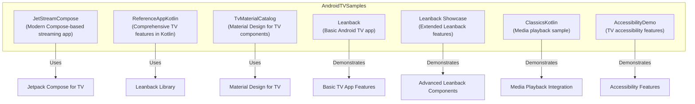

<!-- source: DeepWiki mcp.deepwiki.com · repo android/tv-samples · page 1 Overview · fetched 2026-10-23 -->

# Overview

<details>
<summary>Relevant source files</summary>

The following files were used as context for generating this wiki page:

- [.gitignore](.gitignore)
- [CONTRIBUTING.md](CONTRIBUTING.md)
- [ClassicsKotlin/README.md](ClassicsKotlin/README.md)
- [LICENSE](LICENSE)
- [Leanback/README.md](Leanback/README.md)
- [LeanbackShowcase/README.md](LeanbackShowcase/README.md)
- [README.md](README.md)

</details>


This document provides a comprehensive introduction to the Android TV Samples repository. This collection of sample applications demonstrates recommended implementation patterns and best practices for developing applications for the Android TV platform.

## Purpose

The Android TV Samples repository serves as a practical learning resource for developers building applications for Android TV and Google TV devices. Each sample project focuses on specific aspects of TV application development, from basic UI components to complex media playback systems. The repository demonstrates how to leverage various Android TV libraries and frameworks to create engaging, user-friendly TV experiences.

Sources: [README.md:1-13]()

## Repository Structure

The repository consists of multiple standalone projects, each showcasing different features and implementation approaches:



Sources: [README.md:4-13]()

## Key Sample Applications

The repository contains the following primary sample applications:

### JetStreamCompose

A modern streaming application built with Jetpack Compose for TV. This sample demonstrates how to implement a video streaming interface using declarative UI with Compose, including browse screens, video playback, and navigation patterns.

### ReferenceAppKotlin

The most comprehensive sample that demonstrates a variety of Android TV and Google TV integrations in Kotlin, including:
- Media playback with ExoPlayer
- Video browsing interfaces
- Authentication flows
- Deep linking

### TvMaterialCatalog

Showcases Material Design components specifically optimized for TV interfaces using Jetpack Compose. This sample demonstrates how to implement TV-specific UI patterns following Material Design guidelines.

### Leanback & Leanback Showcase

These Java-based samples demonstrate the usage of the Leanback support library:
- Leanback: A basic implementation of an Android TV app
- Leanback Showcase: Demonstrates various components of the Leanback library in isolation

### ClassicsKotlin

A modern implementation of a media playback application that demonstrates:
- MediaSession support
- ExoPlayer integration
- TV launcher home screen channels
- Content provider implementation for global search and Google Assistant
- Leanback browsing experience

### AccessibilityDemo

Demonstrates best practices for implementing accessibility features in TV applications.

Sources: [README.md:6-12](), [ClassicsKotlin/README.md:1-11](), [Leanback/README.md:1-3](), [LeanbackShowcase/README.md:1-7]()

## Feature Comparison Across Samples

The following table highlights the key features demonstrated in each sample application:

| Feature | JetStreamCompose | ReferenceAppKotlin | TvMaterialCatalog | Leanback | LeanbackShowcase | ClassicsKotlin |
|---------|------------------|-------------------|-------------------|---------|-----------------|---------------|
| UI Framework | Jetpack Compose | Leanback (XML) | Jetpack Compose | Leanback (XML) | Leanback (XML) | Leanback (XML) |
| Language | Kotlin | Kotlin | Kotlin | Java | Java | Kotlin |
| Video Playback | ✓ | ✓ | - | ✓ | ✓ | ✓ |
| Browse Interface | ✓ | ✓ | ✓ | ✓ | ✓ | ✓ |
| Search | ✓ | ✓ | - | ✓ | ✓ | ✓ |
| Home Screen Channels | - | ✓ | - | - | - | ✓ |
| Content Provider | - | ✓ | - | ✓ | - | ✓ |
| Authentication | - | ✓ | - | - | - | - |
| Material Design | ✓ | - | ✓ | - | - | - |
| Accessibility | - | - | - | - | - | - |

Sources: [README.md:6-12](), [ClassicsKotlin/README.md:4-10](), [Leanback/README.md:19-39]()

## Technical Architecture Overview

The following diagram illustrates the key technical components and their relationships across the sample applications:

```mermaid
graph TD
    subgraph "User Interface Frameworks"
        ComposeTV["androidx.tv.compose<br>(Jetpack Compose for TV)"]
        LeanbackLib["androidx.leanback<br>(Leanback Support Library)"]
    end
    
    subgraph "Media Playback"
        ExoPlayer["androidx.media3.exoplayer<br>(ExoPlayer)"]
        MediaSession["androidx.media3.session<br>(MediaSession)"]
        PlaybackTransportControls["Playback Transport Controls"]
    end
    
    subgraph "Content Integration"
        ContentProvider["android.content.ContentProvider"]
        HomeScreenChannels["Home Screen Channels API"]
        SearchableProvider["Searchable Content Provider"]
        DeepLinking["Deep Linking"]
    end
    
    subgraph "Common Components"
        BrowseFragment["BrowseFragment"]
        VideoDetailsFragment["VideoDetailsFragment"]
        PlaybackFragment["PlaybackFragment"]
        SearchFragment["SearchFragment"]
        GuidedStepFragment["GuidedStepFragment"]
    end
    
    ComposeTV -->|Used by| JetStreamCompose
    ComposeTV -->|Used by| TvMaterialCatalog
    
    LeanbackLib -->|Used by| ReferenceAppKotlin
    LeanbackLib -->|Used by| Leanback
    LeanbackLib -->|Used by| LeanbackShowcase
    LeanbackLib -->|Used by| ClassicsKotlin
    
    ExoPlayer -->|Used by| JetStreamCompose
    ExoPlayer -->|Used by| ReferenceAppKotlin
    ExoPlayer -->|Used by| ClassicsKotlin
    
    MediaSession -->|Used by| ReferenceAppKotlin
    MediaSession -->|Used by| ClassicsKotlin
    
    ContentProvider -->|Implemented by| ReferenceAppKotlin
    ContentProvider -->|Implemented by| ClassicsKotlin
    
    HomeScreenChannels -->|Implemented by| ClassicsKotlin
    
    BrowseFragment -->|Extended by| Leanback
    BrowseFragment -->|Extended by| ReferenceAppKotlin
    BrowseFragment -->|Extended by| ClassicsKotlin
    
    VideoDetailsFragment -->|Extended by| Leanback
    VideoDetailsFragment -->|Extended by| ReferenceAppKotlin
    
    PlaybackFragment -->|Extended by| Leanback
    PlaybackFragment -->|Extended by| ReferenceAppKotlin
    PlaybackFragment -->|Extended by| ClassicsKotlin
```



Sources: [README.md:6-12](), [ClassicsKotlin/README.md:4-10](), [Leanback/README.md:20-39]()

## Getting Started

To get started with the Android TV Samples repository:

1. Clone the repository:
   ```
   git clone https://github.com/android/tv-samples.git
   ```

2. Open the specific project you're interested in using Android Studio

3. Build and run the sample on an Android TV emulator or physical device

For detailed information about getting started with a specific sample, refer to the README file in each project's directory.

For more information about getting started with Android TV development in general, see [Getting Started with Android TV](1.1).

Sources: [README.md:14-24]()

## Additional Resources

- [Android TV Introduction](http://www.android.com/tv/)
- [Android TV Developer Documentation](http://developer.android.com/tv)
- [Android TV Apps in Google Play Store](http://play.google.com/store/apps/collection/promotion_3000e26_androidtv_apps_all)

Sources: [README.md:26-30]()

## License

The Android TV Samples repository is licensed under the Apache License, Version 2.0.

Sources: [README.md:38-45](), [LICENSE:1-203]()

---

