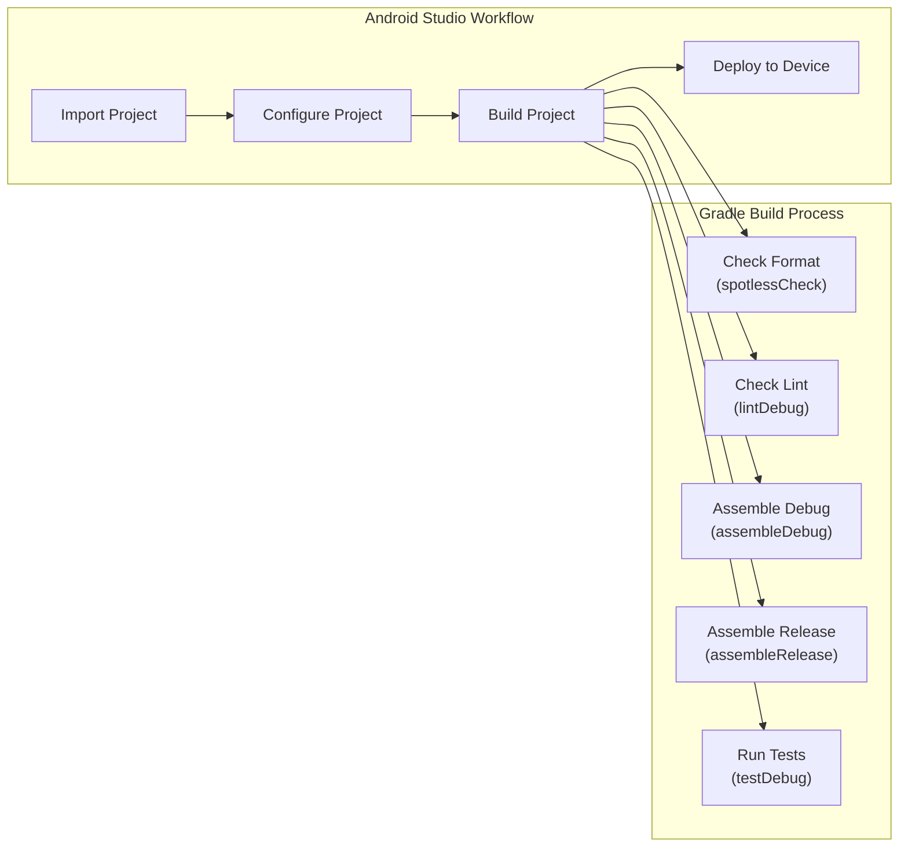

<!-- source: DeepWiki mcp.deepwiki.com · repo android/tv-samples · page 1.1 Getting Started · fetched 2026-10-23 -->

# Getting Started

<details>
<summary>Relevant source files</summary>

The following files were used as context for generating this wiki page:

- [.github/scripts/gradlew_recursive.sh](.github/scripts/gradlew_recursive.sh)
- [.github/workflows/JetStreamCompose.yml](.github/workflows/JetStreamCompose.yml)
- [.github/workflows/TvMaterialCatalog.yml](.github/workflows/TvMaterialCatalog.yml)
- [.github/workflows/build-sample.yml](.github/workflows/build-sample.yml)
- [.gitignore](.gitignore)
- [CONTRIBUTING.md](CONTRIBUTING.md)
- [ClassicsKotlin/README.md](ClassicsKotlin/README.md)
- [LICENSE](LICENSE)
- [Leanback/README.md](Leanback/README.md)
- [LeanbackShowcase/README.md](LeanbackShowcase/README.md)
- [README.md](README.md)
- [scripts/checksum.sh](scripts/checksum.sh)

</details>


This document provides instructions for setting up and running the Android TV Samples repository projects. It covers the prerequisites, environment setup, project configuration, and execution steps needed to successfully work with these samples. For information about the overall repository structure and the specific samples included, see [Repository Structure](#1.2).

## Prerequisites

Before you begin working with the Android TV samples, ensure you have the following prerequisites installed on your development machine:

| Requirement | Version/Details | Purpose |
|-------------|----------------|---------|
| JDK (Java Development Kit) | 17 or newer | Required for Android development |
| Android Studio | Latest stable version | Primary IDE for Android development |
| Android SDK | API level 30+ | Core Android development libraries |
| Android TV Emulator or Device | TV emulator or physical device (ADT-2, ADT-3) | For testing the applications |
| Git | Latest version | For cloning the repository |

Sources: [.github/workflows/build-sample.yml:40-44]()

## Repository Overview

The Android TV Samples repository contains multiple sample applications demonstrating different aspects of Android TV development:

```mermaid
graph TD
    subgraph "Android TV Samples Repository"
        JetStreamCompose["JetStreamCompose<br>(Jetpack Compose for TV)"]
        ReferenceAppKotlin["ReferenceAppKotlin<br>(TV Reference App)"]
        TvMaterialCatalog["TvMaterialCatalog<br>(Material Design Components)"]
        Leanback["Leanback<br>(Basic TV UI Patterns)"]
        LeanbackShowcase["LeanbackShowcase<br>(Advanced Leanback Features)"]
        ClassicsKotlin["ClassicsKotlin<br>(Modern Android TV App)"]
        AccessibilityDemo["AccessibilityDemo<br>(TV Accessibility)"]
    end
    
    Developer["Developer<br>Environment"] -->|"Clone & Setup"| "Android TV Samples Repository"
    "Android TV Samples Repository" -->|"Deploy & Test"| TVDevice["Android TV<br>Device/Emulator"]
```

Sources: [README.md:1-13]()

## Setting Up the Project

Follow these steps to set up the Android TV Samples on your machine:

### 1. Clone the Repository

Open a terminal or command prompt and run:

```
git clone https://github.com/android/tv-samples.git
```

This will create a local copy of the repository on your machine.

Sources: [README.md:16-20]()

### 2. Open a Sample Project in Android Studio

Android Studio is the recommended IDE for working with these samples. To open a specific sample:

1. Launch Android Studio
2. Select "Open an existing Android Studio project"
3. Navigate to the directory where you cloned the repository
4. Select the specific sample project you're interested in (e.g., JetStreamCompose, ReferenceAppKotlin, etc.)
5. Wait for Android Studio to import and index the project

Each sample is an independent Android project with its own Gradle configuration.

Sources: [README.md:22](), [ClassicsKotlin/README.md:24-25]()

## Building and Running a Sample

Once you've opened a sample project, follow these steps to build and run it:



Sources: [.github/workflows/build-sample.yml:57-75]()

### Configure the Project

1. Update `local.properties` if needed to point to your Android SDK location
2. Ensure you have the required SDK versions installed through the SDK Manager
3. Sync the project with Gradle files

### Build the Project

To build the project, you can:

- Use the Android Studio UI: Select **Build** > **Make Project**
- Or use the Gradle wrapper from the terminal:
  ```
  cd path/to/sample
  ./gradlew assembleDebug
  ```

The CI/CD pipeline for the repository performs several checks during the build process:
- Format checking with Spotless
- Lint checking to identify potential issues
- Building debug and release versions
- Running tests

Sources: [.github/workflows/build-sample.yml:57-75]()

### Run on an Emulator or Device

To run the sample on an Android TV emulator or device:

1. Connect an Android TV device or start an Android TV emulator
2. In Android Studio, select **Run** > **Run 'app'**
3. Choose your device from the deployment target dialog
4. Wait for the application to build and install

For best results, test on a physical Android TV device (such as an ADT-2 or ADT-3 developer device) or a properly configured Android TV emulator.

Sources: [ClassicsKotlin/README.md:25](), [Leanback/README.md:15]()

## Troubleshooting Common Issues

If you encounter issues while setting up or running the samples:

| Issue | Potential Solution |
|-------|-------------------|
| Build failures | Ensure you have the correct JDK version (17) installed and selected in Android Studio |
| Missing dependencies | Run Gradle sync to download required dependencies |
| Emulator not starting | Verify your hardware acceleration settings in the Android Studio SDK Manager |
| Deployment errors | Make sure your device is properly connected and has developer options enabled |

## Next Steps

After successfully setting up and running the samples, you may want to:

1. Explore the code structure of each sample to understand the implementation patterns
2. Modify the samples to experiment with different features
3. Use these samples as references for your own Android TV application development

For detailed information about each sample project, refer to the other sections of this wiki:
- For JetStreamCompose, see [JetStreamCompose](#2)
- For ReferenceAppKotlin, see [ReferenceAppKotlin](#3)
- For TvMaterialCatalog, see [TvMaterialCatalog](#4)

Sources: [README.md:14-24]()

---

