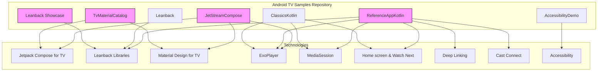
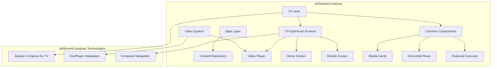
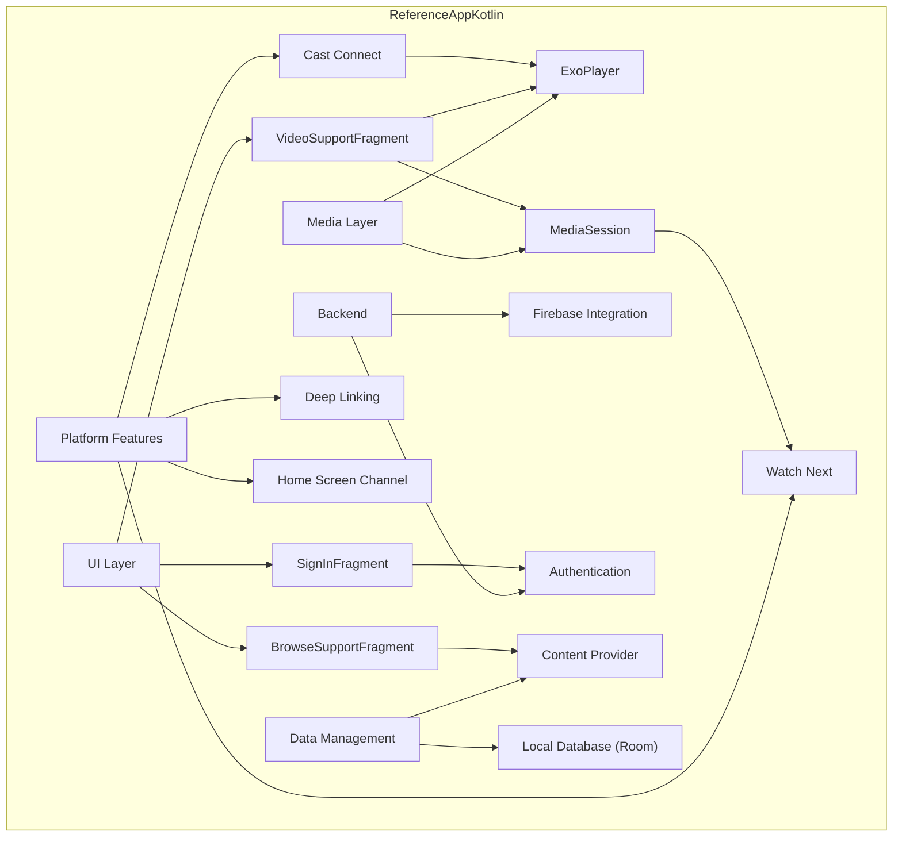
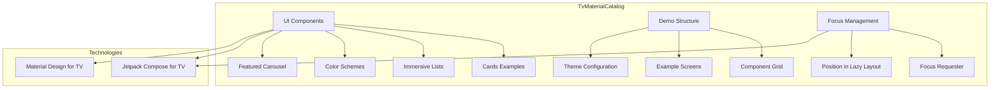
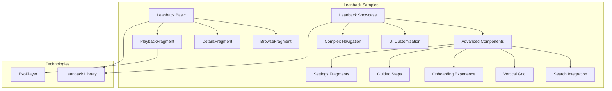
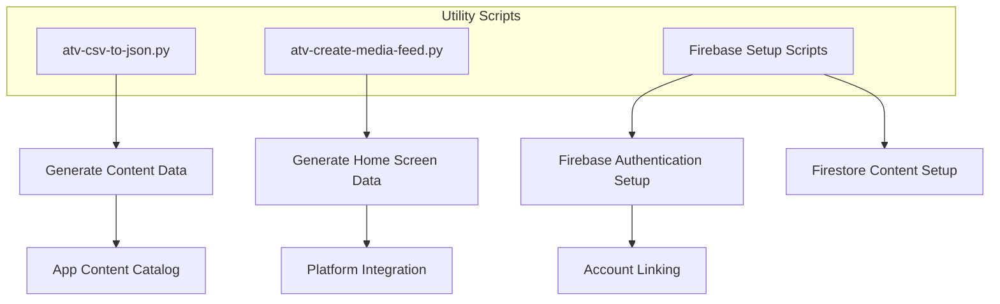
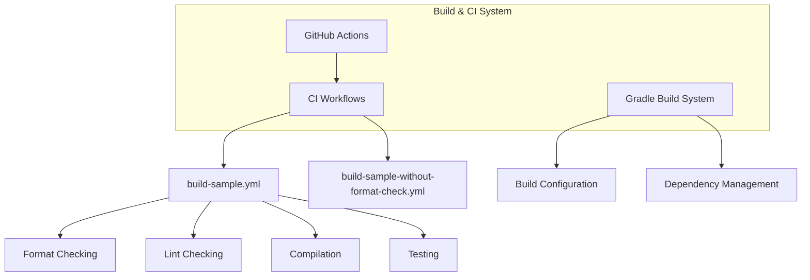
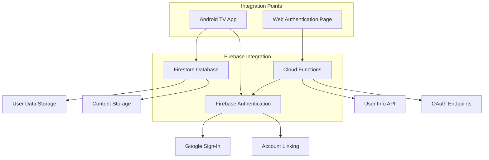

<!-- source: DeepWiki mcp.deepwiki.com · repo android/tv-samples · page 1.2 Repository Structure · fetched 2026-10-23 -->

# Repository Structure

Relevant source files

The following files were used as context for generating this wiki page:

- [.gitignore](.gitignore)
- [CONTRIBUTING.md](CONTRIBUTING.md)
- [ClassicsKotlin/README.md](ClassicsKotlin/README.md)
- [LICENSE](LICENSE)
- [Leanback/README.md](Leanback/README.md)
- [LeanbackShowcase/README.md](LeanbackShowcase/README.md)
- [README.md](README.md)
- [ReferenceAppKotlin/CAST_CONNECT.md](ReferenceAppKotlin/CAST_CONNECT.md)
- [ReferenceAppKotlin/README.md](ReferenceAppKotlin/README.md)
- [ReferenceAppKotlin/firebase/README.md](ReferenceAppKotlin/firebase/README.md)
- [ReferenceAppKotlin/firebase/server/test/authentication.test.ts](ReferenceAppKotlin/firebase/server/test/authentication.test.ts)
- [ReferenceAppKotlin/firebase/setup/save_content_to_firestore.js](ReferenceAppKotlin/firebase/setup/save_content_to_firestore.js)
- [ReferenceAppKotlin/firebase/web/index.html](ReferenceAppKotlin/firebase/web/index.html)
- [ReferenceAppKotlin/firebase/web/oauth/index.html](ReferenceAppKotlin/firebase/web/oauth/index.html)
- [ReferenceAppKotlin/firebase/web/oauth/scripts.js](ReferenceAppKotlin/firebase/web/oauth/scripts.js)
- [ReferenceAppKotlin/scripts/atv-create-media-feed.py](ReferenceAppKotlin/scripts/atv-create-media-feed.py)
- [ReferenceAppKotlin/scripts/atv-csv-to-json.py](ReferenceAppKotlin/scripts/atv-csv-to-json.py)
- [ReferenceAppKotlin/settings.gradle](ReferenceAppKotlin/settings.gradle)

This document provides an overview of the Android TV Samples repository organization, explaining the various sample applications and how they relate to each other. The purpose is to help developers understand the structure and navigate the codebase efficiently.

## Repository Overview

The Android TV Samples repository contains a collection of individual projects that demonstrate different aspects of Android TV application development. Each sample focuses on specific features or technologies relevant to TV app development.

Sources: [README.md:4-13]()

## Main Sample Applications

The repository contains several key sample applications, each focusing on different aspects of Android TV development:

| Sample | Language | UI Framework | Key Focus Areas |
|--------|----------|--------------|-----------------|
| JetStreamCompose | Kotlin | Jetpack Compose | Modern UI with Compose, Video playback |
| ReferenceAppKotlin | Kotlin | Leanback | Comprehensive TV features, ExoPlayer, Cast |
| TvMaterialCatalog | Kotlin | Jetpack Compose | Material Design components for TV |
| Leanback & Showcase | Java | Leanback | Traditional TV UI patterns |
| ClassicsKotlin | Kotlin | Leanback | Media playback, home screen integration |
| AccessibilityDemo | Java | Traditional | Accessibility features for TV |

Sources: [README.md:4-13](), [ReferenceAppKotlin/README.md:1-13](), [Leanback/README.md:1-4]()

### JetStreamCompose

JetStreamCompose demonstrates building Android TV applications using Jetpack Compose for TV. This modern UI toolkit approach replaces the traditional XML-based layouts with a declarative programming model.

Sources: [README.md:9]()

### ReferenceAppKotlin

ReferenceAppKotlin is the most comprehensive sample, demonstrating a variety of Android TV and Google TV integrations in Kotlin. It serves as a reference implementation for modern TV app development.

Sources: [ReferenceAppKotlin/README.md:1-101]()

### TvMaterialCatalog

TvMaterialCatalog showcases Material Design components from the Compose for TV libraries, providing a reference for implementing Google's Material Design guidelines on TV interfaces.

Sources: [README.md:8]()

### Leanback and Leanback Showcase

These samples demonstrate using the traditional Leanback Support library, which provides TV-specific UI components and patterns. The Leanback Showcase expands on the basic sample with more complex implementations.

Sources: [Leanback/README.md:1-70](), [LeanbackShowcase/README.md:1-31]()

## Additional Samples

### ClassicsKotlin

A modern Android TV app written in Kotlin, focused on demonstrating media playback of classic videos with platform integrations like MediaSession, home screen channels, and global search.

Sources: [ClassicsKotlin/README.md:1-17]()

### AccessibilityDemo

A Java sample specifically focused on demonstrating accessibility features for TV applications, helping developers create more inclusive apps.

Sources: [README.md:6]()

## Scripts and Utilities

The repository includes several utility scripts, particularly in the ReferenceAppKotlin project, that help with content management and deployment:

Sources: [ReferenceAppKotlin/scripts/atv-csv-to-json.py:1-68](), [ReferenceAppKotlin/scripts/atv-create-media-feed.py:1-223](), [ReferenceAppKotlin/firebase/README.md:1-178]()

## Build System and CI/CD

The repository uses Gradle for build configuration and GitHub Actions for continuous integration and delivery.

Sources: [ReferenceAppKotlin/settings.gradle:1-18]()

## Firebase Integration

Several samples, particularly ReferenceAppKotlin, offer Firebase integration for authentication, cloud functions, and data storage.

Sources: [ReferenceAppKotlin/firebase/README.md:1-178](), [ReferenceAppKotlin/firebase/setup/save_content_to_firestore.js:1-58](), [ReferenceAppKotlin/firebase/web/oauth/index.html:1-63]()

## Repository License

The entire repository is licensed under the Apache License, Version 2.0, which allows for commercial use, modification, distribution, and private use with appropriate attribution.

Sources: [LICENSE:1-203](), [CONTRIBUTING.md:1-29]()

## Related Documentation

For more detailed information about specific parts of the repository, please refer to:

- For JetStream architecture details, see [JetStream Architecture](#2.1)
- For ReferenceApp architecture details, see [ReferenceApp Architecture](#3.1)
- For TvMaterialCatalog architecture details, see [TvMaterialCatalog Architecture](#4.1)
- For build system details, see [Build System and CI/CD](#5)

---

