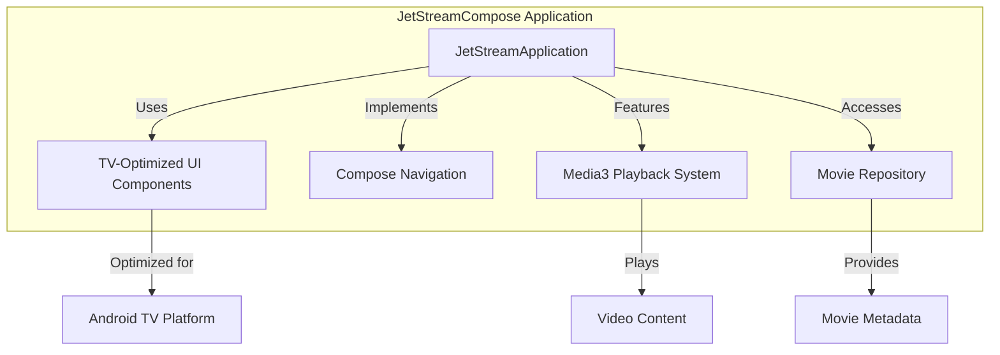
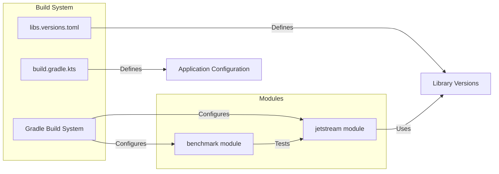
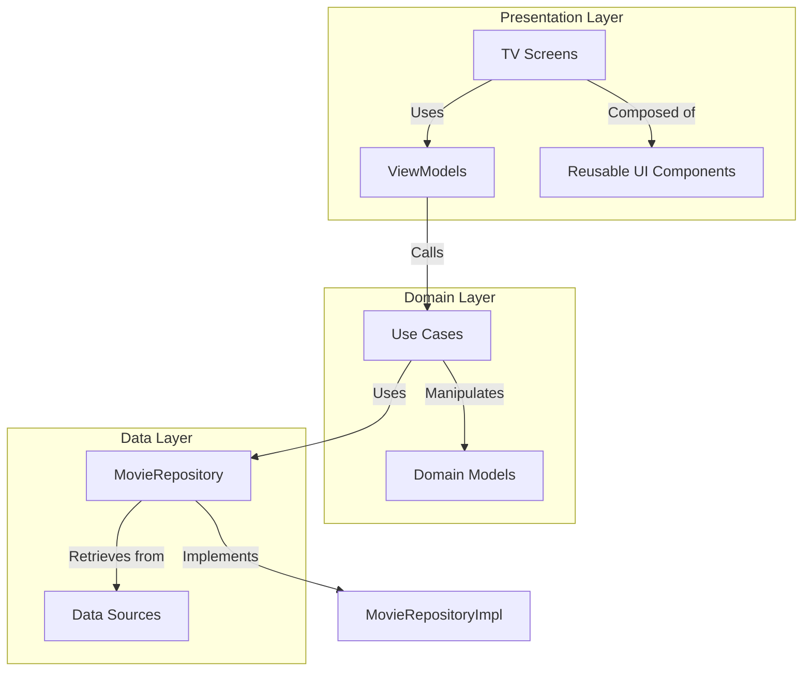
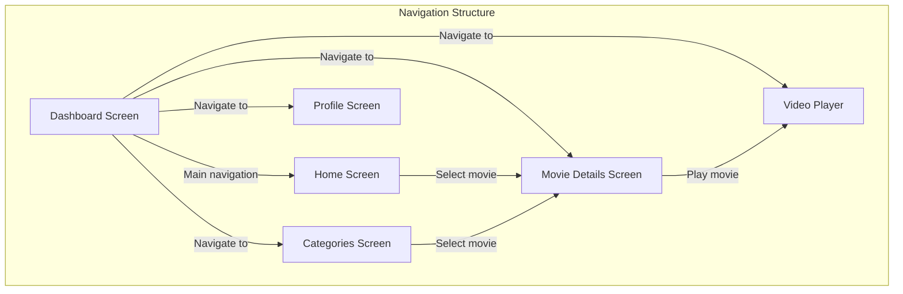
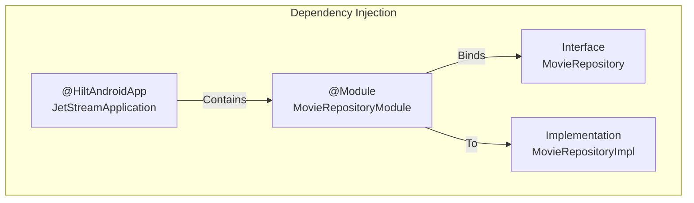

<!-- source: DeepWiki mcp.deepwiki.com · repo android/tv-samples · page 2 JetStreamCompose · fetched 2026-10-23 -->

# JetStreamCompose

Relevant source files

The following files were used as context for generating this wiki page:

- [JetStreamCompose/.gitignore](JetStreamCompose/.gitignore)
- [JetStreamCompose/benchmark/build.gradle.kts](JetStreamCompose/benchmark/build.gradle.kts)
- [JetStreamCompose/build.gradle.kts](JetStreamCompose/build.gradle.kts)
- [JetStreamCompose/gradle/libs.versions.toml](JetStreamCompose/gradle/libs.versions.toml)
- [JetStreamCompose/gradle/wrapper/gradle-wrapper.properties](JetStreamCompose/gradle/wrapper/gradle-wrapper.properties)
- [JetStreamCompose/jetstream/build.gradle.kts](JetStreamCompose/jetstream/build.gradle.kts)
- [JetStreamCompose/jetstream/proguard-rules.pro](JetStreamCompose/jetstream/proguard-rules.pro)
- [JetStreamCompose/jetstream/src/main/java/com/google/jetstream/JetStreamApplication.kt](JetStreamCompose/jetstream/src/main/java/com/google/jetstream/JetStreamApplication.kt)
- [JetStreamCompose/jetstream/src/main/java/com/google/jetstream/presentation/screens/profile/AboutSection.kt](JetStreamCompose/jetstream/src/main/java/com/google/jetstream/presentation/screens/profile/AboutSection.kt)

JetStreamCompose is a sample Android TV application that demonstrates how to build TV applications using Jetpack Compose. This document provides an overview of the JetStreamCompose sample, including its architecture, key features, and implementation details.

For more detailed information about the specific components and systems within JetStreamCompose, see [JetStream Architecture](#2.1), [JetStream Video Player](#2.2), [JetStream UI Components](#2.3), and [JetStream Data Management](#2.4).

## Overview

JetStreamCompose showcases a modern TV streaming application built entirely with Jetpack Compose, Android's modern toolkit for building native UI. The sample demonstrates how to implement common TV app patterns including browsable content catalogs, video playback, and user profiles using Compose for TV components.

Key technologies demonstrated in this sample include:
- Jetpack Compose for TV
- Media3 for video playback
- Hilt for dependency injection
- Navigation Compose for screen navigation
- Coil for image loading

Sources: [JetStreamCompose/jetstream/build.gradle.kts:1-121](), [JetStreamCompose/jetstream/src/main/java/com/google/jetstream/JetStreamApplication.kt:1-40]()

## Technical Implementation

JetStreamCompose is built on modern Android development practices and libraries, with a focus on Jetpack Compose for TV.

### Dependencies and Build Configuration

The application is built with the following key dependencies:

| Category | Libraries | Purpose |
|----------|-----------|---------|
| UI Framework | Jetpack Compose, TV Material | TV-optimized UI components |
| Media | Media3, ExoPlayer | Video playback functionality |
| Navigation | Navigation Compose | Screen navigation |
| Image Loading | Coil | Efficient image loading and caching |
| Dependency Injection | Hilt | Dependency management |
| JSON Parsing | KotlinX Serialization | Data parsing |
| Baseline Profiling | ProfileInstaller | Performance optimization |

The app targets Android TV with:
- Minimum SDK: 28
- Target SDK: 35
- Compose BOM Version: 2025.02.00
- TV Material Version: 1.0.0
- Media3 Version: 1.6.0-beta01

Sources: [JetStreamCompose/jetstream/build.gradle.kts:1-121](), [JetStreamCompose/gradle/libs.versions.toml:1-61](), [JetStreamCompose/build.gradle.kts:1-34]()

### Application Architecture

JetStreamCompose follows a modern Android architecture pattern with clear separation of concerns:

Sources: [JetStreamCompose/jetstream/src/main/java/com/google/jetstream/JetStreamApplication.kt:1-40]()

### Screen Structure

The application includes several key screens that provide a complete TV viewing experience:

Sources: [JetStreamCompose/jetstream/src/main/java/com/google/jetstream/presentation/screens/profile/AboutSection.kt:1-86]()

## Key Features

### Jetpack Compose for TV

JetStreamCompose is built entirely with Jetpack Compose, demonstrating how to use Compose for TV applications. It uses the TV Material library (`androidx.tv.material`) which provides TV-optimized components.

Key UI patterns demonstrated:
- Focus management for D-pad navigation
- TV-specific layouts and components
- Immersive video playback
- TV-optimized card layouts and carousels

### Dependency Injection with Hilt

The application uses Hilt for dependency injection, which simplifies the management of dependencies and promotes better testability:

Sources: [JetStreamCompose/jetstream/src/main/java/com/google/jetstream/JetStreamApplication.kt:19-39]()

### Media Playback

JetStreamCompose uses Media3 (the successor to ExoPlayer) for video playback, demonstrating how to integrate video content in a TV application:

- Media3 ExoPlayer for core video playback
- Media3 UI Compose for playback controls
- Integration with Jetpack Compose

### Performance Optimization

The sample includes baseline profiles for optimizing performance:

- Uses the Baseline Profile API for startup and rendering performance
- Includes a benchmark module for measuring performance
- Configures R8 for release builds to optimize code size and performance

## Getting Started

The JetStreamCompose sample can be built and run on an Android TV emulator or device. It requires:

- Android Studio Iguana or newer
- Android SDK with TV support
- A TV emulator or physical Android TV device

Performance can be analyzed using the included benchmark module, which uses the Baseline Profile API and Macrobenchmark library to measure key user journeys.

Sources: [JetStreamCompose/benchmark/build.gradle.kts:1-83]()

---

