<!-- source: DeepWiki mcp.deepwiki.com · repo android/tv-samples · page 2.1 JetStream Architecture · fetched 2026-10-23 -->

# JetStream Architecture

<details>
<summary>Relevant source files</summary>

The following files were used as context for generating this wiki page:

- [JetStreamCompose/gradle.properties](JetStreamCompose/gradle.properties)
- [JetStreamCompose/jetstream/src/main/java/com/google/jetstream/JetStreamApplication.kt](JetStreamCompose/jetstream/src/main/java/com/google/jetstream/JetStreamApplication.kt)
- [JetStreamCompose/jetstream/src/main/java/com/google/jetstream/MainActivity.kt](JetStreamCompose/jetstream/src/main/java/com/google/jetstream/MainActivity.kt)
- [JetStreamCompose/jetstream/src/main/java/com/google/jetstream/data/entities/Movie.kt](JetStreamCompose/jetstream/src/main/java/com/google/jetstream/data/entities/Movie.kt)
- [JetStreamCompose/jetstream/src/main/java/com/google/jetstream/data/entities/MovieCast.kt](JetStreamCompose/jetstream/src/main/java/com/google/jetstream/data/entities/MovieCast.kt)
- [JetStreamCompose/jetstream/src/main/java/com/google/jetstream/data/entities/MovieCategory.kt](JetStreamCompose/jetstream/src/main/java/com/google/jetstream/data/entities/MovieCategory.kt)
- [JetStreamCompose/jetstream/src/main/java/com/google/jetstream/data/models/MoviesResponse.kt](JetStreamCompose/jetstream/src/main/java/com/google/jetstream/data/models/MoviesResponse.kt)
- [JetStreamCompose/jetstream/src/main/java/com/google/jetstream/data/repositories/CachedDataReader.kt](JetStreamCompose/jetstream/src/main/java/com/google/jetstream/data/repositories/CachedDataReader.kt)
- [JetStreamCompose/jetstream/src/main/java/com/google/jetstream/data/repositories/MovieCastDataSource.kt](JetStreamCompose/jetstream/src/main/java/com/google/jetstream/data/repositories/MovieCastDataSource.kt)
- [JetStreamCompose/jetstream/src/main/java/com/google/jetstream/data/repositories/MovieCategoryDataSource.kt](JetStreamCompose/jetstream/src/main/java/com/google/jetstream/data/repositories/MovieCategoryDataSource.kt)
- [JetStreamCompose/jetstream/src/main/java/com/google/jetstream/data/repositories/MovieDataSource.kt](JetStreamCompose/jetstream/src/main/java/com/google/jetstream/data/repositories/MovieDataSource.kt)
- [JetStreamCompose/jetstream/src/main/java/com/google/jetstream/data/repositories/TvDataSource.kt](JetStreamCompose/jetstream/src/main/java/com/google/jetstream/data/repositories/TvDataSource.kt)
- [JetStreamCompose/jetstream/src/main/java/com/google/jetstream/presentation/screens/Screens.kt](JetStreamCompose/jetstream/src/main/java/com/google/jetstream/presentation/screens/Screens.kt)
- [JetStreamCompose/jetstream/src/main/java/com/google/jetstream/presentation/screens/categories/CategoriesScreen.kt](JetStreamCompose/jetstream/src/main/java/com/google/jetstream/presentation/screens/categories/CategoriesScreen.kt)
- [JetStreamCompose/jetstream/src/main/java/com/google/jetstream/presentation/screens/categories/CategoryMovieListScreen.kt](JetStreamCompose/jetstream/src/main/java/com/google/jetstream/presentation/screens/categories/CategoryMovieListScreen.kt)
- [JetStreamCompose/jetstream/src/main/java/com/google/jetstream/presentation/screens/dashboard/DashboardScreen.kt](JetStreamCompose/jetstream/src/main/java/com/google/jetstream/presentation/screens/dashboard/DashboardScreen.kt)
- [JetStreamCompose/jetstream/src/main/java/com/google/jetstream/presentation/screens/dashboard/DashboardTopBar.kt](JetStreamCompose/jetstream/src/main/java/com/google/jetstream/presentation/screens/dashboard/DashboardTopBar.kt)
- [JetStreamCompose/jetstream/src/main/java/com/google/jetstream/presentation/screens/favourites/FavouritesScreen.kt](JetStreamCompose/jetstream/src/main/java/com/google/jetstream/presentation/screens/favourites/FavouritesScreen.kt)
- [JetStreamCompose/jetstream/src/main/java/com/google/jetstream/presentation/screens/favourites/FilteredMoviesGrid.kt](JetStreamCompose/jetstream/src/main/java/com/google/jetstream/presentation/screens/favourites/FilteredMoviesGrid.kt)
- [JetStreamCompose/jetstream/src/main/java/com/google/jetstream/presentation/screens/home/FeaturedMoviesCarousel.kt](JetStreamCompose/jetstream/src/main/java/com/google/jetstream/presentation/screens/home/FeaturedMoviesCarousel.kt)
- [JetStreamCompose/jetstream/src/main/java/com/google/jetstream/presentation/screens/home/HomeScreen.kt](JetStreamCompose/jetstream/src/main/java/com/google/jetstream/presentation/screens/home/HomeScreen.kt)
- [JetStreamCompose/jetstream/src/main/java/com/google/jetstream/presentation/screens/movies/MovieDetailsScreen.kt](JetStreamCompose/jetstream/src/main/java/com/google/jetstream/presentation/screens/movies/MovieDetailsScreen.kt)
- [JetStreamCompose/jetstream/src/main/java/com/google/jetstream/presentation/screens/movies/MovieReviews.kt](JetStreamCompose/jetstream/src/main/java/com/google/jetstream/presentation/screens/movies/MovieReviews.kt)
- [JetStreamCompose/jetstream/src/main/java/com/google/jetstream/presentation/screens/movies/MoviesScreen.kt](JetStreamCompose/jetstream/src/main/java/com/google/jetstream/presentation/screens/movies/MoviesScreen.kt)
- [JetStreamCompose/jetstream/src/main/java/com/google/jetstream/presentation/screens/profile/AccountsSelectionItem.kt](JetStreamCompose/jetstream/src/main/java/com/google/jetstream/presentation/screens/profile/AccountsSelectionItem.kt)
- [JetStreamCompose/jetstream/src/main/java/com/google/jetstream/presentation/screens/search/SearchScreen.kt](JetStreamCompose/jetstream/src/main/java/com/google/jetstream/presentation/screens/search/SearchScreen.kt)
- [JetStreamCompose/jetstream/src/main/java/com/google/jetstream/presentation/screens/shows/ShowsScreen.kt](JetStreamCompose/jetstream/src/main/java/com/google/jetstream/presentation/screens/shows/ShowsScreen.kt)
- [JetStreamCompose/jetstream/src/main/java/com/google/jetstream/presentation/screens/videoPlayer/components/VideoPlayerMainFrame.kt](JetStreamCompose/jetstream/src/main/java/com/google/jetstream/presentation/screens/videoPlayer/components/VideoPlayerMainFrame.kt)
- [JetStreamCompose/jetstream/src/main/java/com/google/jetstream/presentation/screens/videoPlayer/components/VideoPlayerMediaTitle.kt](JetStreamCompose/jetstream/src/main/java/com/google/jetstream/presentation/screens/videoPlayer/components/VideoPlayerMediaTitle.kt)
- [JetStreamCompose/jetstream/src/main/java/com/google/jetstream/presentation/screens/videoPlayer/components/VideoPlayerPulse.kt](JetStreamCompose/jetstream/src/main/java/com/google/jetstream/presentation/screens/videoPlayer/components/VideoPlayerPulse.kt)

</details>


This document outlines the architecture of the JetStreamCompose application, which is a TV app sample demonstrating Jetpack Compose for TV. It covers the main architectural components, navigation system, data flow, and UI structure of the application. For specific details about the video player implementation, refer to [JetStream Video Player](#2.2), and for UI components information, see [JetStream UI Components](#2.3).

## Overview

JetStreamCompose is designed as a streaming content discovery and playback application for Android TV, built entirely with Jetpack Compose for TV. The application demonstrates best practices for TV app development, including a focus on the "10-foot UI" experience and D-pad navigation.

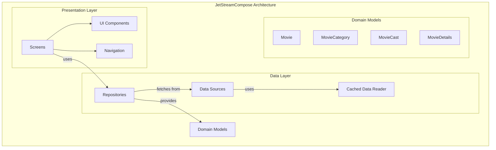

Sources: [JetStreamCompose/jetstream/src/main/java/com/google/jetstream/MainActivity.kt:35-56](), [JetStreamCompose/jetstream/src/main/java/com/google/jetstream/JetStreamApplication.kt:19-39]()

## Application Entry Point

The application begins from `MainActivity`, which is annotated with `@AndroidEntryPoint` for Hilt dependency injection. The `onCreate` method sets up the app content with the JetStreamTheme:

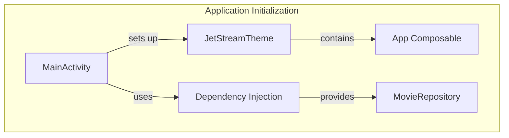

Sources: [JetStreamCompose/jetstream/src/main/java/com/google/jetstream/MainActivity.kt:35-56](), [JetStreamCompose/jetstream/src/main/java/com/google/jetstream/JetStreamApplication.kt:28-39]()

## Screen Navigation Architecture

The JetStream app uses a two-level navigation system:

1. **Main Navigation**: Navigates between major app sections like Dashboard and standalone screens
2. **Dashboard Navigation**: Within the Dashboard, a TabRow navigates between content categories

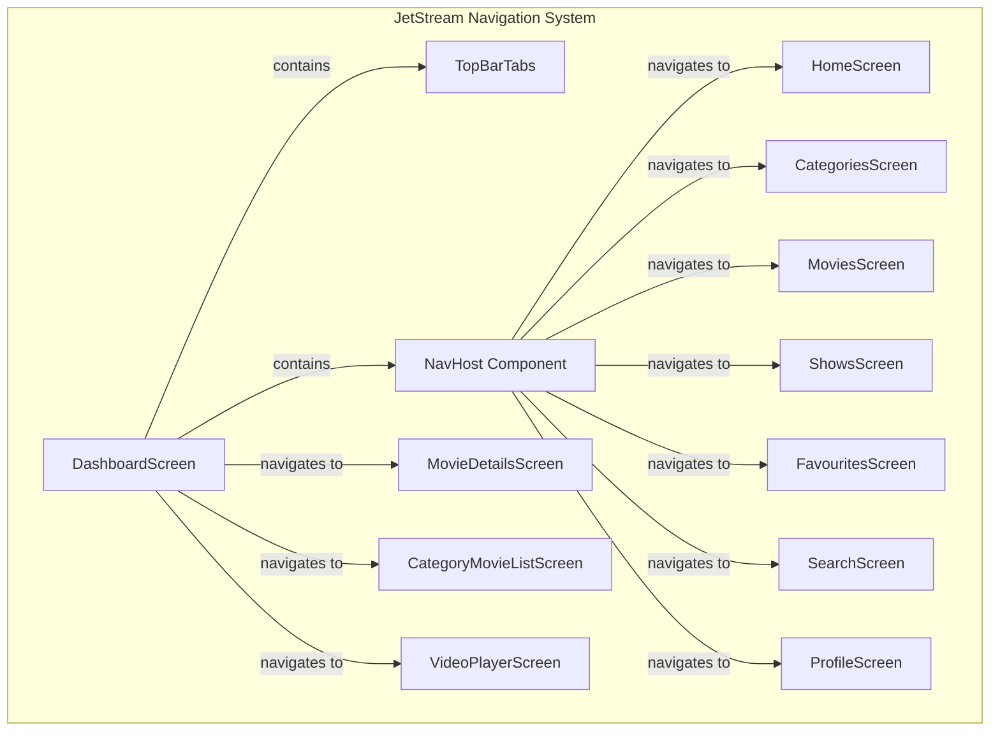

Sources: [JetStreamCompose/jetstream/src/main/java/com/google/jetstream/presentation/screens/dashboard/DashboardScreen.kt:84-283](), [JetStreamCompose/jetstream/src/main/java/com/google/jetstream/presentation/screens/Screens.kt:26-57]()

### Dashboard Screen

The DashboardScreen serves as the main container for most of the app's UI. It provides:

1. A TopBar for navigation between major sections
2. A content area for displaying the selected section
3. Logic for hiding/showing the TopBar based on scroll position

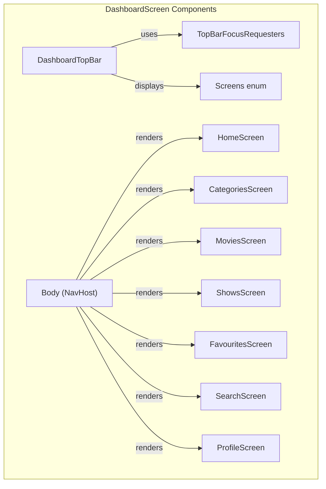

Sources: [JetStreamCompose/jetstream/src/main/java/com/google/jetstream/presentation/screens/dashboard/DashboardScreen.kt:84-283](), [JetStreamCompose/jetstream/src/main/java/com/google/jetstream/presentation/screens/dashboard/DashboardTopBar.kt:65-69]()

## Content Screens

JetStream organizes its content into several main screens, each with its own layout and purpose.

### Home Screen

The HomeScreen displays the main content discovery interface featuring:

- Featured movies carousel
- Trending movies row
- Top 10 movies list
- Now playing movies row

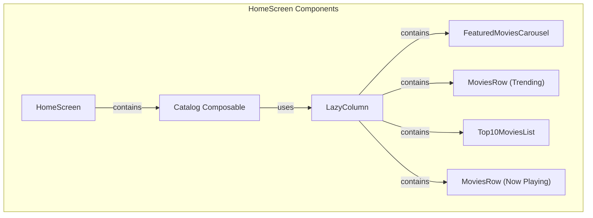

Sources: [JetStreamCompose/jetstream/src/main/java/com/google/jetstream/presentation/screens/home/HomeScreen.kt:46-154](), [JetStreamCompose/jetstream/src/main/java/com/google/jetstream/presentation/screens/home/FeaturedMoviesCarousel.kt:84-143]()

### Categories Screen

The CategoriesScreen displays a grid of movie categories that users can explore:

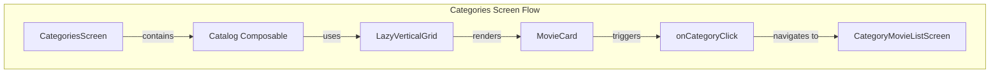

Sources: [JetStreamCompose/jetstream/src/main/java/com/google/jetstream/presentation/screens/categories/CategoriesScreen.kt:56-154](), [JetStreamCompose/jetstream/src/main/java/com/google/jetstream/presentation/screens/categories/CategoryMovieListScreen.kt:50-133]()

### Movies, Shows, and Favourites Screens

These screens follow similar patterns, displaying grids or lists of content with specialized layouts:

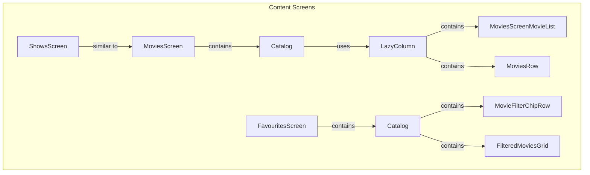

Sources: [JetStreamCompose/jetstream/src/main/java/com/google/jetstream/presentation/screens/movies/MoviesScreen.kt:41-108](), [JetStreamCompose/jetstream/src/main/java/com/google/jetstream/presentation/screens/shows/ShowsScreen.kt:42-112](), [JetStreamCompose/jetstream/src/main/java/com/google/jetstream/presentation/screens/favourites/FavouritesScreen.kt:39-112](), [JetStreamCompose/jetstream/src/main/java/com/google/jetstream/presentation/screens/favourites/FilteredMoviesGrid.kt:36-58]()

## Data Architecture

The JetStream app follows a clean architecture approach for data management, separating data sources from repositories and presentation.

```mermaid
graph TD
    subgraph "Data Architecture"
        MovieRepository["MovieRepository"]
        MovieRepositoryImpl["MovieRepositoryImpl"]
        
        MovieDataSource["MovieDataSource"]
        MovieCategoryDataSource["MovieCategoryDataSource"]
        MovieCastDataSource["MovieCastDataSource"]
        TvDataSource["TvDataSource"]
        
        CachedDataReader["CachedDataReader"]
        AssetsReader["AssetsReader"]
        
        MovieRepository <-- |"implemented by"| MovieRepositoryImpl
        MovieRepositoryImpl --> |"uses"| MovieDataSource
        MovieRepositoryImpl --> |"uses"| MovieCategoryDataSource
        MovieRepositoryImpl --> |"uses"| MovieCastDataSource
        MovieRepositoryImpl --> |"uses"| TvDataSource
        
        MovieDataSource --> |"uses"| CachedDataReader
        MovieCategoryDataSource --> |"uses"| CachedDataReader
        MovieCastDataSource --> |"uses"| CachedDataReader
        TvDataSource --> |"uses"| CachedDataReader
        
        CachedDataReader --> |"accesses"| AssetsReader
    end
```

Sources: [JetStreamCompose/jetstream/src/main/java/com/google/jetstream/JetStreamApplication.kt:31-39](), [JetStreamCompose/jetstream/src/main/java/com/google/jetstream/data/repositories/CachedDataReader.kt:31-75](), [JetStreamCompose/jetstream/src/main/java/com/google/jetstream/data/repositories/MovieDataSource.kt:25-82]()

### CachedDataReader

A key component in the data architecture is the `CachedDataReader`, which:
- Implements a simple caching mechanism using mutex for thread safety
- Ensures data is only loaded once and stored in memory
- Used by all data sources to efficiently load JSON data from assets

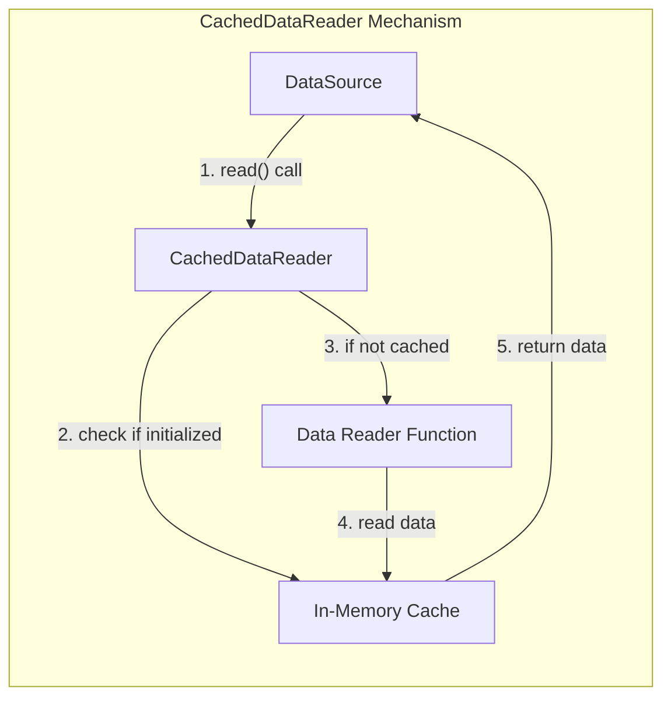

Sources: [JetStreamCompose/jetstream/src/main/java/com/google/jetstream/data/repositories/CachedDataReader.kt:31-43]()

### Domain Models

The app uses several domain models to represent data:

1. **Movie**: Represents a movie or TV show with metadata
2. **MovieCategory**: Represents a category of movies
3. **MovieCast**: Represents cast information for a movie
4. **MovieDetails**: Contains detailed information about a movie

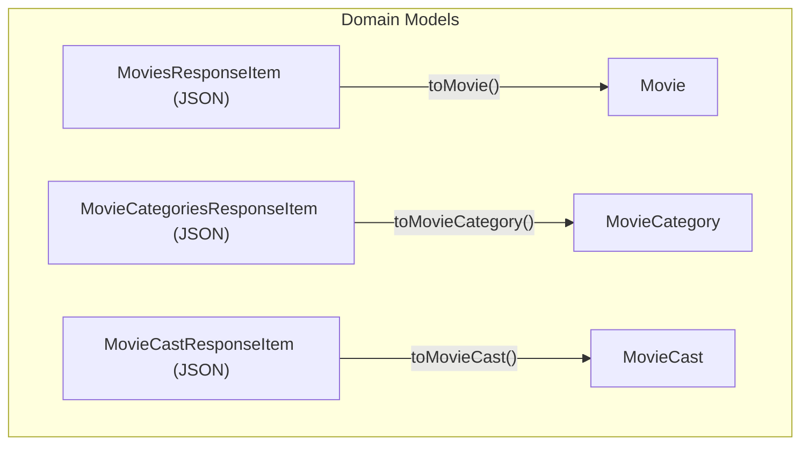

Sources: [JetStreamCompose/jetstream/src/main/java/com/google/jetstream/data/entities/Movie.kt:21-48](), [JetStreamCompose/jetstream/src/main/java/com/google/jetstream/data/entities/MovieCategory.kt:21-27](), [JetStreamCompose/jetstream/src/main/java/com/google/jetstream/data/entities/MovieCast.kt:21-34](), [JetStreamCompose/jetstream/src/main/java/com/google/jetstream/data/models/MoviesResponse.kt:21-45]()

## UI State Management

JetStream uses a unidirectional data flow pattern with ViewModels and UI State objects:

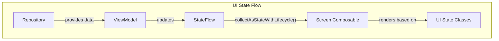

Sources: [JetStreamCompose/jetstream/src/main/java/com/google/jetstream/presentation/screens/home/HomeScreen.kt:46-73](), [JetStreamCompose/jetstream/src/main/java/com/google/jetstream/presentation/screens/movies/MoviesScreen.kt:41-61]()

## Focus Management

As a TV application, JetStream pays special attention to focus management for D-pad navigation:

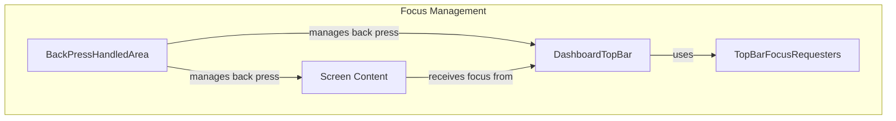

Sources: [JetStreamCompose/jetstream/src/main/java/com/google/jetstream/presentation/screens/dashboard/DashboardScreen.kt:119-219](), [JetStreamCompose/jetstream/src/main/java/com/google/jetstream/presentation/screens/dashboard/DashboardTopBar.kt:65-169]()

## Video Player Integration

The Video Player is a key feature of JetStream, providing playback functionality with controls:

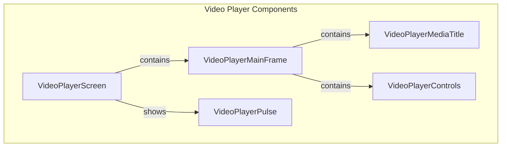

Sources: [JetStreamCompose/jetstream/src/main/java/com/google/jetstream/presentation/screens/videoPlayer/components/VideoPlayerPulse.kt:48-90](), [JetStreamCompose/jetstream/src/main/java/com/google/jetstream/presentation/screens/videoPlayer/components/VideoPlayerMediaTitle.kt:44-99](), [JetStreamCompose/jetstream/src/main/java/com/google/jetstream/presentation/screens/videoPlayer/components/VideoPlayerMainFrame.kt:37-61]()

## Dependency Injection

JetStream uses Hilt for dependency injection, simplifying component management:

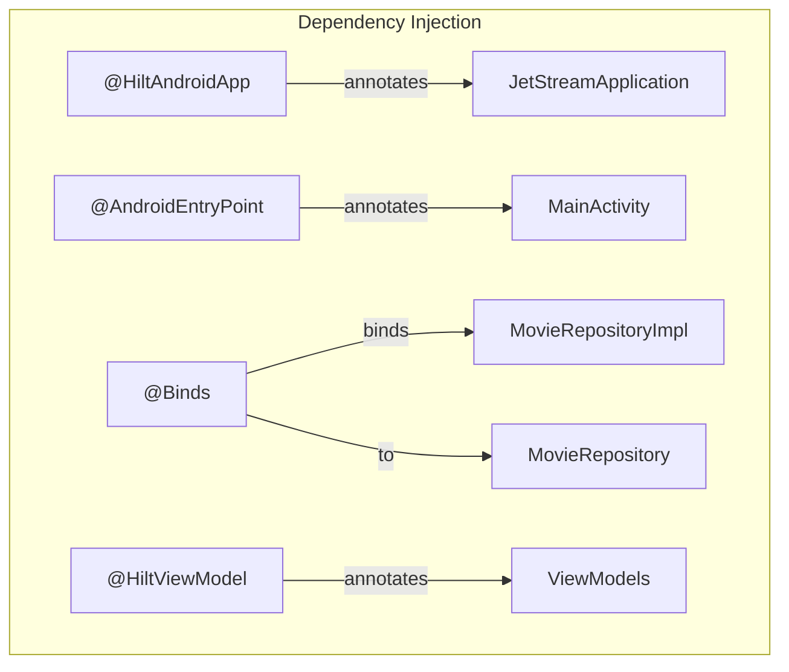

Sources: [JetStreamCompose/jetstream/src/main/java/com/google/jetstream/JetStreamApplication.kt:28-39](), [JetStreamCompose/jetstream/src/main/java/com/google/jetstream/MainActivity.kt:34-56]()

## Summary

JetStreamCompose demonstrates an architecture optimized for Android TV applications using Jetpack Compose. Its key architectural components include:

1. **Clean Separation of Concerns**:
   - Presentation layer with screens and UI components
   - Data layer with repositories and data sources
   - Domain models for data representation

2. **Efficient Data Management**:
   - `CachedDataReader` for optimized data loading
   - Repository pattern for data access abstraction

3. **TV-Optimized UI**:
   - Focus management for D-pad navigation
   - Animations and transitions designed for large screens
   - Hierarchical navigation with tabs and screens

4. **Modern Android Technologies**:
   - Jetpack Compose for UI
   - Hilt for dependency injection
   - StateFlow for UI state management

This architecture provides a solid foundation for building feature-rich TV applications with a great user experience.

---

