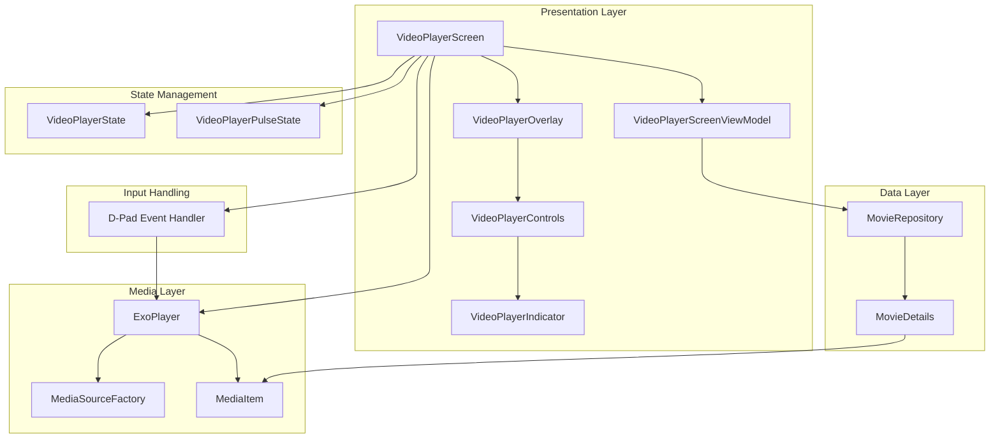
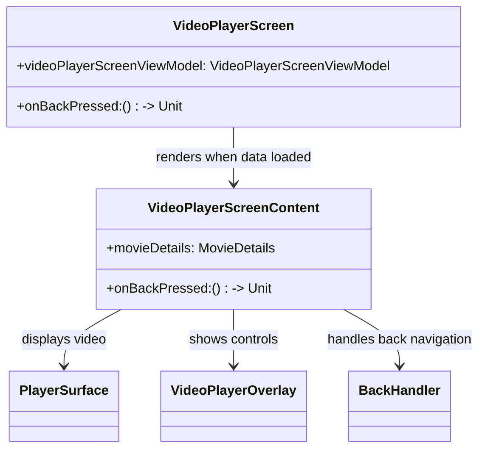
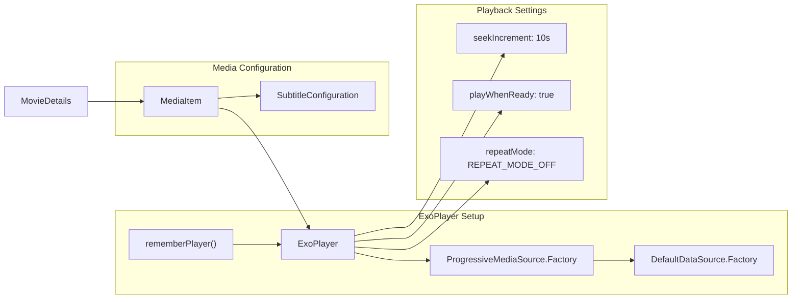
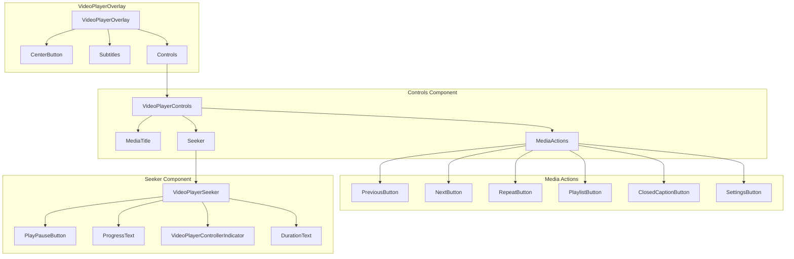
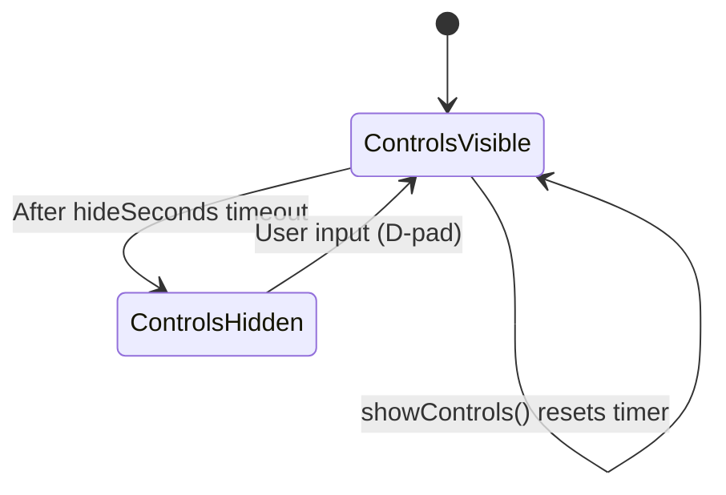
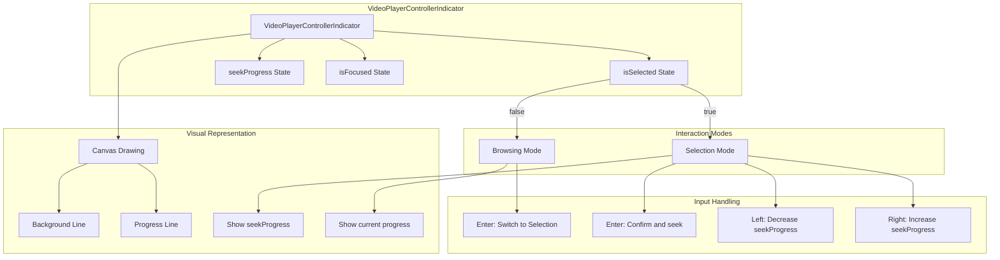
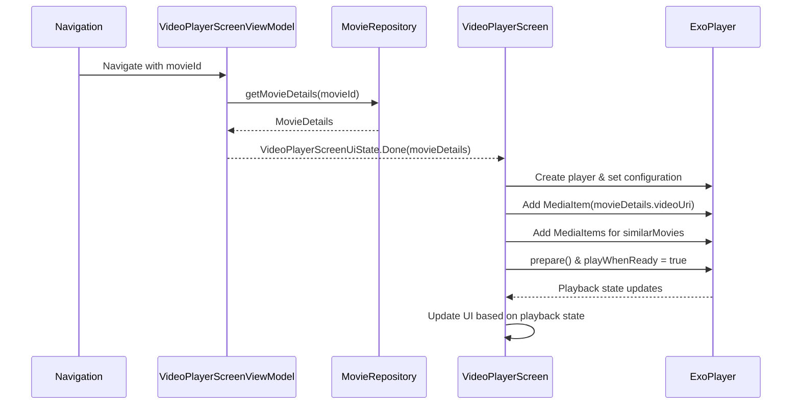

<!-- source: DeepWiki mcp.deepwiki.com · repo android/tv-samples · page 2.2 JetStream Video Player · fetched 2026-10-23 -->

# JetStream Video Player

<details>
<summary>Relevant source files</summary>

The following files were used as context for generating this wiki page:

- [JetStreamCompose/jetstream/src/main/assets/movies.json](JetStreamCompose/jetstream/src/main/assets/movies.json)
- [JetStreamCompose/jetstream/src/main/java/com/google/jetstream/data/entities/MovieDetails.kt](JetStreamCompose/jetstream/src/main/java/com/google/jetstream/data/entities/MovieDetails.kt)
- [JetStreamCompose/jetstream/src/main/java/com/google/jetstream/data/repositories/MovieRepositoryImpl.kt](JetStreamCompose/jetstream/src/main/java/com/google/jetstream/data/repositories/MovieRepositoryImpl.kt)
- [JetStreamCompose/jetstream/src/main/java/com/google/jetstream/data/util/StringConstants.kt](JetStreamCompose/jetstream/src/main/java/com/google/jetstream/data/util/StringConstants.kt)
- [JetStreamCompose/jetstream/src/main/java/com/google/jetstream/presentation/common/MovieCard.kt](JetStreamCompose/jetstream/src/main/java/com/google/jetstream/presentation/common/MovieCard.kt)
- [JetStreamCompose/jetstream/src/main/java/com/google/jetstream/presentation/common/PosterImage.kt](JetStreamCompose/jetstream/src/main/java/com/google/jetstream/presentation/common/PosterImage.kt)
- [JetStreamCompose/jetstream/src/main/java/com/google/jetstream/presentation/screens/videoPlayer/VideoPlayerScreen.kt](JetStreamCompose/jetstream/src/main/java/com/google/jetstream/presentation/screens/videoPlayer/VideoPlayerScreen.kt)
- [JetStreamCompose/jetstream/src/main/java/com/google/jetstream/presentation/screens/videoPlayer/VideoPlayerScreenViewModel.kt](JetStreamCompose/jetstream/src/main/java/com/google/jetstream/presentation/screens/videoPlayer/VideoPlayerScreenViewModel.kt)
- [JetStreamCompose/jetstream/src/main/java/com/google/jetstream/presentation/screens/videoPlayer/components/RememberPlayer.kt](JetStreamCompose/jetstream/src/main/java/com/google/jetstream/presentation/screens/videoPlayer/components/RememberPlayer.kt)
- [JetStreamCompose/jetstream/src/main/java/com/google/jetstream/presentation/screens/videoPlayer/components/VideoPlayerControls.kt](JetStreamCompose/jetstream/src/main/java/com/google/jetstream/presentation/screens/videoPlayer/components/VideoPlayerControls.kt)
- [JetStreamCompose/jetstream/src/main/java/com/google/jetstream/presentation/screens/videoPlayer/components/VideoPlayerControlsIcon.kt](JetStreamCompose/jetstream/src/main/java/com/google/jetstream/presentation/screens/videoPlayer/components/VideoPlayerControlsIcon.kt)
- [JetStreamCompose/jetstream/src/main/java/com/google/jetstream/presentation/screens/videoPlayer/components/VideoPlayerIndicator.kt](JetStreamCompose/jetstream/src/main/java/com/google/jetstream/presentation/screens/videoPlayer/components/VideoPlayerIndicator.kt)
- [JetStreamCompose/jetstream/src/main/java/com/google/jetstream/presentation/screens/videoPlayer/components/VideoPlayerOverlay.kt](JetStreamCompose/jetstream/src/main/java/com/google/jetstream/presentation/screens/videoPlayer/components/VideoPlayerOverlay.kt)
- [JetStreamCompose/jetstream/src/main/java/com/google/jetstream/presentation/screens/videoPlayer/components/VideoPlayerSeeker.kt](JetStreamCompose/jetstream/src/main/java/com/google/jetstream/presentation/screens/videoPlayer/components/VideoPlayerSeeker.kt)
- [JetStreamCompose/jetstream/src/main/java/com/google/jetstream/presentation/screens/videoPlayer/components/VideoPlayerState.kt](JetStreamCompose/jetstream/src/main/java/com/google/jetstream/presentation/screens/videoPlayer/components/VideoPlayerState.kt)
- [JetStreamCompose/jetstream/src/main/java/com/google/jetstream/presentation/utils/ModifierUtils.kt](JetStreamCompose/jetstream/src/main/java/com/google/jetstream/presentation/utils/ModifierUtils.kt)

</details>


This document provides a technical overview of the video player implementation within the JetStreamCompose sample application. For information about the overall JetStream application architecture, see [JetStream Architecture](#2.1). For details about UI components used throughout JetStream, see [JetStream UI Components](#2.3).

## 1. Overview

The JetStream Video Player is a Jetpack Compose implementation of a video player for Android TV, designed to showcase best practices for media playback on the TV platform. It demonstrates:

- Integration with ExoPlayer for video playback
- TV-optimized controls with D-pad navigation
- Auto-hiding player controls
- Visual seeking indicators
- Support for subtitles
- Custom UI overlay components
- Movie information display
- Next/previous navigation for playlists

Sources: [JetStreamCompose/jetstream/src/main/java/com/google/jetstream/presentation/screens/videoPlayer/VideoPlayerScreen.kt:58-218]()

## 2. Architecture

The video player follows a layered architecture pattern with clear separation of concerns:



**Player Component Hierarchy**

Sources: [JetStreamCompose/jetstream/src/main/java/com/google/jetstream/presentation/screens/videoPlayer/VideoPlayerScreen.kt:68-153](), [JetStreamCompose/jetstream/src/main/java/com/google/jetstream/presentation/screens/videoPlayer/components/VideoPlayerOverlay.kt:1-153]()

## 3. Key Components

### 3.1 VideoPlayerScreen

The `VideoPlayerScreen` is the main container composable that orchestrates the video playback experience.



The screen manages the following responsibilities:
- Initializing and configuring the ExoPlayer instance
- Loading media from MovieDetails
- Managing control visibility through VideoPlayerState
- Handling D-pad input for navigation and seeking
- Creating a playlist from the current movie and similar movies

Sources: [JetStreamCompose/jetstream/src/main/java/com/google/jetstream/presentation/screens/videoPlayer/VideoPlayerScreen.kt:68-153]()

### 3.2 Media Playback Integration

The video player uses ExoPlayer for media playback, configured through a custom `rememberPlayer` composable function:



Key ExoPlayer configuration:
- 10-second forward/backward seek increments
- Auto-play when ready
- Scale-to-fit-with-cropping video scaling mode
- Progressive media source loading
- Subtitle support through MediaItem configuration

Sources: [JetStreamCompose/jetstream/src/main/java/com/google/jetstream/presentation/screens/videoPlayer/components/RememberPlayer.kt:31-44](), [JetStreamCompose/jetstream/src/main/java/com/google/jetstream/presentation/screens/videoPlayer/VideoPlayerScreen.kt:180-217]()

### 3.3 UI Controls and Overlay

The player provides a rich set of controls through the `VideoPlayerOverlay` component:



The overlay includes:
- Animated visibility for controls that auto-hide after a configurable timeout
- Cinematic background gradient for better text legibility
- Center pulse indicator for seek feedback
- Comprehensive playback controls
- Seek bar with interactive functionality

Sources: [JetStreamCompose/jetstream/src/main/java/com/google/jetstream/presentation/screens/videoPlayer/components/VideoPlayerOverlay.kt:49-102](), [JetStreamCompose/jetstream/src/main/java/com/google/jetstream/presentation/screens/videoPlayer/components/VideoPlayerControls.kt:36-103](), [JetStreamCompose/jetstream/src/main/java/com/google/jetstream/presentation/screens/videoPlayer/components/VideoPlayerSeeker.kt:44-105]()

### 3.4 State Management

The player employs several state management mechanisms:

#### VideoPlayerState

Manages the visibility of player controls with auto-hide functionality:



Sources: [JetStreamCompose/jetstream/src/main/java/com/google/jetstream/presentation/screens/videoPlayer/components/VideoPlayerState.kt:34-81]()

#### VideoPlayerPulseState

Provides visual feedback during seek operations (forward/backward).

#### D-Pad Input Handling

The player handles D-pad navigation events for intuitive TV remote control:

| D-Pad Key | Action (Controls Hidden) | Action (Controls Visible) |
|-----------|--------------------------|---------------------------|
| Left      | Seek backward 10s        | Navigate controls         |
| Right     | Seek forward 10s         | Navigate controls         |
| Up        | Show controls            | Navigate controls         |
| Down      | Show controls            | Navigate controls         |
| Center    | Pause and show controls  | Activate focused control  |

Sources: [JetStreamCompose/jetstream/src/main/java/com/google/jetstream/presentation/utils/ModifierUtils.kt:76-108](), [JetStreamCompose/jetstream/src/main/java/com/google/jetstream/presentation/screens/videoPlayer/VideoPlayerScreen.kt:155-178]()

### 3.5 Seek Indicator Implementation

The player includes an interactive seek indicator that allows precise control over playback position:



The indicator provides:
- Visual representation of current playback progress
- Interactive seeking by entering selection mode
- Fine-grained control using left/right D-pad keys
- Animated height changes based on focus state

Sources: [JetStreamCompose/jetstream/src/main/java/com/google/jetstream/presentation/screens/videoPlayer/components/VideoPlayerIndicator.kt:44-117]()

## 4. Data Flow

The diagram below illustrates how movie data flows through the video player system:



Key data points:
1. The video player screen receives a movie ID through navigation or saved state
2. The ViewModel fetches detailed movie data including video and subtitle URIs
3. The player converts MovieDetails into ExoPlayer MediaItems
4. Similar movies are added to the playlist for continuous playback
5. Playback state from ExoPlayer drives UI updates

Sources: [JetStreamCompose/jetstream/src/main/java/com/google/jetstream/presentation/screens/videoPlayer/VideoPlayerScreenViewModel.kt:32-57](), [JetStreamCompose/jetstream/src/main/java/com/google/jetstream/data/repositories/MovieRepositoryImpl.kt:80-121](), [JetStreamCompose/jetstream/src/main/java/com/google/jetstream/presentation/screens/videoPlayer/VideoPlayerScreen.kt:104-110]()

## 5. Media Sources and Configuration

The player supports two primary video sources from the sample data:

```
http://commondatastorage.googleapis.com/gtv-videos-bucket/sample/BigBuckBunny.mp4
http://commondatastorage.googleapis.com/gtv-videos-bucket/sample/ElephantsDream.mp4
```

Subtitles are provided through WebVTT files when available:
```
https://thepaciellogroup.github.io/AT-browser-tests/video/subtitles-en.vtt
```

Movie metadata is structured as follows:

| Field | Description | Example |
|-------|-------------|---------|
| id | Unique identifier | "8daa7d22d13a9" |
| videoUri | Video content URL | "http://commondatastorage.googleapis.com/gtv-videos-bucket/sample/BigBuckBunny.mp4" |
| subtitleUri | Optional subtitle URL | "https://thepaciellogroup.github.io/AT-browser-tests/video/subtitles-en.vtt" |
| name | Movie title | "On the Bridge" |
| description | Plot summary | "A documentary film exploring..." |
| posterUri | Thumbnail image URL | "https://storage.googleapis.com/androiddevelopers/samples/media/posters/16_9-400/on-the-bridge.jpg" |

Sources: [JetStreamCompose/jetstream/src/main/assets/movies.json:1-646](), [JetStreamCompose/jetstream/src/main/java/com/google/jetstream/data/entities/MovieDetails.kt:19-40]()

## 6. Implementation Details

### 6.1 MediaItem Creation

The player converts movie data entities into ExoPlayer MediaItems:

```kotlin
private fun MovieDetails.intoMediaItem(): MediaItem {
    return MediaItem.Builder()
        .setUri(videoUri)
        .setSubtitleConfigurations(
            if (subtitleUri == null) {
                emptyList()
            } else {
                listOf(
                    MediaItem.SubtitleConfiguration
                        .Builder(Uri.parse(subtitleUri))
                        .setMimeType("application/vtt")
                        .setLanguage("en")
                        .setSelectionFlags(C.SELECTION_FLAG_DEFAULT)
                        .build()
                )
            }
        ).build()
}
```

This transformation:
- Sets the primary content URI from the movie data
- Conditionally adds subtitle configuration when available
- Configures WebVTT subtitles with English language setting
- Marks subtitles as default when present

Sources: [JetStreamCompose/jetstream/src/main/java/com/google/jetstream/presentation/screens/videoPlayer/VideoPlayerScreen.kt:180-197]()

### 6.2 D-Pad Event Handling

The player implements custom D-pad event handling to provide an intuitive TV experience:

```kotlin
private fun Modifier.dPadEvents(
    exoPlayer: ExoPlayer,
    videoPlayerState: VideoPlayerState,
    pulseState: VideoPlayerPulseState
): Modifier = this.handleDPadKeyEvents(
    onLeft = {
        if (!videoPlayerState.isControlsVisible) {
            exoPlayer.seekBack()
            pulseState.setType(BACK)
        }
    },
    onRight = {
        if (!videoPlayerState.isControlsVisible) {
            exoPlayer.seekForward()
            pulseState.setType(FORWARD)
        }
    },
    onUp = { videoPlayerState.showControls() },
    onDown = { videoPlayerState.showControls() },
    onEnter = {
        exoPlayer.pause()
        videoPlayerState.showControls()
    }
)
```

This approach provides:
- Context-sensitive controls depending on UI state
- Visual feedback during seek operations through the pulse state
- Simple navigation that maps naturally to remote control usage

Sources: [JetStreamCompose/jetstream/src/main/java/com/google/jetstream/presentation/screens/videoPlayer/VideoPlayerScreen.kt:155-178]()

### 6.3 Control Visibility Management

The player implements a debounce mechanism to auto-hide controls after a configurable period of inactivity:

```kotlin
@OptIn(FlowPreview::class)
suspend fun observe() {
    channel.consumeAsFlow()
        .debounce { it.toLong() * 1000 }
        .collect { isControlsVisible = false }
}
```

This implementation:
- Uses Kotlin Flow with debounce to manage timing
- Allows configuration of hide delay in seconds
- Resets the timer whenever controls are shown
- Prevents hiding when the player is paused

Sources: [JetStreamCompose/jetstream/src/main/java/com/google/jetstream/presentation/screens/videoPlayer/components/VideoPlayerState.kt:56-61]()

## 7. Integration with JetStream App

The video player integrates with the larger JetStream application through:

1. Navigation - The player receives a movieId parameter through the Navigation component
2. Repository access - Uses the shared MovieRepository to fetch details
3. Design language - Follows the JetStream design system for visual consistency
4. UI components - Uses shared components like MovieCard and PosterImage for thumbnails

When a user selects a movie from browsing interfaces, the app navigates to the VideoPlayerScreen with the selected movie's ID, initiating the playback flow described above.

Sources: [JetStreamCompose/jetstream/src/main/java/com/google/jetstream/presentation/screens/videoPlayer/VideoPlayerScreen.kt:58-60](), [JetStreamCompose/jetstream/src/main/java/com/google/jetstream/presentation/common/MovieCard.kt:1-60](), [JetStreamCompose/jetstream/src/main/java/com/google/jetstream/presentation/common/PosterImage.kt:1-43]()

---

