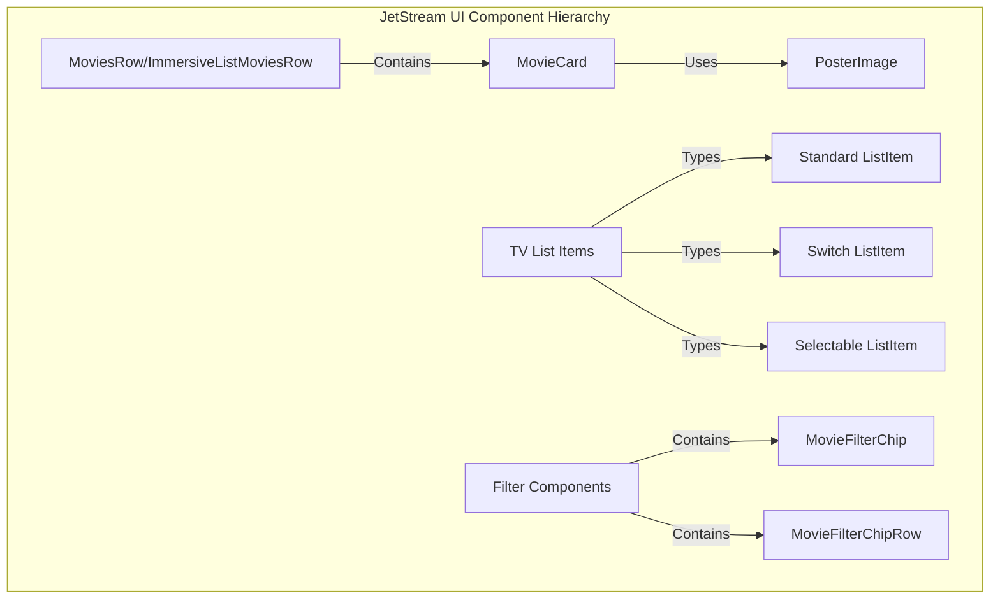
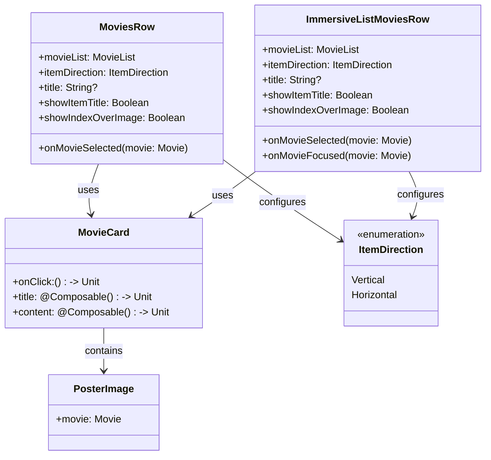
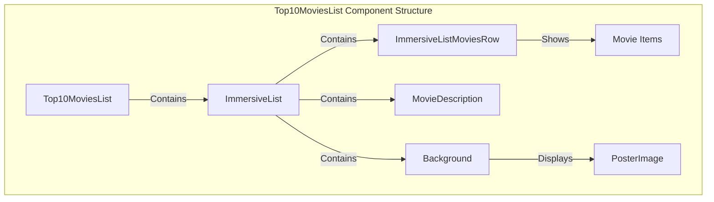
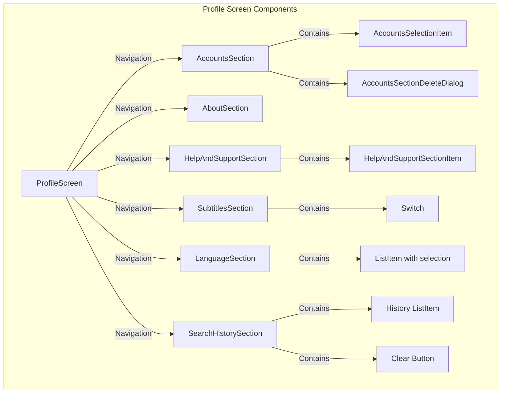
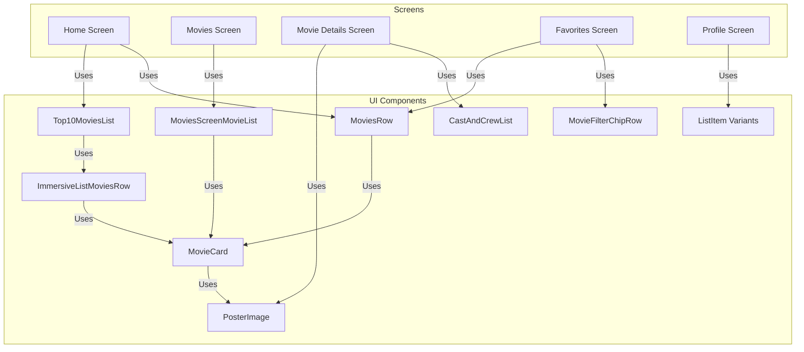

<!-- source: DeepWiki mcp.deepwiki.com · repo android/tv-samples · page 2.3 JetStream UI Components · fetched 2026-10-23 -->

# JetStream UI Components

<details>
<summary>Relevant source files</summary>

The following files were used as context for generating this wiki page:

- [JetStreamCompose/jetstream/src/main/java/com/google/jetstream/presentation/common/MoviesRow.kt](JetStreamCompose/jetstream/src/main/java/com/google/jetstream/presentation/common/MoviesRow.kt)
- [JetStreamCompose/jetstream/src/main/java/com/google/jetstream/presentation/screens/favourites/MovieFilterChip.kt](JetStreamCompose/jetstream/src/main/java/com/google/jetstream/presentation/screens/favourites/MovieFilterChip.kt)
- [JetStreamCompose/jetstream/src/main/java/com/google/jetstream/presentation/screens/favourites/MovieFilterChipRow.kt](JetStreamCompose/jetstream/src/main/java/com/google/jetstream/presentation/screens/favourites/MovieFilterChipRow.kt)
- [JetStreamCompose/jetstream/src/main/java/com/google/jetstream/presentation/screens/home/Top10MoviesList.kt](JetStreamCompose/jetstream/src/main/java/com/google/jetstream/presentation/screens/home/Top10MoviesList.kt)
- [JetStreamCompose/jetstream/src/main/java/com/google/jetstream/presentation/screens/movies/CastAndCrewList.kt](JetStreamCompose/jetstream/src/main/java/com/google/jetstream/presentation/screens/movies/CastAndCrewList.kt)
- [JetStreamCompose/jetstream/src/main/java/com/google/jetstream/presentation/screens/movies/MoviesScreenMovieList.kt](JetStreamCompose/jetstream/src/main/java/com/google/jetstream/presentation/screens/movies/MoviesScreenMovieList.kt)
- [JetStreamCompose/jetstream/src/main/java/com/google/jetstream/presentation/screens/profile/AccountsSection.kt](JetStreamCompose/jetstream/src/main/java/com/google/jetstream/presentation/screens/profile/AccountsSection.kt)
- [JetStreamCompose/jetstream/src/main/java/com/google/jetstream/presentation/screens/profile/HelpAndSupportSection.kt](JetStreamCompose/jetstream/src/main/java/com/google/jetstream/presentation/screens/profile/HelpAndSupportSection.kt)
- [JetStreamCompose/jetstream/src/main/java/com/google/jetstream/presentation/screens/profile/LanguageSection.kt](JetStreamCompose/jetstream/src/main/java/com/google/jetstream/presentation/screens/profile/LanguageSection.kt)
- [JetStreamCompose/jetstream/src/main/java/com/google/jetstream/presentation/screens/profile/ProfileScreen.kt](JetStreamCompose/jetstream/src/main/java/com/google/jetstream/presentation/screens/profile/ProfileScreen.kt)
- [JetStreamCompose/jetstream/src/main/java/com/google/jetstream/presentation/screens/profile/SearchHistorySection.kt](JetStreamCompose/jetstream/src/main/java/com/google/jetstream/presentation/screens/profile/SearchHistorySection.kt)
- [JetStreamCompose/jetstream/src/main/java/com/google/jetstream/presentation/screens/profile/SubtitlesSection.kt](JetStreamCompose/jetstream/src/main/java/com/google/jetstream/presentation/screens/profile/SubtitlesSection.kt)
- [JetStreamCompose/jetstream/src/main/java/com/google/jetstream/presentation/utils/BringIntoViewIfChildrenAreFocused.kt](JetStreamCompose/jetstream/src/main/java/com/google/jetstream/presentation/utils/BringIntoViewIfChildrenAreFocused.kt)

</details>


This page documents the key UI components used throughout the JetStreamCompose app. These reusable UI elements form the building blocks of the app's visual interface and help maintain consistency across different screens.

For information about the JetStream architecture, see [JetStream Architecture](#2.1). For details about the video player implementation, see [JetStream Video Player](#2.2).

## Component Overview

JetStreamCompose leverages a collection of reusable UI components to create a consistent and intuitive TV interface. These components are designed for optimal TV navigation using D-pad controls, with special attention to focus management and visual feedback.



Sources: [JetStreamCompose/jetstream/src/main/java/com/google/jetstream/presentation/common/MoviesRow.kt:69-136](), [JetStreamCompose/jetstream/src/main/java/com/google/jetstream/presentation/common/MoviesRow.kt:214-260](), [JetStreamCompose/jetstream/src/main/java/com/google/jetstream/presentation/screens/profile/HelpAndSupportSection.kt:56-95](), [JetStreamCompose/jetstream/src/main/java/com/google/jetstream/presentation/screens/favourites/MovieFilterChip.kt:48-107](), [JetStreamCompose/jetstream/src/main/java/com/google/jetstream/presentation/screens/favourites/MovieFilterChipRow.kt:29-64]()

## Key UI Components

### MoviesRow

`MoviesRow` is a fundamental component that displays a horizontal row of movies with an optional title. It's used extensively throughout the app to showcase different categories of movies.



Sources: [JetStreamCompose/jetstream/src/main/java/com/google/jetstream/presentation/common/MoviesRow.kt:69-136](), [JetStreamCompose/jetstream/src/main/java/com/google/jetstream/presentation/common/MoviesRow.kt:140-212]()

#### MoviesRow Features:

1. **Configurable Layout**: Supports both vertical and horizontal poster orientations via the `ItemDirection` enum
2. **Focus Management**: Implements proper focus management for TV navigation
3. **Title Customization**: Optional section title with customizable style
4. **Item Titles**: Can show or hide movie titles beneath posters
5. **Special Indices**: Optional index overlay on images (used for Top 10 lists)

Example usage in the home screen:

```
MoviesRow(
    movieList = movieList,
    title = "Action Movies",
    onMovieSelected = { movie -> navigateToDetails(movie) }
)
```

Sources: [JetStreamCompose/jetstream/src/main/java/com/google/jetstream/presentation/common/MoviesRow.kt:62-136]()

### ImmersiveListMoviesRow

An enhanced version of `MoviesRow` that adds immersive capabilities, allowing the background to change based on the focused movie. Used in the Top10MoviesList to create a more dynamic and engaging experience.

Key features:

1. All `MoviesRow` capabilities
2. **Movie Focus Callbacks**: Additional callback for when a movie gains focus
3. **Background Integration**: Works with background transitions in immersive lists

Sources: [JetStreamCompose/jetstream/src/main/java/com/google/jetstream/presentation/common/MoviesRow.kt:140-212](), [JetStreamCompose/jetstream/src/main/java/com/google/jetstream/presentation/screens/home/Top10MoviesList.kt:60-93]()

### Top10MoviesList

A specialized implementation using `ImmersiveListMoviesRow` to create an immersive experience for the top 10 movies section.



Key features:

1. **Dynamic Backgrounds**: Shows a large background image of the currently focused movie
2. **Gradient Overlays**: Applies subtle gradients for better text readability
3. **Movie Descriptions**: Shows movie details when a movie is focused
4. **Index Display**: Displays "#1", "#2", etc. over movie posters

Sources: [JetStreamCompose/jetstream/src/main/java/com/google/jetstream/presentation/screens/home/Top10MoviesList.kt:60-223]()

### MovieCard

A reusable card component used to display movies throughout the app.

Key features:

1. **Click Action**: Handles movie selection
2. **Focus States**: Visual feedback when focused
3. **Content Container**: Standardized container for movie posters
4. **Title Display**: Optional movie title below the card

Sources: [JetStreamCompose/jetstream/src/main/java/com/google/jetstream/presentation/common/MoviesRow.kt:214-260]()

### PosterImage

A component for displaying movie posters with proper aspect ratio and loading handling.

Sources: [JetStreamCompose/jetstream/src/main/java/com/google/jetstream/presentation/common/MoviesRow.kt:263-301]()

### Filter Components

Components used for filtering movie lists, primarily in the favorites screen.

#### MovieFilterChip

A selectable chip component used for filtering movies by category, genre, or other attributes.

Key features:

1. **Toggle Selection**: Users can select/deselect filters
2. **Visual Feedback**: Displays check icon when selected
3. **Focus States**: Custom focus indication

#### MovieFilterChipRow

A container for multiple `MovieFilterChip` components, managing their layout and state.

Key features:

1. **Horizontal Layout**: Displays chips in a row
2. **State Management**: Handles the currently selected filters
3. **Focus Management**: Proper focus behavior for TV navigation

Sources: [JetStreamCompose/jetstream/src/main/java/com/google/jetstream/presentation/screens/favourites/MovieFilterChip.kt:48-121](), [JetStreamCompose/jetstream/src/main/java/com/google/jetstream/presentation/screens/favourites/MovieFilterChipRow.kt:29-64]()

## Profile Screen Components

The Profile screen uses several specialized UI components to display user settings and preferences.



Sources: [JetStreamCompose/jetstream/src/main/java/com/google/jetstream/presentation/screens/profile/ProfileScreen.kt:75-211](), [JetStreamCompose/jetstream/src/main/java/com/google/jetstream/presentation/screens/profile/HelpAndSupportSection.kt:39-95](), [JetStreamCompose/jetstream/src/main/java/com/google/jetstream/presentation/screens/profile/LanguageSection.kt:38-81](), [JetStreamCompose/jetstream/src/main/java/com/google/jetstream/presentation/screens/profile/SearchHistorySection.kt:36-69](), [JetStreamCompose/jetstream/src/main/java/com/google/jetstream/presentation/screens/profile/SubtitlesSection.kt:35-93](), [JetStreamCompose/jetstream/src/main/java/com/google/jetstream/presentation/screens/profile/AccountsSection.kt:44-100]()

### ListItem Variants

The profile section uses several variants of the Material Design `ListItem` component:

1. **Standard ListItem**: For navigation and simple text display
2. **Switch ListItem**: For toggling features like subtitles
3. **Selectable ListItem**: For selecting options like language

Each ListItem is customized with:
- Custom container color using `surfaceColorAtElevation`
- Custom shapes using `JetStreamCardShape`
- Proper focus and selection colors

Sources: [JetStreamCompose/jetstream/src/main/java/com/google/jetstream/presentation/screens/profile/HelpAndSupportSection.kt:56-95](), [JetStreamCompose/jetstream/src/main/java/com/google/jetstream/presentation/screens/profile/SubtitlesSection.kt:35-93](), [JetStreamCompose/jetstream/src/main/java/com/google/jetstream/presentation/screens/profile/LanguageSection.kt:38-81]()

## Movie Details Components

### CastAndCrewList

A component that displays a horizontal scrollable list of cast and crew members for a movie.

Key features:

1. **Horizontal Scrolling**: Displays cast members in a row
2. **Card-Based UI**: Each cast member is displayed in a card
3. **Character Information**: Shows both the actor's name and character name

Sources: [JetStreamCompose/jetstream/src/main/java/com/google/jetstream/presentation/screens/movies/CastAndCrewList.kt:54-135]()

### MoviesScreenMovieList

A component used to display a scrollable list of movies on the Movies screen.

Key features:

1. **Horizontal Scrolling**: Movies displayed in a horizontally scrollable row
2. **Dynamic Content**: Uses AnimatedContent for smooth transitions
3. **Aspect Ratio Control**: Maintains proper poster aspect ratios
4. **Focus Effects**: Enhanced visuals for focused items

Sources: [JetStreamCompose/jetstream/src/main/java/com/google/jetstream/presentation/screens/movies/MoviesScreenMovieList.kt:60-160]()

## Focus Management and Utilities

JetStreamCompose includes several utilities to improve navigation and focus management on TV interfaces.

### BringIntoViewIfChildrenAreFocused

A utility modifier that ensures focused items are brought into view, especially useful for scrollable lists.

```kotlin
Modifier.bringIntoViewIfChildrenAreFocused(PaddingValues(bottom = 116.dp))
```

This modifier helps ensure that when a child element receives focus, the parent container adjusts to keep it in view, which is crucial for TV interfaces with limited scrolling capabilities.

Sources: [JetStreamCompose/jetstream/src/main/java/com/google/jetstream/presentation/utils/BringIntoViewIfChildrenAreFocused.kt:34-66]()

## Component Usage Patterns

The following diagram illustrates how these UI components are used across different screens in the application:



This diagram shows how JetStreamCompose's UI components are organized into a cohesive system, with lower-level components like `PosterImage` and `MovieCard` being used by higher-level components like `MoviesRow`, which are then used by screens like the home screen.

Sources: [JetStreamCompose/jetstream/src/main/java/com/google/jetstream/presentation/common/MoviesRow.kt:69-136](), [JetStreamCompose/jetstream/src/main/java/com/google/jetstream/presentation/screens/home/Top10MoviesList.kt:60-93](), [JetStreamCompose/jetstream/src/main/java/com/google/jetstream/presentation/screens/movies/CastAndCrewList.kt:54-135](), [JetStreamCompose/jetstream/src/main/java/com/google/jetstream/presentation/screens/profile/ProfileScreen.kt:75-211](), [JetStreamCompose/jetstream/src/main/java/com/google/jetstream/presentation/screens/favourites/MovieFilterChipRow.kt:29-64]()

## Component Customization

Many JetStream UI components accept customization parameters:

| Component | Key Customization Parameters |
|-----------|------------------------------|
| MoviesRow | `itemDirection`, `title`, `titleStyle`, `showItemTitle`, `showIndexOverImage` |
| ImmersiveListMoviesRow | Same as MoviesRow, plus `onMovieFocused` |
| Top10MoviesList | `gradientColor` for background overlay |
| MovieCard | Custom `title` and `content` slots |
| MovieFilterChip | `label`, `isChecked`, `onCheckedChange` |
| ListItem variants | Various `colors`, `shape`, and `content` slots |

This customization allows for consistent visual language while accommodating the specific needs of different screens and sections.

Sources: [JetStreamCompose/jetstream/src/main/java/com/google/jetstream/presentation/common/MoviesRow.kt:69-83](), [JetStreamCompose/jetstream/src/main/java/com/google/jetstream/presentation/common/MoviesRow.kt:140-154](), [JetStreamCompose/jetstream/src/main/java/com/google/jetstream/presentation/screens/favourites/MovieFilterChip.kt:48-53]()

## Summary

JetStreamCompose's UI components form a cohesive design system that enables consistent and engaging TV interfaces. The components emphasize:

1. **TV-First Design**: Optimized for D-pad navigation and focus management
2. **Reusability**: Components are designed to be used across multiple screens
3. **Customization**: Flexible parameters allow for adaptation to different contexts
4. **Visual Consistency**: Shared styling and behavior create a unified experience

These components demonstrate best practices for building Jetpack Compose TV interfaces and can be used as reference for other TV application development.

---

